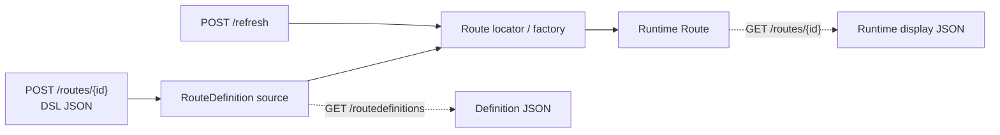
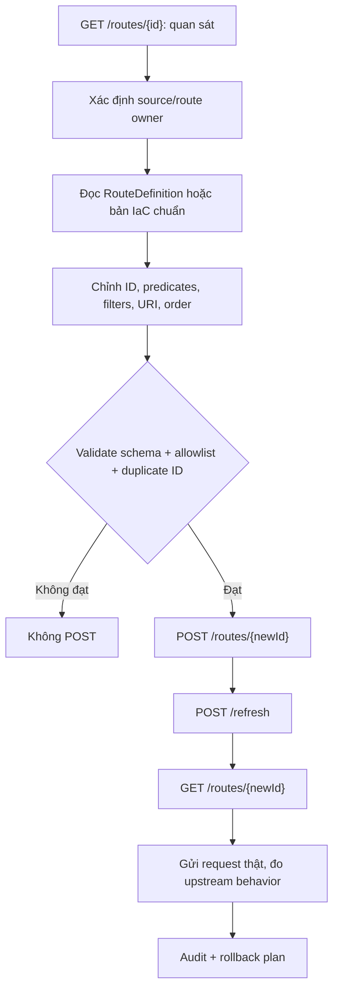

# Đối chiếu định dạng kết quả đọc với định dạng yêu cầu tạo tuyến

## 1. Vì sao đọc được JSON tuyến chưa có nghĩa là POST lại được JSON ấy?

Trong kiến trúc microservices, **Spring Cloud Gateway** là cổng vào áp dụng route predicate, filter chain, biến đổi path/header, service discovery, xác thực, rate limiting, circuit breaker, retry, TLS và quan sát request. Khi vận hành hệ thống, đội ngũ thường cần **xem các route đang hoạt động** và đôi khi **tạo một route thử nghiệm** qua Spring Boot Actuator.

Một lỗi gây khó hiểu là:

1. Gọi `GET /actuator/gateway/routes/catalog-demo`, nhận một JSON có `route_id`, `predicate`, `filters`, `uri` và `order`.
2. Sao chép nguyên response JSON đó.
3. Gửi lại bằng `POST /actuator/gateway/routes/catalog-demo-copy`.
4. Route không được tạo đúng hoặc server trả lỗi.

**Lý do:** endpoint **đọc tuyến đã được biên dịch thành đối tượng thực thi** không có cùng hợp đồng dữ liệu với endpoint **nhận RouteDefinition để tạo tuyến**. Trong Spring Cloud Gateway Server WebFlux 5.0.x, `GET /actuator/gateway/routes/{id}` là **dạng hiển thị cho người vận hành**, còn `POST /actuator/gateway/routes/{id}` dùng **predicate/filter shortcut DSL strings**, chẳng hạn `"Path=/api/catalog/**"` và `"StripPrefix=2"`.

Sau bài thuộc chương **Quản trị Actuator**, bạn có thể:

- Nhận biết các endpoint `routes`, `routes/{id}`, `routedefinitions` và `refresh`.
- Phân biệt **runtime Route**, **RouteDefinition** và **JSON dùng để POST**, không coi chúng là dữ liệu tương đương byte-for-byte.
- Chuyển một route đọc được thành payload tạo tuyến có `predicates` và `filters` đúng DSL.
- Tạo, đọc lại, kiểm tra traffic, xóa route thử nghiệm bằng curl với bước **refresh**.
- Hiểu giới hạn của route do `application.yml` hoặc Java `@Bean` định nghĩa so với route được **Actuator tạo**.
- Bảo vệ Actuator với chế độ `read-only`, chỉ bật `unrestricted` trong phạm vi quản trị đã xác thực.
- Chẩn đoán lỗi route trùng ID, predicate/filter sai, thứ tự route, refresh và khác biệt phiên bản.

> **Phạm vi phiên bản:** Bài sử dụng **Spring Cloud Gateway Server WebFlux 5.0.x**, đối chiếu với tài liệu 5.0.5 hiện hành, Spring Boot 4.x và Spring Cloud BOM tương thích. Một số tài liệu Gateway 4.x/cũ minh họa `GET /routes/{id}` thành object `{"id","predicates":[...]}`, nhưng **bản 5.0.x ghi rõ dạng `route_id`, `predicate` dạng chuỗi hiển thị**. Đừng trộn schema của hai phiên bản hoặc mặc định Server Web MVC có cùng endpoint quản trị.

## 2. Ba tầng của một tuyến cần phân biệt

### 2.1. Cấu hình nguồn (RouteDefinition)

Một route có thể đến từ `application.yml`, repository route definition, discovery hoặc việc tạo qua Actuator. Ở tầng cấu hình, predicate và filter còn giữ **tên factory + tham số**:

```yaml
# Đoạn trong spring.cloud.gateway.server.webflux.routes:
- id: catalog-static
  uri: http://localhost:8081
  predicates:
    - Path=/api/static/**
    - Method=GET
  filters:
    - StripPrefix=2
    - AddRequestHeader=X-Training-Route,static
  order: 0
```

Ở đây `Path`, `Method`, `StripPrefix`, `AddRequestHeader` là **tên factory**, các phần sau dấu `=` là **shortcut arguments**. Đây là những thông tin có ý nghĩa khi Gateway phải **xây route**.

### 2.2. Tuyến thực thi (Route)

Gateway dùng `RouteDefinitionRouteLocator` (và những locator khác) để xây route chạy thật. Predicate trở thành **điều kiện thực thi**; filter trở thành **GatewayFilter objects** có thứ tự trong filter chain.

```text
application.yml / actuator route definition / custom locator
               |
               v
      RouteDefinition (id, predicates, filters, uri, order)
               |
               v
   RouteDefinitionRouteLocator / predicate & filter factories
               |
               v
       Route runtime (predicate function + filter chain)
               |
               +--> GET /actuator/gateway/routes/{id}: mô tả để đọc
               +--> Request thật: chọn route và proxy
```

**Không thể suy ngược một cách tuyệt đối** từ chuỗi `predicate` trong runtime về tất cả tham số gốc: nó có thể đã được gộp các predicate bằng toán tử AND, phần mô tả tùy factory và có giá trị không được hiển thị nguyên văn. Tương tự, `filters` thường chứa chuỗi dạng `[[StripPrefix parts = 2], order = 1]` để con người hiểu, **không phải một khai báo DSL mới**.

### 2.3. Payload tạo route (Actuator POST)

Endpoint tạo tuyến được Spring Cloud Gateway 5.0.x tài liệu hóa với JSON kiểu:

```json
{
  "predicates": [
    "Path=/api/dynamic/**",
    "Method=GET"
  ],
  "filters": [
    "StripPrefix=2",
    "AddRequestHeader=X-Training-Route,dynamic"
  ],
  "uri": "http://localhost:8081",
  "order": 10
}
```

Ở trường hợp `POST /actuator/gateway/routes/catalog-dynamic`, **route ID nằm trong path `catalog-dynamic`**. Payload tối thiểu này không cần thêm `route_id` theo dạng output của GET. Nếu dùng API tạo nhiều tuyến, ID phải được cung cấp theo hợp đồng riêng của endpoint đó.

## 3. Những endpoint Actuator nào liên quan?

Tất cả đường dẫn sau đây thuộc **Spring Cloud Gateway Server WebFlux** và mặc định sử dụng base path `/actuator/gateway` nếu không tùy chỉnh `management.endpoints.web.base-path`.

| HTTP | Endpoint | Mục đích | Định dạng/ảnh hưởng |
|---|---|---|---|
| GET | `/actuator/gateway/` | Xem các child endpoints được báo cáo | Danh sách link/methods |
| GET | `/actuator/gateway/routes` | Xem danh sách route **đang chạy** | Mảng runtime route mô tả, mặc định verbose |
| GET | `/actuator/gateway/routes/{id}` | Xem **một route** thực thi | JSON `route_id`, `predicate` string, `filters` string array, `uri`, `order` |
| GET | `/actuator/gateway/routedefinitions` | Xem các **RouteDefinition** từ nguồn định nghĩa | Dạng definition với `id`/predicate/filter configs, có thể hữu ích cho so sánh |
| GET | `/actuator/gateway/globalfilters` | Xem GlobalFilter và thứ tự | Mô tả các object, không phải POST payload |
| GET | `/actuator/gateway/routefilters` | Xem các factory filter | Mô tả factory/metadata, không phải route definitions |
| GET | `/actuator/gateway/routes/{id}/combinedfilters` | Xem các filter tổng hợp cho một route | Thứ tự filter của route thực thi |
| POST | `/actuator/gateway/routes/{id}` | **Tạo** định nghĩa route với ID mới | JSON RouteDefinition, thành công **201 Created** |
| DELETE | `/actuator/gateway/routes/{id}` | Xóa route do Actuator quản lý | Thành công **200 OK**, không xóa route YAML/Java |
| POST | `/actuator/gateway/refresh` | Xóa/refresh cache route sau thay đổi | Thành công **200**, thường không có body |

**Chú ý:** cả đọc và tạo đều dùng `/routes/{id}`, nhưng **HTTP method khác nhau không làm response body của GET trở thành request body của POST**. Đây là tâm điểm của bài.

### 3.1. Ba khái niệm “đã thấy tuyến” khác nhau



Sơ đồ rút gọn để nhấn mạnh **hợp đồng dữ liệu** và cache refresh, không khẳng định tất cả source trong hệ thống đều do cùng một repository quản lý. Với `@Bean RouteLocator` viết Java, route runtime có thể tồn tại mà không có một route definition chỉnh sửa được bởi Actuator.

### 3.2. Verbose là cách hiển thị, không phải cú pháp tạo tuyến

Tài liệu WebFlux có property:

```yaml
spring:
  cloud:
    gateway:
      server:
        webflux:
          actuator:
            verbose:
              enabled: true
```

Ở 5.0.x, hiển thị verbose được **bật mặc định**. Nếu đặt `false`, một số predicate/filter có thể hiện dạng `toString()` của Java object/lambda thay vì mô tả dễ đọc. Dù bật hay tắt, **không copy output GET làm POST payload**; hai format vẫn là hai hợp đồng khác nhau.

## 4. Kích hoạt Actuator đúng chế độ và bảo vệ endpoint

### 4.1. Dependency

Trong project **Gateway WebFlux**, cần Spring Cloud BOM và Spring Boot BOM tương thích, cùng các dependency:

```xml
<dependencies>
    <dependency>
        <groupId>org.springframework.cloud</groupId>
        <artifactId>spring-cloud-starter-gateway-server-webflux</artifactId>
    </dependency>
    <dependency>
        <groupId>org.springframework.boot</groupId>
        <artifactId>spring-boot-starter-actuator</artifactId>
    </dependency>
</dependencies>
```

Chỉ thêm starter Actuator **không** tự có nghĩa management endpoint `gateway` đã cho phép create/delete. Gateway Actuator bị hạn chế mặc định; cần thiết lập access và exposure phù hợp.

### 4.2. Cấu hình quan sát an toàn: read-only

Đây là cấu hình nên dùng trong môi trường vận hành nếu chỉ cần **xem route**:

```yaml
management:
  endpoint:
    gateway:
      access: read-only
  endpoints:
    web:
      exposure:
        include: health,info,gateway
```

- `management.endpoint.gateway.access: read-only` cho phép **GET** cần thiết nhưng **khóa thao tác tạo, xóa và refresh**.
- `management.endpoints.web.exposure.include` đưa Gateway Actuator endpoint ra lớp web, nhưng **exposure không thay authentication/authorization**.
- Trong Spring Boot có `management.endpoints.access.default` và các cấu hình giới hạn khác; chính sách tổ chức có thể ghi đè/khóa mức access.

**Dùng read-only làm mặc định**. Một công cụ monitoring không cần quyền chỉnh route; cấp `unrestricted` cho cả hệ thống chỉ để xem JSON là quá rộng.

### 4.3. Lab cho phép ghi, chỉ nghe ở loopback management port

Để thực hành tạo/xóa route, chạy một Gateway **lab riêng**, quản trị qua cổng `9090` và chỉ truy cập được từ **loopback trên chính máy**:

```yaml
# CẤU HÌNH THỰC HÀNH CỤC BỘ, KHÔNG COPY NGUYÊN VẸN LÊN PRODUCTION.
management:
  server:
    port: 9090
    address: 127.0.0.1
  endpoint:
    gateway:
      access: unrestricted
  endpoints:
    web:
      exposure:
        include: health,info,gateway
```

`unrestricted` cần thiết để demo `POST`/`DELETE`/`refresh`; nó **không phải chính sách bảo mật production**. Không mở port này qua ingress, Kubernetes Service public, LoadBalancer hay firewall ngoài. Khi nhiều Gateway instances, endpoint quản trị có thể nằm trên **từng instance riêng** và thay đổi route không tự động đồng bộ trên toàn cụm.

Nếu dự án có Spring Security, các endpoint có thể cần authentication tùy cấu hình `SecurityWebFilterChain`. Trong production, dùng **RBAC riêng**, mTLS/VPN/private network, audit người thay đổi, chống CSRF theo mô hình auth và xác thực danh sách upstream/route được phép. Không dùng “actuator unrestricted, anonymous” ở môi trường Internet.

### 4.4. Hai cổng không phải một

```text
Browser / API client  ---> Gateway :8080  ---> backend :8081
Operator (localhost)  ---> Actuator :9090  ---> route management
```

Với cấu hình management port riêng, gọi `/actuator/gateway/routes` **trên `9090`**, còn request nghiệp vụ vào `8080`. Nhầm cổng có thể gây 404 dù actuator đã được bật.

> **Giới hạn của lab:** Các bước POST dưới đây mô tả thay đổi thực tế lên route registry trong môi trường thử nghiệm. Chỉ chạy trên Gateway do bạn kiểm soát. Không áp dụng thao tác tạo/xóa route lên hệ thống production nếu chưa có phê duyệt và quy trình rollback.

## 5. Chuẩn bị hai ứng dụng để đối chiếu kết quả thực

### 5.1. Backend trả JSON nhỏ tại cổng 8081

Tạo một ứng dụng Spring Boot **Web MVC** độc lập tên `catalog-demo` với cổng `8081`. Với Spring Boot 4.x, dùng starter `spring-boot-starter-webmvc`. File `CatalogApplication.java`:

```java
package com.example.catalog;

import java.util.Map;
import org.springframework.boot.SpringApplication;
import org.springframework.boot.autoconfigure.SpringBootApplication;
import org.springframework.web.bind.annotation.GetMapping;
import org.springframework.web.bind.annotation.PathVariable;
import org.springframework.web.bind.annotation.RequestHeader;
import org.springframework.web.bind.annotation.RestController;

@SpringBootApplication
@RestController
public class CatalogApplication {

    public static void main(String[] args) {
        SpringApplication.run(CatalogApplication.class, args);
    }

    @GetMapping("/items/{id}")
    public Map<String, String> getItem(
            @PathVariable String id,
            @RequestHeader(
                name = "X-Training-Route",
                defaultValue = "none") String routeName) {
        return Map.of(
            "id", id,
            "service", "catalog-demo",
            "routedBy", routeName);
    }
}
```

File `application.yml` của **backend**, không đặt trong Gateway:

```yaml
server:
  port: 8081
spring:
  application:
    name: catalog-demo
```

Kiểm tra trước khi thử Gateway:

```bash
curl --noproxy '*' -i \
  'http://127.0.0.1:8081/items/42'
```

Response dự kiến là `200` với JSON chứa `"id":"42"`, `"service":"catalog-demo"` và `"routedBy":"none"`. Chưa liên quan Actuator hay route cache.

### 5.2. Cấu hình ứng dụng Gateway

Tạo ứng dụng **Gateway Server WebFlux** độc lập, thêm dependency ở mục 4. Trong `application.yml`:

```yaml
server:
  port: 8080

spring:
  application:
    name: gateway-actuator-lab
  cloud:
    gateway:
      server:
        webflux:
          actuator:
            verbose:
              enabled: true
          routes:
            - id: catalog-static
              uri: http://127.0.0.1:8081
              predicates:
                - Path=/api/static/**
                - Method=GET
              filters:
                - StripPrefix=2
                - AddRequestHeader=X-Training-Route,static
              order: 0

management:
  server:
    port: 9090
    address: 127.0.0.1
  endpoint:
    gateway:
      access: unrestricted
  endpoints:
    web:
      exposure:
        include: health,info,gateway
```

**Hai loại route của bài:**

- `catalog-static` được khai báo trong **`application.yml`** và được load khi ứng dụng khởi động. Có thể **đọc** nhưng không được Actuator quản lý để xóa như một route tạo qua POST.
- `catalog-dynamic` sẽ được tạo bằng **`POST /actuator/gateway/routes/catalog-dynamic`**; dùng một ID mới hoàn toàn, rồi refresh để có thể proxy request.

Tất cả ví dụ lab chỉ dùng `127.0.0.1` trên **cùng máy**. Nếu chạy Gateway/backend trong những container riêng, phải dùng **DNS/service name có thể truy cập từ container Gateway**, không mặc định `localhost` là máy của người học.

### 5.3. Xác nhận route static bằng request nghiệp vụ

```bash
curl --noproxy '*' -i \
  'http://127.0.0.1:8080/api/static/items/42'
```

`StripPrefix=2` bỏ `api` và `static`; backend nhận `/items/42`. Response minh họa:

```json
{
  "id": "42",
  "service": "catalog-demo",
  "routedBy": "static"
}
```

Đây là **bằng chứng định tuyến đã thực thi**, không phải bằng chứng người vận hành có quyền thay đổi route qua Actuator.

## 6. Đọc một route: GET trả biểu diễn runtime, không phải DSL

### 6.1. GET /actuator/gateway/routes

Trên cổng quản trị `9090`:

```bash
curl --noproxy '*' -sS \
  'http://127.0.0.1:9090/actuator/gateway/routes'
```

Với verbose format, nội dung **minh họa** khi mới có `catalog-static`:

```json
[
  {
    "route_id": "catalog-static",
    "predicate": "(Paths: [/api/static/**], match trailing slash: true && Methods: [GET])",
    "filters": [
      "[[StripPrefix parts = 2], order = 1]",
      "[[AddRequestHeader X-Training-Route = 'static'], order = 2]"
    ],
    "uri": "http://127.0.0.1:8081",
    "order": 0
  }
]
```

**Không phụ thuộc byte-for-byte** vào các chuỗi `predicate`/`filters` trong JSON minh họa: biểu diễn và order cụ thể là do các factory/phiên bản Gateway tạo. Ở thời điểm thực tế, ứng dụng còn có thể có route tự sinh từ discovery, Java `@Bean` hoặc cấu hình khác.

Phân tích cấu trúc:

- `route_id` là **route ID**, khác tên property `id` thường dùng trong YAML/RouteDefinition.
- `predicate` là **một chuỗi hiển thị tổng hợp** các điều kiện, không phải mảng `predicates`.
- `filters` là **mảng các chuỗi mô tả filter runtime**, không phải mảng các khai báo `Filter=arg`.
- `uri` là route destination scheme/host/port.
- `order` là mức ưu tiên khi Gateway chọn route, **khác** order của từng filter.

### 6.2. GET /actuator/gateway/routes/{id}

Đọc riêng route:

```bash
curl --noproxy '*' -sS \
  'http://127.0.0.1:9090/actuator/gateway/routes/catalog-static'
```

Response **tương tự**:

```json
{
  "route_id": "catalog-static",
  "predicate": "(Paths: [/api/static/**], match trailing slash: true && Methods: [GET])",
  "filters": [
    "[[StripPrefix parts = 2], order = 1]",
    "[[AddRequestHeader X-Training-Route = 'static'], order = 2]"
  ],
  "uri": "http://127.0.0.1:8081",
  "order": 0
}
```

Đây là format mà tài liệu **Spring Cloud Gateway 5.0.5** nêu cho `GET /routes/{id}`: `route_id` và `predicate` **số ít, dạng chuỗi**, không phải `id` cùng `predicates` array. Một công cụ lấy JSON này rồi lập tức POST sang endpoint tạo route sẽ **đưa sai cấu trúc**.

### 6.3. Bản hiển thị khi tắt verbose có tạo được route không?

Nếu đặt:

```properties
spring.cloud.gateway.server.webflux.actuator.verbose.enabled=false
```

response GET có thể chứa mô tả Java object/lambda như `org.springframework.cloud.gateway.handler.predicate.*`. Nó **còn khó dùng để tạo route hơn**; tuyệt đối không parse `toString()` của object/lambda để suy ra tham số gốc. Nên giữ verbose cho **quan sát**, còn nguồn cấu hình để **khôi phục** route phải lấy từ RouteDefinition, YAML hoặc IaC.

### 6.4. Vì sao GET không thể bảo toàn đầy đủ một route nguồn?

Giả sử route được viết:

```yaml
predicates:
  - Host=**.example.test
  - Path=/api/catalog/**
  - Method=GET
filters:
  - StripPrefix=2
  - AddRequestHeader=X-Env,staging
```

Khi xây runtime route, Gateway tạo predicate function và filter objects. Biểu diễn `predicate` trong GET có thể cho thấy **một điều kiện tổng hợp**, còn `filters` hiển thị thông tin đã diễn giải, thứ tự và class/factory. Nó **không phải serialization ngược đáng tin** của YAML:

1. Dấu phân cách, escapes trong regex và template có thể bị thay đổi khi hiển thị.
2. Các default values có thể đã được áp dụng, không còn phân biệt rõ giá trị mặc định và giá trị người dùng nhập.
3. Một Java custom `GatewayFilter`/predicate có thể không có shortcut DSL tương đương.
4. Một số runtime filters xuất hiện từ `default-filters` hoặc `GlobalFilter`, không nằm trong chính route definition.

Vì thế **không viết công cụ “GET rồi POST nguyên trạng”** từ endpoint runtime.

## 7. GET /routedefinitions: gần schema cấu hình hơn, nhưng vẫn cần xét nguồn

Tài liệu Gateway có `GET /actuator/gateway/routedefinitions` để đọc **route definitions**. Trong môi trường có route `catalog-static`, một response thường có cấu trúc gần như:

```json
[
  {
    "id": "catalog-static",
    "predicates": [
      {
        "name": "Path",
        "args": {"_genkey_0": "/api/static/**"}
      },
      {
        "name": "Method",
        "args": {"_genkey_0": "GET"}
      }
    ],
    "filters": [
      {
        "name": "StripPrefix",
        "args": {"_genkey_0": "2"}
      },
      {
        "name": "AddRequestHeader",
        "args": {
          "_genkey_0": "X-Training-Route",
          "_genkey_1": "static"
        }
      }
    ],
    "uri": "http://127.0.0.1:8081",
    "order": 0
  }
]
```

Đây là **ví dụ dạng RouteDefinition để giải thích mô hình**, không cam kết tất cả factory/versions trả y hệt keys `_genkey_0` hoặc cấu trúc optional fields. Hãy **đọc response thật** của version đang chạy; metadata/các tham số được đặt tên có thể xuất hiện bổ sung.

### 7.1. RouteDefinition có những trường gì?

| Trường | Ý nghĩa trong cấu hình | Lưu ý |
|---|---|---|
| `id` | Định danh route | Với POST một tuyến, ID được chỉ rõ tại URI `/routes/{id}` |
| `predicates` | Danh sách các `PredicateDefinition` | Tên factory + arguments, hoặc shortcut form theo endpoint |
| `filters` | Danh sách các `FilterDefinition` | Tên filter factory + arguments |
| `uri` | Destination URI | `http://`, `https://`, `lb://`... tùy cấu hình |
| `order` | Thứ tự ưu tiên của route | Giá trị nhỏ hơn thường được xét trước |
| `metadata` (nếu có) | Dữ liệu tùy biến của route | Có thể ảnh hưởng timeout, quản lý hoặc các tính năng khác |

**Đừng đồng nhất `_genkey_0` với ký hiệu route dùng trong URL.** Đây là tên argument vị trí được serializer dùng ở một số dạng definition, không phải một trường bạn phải gửi trong mọi request create. Với các factory có nhiều tham số, kiểu indexed list hoặc tên argument cần được kiểm tra trong tài liệu từng factory.

### 7.2. Đọc definition không đồng nghĩa có quyền sửa definition đó

Route từ `application.yml` hoặc `@Bean` có thể **xem** qua Actuator, nhưng tài liệu 5.0.x nêu rõ: **chỉ route được tạo qua endpoint Actuator mới có thể sửa/xóa qua endpoint Actuator**. `GET /routedefinitions` không phải “bảng quản trị ghi” cho mọi loại nguồn cấu hình.

Nếu `GET /routes/catalog-static` trả 200, rồi `DELETE /routes/catalog-static` trả **404**, điều này có thể đúng vì route được định nghĩa trong YAML và **read-only dưới góc nhìn Actuator**.

### 7.3. Dùng nguồn nào cho mục đích nào?

| Nhu cầu | Nguồn thích hợp |
|---|---|
| Tìm route nào đang được Gateway chạy | `GET /actuator/gateway/routes` |
| Xem chi tiết route ID cụ thể và filter runtime | `GET /actuator/gateway/routes/{id}`, `/combinedfilters` |
| Xem các RouteDefinition do locator cung cấp | `GET /actuator/gateway/routedefinitions` |
| Lưu cấu hình lâu dài, review/versioning | `application.yml`, Git/IaC hoặc route repository đã thiết kế |
| Tạo một route lab | `POST /actuator/gateway/routes/{id}` với DSL body |
| Kích hoạt route vừa tạo | `POST /actuator/gateway/refresh` |

Đây là **những công cụ bổ trợ**, không phải các bản sao có thể dùng thay nhau trong automation.

## 8. So sánh hai JSON đặt cạnh nhau

Giả sử muốn clone **ý nghĩa** tuyến `catalog-static` thành route mới `catalog-dynamic`, nhưng dùng prefix `/api/dynamic/**`.

**GET response: biểu diễn dùng để đọc**

```json
{
  "route_id": "catalog-static",
  "predicate": "Paths: [/api/static/**]",
  "filters": [
    "[[StripPrefix parts = 2], order = 1]"
  ],
  "uri": "http://127.0.0.1:8081",
  "order": 0
}
```

**POST request: định nghĩa tuyến cần tạo**

```json
{
  "predicates": [
    "Path=/api/dynamic/**",
    "Method=GET"
  ],
  "filters": [
    "StripPrefix=2"
  ],
  "uri": "http://127.0.0.1:8081",
  "order": 10
}
```

Hai khối JSON **không phải bản sao**: GET phản ánh trạng thái runtime, POST mô tả một định nghĩa có thể dùng để tạo route mới.

### 8.1. Bảng mapping đúng trọng tâm

| Trường | GET `/routes/{id}` | POST `/routes/{id}` | Chuyển đổi thế nào? |
|---|---|---|---|
| ID | `route_id: "catalog-static"` | `{id}` của endpoint URL, ví dụ `catalog-dynamic` | Tạo ID mới, không copy `route_id` thành trường body rồi hy vọng API hiểu |
| Predicate | `predicate`: **một chuỗi hiển thị** | `predicates`: **mảng DSL strings** | Xây lại `Path=/...`, `Method=GET` từ nguồn định nghĩa, không parse tự động chuỗi hiển thị |
| Filter | `filters` chứa chuỗi như `[[StripPrefix ...], order = 1]` | `filters` chứa chuỗi `StripPrefix=2` | Bỏ phần mô tả/order runtime; dùng shortcut hợp lệ theo factory |
| Destination | `uri` string | `uri` string | Có thể giữ/sửa sau khi duyệt allowlist upstream |
| Route order | `order` number | `order` number | Chọn có chủ đích để tránh đè route khác |
| Metadata | Có thể thấy/không tùy endpoint/format | `metadata` chỉ khi thật sự cần | Không suy diễn metadata từ predicate hiển thị |
| Combined filters | Có thể thấy ở endpoint riêng | Không gửi nguyên mảng combined filters | Global/default filters là khái niệm khác route-specific filters |

**Quy tắc nhớ nhanh:** Trong GET runtime là **`predicate` số ít**, nhưng trong POST definition là **`predicates` số nhiều**. Trong GET, `filters` có vẻ là array nhưng **các phần tử là text mô tả runtime**; trong POST, mỗi phần tử là **khai báo filter**.

### 8.2. Sai: gửi thẳng response GET làm POST body

Ví dụ **không dùng**:

```json
{
  "route_id": "catalog-static",
  "predicate": "(Paths: [/api/static/**], match trailing slash: true)",
  "filters": [
    "[[StripPrefix parts = 2], order = 1]"
  ],
  "uri": "http://127.0.0.1:8081",
  "order": 0
}
```

**Sai ở đâu?**

- `route_id` không phải trường `id` của RouteDefinition; ID create được truyền qua path `/routes/{id}`.
- `predicate` là chuỗi dễ đọc, không phải mảng `predicates` mà binder chờ.
- `"[[StripPrefix parts = 2], order = 1]"` là thông tin log/quan sát, không phải factory shortcut `"StripPrefix=2"`.
- Nếu route ID đã tồn tại, lỗi không chỉ là schema: **POST lại ID cũ còn có rủi ro duplicate route definition** (mục 11).

Không khẳng định server luôn trả một mã 400 cố định cho mọi payload sai. Lỗi có thể xuất hiện khi parse JSON, bind definition, convert predicate/filter factory hoặc refresh route cache; dựa vào log và response thực của phiên bản để chẩn đoán.

### 8.3. Đúng: tạo lại một definition có chủ đích

Ví dụ POST hợp lệ, giữ cấu trúc ngắn gọn:

```json
{
  "predicates": [
    "Path=/api/dynamic/**",
    "Method=GET"
  ],
  "filters": [
    "StripPrefix=2",
    "AddRequestHeader=X-Training-Route,dynamic"
  ],
  "uri": "http://127.0.0.1:8081",
  "order": 10
}
```

Không cần nhập `route_id`, `predicate` hoặc copy chuỗi mô tả `filters` vào JSON này. Với `/api/dynamic/items/42`, route được chọn và `StripPrefix=2` giúp backend thấy `/items/42`.

## 9. Thực hành tạo tuyến bằng Actuator POST, refresh, GET và xóa

**Điều kiện:** Gateway `8080`, management `9090` chỉ nghe loopback, backend `8081` đã chạy. `management.endpoint.gateway.access: unrestricted` được bật **chỉ trong lab**. Nếu dùng Spring Security custom, tài khoản lab cần được cấp quyền quản trị; không bypass security.

### 9.1. Kiểm tra route ID chưa tồn tại

Trước khi tạo `catalog-dynamic`, đọc:

```bash
curl --noproxy '*' -i \
  'http://127.0.0.1:9090/actuator/gateway/routes/catalog-dynamic'
```

Nếu chưa có route, endpoint thường trả **404**. Nhưng 404 không đủ để chứng minh ID chưa tồn tại trong **mọi repository/instance**; ở hệ thống phân tán cần kiểm tra nguồn route và instance quản trị thực sự.

**Không dùng `catalog-static` làm ID của route POST mới**, vì route này được khai báo trong YAML và không thuộc store quản lý bằng Actuator.

### 9.2. Tạo route bằng JSON trong file payload lab

Soạn file `catalog-dynamic.json` **bên ngoài thư mục tài liệu của bài học**, trong môi trường thực hành của người học:

```json
{
  "predicates": [
    "Path=/api/dynamic/**",
    "Method=GET"
  ],
  "filters": [
    "StripPrefix=2",
    "AddRequestHeader=X-Training-Route,dynamic"
  ],
  "uri": "http://127.0.0.1:8081",
  "order": 10
}
```

Rồi dùng curl:

```bash
curl --noproxy '*' -i -X POST \
  'http://127.0.0.1:9090/actuator/gateway/routes/catalog-dynamic' \
  -H 'Content-Type: application/json' \
  --data-binary @catalog-dynamic.json
```

Theo tài liệu Gateway 5.0.5, khi tạo thành công endpoint trả **`201 Created`**. Không suy ra route đã được áp dụng cho toàn bộ traffic chỉ từ status 201: tiếp tục **refresh** và kiểm tra runtime.

### 9.3. Refresh route cache

```bash
curl --noproxy '*' -i -X POST \
  'http://127.0.0.1:9090/actuator/gateway/refresh'
```

Response thành công thường là **`200 OK` không có response body**. Refresh giúp Gateway tải/cập nhật các route từ nguồn đã được thay đổi, không có nghĩa restart JVM hoặc deploy cấu hình mới.

**Không gọi refresh để “sửa” một JSON sai cú pháp**: dữ liệu route phải hợp lệ trước. Nếu refresh xảy ra lỗi bất đồng bộ, theo tài liệu Gateway, cấu hình route hiện có có thể được giữ nguyên; hãy xem log, xác nhận lại runtime và trạng thái thực.

### 9.4. Đọc lại route sau khi refresh

```bash
curl --noproxy '*' -sS \
  'http://127.0.0.1:9090/actuator/gateway/routes/catalog-dynamic'
```

Response sau refresh được hiển thị **theo schema GET**, không phải JSON lúc POST:

```json
{
  "route_id": "catalog-dynamic",
  "predicate": "(Paths: [/api/dynamic/**], match trailing slash: true && Methods: [GET])",
  "filters": [
    "[[StripPrefix parts = 2], order = 1]",
    "[[AddRequestHeader X-Training-Route = 'dynamic'], order = 2]"
  ],
  "uri": "http://127.0.0.1:8081",
  "order": 10
}
```

Đây là **output minh họa**, filter/predicate descriptions có thể khác. Điểm quan trọng là các **thành phần ngữ nghĩa** khớp payload vừa tạo: ID, path, method, filter arguments, URI và route order. **Không so sánh JSON GET với JSON POST bằng equality** vì chúng có schema khác nhau.

### 9.5. Kiểm tra request nghiệp vụ thật

```bash
curl --noproxy '*' -i \
  'http://127.0.0.1:8080/api/dynamic/items/42'
```

Backend demo sẽ nhận `GET /items/42` và header `X-Training-Route: dynamic`. Body **kỳ vọng**:

```json
{
  "id": "42",
  "service": "catalog-demo",
  "routedBy": "dynamic"
}
```

**Đọc route ≠ chứng minh route xử lý traffic.** Nếu URI backend sai hoặc backend dừng, Actuator vẫn có thể cho thấy route tồn tại trong khi request thực trả 5xx. Nếu có route khác với priority cao hơn và predicate trùng, request có thể đi sai route. Vì vậy phải kiểm tra **cả Actuator và lời gọi thực**.

### 9.6. Xóa route lab rồi refresh

```bash
curl --noproxy '*' -i -X DELETE \
  'http://127.0.0.1:9090/actuator/gateway/routes/catalog-dynamic'

curl --noproxy '*' -i -X POST \
  'http://127.0.0.1:9090/actuator/gateway/refresh'
```

Theo tài liệu, DELETE thành công trả **`200 OK`**. Sau refresh, `GET /routes/catalog-dynamic` thường không còn thấy route và `GET /api/dynamic/items/42` không còn match route thử nghiệm (thường `404` nếu không có route khác). **Phải xác minh cả hai**, tránh tin một response DELETE nhưng vẫn có route trùng từ nơi khác.

### 9.7. Không dùng DELETE để xóa route khai báo trong YAML

Thử trên **lab** với `catalog-static`:

```bash
curl --noproxy '*' -i -X DELETE \
  'http://127.0.0.1:9090/actuator/gateway/routes/catalog-static'
```

Theo tài liệu 5.0.x, route đến từ `application.yml` hoặc `@Bean` **không xóa được bằng endpoint này**; DELETE có thể trả **404 Not Found**. Đây không nhất thiết là lỗi permission hay route không tồn tại: **nguồn route là read-only với Actuator management**.

Muốn thay cấu hình route static, sửa **nguồn cấu hình gốc** (Git/IaC/config repository), triển khai hoặc reload theo cơ chế có hỗ trợ, thay vì gọi Actuator DELETE như một database CRUD tổng quát.

## 10. Đọc “giống nhau về ý nghĩa”, không so sánh hai JSON như bản sao

### 10.1. Tiêu chí xác minh sau POST

Một pipeline kiểm thử đúng nên so sánh:

| Từ payload POST | Từ runtime GET | Bằng chứng bổ sung |
|---|---|---|
| ID trong `/routes/catalog-dynamic` | `route_id == "catalog-dynamic"` | GET theo ID phải tìm thấy route |
| `Path=/api/dynamic/**` | Chuỗi predicate có path `/api/dynamic/**` | Request `/api/dynamic/items/42` match |
| `Method=GET` | Predicate hiển thị có GET | POST/DELETE nghiệp vụ không vô tình match |
| `StripPrefix=2` | Filter mô tả StripPrefix với tham số 2 | Backend thấy `/items/42` |
| `AddRequestHeader=X-Training-Route,dynamic` | Filter mô tả header/value | Backend trả `"routedBy":"dynamic"` |
| `uri=http://127.0.0.1:8081` | `uri` của route | Kết nối đúng backend, không kết luận chỉ từ text |
| `order=10` | `order == 10` | So sánh khi có nhiều route cùng match |

**Không kiểm tra**:

- `GET.response == POST.request` theo JSON deep equality.
- Một chuỗi predicate runtime phải bằng hệt `"Path=/..."`.
- `filters[0]` trong runtime chỉ có chuỗi `"StripPrefix=2"`.
- Thứ tự filter display bất biến giữa các phiên bản.
- `201 Created` chứng minh upstream có thể truy cập hoặc mọi Gateway pod đều đã nhận route.

### 10.2. Cách trình bày cho công cụ quản trị

Nếu xây giao diện quản trị route, nên tách hai model:

```text
RouteInspectionDTO  (chỉ đọc)
  routeId        <- GET /routes/{id}.route_id
  displayPredicate <- GET .predicate
  displayFilters   <- GET .filters
  destinationUri   <- GET .uri
  routeOrder       <- GET .order

RouteCreateCommand  (chỉ gửi khi đã kiểm tra)
  id             -> URL /routes/{id}
  predicates     -> ["Path=...", "Method=..."]
  filters        -> ["StripPrefix=...", "AddRequestHeader=..."]
  uri            -> destination allowlist
  order          -> route priority
  metadata       -> optional, validated
```

**Quan trọng:** nếu UI muốn clone một route hiện tại, nên có **nguồn RouteDefinition đáng tin** (Git/IaC/repository), một biểu mẫu cho người vận hành xác nhận từng predicate/filter hoặc một phép chuyển đổi do lập trình viên định nghĩa rõ. Không nên parse `[[Filter..., order=...]]` bằng regex rồi tự tạo route.

### 10.3. Chiến lược “round trip” an toàn



Nếu quá trình POST/refresh/test thất bại, hủy tuyến do Actuator tạo và refresh lại để quay về trạng thái cũ. Với hệ thống nhiều instances, kế hoạch rollback cần xét cả **route store và từng instance cache**; xóa một route trên một pod không có nghĩa toàn cụm đã phục hồi.

## 11. Những ràng buộc khi cập nhật route và các lỗi dễ gây nhầm

### 11.1. Không POST lên ID đã tồn tại

Tài liệu Spring Cloud Gateway 5.0.x cảnh báo cụ thể: **không gửi POST đến route ID đang tồn tại trước khi xóa nó**. Trong một số bản, thao tác này khiến route definition bị nhân đôi trong bộ nhớ, và `GET /actuator/gateway/routes` tiếp theo có thể trả **500 Internal Server Error**.

Đây không phải semantics “PUT thay thế resource” hay upsert:

```text
SAI:
POST /actuator/gateway/routes/catalog-dynamic    # lần đầu: tạo
POST /actuator/gateway/routes/catalog-dynamic    # lần nữa: không phải update an toàn
POST /actuator/gateway/refresh

ĐÚNG cho route được Actuator sở hữu:
DELETE /actuator/gateway/routes/catalog-dynamic
POST   /actuator/gateway/routes/catalog-dynamic    # payload mới
POST   /actuator/gateway/refresh
```

**Quy trình cập nhật khuyến nghị** cho lab:

1. Xác định route ID và **nguồn sở hữu** (Actuator-managed, YAML, Java hoặc repository khác).
2. Lưu định nghĩa cũ trong hệ thống cấu hình/rollback có kiểm soát.
3. Nếu **Actuator-managed**, DELETE trước, kiểm tra kết quả, POST bản mới rồi refresh.
4. Xác nhận runtime sau refresh, gửi request end-to-end, kiểm tra route ID/order/filter/URI.
5. Nếu sai, rollback sang bản cũ, refresh và xác nhận lại.

Trong production, khoảng trống giữa DELETE và POST có thể làm mất route trong một khoảng thời gian; nên dùng **quy trình triển khai route có versioning/atomic update** nếu hệ thống cần tính sẵn sàng cao. Tài liệu Actuator nêu quy trình DELETE → POST → refresh, nhưng **không cam kết cập nhật đồng thời toàn cụm**.

### 11.2. “Route tồn tại” nhưng DELETE trả 404

Thử `GET /routes/catalog-static` đã trả JSON rồi `DELETE /routes/catalog-static` trả 404: **không mâu thuẫn**. Một endpoint đọc dữ liệu từ nhiều route locators có thể hiển thị route static, nhưng endpoint xóa chỉ tác động được tới **store route definitions do Actuator quản lý**.

Đừng giải quyết bằng cách “cố POST cùng ID” để ghi đè. Nó có thể tạo route trùng ID, hành vi chọn route khó dự đoán và lỗi Actuator khi lấy danh sách.

### 11.3. POST trả 201 nhưng GET không có route mới

Kiểm tra theo thứ tự:

1. Có gọi đúng **management port** và đúng **instance** Gateway không?
2. Payload JSON đã được nhận hợp lệ chưa, `Content-Type` đúng không?
3. Đã gọi `POST /actuator/gateway/refresh` chưa?
4. Có lỗi build route do `predicate`/`filter` factory không tồn tại hoặc tham số sai không?
5. Có nguồn route/instance cache khác đang được xem thay vì nơi vừa POST không?
6. Có route trùng ID, custom locator hoặc cấu hình repository làm khác kỳ vọng không?

**Status 201** chỉ xác nhận một bước tạo definition, không bảo đảm tất cả request đã sử dụng definition đó.

### 11.4. Route đã vào GET nhưng request thật trả 404 hoặc 5xx

Một số khả năng:

- `Path`/`Method`/`Host`/`Header` predicate không khớp request thật, nên **404** từ Gateway.
- Route khác có `order` ưu tiên hơn đã match trước.
- `StripPrefix`/`RewritePath` tạo path khác mapping của backend, nên **404** từ backend.
- Destination `uri` không phân giải DNS, backend chưa chạy hoặc TLS trust lỗi, nên **5xx**.
- Nếu dùng `lb://service-name`, cần LoadBalancer và nguồn `ServiceInstance` phù hợp; chỉ có route JSON không đủ.
- Spring Security, rate limiter, circuit breaker, CORS hoặc GlobalFilter trả response sớm, chưa cần gọi backend.

Quan sát **route ID** và backend access log để xác định request đi qua đâu, không chỉ nhìn `GET /routes`.

### 11.5. Khi route hiển thị order khác mong muốn

`order` ở mức route thường dùng để sắp thứ tự xét route, **không** biểu thị vị trí của từng filter. Trong `GET /routes/{id}`, filters có thể hiển thị riêng `order = ...`. Nếu hai route cùng match path/method, ưu tiên của chúng phải được xác minh theo `order` **của route** và cách Gateway xử lý các predicate khác. Không kết luận thứ tự route từ thứ tự các object xuất hiện trong JSON array.

## 12. Các dạng arguments: shortcut DSL và structured definition

### 12.1. Với route phổ thông: dùng shortcut DSL

Tài liệu Actuator 5.0.5 chọn dạng **chuỗi shortcut** cho `POST /routes/{id}`:

```json
{
  "predicates": [
    "Path=/api/items/**",
    "Method=GET"
  ],
  "filters": [
    "StripPrefix=2",
    "AddRequestHeader=X-Lab,yes"
  ],
  "uri": "http://127.0.0.1:8081",
  "order": 1
}
```

Với kiểu này:

- `Path=/api/items/**`: tên factory `Path`, argument là pattern.
- `Method=GET`: chỉ chọn GET.
- `StripPrefix=2`: bỏ hai segment đầu của path.
- `AddRequestHeader=X-Lab,yes`: có hai positional arguments, name và value.
- `uri` phải là URI đích hợp lệ và được người vận hành phê duyệt.

**Không tự thêm `GatewayFilterFactory` vào tên filter** trong shortcut; tên trong DSL thường là `StripPrefix`, `AddRequestHeader`, `RewritePath`... theo convention của Gateway.

### 12.2. Vì sao cấu trúc name + args đôi khi xuất hiện ở definition?

Một `RouteDefinition` còn có thể được biểu diễn bằng **objects** chứa `name` và `args`, ví dụ:

```json
{
  "id": "items-structured-example",
  "uri": "http://127.0.0.1:8081",
  "predicates": [
    {
      "name": "Path",
      "args": {
        "patterns.0": "/api/items/{id}",
        "patterns.1": "/api/legacy/{id}",
        "matchTrailingSlash": "false"
      }
    }
  ],
  "filters": [
    {
      "name": "StripPrefix",
      "args": {"_genkey_0": "2"}
    }
  ],
  "order": 1
}
```

Tài liệu **Path Route Predicate Factory** nhánh 5.0.x có ví dụ POST với `predicates` là object `{"name":"Path","args":{...}}`, đặc biệt khi cần danh sách `patterns.0`, `patterns.1` và `matchTrailingSlash`. Tuy nhiên, tài liệu **Actuator API** trình bày dạng shortcut strings là **cú pháp tạo route đơn giản và đáng dùng nhất trong bài này**.

**Khi dùng structured form nâng cao, cần kiểm tra chính version** và cách binder nhận từng factory/config; không suy đoán rằng bất kỳ kiểu object tùy ý đều được chấp nhận. Cùng một route có thể xuất hiện ở `GET /routedefinitions` theo `name/args` nhưng không có nghĩa tất cả khóa `args` có thể copy nguyên sang mọi filter/phiên bản.

### 12.3. Vì sao args của Path không phải một JSON array tùy ý?

Trong ví dụ Path predicate 5.0.x, `args` map nhận **String key-value pairs**. Danh sách patterns được thể hiện bằng các indexed keys:

```json
{
  "name": "Path",
  "args": {
    "patterns.0": "/red/{segment}",
    "patterns.1": "/blue/{segment}",
    "matchTrailingSlash": "false"
  }
}
```

Không tự thay bằng:

```json
{
  "name": "Path",
  "args": {
    "patterns": [
      "/red/{segment}",
      "/blue/{segment}"
    ]
  }
}
```

Dạng thứ hai trông “JSON tự nhiên” nhưng không tuân đúng **String→String arguments map** đã được tài liệu Path Predicate nhắc đến cho route definitions. Nếu cần nhiều patterns, dùng đúng indexed notation/tên tham số của factory và kiểm tra runtime GET sau refresh.

### 12.4. Regex và dấu phẩy làm shortcut khó hơn

Một số filter dùng regex hoặc values chứa dấu phẩy (`RewritePath`, `AddRequestHeader`), nên shortcut parser có quy tắc phân tách/escape riêng. Những chuỗi có `$`, `\`, YAML escaping và JSON string escaping cần được kiểm tra theo **hai lớp cú pháp**:

```text
YAML application.yml:   phải escape giá trị YAML đúng
JSON Actuator POST:     phải escape JSON string đúng
Gateway factory:       còn parse positional args / regex / template
```

Đừng chuyển regex từ YAML sang JSON bằng thao tác replace đơn giản mà bỏ qua escaping. Khi filter có nhiều tham số/regex phức tạp, ưu tiên cấu hình `name`/`args` **được factory và phiên bản xác nhận hỗ trợ**, hoặc tạo route bằng một nguồn cấu hình quản lý phiên bản thay vì Actuator ad-hoc.

### 12.5. Metadata và source of truth

`RouteDefinition` có thể chứa metadata:

```json
{
  "predicates": ["Path=/api/dynamic/**"],
  "filters": ["StripPrefix=2"],
  "uri": "http://127.0.0.1:8081",
  "order": 10,
  "metadata": {
    "owner": "gateway-training",
    "environment": "lab"
  }
}
```

Metadata không tự làm route an toàn; các property đặc biệt như timeout hay custom route-group có thể được ứng dụng/filters diễn giải riêng. Cần ghi rõ **owner, lifecycle, nơi lưu lâu dài**, loại metadata được phép và cách tránh trùng ID. Những giá trị metadata mang bí mật **không** được trả qua actuator hoặc log.

## 13. Bảo mật Actuator: API tạo route là quyền thay đổi luồng dữ liệu

### 13.1. Nguy cơ khi lộ unrestricted route management

Quyền tạo route mới có thể bị lạm dụng để:

- Chuyển traffic API nhạy cảm sang **upstream do kẻ tấn công kiểm soát**, làm lộ token, cookie hoặc dữ liệu cá nhân.
- Tạo route truy cập **dịch vụ nội bộ**/metadata endpoints mà bên ngoài không được phép tiếp cận (**SSRF và lateral movement**).
- Thêm filter sửa hoặc xóa `Authorization`, `Cookie`, `Host` hay security headers.
- Đặt một route có `Path=/**` và `order` ưu tiên cao để chặn các route hiện hữu.
- Tạo vòng proxy, gọi backend mất kiểm soát hoặc gây downtime.
- Xóa/refresh route liên tục, thay đổi hành vi hệ thống mà không qua review.

**Không coi endpoint tạo route là CRUD bình thường**. Nó tương đương quyền chỉnh các quy tắc định tuyến và phần nào luồng bảo mật của microservices.

### 13.2. Các lớp bảo vệ nên kết hợp

| Lớp | Biện pháp | Mục tiêu |
|---|---|---|
| Access mode | `read-only` mặc định | Giới hạn thay đổi ngoài ý muốn |
| Network | Management port/private subnet/firewall/VPN | Không cho Internet truy cập Actuator |
| Authentication | OIDC/mTLS/basic auth chỉ trên TLS theo chính sách | Xác nhận người thao tác |
| Authorization | Role riêng: `GATEWAY_ROUTE_ADMIN`, phân quyền GET/POST/DELETE | Principle of least privilege |
| Input validation | Allowlist URI scheme/host/port, predicate/filter, route IDs | Ngăn SSRF và filter nguy hiểm |
| Change management | IaC/Git review, phê duyệt, audit log | Khôi phục, truy trách nhiệm |
| Observability | Log request ID, route ID, actor, result, timestamp | Tìm thay đổi bất thường |
| Deployment | Canaries, test route collisions, rollback | Hạn chế downtime |

Nếu Spring Boot Actuator chạy trên **management context riêng** `9090`, phải xác minh Spring Security policy có bảo vệ **đúng context** này. Một `SecurityWebFilterChain` trong application context chính không tự là bằng chứng mọi management endpoint đã được bảo vệ theo kỳ vọng. **Hãy thử unauthenticated POST và chứng minh nó bị chặn** trước khi triển khai production.

### 13.3. Chỉ xem route cũng có rủi ro

GET có thể tiết lộ:

- Hostname/port nội bộ trong `uri`, ví dụ `lb://payment-service` hoặc `https://internal-node:9443`.
- Tên route, path bảo mật, header/filter nội bộ.
- Thứ tự route/filter và cách mạng được thiết kế.
- Metadata về môi trường hoặc hạ tầng.

Vì vậy **read-only không có nghĩa được phép public ra Internet**. Vẫn cần network ACL và authentication phù hợp; chỉ public `health` tối thiểu nếu thực sự cần và được triển khai theo policy riêng.

### 13.4. Tránh đưa secret vào route definition

Không viết:

```json
{
  "filters": [
    "AddRequestHeader=Authorization,Bearer REAL_USER_TOKEN"
  ],
  "uri": "http://backend-internal:8080"
}
```

Raw token/secret trong route có thể lộ ra **Actuator GET, config dump, logs, heap hoặc audit trail**. Với yêu cầu truyền access token, dùng **Spring Security OAuth2 TokenRelay** và backend tự xác minh token; với client secret dùng secret manager; với header nội bộ dùng giá trị không nhạy cảm và trust boundary rõ.

### 13.5. Không thay HTTPS/mTLS bằng một route đúng cú pháp

Một payload có `uri: https://...` không đủ chứng minh Gateway đã tin đúng certificate hoặc hoàn tất mTLS chặng outbound. Ngược lại, `uri: http://...` vẫn có thể gửi token ở dạng cleartext trên mạng nội bộ nếu không có kênh bảo vệ khác. Kiểm tra **TLS ở từng chặng**, trust store, SNI/hostname validation, timeouts và service identity trước khi chấp nhận route production.

## 14. Route management và nhiều Gateway instances

### 14.1. Điều gì xảy ra khi có hai pod?

```text
             Load Balancer
               /     \\
              v       v
         Gateway A  Gateway B
           :8080      :8080
          mgmt A     mgmt B
           :9090      :9090
```

Với route definition được lưu trong **memory store của một instance**, POST tới management endpoint pod A **không tự đồng bộ** route với pod B. Refresh trên A cũng không tự refresh B. Một request user qua LB có thể đi A và match route mới, request tiếp theo đi B và nhận 404.

**Không suy ra độ nhất quán toàn cụm chỉ vì GET trên một pod trả route mới.** Nếu cần route động trên toàn cụm, sử dụng:

1. Nguồn route definitions **được chia sẻ**/persistent (ví dụ repository tùy biến hỗ trợ phân phối, theo kiến trúc đã duyệt).
2. Cơ chế **refresh/notification** tới các Gateway instances thích hợp.
3. Versioning và kiểm chứng **mỗi instance** đang chạy cùng tập định nghĩa.
4. Plan rollback và bảo vệ thay đổi đồng thời.

Ngay cả khi có một store chung, route cache, request đang xử lý và cơ chế refresh **không đảm bảo cutover atomic trên cả cụm**. Quản trị viên cần tính đến cửa sổ chuyển tiếp.

### 14.2. Nguồn động không phải thay thế Git/IaC

| Nguồn route | Ưu điểm | Giới hạn |
|---|---|---|
| `application.yml` trong Git | Review, history, deploy tái lập được | Chỉnh thường cần config rollout/restart/reload |
| Java `@Bean RouteLocator` | Logic điều kiện trong mã nguồn | Không quản trị CRUD trực tiếp bằng Actuator |
| Actuator POST route | Linh hoạt trong lab/canary | Cần quyền nhạy cảm, store/lifecycle/scale-out riêng |
| Custom RouteDefinitionRepository | Có thể chia sẻ, persist, version | Phải tự bảo vệ, quản lý consistency và refresh |
| Discovery-generated routes | Tiện cho service discovery | Có thể tự tạo nhiều route, naming/predicate cần kiểm soát |

Thiết kế quản trị production nên có **một nguồn sự thật chính** cho cấu hình tuyến, quy trình deploy và rollback. Nếu vừa đọc YAML vừa POST dynamic routes mà không có owner/lifecycle, người vận hành khó biết route nào thuộc hệ thống nào và tại sao một route đã bị xóa lại xuất hiện sau restart.

### 14.3. Refresh không bằng restart, cũng không bằng deploy

`POST /actuator/gateway/refresh` làm sạch/cache refresh route definitions. Nó **không**:

- Tự sửa `application.yml` trong filesystem.
- Tự tải version mới của Java code/`GatewayFilterFactory`.
- Tạo thêm OAuth2 client registration, Redis connection hoặc service discovery dependency bị thiếu.
- Tự đẩy thay đổi tới các instances khác.
- Đảm bảo kết nối backend đã sẵn sàng.

Nếu vừa viết một custom filter bằng Java nhưng chưa deploy class/bean của filter, refresh không thể biến filter ấy thành một factory đang chạy.

### 14.4. Refresh theo metadata

Tài liệu Gateway 5.0.x mô tả query `metadata` cho phép refresh những route có metadata khớp:

```bash
# Ví dụ quản trị có điều kiện theo metadata:
curl --noproxy '*' -i -X POST \
  'http://127.0.0.1:9090/actuator/gateway/refresh?metadata=group:catalog'
```

Điều này có ý nghĩa khi route definitions có metadata `group=catalog` và runtime hỗ trợ cơ chế refresh theo nhóm. **Không gửi query này rồi giả định route không có group cũng đã được làm mới**. Với lab cơ bản và một route mới, dùng refresh toàn cục và kiểm tra GET sau đó.

## 15. Bảng lỗi thường gặp khi đối chiếu GET và POST

| Triệu chứng | Nguyên nhân thường gặp | Cách kiểm chứng/khắc phục |
|---|---|---|
| GET `/routes` trả 404 | Endpoint không exposed, sai port/base path hoặc access disabled | Kiểm tra Actuator starter, management port, `access`, web exposure |
| GET trả 401/403 | Spring Security/mTLS hoặc policy mạng từ chối | Kiểm tra quyền đọc, không vô hiệu auth để chạy nhanh |
| GET được nhưng POST bị 403/405 | `access: read-only` hoặc authorization chỉ cho xem | Chỉ bật `unrestricted` trong lab được cô lập, xác thực vai trò admin |
| POST body copy từ GET không được tạo | Sai schema `predicate`/`route_id` và chuỗi runtime filters | Dùng `predicates`/`filters` shortcut DSL strings |
| POST tới cùng ID lần thứ hai gây lỗi GET `/routes` 500 | Definition trùng theo advisory trong tài liệu Actuator | Không POST đè; DELETE → POST → refresh đối với route Actuator-managed |
| DELETE route YAML trả 404 dù GET thấy route | Route không thuộc Actuator-managed repository | Sửa YAML/source of truth, không dùng Actuator để xóa |
| POST trả 201 nhưng route chưa xuất hiện | Chưa refresh, lỗi route conversion, sai instance | POST refresh, kiểm tra logs/GET và route cache mỗi instance |
| `Path`/`Method` không match | DSL sai pattern/method hoặc route order | Đọc runtime predicate, gửi request match thật |
| POST trả lỗi vì filter không biết tên | Filter factory thiếu dependency/bean, typo tên | Kiểm tra starter, tên `StripPrefix`/custom factory, startup logs |
| POST structured args list không bind | Dùng JSON array cho `args.patterns` thay vì `patterns.0` | Dùng indexed String keys theo Path predicate docs |
| URI hợp lệ nhưng 5xx ở client | Upstream DNS/TCP/TLS/LoadBalancer lỗi | Gọi backend từ môi trường Gateway, kiểm tra `lb://` dependency |
| 200 runtime GET nhưng backend nhận sai path | `StripPrefix` hoặc `RewritePath` không đúng | So sánh path/headers trước và sau filter |
| GET route order đúng nhưng traffic đi route khác | Predicate chồng lấn, route khác ưu tiên, Security/GlobalFilter | Xem route ID/trace, kiểm tra toàn danh sách routes |
| JSON GET có `filters` string khác mẫu | Verbose display khác version/order | Không so sánh byte-for-byte hoặc dùng output làm DSL |
| `/routedefinitions` có route nhưng `/routes` không | Definition không build được hoặc route cache chưa refresh | Kiểm tra lỗi conversion, refresh và route locator |
| Route mới có trên pod A, pod B không có | Route repository/cache chỉ local | Dùng shared store và kiểm tra refresh mọi pod |
| Sau restart route dynamic biến mất | Store Actuator không persistent | Có repository persistent/IaC nếu cần bền |
| Lộ host/metadata nội bộ qua GET public | Actuator management bị exposed sai | Khóa network, auth, audit và giảm scope exposure |

### 15.1. Điều tra theo thứ tự thay vì thử nhiều POST

1. **Kiểm tra version** Gateway/WebFlux và docs version tương ứng.
2. **Xác nhận đúng endpoint**: `/actuator/gateway/routes/{id}`, HTTP GET hay POST, management port nào.
3. **Xác minh access**: read-only vs unrestricted, authz, firewall, proxy.
4. **Xem source route**: YAML, Java, Actuator-managed repository, discovery.
5. **Đọc payload đã gửi**: `Content-Type`, `predicates`, `filters` DSL, `uri`, `order`, ID mới chưa tồn tại.
6. **Kiểm tra refresh** và log route conversion.
7. **Đọc GET runtime** và `/routedefinitions` nếu cần; đối chiếu ngữ nghĩa thay vì raw JSON.
8. **Gửi HTTP request nghiệp vụ thật** và đo path/backend headers/response.
9. **Kiểm tra nhiều Gateway instances** nếu có load balancing.
10. **Dọn route lab/rollback**, lưu audit thay đổi và khôi phục access an toàn.

### 15.2. Đừng suy mã HTTP cho mọi lỗi

Chỉ những status được tài liệu nêu tường minh trong ngữ cảnh bài mới nên dùng làm **kỳ vọng cứng**: `POST` thành công `201`, `DELETE` thành công `200`, `refresh` thành công `200`, và `DELETE` một route YAML/Java không Actuator-managed có thể `404`. Parse/validation/authorization/route conversion error có thể chịu ảnh hưởng exception handlers và bản Gateway; nếu gặp `400`, `403` hay `500` khác, đọc body/log đã redact và truy lớp lỗi tương ứng.

## 16. Ma trận kiểm thử đầu cuối cho API quản trị tuyến

Để chứng minh đọc/ghi đúng format, cần test **cả REST management endpoint và HTTP traffic thật**. Không cần kiểm thử trên hệ thống production; hãy dùng Gateway lab với backend echo, nơi route IDs và paths được tách biệt khỏi route doanh nghiệp.

| Test | Thao tác | Kết quả kỳ vọng |
|---|---|---|
| T1 | GET `/actuator/gateway/routes` ở `9090` | Danh sách runtime routes có `route_id`, `predicate` text, `filters` text |
| T2 | GET `/actuator/gateway/routes/catalog-static` | Đọc route YAML đã nạp; không cần quyền ghi |
| T3 | GET `/actuator/gateway/routedefinitions` | Thấy những definitions từ locator thích hợp, gần schema cấu hình |
| T4 | POST khi `gateway.access=read-only` | Bị từ chối, không được tạo/xóa/refresh |
| T5 | POST ID mới `catalog-dynamic` với DSL strings | `201 Created` nếu hợp lệ và có quyền |
| T6 | GET route dynamic sau POST nhưng **trước refresh** | Quan sát trạng thái thực, **không giả định đã áp dụng** |
| T7 | POST `/actuator/gateway/refresh` | `200 OK`, thường không body |
| T8 | GET route dynamic sau refresh | Runtime predicate/filters phù hợp ngữ nghĩa payload |
| T9 | GET nghiệp vụ `/api/dynamic/items/42` | Backend trả JSON `"routedBy":"dynamic"` |
| T10 | GET bằng POST method tới route chỉ `Method=GET` | Không match route đó; kiểm tra không có upstream side effect |
| T11 | DELETE route dynamic được Actuator quản lý | `200 OK`, refresh và kiểm tra route biến mất |
| T12 | DELETE route static từ YAML | Có thể `404` do không phải Actuator-managed |
| T13 | POST body chứa `route_id` + `predicate` text từ GET | Payload sai contract, không được dùng làm cơ sở clone |
| T14 | POST cùng ID đang tồn tại | **Không được thực hiện trong automation**; cần preflight duplicate ID |
| T15 | POST JSON có `uri` đến host không trong allowlist | Bị quy trình kiểm duyệt/validation từ chối trước khi có tác động |
| T16 | Đọc trên hai Gateway pods | Nếu cùng cấu hình, kiểm chứng tập route; không giả định đồng bộ mặc định |
| T17 | Request không có quyền GET route details | Không lộ topology khi policy yêu cầu auth |
| T18 | Request không có quyền POST route | Không tạo route dù có đường mạng tới management port |
| T19 | Route POST có filter `StripPrefix` sai | GET runtime có filter nhưng backend 404; cần test end-to-end |
| T20 | Refresh/route conversion gặp lỗi | Không coi `200`/`201` trước đó là bằng chứng hoàn tất deployment |

### 16.1. Bài lab so sánh output theo cặp

Học viên lập bảng với các trường:

```text
expected route ID:     catalog-dynamic
expected path:         /api/dynamic/**
expected method:       GET
expected filter 1:     StripPrefix, parts=2
expected filter 2:     AddRequestHeader, name=X-Training-Route, value=dynamic
expected upstream:     http://127.0.0.1:8081
expected order:        10

actual GET runtime:    ghi lại route_id/predicate/filters/uri/order
actual HTTP response:  ghi lại status, id và routedBy
```

Sau đó tự đánh dấu:

- **Đạt** khi GET runtime và HTTP request thật **cùng chứng minh** tuyến đã áp dụng đúng.
- **Chưa đạt** nếu chỉ POST nhận `201` nhưng chưa refresh hoặc route không xử lý được request.
- **Chưa đạt** nếu chỉ so sánh JSON GET/POST bằng exact text và tưởng đó là hợp đồng dữ liệu.

### 16.2. Regression test khi nâng Gateway version

Các field hiển thị của Actuator có thể thay đổi giữa 4.x/5.x và theo property `verbose`. Khi nâng version:

1. Chạy lại bài test GET runtime với **cả hai giá trị verbose** trong môi trường staging nếu có nhu cầu tooling.
2. Kiểm thử serialization `RouteDefinition` và payload POST với các predicate/filter thực được sử dụng.
3. Kiểm tra chức năng refresh, tạo/xóa và duplicate ID trong một môi trường cô lập.
4. Đảm bảo pipeline quản trị **không parse chuỗi hiển thị predicate/filter**.
5. Xác nhận `read-only` vẫn chặn ghi sau khi upgrade, authz không bị thay đổi.
6. Test rollback và nhiều instance/pods.

Đây là **kiểm thử hợp đồng và hành vi**, không phải so sánh snapshot JSON tuyệt đối.

## 17. Bài tập và câu hỏi tự kiểm tra

**Bài 1 — Tìm lỗi schema.** Cho response GET:

```json
{
  "route_id": "demo",
  "predicate": "Paths: [/api/demo/**]",
  "filters": ["[[StripPrefix parts = 2], order = 1]"],
  "uri": "http://127.0.0.1:8081",
  "order": 0
}
```

Tại sao **không** thể POST nguyên JSON này đến `/actuator/gateway/routes/demo-copy`? Hãy viết payload đúng với `Path=/api/demo-copy/**` và `StripPrefix=2`.

**Bài 2 — Một chữ số nhiều.** Hãy phân biệt `predicate` trong GET runtime với `predicates` trong POST definition. Mảng `filters` trên GET và POST có giống kiểu phần tử không?

**Bài 3 — Ba phép GET.** Mỗi endpoint dùng khi nào: `/routes`, `/routes/{id}` và `/routedefinitions`? Endpoint nào gần khái niệm RouteDefinition hơn?

**Bài 4 — Quyền truy cập.** Có `management.endpoint.gateway.access: read-only` và `web.exposure.include: gateway`. GET hoạt động nhưng POST trả lỗi. Cần giải thích vì sao; có nên bật unrestricted công khai Internet để khắc phục không?

**Bài 5 — Cập nhật route.** Một hệ thống thử nghiệm có route `catalog-dynamic` đã được Actuator tạo. Bạn muốn thay `order` từ 10 thành 3. Vì sao không POST đè cùng ID? Viết đúng thứ tự thao tác.

**Bài 6 — Static route.** Route `catalog-static` được YAML tạo. GET theo ID trả JSON, nhưng DELETE trả 404. Đây có nhất thiết là bug không?

**Bài 7 — Định tuyến thật.** POST trả 201, refresh trả 200, GET route đúng JSON, nhưng request `/api/dynamic/items/42` trả 404. Nêu ít nhất bốn nguyên nhân khác nhau.

**Bài 8 — Path rewrite.** Route `Path=/api/dynamic/**` có `StripPrefix=2`. Backend nhận path nào khi client gọi `/api/dynamic/items/42`? Vì sao cần test bằng backend echo?

**Bài 9 — Global filters.** Một GET `/routes/catalog-dynamic` liệt kê hai route-level filters. Tại sao `GET /globalfilters` hoặc `/combinedfilters` có thể thấy thêm các filters khác?

**Bài 10 — Structured arguments.** Predicate Path có hai patterns. Vì sao `args: {"patterns": ["/a", "/b"]}` không phải cách JSON đúng theo hướng dẫn `Path Route Predicate Factory` 5.0.x? Hãy đưa ra indexed notation.

**Bài 11 — Dynamic route nhiều pod.** Bạn POST route trên pod A rồi refresh, nhưng user request đi pod B bị 404. Hãy nêu kiến trúc cần bổ sung trước khi dùng dynamic route production.

**Bài 12 — Security.** Một kẻ không được phép có thể gọi `POST /actuator/gateway/routes/steal` và chọn `uri` đến host do mình quản lý. Tại sao đây là rủi ro cao hơn một API CRUD bình thường? Đề xuất ít nhất ba lớp bảo vệ.

**Bài 13 — Verbose.** Vì sao tắt `spring.cloud.gateway.server.webflux.actuator.verbose.enabled` không biến output GET thành definition thích hợp để POST?

**Bài 14 — Refresh.** Refresh có tự cài class `GatewayFilterFactory` mới vừa được viết vào mã nguồn nhưng chưa deploy không? Có đảm bảo tất cả Gateway pods được cập nhật không?

**Bài 15 — CI validation.** Một pipeline config management đang kiểm tra `GET.response == POST.request`. Hãy sửa tiêu chí kiểm tra thành ít nhất năm assertions dựa trên ngữ nghĩa.

### Gợi ý đáp án

1. GET có `route_id`, `predicate` số ít text và `filters` là chuỗi hiển thị. POST dùng `{"predicates":["Path=/api/demo-copy/**"],"filters":["StripPrefix=2"],"uri":"http://127.0.0.1:8081","order":0}` với ID `demo-copy` trong URL.
2. `predicate` là mô tả kết quả thực thi, `predicates` là list điều kiện định nghĩa; hai mảng `filters` đều là JSON array nhưng ý nghĩa **phần tử** khác (mô tả runtime và DSL).
3. `/routes` đọc danh sách runtime; `/routes/{id}` đọc một route runtime; `/routedefinitions` đọc danh sách định nghĩa của locator, gần schema cấu hình hơn.
4. `read-only` cố ý cấm create/delete/refresh. Không bật unrestricted public; nếu cần viết phải mở **trong quản trị được cô lập**, authz/RBAC và audit.
5. Với route Actuator-managed: lưu bản cũ → DELETE theo ID → POST payload mới theo ID → POST refresh → GET runtime/test traffic. Tránh POST đè vì nguy cơ duplicate route.
6. Không; route YAML/Java được đọc nhưng **không thuộc Actuator-managed repository** để xóa. Phải sửa nguồn cấu hình gốc.
7. Route không match path/method/host/header; route khác có priority cao hơn; `StripPrefix` sai; backend handler không có path; DNS/TLS/backend service không khỏe; instance chưa đồng bộ.
8. Backend nhận `/items/42`, vì bỏ hai segment `api` và `dynamic`. Backend echo kiểm chứng việc filter thực sự biến đổi path, thay vì chỉ nhìn JSON mô tả.
9. `GlobalFilter`/`default-filters` thuộc filter chain thực thi nhưng không nhất thiết được khai báo riêng trong cùng RouteDefinition; endpoint combinedfilters cho cái nhìn tổng hợp.
10. `args` cho dạng này dùng `String→String` keyed values: `{"patterns.0":"/a","patterns.1":"/b"}`, không phải array lồng bên dưới key `patterns`.
11. Cần shared/persistent RouteDefinition source, refresh/notification tới mỗi instance, versioning, health checks và rollback; route cache của từng instance có đời sống riêng.
12. Có thể redirect traffic, SSRF, đánh cắp tokens, bypass filters và gây outage. Dùng management network riêng, authentication/RBAC, allowlist upstream/factory, audit và read-only mặc định.
13. Verbose false chỉ đổi **cách mô tả runtime** (thậm chí thành Java `toString()`), không thay serialization thành RouteDefinition.
14. Không; refresh không triển khai mã mới và không tự cập nhật mọi pod.
15. So sánh `route_id` đúng, path/method hiển thị đúng, filter names/args đúng ngữ nghĩa, `uri`/`order` đúng, request thật proxy tới backend đúng path/header và không có route ID trùng.

## Tài liệu tham khảo chính thức

- [Spring Cloud Gateway Server WebFlux 5.0 — Actuator API](https://docs.spring.io/spring-cloud-gateway/reference/5.0/spring-cloud-gateway-server-webflux/actuator-api.html) — định dạng GET verbose, POST shortcut DSL, 201/200, refresh, giới hạn route YAML/Java và cảnh báo POST ID trùng.
- [Spring Cloud Gateway Server WebFlux 5.0 — Configuration](https://docs.spring.io/spring-cloud-gateway/reference/5.0/spring-cloud-gateway-server-webflux/configuration.html) — `RouteDefinitionLocator`, `RouteDefinition` và shortcut/named arguments.
- [Spring Cloud Gateway Server WebFlux 5.0 — Route Predicate Factories](https://docs.spring.io/spring-cloud-gateway/reference/5.0/spring-cloud-gateway-server-webflux/request-predicates-factories.html) — `Path`, `Method`, structured `name/args` và indexed list arguments trong Actuator POST.
- [Spring Cloud Gateway Server WebFlux 5.0 — GatewayFilter Factories](https://docs.spring.io/spring-cloud-gateway/reference/5.0/spring-cloud-gateway-server-webflux/gatewayfilter-factories.html) — shortcut syntax và tên filter.
- [Spring Cloud Gateway Server WebFlux 5.0 — Global Filters](https://docs.spring.io/spring-cloud-gateway/reference/5.0/spring-cloud-gateway-server-webflux/global-filters.html) — `GlobalFilter` và thứ tự filter chain.
- [Spring Cloud Gateway Server WebFlux 5.0 — Route Metadata](https://docs.spring.io/spring-cloud-gateway/reference/5.0/spring-cloud-gateway-server-webflux/route-metadata-configuration.html) — mục đích và sử dụng metadata trong route.
- [Spring Cloud Gateway Server WebFlux 5.0 — Sharing Routes between Multiple Gateway Instances](https://docs.spring.io/spring-cloud-gateway/reference/5.0/spring-cloud-gateway-server-webflux/sharing-routes.html) — các lựa chọn chia sẻ route giữa instances.
- [Spring Boot 4.0 — Actuator Endpoints](https://docs.spring.io/spring-boot/4.0/reference/actuator/endpoints.html) — access `none/read-only/unrestricted`, exposure và bảo vệ endpoint.
- [Spring Boot 4.0 — Monitoring and Management over HTTP](https://docs.spring.io/spring-boot/4.0/reference/actuator/monitoring.html) — management port, base path và endpoint exposure.
