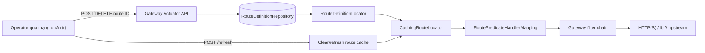
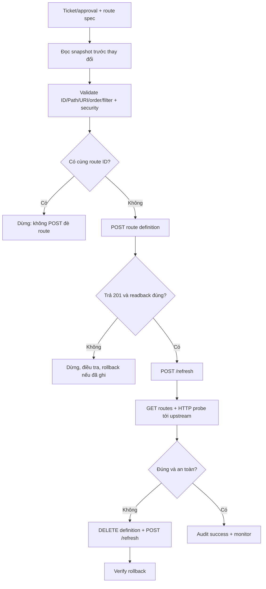
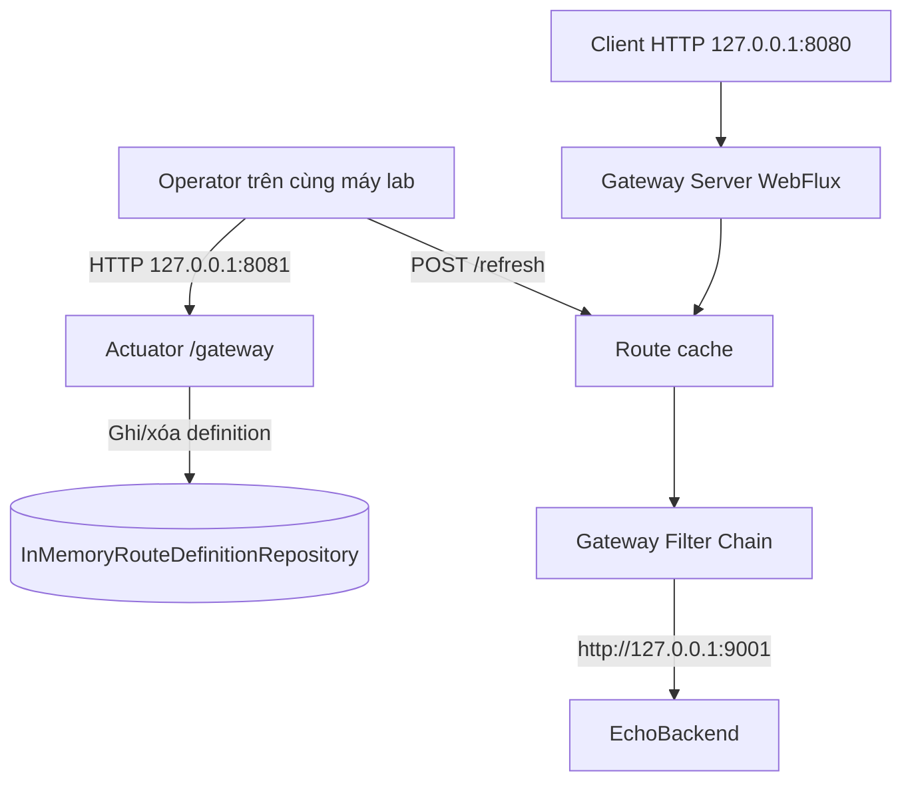
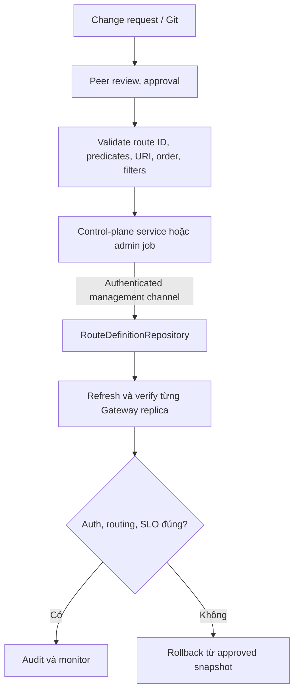

# Tạo, xóa và refresh tuyến động trong môi trường được kiểm soát

## 1. Vì sao cần thay đổi route mà không khởi động lại Gateway?

**SPRING_CLOUD_GATEWAY** thường là cửa vào cho nhiều microservices. Một request đi qua **route predicate** để chọn upstream, **filter chain** để xử lý path/header, xác thực, giới hạn lưu lượng, circuit breaker, retry, TLS và quan sát lưu lượng. Khi tách một dịch vụ, chuyển lưu lượng sang upstream khác hoặc thêm một API tạm thời, vận hành đôi khi cần đổi tuyến **trong lúc Gateway vẫn chạy**.

Ví dụ nhóm Catalog đang có:

```text
Client -> Gateway :8080 -> /catalog/** -> catalog-service
```

Trong một đợt chuyển dịch, nhóm vận hành muốn thêm route `/dynamic/**` chỉ cho môi trường thử nghiệm, kiểm tra kết nối rồi xóa đi mà không restart Gateway. **Spring Boot Actuator + Gateway Actuator API** cung cấp các thao tác quản lý route definition, gồm tạo, xem, xóa và refresh **route cache**.

Nhưng các thao tác này mang quyền lực rất lớn: ai có quyền tạo route có thể làm thay đổi đường proxy, chọn upstream nội bộ, thay đổi header/filter hoặc che khuất một route đang bảo vệ bằng chính sách khác. Vì vậy, bài học thuộc chương **Quản trị Actuator** và nhấn mạnh việc thao tác trong **môi trường được kiểm soát**, không coi API quản trị là endpoint public.

### Mục tiêu học tập

Sau bài này, bạn có thể:

1. Phân biệt **route definition**, **route đã được dựng**, **route cache**, **nguồn lưu trữ** và **refresh**.
2. Cấu hình Actuator Gateway ở chế độ `read-only` hoặc `unrestricted` tùy nhiệm vụ; không nhầm **exposure** với **authentication/authorization**.
3. Dùng `GET`, `POST`, `DELETE` và `POST /refresh` đúng trình tự với một route do Actuator quản lý.
4. Đọc/đăng một route definition có `id`, `predicates`, `filters`, `uri` và `order` mà không lẫn JSON của **GET** với payload của **POST**.
5. Kiểm chứng thay đổi bằng cả Actuator và request HTTP thật tới backend; biết tại sao chỉ thấy `200` từ refresh chưa đủ.
6. Thực hiện rollback và phân biệt route tạo qua Actuator với route khai báo trong `application.yml`.
7. Hiểu giới hạn của `InMemoryRouteDefinitionRepository`, phương án Redis, nhiều Gateway replicas và quy trình audit/approval.
8. Nhận diện nguy cơ lộ API quản trị: route injection, SSRF, proxy sang mạng nội bộ và bỏ qua filter bảo mật.

> **Phạm vi kỹ thuật:** ví dụ dùng **Spring Cloud Gateway Server WebFlux 4.3.x**, Spring Cloud 2025.0.x, Spring Boot 3.5.x, JDK 17+. Starter là `spring-cloud-starter-gateway-server-webflux`; cấu hình route tĩnh ở `spring.cloud.gateway.server.webflux.routes`. **Gateway Server MVC** có pipeline khác. Các version `*.0` chỉ minh họa cặp release train tương thích; môi trường thật cần bản vá đang được hỗ trợ.

## 2. Route definition, nguồn lưu và route cache không phải một

Để hiểu refresh, cần phân biệt ít nhất bốn khái niệm:

| Thành phần | Chứa/đại diện cho | Tác động khi thao tác |
| --- | --- | --- |
| `RouteDefinition` | Dữ liệu khai báo: `id`, `uri`, `predicates`, `filters`, `order`, có thể có `metadata`. | `POST`/`DELETE` thông qua repository làm thay đổi định nghĩa được lưu. |
| `RouteDefinitionLocator` | Nguồn đọc danh sách định nghĩa, ví dụ từ `application.yml` hoặc repository. | Có thể gộp định nghĩa từ nhiều nguồn. |
| `RouteDefinitionRepository` | Nguồn **có khả năng ghi** để thêm/xóa định nghĩa. | Actuator write thường làm việc với nguồn này, không viết ngược `application.yml`. |
| `RouteLocator` / route đã dựng | Route có predicate/filter factories đã được diễn giải thành cấu trúc chạy thực tế. | Dùng để match và xử lý request. |
| `CachingRouteLocator` / route cache | Snapshot/bộ nhớ đệm của các route đang được sử dụng để tìm tuyến. | `POST /refresh` làm mới cache để route mới được nhìn thấy. |

**Hai thao tác cần tách rời:** *thay đổi định nghĩa đã lưu* và *làm mới cấu trúc route phục vụ request*. Một phản hồi `201 Created` từ Actuator ghi route definition **không có nghĩa** mọi request sau đó đã đi qua route mới. Theo tài liệu Gateway, cần gọi **`POST /actuator/gateway/refresh`** để áp dụng thay đổi mà không restart.



### 2.1. Có những nguồn route nào?

Một Gateway có thể đồng thời có:

- **Route tĩnh trong `application.yml`**: do `PropertiesRouteDefinitionLocator` quản lý; version cùng source code/config deployment.
- **Route do Java `RouteLocator` bean**: được dựng bằng Java DSL; không phải một bản ghi Actuator có thể xóa như route repository.
- **Route trong `InMemoryRouteDefinitionRepository`**: dùng cho các thao tác tạo/xóa động tại process, mất khi process restart.
- **Route trong `RedisRouteDefinitionRepository`** hoặc implementation riêng: dành cho yêu cầu lưu/chia sẻ định nghĩa giữa nhiều Gateway instances.
- **Route được tạo qua discovery locator**: có thể phát sinh từ service discovery theo cấu hình, không tương đương route quản lý thủ công bằng Actuator.

**Không coi Actuator là một công cụ chỉnh sửa file YAML.** Nếu cần thay route tĩnh theo GitOps, sửa nguồn cấu hình và triển khai lại/refresh qua quy trình cấu hình tương ứng; không kỳ vọng `DELETE /actuator/gateway/routes/<static-id>` thay đổi file.

### 2.2. Refresh không làm gì?

`POST /actuator/gateway/refresh` **không** tự:

- Cấp lại OAuth2/JWT hoặc thay đổi quyền truy cập của một người dùng.
- Xóa các dữ liệu session, Redis rate-limit buckets hoặc Caffeine response cache theo ý nghĩa chung.
- Làm DNS, TLS certificate, route config trong Git hoặc `application.yml` tự được cập nhật từ bản mới.
- Đồng bộ ngay mọi Gateway replica nếu chúng không có cơ chế lưu/thông báo phù hợp.
- Đảm bảo downstream đã sẵn sàng hoặc request tới backend trả 200.

Nó liên quan đến **route cache**, không phải "khởi động lại toàn bộ ứng dụng bằng HTTP". Vì vậy sau mỗi lần refresh phải **verify route và lưu lượng thật**.

## 3. Actuator Gateway API và mô hình quyền truy cập

Theo tài liệu Spring Cloud Gateway Server WebFlux 4.3, endpoint `/actuator/gateway` **không cho phép truy cập mặc định**. Việc quản trị từ xa cần cả hai điều kiện: endpoint được **cấp quyền truy cập ở mức Actuator** và được **expose qua HTTP/JMX**.

| Cấu hình / trạng thái | Ý nghĩa |
| --- | --- |
| `management.endpoint.gateway.access=none` | Không cấp quyền truy cập vào Gateway Actuator endpoint. |
| `management.endpoint.gateway.access=read-only` | Cho phép đọc thông tin; **không** tạo, xóa hay refresh route. |
| `management.endpoint.gateway.access=unrestricted` | Cho phép các thao tác quản lý, gồm `POST`/`DELETE`/refresh nếu endpoint được expose và HTTP security cho phép. |
| `management.endpoints.web.exposure.include=gateway` | Đưa endpoint Gateway vào danh sách có thể truy cập qua HTTP; **không tự làm endpoint an toàn**. |
| `management.server.port` | Chọn cổng management riêng, ví dụ `8081`. |
| `management.server.address` | Chọn địa chỉ bind của management server, ví dụ `127.0.0.1` khi cổng management khác cổng ứng dụng. |

**Nguyên tắc vận hành:** mặc định nên chọn **`read-only`** hoặc **không expose** Gateway Actuator. Chỉ nâng tạm thời sang `unrestricted` trong một môi trường/quy trình có phê duyệt, kiểm soát mạng và identity mạnh. Khi hoàn tất, trả lại `read-only` hoặc tắt quyền ghi.

> **Điểm cần tránh:** tài liệu Gateway cũng nhắc cơ chế legacy `management.endpoint.gateway.enabled=true`; không nên dùng nó như viết tắt an toàn thay `access=read-only`, vì có thể cho phép thao tác ghi. Với Spring Boot 3.5, dùng `management.endpoint.gateway.access` để nêu rõ chính sách.

### 3.1. Bảng API cần nhớ

Các đường dẫn sau giả sử base path mặc định là `/actuator`:

| HTTP | URI | Mục đích |
| --- | --- | --- |
| `GET` | `/actuator/gateway` | Xem các operation được công bố bởi endpoint. |
| `GET` | `/actuator/gateway/routes` | Liệt kê những route đang được Gateway thấy. |
| `GET` | `/actuator/gateway/routes/{id}` | Xem một route cụ thể. |
| `GET` | `/actuator/gateway/routedefinitions` | Quan sát định nghĩa routes theo nguồn dữ liệu có sẵn. |
| `GET` | `/actuator/gateway/globalfilters` | Xem `GlobalFilter` và thứ tự khi được hỗ trợ. |
| `GET` | `/actuator/gateway/routefilters` | Xem các `GatewayFilterFactory` đã đăng ký. |
| `POST` | `/actuator/gateway/routes/{id}` | **Tạo** một route definition có ID chỉ định. |
| `DELETE` | `/actuator/gateway/routes/{id}` | **Xóa** một definition thuộc repository có thể ghi. |
| `POST` | `/actuator/gateway/refresh` | Làm mới route cache (có thể có tùy chọn theo metadata). |

**Chú ý:** URL điều khiển đầy đủ là **`/actuator/gateway/routes/{id}`**, không phải `/gateway/routes/{id}` nếu không đổi base path. Nếu dùng `management.endpoints.web.base-path` khác `/actuator`, URI sẽ thay đổi.

### 3.2. Chế độ `read-only` phải được kiểm thử

```yaml
management:
  endpoint:
    gateway:
      access: read-only
  endpoints:
    web:
      exposure:
        include: health,gateway
```

Trong cấu hình này `GET /actuator/gateway/routes` có thể được đọc theo chính sách HTTP security, nhưng **`POST /actuator/gateway/refresh`** không được cấp phép theo Actuator. HTTP status của thao tác bị chặn có thể khác tùy tầng (404/405/401/403) và bản vá: hãy **kiểm tra cả việc route không bị thay đổi**, không chỉ so một status.

Nếu ứng dụng có `management.endpoints.access.max-permitted=read-only`, giới hạn toàn cục này còn có thể **chặn quyền ghi** dù endpoint Gateway tự đặt `access=unrestricted`. Ngược lại, expose endpoint qua HTTP không đồng nghĩa người gọi đã được xác thực; **Actuator access control và Spring Security/network access là các lớp khác nhau**.

## 4. Vì sao thao tác quản trị route phải được bảo vệ riêng?

Khả năng tạo/xóa route động có thể gây hậu quả ngang với việc thay đổi cấu hình bảo mật của hệ thống:

```text
Client không được phép
    |
    +--> /actuator/gateway/routes/<id> (nếu endpoint bị lộ)
             |
             +--> đổi upstream sang host do kẻ tấn công kiểm soát
             +--> bỏ các filter xác thực/giới hạn lưu lượng
             +--> mở đường proxy tới dịch vụ nội bộ nhạy cảm
             +--> tạo route có order ưu tiên che route khác
             +--> khiến client nhận dữ liệu/headers không mong muốn
```

Các rủi ro cần đánh giá gồm **server-side request forgery (SSRF)**, proxy tới mạng/metadata nội bộ, bypass ranh giới xác thực/tenant, dữ liệu nhạy cảm qua `AddRequestHeader`/`TokenRelay`, phá quota và route hijacking. **Một route ID không phải ACL.** Không dùng cách "đặt tên khó đoán" để thay authentication/authorization.

### 4.1. Các lớp bảo vệ tối thiểu

1. **Management network riêng:** tách cổng `management.server.port`, bind vào interface quản trị hoặc loopback; firewall/NetworkPolicy từ chối Internet và các workload không được phê duyệt.
2. **Xác thực mạnh:** OAuth2/JWT dành cho quản trị, mTLS workload identity hoặc một cơ chế quản trị tương đương; không mở public endpoint chỉ dựa vào URL.
3. **Phân quyền riêng:** phân biệt **route viewer** với **route operator**; tạo/xóa/refresh cần role/policy được phê duyệt.
4. **TLS/mTLS:** bảo vệ kênh quản trị qua mạng, kể cả khi phía sau ingress/bastion; kiểm tra peer certificate/SAN, không dùng trust-all.
5. **Allowlist route definition:** kiểm tra route ID, `uri` schemes/host/port, path patterns, những predicates/filters được phép và order. Không cho một caller tùy ý trỏ đến cloud metadata, loopback services hoặc bất kỳ domain nào.
6. **Audit bất biến:** ghi ai yêu cầu, ticket/change ID, diff trước/sau, thời gian, kết quả HTTP, xác minh và rollback, **không log secrets/tokens**.
7. **Rate limit và approval cho control-plane API:** tránh ghi hàng loạt/ngẫu nhiên, áp dụng two-person review khi cần.
8. **Không dùng CORS hoặc một header tĩnh tự khai báo làm authorization**. CORS chỉ áp dụng chính sách trình duyệt và không ngăn `curl`/script gửi request.

### 4.2. Cổng quản trị chỉ nghe trên localhost trong lab

Ví dụ bài học **không triển khai authentication trên management port** để giảm số thành phần phải dựng. Đổi lại, endpoint writable **chỉ bind `127.0.0.1:8081`** và chỉ dùng ở máy lab riêng của người học; không đặt trong môi trường chia sẻ hoặc production.

Khi phải quản trị từ nơi khác, dùng phương thức kiểm soát được phê duyệt (bastion, VPN, TLS/mTLS, identity-aware proxy và RBAC). **Không thay `127.0.0.1` bằng `0.0.0.0` chỉ để `curl` thuận tiện**, và cũng không mở cổng management qua public ingress. Một port-forward hoặc SSH tunnel vẫn cần cơ chế auth/approval và kiểm soát người có thể sử dụng nó.

## 5. Quy trình thay đổi route an toàn

Không nên coi quản trị động là chuỗi lệnh `curl` tùy hứng. Một thay đổi cần có kế hoạch và điểm dừng:



Thứ tự chuẩn:

1. Lưu **before-state** (ID, URI, predicate, filters, order) vào change record an toàn.
2. Kiểm tra ID mới chưa được sử dụng; không đụng route khai báo bởi YAML/Java.
3. Validate đặc tả: endpoint được phép, target upstream sẵn sàng, auth/authorization còn nguyên, không trùng predicate nguy hiểm.
4. Ghi route definition với `POST /routes/{id}`.
5. Đọc lại definition. **Không sao chép nguyên JSON GET để POST lại** khi các phiên bản hiển thị dạng verbose/đã biên dịch.
6. Gọi `POST /refresh`; kiểm tra route mới thực sự được match và request có tới đúng backend.
7. Ghi nhận kết quả và quan sát latency, 4xx/5xx, rate limit, TLS, circuit breaker.
8. Nếu sai, dùng rollback đã chuẩn bị: `DELETE` route vừa tạo → `POST /refresh` → xác minh nó biến mất.

**Đặc biệt quan trọng:** tài liệu Gateway mới cảnh báo **không POST trùng route ID đã tồn tại**: một số phiên bản có thể giữ các definition trùng khiến `GET /routes` báo lỗi 500. Sửa route do Actuator quản lý theo trình tự **DELETE → POST definition mới → POST refresh**. Đây không phải một cập nhật atomic; với production cần maintenance window hoặc cơ chế versioned route/canary để tránh khoảng trống route.

## 6. Cấu trúc RouteDefinition và JSON cho POST

Một route definition chứa thông tin khai báo, ví dụ:

```json
{
  "predicates": [
    "Path=/dynamic/**"
  ],
  "filters": [
    "StripPrefix=1",
    "AddRequestHeader=X-Dynamic-Route, v1"
  ],
  "uri": "http://127.0.0.1:9001",
  "order": 0
}
```

Đường dẫn `POST /actuator/gateway/routes/dynamic_catalog_lab` xác định **route ID**; body chỉ định predicate/filter, URI và order.

Trong tài liệu Actuator hiện hành, các phần tử `predicates` và `filters` ở dạng **shortcut DSL strings**, như `"Path=/dynamic/**"` và `"StripPrefix=1"`. **Không dùng** chuỗi mô tả từ `GET /routes` (ví dụ `"Paths: [...]"` hoặc `"OrderedGatewayFilter{...}"`) làm một định nghĩa để POST.

### 6.1. Chú ý tương thích 4.3.x và format JSON

Tài liệu 4.3 của Gateway có trang minh họa `GET /routes/{id}` theo dạng có cấu trúc:

```json
{
  "id": "first_route",
  "predicates": [
    {
      "name": "Path",
      "args": {
        "_genkey_0": "/first"
      }
    }
  ],
  "filters": [],
  "uri": "https://example.org",
  "order": 0
}
```

Tùy bản vá và cách Jackson bind `RouteDefinition`, route definitions cũng có dạng `{"name":"Path","args":{"_genkey_0":"/dynamic/**"}}`. Một số predicate phức tạp cần map `args` với các keys rõ ràng (ví dụ `patterns.0`), **không phải JSON array bất kỳ trong `args`**. Vì Gateway docs qua các phiên bản khác nhau ở representation, hãy kiểm tra tài liệu đúng **artifact/release train của ứng dụng**, thử một route lab trước và dùng format mà bản đó chấp nhận.

**Đừng mặc định response của GET có thể POST nguyên xi.** Phân biệt dữ liệu quản trị hiển thị (*descriptive view*) với route specification (*declarative input*). Ví dụ thực hành ở dưới dùng shortcut form cho route đơn giản, và yêu cầu xác minh ngay status/readback.

### 6.2. Những trường cần kiểm tra trước khi lưu

| Trường | Ví dụ | Quy tắc an toàn |
| --- | --- | --- |
| `id` | `dynamic_catalog_lab` | Duy nhất, có owner, không trùng route trong YAML/Java/Redis. |
| `predicates` | `Path=/dynamic/**` | Scope đủ hẹp; không dùng `/**` để vô tình che mọi route. |
| `filters` | `StripPrefix=1` | Chỉ sử dụng filters được allowlist; không bỏ auth/rate limiting mặc định. |
| `uri` | `http://127.0.0.1:9001` | **Chỉ dành cho lab cùng host**. Prod cần upstream allowlist, TLS/hostname verification hoặc `lb://` đã kiểm soát. |
| `order` | `0` | Route order thấp hơn có thể được ưu tiên; kiểm tra route overlap. |
| `metadata` | `{"group":"lab"}` | Dùng tổ chức/refresh theo phạm vi nếu được hỗ trợ; không thay phân quyền. |

Nếu một route động đưa client đến backend `lb://catalog-service`, đó chỉ là cách chọn instance từ Discovery/LoadBalancer; không làm route tự trở nên an toàn. Service vẫn cần kiểm tra JWT/permissions, Gateway vẫn cần TLS, rate limiting và các filter phù hợp.

## 7. Dựng phòng thí nghiệm có cổng quản trị localhost

Bài thực hành gồm:

- Gateway HTTP data plane: `127.0.0.1:8080`.
- Gateway Actuator management plane: `127.0.0.1:8081`, **chỉ nghe trên loopback**.
- HTTP EchoBackend: `127.0.0.1:9001`, dùng đếm request và nhận biết route/header đã được proxy.
- Route tĩnh `fixed_status`: `GET /fixed/status` tới backend `/status`.
- Route động `dynamic_catalog_lab`: ban đầu chưa tồn tại; sau đó sẽ được tạo, refresh, thay và xóa.



> **CẢNH BÁO:** `unrestricted` dưới đây **chỉ được bật cho lab local do một người kiểm soát**. Không copy nguyên `management.endpoint.gateway.access: unrestricted` sang môi trường chia sẻ, Kubernetes hoặc production nếu chưa có xác thực mạnh, phân quyền, TLS, network policy và audit.

### 7.1. Tạo project Maven

Yêu cầu: JDK 17+, Maven, `curl` và hai terminal. Tạo `pom.xml` trong project **người học tự tạo**, không phải repository nội dung bài giảng:

```xml
<?xml version="1.0" encoding="UTF-8"?>
<project xmlns="http://maven.apache.org/POM/4.0.0"
         xmlns:xsi="http://www.w3.org/2001/XMLSchema-instance"
         xsi:schemaLocation="http://maven.apache.org/POM/4.0.0
                             https://maven.apache.org/xsd/maven-4.0.0.xsd">
    <modelVersion>4.0.0</modelVersion>

    <parent>
        <groupId>org.springframework.boot</groupId>
        <artifactId>spring-boot-starter-parent</artifactId>
        <version>3.5.0</version>
        <relativePath/>
    </parent>

    <groupId>com.example</groupId>
    <artifactId>gateway-actuator-lab</artifactId>
    <version>0.0.1-SNAPSHOT</version>

    <properties>
        <java.version>17</java.version>
    </properties>

    <dependencyManagement>
        <dependencies>
            <dependency>
                <groupId>org.springframework.cloud</groupId>
                <artifactId>spring-cloud-dependencies</artifactId>
                <version>2025.0.0</version>
                <type>pom</type>
                <scope>import</scope>
            </dependency>
        </dependencies>
    </dependencyManagement>

    <dependencies>
        <dependency>
            <groupId>org.springframework.cloud</groupId>
            <artifactId>spring-cloud-starter-gateway-server-webflux</artifactId>
        </dependency>
        <dependency>
            <groupId>org.springframework.boot</groupId>
            <artifactId>spring-boot-starter-actuator</artifactId>
        </dependency>
    </dependencies>

    <build>
        <plugins>
            <plugin>
                <groupId>org.springframework.boot</groupId>
                <artifactId>spring-boot-maven-plugin</artifactId>
            </plugin>
        </plugins>
    </build>
</project>
```

- `spring-cloud-starter-gateway-server-webflux` cung cấp Gateway WebFlux.
- `spring-boot-starter-actuator` cung cấp hạ tầng management và Gateway Actuator endpoint khi được cấu hình.
- Không thêm `spring-boot-starter-web` Servlet; chúng ta dùng Reactor Netty.
- Boot parent và Cloud BOM quản lý phiên bản starters. **Đây không phải lệnh build worker chạy**; người học chạy trong project demo riêng.

### 7.2. Entry point

Tạo `src/main/java/com/example/gateway/GatewayApplication.java`:

```java
package com.example.gateway;

import org.springframework.boot.SpringApplication;
import org.springframework.boot.autoconfigure.SpringBootApplication;

@SpringBootApplication
public class GatewayApplication {
    public static void main(String[] args) {
        SpringApplication.run(GatewayApplication.class, args);
    }
}
```

### 7.3. `application.yml`: cổng quản trị riêng, chỉ có route tĩnh

```yaml
server:
  port: 8080

management:
  server:
    port: 8081
    address: "127.0.0.1"
  endpoint:
    gateway:
      # Chỉ dùng khi học trên máy local bị cô lập:
      access: unrestricted
  endpoints:
    web:
      exposure:
        include: health,gateway

spring:
  application:
    name: gateway-actuator-lab
  cloud:
    gateway:
      server:
        webflux:
          routes:
            - id: fixed_status
              uri: http://127.0.0.1:9001
              predicates:
                - Path=/fixed/**
              filters:
                - StripPrefix=1
```

Điểm quan trọng:

1. **`server.port: 8080`** phục vụ các client request theo route Gateway.
2. **`management.server.port: 8081`** dành riêng cho Actuator.
3. **`management.server.address: 127.0.0.1`** chỉ hợp lệ để bind riêng khi management port khác app port. Nó hạn chế truy cập từ mạng ngoài cho lab; không thay thế authentication ở production.
4. **`access: unrestricted`** cho phép thao tác ghi. Với chế độ chỉ xem, đổi thành `read-only`; với endpoint không cần thiết, ngừng expose.
5. **`exposure.include: health,gateway`** chỉ expose hai endpoint này qua HTTP. Không dùng `include: "*"` cho tiện.
6. `fixed_status` là **route static** từ cấu hình app; dùng để kiểm chứng nó không bị xóa như một route Actuator-managed.
7. Ban đầu **không** khai báo `dynamic_catalog_lab` trong YAML; nó chỉ được tạo qua API.

Nếu mạng container làm `127.0.0.1:9001` không phải cùng network namespace với backend, thay bằng host/service name phù hợp trong môi trường **thử nghiệm được kiểm soát**; không dùng localhost target này cho cluster thật.

### 7.4. EchoBackend: nhìn thấy path và header thực

Tạo `EchoBackend.java` ở một **thư mục thực hành riêng ngoài source Gateway**:

```java
import com.sun.net.httpserver.HttpServer;
import java.net.InetSocketAddress;
import java.nio.charset.StandardCharsets;
import java.util.concurrent.atomic.AtomicInteger;

public class EchoBackend {

    public static void main(String[] args) throws Exception {
        AtomicInteger calls = new AtomicInteger();

        HttpServer server = HttpServer.create(
                new InetSocketAddress("127.0.0.1", 9001), 0);

        server.createContext("/", exchange -> {
            int n = calls.incrementAndGet();
            String path = exchange.getRequestURI().getRawPath();
            String revision = exchange.getRequestHeaders()
                    .getFirst("X-Dynamic-Route");

            String body = "backend-request=" + n + "\n"
                    + "path=" + path + "\n"
                    + "route-revision="
                    + (revision == null ? "none" : revision) + "\n";

            System.out.printf(
                    "UPSTREAM #%d path=%s revision=%s%n",
                    n, path, revision);

            byte[] bytes = body.getBytes(StandardCharsets.UTF_8);
            exchange.getResponseHeaders().set(
                    "Content-Type", "text/plain; charset=UTF-8");
            exchange.sendResponseHeaders(200, bytes.length);

            try (var response = exchange.getResponseBody()) {
                response.write(bytes);
            }
        });

        server.start();
        System.out.println("EchoBackend ready on 127.0.0.1:9001");
    }
}
```

Trong demo, `X-Dynamic-Route` là marker phiên bản **không nhạy cảm**. Nếu một filter thật đẩy `Authorization`, API key, cookie hoặc identity header xuống upstream thì không được in chúng ra log như bài thực hành.

Chạy hai process:

```bash
# Terminal A, thư mục có EchoBackend.java:
java EchoBackend.java

# Terminal B, thư mục có pom.xml và application.yml:
mvn spring-boot:run
```

Nếu có Maven Wrapper, dùng `./mvnw spring-boot:run` (Linux/macOS) hoặc `mvnw.cmd spring-boot:run` (Windows). Ví dụ `curl` bên dưới theo cú pháp **Bash**; trên PowerShell hãy dùng `curl.exe` và chỉnh cách quote JSON.

## 8. Kiểm tra trạng thái ban đầu và cổng quản trị

### 8.1. Route tĩnh phải chạy

```bash
curl -i "http://127.0.0.1:8080/fixed/status"
```

Response dự kiến khi backend sẵn sàng:

```http
HTTP/1.1 200 OK
Content-Type: text/plain; charset=UTF-8

backend-request=1
path=/status
route-revision=none
```

Số `backend-request` tăng theo số request thực tới EchoBackend; không assert nó luôn bằng 1 nếu đã gọi trước. `StripPrefix=1` đổi `/fixed/status` thành `/status` ở backend.

### 8.2. Route động chưa tồn tại

```bash
curl -i "http://127.0.0.1:8080/dynamic/check"
```

Nếu chưa có handler/route khác, dự kiến **404 Not Found**. Backend counter **không tăng**, vì Gateway chưa có route `/dynamic/**`.

### 8.3. Xem danh sách route qua management

```bash
curl -i "http://127.0.0.1:8081/actuator/gateway"
curl -i "http://127.0.0.1:8081/actuator/gateway/routes"
curl -i "http://127.0.0.1:8081/actuator/gateway/routedefinitions"
curl -i "http://127.0.0.1:8081/actuator/gateway/routes/fixed_status"
```

Kỳ vọng nhìn thấy `fixed_status`; chưa có `dynamic_catalog_lab`. Hai URI **không nên** được dùng thay cho nhau để suy kết quả: `/routedefinitions` quan sát khai báo, còn `/routes` phản ánh route đã được Gateway trình bày từ các locator/cache.

**GET response format có thể khác giữa 4.3 và 5.x**, nhất là khi verbose format được bật. Chỉ cần xác minh route ID, predicate, URI, filter, order và response HTTP; đừng viết script phụ thuộc một trường nested `route_object` chắc chắn tồn tại trên mọi version.

### 8.4. Chế độ chỉ đọc (negative test)

Nếu đổi trong YAML lab:

```yaml
management:
  endpoint:
    gateway:
      access: read-only
```

rồi khởi động lại, `GET` vẫn có thể được phép nhưng `POST /actuator/gateway/refresh` bị hạn chế. Hãy thử (chỉ trên lab):

```bash
curl -i -X POST \
  "http://127.0.0.1:8081/actuator/gateway/refresh"
```

Không cần assert duy nhất 403: ứng dụng có thể trả 404/405 tùy Actuator access và HTTP security. Điều **bắt buộc** là thao tác ghi/refresh **không được chấp nhận hoặc không đổi route state**. Để tiếp tục các mục tạo/xóa, khôi phục `unrestricted` và restart Gateway lab. Trên production hãy giữ `read-only` trừ lúc cần một thay đổi có phê duyệt.

## 9. Tạo tuyến động qua `POST /routes/{id}`

Trước khi POST, kiểm tra ID mới **chưa tồn tại**:

```bash
curl -i \
  "http://127.0.0.1:8081/actuator/gateway/routes/dynamic_catalog_lab"
```

Nếu route đã tồn tại, **DỪNG** để kiểm tra nguồn sở hữu, không tiếp tục POST đè. Trong lab sạch, endpoint thường trả 404.

### 9.1. Gửi payload JSON

```bash
curl -i -X POST \
  "http://127.0.0.1:8081/actuator/gateway/routes/dynamic_catalog_lab" \
  -H "Content-Type: application/json" \
  --data-binary '{
    "predicates": ["Path=/dynamic/**"],
    "filters": [
      "StripPrefix=1",
      "AddRequestHeader=X-Dynamic-Route, v1"
    ],
    "uri": "http://127.0.0.1:9001",
    "order": 0
  }'
```

Trên bản Gateway hỗ trợ định dạng shortcut POST như tài liệu Actuator hiện hành, thao tác thành công trả **`201 Created`**. Đây chỉ là **route definition đã được chấp nhận**, chưa phải chứng minh mọi request mới đã sử dụng route.

Nếu bản 4.3 đang chạy báo lỗi **400** khi bind JSON shortcut, đối chiếu API tài liệu đúng bản vá và thử dạng structured `PredicateDefinition`/`FilterDefinition` trong **môi trường lab**, ví dụ:

```json
{
  "predicates": [
    {"name": "Path", "args": {"_genkey_0": "/dynamic/**"}}
  ],
  "filters": [
    {"name": "StripPrefix", "args": {"_genkey_0": "1"}},
    {"name": "AddRequestHeader",
     "args": {"_genkey_0": "X-Dynamic-Route", "_genkey_1": "v1"}}
  ],
  "uri": "http://127.0.0.1:9001",
  "order": 0
}
```

**Đây là phương án tương thích theo cấu trúc definition, không phải một POST thứ hai để gửi ngay khi route đầu đã thành công.** Chỉ chọn *một* cách tạo theo API mà artifact thực hỗ trợ, vì POST trùng ID có thể làm hỏng trạng thái liệt kê routes.

### 9.2. Đọc lại định nghĩa, sau đó refresh

```bash
curl -i \
  "http://127.0.0.1:8081/actuator/gateway/routedefinitions"

curl -i -X POST \
  "http://127.0.0.1:8081/actuator/gateway/refresh"
```

Theo tài liệu, `POST /refresh` thường trả **`200 OK`** mà **không có response body**. Nó yêu cầu làm mới route cache; không cần restart Gateway. Việc làm mới có thể có xử lý bất đồng bộ, nên **đừng coi 200 là bằng chứng kiểm chứng toàn bộ thành công**.

Ngay sau đó kiểm tra:

```bash
curl -i \
  "http://127.0.0.1:8081/actuator/gateway/routes"

curl -i \
  "http://127.0.0.1:8081/actuator/gateway/routes/dynamic_catalog_lab"
```

Phải tìm được route ID `dynamic_catalog_lab`, predicate `Path=/dynamic/**`, URI loopback và filters tương ứng. Nếu chưa xuất hiện ngay, kiểm tra log/error và đọc lại sau khoảng ngắn với **số lần retry giới hạn**; không POST lại definition một cách mù quáng.

### 9.3. Kiểm chứng bằng request thực

```bash
curl -i "http://127.0.0.1:8080/dynamic/check"
```

Nếu route mới đã có hiệu lực và EchoBackend hoạt động:

```http
HTTP/1.1 200 OK
Content-Type: text/plain; charset=UTF-8

backend-request=2
path=/check
route-revision=v1
```

Dòng `backend-request=2` chỉ minh họa sau các request trước đó; con số thật phụ thuộc thứ tự bạn gọi. Hai điều cần assert là:

- **Backend path `/check`** — chứng minh `StripPrefix=1` có hiệu lực.
- **`route-revision=v1`** — chứng minh `AddRequestHeader` của route động đã chạy.

Nếu client có HTTP 200 nhưng body không chứa `route-revision=v1`, có thể một route khác đã match, filter không được bind, hoặc request không đến backend bạn mong đợi. Kiểm tra request counter/log EchoBackend và `/actuator/gateway/routes`.

## 10. Sửa một route động: không POST đè ID

Tài liệu Actuator mới đặc biệt cảnh báo: **POST lại trên route ID đã tồn tại có thể tạo definition trùng**, làm `GET /actuator/gateway/routes` thất bại với 500. Vì vậy, khi cập nhật `dynamic_catalog_lab`, đừng gửi payload mới cùng ID như một PUT/upsert.

**Quy trình sửa theo tài liệu:** `DELETE` route động cũ → `POST` definition mới cùng ID → `POST /refresh` → kiểm tra.

### 10.1. Tạo phiên bản v2 trong lab

Bước này chỉ trên Gateway local, không có người dùng thật. Đầu tiên lưu lại JSON v1 vào change record riêng do người học quản lý, rồi xóa definition cũ:

```bash
curl -i -X DELETE \
  "http://127.0.0.1:8081/actuator/gateway/routes/dynamic_catalog_lab"
```

Khi xóa thành công, Actuator thường trả `200 OK`. **Chưa refresh ngay** vì đây là bước thay definition trong lab; trong production phải tính đến cửa sổ không nhất quán nếu refresh xảy ra giữa DELETE và POST.

Gửi route v2:

```bash
curl -i -X POST \
  "http://127.0.0.1:8081/actuator/gateway/routes/dynamic_catalog_lab" \
  -H "Content-Type: application/json" \
  --data-binary '{
    "predicates": ["Path=/dynamic/**"],
    "filters": [
      "StripPrefix=1",
      "AddRequestHeader=X-Dynamic-Route, v2"
    ],
    "uri": "http://127.0.0.1:9001",
    "order": 0
  }'
```

Đừng tiếp tục nếu lệnh POST không trả thành công hoặc nếu route ID v2 không được ghi đúng. Khi dùng bản Gateway 4.3 chỉ chấp nhận structured input, dùng đúng cấu trúc đã xác nhận ở mục 9.1 và thay `v1` bằng `v2`.

Sau khi định nghĩa mới được xác nhận:

```bash
curl -i -X POST \
  "http://127.0.0.1:8081/actuator/gateway/refresh"

curl -i \
  "http://127.0.0.1:8080/dynamic/check"
```

Backend cần báo `route-revision=v2`. Route `fixed_status` vẫn phải hoạt động:

```bash
curl -i "http://127.0.0.1:8080/fixed/status"
```

**Không phải thao tác atomic:** `DELETE` và `POST` là hai request độc lập. Nếu Gateway crash, operator refresh nhầm, hoặc repository shared có replica đọc giữa chừng, có thể có khoảng trống/khác biệt trạng thái. Với production, nên đưa thay đổi qua pipeline control plane có validation và rollback/canary, hoặc chiến lược route ID có version và chuyển hướng lưu lượng được kiểm soát.

### 10.2. Rollback thay đổi v2 nếu không đạt

Nếu v2 không đúng, sử dụng cùng quy trình **DELETE v2 → POST v1 đã lưu → POST refresh → kiểm tra**. Không làm:

```text
POST /routes/dynamic_catalog_lab với v1 khi v2 vẫn tồn tại
```

Vì đó lại là POST trùng ID. **Rollback phải là quy trình có kịch bản và điều kiện dừng**, không phải chỉ "thử POST thêm lần nữa". Sau rollback cần so lại route definition, backend path/header và logs.

## 11. Xóa route động và xác minh không còn proxy

Khi kết thúc lab, xóa route động:

```bash
curl -i -X DELETE \
  "http://127.0.0.1:8081/actuator/gateway/routes/dynamic_catalog_lab"

curl -i -X POST \
  "http://127.0.0.1:8081/actuator/gateway/refresh"
```

Một lần xóa thành công thường trả `200 OK`, refresh trả `200 OK` không body. Xác minh:

```bash
curl -i \
  "http://127.0.0.1:8081/actuator/gateway/routes"

curl -i \
  "http://127.0.0.1:8080/dynamic/check"
```

Kỳ vọng:

- `dynamic_catalog_lab` không còn trong danh sách routes.
- `GET /dynamic/check` **404** nếu không có route/handler khác.
- Backend counter **không tăng** do request `/dynamic/check` đã bị miss route.
- `GET /fixed/status` vẫn 200 và tới backend.

Đó là **xóa route definition động và refresh route cache**, không xóa ứng dụng downstream hay xóa dữ liệu của Catalog Service.

### 11.1. Không thể dùng API này xóa route static

Thử **chỉ trên lab**:

```bash
curl -i -X DELETE \
  "http://127.0.0.1:8081/actuator/gateway/routes/fixed_status"
```

Theo tài liệu Actuator hiện hành, route từ `application.yml` hoặc `@Bean` **không thuộc nhóm có thể sửa/xóa qua endpoint write này**; thao tác xóa route từ cấu hình có thể trả `404 Not Found`. Status trên một bản vá cụ thể cần được kiểm chứng; điều cốt lõi là file YAML **không bị xóa** và route static vẫn phục vụ:

```bash
curl -i "http://127.0.0.1:8080/fixed/status"
```

Nếu muốn xóa `fixed_status` thật, phải thay đổi **nguồn khai báo** theo quy trình triển khai cấu hình/GitOps. Actuator không làm thay việc quản trị cấu hình tĩnh.

### 11.2. Đưa management trở về chế độ an toàn

Khi lab xong, trả lại:

```yaml
management:
  endpoint:
    gateway:
      access: read-only
```

Hoặc loại `gateway` khỏi `management.endpoints.web.exposure.include` nếu không cần đọc. Khởi động lại lab theo cấu hình mới rồi **test negative** rằng POST/DELETE/refresh không còn được phép và GET còn có hành vi như thiết kế.

Lưu ý: một endpoint đã được expose với quyền unrestricted trên production không thể "được bảo vệ" chỉ bằng việc **không gửi thêm `curl`**; phải sửa cấu hình/quyền truy cập và xác minh trạng thái sau rollout.

## 12. Refresh toàn bộ và refresh theo metadata

Lệnh phổ biến sau một thao tác tạo, sửa hoặc xóa route definition là:

```bash
curl -i -X POST "http://127.0.0.1:8081/actuator/gateway/refresh"
```

Theo tài liệu Gateway, endpoint này thường trả **200 không có response body**. Nó làm mới route cache, **không** sửa file YAML, không bảo đảm upstream đang hoạt động và không tự broadcast đến mọi Gateway replica.

Một số phiên bản Gateway hỗ trợ refresh có chọn lọc qua query `metadata`:

```bash
curl -i -X POST \
  "http://127.0.0.1:8081/actuator/gateway/refresh?metadata=group:lab"
```

Điều kiện là các route definitions có metadata phù hợp:

```json
{
  "id": "dynamic_catalog_lab",
  "metadata": {
    "group": "lab"
  },
  "predicates": ["Path=/dynamic/**"],
  "filters": ["StripPrefix=1"],
  "uri": "http://127.0.0.1:9001",
  "order": 0
}
```

**Không thay toàn bộ quy trình xóa/refresh bằng scoped refresh mà chưa kiểm thử**. Khi definition đã bị xóa, metadata dùng để chọn vùng cache có thể không còn nhìn thấy theo cách bạn mong đợi. Với lab này, sau `DELETE` và `POST`, luôn dùng **full refresh**.

### 12.1. Phản hồi 200 chưa đồng nghĩa mọi route đã được áp dụng

Refresh có thể bao gồm xử lý event và làm mới cache **bất đồng bộ**. Tài liệu Gateway cho biết lỗi trong quá trình refresh có thể khiến route cache cũ được giữ nguyên. Do đó:

1. `POST /refresh` và xác minh status.
2. `GET /actuator/gateway/routes` hoặc `GET /routes/{id}`.
3. Phát HTTP canary request tới route mới.
4. So **backend path/header** và upstream counter.
5. Chỉ ghi "rollout thành công" khi cả control plane và data plane đều đạt kỳ vọng.

Một lệnh refresh không phải `SpringApplication.restart()`, cũng không tự xóa session/OAuth2 authorized clients, rate-limit Redis buckets, circuit breaker state hoặc mọi cache phản hồi.

### 12.2. Request đang chạy khi refresh

Một request đã match route và đi vào filter chain trước lúc cache được làm mới **có thể tiếp tục chạy** theo route đã chọn. Refresh không bảo đảm hủy tất cả in-flight HTTP calls tức thì.

Nếu cần **ngăn một API nguy hiểm ngay lập tức**, chỉ xóa route ở một Gateway pod là chưa đủ: còn các replica, in-flight requests và các đường truy cập backend khác. Cần một chính sách chặn đáng tin ở security/ingress/backend và kiểm chứng mọi đường vào.

## 13. Nhiều Gateway instances: repository chung khác route cache chung

### 13.1. InMemoryRouteDefinitionRepository

`InMemoryRouteDefinitionRepository` lưu route definitions **trong process**. Nó thuận tiện cho lab nhưng không phải nơi lưu bền vững cho hệ thống nhiều replica:

```text
           Load Balancer
             /     \
      Gateway A     Gateway B
      routes A      routes B
      heap A        heap B

POST route vào A:
  A biết definition mới
  B không tự có definition đó

POST /refresh tại A:
  A làm mới cache A
  Không phải broadcast sang B
```

| Tình huống | Hệ quả có thể có |
| --- | --- |
| Gateway A restart | Route definitions động in-memory của A bị mất. |
| Rolling deployment thay A bằng A2 | A2 không tự nhận definitions từ heap của A. |
| Client chuyển từ A sang B | B có thể không thấy route mới, trả 404. |
| Management request gửi vào A | Không bảo đảm đã thay routes trên B. |
| Sticky session | Không khôi phục route definitions khi pod chết. |

### 13.2. RedisRouteDefinitionRepository

Spring Cloud Gateway cung cấp `RedisRouteDefinitionRepository` để dùng shared store. Bảng **Configuration Properties 4.3** liệt kê namespace Server WebFlux:

```properties
spring.cloud.gateway.server.webflux.redis-route-definition-repository.enabled=true
```

Ví dụ cấu hình **minh họa phương án**, không đưa nguyên bản này vào production:

```yaml
spring:
  data:
    redis:
      host: redis.internal.example
      port: 6379
  cloud:
    gateway:
      server:
        webflux:
          redis-route-definition-repository:
            enabled: true
```

Và thêm reactive Redis starter:

```xml
<dependency>
    <groupId>org.springframework.boot</groupId>
    <artifactId>spring-boot-starter-data-redis-reactive</artifactId>
</dependency>
```

Chưa đủ để an toàn: còn cần TLS Redis, AUTH/ACL, secrets, backup, HA, network isolation, migration, cấu hình timeout và kiểm tra phiên bản/binding thực tế. Tài liệu Gateway cũ còn đề cập prefix `spring.cloud.gateway.redis-route-definition-repository.enabled`; với Gateway Server WebFlux 4.3 ưu tiên prefix `spring.cloud.gateway.server.webflux` đã kiểm chứng từ bảng properties.

**Chia sẻ definitions không đồng nghĩa đồng bộ mọi route cache:**

```text
                    Redis shared definitions
                       /            \
               Gateway A         Gateway B
               local cache A     local cache B
```

Sau khi ghi definition vào Redis, từng Gateway vẫn phải có **cơ chế nhận refresh** phù hợp. Một `POST /refresh` gửi tới A không tự đảm bảo đã gửi event tới B. Có thể dùng một control plane điều phối refresh tới từng replica hoặc một cơ chế pub/sub/event phù hợp, nhưng phải **test trực tiếp** hành vi trên từng process.

### 13.3. Quy trình cluster an toàn

1. Dùng change ticket và spec route versioned đã được review.
2. Kiểm tra ID mới không trùng trên nguồn dữ liệu chung; có chống ghi đồng thời.
3. Chỉ một control-plane service/bot được quyền cập nhật repository.
4. Phát tín hiệu refresh theo thiết kế tới **toàn bộ Gateway replicas**.
5. Probe `GET /routes/{id}` và HTTP canary trên từng pod, không chỉ qua load balancer.
6. Quan sát 404/5xx, tỷ lệ request theo route ID, JWT auth, limiter, breaker và TLS.
7. Nếu pod không đạt, tạm dừng rollout, rollback definition và phát refresh lại.
8. Audit phiên bản cuối cùng đã được xác nhận đồng nhất trên tất cả instances.

Khi Redis unreachable hoặc một replica không refresh, không tự động chuyển route thành `/**` hay bypass authentication để "đảm bảo availability". Cần chính sách fail-closed cho route mới và khả năng phục hồi được thiết kế rõ.

## 14. Vận hành control plane an toàn ngoài môi trường lab

Trong phòng lab, chúng ta dùng `curl` trên localhost. Trong production, không nên cho mọi người có mạng nội bộ gọi thẳng API tạo/xóa route.

### 14.1. Quy trình có phê duyệt



Những kiểm soát quan trọng:

- **RBAC:** phân biệt `route viewer` và `route operator`; read-only là trạng thái mặc định.
- **Network:** management interface/cổng quản trị chỉ ở mạng nội bộ được phê duyệt; firewall/NetworkPolicy; không public ingress.
- **Identity:** OAuth2/JWT dành riêng cho operator, mTLS workload identity hoặc mô hình bảo mật tương đương. Không dùng access token của end user cho API quản trị.
- **TLS:** xác minh CA/SAN/hostname cho control plane và upstream. Không tắt chứng chỉ/TLS khi xảy ra lỗi.
- **URI allowlist:** giới hạn scheme/host/port/CIDR. Tránh request proxy tùy ý tới địa chỉ nội bộ, cloud instance metadata hoặc host do attacker điều khiển.
- **Filter allowlist:** giới hạn các filter được dùng; đặc biệt thận trọng với `TokenRelay`, `AddRequestHeader`, `RewritePath`, `RequestRateLimiter`, `LocalResponseCache` và `CircuitBreaker`.
- **Route overlap:** kiểm tra `Host`, `Path`, `Method`, `order` để route mới không che route có chính sách bảo mật.
- **Audit:** ghi principal quản trị, change ID, diff trước/sau, thời gian, các replica xác minh, kết quả/rollback; không log raw bearer token, secret hoặc cookie.

### 14.2. Ba lớp bảo vệ không thay thế nhau

| Lớp | Ví dụ | Vì sao chưa đủ nếu chỉ dùng riêng? |
| --- | --- | --- |
| **Actuator access** | `management.endpoint.gateway.access=read-only/unrestricted` | Chỉ quyết định loại operation, không xác thực riêng từng operator. |
| **HTTP security/RBAC** | Spring Security WebFlux, JWT/mTLS, role control | Cần bổ sung network isolation và allowlist target URIs. |
| **Network restriction** | `management.server.address`, firewall/NetworkPolicy | Caller nội bộ không đáng tin hoặc credential lộ vẫn là rủi ro. |

Lưu ý **CSRF**: nếu management UI dùng cookie/session của trình duyệt, không tắt CSRF chỉ để POST/DELETE chạy dễ. Nếu dùng service-to-service bearer tokens stateless, cần thiết kế security chain và CSRF theo mô hình credential, rồi test. Khi khai báo `SecurityWebFilterChain` tùy chỉnh, Boot auto security có thể back off; không được mặc định Actuator vẫn được bảo vệ giống trước. Management port riêng cũng cần xác minh security context/chains phù hợp.

## 15. Ma trận kiểm thử hồi quy

| ID | Điều kiện và thao tác | Kết quả cần kiểm chứng |
| --- | --- | --- |
| M01 | Gateway access `read-only`, GET routes | Đọc được theo network/HTTP policy. |
| M02 | `read-only`, POST refresh | Bị chặn; route state không đổi. |
| M03 | `unrestricted` trên localhost, POST ID mới | Definition được tạo, thường 201. |
| M04 | Route ID đã tồn tại | Preflight phải từ chối POST đè; không làm phát sinh definition trùng. |
| M05 | GET routedefinitions sau POST | Đúng route ID, URI, Path, filters, order. |
| M06 | POST refresh sau tạo | Routes cache cập nhật; HTTP canary tới backend. |
| M07 | GET `/dynamic/check` khi v1 | Path `/check`, marker `v1`. |
| M08 | DELETE rồi POST v2, refresh | Path vẫn đúng, marker thành `v2`. |
| M09 | DELETE dynamic + refresh | Route biến mất, thường 404, backend counter không tăng. |
| M10 | DELETE `fixed_status` | Không xóa route static, endpoint thường 404. |
| M11 | Operator thiếu role/auth | POST/DELETE bị từ chối, state không đổi. |
| M12 | Route trỏ URI ngoài allowlist | Bị chặn bởi control-plane validation. |
| M13 | Hai Gateway replicas | Định nghĩa/cache/trạng thái route được kiểm chứng ở từng pod. |
| M14 | Backend HTTPS sai CA/SAN | Không bypass TLS; báo lỗi đúng và rollback. |
| M15 | Route cần JWT/tenant | Không trả dữ liệu khi principal không đủ quyền. |
| M16 | Rate limiter / CircuitBreaker | Không bỏ qua quota hoặc fallback policy do đổi route. |
| M17 | Refresh lỗi | Không tuyên bố thành công chỉ vì một HTTP status. |
| M18 | Rollback | So definition, route cache và request thật đều trở về version đã duyệt. |

**Một HTTP 200 không đủ để nghiệm thu route**. Phải kiểm tra ít nhất hai loại dữ liệu: *control-plane readback* (`/actuator/gateway/routes`) và *data-plane probe* (backend nhận path/header/HTTP method đúng). Với các API bảo mật, thêm test negative cho user/tenant không đủ quyền và test không bypass qua route overlap.

### 15.1. Script kiểm tra đơn giản cho lab

```bash
curl -s -o /dev/null -w "static=%{http_code}\n" \
  "http://127.0.0.1:8080/fixed/status"

curl -s -o /dev/null -w "dynamic=%{http_code}\n" \
  "http://127.0.0.1:8080/dynamic/check"

curl -i "http://127.0.0.1:8080/dynamic/check"

curl -i "http://127.0.0.1:8081/actuator/gateway/routes"
```

Khi triển khai thật, script phải **assert các kỳ vọng và dừng deployment nếu sai**, đặt timeout/retry có giới hạn để tránh vòng polling vô hạn trong lúc refresh bất đồng bộ.

## 16. Chẩn đoán sự cố

| Triệu chứng | Nguyên nhân | Cách xử lý |
| --- | --- | --- |
| `/actuator/gateway` trả 404 | Endpoint chưa được enable/expose, sai port/base path hoặc access none. | Kiểm tra Actuator starter, access/exposure và management address. |
| GET hoạt động, POST bị 404/405 | Access read-only hoặc max-permitted ở mức read-only. | Giữ read-only trừ lúc có quyền thay đổi; lab mới bật unrestricted. |
| POST trả 400 | JSON sai, format không phù hợp bản Gateway, predicate/filter args lỗi. | Kiểm tra 4.3 artifact/Jackson binding; không POST lại nếu đã tạo. |
| POST trả 201 nhưng route mới vẫn 404 | Chưa refresh, cache chưa áp dụng, predicate sai hoặc pod khác. | Refresh, GET routes, probe backend và kiểm tra instance. |
| POST refresh 200 nhưng không thấy route | Lỗi bất đồng bộ khi dựng route hoặc repository không đúng. | Xem logs, definition vs cached route, dừng blind retry. |
| GET routes lỗi 500 sau khi update | Có thể do POST trùng ID hoặc definition không hợp lệ. | Dừng thay đổi, tra repository và snapshot; cleanup theo quy trình. |
| DELETE static route trả 404 | Route từ YAML/`@Bean` không thuộc writable repository. | Sửa nguồn cấu hình/GitOps, không dùng Actuator write. |
| Xóa rồi nhưng route vẫn match | Chưa refresh, route khác trùng predicate hoặc replica giữ cache. | GET routes, kiểm tra ID/order, refresh các replicas. |
| Route có nhưng upstream trả 502/503 | URI sai, DNS/TCP/TLS lỗi, service không tồn tại. | Test backend trực tiếp trong môi trường lab; giữ TLS verification. |
| 403 dù access unrestricted | Spring Security RBAC/CSRF hoặc network policy. | Xác định tầng chặn, không tắt bảo mật bừa bãi. |
| Operator đổi target vào mạng nội bộ | Thiếu policy allowlist, nguy cơ SSRF. | Đóng write surface, điều tra/audit, chặn target không cho phép. |
| Pod A và B thấy routes khác nhau | In-memory repositories riêng hoặc refresh không phân phối. | Shared store và refresh từng instance. |
| Restart làm mất dynamic route | In-memory store không bền vững. | Chuyển sang shared/durable source hoặc GitOps khi phù hợp. |
| 404 sau delete nhưng backend counter vẫn tăng | Có route khác proxy cùng URL hoặc 404 thật từ backend. | Kết hợp Gateway route ID và EchoBackend logs. |

**Đừng đánh đồng mọi 404:** `GET /actuator/gateway/routes/id` có thể 404 vì route không thấy; `GET /dynamic/check` có thể 404 vì không match route **hoặc** backend đã trả 404; `DELETE /routes/fixed_status` 404 có thể vì route static không nằm trong writable repository. Backend request counter là phép phân biệt quan trọng.

## 17. Checklist vận hành

### Trước thao tác

- [ ] Đã xác định môi trường lab/staging/prod và change approval.
- [ ] Management endpoint không mở Internet; actor đã xác thực và có role đúng.
- [ ] Đã lưu route spec cũ và xác minh route ID chưa trùng.
- [ ] Target URI nằm trong allowlist; TLS/mTLS, DNS và service discovery đã được đánh giá.
- [ ] Predicates/filters/order không che hoặc làm yếu bảo vệ của route khác.
- [ ] Đã kiểm thử JWT/tenant, rate limiting, circuit breaker, retry, cache và fallback theo policy.
- [ ] Có snapshot, canary, rollback commands và điều kiện dừng.

### Sau thao tác

- [ ] POST/DELETE có trạng thái phù hợp; readback definition đúng.
- [ ] Refresh đã áp dụng cho mọi Gateway instance liên quan.
- [ ] Route cache ở từng pod đúng định nghĩa đã phê duyệt.
- [ ] HTTP canary cho path, method, headers và response đúng; backend counter hợp lý.
- [ ] Không có bất thường về 401/403/404/429/5xx, latency, TLS hoặc retry.
- [ ] Audit ghi actor/change ID, diff và kết quả từng pod, không có credential bí mật.
- [ ] Nếu rollback, xác minh lại cả control plane và data plane.
- [ ] Trả Gateway Actuator về `read-only`/`none` theo chính sách.

## 18. Câu hỏi tự kiểm tra

**1. `POST /actuator/gateway/routes/{id}` và `POST /actuator/gateway/refresh` khác nhau ở đâu?**

Lệnh đầu **ghi route definition** vào repository; lệnh sau **làm mới route cache** để Gateway có thể dùng trạng thái mới. Cần cả hai khi tạo/xóa động.

**2. Vì sao refresh trả 200 chưa chứng minh route hoạt động?**

Vì thao tác route cache có thể bất đồng bộ hoặc lỗi; upstream còn có thể down, predicate/filter sai, hoặc pod khác chưa refresh. Cần GET routes và HTTP canary tới backend.

**3. Có xóa route từ `application.yml` bằng DELETE Actuator được không?**

Không theo cơ chế writable repository mà tài liệu mới mô tả. Route static phải được đổi ở nguồn khai báo hoặc quy trình triển khai.

**4. Có nên POST đè route ID đã tồn tại để update không?**

Không. Có thể tạo definitions trùng và làm GET routes lỗi 500; với route Actuator-managed dùng DELETE → POST mới → refresh, cùng rollback đã chuẩn bị.

**5. Vì sao `access=unrestricted` không tự nghĩa chỉ admin được phép thay route?**

Vì nó cho phép loại operation ở mức Actuator, **không xác thực/phân quyền HTTP operator**. Cần Spring Security/RBAC, TLS, mạng quản trị và audit.

**6. Vì sao `management.server.address=127.0.0.1` trong lab dùng port khác app?**

Spring Boot cho phép bind management address riêng khi management port khác server port. Cách này hạn chế endpoint chỉ local trong bài lab, không thay cơ chế auth ở production.

**7. Redis RouteDefinitionRepository có làm hai Gateway pod chia sẻ cache ngay lập tức không?**

Không tự động. Shared definitions khác với route cache trong từng process; cần refresh/đồng bộ và kiểm chứng ở từng pod.

**8. Nếu cần ngăn một API nguy hiểm ngay tức thì, DELETE route ở một pod có đủ không?**

Không. In-flight requests, routes khác hoặc pod khác vẫn có thể phục vụ. Phải có chính sách chặn tại security/ingress/backend và xác minh toàn hệ thống.

**9. Vì sao không nên cho operator tự nhập arbitrary `uri`?**

Vì có thể tạo proxy đến host nội bộ, metadata endpoint hoặc host do attacker điều khiển, dẫn tới SSRF và rò dữ liệu. Cần allowlist và approval.

**10. Một route dùng `lb://catalog-service` có tự thêm authentication/TLS/rate limit không?**

Không. `lb://` giúp chọn instance; các chính sách xác thực/phân quyền, TLS và hạn chế lưu lượng phải được thiết kế và kiểm chứng riêng.

## Kết luận

**Tạo, xóa và refresh tuyến động** là thao tác **control plane** có ảnh hưởng trực tiếp tới **data plane** của Spring Cloud Gateway Server WebFlux. `POST /actuator/gateway/routes/{id}` và `DELETE` thay đổi definition được lưu; `POST /actuator/gateway/refresh` làm mới route cache. Cần phân biệt route tĩnh với route động, tránh POST trùng ID, xác minh bằng request backend thật và có rollback trước khi thay đổi.

Trong lab, endpoint writable chỉ nghe localhost. Với hệ thống thật, hãy giữ Actuator **read-only/none theo mặc định**, yêu cầu authentication/RBAC/TLS/mTLS/network isolation, validate route IDs/URIs/filters để chống SSRF, audit mọi thao tác và bảo đảm refresh/kiểm thử trên từng Gateway replica. Route động giúp vận hành nhanh hơn **chỉ khi không đánh đổi ranh giới an toàn** mà API Gateway đang bảo vệ.

### Tài liệu tham khảo chính thức

- [Spring Cloud Gateway Server WebFlux 4.3 — Actuator API](https://docs.spring.io/spring-cloud-gateway/reference/4.3/spring-cloud-gateway-server-webflux/actuator-api.html)
- [Spring Cloud Gateway — Actuator API hiện hành](https://docs.spring.io/spring-cloud-gateway/reference/spring-cloud-gateway-server-webflux/actuator-api.html)
- [Spring Cloud Gateway Server WebFlux 4.3 — Sharing Routes between Instances](https://docs.spring.io/spring-cloud-gateway/reference/4.3/spring-cloud-gateway-server-webflux/sharing-routes.html)
- [Spring Cloud Gateway 4.3 — Configuration Properties](https://docs.spring.io/spring-cloud-gateway/reference/4.3/configprops.html)
- [Spring Cloud Gateway — Route Predicate Factories](https://docs.spring.io/spring-cloud-gateway/reference/spring-cloud-gateway-server-webflux/request-predicates-factories.html)
- [Spring Boot 3.5 — Actuator Endpoint Access and Security](https://docs.spring.io/spring-boot/3.5/reference/actuator/endpoints.html)
- [Spring Boot — Management over HTTP](https://docs.spring.io/spring-boot/reference/actuator/monitoring.html)
- [Spring Cloud Gateway WebFlux 4.3 — How It Works](https://docs.spring.io/spring-cloud-gateway/reference/4.3/spring-cloud-gateway-server-webflux/how-it-works.html)
- [Spring Cloud — Release Train Compatibility](https://spring.io/projects/spring-cloud/)


