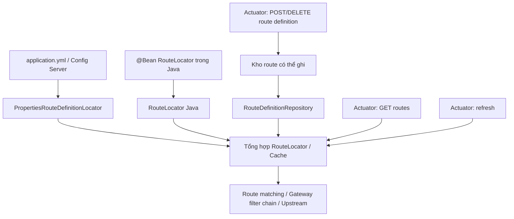
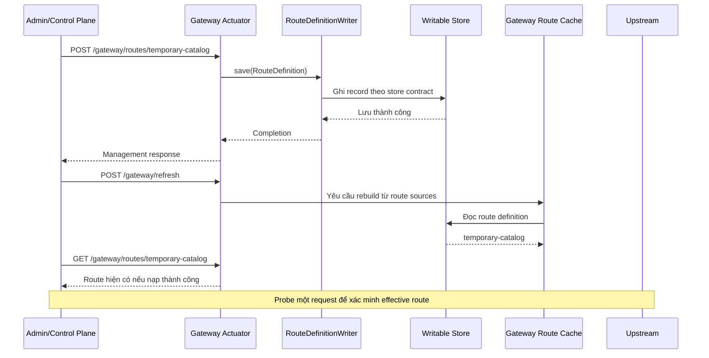
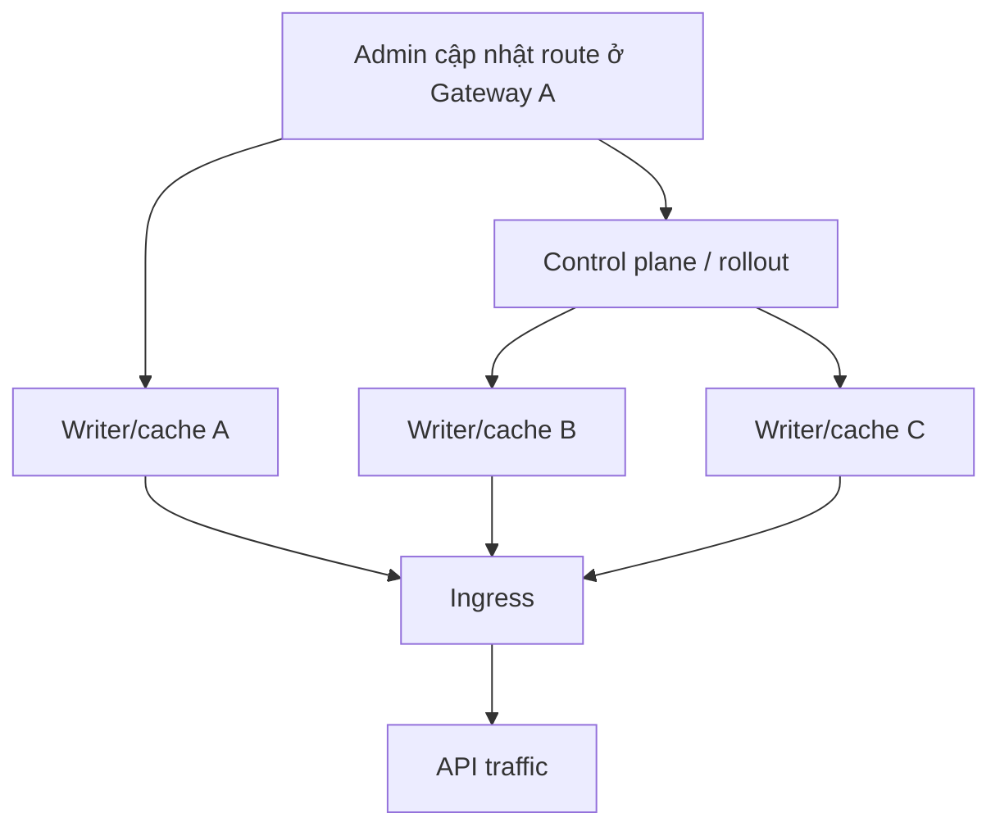
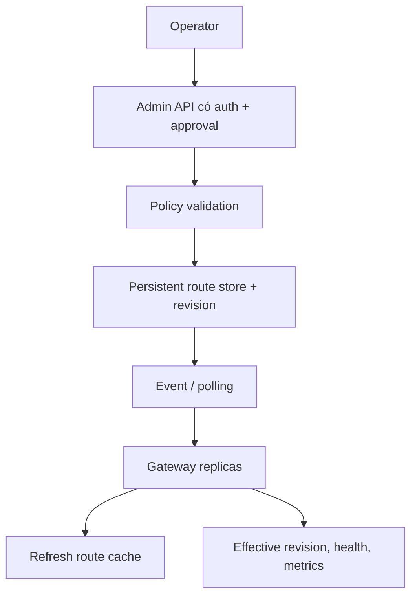

# Giới hạn thao tác đối với tuyến do YAML hoặc Java bean quản lý trong Spring Cloud Gateway

Trong một hệ thống microservices, Spring Cloud Gateway có thể nạp tuyến từ `application.yml`, từ cấu hình tập trung như Spring Cloud Config, từ mã Java tạo `RouteLocator`, hoặc từ một kho định nghĩa route có khả năng ghi. Khi bật **Spring Boot Actuator**, người vận hành có thể xem các route hiệu lực và, ở những phiên bản/cấu hình có cấp quyền ghi, yêu cầu thêm, xóa hoặc làm mới một số route.

Điểm dễ gây nhầm lẫn là: **nhìn thấy một route qua Actuator không đồng nghĩa Actuator có thể sửa nguồn đã tạo ra route đó**. Một route khai trong YAML vẫn chịu quản lý của YAML/config source. Một route được tạo bằng `@Bean RouteLocator` vẫn chịu quản lý bởi Java code và vòng đời bean. Lệnh `POST` hoặc `DELETE` của Gateway Actuator thường làm việc thông qua **`RouteDefinitionWriter`**, không tự chỉnh file YAML, sửa source Java hay phát hành một phiên bản ứng dụng mới.

Bài thuộc chương **Quản trị Actuator** của module `SPRING_CLOUD_GATEWAY`, trong bối cảnh một API Gateway xây dựng bằng route predicates, filter chain, biến đổi path/header, service discovery, xác thực, rate limiting, circuit breaker, retry, TLS và observability. Mục tiêu không chỉ là nhớ endpoint nào có thể gọi, mà là **chọn đúng đường quản trị theo nguồn sở hữu route** và tránh việc một thao tác quản trị tạm thời khiến nhiều replica định tuyến không nhất quán.

**Sau bài học, bạn có thể:**

1. Phân biệt **route có thể quan sát** với **route có thể thay đổi bền vững** qua Actuator.
2. Giải thích vai trò của `RouteLocator`, `RouteDefinitionLocator`, `RouteDefinitionWriter` và `RouteDefinitionRepository`.
3. Hiểu giới hạn của `POST /actuator/gateway/routes/{id}`, `DELETE /actuator/gateway/routes/{id}` và `POST /actuator/gateway/refresh` với các route đến từ **YAML** hoặc **Java bean**.
4. Thiết kế workflow đúng cho cấu hình tập trung, canary, refresh cache, rollback và nhiều Gateway replicas.
5. Bảo vệ management endpoint và kiểm thử kết quả thật ở data plane, không chỉ tin HTTP 2xx của API quản trị.

> **Phạm vi:** Các ví dụ dành cho **Spring Cloud Gateway Server WebFlux**. Tên starter, namespace `spring.cloud.gateway...`, cơ chế bật quyền truy cập Gateway Actuator và danh sách thao tác có thể thay đổi theo phiên bản Spring Boot/Spring Cloud Gateway. Những đoạn cấu hình chỉ minh họa một nhánh API, không phải cấu hình hoạt động trên mọi version. Đặc biệt, **Server MVC** có pipeline/khả năng quản trị khác và không được suy ra từ ví dụ WebFlux.

## 1. Tình huống mở đầu: xóa route trên Actuator nhưng route vẫn tồn tại

Giả sử Gateway có hai tuyến:

- `catalog-yaml` được cấu hình từ YAML, nhận `GET /api/catalog/**`.
- `orders-java` được tạo trong phương thức Java `@Bean RouteLocator`, nhận `/api/orders/**`.

Người vận hành mở danh sách Actuator và thấy cả hai tuyến. Sau đó họ muốn tạm xóa `catalog-yaml` bằng API quản trị, rồi tự hỏi tại sao request catalog vẫn khớp route hoặc route xuất hiện trở lại khi refresh/restart.

Vấn đề nằm ở **quyền sở hữu nguồn route**:



Sơ đồ là **mô hình logic**: cách ghép các locators và repository phụ thuộc Bean/auto-configuration của phiên bản. Mũi tên từ Actuator write tới kho có thể ghi **không phải** mũi tên đến YAML hay source Java.

**Nguyên tắc:** Nếu route được quản lý bởi một nguồn khai báo bên ngoài API write, hãy sửa **nguồn đó** qua đúng quy trình rồi refresh/rollout. Không dùng thao tác Actuator như một cách “ghi đè” lâu dài lên source of truth.

## 2. Ba tầng cần phân biệt: định nghĩa, route hiệu lực, thao tác quản trị

| Tầng | Nó chứa gì? | Ai quản lý? |
| --- | --- | --- |
| **Nguồn định nghĩa** | YAML, Git/Config Server, Java DSL hoặc record database. | Repository, CI/CD, config controller hoặc quản trị viên được phân quyền. |
| **Route hiệu lực** | `Route` đã được bind, sắp thứ tự, nạp predicate/filter và có thể nằm trong cache. | Gateway route locators, filter/route pipeline. |
| **Management API** | Endpoint đọc route, thêm/xóa qua writer, yêu cầu refresh. | Spring Boot Actuator + Spring Cloud Gateway actuator integration. |

Một thao tác chỉ tác động một tầng không tự đồng bộ tất cả các tầng.

Ví dụ:

```text
Git: catalog URI đổi sang lb://catalog-v2
Config Client chưa nhận revision mới
Gateway route cache còn lb://catalog-v1

POST /actuator/gateway/refresh
    → Có thể chỉ dựng lại route từ source đang giữ v1
    → Không tự fetch Git commit mới
```

Tương tự, một POST tạo route vào một `RouteDefinitionRepository` trong bộ nhớ **không làm thay đổi** file YAML hoặc Java class đã được build.

### 2.1. Quyền quan sát khác quyền chỉnh sửa

Một endpoint quản trị có thể đọc các route từ nhiều locator, nhưng write endpoint chỉ có thể tác động vào nơi `RouteDefinitionWriter` thực sự lưu dữ liệu.

| Hành động | Có thể thấy route YAML/Java? | Có trực tiếp sửa YAML/Java source? |
| --- | --- | --- |
| Xem danh sách effective routes | Thường có, nếu route đã được nạp và endpoint hỗ trợ. | Không. |
| Xem một route theo ID | Thường có, nếu route đã tồn tại trong effective locator. | Không. |
| Tạo route definition qua writer | Chỉ nếu quyền ghi và writer được hỗ trợ/cấu hình. | Không. |
| Xóa route definition qua writer | Chỉ với definition mà writer/backend sở hữu theo semantics cụ thể. | Không. |
| Refresh Gateway route cache | Yêu cầu đọc lại definitions/locators hiện có. | Không. |
| Restart/rollout | Nạp lại app/config theo lifecycle. | Không tự sửa source, nhưng source đã thay sẽ có hiệu lực. |

Từ “thường” ở bảng phản ánh sự khác nhau giữa các phiên bản và nguồn route. **Đọc được không phải chứng cứ có thể xóa được.**

## 3. Các giao diện nền tảng trong Gateway Server WebFlux

### 3.1. `RouteLocator`: cung cấp route runtime

`RouteLocator` cung cấp các đối tượng `Route` đã dùng để match request. Một `@Bean RouteLocator` có thể tạo các route bằng Java DSL. Gateway Actuator có thể hiển thị những route hiệu lực đó thông qua API đọc route.

Đây không phải API chung để sửa source Java.

### 3.2. `RouteDefinitionLocator`: cung cấp dữ liệu khai báo

Một locator định nghĩa route có dạng reactive:

```java
import org.springframework.cloud.gateway.route.RouteDefinition;
import org.springframework.cloud.gateway.route.RouteDefinitionLocator;
import reactor.core.publisher.Flux;

public interface ConceptualLocator extends RouteDefinitionLocator {
    @Override
    Flux<RouteDefinition> getRouteDefinitions();
}
```

Đoạn code chỉ minh họa **hợp đồng đọc**; nó không tạo route thực tế. Các implementation có thể lấy definitions từ properties, discovery service hoặc kho custom.

### 3.3. `RouteDefinitionWriter`: đường ghi/xóa definition

Một writer có trách nhiệm thực hiện các thao tác quản lý definition phù hợp với backend của nó, thường có chữ ký dạng:

```java
Mono<Void> save(Mono<RouteDefinition> route);

Mono<Void> delete(Mono<String> routeId);
```

Tên method, tham số và gói import cần được đối chiếu bản Gateway đang dùng. **Writer không có quyền thần kỳ đối với mọi locator khác**. Nếu backend của writer là in-memory repository, `save` chỉ ghi vào backend đó; nếu route chỉ tồn tại trong `@Bean RouteLocator` thì writer thường không thể viết lại bean.

### 3.4. `RouteDefinitionRepository`: kết hợp đọc và ghi

`RouteDefinitionRepository` là hướng tiếp cận cho một nguồn definition có cả khả năng đọc lẫn ghi. Một implementation có thể lưu dữ liệu trong bộ nhớ, Redis, database hoặc control plane tương ứng.

Ví dụ kiến trúc:

```text
Actuator POST/DELETE
  → RouteDefinitionWriter
  → Repository writable
  → Store
  → Gateway route-cache refresh
  → New effective routes
```

**Quan trọng:** Đây là một luồng thao tác **nếu các thành phần được cấu hình đúng**; không phải cam kết mọi Gateway tự có persistent repository hay tự refresh sau mỗi save/delete. Đối với dữ liệu cần lưu qua restart, phải chọn và kiểm thử implementation bền vững.

### 3.5. `CachingRouteLocator`

Gateway có thể sử dụng bộ nhớ đệm route để tối ưu việc match HTTP request. Khi definition nguồn đổi, cache có thể còn chứa route cũ cho tới khi được làm mới.

Nhưng refresh cache **không sửa nguồn**, nên việc reload chỉ nạp lại những gì các locators thực sự cung cấp tại thời điểm đó.

## 4. Hai nguồn không ghi được bằng một lệnh Actuator đơn giản

Bài học tập trung vào hai nguồn hay xuất hiện trong ứng dụng Gateway.

### 4.1. YAML properties là nguồn khai báo

Một route được binding từ properties:

```yaml
spring:
  cloud:
    gateway:
      server:
        webflux:
          routes:
            - id: catalog-yaml
              uri: lb://catalog-service
              predicates:
                - Path=/api/catalog/**
              filters:
                - StripPrefix=1
```

Trong một số phiên bản Gateway Server WebFlux cũ, namespace nằm tại `spring.cloud.gateway.routes`. Cần chọn một dạng phù hợp với phiên bản thực tế.

Nếu `catalog-yaml` đến từ `PropertiesRouteDefinitionLocator` hay một nguồn properties tương tự, **Actuator không tự mở file và xóa dòng YAML đó**. Vì vậy:

- Lệnh DELETE qua writer **có thể không tìm thấy** definition trong storage mà writer quản lý.
- Một thao tác POST trùng ID có thể gây **định nghĩa trùng** giữa nhiều nguồn, thay vì cập nhật YAML.
- Nếu route cache reload, definition từ YAML vẫn có thể được cung cấp trở lại.
- Restart ứng dụng nạp YAML theo nguồn đã deploy.

Đừng khẳng định một mã HTTP cụ thể cho mọi trường hợp DELETE: mapping exception/status và implementation writer phụ thuộc phiên bản. Điều cần kiểm tra là **route nguồn thực sự còn hay không** và **effective route sau refresh là gì**.

### 4.2. Java bean là nguồn chương trình

Ví dụ:

```java
import org.springframework.cloud.gateway.route.RouteLocator;
import org.springframework.cloud.gateway.route.builder.RouteLocatorBuilder;
import org.springframework.context.annotation.Bean;
import org.springframework.context.annotation.Configuration;

@Configuration
public class GatewayRoutes {

    @Bean
    RouteLocator ordersJavaRoute(RouteLocatorBuilder builder) {
        return builder.routes()
            .route("orders-java", r -> r
                .path("/api/orders/**")
                .filters(f -> f.stripPrefix(1))
                .uri("lb://order-service"))
            .build();
    }
}
```

Route `orders-java` được xây dựng bởi **Java code và Spring bean lifecycle**. Ngay cả khi Actuator hiển thị ID này, thao tác DELETE `/actuator/gateway/routes/orders-java` không thể tự sửa phương thức `ordersJavaRoute(...)`, xóa bytecode hay làm cho Bean không còn sinh route đó.

Nếu cần đổi route Java:

- Sửa code/Java DSL hoặc nguồn dữ liệu mà code đó thực sự đọc.
- Kiểm thử và triển khai phiên bản mới; hoặc
- Thiết kế một Bean/locator tùy biến có khả năng đổi snapshot runtime được kiểm soát.

**Actuator refresh không biên dịch lại Java class**. Đối với một Java RouteLocator Bean tĩnh, làm mới cache thường vẫn đọc cùng definitions runtime do Bean cung cấp.

## 5. So sánh giới hạn thao tác theo nguồn route

| Nguồn route | Hiển thị qua Gateway Actuator | Thêm/sửa/xóa trực tiếp qua writer mặc định | Duy trì qua restart | Đường thay đổi đáng tin |
| --- | --- | --- | --- | --- |
| `application.yml` đóng gói | Có thể thấy khi đã nạp. | **Không sửa trực tiếp YAML**. | Theo file config được deploy. | Sửa YAML, CI/CD, rollout/rebind phù hợp. |
| YAML từ Spring Cloud Config | Có thể thấy khi đã bind. | **Không sửa Git/Config Server**. | Theo cấu hình nguồn được nạp lại. | PR/commit, Config Client refresh, Gateway route refresh. |
| `@Bean RouteLocator` Java DSL tĩnh | Có thể thấy khi route được nạp. | **Không sửa code/Bean source**. | Theo bản binary/deploy. | Sửa code, deploy hoặc thiết kế custom dynamic source. |
| In-memory `RouteDefinitionRepository` | Có thể thấy sau khi effective routes được refresh. | Có thể ghi/xóa **trong store do writer sở hữu**. | Thường **không**, nếu chỉ giữ trong JVM. | Actuator được bảo vệ hoặc API nội bộ + refresh. |
| Persistent `RouteDefinitionRepository` tùy biến | Có thể thấy nếu locator được tích hợp. | Có thể ghi/xóa theo writer/transaction của repository. | Có thể, nếu store bền vững. | API control plane có auth/validation/commit/refresh. |
| Discovery-based routes | Có thể thấy nếu discovery locator tạo route. | Không tự sửa service registry hay policy discovery. | Phụ thuộc registry/locator. | Thay registry/service metadata/cấu hình locator. |

**Không có một thao tác CRUD dùng chung để chỉnh sửa bền vững tất cả các nguồn**. Nếu hệ thống thật sự cần quản trị route bằng API, hãy chủ động đưa những route được quản trị vào **một nguồn có khả năng ghi** thay vì cố ép Actuator thay thế Git và Java code.

## 6. Những endpoint Gateway Actuator cần biết

Trong các bản Spring Cloud Gateway Server WebFlux hỗ trợ Gateway Actuator, những endpoint thường dùng gồm:

| HTTP method / đường dẫn | Công dụng thường gặp | Giới hạn quan trọng |
| --- | --- | --- |
| `GET /actuator/gateway/routes` | Liệt kê route hiệu lực, có thể kèm predicate/filter/URI/metadata. | Không phân biệt route có quyền sửa source hay không. |
| `GET /actuator/gateway/routes/{id}` | Xem một route theo ID. | Không cấp quyền sở hữu hoặc quyền ghi. |
| `GET /actuator/gateway/globalfilters` | Kiểm tra global filters. | Read-only observation, không sửa logic Bean. |
| `GET /actuator/gateway/routefilters` | Kiểm tra route filter factories theo khả năng endpoint. | Không phải API chỉnh Java classes. |
| `POST /actuator/gateway/routes/{id}` | Lưu một `RouteDefinition` qua writer được hỗ trợ. | Không tự ghi YAML hoặc sửa Java code; có rủi ro trùng ID. |
| `DELETE /actuator/gateway/routes/{id}` | Xóa definition từ writer backend theo semantics của nó. | Không tự loại YAML/Java route ở locator khác. |
| `POST /actuator/gateway/refresh` | Yêu cầu làm mới Gateway route cache. | Không tự fetch Config Server hoặc restart app; thường là thao tác instance-local. |

**Không phải mọi phiên bản hoặc mọi cấu hình đều bật đầy đủ các phương thức này.** Spring Boot Actuator có thể yêu cầu cả **exposure** lẫn quyền truy cập **write/unrestricted**; có phiên bản chỉ cho phép đọc.

### 6.1. Nhìn thấy route ≠ chỉnh được route

Ví dụ hai API:

```http
GET /actuator/gateway/routes/catalog-yaml
GET /actuator/gateway/routes/orders-java
```

có thể trả chi tiết route vì Gateway **đang sử dụng** chúng. Nhưng:

```http
DELETE /actuator/gateway/routes/catalog-yaml
DELETE /actuator/gateway/routes/orders-java
```

không phải API chỉnh YAML hoặc Bean. Nếu được phép gọi, kết quả cụ thể phụ thuộc backend writer; không được suy từ status DELETE rằng source đã bị xóa.

### 6.2. Quyền truy cập Actuator thay đổi theo phiên bản

Một cấu hình **ưu tiên chỉ đọc** trong nhánh Spring Boot/Gateway hỗ trợ mô hình `access` có thể có dạng:

```yaml
management:
  endpoints:
    web:
      exposure:
        include: health,info,gateway
  endpoint:
    gateway:
      access: read-only
```

Với mục đích quản trị có quyền ghi, một số phiên bản cho phép `management.endpoint.gateway.access: unrestricted`, nhưng đó là quyền rất nhạy cảm và **không nên bật chỉ để thử CRUD ngoài production có kiểm soát**.

Các phiên bản cũ có thể dùng `management.endpoint.gateway.enabled` hoặc cơ chế khác; phiên bản mới có thể có thiết lập access control ở mức Actuator chung. **Chọn cấu hình theo reference docs của bản đang dùng**, không trộn tùy tiện `enabled`, `access` và `exposure` rồi coi là đồng nhất.

> **Exposure không phải authentication.** Có endpoint trong `exposure.include` không tự giới hạn client nào được phép xem/sửa. Cần Spring Security, management network, TLS/mTLS và quyền ghi riêng.

## 7. Tình huống A — Route YAML: phải thay source trước

Giả sử có route:

```yaml
- id: catalog-yaml
  uri: lb://catalog-service-v1
  predicates:
    - Path=/api/catalog/**
  filters:
    - StripPrefix=1
```

Người vận hành muốn chuyển `catalog-service-v1` sang `catalog-service-v2`.

### 7.1. Cách không nên dùng làm phương án bền vững

Không nên đơn giản POST một route mới với **cùng ID** vào Actuator writer rồi coi đây là “đã sửa YAML”:

```text
YAML locator:
    id=catalog-yaml, uri=lb://catalog-service-v1

Actuator writable repository:
    id=catalog-yaml, uri=lb://catalog-service-v2

Combined route sources:
    Có khả năng xuất hiện definition ID trùng
    hoặc behavior phụ thuộc locator/priority/version
```

Duplicate ID giữa các nguồn có thể dẫn đến hành vi khó dự đoán và quan sát không rõ ràng. Đừng dựa vào thứ tự tổng hợp như một cơ chế override cấu hình chính thức khi chưa có thiết kế và test cụ thể.

### 7.2. Cách đúng với YAML được quản lý bởi Git

1. Sửa định nghĩa route trong Git/config repository.
2. Chạy review, kiểm tra URI/service ID và policy.
3. Merge/publish một revision rõ ràng.
4. Đảm bảo Config Client hoặc cơ chế cấu hình của Gateway **nhận và bind** revision mới.
5. Làm mới Gateway route cache bằng cách được phiên bản hỗ trợ, hoặc rollout/restart có kiểm soát.
6. Kiểm tra **effective route** trên từng replica và request thực tế tới v2.
7. Rollback ở **nguồn YAML** nếu không đạt SLO, rồi refresh/rollout lại.

### 7.3. Nếu YAML đóng gói cùng binary?

Khi YAML nằm trong ứng dụng đã build, cách đơn giản và tái lập thường là **triển khai một binary/config mới** và rolling restart. Không chỉnh file bên trong container rồi gọi refresh với kỳ vọng mọi instance biết thay đổi.

### 7.4. Vì sao một lần Gateway refresh có thể không đổi gì?

`POST /actuator/gateway/refresh` thường yêu cầu rebuild route cache từ **các route sources đang được cung cấp**. Nếu `@ConfigurationProperties` hoặc Config Client chưa cập nhật, cache có thể tiếp tục nạp v1.

Phân biệt:

```text
Config source refresh / rebind
        khác
Gateway route-cache refresh
```

Cả hai cần được kiểm chứng khi dùng YAML từ nguồn tập trung.

## 8. Tình huống B — Route từ Java Bean: Actuator không sửa Bean definition

Xét Java DSL:

```java
@Bean
RouteLocator promotionsRoutes(RouteLocatorBuilder builder) {
    return builder.routes()
        .route("promotions-java", r -> r
            .path("/api/promotions/**")
            .filters(f -> f.stripPrefix(1))
            .uri("lb://promotions-service-v1"))
        .build();
}
```

Nếu muốn đổi đích thành `lb://promotions-service-v2`, Actuator không thể thay literal bên trong source Java đã compile.

### 8.1. Ba lựa chọn thực tế

| Lựa chọn | Cách làm | Ưu/nhược |
| --- | --- | --- |
| **Deploy code mới** | Sửa `uri` trong Java, build/test, rolling deploy. | Rõ ràng, audit qua Git, không đổi động tức thời. |
| **Đọc URI từ nguồn cấu hình** | Java Bean hoặc custom locator được thiết kế nhận property có thể refresh. | Cần chứng minh rebind/rebuild route thực sự xảy ra; không tự động. |
| **Chuyển sang writable route repository** | Định nghĩa route nằm trong store có schema/validation/version. | Linh hoạt, nhưng phải xây control plane và rollback. |

Thực tế, nếu route đã trở thành cấu hình được đổi thường xuyên, đặt nó trong Java DSL tĩnh có thể không còn là cách quản lý phù hợp. **Đổi mô hình sở hữu route có chủ đích** tốt hơn “ghi đè” tạm qua Actuator.

### 8.2. `@RefreshScope` có phải lời giải chung?

Không. `@RefreshScope` liên quan cơ chế refresh Bean/properties của Spring Cloud Context, còn `@Bean RouteLocator`, route cache và cách bean được tạo lại phụ thuộc wiring/version thực tế. Không nên thêm annotation rồi tuyên bố mọi route Java được rebuild đúng.

Nếu cần động, thiết kế **RouteDefinitionLocator/snapshot source có version**, validation và refresh event rõ ràng; hoặc dùng deploy để giữ tính tái lập.

### 8.3. Không nhầm service discovery với sửa URI route

`lb://promotions-service` cho phép LoadBalancer chọn instance trong danh sách khám phá dịch vụ. Khi số instance thay đổi, Gateway có thể đổi đích instance mà **route definition không đổi**.

Việc đổi `lb://promotions-service-v1` sang `lb://promotions-service-v2` là đổi **service ID trong route**; khác với cập nhật danh sách instance của cùng service ID.

## 9. Tình huống C — Route thực sự do writer/repository quản lý

Nếu route được tạo trong một `RouteDefinitionRepository` có thể ghi, Gateway Actuator có thể tham gia quản trị theo API của repository và quyền được cấu hình.

Một flow minh họa trong **môi trường staging cô lập**, với management endpoint chỉ cho admin:



Sơ đồ không cam kết endpoint luôn refresh đồng bộ hoặc trả mã status cố định sau save. Một số implementation có thể tích hợp refresh theo cách riêng; phải kiểm tra bản chạy thực tế.

### 9.1. Ví dụ tạo route qua writer

Một request minh họa:

```bash
curl -i -X POST \
  "https://gateway-admin.internal.example/actuator/gateway/routes/temporary-catalog" \
  -H "Authorization: Bearer <admin-token>" \
  -H "Content-Type: application/json" \
  --data '{
    "id": "temporary-catalog",
    "uri": "lb://catalog-service",
    "predicates": [
      {
        "name": "Path",
        "args": {
          "_genkey_0": "/sandbox/catalog/**"
        }
      }
    ],
    "filters": [],
    "order": 100
  }'
```

**Giới hạn của ví dụ:** Cấu trúc JSON `RouteDefinition` và cách bind predicate arguments có thể thay đổi theo API/version. `_genkey_0` là biểu diễn positional arg thường gặp trong các ví dụ Gateway, không phải schema do người dùng phải tự áp dụng cho mọi predicate.

Đây là thao tác **quản trị quyền cao**; chỉ chạy trong staging với endpoint nội bộ đã kiểm soát. Không sao chép nguyên endpoint ra Internet.

### 9.2. Refresh và quan sát

Nếu phiên bản/config cần refresh tường minh:

```bash
curl -i -X POST \
  "https://gateway-admin.internal.example/actuator/gateway/refresh" \
  -H "Authorization: Bearer <admin-token>"
```

Rồi kiểm tra:

```bash
curl -i \
  "https://gateway-admin.internal.example/actuator/gateway/routes/temporary-catalog" \
  -H "Authorization: Bearer <admin-token>"
```

Để kiểm chứng data plane, gửi request qua **cổng API thông thường** tới `/sandbox/catalog/products/42` và quan sát backend/mocking/tracing. **GET route** chỉ xác minh một góc nhìn management; không chứng minh backend sẵn sàng hoặc mọi replica đã nạp route.

### 9.3. Xóa route động

Với route do writer sở hữu:

```bash
curl -i -X DELETE \
  "https://gateway-admin.internal.example/actuator/gateway/routes/temporary-catalog" \
  -H "Authorization: Bearer <admin-token>"
```

Sau đó refresh nếu cần và kiểm tra route không còn được đưa ra bởi **mọi source**. Nếu route vẫn thấy, có thể còn một locator khác phát cùng ID, cache chưa refresh hoặc node khác chưa cập nhật.

### 9.4. Tính bền vững phụ thuộc storage

Nếu writer sử dụng **in-memory store**, restart Gateway có thể làm route động biến mất. Nếu muốn tồn tại qua restart và nhiều replicas, cần persistent repository dùng chung hoặc control plane phân phối version đã lưu.

**Actuator POST thành công không đồng nghĩa dữ liệu đã durable** nếu storage chỉ là memory.

## 10. Vì sao DELETE route YAML/Java có thể trả lỗi hoặc không có tác dụng mong đợi?

Một lỗi chẩn đoán phổ biến: thấy route trong `GET /gateway/routes` rồi gọi DELETE route ID đó, nhận lỗi “not found” hoặc thấy route không biến mất.

Hai đường thực thi có thể khác:

```text
GET:
  Effective RouteLocator
    → tổng hợp nhiều route sources

DELETE:
  RouteDefinitionWriter
    → chỉ thao tác backend writer được cấu hình
```

Nếu ID chỉ tồn tại trong `PropertiesRouteDefinitionLocator` hoặc Java `RouteLocator`, writer không nhất thiết có record đó. Kết quả có thể là exception do backend hoặc error response tùy handler/version.

**Không cố “sửa” bằng cách thêm một record trùng ID vào writable repository rồi xóa record đó.** Bạn chỉ thay đổi backend của writer; route YAML/Java có thể vẫn tồn tại.

### 10.1. Refresh sau DELETE cũng không phải xóa nguồn

Nếu route YAML vẫn ở file config, refresh có thể nạp lại nó. Nếu route Java vẫn được Bean cung cấp, refresh vẫn có thể dùng nó.

Muốn **vô hiệu hóa** route một cách bền vững, phải:

- Xóa/sửa predicate hoặc route tại nguồn sở hữu.
- Hoặc triển khai chính sách chặn tạm ở edge/Security nếu là tình huống khẩn cấp.
- Sau đó xác minh mọi Gateway instances và request in-flight theo threat model.

### 10.2. Tại sao phải tránh duplicate route IDs?

Hai nguồn cùng phát ID `catalog-yaml` có thể khiến:

- Actuator hiển thị nhiều bản hoặc một trạng thái khó nhận diện.
- Route matching bị ảnh hưởng bởi thứ tự/priority.
- Việc xóa ở một store không loại bản ở store khác.
- Observability theo route ID khó phân biệt nguồn.
- Rollback không biết bản nào là source of truth.

Cần validation ID duy nhất trong tập hợp route nguồn có hiệu lực, và một chính sách sở hữu rõ cho mỗi nhóm route.

## 11. `/actuator/gateway/refresh` chỉ là một bước làm mới cache

Một chuỗi an toàn thường cần:

```text
1. Sửa đúng nguồn có thẩm quyền.
2. Xác nhận source commit/update hoàn tất.
3. Nếu cần, cập nhật Environment/Bean/locator source.
4. Yêu cầu route cache refresh.
5. Kiểm tra route hiệu lực ở instance đó.
6. Probe request và upstream.
7. Lặp/điều phối cho mọi Gateway instances.
```

**Không đảo bước 3 và 4**: refresh quá sớm có thể nạp bản cũ.

### 11.1. `RefreshRoutesEvent` và actuator refresh

Trong code WebFlux, có thể phát sự kiện cục bộ:

```java
import org.springframework.cloud.gateway.event.RefreshRoutesEvent;
import org.springframework.context.ApplicationEventPublisher;
import org.springframework.stereotype.Service;

@Service
public class RouteRefreshService {

    private final ApplicationEventPublisher publisher;

    public RouteRefreshService(ApplicationEventPublisher publisher) {
        this.publisher = publisher;
    }

    public void refreshAfterSourceCommit() {
        publisher.publishEvent(new RefreshRoutesEvent(this));
    }
}
```

`RefreshRoutesEvent` là cơ chế làm mới route cache từ các source hiện có, **không phải** API đổi YAML/source code và không mặc định broadcast tới cluster.

### 11.2. Spring Cloud Context refresh khác Gateway route refresh

Trong hệ sinh thái Spring Cloud, `/actuator/refresh` (nếu có) có thể liên quan tới làm mới properties/`@RefreshScope`. Trong khi đó `/actuator/gateway/refresh` tập trung vào cache route của Gateway.

Đây là hai ý nghĩa khác nhau. Nếu dùng Config Server, phải xác minh cả **config source revision** lẫn **effective route**. Gọi một endpoint không tự bảo đảm endpoint kia đã làm đủ việc.

### 11.3. Refresh không phải request draining

Một request đã match route cũ có thể tiếp tục dùng filter chain/URI cũ khi refresh xảy ra. Không sử dụng route cache refresh làm cam kết chặn ngay mọi request in-flight.

Với thay đổi bảo mật khẩn cấp, cần xem xét firewall/ingress, security policy, token revocation, connection draining và rollout có kiểm soát.

## 12. Quản lý nhiều Gateway replicas

Một môi trường production thường có nhiều Gateway instances phía sau ingress/load balancer. Cùng một management path nhưng request có thể đến **một** instance cụ thể.



Nếu chỉ gọi Actuator POST và refresh trên A:

- B và C có thể tiếp tục dùng route cũ.
- Nếu A có in-memory repository, B/C không biết record mới.
- Nếu dùng shared database, B/C có thể nhìn thấy source mới **nhưng vẫn cần refresh cache** theo cơ chế riêng.
- Nếu load balancer đưa request quản trị ngẫu nhiên đến một replica khác, bạn có thể nhầm phản hồi của B với trạng thái A.

### 12.1. Shared repository là cần thiết nhưng chưa đủ

Cùng đọc Redis/database không tự tạo atomic cutover toàn cụm. Các node có thể có:

```text
Gateway A: effective revision 12
Gateway B: effective revision 11
Gateway C: effective revision 12
```

Cần một quy trình:

1. Xuất bản snapshot version 12 đã được kiểm tra.
2. Phân phối tín hiệu hoặc polling tới từng node.
3. Mỗi node refresh cache và xác nhận version.
4. Kiểm tra canary/health.
5. Chỉ công bố rollout hoàn tất khi đạt điều kiện nhất quán mong muốn.

### 12.2. HTTP 2xx của admin endpoint không phải xác nhận cả cụm

Nếu admin POST vào một Gateway và nhận response 2xx, mới biết **endpoint đó xử lý request theo contract của nó**. Không kết luận toàn bộ Gateway cluster đã cập nhật và data plane có thể phục vụ đích mới.

Khi route critical, cần telemetry như:

```json
{
  "instance": "edge-02",
  "desiredRevision": "routes-12",
  "effectiveRevision": "routes-11",
  "lastRefreshResult": "PENDING"
}
```

Đây là **schema observability tùy biến**, không phải JSON chuẩn mà Gateway Actuator luôn cung cấp.

## 13. Bảo mật Gateway Actuator: quyền đọc và quyền ghi khác nhau

Danh sách route có thể tiết lộ các thông tin:

- Service IDs như `payment-service` hoặc `identity-service`.
- Host/path nội bộ.
- Tên filter, metadata, timeout hoặc kiến trúc network.
- Các route quản trị không được công khai.

Khả năng tạo/xóa route còn nhạy cảm hơn: người có quyền ghi có thể chuyển lưu lượng đến upstream không đáng tin hoặc tạo route trỏ vào hạ tầng riêng.

### 13.1. Mô hình quyền đề xuất

| Vai trò | Quyền |
| --- | --- |
| API client bình thường | **Không** truy cập Gateway Actuator management. |
| Observer/SRE read-only | Chỉ đọc health/metrics/route details đã được cho phép. |
| Operator có quyền rollout | Có thể yêu cầu refresh qua workflow đã xác thực và audit. |
| Control plane có quyền thay route | Chỉ được ghi/xóa route theo approved policy; cần kiểm tra schema, URI và quota. |
| Break-glass admin | Quyền tạm thời, ghi audit đầy đủ, bảo vệ bằng nhiều lớp. |

**Đừng cấp toàn bộ quyền unrestricted** cho mọi người chỉ vì cần một người xem danh sách route.

### 13.2. Phòng vệ nhiều lớp

- Expose management trên **private port/network** khi có thể.
- Chỉ cho phép ingress nội bộ, firewall và network policy phù hợp.
- Dùng HTTPS/mTLS hoặc identity có xác thực mạnh cho admin clients.
- Phân quyền chi tiết: GET khác POST/DELETE.
- Bảo vệ credential và giới hạn tuổi thọ/quyền của admin tokens.
- Audit user/service account, thời gian, route ID, desired revision và kết quả.
- Giới hạn tốc độ write/refresh để tránh refresh storm.
- Không bật wildcard management exposure ngoài môi trường test đã cô lập.
- Không log raw token, secret hoặc toàn bộ sensitive route metadata.

### 13.3. Spring Security WebFlux và Actuator

Một chính sách khái niệm:

```text
GET    /actuator/gateway/**   -> SCOPE_gateway.read
POST   /actuator/gateway/**   -> SCOPE_gateway.admin
DELETE /actuator/gateway/**   -> SCOPE_gateway.admin

Mọi traffic từ Internet tới management -> chặn tại network/ingress.
Các thao tác write -> qua admin workflow có approval/audit.
```

Đây là **policy thiết kế**, không phải cấu hình mặc định của Spring Boot. Nếu dùng `SecurityWebFilterChain`, hãy kiểm tra thứ tự chain/matcher và endpoint thực tế. Khi management chạy ở port/application context riêng, cách bảo vệ có thể khác API WebFlux chính.

Nếu management dùng cookie/session, cần cân nhắc CSRF; nếu chỉ dùng Bearer/mTLS với API stateless, chính sách CSRF có thể khác. Không copy `csrf(disable)` cho toàn hệ thống chỉ để POST refresh hoạt động.

### 13.4. Route write có thể trở thành SSRF

Một route tạo từ API admin:

```yaml
id: unsafe-example
uri: http://169.254.169.254
predicates:
  - Path=/**
```

có thể tạo đường truy cập không mong muốn tới địa chỉ metadata/internal. Ví dụ chỉ để nhận diện rủi ro, **không triển khai**.

Cần allowlist URI schemes/host/service IDs, chặn metadata/loopback/private networks ngoài policy, kiểm tra DNS/TLS và đặt egress restrictions. Kể cả admin đã xác thực, route change vẫn cần **policy validation** vì sai sót vận hành cũng có thể gây lộ dữ liệu.

### 13.5. Route CRUD không được âm thầm bỏ qua JWT, CORS hoặc hạn mức

Một route mới được tạo qua writer không mặc nhiên có cùng chính sách với route YAML/Java mà nó thay thế. Trước khi duyệt, cần kiểm tra:

- **JWT và Spring Security:** `SecurityWebFilterChain` bảo vệ đường dẫn public tương ứng, đồng thời backend tiếp tục xác minh quyền nghiệp vụ; không tin header danh tính do client tự gửi.
- **CORS:** nếu route phục vụ browser, chính sách preflight và origin không được mở rộng tùy ý khi thay `Path`/`Host` hoặc metadata CORS.
- **`RequestRateLimiter`:** tránh vô tình bỏ bộ lọc quota hoặc thay `KeyResolver` thành giá trị lấy từ header không đáng tin.
- **`CircuitBreaker` và `Retry`:** thay bộ lọc có thể tăng số lần gọi upstream; tuyệt đối không bật retry POST có tác dụng phụ nếu thiếu hợp đồng idempotency.
- **TLS và upstream trust:** thay `uri` không được làm mất kiểm tra chứng chỉ, định danh service hoặc chính sách egress.

Việc có quyền ghi route **không được xem là quyền tắt những lớp phòng vệ này**. Với các điều kiện an toàn bắt buộc, nên thực thi chính sách ở tầng khó bị route CRUD làm thay đổi và kiểm chứng bằng test.

## 14. Vì sao không nên dùng Actuator CRUD làm control plane production hoàn chỉnh?

Actuator hữu ích cho **observability và thao tác quản trị ở runtime**, nhưng một hệ thống quản lý route production thường cần nhiều thành phần hơn:

1. Schema/API contract và validation nghiêm ngặt.
2. Xác thực/ủy quyền theo operator, service account và môi trường.
3. Phê duyệt thay đổi, audit và lịch sử phiên bản.
4. Route ownership và phát hiện duplicate IDs.
5. Kiểm tra sự tương thích giữa predicates, filters và security policy.
6. Snapshot atomically, rollout/canary/rollback.
7. Persist state qua restart và nhiều replicas.
8. Giới hạn tần suất thay đổi, debounce và circuit breaker cho control plane.
9. Health/status mỗi replica và kiểm tra effective route.
10. Tích hợp với GitOps/Config Server hoặc repository đã chuẩn hóa.

Nếu chỉ expose POST/DELETE Actuator vào Internet, bạn mới tạo ra một **cửa ghi cấu hình có rủi ro cao**, chứ chưa tạo được một hệ thống quản trị có kiểm soát.

### 14.1. Có thể xây API quản trị riêng không?

Có. Một **control plane** chuyên biệt có thể:



Control plane quyết định **ai được đổi gì**, kiểm tra toàn bộ snapshot và phát hành revision. Gateway chỉ nhận definitions từ nguồn tin cậy; actuator write endpoint có thể được **tắt** khi không cần.

### 14.2. Route thuộc về YAML hay database?

Tránh để cả hai là “nguồn thật” cho cùng route. Một số phương án:

- **GitOps:** mọi route được quản lý qua YAML trong Git; Actuator chỉ quan sát/refresh có kiểm soát.
- **DB-managed:** route động nằm trong persistent repository; control plane quản lý CRUD.
- **Hybrid có phân vùng:** một tập route tĩnh có prefix ID riêng, một tập route động có prefix khác; validation ngăn overlap.
- **Java-managed:** những route có logic đặc thù nằm trong code; thay đổi qua deploy; route còn lại quản lý tập trung.

Nếu hybrid, cần phát hiện cả **trùng ID** lẫn **predicate overlap** để tránh một route dynamic không chủ ý lấy traffic của static route.

## 15. Refresh và khả năng rollback: nguồn có quyền quyết định

Giả sử một operator đã lỡ đổi route `/api/orders/**` sang upstream thử nghiệm. Cách rollback phụ thuộc nguồn:

| Nguồn | Cách rollback |
| --- | --- |
| YAML nằm trong Git | Revert/đưa về revision trước, Config Client nhận bản mới, refresh/rollout. |
| Java DSL tĩnh | Deploy lại artifact/revision Java đã biết tốt. |
| Writable persistent repository | Restore snapshot version trước trong kho và phát refresh tới replicas. |
| In-memory route Actuator | Xóa/sửa record trong instance bị ảnh hưởng; cần xác minh không có source khác phát route. |
| Discovery route | Sửa registry/metadata hoặc policy discovery đã tạo route. |

**Không nhầm rollback một thao tác DELETE trong writer với rollback một commit YAML**. Đó là những nguồn khác nhau.

### 15.1. Last-known-good

Khi Config Server/DB outage hoặc snapshot mới sai, Gateway thường nên có cách giữ một bộ route đã được kiểm chứng, thay vì tự xóa hết routes vì source tạm rỗng. Cần phân biệt “snapshot rỗng được phê duyệt” với lỗi tải dữ liệu.

### 15.2. Thao tác khẩn cấp

Với route đang mở một điểm rủi ro bảo mật, sửa YAML/Java có thể cần thời gian deploy. Một biện pháp chặn tạm ở **ingress/firewall/Spring Security** có thể hiệu quả hơn việc thử DELETE một definition không thuộc writer.

Sau đó vẫn phải sửa **source of truth** để biện pháp tạm không trở thành “cấu hình bóng” khó audit.

## 16. Versioning và thay đổi đồng thời

Hai operator có thể cùng cập nhật route `orders-api`. Nếu chỉ dựa vào POST writer theo ID mà không có version/ETag hoặc CAS:

```text
Operator A đọc route v10
Operator B đọc route v10
A ghi bản sửa v11
B ghi bản sửa dựa trên v10
Kết quả A có thể bị ghi đè nếu store không kiểm soát cạnh tranh
```

Để an toàn:

- Có revision/ETag hoặc optimistic locking tại control plane/store.
- Chỉ chấp nhận update với expected version phù hợp.
- Kiểm tra quyền owner/namespace của route.
- Audit patch/diff và người phê duyệt.
- Sử dụng snapshot atomically thay vì nửa số route đã đổi.
- Sau commit, yêu cầu refresh có giới hạn và kiểm tra effective revision.

**Actuator route CRUD không mặc định cung cấp đầy đủ version-conflict protection cho mọi repository**. Những bảo đảm này cần được thiết kế tại nguồn quản lý dữ liệu.

### 16.1. Delete và refresh đang chạy đồng thời

Nếu DELETE một route dynamic, trong khi một refresh khác đang nạp snapshot cũ, có thể xuất hiện một khoảng thời gian effective state khác desired state. Cần test race giữa save/delete, cache rebuild và concurrent HTTP traffic.

Không nên coi HTTP 204/200 của DELETE (nếu có) là bảo đảm **mọi request sau mili giây đó không bao giờ được match route cũ**.

## 17. Observability: phân biệt source, desired và effective routes

Một dashboard quản trị tốt cần trả lời:

- Route ID nào đến từ YAML, Java, discovery, in-memory hay persistent repository?
- Desired config revision hiện tại là gì?
- Effective route revision ở **mỗi Gateway instance** là gì?
- Có route ID trùng hoặc predicate overlap không?
- Actuator writes/refresh bị từ chối bởi policy hay lỗi backend?
- Sau rollout, 404/429/503/circuit breaker events thay đổi ra sao?
- Bao nhiêu request vẫn đi theo route cũ trong giai đoạn chuyển đổi?

### 17.1. Các metric nên cân nhắc

| Metric/event | Mục đích |
| --- | --- |
| `gateway_route_inventory_count` theo source | Biết route từ các nguồn. |
| `gateway_route_duplicate_id_total` | Phát hiện ID xung đột. |
| `gateway_admin_write_attempts_total` theo action/outcome | Audit tần suất tạo/xóa. |
| `gateway_refresh_attempts_total` và duration | Phát hiện refresh storm hoặc chậm. |
| `gateway_route_revision_skew` | Đo số replicas lệch target revision. |
| `gateway_route_update_rejected_total` | Phân loại lỗi schema/allowlist/auth. |
| HTTP requests theo route ID/status | Đo tác động lên traffic thật. |
| Upstream attempts/latency/5xx | Tách lỗi route khỏi lỗi backend. |

Đây là **tên metric gợi ý để tự thiết kế**, không phải khẳng định Spring Cloud Gateway xuất sẵn tất cả tên trên.

### 17.2. Không dùng nhãn quá chi tiết

Tránh metric labels theo raw access token, email, route URI tùy ý, full request path, idempotency key hoặc raw operator ID nếu cardinality cao. Dùng route ID đã chuẩn hóa, source category và action outcome; log audit chi tiết phải được bảo vệ riêng.

### 17.3. Phân biệt status

| HTTP status | Có thể liên quan tới điều gì? |
| --- | --- |
| `401` | Client chưa có credential hợp lệ, có thể do Spring Security trước Gateway route. |
| `403` | Thiếu quyền xem/sửa management endpoint hoặc thiếu API authorization. |
| `404` | Route không khớp hoặc backend/management path không tồn tại. |
| `405` | Method write không được endpoint hỗ trợ ở mode/phiên bản hiện tại. |
| `429` | API client bị rate limit; management có thể bị policy riêng giới hạn. |
| `503` | `lb://` không có service instance hoặc upstream không khả dụng. |
| `5xx` | Có thể do storage/refresh/filter/backend lỗi; cần phân loại nguồn. |

Không sửa cấu hình actuator chỉ vì một route trả 503: lỗi có thể ở discovery/backend hoàn toàn độc lập.

## 18. Kịch bản kiểm thử: YAML, Java Bean và writable route

Giả sử staging có:

- Route `catalog-yaml` trong `application.yml`.
- Route `orders-java` trong `@Bean RouteLocator`.
- Một writable repository đã được cấu hình dành cho route `temporary-catalog`.
- Hai Gateway replicas: A và B.
- Actuator management có quyền read/write **chỉ trong mạng staging**.

### 18.1. Bước 1 — Liệt kê và phân loại nguồn

Lấy danh sách effective routes:

```bash
curl -i \
  "https://gateway-admin.internal.example/actuator/gateway/routes" \
  -H "Authorization: Bearer <observer-token>"
```

Đối chiếu nguồn quản lý ngoài Actuator: `catalog-yaml` thuộc YAML, `orders-java` thuộc Java code, `temporary-catalog` thuộc writer repository.

**Không suy nguồn chỉ từ việc route có mặt trong JSON Actuator**; Gateway route display không nhất thiết công bố “owner/source” theo một schema chuẩn. Hãy duy trì registry/metadata inventory riêng khi cần.

### 18.2. Bước 2 — Kiểm thử route YAML không bị xóa ở nguồn

Trong **staging cô lập**, kiểm tra capability writer bằng phương pháp an toàn và đã được phê duyệt. Nếu thử DELETE route YAML, kết quả status khác nhau giữa các version/store; bất biến quan trọng là:

- File/config source vẫn chứa `catalog-yaml`.
- Làm mới cache từ nguồn YAML vẫn có thể tái tạo route.
- Sửa nguồn YAML mới là cách xóa bền vững.

Không thực hiện phép thử phá hủy này trên production và **không viết automation tự DELETE route static chỉ dựa vào GET inventory**.

### 18.3. Bước 3 — Kiểm thử Java route tương tự

Xem `orders-java` qua route list. Đối chiếu source code/bean definition: writer không sửa Java DSL. Thay route bằng build/deploy staging mới và xác minh ID/path/upstream thay đổi theo revision.

### 18.4. Bước 4 — Tạo và xóa writable route

Gửi `POST` route test mới có ID không đụng route tĩnh, refresh nếu cần, xác minh upstream; sau đó DELETE chính ID đó và refresh. Kiểm tra store/writer có đúng semantics hay không.

### 18.5. Bước 5 — Restart instance

Restart một Gateway staging có in-memory writer repository. Route test có thể mất. Với persistent repository, route có thể tồn tại nhưng cache cần nạp lại. Ghi rõ durability theo implementation.

### 18.6. Bước 6 — Multi-replica

Gọi admin endpoint trực tiếp A, xác minh B không bị mặc định đồng bộ nếu source/cache chưa có cơ chế chia sẻ; sau đó chạy workflow phân phối và kiểm tra effective route từng instance.

### 18.7. Bước 7 — Security controls

Thử các trường hợp:

- Không token hoặc token hết hạn → từ chối.
- Observer read-only gọi GET được theo policy.
- Observer read-only gọi POST/DELETE/refresh → từ chối.
- Admin được phép sửa đúng namespace, nhưng không được tạo route có URI không nằm trong allowlist.
- Rate cap chặn admin refresh storm.
- Audit ghi đúng actor/action/revision, không lộ credential.

## 19. Ma trận kiểm thử chi tiết

| Ca kiểm thử | Nguồn route | Hành động | Bất biến cần kiểm chứng |
| --- | --- | --- | --- |
| GET inventory | YAML | `GET /gateway/routes` | Route hiệu lực được nhìn thấy; không suy quyền write. |
| DELETE route YAML | YAML | DELETE qua writer | Không tự sửa/xóa YAML source; behavior status tùy store. |
| POST trùng ID YAML | YAML + writer | Tạo ID trùng | Policy nên chặn; không coi là override YAML tin cậy. |
| Refresh sau đổi Git | Config Server YAML | Gateway refresh trước Config Client reload | Có thể vẫn nạp route cũ; cần đúng thứ tự. |
| GET Java route | Java `@Bean RouteLocator` | `GET /gateway/routes/{id}` | Có thể thấy effective route, không suy writer ownership. |
| DELETE Java route | Java Bean | DELETE qua writer | Không sửa code/bean; không dựa vào DELETE để vô hiệu bền vững. |
| Change Java URI | Java Bean | Recompile/deploy hoặc custom source | Route đổi theo version quản lý thực tế. |
| POST route mới | Writable store | Save qua Actuator | Record được ghi theo store semantics; route effective cần verify. |
| Refresh | Writable store | `POST /gateway/refresh` | Cache nạp từ source đã commit. |
| DELETE writable | Writable store | Delete + refresh | Không còn record do writer sở hữu; route không có bản trùng. |
| Restart | In-memory store | Restart Gateway | Route in-memory có thể mất, không hứa persistence. |
| Restart | Persistent store | Restart Gateway | Record còn nếu store bền vững và được nạp đúng. |
| Multi-replica | Shared store | Chỉ refresh A | B vẫn có thể giữ cache cũ; cần version reconciliation. |
| Concurrent writes | Persistent store | A và B cập nhật cùng ID | CAS/revision ngăn lost update theo policy. |
| Route URI không an toàn | Writable store | POST URI metadata/internal | Validation/egress policy từ chối. |
| Client thông thường | Actuator | GET/POST/DELETE | Bị network/auth policy từ chối. |
| Observer token | Actuator | POST/DELETE/refresh | Không có quyền ghi. |
| Refresh storm | Actuator | Nhiều POST refresh | Rate cap/single-flight/backoff có hiệu lực. |
| Route no-instance | `lb://` | HTTP API request | 503 có thể do discovery, không phải actor CRUD. |
| Retry/RateLimiter | YAML/Java/dynamic | Thay route config | Security/quota/idempotency không bị bypass. |

## 20. Những lỗi phổ biến và cách chẩn đoán

| Triệu chứng | Nguyên nhân thường gặp | Hướng kiểm tra |
| --- | --- | --- |
| DELETE route trả not found dù GET có route. | GET nhìn effective locator; writer chỉ biết record của backend riêng. | Xác định route source và writer repository, không ép xóa static route. |
| DELETE trả thành công nhưng route xuất hiện lại. | YAML/Java/discovery vẫn phát route hoặc cache/replica khác. | Kiểm tra source of truth và refresh từng node. |
| POST route trùng ID làm kết quả khó đoán. | Nhiều locators phát cùng ID. | Chặn duplicate IDs, phân quyền sở hữu route. |
| POST route mới trả 2xx nhưng HTTP API vẫn 404. | Chưa refresh cache, route predicate không khớp hoặc sai node. | Kiểm tra effective route/predicate và backend path. |
| Refresh không đổi YAML route. | Config Client chưa tải/rebind revision mới. | Phân biệt config reload với route-cache refresh. |
| Java route không đổi sau refresh. | Bean vẫn dùng Java literal/config cũ. | Deploy version mới hoặc thiết kế dynamic locator. |
| Route mới mất sau restart. | Writable repository nằm trong bộ nhớ. | Dùng persistent store nếu cần durability. |
| A có route mới, B không có. | Chỉ gọi Actuator ở A hoặc B chưa refresh. | Phân phối revision, verify từng replica. |
| Actuator GET chạy nhưng POST trả 403/405. | Quyền write không được bật, Security/RBAC từ chối hoặc method không có. | Kiểm tra access/exposure/version và security matcher. |
| Actuator endpoint trả 404. | Không expose gateway endpoint, URL/management port khác hoặc component không bật. | Kiểm tra dependency/config/management base path. |
| Gateway trả 503 sau route update. | Service ID mới không có instance/readiness. | Kiểm tra discovery/LoadBalancer/TLS, không quy mọi lỗi cho actuator. |
| Refresh liên tục làm CPU tăng. | Automation không dedupe/rate-limit. | Single-flight, debounce, minimum interval, audit. |
| Không thấy 401/403 trong GlobalFilter. | Spring Security chặn trước Gateway chain. | Instrument authentication layer. |
| User sửa route để bypass security. | Control plane thiếu policy/egress restrictions. | Allowlist filters/URI, giữ security/backend defenses độc lập. |
| Một route động thêm filter ghi đè Authorization. | Header mutation không được review. | Chặn sensitive headers, kiểm tra filter allowlist và TLS. |
| Có nhiều route ID giống nhau sau deploy. | Hybrid YAML + Java + repository không phân vùng tên. | Inventory/source ownership, unique ID policy. |
| Rollback Git nhưng traffic vẫn tới v2. | Các replicas chưa nhận hoặc chưa refresh revision rollback. | Effective revision và request probe trên từng node. |
| Ingress load balance làm test admin lúc thấy lúc không. | Admin request đến các instance khác nhau. | Dùng management plane biết instance/revision; không public debug port. |

## 21. Bài tập vận dụng có đáp án

### Bài 1 — GET được nhưng DELETE không xóa

`GET /actuator/gateway/routes/catalog-yaml` cho thấy route. `DELETE` cùng ID báo lỗi vì writer không tìm thấy. Có mâu thuẫn không?

**Đáp án:** Không. GET có thể đọc từ effective `RouteLocator` tổng hợp, còn DELETE chỉ thao tác store mà `RouteDefinitionWriter` quản lý. Route YAML có thể không thuộc writer đó.

### Bài 2 — Refresh route Java Bean

Một `@Bean RouteLocator` có URI literal `lb://orders-v1`. Người vận hành gọi `POST /actuator/gateway/refresh` và kỳ vọng đổi thành v2 dù chưa deploy code mới. Đúng không?

**Đáp án:** Không. Refresh cache không thay source Java literal. Cần deploy bean/code mới hoặc một locator động được thiết kế có nguồn config riêng.

### Bài 3 — Trùng route ID

YAML và writable repository cùng phát `id=orders-api` nhưng có URI khác nhau. Có nên để “route sau ghi đè route trước” như cách merge map?

**Đáp án:** Không nên suy ra semantics override ổn định. Nhiều source có thể cùng đóng góp definitions; hành vi phụ thuộc locator/order. Cần chặn trùng ID và phân vùng sở hữu route.

### Bài 4 — POST thành công nhưng GET chưa thấy route

Admin POST route mới thành công; immediate GET effective route chưa thấy. Có thể xảy ra không?

**Đáp án:** Có. Save có thể chỉ ghi definition; route cache chưa refresh hoặc refresh bất đồng bộ. Cần làm mới đúng cách và xác minh effective route trên instance phù hợp.

### Bài 5 — In-memory store

Route tạo từ Actuator xuất hiện trên Gateway A nhưng mất sau restart. Có phải lỗi Gateway?

**Đáp án:** Không nhất thiết. Nếu writer dùng kho trong bộ nhớ, durability không được bảo đảm. Dùng persistent repository hoặc GitOps nếu route phải sống qua restart.

### Bài 6 — Nhiều replica

Route được thêm vào shared Redis repository. Gateway A đã refresh, B chưa. Request cùng path tới A và B có nhất quán không?

**Đáp án:** Chưa chắc. Shared store không tự invalidate route cache trên mọi node. Cần event/polling/refresh, theo dõi revision và điều kiện rollout.

### Bài 7 — Quản trị qua Git hay Actuator?

Một tuyến production quản lý bằng YAML trong Git, có audit/approval. Team muốn dùng POST Actuator để sửa URI trực tiếp cho nhanh và để Git nguyên vẹn. Nên làm không?

**Đáp án:** Không như một phương án bền vững. Nó tạo configuration drift, nguy cơ trùng source/ID và khó rollback. Nên sửa Git rồi chạy pipeline config refresh/rollout đã được kiểm soát.

### Bài 8 — Management exposure

Ứng dụng bật `management.endpoints.web.exposure.include=gateway` và tin rằng chỉ admin mới có quyền gọi. Nhận định đúng không?

**Đáp án:** Không. Exposure không thay authentication/authorization. Cần network policy, TLS/mTLS, Spring Security và phân tách quyền đọc/ghi.

### Bài 9 — Mã 405

Observer gọi POST `/actuator/gateway/refresh` và nhận 405. Có thể kết luận token của họ sai không?

**Đáp án:** Không đủ căn cứ. Endpoint/write method có thể không được hỗ trợ hoặc không được expose ở access mode/phiên bản hiện hành; Security cũng có thể ảnh hưởng. Kiểm tra config/version và endpoint mapping trước.

### Bài 10 — Route SSRF

Một actor có quyền POST Actuator tạo route `Path=/**` trỏ `http://169.254.169.254`. Dù actor được xác thực, việc này có nên cho phép không?

**Đáp án:** Không theo security policy thông thường. Cần route validation, destination allowlist, network egress restrictions và review change; xác thực admin không thay kiểm tra tính an toàn của cấu hình.

### Bài 11 — Source change nhưng cache chưa đổi

Control plane commit một route mới vào persistent repository, nhưng Gateway vẫn match route cũ. Phải sửa gì?

**Đáp án:** Xác nhận repository đã cung cấp version mới, sau đó refresh Gateway route cache và kiểm tra effective route. Không đánh đồng source commit với cache update.

### Bài 12 — Service discovery

Route Java dùng `lb://catalog-service`. Registry thêm một instance mới của cùng service. Có cần sửa Java Bean hoặc POST Actuator route mới?

**Đáp án:** Không nhất thiết. Route vẫn trỏ service ID cũ; LoadBalancer có thể chọn instance mới theo service discovery. Đây là thay đổi instance list, không phải chỉnh route definition.

### Bài 13 — Rollback khẩn cấp

Một route YAML mở nhầm API nội bộ, nhưng DELETE qua Actuator không loại được nó. Có nên tiếp tục gọi DELETE liên tục?

**Đáp án:** Không. Chặn tạm ở ingress/Security/network nếu cần, sửa nguồn YAML/Config Server, triển khai/refresh theo workflow và xác nhận tất cả replicas đã dừng match route nguy hiểm.

### Bài 14 — Tính nhất quán của status

Admin nhận 2xx từ `POST /actuator/gateway/refresh` nhưng Gateway B còn dùng route revision cũ. Có thể tuyên bố toàn cụm đã cập nhật không?

**Đáp án:** Không. Một HTTP management response chỉ phản ánh thao tác trên node/handler được gọi. Cần verify effective revision và probe request trên từng replica hoặc dùng control plane có trạng thái rollout.

## 22. Checklist triển khai và vận hành

- [ ] Đã xác định chính xác **Gateway Server WebFlux** và phiên bản Spring Boot/Spring Cloud Gateway.
- [ ] Mỗi route có owner/source rõ ràng: YAML, Config Server, Java Bean, discovery hay writable repository.
- [ ] Phân biệt effective route **đọc được** với route **ghi/xóa được** qua writer.
- [ ] Không coi `GET /actuator/gateway/routes` là bằng chứng Actuator có thể sửa mọi route được hiển thị.
- [ ] Không cố xóa route YAML/Java bằng API writer như phương án bền vững.
- [ ] Không tạo route trùng ID giữa YAML, Java và writable source.
- [ ] Route YAML được thay tại Git/config source rồi reload/refresh/rollout đúng thứ tự.
- [ ] Route Java Bean tĩnh được thay bằng code/deploy hoặc chuyển sang nguồn động được kiểm soát.
- [ ] Route thực sự quản trị qua API nằm trong repository có semantics save/delete rõ ràng.
- [ ] Đã biết writer lưu in-memory hay persistent, và có kiểm thử sau restart.
- [ ] `POST /actuator/gateway/refresh` chỉ được dùng sau khi source sẵn sàng, không giả định tự tải remote config.
- [ ] Đã phân biệt `/actuator/refresh` và `/actuator/gateway/refresh` theo version.
- [ ] Multi-replica có event/polling/rollout và trạng thái effective revision từng instance.
- [ ] GET/POST/DELETE/refresh Actuator được hạn chế theo network và RBAC.
- [ ] Management endpoint không public write; có HTTPS/mTLS, audit, rate cap và rollback.
- [ ] Validation route URI/predicates/filters/order chặn SSRF, route catch-all và bypass security.
- [ ] Không để Actuator write làm thay đổi policy authentication/authorization mà chưa qua approval.
- [ ] Có snapshot/revision/CAS cho thay đổi đồng thời, tránh lost update.
- [ ] Có last-known-good và quy trình rollback về đúng source of truth.
- [ ] Đã test GET inventory, DELETE static, POST/delete dynamic, refresh, restart, config drift và multi-replica.
- [ ] Sau thay đổi, kiểm tra thực tế request/upstream, không chỉ management HTTP status.
- [ ] Observability phân biệt 401/403/404/405/429/503, route ownership và refresh failures.
- [ ] Không log admin bearer token, private URI nhạy cảm hoặc dữ liệu từ Actuator không cần thiết.
- [ ] Không dùng actuator CRUD làm control plane sản xuất nếu chưa có validation/approval/version/audit.

## 23. Tổng kết

Trong **Spring Cloud Gateway Server WebFlux**, Gateway Actuator giúp **quan sát route hiệu lực** và có thể cho phép **ghi/xóa route definitions thông qua `RouteDefinitionWriter`** khi phiên bản, quyền truy cập và backend tương ứng hỗ trợ. Tuy nhiên, **nguồn route quyết định những thao tác nào có ý nghĩa**:

- **YAML/Config Server:** Actuator không tự sửa file hoặc Git; hãy thay source, reload properties khi cần, rồi refresh/rollout.
- **Java `@Bean RouteLocator`:** Actuator không thể sửa code đã compile hay Bean tĩnh; hãy deploy hoặc thiết kế locator động.
- **Writable `RouteDefinitionRepository`:** Có thể dùng management CRUD theo storage semantics, nhưng durability, refresh, concurrency và cluster consistency phải được thiết kế riêng.

**`GET /actuator/gateway/routes` không phải hợp đồng về quyền ghi. `POST /actuator/gateway/refresh` không phải cách sửa nguồn định tuyến.** Khi phân biệt rõ nguồn quản lý, route cache, quyền truy cập actuator và trạng thái từng Gateway replica, đội vận hành có thể quản trị `SPRING_CLOUD_GATEWAY` an toàn, tránh xóa nhầm, tránh drift cấu hình và không biến endpoint quản trị thành đường bypass bảo mật của các microservices.
