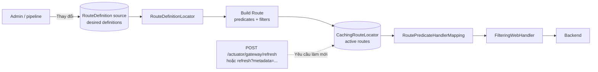
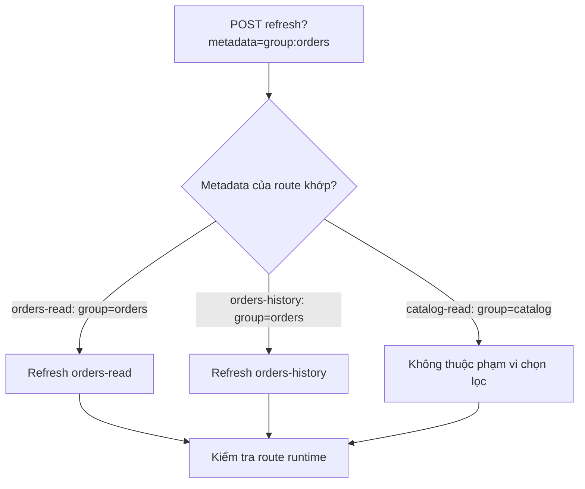
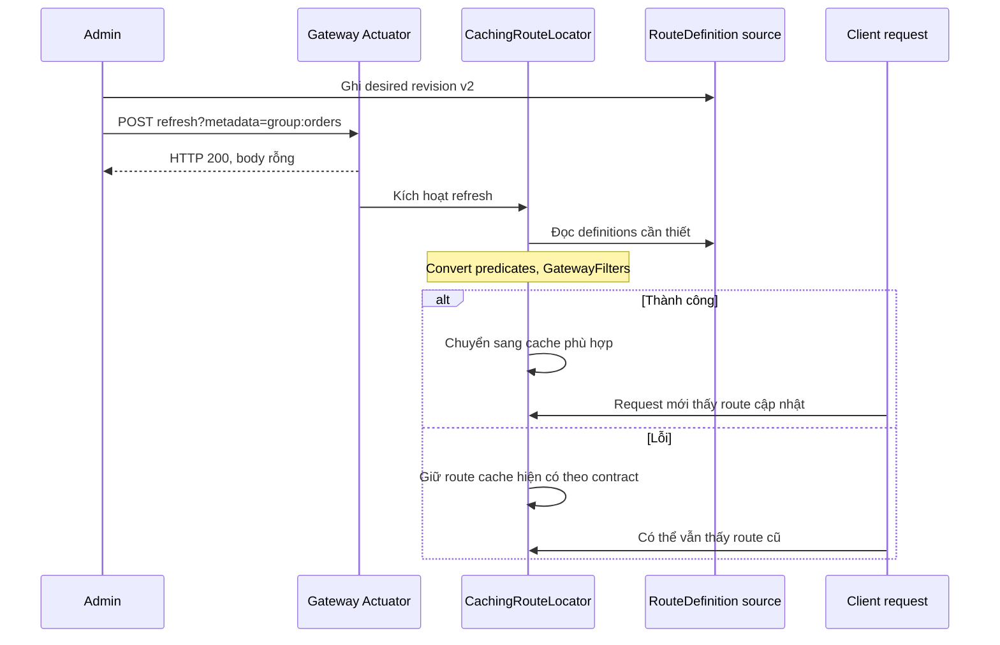
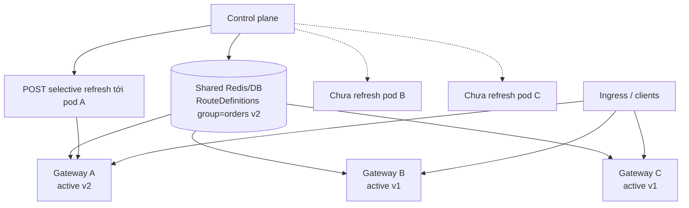

# Refresh có chọn lọc theo metadata khi được hỗ trợ

Khi vận hành **Spring Cloud Gateway**, đôi khi chỉ một nhóm route cần thay đổi: các route `orders` chuyển sang backend mới, còn những route `catalog` vẫn giữ nguyên. Lệnh `POST /actuator/gateway/refresh` có thể yêu cầu Gateway làm mới cache route. Trong các phiên bản **Spring Cloud Gateway Server WebFlux hỗ trợ tính năng này**, ta còn có thể yêu cầu **refresh có chọn lọc theo route metadata**:

```http
POST /actuator/gateway/refresh?metadata=group:orders
```

Cú pháp trên yêu cầu làm mới những route có metadata `group` bằng `orders` theo contract Actuator được tài liệu mô tả. Nó **không** nói “làm mới route có ID là orders”, “đăng ký lại một service instance”, “tải lại toàn bộ application.yml”, hoặc “đồng bộ tức thời mọi Gateway pod”.

Bài thuộc chương **Quản trị Actuator** của module **SPRING_CLOUD_GATEWAY**. Khi xây dựng API Gateway với route predicate, GatewayFilter/GlobalFilter, chuyển đổi path/header, service discovery và các chính sách xác thực, rate limiting, circuit breaker, retry, TLS, refresh route là một thao tác **control plane** có thể tác động trực tiếp đến luồng request thật. Vì vậy, refresh có chọn lọc cần được sử dụng cùng **kiểm chứng trạng thái active, bảo vệ endpoint, quan sát và rollback**.

**Mục tiêu:**

1. Hiểu khác biệt giữa **route metadata**, `RouteDefinition`, `Route` runtime, nguồn cấu hình và cache route.
2. Sử dụng đúng cú pháp `POST /actuator/gateway/refresh?metadata=key:value` khi phiên bản hỗ trợ.
3. Phân biệt **refresh toàn bộ** và **refresh theo metadata**; chọn cách an toàn khi update, delete, rename hoặc đổi metadata.
4. Chuẩn bị ví dụ có hai nhóm routes, gửi request quản trị, đọc lại route runtime và thử HTTP traffic.
5. Tránh giả định refresh `200` đồng nghĩa route đã active trên mọi instance, đặc biệt khi refresh bất đồng bộ.
6. Triển khai quy trình bảo mật và giám sát dành cho Actuator, Redis repository và cụm nhiều Gateway replicas.

> **Phạm vi và giới hạn:** Tài liệu Spring Cloud Gateway **Server WebFlux 5.1.x** và **4.3.x** có mô tả query parameter `metadata` cho endpoint refresh. Các endpoint, property namespace, bộ xử lý refresh và hành vi ở tình huống biên có thể thay đổi theo version/implementation; hãy kiểm tra chính xác build đang triển khai. Ví dụ WebFlux 5.x sử dụng `spring.cloud.gateway.server.webflux.routes`, WebFlux 4.3.x thường là `spring.cloud.gateway.routes`. Bài không áp dụng nguyên xi cho **Gateway Server MVC**.

## 1. Thay đổi definition chưa đồng nghĩa route đã active

Một route có ít nhất hai trạng thái cần phân biệt:

- **Desired definition:** dữ liệu về URI, predicate, filter, order và metadata được lưu ở `RouteDefinitionLocator`/repository/source.
- **Active route:** đối tượng `Route` đã được Gateway dựng từ definition và đang được `RouteLocator`/`CachingRouteLocator` cung cấp cho request matching.



Một route definition có thể đã được lưu nhưng **chưa được cache route runtime đọc lại**. Ngược lại, sau khi xóa definition khỏi source, một Gateway pod chưa refresh vẫn có thể match route cũ.

Refresh nhằm giải quyết sự chênh lệch đó, **không phải một thao tác ghi định nghĩa mới**.

| Hành động | Thay đổi nguồn definition? | Tác động tới cache route? |
| --- | --- | --- |
| Ghi `RouteDefinition` bằng writer/repository | Có | Không nên mặc định tự áp dụng |
| Xóa definition bằng writer hoặc Actuator | Có | Cần xác minh refresh |
| `POST /actuator/gateway/refresh` | Không trực tiếp ghi route | Yêu cầu làm mới cache routes |
| `POST /actuator/gateway/refresh?metadata=group:orders` | Không trực tiếp ghi route | Yêu cầu làm mới chọn lọc các routes khớp metadata |
| Đăng ký instance mới cho `lb://order-service` | Thay đổi service discovery | Không đồng nghĩa thay route definition |
| Chỉnh file `application.yml` trên đĩa | Thay đổi file | Không bảo đảm Spring Boot process đã rebind và Gateway thấy source mới |

**Ba bước nghiệm thu riêng:** (1) nguồn definition đúng, (2) route runtime đã thay đổi, (3) HTTP request thật match đúng route và backend/policy mong muốn.

## 2. Route metadata là gì?

Mỗi route có thể mang một map `metadata` gồm các khóa và giá trị do Gateway hoặc ứng dụng sử dụng. Một số metadata có ý nghĩa đặc biệt (chẳng hạn HTTP timeout của route), còn những khóa như `group`, `owner`, `revision` trong bài là **quy ước do đội vận hành tự đặt**.

Ví dụ WebFlux 5.x:

```yaml
spring:
  cloud:
    gateway:
      server:
        webflux:
          routes:
            - id: orders-read
              uri: lb://order-service
              predicates:
                - Path=/api/orders/**
                - Method=GET
              filters:
                - StripPrefix=1
              metadata:
                group: orders
                owner: commerce
                revision: v1
```

Ở đây:

- `id: orders-read` là định danh route.
- `uri: lb://order-service` là đích logical để LoadBalancer tìm instance.
- `Path` và `Method` là **route predicates** dùng để match request.
- `StripPrefix=1` là một GatewayFilter sửa path trước khi proxy.
- `metadata.group: orders` là nhãn quản trị dùng để nhóm route.
- `metadata.owner` và `metadata.revision` là nhãn phụ, không tự tạo cơ chế RBAC hay rollout.

Trong runtime, `Route#getMetadata()` cung cấp các giá trị đó khi route đã được chọn. Tuy nhiên, **metadata không phải route predicate** trừ khi bạn tự viết logic đọc nó. Một request tới `/api/orders/42` không được match chỉ vì route mang `group=orders`; nó match khi Path/Method/Host predicates đúng.

### Metadata và những tên dễ nhầm

| Giá trị | Ví dụ | Dùng cho điều gì? |
| --- | --- | --- |
| Route ID | `orders-read` | Nhận diện route runtime |
| Service ID | `order-service` | LoadBalancer chọn instance |
| Metadata group | `orders` | Nhóm route để quản trị/refresh chọn lọc |
| Revision | `v2` | Nhãn kiểm soát rollout do ứng dụng đặt |
| Route order | `0` hoặc `-10` | Ưu tiên giữa các routes cùng match |
| GatewayFilter order | Order của filter | Thứ tự xử lý pre/post trong filter chain |
| HTTP path | `/api/orders/**` | Điều kiện match request |
| Tenant ID trong JWT | `tenant-42` | Identity/ngữ cảnh xác thực, không được tùy tiện dùng để bật quyền refresh |

**Không coi metadata là bằng chứng quyền truy cập.** Một field `owner: commerce` trong definition chỉ là dữ liệu; quyền được sửa route phải do control plane/Spring Security quản lý.

## 3. Khi nào refresh theo metadata được hỗ trợ?

Tài liệu Actuator của **Spring Cloud Gateway Server WebFlux 5.1** và **4.3** nêu:

- `POST /actuator/gateway/refresh` để làm mới route cache.
- `POST /actuator/gateway/refresh?metadata=group:group-1` để chỉ làm mới các routes có metadata `group=group-1`.
- Phản hồi request refresh thông thường là **HTTP `200` với body rỗng**.
- Nếu phát sinh lỗi trong quá trình **refresh bất đồng bộ**, tài liệu mô tả cache routes hiện có không bị thay đổi bởi refresh lỗi đó.

Tuy nhiên, không suy ra từ tài liệu của **một phiên bản** rằng một ứng dụng bất kỳ đều hỗ trợ query metadata. Cần kiểm tra:

1. Starter thật sự là **Gateway Server WebFlux**, không phải ứng dụng Spring Boot chỉ có Actuator hoặc Gateway MVC.
2. Phiên bản Gateway đã có tính năng metadata-filtered refresh.
3. Endpoint `/actuator/gateway/refresh` đã được enable/expose và người gọi có **quyền ghi**.
4. Source `RouteDefinitionLocator` có trả metadata đúng kiểu/vị trí cho routes.
5. Các custom `RouteLocator`, discovery routes hoặc repository đặc biệt có tương thích với cơ chế refresh chọn lọc.
6. Có integration test với chính artifact/JAR được đưa lên staging/production.

**Quy tắc tương thích:** Nếu không thể xác minh tính năng ở bản đang chạy, **không giả lập** selective refresh bằng cách tự xóa cache nội bộ qua reflection/private API. Sử dụng **refresh toàn bộ** theo endpoint hỗ trợ và kiểm thử hành vi.

## 4. Cú pháp chính xác của refresh toàn bộ và refresh theo metadata

Hai lệnh căn bản:

```bash
# Toàn bộ route cache của instance được gọi
curl -i -X POST \
  "http://localhost:9090/actuator/gateway/refresh"

# Chỉ những route khớp metadata group=orders, nếu phiên bản hỗ trợ
curl -i -X POST \
  "http://localhost:9090/actuator/gateway/refresh?metadata=group:orders"
```

Cú pháp minh họa đã có trong tài liệu chính thức:

```text
POST /actuator/gateway/refresh?metadata=group:group-1
```

`metadata` chứa cặp `key:value`, không phải JSON body. Với `group=orders`, biểu diễn query là `metadata=group:orders`.

### Chú ý dấu hai chấm và URL encoding

Nếu quản lý URLs bằng tool/script, dùng encoding đúng quy tắc query. Một dạng tương đương:

```bash
curl -i -X POST \
  "http://localhost:9090/actuator/gateway/refresh?metadata=group%3Aorders"
```

Với `curl --get --data-urlencode` cần chú ý nó chuyển thành GET theo cách dùng thông thường, nên **không** dùng nguyên một mẫu GET rồi tưởng đang gọi POST. Khi phải encode giá trị phức tạp, dựng URL bằng HTTP client phù hợp và giữ method POST.

**Không khẳng định format nhiều cặp metadata**, ví dụ `metadata=group:orders,revision:v2`, hoạt động giống nhau ở mọi version nếu chưa kiểm tra tài liệu/API của chính bản đó. Bài dùng **một cặp `group:orders`** vì có ví dụ chính thức rõ ràng.

### Tên key và giá trị phải thống nhất

`metadata=group:orders` khác với:

- `metadata=routeId:orders-read`: chỉ có nghĩa nếu metadata thật sự có key `routeId`.
- `metadata=serviceId:order-service`: không phải cú pháp đặc biệt nhận biết `lb://`.
- `metadata=group:Orders`: có thể không match chuỗi `orders` nếu so sánh phân biệt hoa/thường.
- `metadata=group:orders-v2`: không match group `orders` trừ khi giá trị đó có trong metadata.

Để tránh lỗi, sử dụng **giá trị metadata chuẩn hóa và ổn định**, chẳng hạn `orders`, `catalog`, `reports`, không trộn kiểu chuỗi/số/boolean cho cùng một key group.

## 5. Refresh chọn lọc hoạt động theo nhóm route, không theo HTTP request

Giả sử Gateway đang có ba routes:

| Route ID | Predicate | URI | Metadata |
| --- | --- | --- | --- |
| `orders-read` | `Path=/api/orders/**` | `http://localhost:8081` | `group: orders` |
| `orders-history` | `Path=/api/history/**` | `http://localhost:8081` | `group: orders` |
| `catalog-read` | `Path=/api/catalog/**` | `http://localhost:8083` | `group: catalog` |

Lệnh:

```http
POST /actuator/gateway/refresh?metadata=group:orders
```

theo mục đích được tài liệu hỗ trợ, chỉ làm mới các route thuộc nhóm **orders**; **catalog-read** không nằm trong nhóm mục tiêu.



**Lưu ý:** Sơ đồ mô tả kết quả mong muốn theo tài liệu Actuator, không khẳng định bất cứ custom repository nào cũng cập nhật từng entry một cách nguyên tử hay mọi route runtime có cùng thời điểm chuyển trạng thái.

### Điều không có nghĩa

- Không có nghĩa **chỉ refresh những request thuộc user/tenant orders**.
- Không có nghĩa **chỉ làm mới route ID orders**.
- Không có nghĩa Redis sẽ tự xóa entries của service discovery.
- Không bảo đảm request đã vào Gateway trước refresh được chuyển sang route mới.
- Không bảo đảm ứng dụng không có lỗi khi biên dịch filter/predicate của các route trong nhóm.
- Không đồng bộ route cache của tất cả pods trong cụm.

## 6. Cấu hình ba route với metadata theo nhóm

Ví dụ cấu hình tĩnh của **Gateway Server WebFlux 5.x** để quan sát metadata. Chỉ cần backend thử nghiệm ở các port đã nêu.

```yaml
spring:
  cloud:
    gateway:
      server:
        webflux:
          routes:
            - id: orders-read
              uri: http://localhost:8081
              predicates:
                - Path=/api/orders/**
                - Method=GET
              filters:
                - StripPrefix=1
              metadata:
                group: orders
                owner: commerce
                revision: v1

            - id: orders-history
              uri: http://localhost:8081
              predicates:
                - Path=/api/history/**
                - Method=GET
              filters:
                - StripPrefix=1
              metadata:
                group: orders
                owner: commerce
                revision: v1

            - id: catalog-read
              uri: http://localhost:8083
              predicates:
                - Path=/api/catalog/**
                - Method=GET
              filters:
                - StripPrefix=1
              metadata:
                group: catalog
                owner: search
                revision: v1
```

**Lưu ý quan trọng:** Đây là ví dụ **routes từ `application.yml`**. Actuator có thể **đọc** chúng, nhưng không mặc định **sửa/xóa trực tiếp những route cấu hình này** qua `POST/DELETE /actuator/gateway/routes/{id}`. Muốn thay đổi định nghĩa thực sự ở runtime, cần một **nguồn route definitions có thể cập nhật** (ví dụ repository do Actuator quản lý hoặc `RouteDefinitionWriter`) hoặc quy trình cập nhật config/rebind/deploy phù hợp.

### Với Gateway WebFlux 4.3.x

Prefix cấu hình routes thay đổi:

```yaml
spring:
  cloud:
    gateway:
      routes:
        - id: orders-read
          uri: http://localhost:8081
          predicates:
            - Path=/api/orders/**
          metadata:
            group: orders
            revision: v1
```

Tên route và metadata `group` có cùng ý nghĩa ở mức khái niệm. Đừng áp dụng đồng thời hai prefixes cho một danh sách route rồi bị đăng ký trùng. Cần kiểm tra đúng configuration properties và starter đang sử dụng.

## 7. Bật Actuator read-only cho môi trường quan sát

Để kiểm tra routes mà **không trao quyền thay đổi**, thêm Spring Boot Actuator starter phù hợp:

```xml
<dependency>
  <groupId>org.springframework.boot</groupId>
  <artifactId>spring-boot-starter-actuator</artifactId>
</dependency>
```

Ví dụ `application.properties`:

```properties
management.endpoint.gateway.access=read-only
management.endpoints.web.exposure.include=gateway,health
management.server.port=9090
```

Khi `access=read-only`, bạn có thể dùng một số GET endpoint để quan sát, nhưng **không được phép refresh/tạo/xóa route** theo contract của Gateway Actuator. Đây là cấu hình tốt cho production nếu tổ chức **không dùng Actuator làm control plane ghi**.

### Các endpoint GET cần biết

| Endpoint | Dùng để quan sát |
| --- | --- |
| `GET /actuator/gateway/routedefinitions` | Các route definitions Gateway biết |
| `GET /actuator/gateway/routes` | Routes runtime được Gateway công bố |
| `GET /actuator/gateway/routes/{id}` | Thông tin một route runtime |
| `GET /actuator/gateway/globalfilters` | Các GlobalFilters và order |
| `GET /actuator/gateway/routes/{id}/combinedfilters` | Chuỗi filter kết hợp khi version hỗ trợ |

`GET /actuator/gateway/routes` thường hiển thị predicate/filter ở dạng diễn giải (“verbose”) trong Gateway 5.x. Hình dạng JSON **có thể khác** giữa các bản; không parse response bằng giả định cứng rằng mọi version luôn có cùng các keys `route_id`, `id` hay object nested `route_object`.

**Không cần quyền ghi để tra cứu route.** Nếu chỉ muốn biết group metadata có xuất hiện trong active route không, nên dùng read-only, metrics và kiểm thử request trước khi mở endpoint `unrestricted`.

## 8. Chỉ mở quyền refresh trong môi trường quản trị được bảo vệ

Để Actuator chấp nhận `POST /actuator/gateway/refresh` trong **môi trường lab hoặc admin plane được bảo vệ**, tài liệu Gateway hướng dẫn:

```properties
# CHỈ dùng khi đã có authentication, authorization và network isolation.
management.endpoint.gateway.access=unrestricted
management.endpoints.web.exposure.include=gateway
management.server.port=9090
```

Phân biệt:

- `access=read-only` → không có quyền refresh.
- `access=unrestricted` → cho phép thao tác refresh/create/delete ở endpoint, **nhưng không tự bảo vệ endpoint khỏi người gọi trái phép**.
- `management.server.port=9090` → tách port quản trị theo cấu hình Spring Boot, **không tự đồng nghĩa mạng đã cách ly**.
- `management.endpoints.web.exposure.include=gateway` → expose endpoint qua HTTP, **không tạo RBAC**.

Nếu cả gateway public và management port đều có thể truy cập từ Internet, tách port không phải giải pháp an ninh. Cần authn/authz riêng, firewall/Kubernetes NetworkPolicy, ingress nội bộ hoặc service mesh, TLS/mTLS phù hợp và audit.

### Vì sao quyền refresh nhạy cảm?

Một người có quyền gọi refresh (đặc biệt khi cùng hệ thống còn có quyền ghi route definitions) có thể kích hoạt thay đổi routing trên data plane. Nếu có quyền thêm route, họ còn có thể điều hướng request tới backend nội bộ trái phép, gây **SSRF**, bỏ bớt filter bảo mật, thay đường dẫn/Host và tác động tới CORS/rate limiting.

**Không** mở `unrestricted` công khai chỉ để test selective refresh bằng curl. Khi production chỉ cần quan sát, giữ `read-only` và thực hiện thay đổi qua control plane hạn chế hơn.

## 9. Bài thực hành an toàn: khởi tạo ba route qua Actuator

Thực hành sau dùng một **Gateway test cô lập**, không dùng routes production.

Giả định:

- Gateway public listener ở `localhost:8080`.
- Gateway Actuator (admin) ở `localhost:9090`.
- Orders backend v1 ở `localhost:8081`.
- Orders backend v2 ở `localhost:8082`.
- Catalog backend ở `localhost:8083`.
- Ba backend có endpoint GET thích hợp, trả marker phiên bản như `"instance":"orders-v1"`.
- Không có một route khác match chồng `/api/orders/**` hoặc `/api/history/**`.

Thay vì sửa `application.yml` khi tiến trình đang chạy, ví dụ dùng **route definitions do Actuator quản lý** để thật sự có một nguồn cập nhật lúc runtime.

### Bước A — Đăng ký hai route cùng group orders

```bash
# Actuator write endpoint chỉ mở trong test/admin plane đã bảo vệ.
curl -i -X POST \
  "http://localhost:9090/actuator/gateway/routes/orders-read" \
  -H "Content-Type: application/json" \
  -d '{
    "uri": "http://localhost:8081",
    "predicates": ["Path=/api/orders/**", "Method=GET"],
    "filters": ["StripPrefix=1"],
    "order": 0,
    "metadata": {
      "group": "orders",
      "owner": "commerce",
      "revision": "v1"
    }
  }'

curl -i -X POST \
  "http://localhost:9090/actuator/gateway/routes/orders-history" \
  -H "Content-Type: application/json" \
  -d '{
    "uri": "http://localhost:8081",
    "predicates": ["Path=/api/history/**", "Method=GET"],
    "filters": ["StripPrefix=1"],
    "order": 0,
    "metadata": {
      "group": "orders",
      "owner": "commerce",
      "revision": "v1"
    }
  }'
```

Đây là JSON `RouteDefinition` dùng **shortcut DSL strings** cho `predicates` và `filters`. Nó khác format human-readable của `GET /actuator/gateway/routes/{id}`.

Mỗi lệnh tạo có thể trả **`201 Created`** theo tài liệu Actuator 5.x. `201` chỉ xác nhận tạo definition thành công, **chưa** xác nhận route đã nằm trong active cache.

### Bước B — Đăng ký route nhóm catalog

```bash
curl -i -X POST \
  "http://localhost:9090/actuator/gateway/routes/catalog-read" \
  -H "Content-Type: application/json" \
  -d '{
    "uri": "http://localhost:8083",
    "predicates": ["Path=/api/catalog/**", "Method=GET"],
    "filters": ["StripPrefix=1"],
    "order": 0,
    "metadata": {
      "group": "catalog",
      "owner": "search",
      "revision": "v1"
    }
  }'
```

Ba route này tạo hai nhóm metadata:

```text
group=orders
  ├── orders-read
  └── orders-history

group=catalog
  └── catalog-read
```

**Không** coi chuỗi `orders` là URI hoặc service ID; nó chỉ là nhãn metadata trên các definitions được tạo.

### Bước C — Refresh toàn bộ để tạo baseline

```bash
curl -i -X POST \
  "http://localhost:9090/actuator/gateway/refresh"

curl -fsS \
  "http://localhost:9090/actuator/gateway/routes"

curl -i \
  "http://localhost:8080/api/orders/42"

curl -i \
  "http://localhost:8080/api/catalog/items/7"
```

Trước khi thử selective refresh, cần có **baseline active** đáng tin: cả ba routes tồn tại và backend v1/catalog thật sự được gọi. Nếu một route không hoạt động ở bước này, đừng tiếp tục bài tập; kiểm tra route predicate, filter, backend và application security trước.

## 10. Thay một route thuộc group orders rồi refresh chọn lọc

Trong thí nghiệm, muốn đổi riêng `orders-read` từ backend 8081 sang 8082 và giữ nguyên metadata `group=orders`. Đây là route **do Actuator quản lý**.

### Lưu ý trước khi cập nhật

Tài liệu Actuator 5.x cảnh báo **không POST đè một route ID đang tồn tại**. Nó có thể dẫn tới definition trùng và lỗi `500` khi liệt kê routes. Với route do Actuator quản lý, tài liệu chỉ dẫn **DELETE → POST → refresh**.

Quy trình này **không nguyên tử**, có cửa sổ source thiếu route giữa DELETE và POST. Do đó nó phù hợp **lab cô lập**, không phải một giao dịch update production có bảo đảm không gián đoạn.

### Thao tác trong lab

```bash
# 1. Xóa definition cũ do Actuator quản lý.
curl -i -X DELETE \
  "http://localhost:9090/actuator/gateway/routes/orders-read"

# 2. Tạo lại cùng ID, chuyển URI sang v2, giữ group=orders.
curl -i -X POST \
  "http://localhost:9090/actuator/gateway/routes/orders-read" \
  -H "Content-Type: application/json" \
  -d '{
    "uri": "http://localhost:8082",
    "predicates": ["Path=/api/orders/**", "Method=GET"],
    "filters": ["StripPrefix=1"],
    "order": 0,
    "metadata": {
      "group": "orders",
      "owner": "commerce",
      "revision": "v2"
    }
  }'

# 3. Chỉ yêu cầu refresh group orders, nếu version hỗ trợ.
curl -i -X POST \
  "http://localhost:9090/actuator/gateway/refresh?metadata=group:orders"
```

**Điều mong muốn:**

- `orders-read` bắt đầu chuyển tới `http://localhost:8082`.
- `orders-history` vẫn thuộc group orders và được đưa vào phạm vi refresh chọn lọc.
- `catalog-read` thuộc group catalog, không nằm trong nhóm refresh.
- Một request mới tới `/api/orders/42` đi tới backend v2 **sau khi active route đã cập nhật**.

**Không** chỉ xem `HTTP 200` của lệnh refresh. Nó mô tả việc endpoint nhận yêu cầu theo contract, còn refresh có thể **bất đồng bộ**. Phải đọc lại route runtime và kiểm tra traffic.

## 11. Xác minh route runtime và traffic sau selective refresh

Dùng hai góc nhìn:

### Góc nhìn 1 — RouteDefinition và Route runtime

```bash
# Các definitions mà Gateway đang biết
curl -fsS \
  "http://localhost:9090/actuator/gateway/routedefinitions"

# Route runtime có ID orders-read
curl -fsS \
  "http://localhost:9090/actuator/gateway/routes/orders-read"

# Route catalog, để so sánh với nhóm không bị tác động
curl -fsS \
  "http://localhost:9090/actuator/gateway/routes/catalog-read"
```

Hãy kiểm tra:

1. Definition `orders-read` có URI v2 và metadata `revision=v2`.
2. Route runtime `orders-read` đã phản ánh mục tiêu v2.
3. `catalog-read` vẫn trỏ tới backend catalog và hoạt động.
4. Các filter `StripPrefix`, Path và Method predicates vẫn đúng.
5. Không có route chồng lấn được chọn thay `orders-read`.

Nếu route runtime chưa đổi ngay sau `POST /refresh`, hãy **poll có deadline** trong môi trường test thay vì khẳng định refresh thất bại tức thì. Nếu hết deadline, xem lỗi refresh/build route và cân nhắc full refresh có kiểm soát.

### Góc nhìn 2 — Request thực tế

```bash
curl -i \
  "http://localhost:8080/api/orders/42"

curl -i \
  "http://localhost:8080/api/history/recent"

curl -i \
  "http://localhost:8080/api/catalog/items/7"
```

Backend demo cần ghi lại marker/vị trí nhận request, ví dụ:

```json
{
  "backend": "orders-v2",
  "pathReceived": "/orders/42"
}
```

Do `StripPrefix=1` bỏ `api`, backend orders nhận `/orders/42`; catalog nhận `/catalog/items/7`. Chỉ một response `200` không đủ chứng minh route mới active nếu v1/v2 trả body giống nhau; cần **backend marker hoặc tracing**.

### Poll với deadline, không sleep cố định

Một đoạn script minh họa dùng `jq` và HTTP GET route runtime. **Nó chỉ chạy khi JSON của phiên bản bạn test thật sự có các field phù hợp**:

```bash
# Pseudocode shell: điều chỉnh đường dẫn jq theo JSON runtime thật.
for attempt in 1 2 3 4 5 6 7 8 9 10; do
  current_uri="$(curl -fsS \
    http://localhost:9090/actuator/gateway/routes/orders-read \
    | jq -r '.uri // empty')" || current_uri=""

  if [ "$current_uri" = "http://localhost:8082" ]; then
    echo "orders-read active on v2"
    break
  fi

  sleep 1
done
```

Không dùng output `echo` làm dấu chứng nhận hoàn tất toàn cluster. Trong một hệ thống nhiều pods, kiểm tra **từng instance** và đặt error path rõ ràng khi deadline hết.

## 12. Phân biệt selective refresh và full refresh bằng bảng quyết định

| Tình huống | Có thể cân nhắc selective? | Vì sao |
| --- | --- | --- |
| Thay URI/filter của một route, **giữ group cũ** | **Có**, nếu đã kiểm chứng trên version | Nhóm mục tiêu ổn định |
| Thay nhiều routes trong cùng group `orders` | **Có** | Có thể tránh làm mới nhóm khác |
| Chỉ đổi backend instance dưới `lb://service` | **Thường không cần route refresh** | Đây là sự kiện discovery/LoadBalancer |
| Xóa hoàn toàn route thuộc group | **Thận trọng, thường ưu tiên full** | Route đã bị xóa có thể không còn definition metadata trong source để match |
| Chuyển metadata `group=orders` sang `group=payments` | **Ưu tiên full** | Nhóm cũ và mới có thể không cùng tập match |
| Đổi route ID hoặc tách/gộp route | **Ưu tiên full** | Định danh cache và nhóm routes đã thay đổi |
| Thay key/value metadata dùng làm filter | **Ưu tiên full** nếu không chứng minh được match | Predicate chọn lọc có thể dựa vào trạng thái khác mong đợi |
| Thêm route hoàn toàn mới | **Test trước; full là baseline an toàn** | Route mới chưa xuất hiện trong active cache cũ |
| Refresh của một group bị lỗi | **Không tự retry vô hạn** | Cần sửa source/factory/Redis trước |
| Không rõ phiên bản hỗ trợ query metadata | **Full refresh hoặc nâng version đã kiểm thử** | Tránh hành vi không được chứng minh |
| Cập nhật cấu hình YAML nhưng Spring chưa rebind | **Selective/full đều chưa đủ** | Nguồn locator có thể vẫn trả definitions cũ |

Đây là **khuyến nghị vận hành**, không phải lời khẳng định mọi trường hợp delete/rename đều thất bại với selective refresh. Cơ chế chọn lọc có thể phụ thuộc vào **metadata của route đang cache, metadata của definitions mới và thuật toán merge/invalidation của đúng version**. Khi thiếu bằng chứng test, chọn full refresh có giám sát và rollback.

### Tại sao full refresh an toàn hơn cho structural changes?

Nếu route `orders-read` đã bị xóa khỏi source, một selector `group:orders` có thể cần biết **route cũ từng thuộc group nào** để loại nó khỏi cache. Việc Gateway xử lý đúng tình huống này phải được kiểm chứng theo version. Full refresh yêu cầu xây lại tập routes từ nguồn, nên thường là phương án dễ dự đoán hơn khi **thêm/xóa/đổi ID/chuyển group**.

Dù là full refresh, phải xác minh runtime và request thật; nó **không** sửa được definition invalid.

## 13. Chuyển nhóm metadata: tình huống dễ bị bỏ sót

Giả sử ban đầu:

```yaml
- id: invoice-api
  uri: http://localhost:8084
  predicates:
    - Path=/api/invoices/**
  metadata:
    group: orders
```

Sau đó definition mới:

```yaml
- id: invoice-api
  uri: http://localhost:8084
  predicates:
    - Path=/api/invoices/**
  metadata:
    group: finance
```

Nếu chỉ gọi:

```http
POST /actuator/gateway/refresh?metadata=group:finance
```

bạn có thể gặp vấn đề tùy thuật toán chọn lọc: route hiện đang active thuộc group `orders` nhưng desired mới thuộc `finance`. Refresh theo group mới **không nên được giả định** sẽ xóa/invalidate entry của group cũ.

Tương tự, nếu chỉ refresh `group:orders`, bạn cũng không có bằng chứng route được chuyển hoàn toàn sang group `finance` đúng trên mọi instance.

**Runbook cho chuyển nhóm:**

1. Ghi định nghĩa với metadata mới và revision.
2. Yêu cầu **full refresh** trên đúng Gateway instance(s).
3. Kiểm tra `invoice-api` chỉ xuất hiện **một lần** trong active route view.
4. Kiểm tra group/revision runtime đã thành `finance`.
5. Gọi request thực tế để đảm bảo predicate/filter và security policy đúng.
6. Xác minh không còn route cũ/route shadowing sau cập nhật.

**Metadata group nên ổn định** nếu nó được dùng làm selector trong control plane. Nếu thay group thường xuyên, công cụ quản trị cần một chính sách phân phối refresh và kiểm tra hội tụ mạnh hơn.

## 14. Xóa route hoặc tạo route mới: refresh chọn lọc có thể không đủ

### Case A — Xóa route

Source ban đầu:

```text
orders-read: group=orders
orders-history: group=orders
catalog-read: group=catalog
```

Source mới:

```text
orders-read: group=orders
catalog-read: group=catalog
# orders-history đã bị xóa
```

Nếu cache runtime vẫn giữ `orders-history`, việc chỉ yêu cầu refresh một group có thể bị ảnh hưởng bởi cách implementation xác định tập routes cần invalidate. **Không tuyên bố xóa xong** chỉ vì DELETE trả response thành công.

Với một thay đổi xóa route quan trọng:

```bash
# Chỉ sau khi source delete thành công và có quyền ghi.
curl -i -X POST \
  "http://localhost:9090/actuator/gateway/refresh"

# Xác minh route runtime biến mất.
curl -i \
  "http://localhost:9090/actuator/gateway/routes/orders-history"
```

Khi GET route trả `404`, vẫn cần thử một request tới public path để xem nó có match **route khác** hay không. HTTP 404 cuối cùng không đủ để chứng minh không có handler khác.

### Case B — Thêm route mới

Route mới `orders-tracking` với `metadata.group=orders` chưa tồn tại trong cache cũ. Một số implementation có thể nhận route mới trong selective refresh; một số workflow tùy biến có thể không. Nếu yêu cầu bổ sung route là quan trọng, dùng **full refresh lần đầu**, kiểm chứng active, rồi sử dụng selective cho các thay đổi ổn định tiếp theo.

### Case C — Thay metadata dùng làm selector

Nếu cập nhật đồng thời `metadata.group` và các filters, phải tính đến **nhiều loại trạng thái không nhất quán**: selector khớp cũ hay mới, route có thể vẫn dùng filters cũ và request có thể qua một pod chưa refresh.

**Không dùng refresh chọn lọc như một giao thức đồng bộ transaction** giữa repository và routes cache. Nó là cơ chế refresh, không phải hệ thống quản lý revision có atomic cutover được bảo đảm.

## 15. Refresh thất bại và tính bất đồng bộ

Theo tài liệu Gateway Actuator, `POST /actuator/gateway/refresh` trả **`200` không có body**. Nếu quá trình refresh bất đồng bộ gặp lỗi, cache routes hiện tại **không bị thay đổi bởi lần refresh lỗi đó** theo cơ chế được mô tả.

Điều này có nghĩa:

- `200` **không chứng minh** route mới đã được build.
- Invalid predicate/filter/URI có thể làm refresh không áp dụng được.
- Với error, các routes active trước đó có thể vẫn phục vụ request.
- Có thể cần đọc logs/metrics riêng để biết refresh thực sự hoàn tất.
- Một lần retry refresh không thay thế việc sửa definition lỗi.



Sơ đồ logic không hứa mọi request thay đổi ngay cùng một timestamp. Request đã match trước cutover có thể tiếp tục dùng route/URI đã chọn.

### Làm sao xác nhận kết quả?

**Điều kiện hoàn tất nên bao gồm cả ba:**

1. **Source revision** đã được ghi thành công.
2. **Active route view** của từng Gateway replica phản ánh URI/predicate/filter/metadata đúng.
3. **Canary request** đi qua đúng route, đúng backend và không vi phạm security/SLO.

Nếu không đạt trong deadline đã định, báo “refresh pending/failed” theo workflow và kích hoạt rollback có kiểm soát; không công bố “rollout complete” chỉ vì Actuator trả 200.

## 16. Nhiều Gateway replicas: selective refresh vẫn là thao tác trên instance

Trong Kubernetes hoặc một cụm VM, thường có nhiều Gateway instances sau ingress. Mỗi JVM có thể dùng **CachingRouteLocator** riêng.



**Dù cả ba pods đọc cùng Redis route repository**, một lệnh refresh gửi tới một pod không có nghĩa các pod khác cũng refresh. `RefreshRoutesEvent` mặc định là sự kiện của application context, không phải broadcast cluster toàn cầu.

### Runbook nhiều pods

1. Cập nhật source definitions **một lần**, có revision mới.
2. Xác định danh sách Gateway replicas đang phục vụ traffic.
3. Gửi refresh theo metadata tới **từng instance qua địa chỉ quản trị riêng**, không chỉ qua một ingress cân bằng tải.
4. Poll active route runtime cho nhóm mục tiêu **trên từng instance**.
5. Gửi canary request đến từng instance với Host/Path/Method đúng, dùng môi trường staging hoặc một cơ chế định tuyến test đã được phê duyệt.
6. Xác nhận không có pod còn route v1 trước khi thông báo rollout hoàn tất.
7. Nếu một pod lỗi, cô lập traffic hoặc rollback trên toàn bộ cụm theo chính sách, không để “split-brain routing” lâu.
8. Lưu audit ai đã refresh, target pods, revision, kết quả và thời điểm.

### Tại sao không chỉ gọi qua LoadBalancer?

Một request HTTP tới `https://admin-gateway.example/actuator/gateway/refresh?metadata=group:orders` thường được ingress chuyển vào **một instance**. Không có bảo đảm fan-out. Nếu operator gọi ba lần qua cùng ingress, cả ba request **có thể vào cùng một pod**.

Cần một control plane có khả năng gọi theo **pod identity** hoặc một cơ chế phân phối sự kiện được kiểm thử, kèm xác minh từng pod.

## 17. Redis repository và refresh metadata

Một nguồn route definitions có thể dùng `RedisRouteDefinitionRepository` để chia sẻ giữa nhiều Gateway instances. Nhưng Redis ở đây là **source của definition**, không phải một cache route runtime chung cho mọi JVM.

```text
Redis RouteDefinitionRepository:
  giữ definitions đã lưu

Gateway pod A:
  RouteDefinitionLocator -> CachingRouteLocator A

Gateway pod B:
  RouteDefinitionLocator -> CachingRouteLocator B

POST refresh pod A:
  làm mới active cache A theo phạm vi yêu cầu
  KHÔNG mặc định cập nhật cache B
```

Đối với Gateway Server WebFlux, property bật Redis RouteDefinitionRepository **phải lấy theo version thực tế**. Tài liệu 5.x Configuration Properties có prefix dạng:

```yaml
spring:
  cloud:
    gateway:
      server:
        webflux:
          redis-route-definition-repository:
            enabled: true
  data:
    redis:
      host: localhost
      port: 6379
```

Tài liệu *Sharing Routes* của một số phiên bản còn ví dụ prefix cũ `spring.cloud.gateway.redis-route-definition-repository.enabled`. Vì vậy, hãy **kiểm tra effective configuration**, starter và phiên bản, không trộn prefix cũ/mới chỉ để hy vọng một cái có hiệu lực.

### Những lưu ý khi dùng Redis

- Redis timeout/error có thể làm không đọc được desired definitions; refresh có thể thất bại.
- Redis vừa được update không chứng minh tất cả pods đã làm mới active cache.
- Nên bảo vệ Redis bằng network isolation, auth/TLS phù hợp, backup/persistence và kiểm soát write concurrency.
- Redis dùng cho route repository và Redis dùng cho `RedisRateLimiter` là **hai chức năng khác nhau**; không xóa toàn bộ Redis keys chỉ để làm mới route.
- Nếu nhiều writers cập nhật cùng route, cần serialization/optimistic locking và revision để tránh lost update.
- Không tạo vòng lặp “refresh thất bại → bắn hàng nghìn refresh” vì điều đó chỉ tăng tải Redis và logs.

## 18. Tác động lên route predicates, filters và security policy

Selective refresh **không có nghĩa** “chỉ update URI”; nó có thể áp dụng một definition mới cho route, bao gồm Path/Host/Method predicates, filters, order và metadata tùy source.

| Loại thay đổi | Rủi ro cần kiểm tra |
| --- | --- |
| `Path` / `Host` / `Method` | Request có thể match route khác hoặc không còn match |
| `StripPrefix` / `RewritePath` | Backend nhận path mới, có thể trả 404 |
| `AddRequestHeader` / `RemoveRequestHeader` | Mất/giả mạo identity headers, thay behavior downstream |
| `RequestRateLimiter` | Thay hạn mức, key resolver hoặc rate-limit bypass |
| `CircuitBreaker` / `Retry` | Số attempts, fallback và nguy cơ request ghi trùng |
| `SetRequestHostHeader` | Rủi ro trust boundary, routing và virtual hosts |
| `URI lb://service` | LoadBalancer/discovery có thể chọn instance khác |
| `URI https://host` | TLS certificate/SNI/truststore, chính sách egress |
| `order` | Route overlap/shadowing, route khác bỗng được chọn |
| `metadata.group` | Ảnh hưởng phạm vi refresh chọn lọc |

**Không coi metadata.group là policy bảo mật.** Một route mới/đổi group có thể lộ endpoint nhạy cảm nếu Spring Security path matchers hoặc route filter security không được kiểm thử theo URL public. Authorization nghiệp vụ phải được backend thực thi, không chỉ dựa vào việc route mang nhãn `orders`.

### CORS, timeout và metadata kỹ thuật

Gateway có các route metadata được framework hiểu, ví dụ `response-timeout` và `connect-timeout` theo tài liệu HTTP Timeouts. Một key `group` là custom metadata phục vụ phân nhóm, còn key timeout điều khiển hành vi HTTP client tương ứng.

Đừng đặt `metadata: group:orders` rồi nghĩ đó là một cách **bật/tắt CORS, authentication hoặc retry**. Những chính sách đó có cấu hình/filter riêng và đôi khi các caches/listeners liên quan có vòng đời khác. Sau selective refresh có thay đổi liên quan CORS, cần thử browser **preflight OPTIONS** và actual request, không chỉ nhìn GET route.

## 19. Bảo vệ endpoint Actuator và giảm rủi ro SSRF

Gateway Actuator là một **control plane** vì nó có thể thêm/xóa/refresh routes. Những quyền này có thể ảnh hưởng đường đi của request ngoài Internet.

### Nguyên tắc bảo vệ

- Dùng `read-only` ở môi trường không cần mutation.
- Chỉ bật `unrestricted` ở admin context được cách ly, có **authentication và RBAC mạnh**.
- Tách network quản trị và hạn chế egress; dùng TLS/mTLS khi cần.
- Không đặt credentials trong shell history, script công khai hoặc log của curl.
- Audit route ID, metadata group, revision, actor, source/active result; không ghi Bearer token hay API secrets.
- Giới hạn tần suất lệnh refresh, có rate limit cho admin API và áp dụng change window.
- Với quyền ghi definitions, **allowlist URI scheme/hosts/ports** và filter factories, chống **SSRF/open proxy**.
- Không cho tenant/client tự chọn `group`, URI hoặc refresh scope từ input công khai chưa xác thực.
- Không expose `/actuator/gateway/routes`/`routedefinitions` công khai nếu chúng tiết lộ upstream host, route topology hay header policy.
- Không tin nhãn group để quyết định ai được truy cập; authorization phải dựa trên identity/permission của operator.

### Vai trò tách biệt trong production

| Vai trò | Quyền phù hợp |
| --- | --- |
| Người quan sát/On-call | GET route/metrics qua management plane read-only |
| Control-plane service đã xác thực | Ghi definition theo allowlist và yêu cầu refresh có giám sát |
| Reviewer/Approver | Phê duyệt changesets, không nhất thiết gọi Actuator trực tiếp |
| Application client | Chỉ gọi public APIs; **không có quyền refresh** |
| Backend service | Xử lý request nghiệp vụ; không tự cấp quyền thay route Gateway |

Đặc biệt không thực hiện retry vô hạn trên endpoint refresh. Nếu Redis/source đang lỗi, **đầu tiên sửa lỗi**, rồi phát lại refresh theo quy trình có deadline; không khuếch đại sự cố bằng hàng loạt admin requests.

## 20. Observability: chứng minh selective refresh có hiệu lực

Cần đo cả **control plane** và **data plane**.

| Tín hiệu | Thu thập ở đâu? | Phục vụ mục đích gì? |
| --- | --- | --- |
| `refreshRequested` | Admin service / Actuator caller | Biết group nào được yêu cầu refresh, lúc nào |
| `refreshResult` / error logs | Gateway application | Phát hiện async refresh/build failure |
| Desired revision | Repository/control-plane DB | Definition mong muốn hiện là phiên bản nào |
| Active revision theo pod | Active routes/metadata, tooling quản trị | Phát hiện các pods chưa hội tụ |
| Route ID và selected URI | Gateway Actuator/tracing | Biết route runtime có đổi không |
| HTTP 404/502/503/5xx theo route | Micrometer/Gateway metrics | Phát hiện mismatch Path/upstream sau refresh |
| Upstream marker/version | Backend logs/traces | Chứng minh request tới đúng v1/v2 |
| CORS preflight/error | Browser/staging metrics | Kiểm tra policy được cập nhật hợp lệ |
| Redis latency/errors | Redis client/infra | Phân biệt source outage với route cache lỗi |
| Security/429/fallback rates | Security, RequestRateLimiter, Resilience4j | Kiểm tra không làm yếu policy khi refresh |

**Không mặc định framework export sẵn mọi metric trong bảng.** Một số là **tín hiệu do đội vận hành tự bổ sung**. Hãy dùng route ID, group và revision có cardinality hữu hạn; không đưa raw user ID, full URL có query, token, cookie hay path chứa PII làm metric labels.

### Vì sao cần kiểm tra nhóm không nằm trong scope?

Nếu refresh `group:orders`, đừng chỉ kiểm tra orders. Hãy đo:

1. Orders route mới có đúng không?
2. Catalog route **còn hoạt động** và không bị cấu hình thay đổi ngoài dự kiến không?
3. Có route nào bị thêm trùng ID hoặc order shadowing không?
4. Số routes active có còn phù hợp expected baseline không?
5. SLO/latency/5xx có tăng trên toàn Gateway không?

Mục đích selective refresh là hạn chế phạm vi làm mới, nhưng **sự đúng đắn phải được xác minh bằng kết quả**.

## 21. Troubleshooting: những lỗi hay gặp

| Triệu chứng | Nguyên nhân có thể | Hướng kiểm tra |
| --- | --- | --- |
| `POST /refresh?metadata=...` trả `404` | Actuator chưa expose, sai base-path/port hoặc endpoint không hỗ trợ | Kiểm tra Boot/Gateway version, management path |
| `POST /refresh` trả `405` / bị từ chối | `access=read-only` hoặc HTTP method sai | Kiểm tra Actuator access và RBAC |
| `POST /refresh` trả `401/403` | Người gọi không có quyền | Sửa authentication/authorization, không mở public |
| `POST /refresh` trả `200` nhưng route vẫn cũ | Refresh async đang chạy hoặc lỗi; source chưa đổi | Poll runtime, xem logs và source |
| `GET /routedefinitions` mới nhưng `/routes` cũ | Chưa refresh hoặc build route lỗi | Quan sát error, xác minh version |
| `group:orders` không refresh route nào | Metadata group sai key/value/kiểu, route không thuộc group | Đọc definitions và metadata runtime |
| Group đúng nhưng route mới không xuất hiện | Thêm route mới chưa có trong active selection | Full refresh có kiểm soát, verify |
| Xóa route vẫn còn active | Invalidation theo group không bao phủ deleted entry | Full refresh và xác minh route biến mất |
| Đổi group rồi route cũ vẫn hiện | Selector khớp metadata cũ/mới khác nhau | Full refresh, verify uniqueness |
| Catalog thay đổi dù chỉ refresh orders | Route sources khác, custom locator, filter/route overlap | So sánh effective runtime/canary |
| Một số requests v1, số khác v2 | Các Gateway pods refresh không đều | Kiểm tra từng instance, fan-out |
| Route active đúng nhưng backend trả 404 | `StripPrefix`/`RewritePath` sai | Xem backend path và Gateway filters |
| Route active đúng nhưng backend trả 503 | Không có instance cho `lb://` hoặc upstream lỗi | Kiểm tra LoadBalancer/discovery, không đổ cho refresh |
| Mất HTTPS sau đổi URI | TLS trust/SNI/hostname certificate không phù hợp | Sửa TLS config; không tắt verify |
| Refresh liên tục gây áp lực Redis | Control plane retry/burst quá nhiều | Giảm tần suất, serialize updates |
| Actuator không thể xóa route từ YAML | Route không thuộc repository writable | Thay nguồn config/redeploy, không cố DELETE |
| Duplicate route sau POST existing ID | API Actuator 5.x cảnh báo trùng definition | Dùng DELETE+POST trong lab; production có versioned control plane |
| Đổi YAML nhưng refresh không tác dụng | Spring Boot process chưa đọc lại source | Rebind/redeploy/config-refresh theo cơ chế hỗ trợ |
| Metrics không phân biệt route versions | Thiếu revision/instance labels đã chuẩn hóa | Bổ sung observability có giới hạn cardinality |
| CORS thay đổi không đúng | Cache/handler CORS hoặc browser preflight vẫn cũ | Thử OPTIONS + actual request và kiểm tra CORS config |

### Quy trình chẩn đoán ưu tiên

1. **Đúng phiên bản?** Gateway WebFlux có hỗ trợ metadata-filtered refresh không?
2. **Đúng endpoint/quyền?** POST, management port, `unrestricted`, authentication?
3. **Đúng metadata?** Key `group` có thật và value `orders` đúng trong active definitions?
4. **Source đã đổi?** URI/filter/metadata trong repository đúng revision chưa?
5. **Refresh hoàn tất?** Có async error hay refresh pending không?
6. **Runtime đã đổi?** `/actuator/gateway/routes/{id}` trên đúng pod?
7. **Request thật đúng?** Host/Path/Method, backend marker, security, CORS?
8. **Nhiều pods?** Có instance chưa refresh hoặc route order chồng lấn không?
9. **Xóa/đổi group?** Chuyển sang full refresh nếu không chắc chắn.
10. **Rollback?** Khôi phục last-known-good definition và refresh/verify toàn phạm vi ảnh hưởng.

## 22. Bài tập củng cố

### Bài tập 1 — Chọn đúng group

Có ba routes:

```yaml
- id: a
  metadata:
    group: orders

- id: b
  metadata:
    group: catalog

- id: c
  metadata:
    group: orders
```

**Hỏi:** `POST /actuator/gateway/refresh?metadata=group:orders` nhắm tới route nào?

**Đáp án:** Theo contract chọn metadata, nhóm **a** và **c**. Route **b** có `group=catalog` nên không thuộc phạm vi yêu cầu.

### Bài tập 2 — Khác route ID

Route có ID `orders-read` nhưng metadata `group: commerce`.

**Hỏi:** `metadata=group:orders` có tự nhận ra route đó nhờ tên ID không?

**Đáp án:** Không. Selector nhìn vào **metadata group**, không tự suy route ID hay service ID từ chuỗi.

### Bài tập 3 — Xóa một route

Definition `orders-history` đã bị xóa khỏi source. Operator chỉ gọi selective refresh `group:orders` và thấy active route vẫn tồn tại.

**Cách xử lý:** Không lặp lại vô hạn lệnh cũ. Kiểm tra behavior/version và errors, yêu cầu **full refresh** có kiểm soát, xác minh runtime không còn route và request public không match nhầm route khác.

### Bài tập 4 — Đổi group

Route `invoice-api` chuyển metadata từ `group=orders` sang `group=finance`.

**Hỏi:** chỉ refresh `group=finance` có chắc remove route khỏi group cũ không?

**Đáp án:** Không nên giả định. Chọn full refresh và kiểm tra revision/uniqueness trên từng pod.

### Bài tập 5 — Ba pods và Redis chung

Redis source đã cập nhật revision v2. Operator POST selective refresh một lần qua ingress chung.

**Hỏi:** có thể tuyên bố toàn cluster ở v2 không?

**Đáp án:** Không. Request có thể chỉ vào một pod. Cần fan-out và xác minh active route trên **từng instance**.

### Bài tập 6 — Quyền Actuator

Ứng dụng có:

```properties
management.endpoint.gateway.access=read-only
management.endpoints.web.exposure.include=gateway
```

**Hỏi:** tại sao POST refresh không chạy dù GET routes thành công?

**Đáp án:** Chế độ **read-only** cố ý vô hiệu các thao tác thay đổi. Muốn refresh phải dùng admin plane được bảo vệ với quyền `unrestricted`/cơ chế tương ứng, không mở anonymous public endpoint.

### Bài tập 7 — Refresh 200 nhưng traffic lỗi

Admin đã nhận `200` từ refresh, nhưng GET route active vẫn trỏ v1, canary tới v2 chưa có response.

**Hỏi:** kết luận nào đúng?

**Đáp án:** Chưa xác nhận v2 active. Phải xem async refresh logs, desired source, lỗi convert, route runtime và backend; có thể cần rollback hoặc full refresh tùy nguyên nhân.

### Bài tập 8 — Một route có metadata kỹ thuật

Route có `metadata.response-timeout: 500` và `metadata.group: catalog`.

**Hỏi:** `metadata=group:catalog` có thay response timeout thành 500 giây không?

**Đáp án:** Không. Query metadata là **selector refresh**; `response-timeout` là route metadata phục vụ HTTP timeout, với đơn vị theo tài liệu tương ứng (route metadata response-timeout thường tính **mili giây**).

### Câu hỏi tự kiểm tra nhanh

**1. Refresh chọn lọc có sửa RouteDefinitionRepository không?**

> Không. Nó làm mới cache/runtime theo source hiện có; thay đổi definition là thao tác khác.

**2. Refresh chọn lọc có đồng bộ Redis RateLimiter không?**

> Không. RedisRateLimiter quản lý trạng thái quota, không phải cache Route.

**3. Giá trị `group` có cần là tên service trong `lb://` không?**

> Không. Group là nhãn metadata do bạn đặt.

**4. Có nên dùng selective cho rename route ID không?**

> Nếu chưa có test bảo đảm, ưu tiên full refresh và kiểm tra route cũ biến mất, route mới xuất hiện.

**5. Làm sao chứng minh request đang dùng route mới?**

> Đọc route runtime theo pod, quan sát route ID/selected upstream và gửi canary request đến backend mong muốn.

**6. Actuator trả `200` có phải refresh hoàn tất trên tất cả pods không?**

> Không. Có xử lý bất đồng bộ và mỗi Gateway instance có cache riêng.

## 23. Checklist vận hành selective refresh an toàn

- [ ] Xác minh phiên bản **Gateway Server WebFlux** có hỗ trợ query `metadata` ở endpoint refresh.
- [ ] Dùng `POST /actuator/gateway/refresh?metadata=group:value` đúng HTTP method/query.
- [ ] Phân biệt `group` metadata với route ID, service ID và Path predicate.
- [ ] Chọn metadata group ổn định, giá trị thống nhất và kiểu đơn giản dễ so sánh.
- [ ] Không giả định nhiều cặp metadata có format thống nhất nếu chưa kiểm chứng API/version.
- [ ] Cập nhật source definitions **trước** khi gửi refresh; source phải thật sự đọc được bởi locator.
- [ ] Có baseline route runtime/traffic trước khi thay đổi.
- [ ] Sau POST refresh, poll active routes có deadline; không tin mỗi `200`.
- [ ] Gửi canary request kiểm tra backend/version/path/filter/predicate, không chỉ xem route list.
- [ ] Kiểm tra thêm routes thuộc nhóm **không** được refresh để phát hiện tác động ngoài scope.
- [ ] Với delete, add, rename hoặc chuyển group, ưu tiên **full refresh** nếu chưa chứng minh selective đủ an toàn.
- [ ] Không POST đè existing Actuator-managed route ID trong Gateway 5.x; dùng quy trình theo docs và biết rủi ro non-atomic.
- [ ] Không dùng Actuator để sửa routes từ `application.yml`/`@Bean` vốn read-only với writer đó.
- [ ] Trong multi-pod, gửi refresh tới từng instance và kiểm chứng active revision trên từng pod.
- [ ] Không nhầm Gateway routes refresh với config rebind, LoadBalancer instance cache, DNS refresh hoặc Redis rate limiter.
- [ ] Đo refresh error/latency, desired revision, active revision và ảnh hưởng HTTP 4xx/5xx.
- [ ] Bảo vệ Actuator bằng auth/RBAC, network isolation, TLS/mTLS và audit.
- [ ] Duy trì `read-only` nếu không cần ghi/refresh tại endpoint.
- [ ] Validate RouteDefinition URI/predicates/filters để tránh SSRF và bypass security.
- [ ] Không tiết lộ backend topology hoặc access token trong public Actuator/tracing/logs.
- [ ] Có cơ chế serialize changes, snapshot last-known-good và rollback.
- [ ] Kiểm thử tình huống refresh lỗi, metadata sai, Redis outage, route overlap, security, CORS và rolling deployment.
- [ ] Chỉ báo rollout **ACTIVE** khi cả source, route runtime và request thật đều đạt yêu cầu.

## Kết luận

**Refresh có chọn lọc theo metadata** là một khả năng quản trị hữu ích của **Spring Cloud Gateway Server WebFlux** trong những phiên bản có hỗ trợ. Cú pháp `POST /actuator/gateway/refresh?metadata=group:orders` giúp yêu cầu làm mới những route thuộc nhóm metadata `orders`, thay vì làm mới toàn bộ route cache của instance. Nó đặc biệt phù hợp khi nhóm route đã tồn tại, metadata group ổn định và muốn hạn chế phạm vi thay đổi.

Tuy nhiên, selective refresh **không phải** thao tác ghi route, không tự rebind mọi configuration source, không phân phối tự động tới mọi Gateway replica và không bảo đảm nguyên tử trong mọi trường hợp đổi/xóa/rename metadata. Với structural changes, route deletion hoặc thay group, **full refresh có kiểm soát và xác minh** thường là lựa chọn dễ dự đoán hơn khi chưa có test bảo đảm.

Hãy coi refresh là **một bước trong quy trình rollout**: thay source → yêu cầu refresh → kiểm tra active route trên từng pod → kiểm thử request thật → theo dõi metrics hoặc rollback. Kết hợp với Actuator security, route metadata chuẩn hóa, TLS, authorization, rate limiting, circuit breaker, retry và observability sẽ giúp vận hành API Gateway an toàn ngay cả khi route thay đổi tại runtime.

## Tài liệu tham khảo

- [Spring Cloud Gateway Server WebFlux 5.1 — Actuator API: selective Refreshing the Route Cache](https://docs.spring.io/spring-cloud-gateway/reference/spring-cloud-gateway-server-webflux/actuator-api.html)
- [Spring Cloud Gateway Server WebFlux 4.3 — Actuator API](https://docs.spring.io/spring-cloud-gateway/reference/4.3/spring-cloud-gateway-server-webflux/actuator-api.html)
- [Spring Cloud Gateway Server WebFlux — Route Metadata Configuration](https://docs.spring.io/spring-cloud-gateway/reference/spring-cloud-gateway-server-webflux/route-metadata-configuration.html)
- [Spring Cloud Gateway Server WebFlux — Configuration and RouteDefinitionLocator](https://docs.spring.io/spring-cloud-gateway/reference/spring-cloud-gateway-server-webflux/configuration.html)
- [Spring Cloud Gateway Server WebFlux — Sharing Routes Between Gateway Instances](https://docs.spring.io/spring-cloud-gateway/reference/spring-cloud-gateway-server-webflux/sharing-routes.html)
- [Spring Cloud Gateway Server WebFlux — GlobalFilters and Route Cache](https://docs.spring.io/spring-cloud-gateway/reference/spring-cloud-gateway-server-webflux/global-filters.html)
- [Spring Cloud Gateway Server WebFlux — HTTP Timeouts Configuration](https://docs.spring.io/spring-cloud-gateway/reference/spring-cloud-gateway-server-webflux/http-timeouts-configuration.html)
- [Spring Cloud Gateway — Configuration Properties](https://docs.spring.io/spring-cloud-gateway/reference/configprops.html)
- [Spring Boot — Actuator Endpoint Access and Security](https://docs.spring.io/spring-boot/reference/actuator/endpoints.html)
