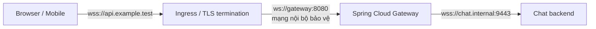
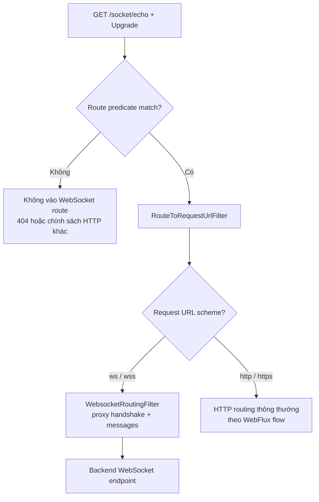
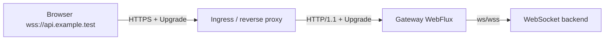

# Định tuyến WebSocket bằng `ws:` và `wss:` trong Spring Cloud Gateway

Trong một kiến trúc microservices, Spring Cloud Gateway là điểm vào chung cho các API HTTP và những kết nối cần trao đổi dữ liệu **hai chiều, liên tục**. Ngoài việc chọn tuyến bằng *route predicate*, chạy *filter chain*, biến đổi path/header, service discovery và các lớp xác thực, giới hạn lưu lượng, circuit breaker, retry, TLS, quan sát request, Gateway còn có thể **proxy WebSocket** từ client đến một backend.

Với HTTP thông thường, mỗi request có một response rồi kết thúc. Với WebSocket, một request HTTP/1.1 ban đầu yêu cầu **nâng cấp kết nối (Upgrade)**; khi bắt tay thành công, client và server trao đổi các **WebSocket frame/message** trên cùng một kết nối đang mở. Điều đó ảnh hưởng trực tiếp đến lựa chọn scheme, cách vận hành load balancer, bảo mật, timeout và đo lường.

Trong **Spring Cloud Gateway Server WebFlux**, route có thể dùng:

- `ws://` — kết nối WebSocket **không mã hóa TLS** trên hop Gateway → upstream.
- `wss://` — kết nối WebSocket **có TLS** trên hop Gateway → upstream.
- `lb:ws://service-id` — WebSocket route có **service discovery/load balancing** theo cơ chế tương ứng, nếu đã cấu hình LoadBalancer.

**Điểm dễ nhầm nhất:** `uri: wss://backend...` mô tả **hop Gateway → backend**. Nó **không tự cấu hình TLS cho client → Gateway**. Client có thể gọi `wss://api.example.test/...` khi ingress/Gateway terminate TLS, dù route nội bộ dùng `ws://...`. Ngược lại, một client gọi `ws://...` vào Gateway không được mã hóa chỉ vì upstream URI là `wss://...`.

Bài thuộc chương **WebSocket và truyền luồng** của module `SPRING_CLOUD_GATEWAY`, tập trung vào **cấu hình định tuyến WebSocket bằng `ws:`/`wss:`**, cơ chế handshake, áp dụng route predicate/filter, xác thực, xử lý TLS, thử nghiệm và vận hành nhiều instance. Những thuật ngữ liên quan như SockJS, SSE và gRPC được giải thích để phân biệt, không coi chúng là WebSocket tương đương.

> **Phạm vi phiên bản:** Ví dụ sử dụng **Spring Cloud Gateway Server WebFlux 5.0.x**, Spring Cloud 2025.1.x và Spring Boot 4.x tương thích. Prefix route YAML dùng `spring.cloud.gateway.server.webflux.routes`. Tài liệu Gateway 4.x thường dùng `spring.cloud.gateway.routes`; Server Web MVC có đường xử lý proxy WebSocket khác, vì thế không chép Java/WebFlux config sang MVC máy móc.

## 1. Mục tiêu học tập

Sau bài này, bạn có thể:

1. Giải thích sự khác biệt giữa HTTP request-response và một WebSocket session sau handshake `101 Switching Protocols`.
2. Phân biệt vai trò `ws://`, `wss://` ở client URL, route URI và backend; hiểu TLS termination.
3. Viết route Gateway WebFlux với `Path`, `Method=GET`, `uri: ws://...` và `StripPrefix` đúng với endpoint backend.
4. Giải thích `WebsocketRoutingFilter` chọn kết nối dựa trên scheme của `GATEWAY_REQUEST_URL_ATTR`.
5. Kết hợp `lb:ws://service-id` với service discovery mà không nhầm load balancing theo **kết nối** với balancing từng message.
6. Xử lý `Origin`, xác thực, phân quyền, proxy headers và giới hạn tài nguyên của kết nối dài.
7. Chạy lab một backend echo WebFlux, Gateway proxy và client `wscat`; kiểm tra HTTP 101, message echo, đóng kết nối và các lỗi thường gặp.
8. Thiết kế TLS outbound `wss`, ingress `wss`, health checks, observability và cách scale Gateway replicas.

## 2. WebSocket bắt đầu bằng HTTP, nhưng không kết thúc như HTTP

Một WebSocket client kết nối bằng handshake HTTP/1.1:

```http
GET /socket/echo HTTP/1.1
Host: api.example.test
Upgrade: websocket
Connection: Upgrade
Sec-WebSocket-Key: dGhlIHNhbXBsZSBub25jZQ==
Sec-WebSocket-Version: 13
Origin: https://app.example.test
```

Nếu server đồng ý nâng cấp, response là:

```http
HTTP/1.1 101 Switching Protocols
Upgrade: websocket
Connection: Upgrade
Sec-WebSocket-Accept: s3pPLMBiTxaQ9kYGzzhZRbK+xOo=
```

Giá trị `Sec-WebSocket-Accept` ở trên là ví dụ chuẩn RFC 6455 đối với `Sec-WebSocket-Key` đã cho. Nó được tính theo quy tắc của handshake, **không** phải chuỗi được copy tùy ý hay access token.

Sau response `101`, luồng trao đổi có dạng:

```text
Client                           Gateway                           Backend
  | HTTP GET + Upgrade              |                                 |
  |-------------------------------->| WebSocket outbound handshake    |
  |                                 |-------------------------------->|
  |                                 |<--------------------------------|
  |<--------------------------------| 101 nếu handshake thành công     |
  |  Text frame: "ping-app"          |                                 |
  |-------------------------------->| Forward message/frame            |
  |                                 |-------------------------------->|
  |                                 |<--------------------------------|
  |<--------------------------------| Text: "echo:ping-app"            |
  | ... kết nối duy trì ...          | ...                              |
  | Close                            |                                 |
```

**Bên ngoài** là HTTP handshake, **bên trong** là WebSocket protocol. Điều đó dẫn tới các giới hạn:

- Không thể dùng HTTP status `200 OK` và JSON body thay cho handshake `101` rồi coi như WebSocket hoạt động.
- Gateway filter đổi HTTP response body không phải công cụ tự động biến đổi **từng WebSocket message** sau khi đã Upgrade.
- HTTP retry/circuit breaker, cache response hay rate limiter của request ban đầu **không tự giới hạn** số message/phút trong một session đã mở.
- Client/WebSocket backend phải có cơ chế **đóng kết nối, heartbeat, kiểm tra payload** và xử lý reconnect.

### 2.1. So sánh `http`, `https`, `ws`, `wss`

| URI hoặc scheme | Giao thức ứng dụng | TLS? | Trong Gateway WebFlux |
|---|---|---|---|
| `http://backend:8080` | HTTP request/response | Không | Chọn Netty HTTP routing thông thường |
| `https://backend:8443` | HTTP request/response | Có | HTTP routing qua TLS |
| `ws://backend:9001` | WebSocket | Không | Kích hoạt Websocket Routing Filter |
| `wss://backend:9443` | WebSocket | Có | Kích hoạt Websocket Routing Filter với kết nối TLS outbound |
| `lb:ws://chat-service` | WebSocket + tên dịch vụ | Tùy đích được giải quyết; ví dụ là `ws` | LoadBalancer giải quyết service instance, rồi WebSocket routing |
| `wss://api.example.test/socket/echo` | WebSocket public từ browser | Có | Đây là **URL client gọi**, không nhất thiết là route URI của backend |

Cặp `ws`/`wss` tương tự `http`/`https` về **mã hóa TLS**, nhưng có khác biệt về cơ chế handshake và trao đổi dữ liệu sau đó. Cổng mặc định thường là 80 cho `ws` và 443 cho `wss` nếu URI không ghi port; trong lab chúng ta dùng port riêng để quan sát rõ các hop.

### 2.2. Hai hop TLS cần được xem độc lập



Có thể có những topology hợp lệ khác:

| Hop client → Gateway | Hop Gateway → backend | Điều cần biết |
|---|---|---|
| `ws` | `ws` | Không có TLS ở cả hai hop; chỉ phù hợp lab hoặc mạng tin cậy có chính sách riêng |
| `wss` | `ws` | TLS đến Gateway/ingress, sau đó cleartext nội bộ; cần đánh giá network trust |
| `wss` | `wss` | TLS trên cả hai hop; **hai phiên TLS khác nhau** |
| `ws` | `wss` | Outbound có TLS nhưng client inbound không; **không bảo vệ hop đầu** |

Nếu ingress nhận public `wss` và forward HTTP Upgrade đến Gateway qua `ws` nội bộ, cần bảo đảm ingress thật sự hỗ trợ WebSocket proxy, giữ handshake và không cắt kết nối dài quá sớm. Không mô tả topology này là TLS end-to-end nếu tại ingress đã giải mã rồi truyền cleartext.

## 3. Websocket Routing Filter trong Gateway Server WebFlux

Tài liệu Spring Cloud Gateway mô tả `WebsocketRoutingFilter`:

1. `RoutePredicateHandlerMapping` tìm route khớp request, gắn route vào exchange.
2. `RouteToRequestUrlFilter` xây URL đích và đặt trong exchange attribute `ServerWebExchangeUtils.GATEWAY_REQUEST_URL_ATTR`.
3. Khi URL đích có scheme `ws` hoặc `wss`, `WebsocketRoutingFilter` chuyển phiên WebSocket xuống upstream bằng hạ tầng Spring WebSocket.
4. Sau khi kết nối được nâng cấp, Gateway chuyển dữ liệu hai chiều giữa hai WebSocket sessions.



**Điểm cốt lõi:** URI `ws://` hoặc `wss://` là tín hiệu để WebSocket routing filter hoạt động. Chỉ thêm header `Upgrade: websocket` vào một route HTTP `uri: http://...` không phải cách cấu hình WebSocket mà tài liệu Gateway WebFlux đưa ra; đừng lấy cách ứng xử của **Gateway Server Web MVC** rồi giả định Server WebFlux làm y hệt.

### 3.1. Route predicate vẫn được xét ở handshake

Ví dụ:

```yaml
predicates:
  - Path=/socket/**
  - Method=GET
```

WebSocket handshake HTTP/1.1 thường là `GET` và có path được gửi. `Path`/`Method` có thể dùng để giới hạn route, nhưng chúng **không** kiểm tra nội dung frame sau khi kết nối mở. `Header`/`Host` predicates có thể áp dụng cho handshake nếu thực sự cần; không coi chúng là logic authorization cho từng message.

### 3.2. GatewayFilter thay đổi request trước khi đến backend

Ví dụ:

```yaml
filters:
  - StripPrefix=1
```

Khi client gọi `ws://localhost:8080/socket/echo`, backend tại `ws://localhost:9001` nhận path `/echo`. Hãy giữ path do backend hỗ trợ và filter biến đổi path nhất quán, nếu không handshake có thể kết thúc bằng `404` dù service đang chạy.

Các filter như `AddRequestHeader` hoặc `RemoveRequestHeader` có thể tác động đến **HTTP handshake**; chúng không phải pipeline tự động sửa từng WebSocket message. Không tự thay `Upgrade`, `Connection`, `Sec-WebSocket-Key` hoặc `Sec-WebSocket-Accept` bằng chuỗi cố định: đây là phần bắt tay được WebSocket client/server hạ tầng quản lý.

### 3.3. Không chuyển frame theo mỗi route predicate

Sau khi upgrade thành công, **một WebSocket connection** đã được tạo đến backend được chọn. Khi client gửi 1.000 message, Gateway **không chạy lại `Path` predicate 1.000 lần**, cũng không hỏi LoadBalancer chọn backend mới cho từng frame.

Đó là khác biệt quan trọng với REST: load balancing thường diễn ra ở **thời điểm tạo session**. Khi một instance backend đang giữ state của session, load balancer không thể chuyển một session đang mở sang backend khác mà không có protocol hỗ trợ. Nếu backend mất kết nối, client cần reconnect; phiên mới có thể được route đến instance khác.

## 4. Cấu hình tuyến `ws://` cơ bản bằng YAML

### 4.1. Một route WebSocket đầy đủ

Dùng `src/main/resources/application.yml` trong project Gateway Server WebFlux:

```yaml
server:
  address: 127.0.0.1
  port: 8080

spring:
  application:
    name: gateway-websocket-lab

  cloud:
    gateway:
      server:
        webflux:
          routes:
            - id: echo-websocket
              uri: ws://127.0.0.1:9001
              predicates:
                - Path=/socket/**
                - Method=GET
              filters:
                - StripPrefix=1
```

**Diễn giải từng phần:**

| Thành phần | Giá trị | Hành vi |
|---|---|---|
| `server.port` | `8080` | Gateway nhận handshake của client |
| `uri` | `ws://127.0.0.1:9001` | Gateway tạo WebSocket outbound đến backend không dùng TLS |
| `Path` | `/socket/**` | Chỉ chọn request có path phù hợp |
| `Method` | `GET` | WebSocket HTTP/1.1 handshake dùng GET |
| `StripPrefix=1` | Bỏ một segment đầu | Client `/socket/echo` → backend `/echo` |
| `id` | `echo-websocket` | ID dùng để quan sát cấu hình route |

Đây là **route WebSocket**, không có logic echo trong Gateway. Gateway chuyển tiếp WebSocket connection đến backend trên port 9001; nếu backend không có endpoint `/echo` hỗ trợ upgrade, handshake sẽ thất bại.

### 4.2. Những cấu hình sai phổ biến

**Sai 1 — dùng HTTP URI mà kỳ vọng tự chuyển thành WebSocket ở WebFlux:**

```yaml
# Không phải cấu hình WebSocket WebFlux được tài liệu hướng dẫn:
uri: http://127.0.0.1:9001
```

Với Gateway Server WebFlux, dùng `ws://` hoặc `wss://` để đưa exchange vào `WebsocketRoutingFilter`. Đừng lấy hành vi Server Web MVC — có thể upgrade từ route `http://`/`https://` — áp đặt cho WebFlux.

**Sai 2 — dùng `StripPrefix=2` khi path chỉ có một prefix cần bỏ:**

```yaml
predicates:
  - Path=/socket/**
filters:
  - StripPrefix=2
```

Với request `/socket/echo`, strip hai segment có thể khiến backend nhận path `/` thay vì `/echo`, nên WebSocket backend không match handler. Hãy vẽ rõ mapping trước/sau và kiểm thử bằng backend echo.

**Sai 3 — chỉ thêm header Upgrade vào HTTP request:**

```yaml
filters:
  - AddRequestHeader=Upgrade, websocket
```

Không dùng filter này để mô phỏng một WebSocket handshake. Client và server phải thỏa RFC 6455 (key, version, upgrade headers, subprotocol nếu có); hạ tầng WebSocket của Spring đảm nhận handshake đúng.

### 4.3. Khi có nhiều WebSocket upstream

Một Gateway có thể công bố nhiều API:

```yaml
spring:
  cloud:
    gateway:
      server:
        webflux:
          routes:
            - id: chat-socket
              uri: ws://chat-internal:9011
              predicates:
                - Path=/socket/chat/**
              filters:
                - StripPrefix=1

            - id: notifications-socket
              uri: ws://notification-internal:9012
              predicates:
                - Path=/socket/notifications/**
              filters:
                - StripPrefix=1
```

Tên `chat-internal` và `notification-internal` là **DNS minh họa**; khi chạy thực, cần resolver/service discovery/network policy. Nếu hai route chồng lấn `Path`, xác định `order` tường minh. Đừng bật một route quá rộng `Path=/**` với `ws://` vì có thể bắt cả HTTP request không có Upgrade và gây lỗi không mong đợi.

### 4.4. Phân biệt server inbound và upstream URL

Với cấu hình lab:

```text
Client:  ws://127.0.0.1:8080/socket/echo
Gateway: uri: ws://127.0.0.1:9001
Backend: handler path /echo
```

Ba thứ khác nhau: **URL client**, **route URI đích** và **path handler backend**. Route `uri` không phải đường dẫn mà browser phải dùng để truy cập; client luôn truy cập endpoint công khai của Gateway.

## 5. Từ `ws:` sang `wss:`: TLS nằm trên hop nào?

`wss://` dùng WebSocket qua TLS. Có hai mạch TLS riêng cần cấu hình độc lập:

- **Inbound:** browser/ứng dụng → ingress hoặc Gateway.
- **Outbound:** Gateway → backend.

### 5.1. Inbound TLS khi Gateway terminate trực tiếp

Ví dụ Gateway nghe TLS `8443` bằng PKCS#12:

```yaml
server:
  port: 8443
  ssl:
    enabled: true
    key-store: classpath:gateway-tls.p12
    key-store-type: PKCS12
    key-store-password: ${GATEWAY_KEYSTORE_PASSWORD}
    key-alias: gateway

spring:
  cloud:
    gateway:
      server:
        webflux:
          routes:
            - id: echo-over-inbound-tls
              uri: ws://127.0.0.1:9001
              predicates:
                - Path=/socket/**
              filters:
                - StripPrefix=1
```

Client sẽ gọi `wss://api.example.test:8443/socket/echo` sau khi DNS/certificate khớp thực tế. **Upstream vẫn là `ws://` không TLS** theo URI route, dù client có WSS đến Gateway. Không có certificate file `gateway-tls.p12` thật trong tài liệu; phải tạo bằng CA/test PKI phù hợp, bảo vệ mật khẩu bằng secret, kiểm tra SAN của host và không commit private key vào Git.

Khi ingress terminate TLS thay Gateway, `server.ssl` có thể không bật ở Gateway; client vẫn gọi WSS đến **ingress**, ingress proxy handshake tới Gateway. Nhớ đánh giá mức độ tin cậy của đoạn cleartext nội bộ.

### 5.2. Outbound TLS bằng `wss://`

Nếu backend WebSocket mở TLS tại `chat.internal.example:9443`:

```yaml
spring:
  cloud:
    gateway:
      server:
        webflux:
          routes:
            - id: chat-secure-upstream
              uri: wss://chat.internal.example:9443
              predicates:
                - Path=/socket/chat/**
              filters:
                - StripPrefix=2
```

Khi client gọi `/socket/chat/room/42`, backend sẽ thấy path `/room/42`. Gateway phải kết nối tới WebSocket endpoint có **certificate hợp lệ**, SAN/hostname phù hợp và chuỗi CA được tin cậy. `wss` không có nghĩa “bỏ qua kiểm chứng chứng chỉ”.

**Lưu ý kỹ thuật quan trọng:** `server.ssl.*` cấu hình certificate của **server inbound**, không tự cung cấp truststore hoặc client certificate cho mọi WebSocket outbound. Với private CA hoặc mTLS đến backend, phải cấu hình TLS/trust/client identity **của WebSocket client phía Gateway** theo cơ chế được hỗ trợ trên đúng release; đừng giả định mọi property `httpclient.ssl.*` đều được sử dụng y hệt bởi cả HTTP proxy và `WebsocketRoutingFilter` khi chưa kiểm tra wiring thực tế.

Nếu outbound TLS handshake sai, khắc phục CA, hostname, trust manager, cipher/protocol và mTLS credentials — **không bật insecure trust-all** trong production để vượt lỗi `PKIX path building failed`.

### 5.3. Ma trận TLS trong triển khai

| Client → ingress/Gateway | Gateway → backend | Có thể dùng? | Rủi ro/chú ý |
|---|---|---|---|
| `ws://` | `ws://` | Lab local | Không bảo mật hop truyền dữ liệu |
| `wss://` | `ws://` | Có, khi mạng nội bộ chấp nhận | TLS terminate sớm, cleartext phía sau ingress |
| `wss://` | `wss://` | Có | Hai bắt tay TLS, trust/CA/SAN cho từng hop |
| `ws://` | `wss://` | Về kỹ thuật có | Hop client không TLS, không an toàn cho Internet |
| `wss://` + mTLS inbound | `wss://` + mTLS outbound | Có với thiết kế PKI phù hợp | Hai identity/trust domain độc lập; test ở mỗi hop |

### 5.4. Không nhầm 101, TLS handshake và WebSocket Close

Một lỗi TLS certificate xảy ra **trước** HTTP 101; client có thể thấy lỗi TLS thay vì HTTP status. Khi WebSocket đã upgrade rồi mà backend cắt kết nối, client nhận **close/error event hoặc close frame**, không nhận một HTTP `500` mới trên cùng kết nối đã upgrade.

Vì vậy khi điều tra, luôn phân biệt:

1. TLS handshake thất bại.
2. HTTP WebSocket Upgrade thất bại (401/403/404/400/502... tùy lớp gây lỗi).
3. WebSocket đã nâng cấp rồi nhưng session bị close/reset.
4. Message lỗi nghiệp vụ được backend gửi **bên trong WebSocket protocol**.

## 6. Route load balancing: `lb:ws://service-id`

Spring Cloud Gateway cho phép đặt prefix `lb` cho WebSocket route:

```yaml
spring:
  cloud:
    gateway:
      server:
        webflux:
          routes:
            - id: chat-load-balanced
              uri: lb:ws://chat-service
              predicates:
                - Path=/socket/chat/**
              filters:
                - StripPrefix=2
```

Từ `lb:ws://chat-service`, Gateway dùng **Spring Cloud LoadBalancer**/service discovery phù hợp để lấy instance `chat-service` và định tuyến WebSocket đến nó. Ví dụ này chỉ có ý nghĩa khi:

- Project có starter Spring Cloud LoadBalancer (nếu dependency không được kéo vào bởi stack hiện tại).
- Có DiscoveryClient hoặc một `ServiceInstanceListSupplier` khai báo instance cụ thể.
- Backend instances đều hỗ trợ WebSocket trên path do filter truyền đến.
- Scheme/port và cấu hình TLS được kiểm chứng trên các service instance thật.

`lb:ws://chat-service` **không tự khởi chạy** service tên `chat-service`, và không bảo đảm backend được đặt trên port 80/443 khi registry báo port khác.

### 6.1. Kết nối dài không được cân bằng theo từng frame

Khi client mở session:

```text
Client #1 ── WebSocket session A ── Gateway ── chat-service instance 1
Client #2 ── WebSocket session B ── Gateway ── chat-service instance 2
Client #1 ── Message 2,3,... ──────────────────> instance 1
```

**LoadBalancer thường chọn instance khi bắt đầu WebSocket connection**. Một session đang mở không tự nhảy sang instance khác khi có instance mới hoặc khi instance 1 bị mất. Sau khi connection đóng, client reconnect sẽ bắt đầu một kết nối mới, có thể trỏ instance khác.

Nếu chat backend lưu phòng chat/session state trong RAM của một instance, cần thiết kế **shared session state, pub/sub, broker hoặc message routing** cho toàn cụm. Sticky sessions có thể hỗ trợ một số mô hình nhưng không giải quyết failover/rebalance hoặc đồng bộ message theo toàn hệ thống.

### 6.2. Khi nào cần `lb:wss://...`?

Các tài liệu Gateway WebFlux mô tả rõ `lb:ws://serviceid` và logic scheme prefix `lb`. Với backend secure ở service discovery, có thể gặp cách cấu hình scheme có TLS như `lb:wss://chat-service`; **đừng kết luận tự động đúng cho mọi registry/release**. Cần kiểm tra cách LoadBalancer giải quyết scheme/secure flag và test outbound TLS với certificate/service instance thực tế. Khi chưa xác minh, `wss://` trỏ host/port cụ thể là ví dụ dễ kiểm soát hơn.

### 6.3. Discovery và health check khác độ khỏe session

HTTP health endpoint `GET /actuator/health` có thể đang 200 khi WebSocket handler bị nghẽn message, session bị đóng do idle timeout hoặc upstream broker chết. Nếu WebSocket là chức năng quan trọng, cần health/readiness kiểm tra dependency liên quan và số session/timeout/close-code theo ứng dụng, không chỉ health tổng.

## 7. Lab end-to-end: backend WebSocket echo và Gateway `ws://`

Mục tiêu lab: client gửi chuỗi `hello` vào Gateway, backend nhận `hello` và trả `echo:hello` qua cùng WebSocket session. Ta dùng **hai Spring Boot application độc lập**:

1. **Backend Echo** — Spring Boot WebFlux, port `9001`, xử lý WebSocket tại `/echo`.
2. **Gateway Echo** — Spring Cloud Gateway Server WebFlux, port `8080`, route `/socket/**` tới `ws://127.0.0.1:9001`.

Đây là lab **không TLS** trên loopback. Không đưa `server.address: 127.0.0.1` thành cấu hình công khai khi chưa thiết kế ingress, identity và transport security.

### 7.1. Project backend: dependency Maven

Tạo một project Spring Boot WebFlux riêng (ví dụ `echo-backend`), với dependency:

```xml
<dependency>
    <groupId>org.springframework.boot</groupId>
    <artifactId>spring-boot-starter-webflux</artifactId>
</dependency>
```

Đây chỉ là **đoạn dependencies liên quan**, không phải `pom.xml` đầy đủ: cần Spring Boot parent hoặc dependency management/plugin tương thích. **Không thêm starter Spring MVC** vào backend demo này, vì nó có thể khiến Boot chọn Servlet/MVC thay WebFlux. `spring-boot-starter-websocket` của Spring Boot dành chủ yếu cho WebSocket trên Spring MVC, không phải dependency bắt buộc của ví dụ WebFlux này.

Cấu hình backend `src/main/resources/application.yml`:

```yaml
server:
  address: 127.0.0.1
  port: 9001

spring:
  application:
    name: echo-websocket-backend
```

### 7.2. Backend Java với `WebSocketHandler`

Tạo `EchoBackendApplication.java` dưới package của ứng dụng:

```java
import java.util.Map;

import org.springframework.boot.SpringApplication;
import org.springframework.boot.autoconfigure.SpringBootApplication;
import org.springframework.context.annotation.Bean;
import org.springframework.web.reactive.HandlerMapping;
import org.springframework.web.reactive.handler.SimpleUrlHandlerMapping;
import org.springframework.web.reactive.socket.WebSocketHandler;
import org.springframework.web.reactive.socket.WebSocketMessage;

@SpringBootApplication
public class EchoBackendApplication {

    public static void main(String[] args) {
        SpringApplication.run(EchoBackendApplication.class, args);
    }

    @Bean
    HandlerMapping websocketMapping() {
        WebSocketHandler echo = session -> session.send(
            session.receive()
                .filter(message ->
                    message.getType() == WebSocketMessage.Type.TEXT)
                .map(message -> session.textMessage(
                    "echo:" + message.getPayloadAsText()))
        );

        Map<String, WebSocketHandler> handlers =
                Map.of("/echo", echo);

        // -1 cho handler mapping ưu tiên trước mapping
        // thông thường của annotated controllers.
        return new SimpleUrlHandlerMapping(handlers, -1);
    }
}
```

Lớp `WebSocketHandler` của Spring WebFlux nhận `WebSocketSession` với:

- `session.receive()`: stream của các message đến.
- `session.textMessage(...)`: tạo text message gửi ra.
- `session.send(publisher)`: viết các message phản hồi và kết thúc khi publisher hoàn tất.

Mẫu này chỉ echo **text messages**; binary messages bị bỏ qua theo filter. **Không** giải mã JSON, lưu trạng thái người dùng, kiểm tra payload size hay authorization theo room. Đó là các yêu cầu riêng cho backend production.

Spring WebFlux Java configuration cung cấp `WebSocketHandlerAdapter` hỗ trợ handshake; với Spring Boot WebFlux auto-configuration thông thường không cần tự tạo một adapter thứ hai. Nếu project đã tùy biến hoàn toàn WebFlux configuration và loại bỏ handler adapter, đối chiếu tài liệu Spring Framework để đăng ký nó, tránh tạo bean trùng ngoài ý muốn.

### 7.3. Project Gateway: dependency Maven

Tạo project **khác** (ví dụ `gateway-ws-demo`) dùng Spring Cloud Gateway Server WebFlux:

```xml
<dependency>
    <groupId>org.springframework.cloud</groupId>
    <artifactId>spring-cloud-starter-gateway-server-webflux</artifactId>
</dependency>
```

Dùng Spring Cloud BOM tương thích với Spring Boot 4.x. Không tự chọn một Cloud train tùy ý, không trộn Gateway Web MVC starter vào ứng dụng WebFlux.

Class khởi động:

```java
import org.springframework.boot.SpringApplication;
import org.springframework.boot.autoconfigure.SpringBootApplication;

@SpringBootApplication
public class WebSocketGatewayApplication {
    public static void main(String[] args) {
        SpringApplication.run(WebSocketGatewayApplication.class, args);
    }
}
```

Dùng đúng `application.yml` của mục **4.1**, với port Gateway `8080` và `uri: ws://127.0.0.1:9001`. Trong lab không cần cấu hình `ssl`, không cần Redis, không cần discovery và không cần viết WebSocket handler tại Gateway — Gateway đóng vai trò **proxy**, không xử lý business messages.

### 7.4. Khởi động backend rồi Gateway

Trong project backend:

```bash
# Linux/macOS
./mvnw spring-boot:run

# PowerShell
.\mvnw.cmd spring-boot:run
```

Giữ terminal chạy. Trong project Gateway (terminal khác):

```bash
# Linux/macOS
./mvnw spring-boot:run

# PowerShell
.\mvnw.cmd spring-boot:run
```

Kiểm tra logs: backend lắng nghe `127.0.0.1:9001`, Gateway lắng nghe `127.0.0.1:8080`. Nếu khởi động sai port, đừng vội sửa route filter trước khi kiểm tra địa chỉ thực của hai process.

### 7.5. Kết nối trực tiếp backend bằng `wscat`

`wscat` là một công cụ CLI để gửi/nhận WebSocket messages. Nếu môi trường đã có Node.js/npm và được phép cài package, có thể dùng `npx`:

```bash
npx wscat -c ws://127.0.0.1:9001/echo
```

Sau khi kết nối, nhập:

```text
> hello
< echo:hello
> testing
< echo:testing
```

Đây là **minh họa output tương tác**; ký hiệu `>`/`<` do client terminal hiển thị, không phải dữ liệu bắt buộc gửi lên protocol. Nếu muốn thoát, dùng tính năng đóng của CLI hoặc Ctrl+C, rồi kiểm tra session đã được dọn.

Nếu không kết nối **trực tiếp** được backend, hãy xử lý backend trước: có đúng `/echo`, server đang chạy, dependency WebFlux và WebSocket handler mapping đã đăng ký không? Một route Gateway đúng không thể sửa lỗi backend handshake.

### 7.6. Kết nối qua Gateway

Khi backend hoạt động, chạy:

```bash
npx wscat -c ws://127.0.0.1:8080/socket/echo
```

Nhập:

```text
> hello gateway
< echo:hello gateway
> good morning
< echo:good morning
```

Khi thành công:

- `/socket/echo` khớp `Path=/socket/**` và `Method=GET`.
- `StripPrefix=1` biến path thành `/echo`.
- Gateway tạo WebSocket outbound tới backend `127.0.0.1:9001`.
- Backend nhận text, tạo reply.
- Reply đi qua Gateway tới client trên **session đã mở**, không qua một HTTP request mới.

**Không đọc JSON body hay `Content-Length` để chứng minh kết nối:** dữ liệu phản hồi `echo:...` là WebSocket message sau HTTP `101`. Sử dụng WebSocket client, không phải chỉ dùng `curl -i` thông thường.

## 8. Kiểm tra handshake, route và frame

### 8.1. Kiểm tra HTTP `101` bằng `curl`

Một WebSocket handshake phải có các header phù hợp. Có thể dùng curl cho phần **handshake**:

```bash
curl --http1.1 -i -N --max-time 3 \
  -H "Connection: Upgrade" \
  -H "Upgrade: websocket" \
  -H "Sec-WebSocket-Version: 13" \
  -H "Sec-WebSocket-Key: dGhlIHNhbXBsZSBub25jZQ==" \
  http://127.0.0.1:8080/socket/echo
```

Khi handshake thành công, đầu response thường là:

```http
HTTP/1.1 101 Switching Protocols
Upgrade: websocket
Connection: Upgrade
Sec-WebSocket-Accept: s3pPLMBiTxaQ9kYGzzhZRbK+xOo=
```

`curl` **không phải công cụ lý tưởng để trao đổi WebSocket frame tương tác** theo bài lab này. Với `--max-time 3`, curl có thể kết thúc bằng timeout sau khi đã nhìn thấy 101 — **không đồng nghĩa handshake thất bại**. Dùng `wscat`/`websocat` hoặc test client WebSocket để kiểm tra text, binary, ping/pong và close.

Đặc biệt, dòng lệnh trên không tự gửi `Origin`; CLI WebSocket client có thể không gửi `Origin`, khác browser. Vì thế handshake 101 với curl **không chứng minh** ứng dụng từ trình duyệt cross-origin cũng kết nối được, hoặc Origin policy đã an toàn.

### 8.2. Test sai path và sai method

```bash
# /not-socket/** không khớp route /socket/**
curl -i http://127.0.0.1:8080/not-socket/echo

# POST không khớp Method=GET của route WebSocket
curl -i -X POST http://127.0.0.1:8080/socket/echo
```

Hai request này không phải WebSocket handshake hợp lệ; thông thường nếu không có route/handler khác thì nhận `404`, nhưng khi thêm Spring Security hoặc filter khác có thể nhận `401`/`403` trước đó.

Nếu gọi `GET /socket/echo` **không có header Upgrade** nhưng vẫn match WebSocket route, Gateway có thể từ chối handshake/upgrade hoặc phát lỗi phù hợp; không mong đợi HTTP `200` có body echo.

### 8.3. Test backend dừng hoạt động

1. Giữ Gateway chạy.
2. Dừng backend port 9001.
3. Dùng `wscat` mở **kết nối mới** qua Gateway.
4. Ghi lỗi handshake, Gateway logs và outbound connect error.
5. Khởi động lại backend rồi thử session mới.

Khi upstream không khả dụng, client có thể thấy lỗi handshake HTTP hoặc kết nối bị đóng; **không mặc định** mọi lỗi đều trả `502` đúng như Server Web MVC, vì cơ chế/phiên bản Gateway WebFlux và lớp hạ tầng có thể khác.

Khi backend chết **sau khi** WebSocket đã upgrade thành công, client sẽ thấy close/error event hoặc TCP reset, không nhận một HTTP 502 mới trên kết nối đó.

### 8.4. Trình duyệt JavaScript đơn giản

Trong môi trường frontend được phép bởi Origin policy:

```javascript
const socket = new WebSocket("wss://api.example.test/socket/echo");

socket.addEventListener("open", () => {
  socket.send("hello");
});

socket.addEventListener("message", (event) => {
  console.log("Reply:", event.data);
});

socket.addEventListener("close", (event) => {
  console.log("Closed", event.code, event.reason);
});

socket.addEventListener("error", () => {
  console.error("WebSocket connection error");
});
```

Đây là **mẫu frontend production URL**, không chạy nguyên trên lab `ws://127.0.0.1:8080` nếu chưa có ingress/TLS và DNS `api.example.test`. Trang HTTPS thường phải kết nối bằng `wss://` để tránh mixed-content security restrictions.

Browser WebSocket constructor **không cho phép tùy ý đặt `Authorization` header**. Đừng viết mã JavaScript kiểu `new WebSocket(url, { headers: { Authorization: ... } })` rồi tin rằng trình duyệt hỗ trợ. Cần thiết kế xác thực WebSocket phù hợp qua session cookie được bảo vệ, ticket ngắn hạn hoặc cơ chế khác do ứng dụng kiểm soát, nêu chi tiết ở mục tiếp theo.

## 9. Bảo mật WebSocket: `Origin`, CVE-2026-59428 và xác thực

WebSocket từ browser không áp dụng cùng cơ chế CORS preflight cho handshake như `fetch()`. Browser vẫn gửi `Origin` để server quyết định có chấp nhận kết nối từ trang web đó hay không. Nếu server bỏ qua `Origin`, một trang độc hại có thể khiến browser của người dùng mở WebSocket đến API đang mang session cookie của họ — trường hợp thường gọi là **Cross-Site WebSocket Hijacking (CSWSH)**.

### 9.1. Cảnh báo bảo mật với Spring Cloud Gateway 5.0.x

**Cập nhật ngày 19/11/2026:** Spring công bố **CVE-2026-59428 — Spring Cloud Gateway WebSocket Routing Filter Does Not Enforce Same-Origin by Default**.

Thông tin từ thông báo chính thức:

| Nội dung | Kết luận |
|---|---|
| Sản phẩm bị ảnh hưởng trong nhánh 5.0 | **5.0.0 đến 5.0.4** |
| Vấn đề | `WebsocketRoutingFilter` không kiểm tra `Origin` theo mặc định trên các bản bị ảnh hưởng |
| Nguy cơ | Cross-origin browser handshake có thể được chấp nhận, đặc biệt nguy hiểm khi có cookie tự động đính kèm |
| Bản sửa OSS được công bố | **5.0.5** |
| Hành vi bản đã sửa | Mặc định chỉ chấp nhận **same-origin** hoặc request không có `Origin`; cross-origin khác bị trả `403` |
| Cơ chế tùy chỉnh trên bản đã sửa | `spring.cloud.gateway.server.webflux.websocket.allowed-origins` hoặc `allowed-origin-patterns` |

**Không diễn đạt rằng “mọi bản Gateway 5.0.x đều mặc định chặn cross-origin”**. Với phiên bản bị ảnh hưởng, không dựa vào mặc định `Origin` để chống CSWSH; **nâng cấp lên bản đã sửa 5.0.5 hoặc bản mới hơn có fix phù hợp**. Đối với nhánh 4.x, xem advisory để tìm chính xác bản sửa theo nhánh. Cấu hình allowlist mới không thay thế việc nâng cấp một bản dễ tổn thương.

Nguồn: [Thông báo bảo mật chính thức của Spring — CVE-2026-59428](https://spring.io/security/cve-2026-59428/).

### 9.2. Cho phép origin cụ thể trên Gateway đã vá

Với Gateway Server WebFlux **5.0.5+**, nếu frontend nằm tại `https://app.example.test` và trang dev ở `http://localhost:5173`, chỉ thêm các origin thực sự được phép:

```yaml
spring:
  cloud:
    gateway:
      server:
        webflux:
          websocket:
            allowed-origins:
              - https://app.example.test
              - http://localhost:5173
```

Đây là **đoạn cấu hình để hợp nhất dưới `spring.cloud.gateway.server.webflux`** của ứng dụng, không phải file YAML riêng áp dụng cho cả stack. Chỉ giữ origin localhost trong **profile phát triển**, không copy không suy xét vào production.

Nếu cần cho phép nhiều subdomain, release đã vá còn cung cấp `allowed-origin-patterns`:

```yaml
spring:
  cloud:
    gateway:
      server:
        webflux:
          websocket:
            allowed-origin-patterns:
              - "https://*.example.test"
```

**Rủi ro:** Wildcard cho toàn bộ subdomain có thể chấp nhận cả một subdomain bị chiếm quyền hoặc host không được tin. Chỉ dùng pattern khi có yêu cầu thật và quản lý toàn bộ namespace. Không đặt `*` cho mọi origin trên API dùng cookie hoặc dữ liệu nhạy cảm.

### 9.3. Origin là kiểm tra bổ sung, không phải danh tính user

Các lớp kiểm tra độc lập:

| Kiểm tra | Câu hỏi | Cách làm |
|---|---|---|
| TLS / `wss` | Kênh tới Gateway/backend có được mã hóa và xác minh không? | TLS đúng cert/CA/SAN |
| `Origin` | Trang web nào yêu cầu mở socket từ browser? | Same-origin hoặc allowlist chặt |
| Authentication | Client/user/workload là ai? | Session/JWT/ticket đã xác minh |
| Authorization handshake | Danh tính có được mở endpoint `/socket/chat`? | Spring Security/policy trước upgrade |
| Authorization message | User có được gửi nội dung vào phòng chat X không? | Kiểm tra tại backend cho từng operation |
| Resource limits | Mỗi user/tenant có bao nhiêu session/message? | Rate/concurrency/quota và validation |

**`Origin` không phải một credential.** Non-browser clients có thể tự đặt giả `Origin` hoặc không gửi `Origin`. Vì thế server vẫn phải xác thực và phân quyền, không dùng “đúng Origin” làm bằng chứng người dùng đã đăng nhập.

### 9.4. Browser WebSocket và `Authorization`

Browser API:

```javascript
new WebSocket("wss://api.example.test/socket/chat");
```

**Không cho phép gắn một header `Authorization: Bearer ...` tùy ý** như `fetch()` hoặc các CLI WebSocket clients. Những chiến lược có thể chọn:

1. **Session cookie đã được bảo vệ**: Gateway xác thực cookie/session trong handshake; kết hợp SameSite, Secure, HttpOnly, CSRF/CSWSH protection và strict Origin allowlist.
2. **Ticket WebSocket ngắn hạn**: frontend gọi API HTTPS đã xác thực để đổi lấy ticket một lần hoặc hạn ngắn, sau đó dùng ticket để mở WebSocket theo một giao thức được thiết kế; Gateway/backend phải xác minh ticket, chống replay và không lưu raw ticket ở logs.
3. **Subprotocol hoặc message xác thực đầu tiên**: cần protocol được xác định nghiêm ngặt, ngăn gửi message nghiệp vụ trước khi xác minh và đảm bảo không tiết lộ credentials qua logs; không tùy tiện nhét JWT vào `Sec-WebSocket-Protocol` rồi coi là phương án bảo mật chuẩn.
4. **Non-browser clients**: có thể hỗ trợ `Authorization` trong HTTP handshake tùy client library và Security configuration, nhưng phải kiểm thử chính xác.

**Không truyền access token dài hạn qua query string** như `?token=eyJ...` chỉ để “browser gửi được”. URL có thể bị ghi vào access logs, proxy logs, tracing, analytics và lịch sử giám sát. Nếu buộc dùng ticket theo URL, phải cực ngắn hạn, một lần, bound với user/route, được sanitize khỏi mọi log và chỉ dùng qua WSS.

### 9.5. Spring Security áp dụng cho handshake, chưa phải message policy

Nếu Gateway dùng Spring Security WebFlux, bảo vệ handshake path `/socket/**` tương tự API HTTP:

```java
import org.springframework.context.annotation.Bean;
import org.springframework.context.annotation.Configuration;
import org.springframework.security.config.web.server.ServerHttpSecurity;
import org.springframework.security.web.server.SecurityWebFilterChain;

@Configuration
public class GatewayWebSocketSecurity {
    @Bean
    SecurityWebFilterChain socketSecurity(ServerHttpSecurity http) {
        return http
            // Chỉ là phác thảo chính sách: chọn auth scheme
            // và CSRF handling theo session/JWT thật.
            .authorizeExchange(ex -> ex
                .pathMatchers("/socket/**").authenticated()
                .anyExchange().denyAll())
            .build();
    }
}
```

Ví dụ trên **chưa cấu hình** login, JWT decoder hoặc session identity provider, nên không phải mẫu auth production có thể chép nguyên. Khi dùng JWT Resource Server, thêm dependency/security và `oauth2ResourceServer(...).jwt(...)` tương ứng; khi dùng session cookie, phải cấu hình CSRF, SameSite và origin. Không tắt `csrf` hoặc `formLogin` mù quáng nếu ứng dụng dựa vào browser session.

Và **sau handshake**, từng message như `JOIN_ROOM`/`SEND_MESSAGE` phải được kiểm tra:

- User đang có quyền trong room/tenant nào?
- Quyền có bị thu hồi giữa session hay không?
- Message type, kích thước, JSON schema, nội dung nhạy cảm có hợp lệ?
- User có được gửi message tới room đó ở thời điểm này không?
- Có giới hạn số message và chống spam không?

Handshake `101` không tự trao quyền vô hạn cho toàn bộ session. Đặc biệt, route động hoặc rewrite path/header của Gateway không được phép bypass authorization tại backend.

### 9.6. Cấu hình Origin ở Gateway không thay mọi chính sách backend

Gateway WebFlux sau bản vá có thể chặn Origin sai **trước khi outbound handshake**. Nhưng backend WebSocket cũng có thể kiểm tra Origin độc lập. Nếu backend chỉ cho phép same-origin với host nội bộ, còn browser gửi Origin `https://app.example.test`, outbound handshake có thể bị backend từ chối ngay cả khi Gateway allowlist cho phép.

Để hỗ trợ browser cross-origin hợp lệ:

1. Allowlist Origin ở **Gateway**.
2. Thẩm định và cấu hình policy Origin của **backend WebSocket handler** nếu backend cũng kiểm tra.
3. Truyền/chuẩn hóa forwarded host/scheme chỉ từ proxy tin cậy.
4. Kiểm thử browser thật và non-browser client, cùng các Origin sai.

Không tắt toàn bộ Origin checks của backend như cách sửa duy nhất khi thấy 403; xác định lớp trả lỗi và thiết kế một policy tin cậy cho cả đường kết nối.

## 10. Ingress, reverse proxy và HTTP Upgrade

Khi triển khai thật, thường có thêm ingress/reverse proxy trước Gateway:



Những điều cần ở ingress:

- Hỗ trợ HTTP/1.1 WebSocket Upgrade (hoặc cơ chế tương thích do proxy/framework công bố); không chỉ proxy HTTP request ngắn.
- Chuyển đúng các header handshake phù hợp như `Upgrade` và `Connection` khi làm reverse proxy.
- Giữ upstream connection mở trong thời gian session, có **idle timeout** đủ cho heartbeat.
- Bảo vệ nguồn `X-Forwarded-*`/`Forwarded`: ingress phải sanitize header từ Internet trước khi ghi thông tin đáng tin.
- Đảm bảo listener public là TLS/WSS; không mở ws:// public ngoài chính sách cho phép.
- Có giới hạn concurrent connections, new handshakes/giây và cơ chế drain trong rolling update.

### 10.1. Ví dụ Nginx HTTP/1.1 reverse proxy

Đây là đoạn cấu hình **minh họa**, không phải toàn bộ `nginx.conf`:

```nginx
# Khai báo ở ngữ cảnh http:
map $http_upgrade $connection_upgrade {
    default upgrade;
    ''      close;
}

upstream gateway_ws {
    server 127.0.0.1:8080;
}

server {
    listen 443 ssl;
    server_name api.example.test;

    ssl_certificate     /etc/nginx/tls/fullchain.pem;
    ssl_certificate_key /etc/nginx/tls/privkey.pem;

    location /socket/ {
        proxy_pass http://gateway_ws;
        proxy_http_version 1.1;
        proxy_set_header Upgrade $http_upgrade;
        proxy_set_header Connection $connection_upgrade;
        proxy_set_header Host $host;
        proxy_set_header X-Forwarded-Proto $scheme;
        proxy_set_header X-Forwarded-Host $host;
        proxy_read_timeout 120s;
        proxy_send_timeout 120s;
    }
}
```

**Giới hạn của đoạn Nginx:** Cần bổ sung cấu hình chứng chỉ thật, bảo mật TLS, network/firewall, access logs/PII, proxy buffer chính sách, health/readiness, các location API khác và deployment topology. `proxy_read_timeout 120s` là ví dụ chứ không phải mặc định khuyến nghị cho mọi hệ thống; ứng dụng nên có heartbeat và chọn timeout dựa trên SLO.

Không tự đặt `proxy_set_header Connection "upgrade"` cho mọi HTTP endpoint khi không có Upgrade; dùng map theo header request là một cách tránh làm sai các HTTP request khác.

### 10.2. Forwarded host/scheme khi TLS terminate ở ingress

Sau TLS termination:

- Browser thấy public `wss://api.example.test`, Origin có thể là `https://app.example.test`.
- Gateway nhận HTTP từ ingress, có thể thấy scheme nội bộ `http` và host nội bộ nếu forwarded headers không được xử lý.
- Same-origin WebSocket policy và cách tái dựng public URL có thể bị ảnh hưởng.

Gateway docs gợi ý dùng `server.forward-headers-strategy` để áp dụng host/scheme từ forwarded headers ở môi trường proxy. Nhưng chỉ bật cơ chế đó **khi ingress tin cậy đã loại bỏ/ghi lại forwarded headers do client gửi**; nếu không client có thể giả host/scheme/origin context.

### 10.3. Idle timeout và heartbeat

Một WebSocket có thể duy trì nhiều phút hoặc hàng giờ. Nếu không trao đổi dữ liệu, ingress/proxy có thể đóng kết nối do idle timeout; client thấy close/error dù backend còn khỏe.

Nên thiết kế heartbeat:

- WebSocket **Ping/Pong control frames** theo API của client/server và giới hạn library;
- hoặc **application-level heartbeat** (ví dụ message `{"type":"ping"}` và `{"type":"pong"}`) để kiểm tra cả business handler ở backend;
- deadline cho heartbeat bị mất, reconnect có **exponential backoff và jitter**;
- giới hạn reconnect/giây để tránh bão reconnect khi rollout hàng nghìn connections.

Không copy đặc tính ping/pong của **Gateway Server Web MVC** sang WebFlux mà không test: container/codec khác nhau có thể xử lý các control frames khác nhau. Quan sát **message thực sự được backend xử lý** khi cần chứng minh upstream khỏe, không chỉ TCP socket còn mở.

## 11. Resource management với WebSocket sessions dài

Một REST API có thể phục vụ hàng nghìn request/giây với thời gian xử lý ngắn. WebSocket có thể mở hàng nghìn **kết nối đồng thời**, mỗi kết nối giữ socket/file descriptor, buffers, trạng thái xác thực, timers và resources phía Gateway **lẫn backend**.

### 11.1. Không đánh đồng rate limiting handshake và message rate

`RequestRateLimiter` của Gateway áp dụng ở HTTP request/handshake (tùy vị trí filter và Security). Sau khi một kết nối đã upgrade, client có thể gửi nhiều WebSocket messages mà không tạo thêm HTTP request mới.

Vì vậy:

| Chính sách | Điểm kiểm soát |
|---|---|
| Số kết nối mới/giây | Ingress/Gateway handshake rate limit |
| Concurrent WebSocket sessions/user | Gateway/ingress hoặc backend session quota (cần state dùng chung nếu nhiều replica) |
| Số message/giây/user | Backend WebSocket protocol handler hoặc message broker |
| Kích thước message | WebSocket server/client codec limits + backend validation |
| Chi phí operation | Business message handler, không dựa hoàn toàn vào route filter |
| Timeout/heartbeat | Ingress, Gateway và backend session management |
| Chống spam và amplification | Policy tại ứng dụng và broker |

Một route được giới hạn **10 handshakes/giây** không tự giới hạn **10 messages/giây**. Cần quota riêng cho message traffic và active connections.

### 11.2. Backpressure và payload

Spring WebFlux dùng Reactor, nhưng **không tự bảo đảm** mọi hệ thống downstream (browser, broker, database) chịu được stream vô hạn. Khi một client gửi nhanh hơn backend xử lý:

- Buffer có thể tăng, làm áp lực memory/GC và latency.
- Có thể xuất hiện timeout, close code cho message quá lớn hoặc lỗi protocol.
- Backend nên hạn chế message size, validate JSON, kiểm soát buffer và số tác vụ đồng thời.
- Broker/broadcast cần fan-out quota và chính sách drop/throttle.
- Tránh gom toàn bộ message stream bằng `collectList()` hoặc `block()` trong event loop.

**Ví dụ backend echo ở mục 7** chỉ xử lý text frame trong lab và chưa có rate/size limiter. Không dùng nguyên handler đó ở production mà không có validation/backpressure/authorization.

### 11.3. Close codes khác HTTP status

| Close code | Ý nghĩa thường gặp | Chú ý |
|---|---|---|
| `1000` | Normal closure | Client/server chủ động kết thúc bình thường |
| `1001` | Going away | Server shutdown hoặc client rời trang |
| `1002` | Protocol error | Frame/protocol không hợp lệ |
| `1006` | Abnormal closure | **Mã quan sát cục bộ**, không được gửi như một close frame hợp lệ |
| `1008` | Policy violation | Backend chủ động đóng do policy |
| `1009` | Message too big | Message vượt giới hạn |
| `1011` | Internal server error | Backend gặp lỗi khi xử lý kết nối |

Một close code **không phải HTTP status**. Nếu handshake bị từ chối trước 101, client có thể thấy HTTP 401/403/404. Nếu đã nâng cấp, backend nên dùng close code hợp lệ hoặc message lỗi ở tầng ứng dụng thay vì cố “trả HTTP 500” lần nữa.

### 11.4. Rolling deployment và reconnect storm

Khi Gateway instance đang giữ 20.000 WebSocket sessions bị restart hoặc drain, rất nhiều client có thể reconnect đồng thời:

1. Ingress ngừng chuyển **handshake mới** tới instance đang drain.
2. Cho các session cũ thời gian đóng có kiểm soát và thông báo `server-shutdown` nếu protocol hỗ trợ.
3. Client reconnect bằng backoff + jitter; không đồng loạt reconnect ngay.
4. Backend/broker hỗ trợ resume/replay từ sequence ID nếu cần không mất message.
5. Theo dõi active sessions, handshake success/error, reconnect count, p95 reconnect time.
6. Đảm bảo rolling update không làm hỏng session state hoặc gây double delivery khi retry message.

Gateway không thể **tự di chuyển** một WebSocket TCP connection đang mở từ pod A sang pod B khi pod A bị xóa. Dữ liệu quan trọng cần protocol session recovery ở tầng ứng dụng.

## 12. SockJS, SSE và gRPC không phải một WebSocket route

### 12.1. SockJS có cả HTTP endpoints

Spring Cloud Gateway docs chỉ rõ: nếu hệ thống dùng **SockJS fallback over normal HTTP**, cần một **route HTTP bình thường** và một **route WebSocket**.

Ví dụ từ ý tưởng chính thức:

```yaml
spring:
  cloud:
    gateway:
      server:
        webflux:
          routes:
            # Route HTTP để SockJS lấy thông tin.
            - id: sockjs-info
              uri: http://127.0.0.1:9001
              order: -10
              predicates:
                - Path=/websocket/info/**

            # WebSocket transport.
            - id: sockjs-websocket
              uri: ws://127.0.0.1:9001
              order: 0
              predicates:
                - Path=/websocket/**
```

Tại sao `order: -10`? Path `/websocket/info/**` có thể đồng thời khớp `/websocket/**`; route HTTP cụ thể cần được ưu tiên để không bị một `ws://` route xử lý như handshake WebSocket.

**Quan trọng:** SockJS có thể có **nhiều HTTP polling/streaming transport endpoints** ngoài `/info`. Ví dụ trên chỉ minh họa một HTTP endpoint theo tài liệu; nếu ứng dụng thực sự cần XHR streaming/polling, hãy liệt kê **tất cả** HTTP transport paths cần thiết, route chúng bằng HTTP và kiểm thử ở các browser bị chặn WebSocket. Không coi một route `/info` là giải pháp SockJS đầy đủ cho mọi cấu hình.

Nếu backend dùng `/websocket/**` nguyên trạng thì không thêm `StripPrefix` tùy tiện. Ví dụ này giả định path client và backend giống nhau, khác lab `/socket/echo → /echo`.

### 12.2. SSE là HTTP streaming một chiều

`Server-Sent Events` thường dùng:

```http
GET /events HTTP/1.1
Accept: text/event-stream
```

Và response:

```http
HTTP/1.1 200 OK
Content-Type: text/event-stream

event: notification
data: {"message":"hello"}

```

Đây **không phải WebSocket**: SSE không cần `101 Switching Protocols`, dùng HTTP response streaming (thường server → client) và có retry semantics riêng của EventSource. Route SSE thường có `uri: http://...` hoặc `https://...`, đi qua HTTP routing và cần cấu hình buffering/timeouts thích hợp.

**Đừng dùng `uri: ws://...` cho endpoint `text/event-stream`** chỉ vì tài liệu nói “truyền luồng”. Cũng đừng mặc định HTTP cache/`ModifyResponseBody` của Gateway an toàn cho SSE stream vô hạn: các filter đọc/gom body có thể phá tính streaming.

### 12.3. gRPC streaming dùng HTTP/2

gRPC truyền luồng thường dựa trên HTTP/2 và framing gRPC, khác WebSocket. Cấu hình h2/h2c/TLS, routing và proxy gRPC cần được thiết kế riêng; `wss:` không phải thay thế cho gRPC proxy.

### 12.4. HTTP/2 WebSocket không được suy từ HTTP/1.1 Upgrade

RFC 6455 mô tả handshake kinh điển qua HTTP/1.1, còn RFC 8441 mô tả WebSocket qua extended CONNECT của HTTP/2. **Không tự kết luận** một ingress/Gateway hỗ trợ HTTP/2 cho REST cũng hỗ trợ end-to-end HTTP/2 WebSocket như nhau. Khi muốn dùng WebSocket qua HTTP/2 ở một hop, cần kiểm tra riêng proxy/controller/runtime, và test giao thức thực. Lab này dùng HTTP/1.1 Upgrade.

## 13. Quan sát WebSocket theo session, không chỉ theo HTTP status

### 13.1. Actuator có thể xác nhận route URI

Thêm Spring Boot Actuator vào Gateway project nếu cần quan sát:

```xml
<dependency>
    <groupId>org.springframework.boot</groupId>
    <artifactId>spring-boot-starter-actuator</artifactId>
</dependency>
```

Trong lab loopback:

```yaml
management:
  endpoint:
    gateway:
      access: read-only
  endpoints:
    web:
      exposure:
        include: health,info,gateway,metrics
```

Đặt khối `management` ở root YAML và gọi:

```bash
curl -i http://127.0.0.1:8080/actuator/gateway/routes
curl -i http://127.0.0.1:8080/actuator/gateway/routes/echo-websocket
```

Actuator xác nhận route `echo-websocket` có URI `ws://127.0.0.1:9001`, path và filter phù hợp. **Nó không chứng minh một session WebSocket đã upgrade thành công**, không đo message delivery và không bảo đảm backend còn khỏe ở thời điểm gọi.

**Không mở Actuator ra Internet**: routes/metadata có thể tiết lộ upstream host, TLS, filter và policy.

### 13.2. Metric quan trọng cho WebSocket

| Nhóm metric | Ý nghĩa cần theo dõi |
|---|---|
| `websocket_handshake_attempts` | Số lần client thử mở connection |
| `websocket_handshake_successes` | Số handshake upgrade thành công |
| `websocket_handshake_failures{reason=...}` | 401/403 Origin/auth, 404 route, 5xx upstream/network |
| `websocket_active_sessions` | Số kết nối đang mở theo replica/route |
| `websocket_session_duration` | Session kéo dài bao lâu |
| `websocket_messages_in/out` | Số text/binary messages theo chiều |
| `websocket_bytes_in/out` | Băng thông theo chiều |
| `websocket_close_code` | 1000, 1001, 1006, 1008, 1009, 1011 |
| `websocket_backend_connect_latency` | Tốc độ tạo WebSocket outbound |
| `websocket_heartbeat_timeout` | Kết nối tồn tại nhưng không khỏe/idle |
| `websocket_reconnect_rate` | Bão reconnect khi deploy hoặc outage |
| `gateway_cpu_memory_fd` | Memory/CPU/file descriptors khi nhiều sessions |

Các tên trên là **metric schema đề xuất**, không phải các metric đều tự có sẵn trong Gateway/Boot starter. Cần instrument WebSocket backend, Gateway/WebSocket client hoặc ingress/metrics registry theo khả năng của release thực. Đừng gắn `userId`, access token, session ID hoặc requestId làm label metric cardinality cao; dùng tags giới hạn như route ID, direction, close reason/category và instance.

### 13.3. Structured logging mẫu

Một sự kiện đã chuẩn hóa:

```json
{
  "event": "websocket.session.closed",
  "routeId": "echo-websocket",
  "gatewayInstance": "gateway-a",
  "sessionDurationMs": 38210,
  "clientCloseCode": 1000,
  "backendCloseCategory": "NORMAL",
  "messagesFromClient": 18,
  "messagesFromBackend": 18,
  "traceId": "trace-opaque-test-id"
}
```

Đây **không phải output mặc định** của Gateway; là schema observability để đội dự án xây. Không log raw message body, `Authorization`, `Cookie`, query tickets hoặc các header `Sec-WebSocket-Protocol` chứa dữ liệu nhạy cảm.

Khi muốn hỗ trợ user báo lỗi “chat bị ngắt”, nên có một **public correlation ID** an toàn, liên kết được session ở Gateway với backend nhưng không tiết lộ internal IP hoặc token.

### 13.4. Dashboard phải phân biệt handshake và session outcome

Một dashboard chỉ có HTTP 101/401/403 có thể trông rất tốt trong khi toàn bộ WebSocket sessions bị đóng sau 5 giây. Ngược lại, một session đã mở khỏe trong 2 giờ chỉ tạo **một handshake**, nhưng có thể trao đổi hàng triệu messages.

Theo dõi riêng:

1. **Handshake acceptance rate** — kết nối có được mở hay không.
2. **Active session capacity** — số session đang mở và tài nguyên sử dụng.
3. **Session reliability** — phân bố thời gian sống, abnormal closes/reconnects.
4. **Message latency/delivery** — ứng dụng trao đổi dữ liệu có đúng và kịp thời không.
5. **Security enforcement** — sai Origin, auth denial, message policy violation.

`http.server.requests` hoặc Gateway route metrics có thể thấy handshake HTTP nhưng không tự bao phủ toàn bộ vòng đời message. Nếu SLO là “notification nhận trong 2 giây”, cần metric ở protocol/backend, không chỉ nhìn HTTP 101.

## 14. Những lỗi thường gặp và cách khoanh vùng

| Triệu chứng | Nguyên nhân có thể | Kiểm tra / hướng khắc phục |
|---|---|---|
| `wscat` báo 404 | Path Gateway/backend sai, route không match, `StripPrefix` sai | Xem `/actuator/gateway/routes` và mapping `/echo` |
| `wscat` báo 400 | Thiếu/không hợp lệ WebSocket headers hoặc backend không chấp nhận handshake | Dùng client WebSocket chuẩn, kiểm tra logs/HTTP version |
| Nhìn thấy 200 JSON thay vì 101 | Request được xử lý như HTTP thường, không Upgrade | Kiểm tra client, `uri: ws://`, proxy headers |
| WebFlux `uri: http://...` không proxy WebSocket như mong đợi | WebsocketRoutingFilter dựa trên scheme `ws/wss` | Đổi URI WebFlux thành `ws://` hoặc `wss://` |
| Gateway báo 502/503 khi connect | Backend down, port/scheme sai, DNS/LoadBalancer/TLS lỗi | Test backend trực tiếp và outbound network |
| Handshake 101 nhưng client không nhận reply | Backend handler không echo, sai message type, kết nối close, message routing lỗi | Dùng backend echo trực tiếp, logs/message metrics |
| `/socket/echo` nhận 404 nhưng backend `/echo` khỏe | Chưa chạy `StripPrefix=1` hoặc route khác match | Kiểm tra route YAML, filter order, Actuator |
| Browser bị `403`, CLI không lỗi | Origin policy chặn browser cross-origin | Kiểm tra bản Gateway đã vá, allowlist ở Gateway và backend |
| Browser không đọc được HTTP 401/403 handshake | Browser WebSocket API giới hạn khả năng truy cập handshake status/body | Kiểm tra DevTools Network và logs server; không yêu cầu JS tự đọc JSON handshake |
| Browser bị lỗi mixed content | Trang HTTPS dùng `ws://` không an toàn | Dùng `wss://` ở public endpoint |
| `wss://` gặp cert error | CA/SAN/hostname/expiry không hợp lệ hoặc thiếu mTLS credentials | Sửa TLS trust/identity, không tắt verification |
| Client WSS nhưng backend vẫn cleartext | Route URI `ws://` | Đánh giá topology; muốn TLS outbound phải dùng `wss://` |
| Backend WSS nhưng client chỉ dùng WS | Inbound chưa có TLS | Bật TLS tại ingress/Gateway; outbound TLS không thay inbound |
| `lb:ws://chat-service` không định tuyến | Chưa có service discovery/LoadBalancer hoặc instance không đúng port | Kiểm tra registry và supplier instances |
| Sau scale-out, message ở instance khác không đến room | Backend lưu state cục bộ, không có broker/pub-sub | Dùng shared session/message infrastructure |
| Đang hoạt động bị đóng sau 60s | Proxy idle timeout hoặc heartbeat thiếu | Điều chỉnh idle/heartbeat; kiểm tra từng hop |
| Rolling update gây reconnect storm | Nhiều session bị drain cùng lúc | Backoff/jitter, graceful shutdown và capacity planning |
| `RequestRateLimiter` đã bật nhưng vẫn flood messages | Limiter chỉ xử lý handshake request | Thêm message rate/size/concurrency limit ở backend |
| WebSocket có header Authorization nhưng vẫn 401 | Token sai/expired, Security chain sai, header không được forward như tưởng | Kiểm tra auth source và policy, không log raw token |
| Browser không thể thêm Authorization header | WebSocket API không hỗ trợ request headers tùy ý | Dùng session cookie/ticket hoặc handshake protocol phù hợp |
| `Origin` hợp lệ nhưng bị backend chặn | Backend cũng có same-origin policy | Đồng bộ allowlist backend và Gateway |
| Lỗi sau 101 nhưng metrics chỉ báo HTTP success | Không đo vòng đời session/close code | Bổ sung session/message metrics |
| `curl --max-time 3` báo timeout sau response 101 | curl còn giữ kết nối đang mở | Dùng wscat để test messages; 101 đã chứng minh handshake |
| SSE bị định tuyến bằng ws và lỗi | SSE là HTTP streaming, không phải WebSocket | Dùng `http/https` route và `text/event-stream` đúng |
| Cấu hình Web MVC được chép vào WebFlux không hoạt động | Prefix/API khác giữa hai server variants | Đối chiếu docs đúng Server WebFlux |
| WebSocket Origin policy không chặn trên Gateway 5.0.0–5.0.4 | Bản bị ảnh hưởng bởi CVE-2026-59428 | **Nâng cấp 5.0.5+** và kiểm thử origin/CSWSH |

### 14.1. Quy trình chẩn đoán bảy bước

1. **Xác nhận WebSocket client thật:** `wscat` hay browser, URL `ws/wss`, path, header Origin; đừng dùng `curl -i` thiếu Upgrade rồi kết luận Gateway lỗi.
2. **Kiểm tra route:** ID, `uri: ws://`/`wss://`, predicate `Path/Method`, `StripPrefix`, `WebsocketRoutingFilter` có được bật không.
3. **Kiểm tra backend trực tiếp:** `ws://backend/echo` hoặc `wss://backend/...` có handshake và echo bình thường không.
4. **Kiểm tra TLS từng hop:** inbound certificate, ingress termination, outbound CA/SAN/mTLS.
5. **Kiểm tra Origin và auth:** bản Gateway đã vá chưa, allowlist client Origin, Security chain, backend Origin/authorization.
6. **Kiểm tra session runtime:** close code, idle timeout, message size, heartbeat và backpressure.
7. **Kiểm tra phân tán:** LB instance, pod rollout, Redis/broker state và số reconnect; tránh chỉ xem HTTP 101.

Một HTTP 403 của WebSocket **không luôn là lỗi phân quyền JWT**. Nó có thể đến từ Origin check của Gateway đã vá, Origin check backend, ingress/WAF hoặc Spring Security. Cần biết **lớp nào đã phát status** trước khi sửa.

## 15. Ma trận kiểm thử WebSocket Gateway

Đừng chỉ kiểm tra một kết nối thành công. Một bài kiểm thử đầy đủ cần xem **handshake**, **message sau upgrade**, **đường đi TLS**, **Origin**, **authorization** và **session lifecycle**.

| Ca thử | Điều kiện | Kết quả cần kiểm chứng |
|---|---|---|
| W01 | `wscat` kết nối trực tiếp `ws://127.0.0.1:9001/echo` | Backend trả `echo:hello` |
| W02 | `wscat` qua `ws://127.0.0.1:8080/socket/echo` | Gateway proxy message đúng |
| W03 | Handshake `curl` với các header RFC 6455 | Nhìn thấy `101 Switching Protocols` nếu thành công |
| W04 | Gọi `/not-socket/echo` | Route WebSocket không match |
| W05 | Gọi POST `/socket/echo` | Không match `Method=GET` |
| W06 | Bỏ `StripPrefix=1` trong lab | Backend không match `/socket/echo`; tìm lỗi path |
| W07 | Tắt backend trước khi handshake | Client nhận connect/handshake failure, không echo |
| W08 | Tắt backend khi session đang mở | Client nhận close/error, không HTTP 502 mới |
| W09 | Gateway 5.0.5+, Origin không hợp lệ | Handshake cross-origin bị từ chối theo policy |
| W10 | Gateway 5.0.5+, Origin trong allowlist | Gateway chấp nhận theo Origin policy; backend có thể có policy riêng |
| W11 | CLI không gửi Origin | Không bị chặn **chỉ vì thiếu Origin**, nhưng vẫn phải qua auth nếu có |
| W12 | Không có credentials vào route được bảo vệ | Authentication policy từ chối trước upgrade |
| W13 | User hợp lệ nhưng không được vào room khác | Message/room policy ở backend từ chối |
| W14 | Browser trang HTTPS gọi `ws://` | Mixed-content/security restriction; dùng WSS |
| W15 | WSS inbound đúng cert, ws outbound | Client hop được TLS, internal hop là cleartext |
| W16 | WSS outbound sai CA/SAN | Outbound handshake thất bại, không tắt TLS verification |
| W17 | `lb:ws://` đến nhiều instances | Session mới chọn backend; session cũ không nhảy giữa instances |
| W18 | Ingress idle timeout thấp hơn heartbeat | Session đóng sớm, cần đồng bộ timeout/heartbeat |
| W19 | Gửi binary tới backend chỉ echo text | Không nhận `echo` binary; handler demo cố tình bỏ qua |
| W20 | Message vượt giới hạn backend | Session/error theo policy, không để memory tăng vô hạn |
| W21 | Rate limiter áp dụng ở handshake | Không tự giới hạn mỗi message sau 101 |
| W22 | Gateway pod drain/restart | Client reconnect, session cũ không tự migrate |
| W23 | SockJS `/websocket/info/**` | Đi HTTP route, không bị WS route rộng bắt nhầm |
| W24 | API SSE `text/event-stream` | Đi HTTP route, không dùng ws/wss |
| W25 | Một HTTP 101 nhưng session đóng ngay | Quan sát close code/duration, không coi 101 là SLO thành công |

### 15.1. Kiểm thử Origin với `wscat`

Sau khi nâng lên bản Gateway có bản vá CVE-2026-59428, thử origin không được phép:

```bash
npx wscat -c ws://127.0.0.1:8080/socket/echo \
  --origin https://evil.example.test
```

Với policy mặc định của bản vá hoặc allowlist không chứa origin này, Gateway phải từ chối cross-origin handshake (thường `403`), thay vì tạo session thành công.

Sau khi cấu hình `allowed-origins` chứa `http://localhost:5173` như mục 9.2, thử:

```bash
npx wscat -c ws://127.0.0.1:8080/socket/echo \
  --origin http://localhost:5173
```

Gateway có thể chấp nhận `Origin`; **backend vẫn có thể từ chối** nếu backend áp dụng same-origin riêng với host nội bộ. Vì vậy hãy kiểm tra response/log từ từng lớp. Không dùng một request được phép làm bằng chứng **authentication**; trong lab chưa cấu hình Security.

**Đừng đặt `allowed-origins: ["*"]` để khiến test pass** rồi quên trong production. Ngay cả khi không dùng cookie hôm nay, một endpoint mở Origin toàn cầu có thể trở thành lỗ hổng khi dự án thêm session authentication sau này.

### 15.2. Kiểm thử subprotocol

Một số ứng dụng dùng `Sec-WebSocket-Protocol` để đàm phán protocol phiên, ví dụ `chat.v1` hoặc `graphql-transport-ws`. Công cụ `wscat` có option `-s`:

```bash
npx wscat -c ws://127.0.0.1:8080/socket/echo \
  -s chat.v1
```

Backend echo lab không chủ động chọn subprotocol. Do đó client yêu cầu một protocol cụ thể **có thể thất bại hoặc không có negotiated subprotocol** tùy client/handshake implementation. Đây là kỳ vọng đúng cho lab, không phải bằng chứng filter route sai.

Trong production, backend phải đàm phán một subprotocol hợp lệ mà client hỗ trợ, Gateway phải proxy handshake tương ứng, và client nên kiểm tra `socket.protocol` trước khi gửi các message phụ thuộc giao thức. Không tự tạo `Sec-WebSocket-Protocol` response với một giá trị ngẫu nhiên.

### 15.3. Kiểm thử TLS riêng bằng OpenSSL

Để kiểm tra **chứng chỉ TLS** trên public endpoint trước khi test WebSocket:

```bash
openssl s_client \
  -connect api.example.test:443 \
  -servername api.example.test \
  -verify_return_error
```

Lệnh trên chỉ kiểm tra TLS handshake/certificate chain, **không thực hiện WebSocket Upgrade**. Với private CA, cung cấp CA chain tin cậy theo hướng dẫn OpenSSL; đừng chạy `curl -k` hay `wscat --no-check` như một cách “fix” production.

Sau khi TLS hợp lệ, dùng WebSocket client với `wss://api.example.test/socket/echo` để kiểm tra HTTP 101 và message. Một TLS handshake thành công **không chứng minh** WebSocket route, Origin, subprotocol hoặc auth đã đúng.

### 15.4. Test tự động nên bao phủ điều gì?

- Gateway integration test bắt đầu với một backend WebSocket mock/echo đã chạy.
- Assert URL public đi qua `StripPrefix` đúng backend path.
- Assert handshake success/failure với Origin được phép và bị từ chối.
- Assert message round trip sau upgrade, cả text và binary theo contract.
- Assert xác thực/authorization trước handshake và quyền theo message.
- Assert close behavior, timeout, backend unavailable và reconnect có giới hạn.
- Assert Gateway restart/scale-out không làm lộ session của user khác.
- Assert các response JSON HTTP/REST không bị route `ws://` rộng bắt nhầm.
- Với WSS, test CA/SAN thật của môi trường test, không tắt certificate validation.
- Test trên release **đã vá** tương ứng cho các Origin checks.

Với các test timing/heartbeat, dùng deadline và tolerance; đừng hard-code rằng một handshake/close diễn ra chính xác sau vài mili-giây trên CI.

## 16. Checklist trước khi đưa WebSocket route lên production

- [ ] Xác nhận stack **Gateway Server WebFlux**, không trộn configuration của Server Web MVC.
- [ ] Dùng `uri: ws://`/`wss://`, kiểm tra `WebsocketRoutingFilter` còn bật trong release.
- [ ] Prefix `spring.cloud.gateway.server.webflux.routes` đúng version.
- [ ] Predicate `Path/Method` và `StripPrefix/RewritePath` đưa tới WebSocket handler backend thực.
- [ ] Có test handshake `101` lẫn message exchange thực, không chỉ HTTP `200`/`404`.
- [ ] **Đã nâng Gateway lên bản vá cho CVE-2026-59428**, ví dụ OSS 5.0.5+ trong nhánh 5.0, và kiểm tra cấu hình Origin.
- [ ] Không dùng Origin wildcard nếu có cookie/session; chỉ cho frontend origins đã được phê duyệt.
- [ ] Không coi Origin là authentication; có auth/authorization cho handshake và từng message nhạy cảm.
- [ ] Browser không cần custom Authorization header không được hỗ trợ; có session/ticket auth protocol phù hợp.
- [ ] Không ghi access/refresh token vào URL logs, WebSocket metadata hoặc query tickets.
- [ ] Public traffic dùng **WSS**; certificate/SAN/CA được xác minh, không dùng trust-all.
- [ ] Đã kiểm tra **inbound TLS** và **outbound WSS TLS/mTLS** riêng, gồm truststore/client identity khi cần.
- [ ] Ingress/reverse proxy giữ WebSocket Upgrade, forward host/scheme đáng tin và timeout phù hợp.
- [ ] Không cho `X-Forwarded-*` do client tự giả làm trusted origin/scheme.
- [ ] Có heartbeat, idle timeout, close protocol, reconnect backoff/jitter và giới hạn số session.
- [ ] Giới hạn message size, message rate, concurrent sessions và fan-out tại backend/broker.
- [ ] Có shared state/pubsub phù hợp nếu dùng `lb:ws://` với nhiều backend replicas.
- [ ] Kiểm tra SockJS HTTP routes tách khỏi WebSocket routes; SSE và gRPC không bị route WS bắt nhầm.
- [ ] Có metric handshake success/failure, active sessions, session duration, close codes, messages, reconnect storm.
- [ ] Có graceful draining và capacity planning khi rolling deployment/HPA.
- [ ] Actuator/diagnostics chỉ đọc và chỉ mở trên mạng quản trị đáng tin.
- [ ] Không cache WebSocket frame bằng `LocalResponseCache`, không coi rate limiting handshake là message rate limiting.
- [ ] Có integration tests trên browser thật cho Origin, cookies, WSS, auth và reconnect.

## 17. Câu hỏi tự kiểm tra

**Câu 1.** `ws://` khác `wss://` ở đâu?

**Đáp án:** `wss://` mã hóa và xác minh kênh bằng TLS, `ws://` thì không. Cả hai đều dùng giao thức WebSocket sau handshake.

**Câu 2.** Với `uri: wss://backend:9443`, client gọi `ws://gateway:8080` có tự an toàn nhờ TLS không?

**Đáp án:** Không. TLS outbound Gateway → backend không bảo vệ hop inbound client → Gateway.

**Câu 3.** HTTP status nào chứng minh WebSocket handshake thành công trong mô hình HTTP/1.1?

**Đáp án:** `101 Switching Protocols` với các header handshake hợp lệ. HTTP 200 không thay thế WebSocket Upgrade.

**Câu 4.** Vì sao `WebsocketRoutingFilter` được dùng khi route URI là `ws://`/`wss://`?

**Đáp án:** Filter quan sát `GATEWAY_REQUEST_URL_ATTR` sau route URL construction. Khi scheme là `ws`/`wss`, nó sử dụng hạ tầng Spring WebSocket để forward handshake và kết nối.

**Câu 5.** Client gọi `/socket/echo`, backend handler ở `/echo`. Filter nào phù hợp?

**Đáp án:** `StripPrefix=1` khi route predicate là `Path=/socket/**`.

**Câu 6.** `lb:ws://chat-service` có phân phối từng message đến một service instance khác nhau không?

**Đáp án:** Không. Load balancing thường chọn instance khi tạo session, rồi session duy trì kết nối với backend đó.

**Câu 7.** Vì sao request dùng `curl -i` bình thường không thử được WebSocket đầy đủ?

**Đáp án:** Nó không gửi handshake Upgrade và không xử lý interactive WebSocket frames trong cách gọi thông thường; dùng `wscat` hoặc WebSocket client, `curl` với các header chỉ để nhìn HTTP 101.

**Câu 8.** Spring Gateway 5.0.0–5.0.4 có mặc định chặn cross-origin WebSocket handshake không?

**Đáp án:** Không. Chúng nằm trong các bản bị ảnh hưởng bởi CVE-2026-59428; cần nâng lên bản vá 5.0.5+ hoặc bản sửa tương ứng theo nhánh.

**Câu 9.** Nếu client `wscat` không gửi Origin và kết nối thành công, điều đó chứng minh website tùy ý cũng được phép truy cập không?

**Đáp án:** Không. Bản Gateway đã vá có thể cho request không có Origin nhưng từ chối Origin cross-site; và Origin cũng không thay authentication.

**Câu 10.** Browser JavaScript có thể gọi `new WebSocket(url, {headers:{Authorization:token}})` không?

**Đáp án:** Không. Browser WebSocket constructor không hỗ trợ custom HTTP headers như vậy; cần mô hình auth phù hợp.

**Câu 11.** Vì sao HTTP 101 cao không đủ để chứng minh chat backend khỏe?

**Đáp án:** 101 chỉ chứng minh handshake đã thành công. Session có thể bị đóng sớm, messages bị drop hoặc latency cao; cần metrics ở message/session.

**Câu 12.** `RequestRateLimiter` giới hạn 10 request/giây có tự hạn chế 10 WebSocket messages/giây không?

**Đáp án:** Không. Nó xử lý HTTP request/handshake; một session có thể gửi nhiều messages mà không chạy lại route filter.

**Câu 13.** Khi browser bị `403` còn CLI không gặp lỗi, cần kiểm tra gì?

**Đáp án:** Origin policy ở Gateway (bản vá), Origin policy ở backend, Security/authorization và proxy forwarded scheme/host.

**Câu 14.** Nếu WebSocket đã mở và backend crash, client có nhận HTTP `503` mới trên session đó không?

**Đáp án:** Không. Sau upgrade, lỗi thường biểu hiện qua WebSocket close/error hoặc TCP reset. HTTP status thuộc giai đoạn handshake.

**Câu 15.** `SSE` có cần route `ws://` vì là streaming không?

**Đáp án:** Không. SSE dùng HTTP `text/event-stream` (thường một chiều), phù hợp route `http://`/`https://`.

**Câu 16.** `SockJS` fallback qua HTTP cần cấu hình gì?

**Đáp án:** Một hoặc nhiều route HTTP cho các SockJS HTTP transport/info endpoints và route WebSocket riêng; cần kiểm tra path overlap/order.

**Câu 17.** Trong topology ingress terminate WSS, Gateway dùng WS nội bộ, có phải TLS end-to-end không?

**Đáp án:** Không. TLS từ client kết thúc tại ingress, sau đó có hop cleartext nội bộ.

**Câu 18.** Khi pod Gateway bị xóa, session WebSocket có tự di chuyển sang pod khác không?

**Đáp án:** Không. Client phải reconnect; backend/ứng dụng cần protocol resume/state sharing nếu muốn không mất dữ liệu.

### Bài tập mở rộng

1. Chạy backend echo và Gateway trên hai port `9001`/`8080`. Gửi ba message với `wscat` và ghi lại kết quả.
2. Thử bỏ `StripPrefix=1`, quan sát lỗi handshake, rồi khôi phục. Giải thích đường dẫn backend đã nhận.
3. Dùng Gateway 5.0.5+ với `wscat --origin`, thử Origin nằm ngoài/thuộc allowlist và quan sát khác biệt.
4. Đặt một frontend thật tại `http://localhost:5173`, thiết kế allowlist ở Gateway và backend, test browser WebSocket API. Không tắt Origin check để test pass.
5. Thiết lập ingress/TLS test riêng và chuyển client từ `ws://` sang `wss://`; phân biệt certificate của inbound với upstream.
6. Chạy hai WebSocket backend replicas qua `lb:ws://` và theo dõi mỗi session đi instance nào; thêm một broker/pubsub nếu cần broadcast.
7. Mô phỏng backend ngắt giữa session, đo close code và client reconnect với exponential backoff + jitter.
8. Đặt giới hạn concurrent sessions và message rate per-user, chứng minh một session gửi quá nhiều messages vẫn bị backend chặn.
9. Thiết lập SockJS info HTTP route và WebSocket route cùng prefix, test routing đúng bằng `curl` và `wscat`.
10. Viết bảng SLO gồm handshake success, 95th percentile message latency, session disconnect rate và reconnect storm; xác định vị trí instrumentation.

## 18. Tài liệu tham khảo

1. [Spring Cloud Gateway Server WebFlux — Global Filters, Websocket Routing Filter](https://docs.spring.io/spring-cloud-gateway/reference/spring-cloud-gateway-server-webflux/global-filters.html). Nguồn chính thức về `GATEWAY_REQUEST_URL_ATTR`, `ws`/`wss`, `lb:ws://serviceid`, SockJS HTTP route và allowed origins.
2. [Spring Cloud Gateway 5.0 — Configuration Properties](https://docs.spring.io/spring-cloud-gateway/reference/5.0/configprops.html). Dùng để đối chiếu prefix `spring.cloud.gateway.server.webflux.*`, property bật Websocket Routing Filter và HTTP client settings.
3. [Spring Cloud Gateway Server WebFlux — How It Works](https://docs.spring.io/spring-cloud-gateway/reference/5.0/spring-cloud-gateway-server-webflux/how-it-works.html). Route predicate, filter chain, global filters và routing behavior.
4. [Spring Cloud Gateway Server WebFlux — Actuator API](https://docs.spring.io/spring-cloud-gateway/reference/5.0/spring-cloud-gateway-server-webflux/actuator-api.html). Kiểm tra cấu hình route qua endpoints chỉ đọc.
5. [Spring Security Advisory — CVE-2026-59428, WebSocket Origin Validation](https://spring.io/security/cve-2026-59428/). Thông báo ngày 19/11/2026, các phiên bản bị ảnh hưởng và bản vá 5.0.5 OSS.
6. [Spring Framework — WebSockets trên WebFlux](https://docs.spring.io/spring-framework/reference/web/webflux-websocket.html). `WebSocketHandler`, `WebSocketSession.receive/send`, `SimpleUrlHandlerMapping` và handshake handling.
7. [Spring Boot 4.0 — Reactive Web Applications](https://docs.spring.io/spring-boot/4.0/reference/web/reactive.html). Starter WebFlux và auto-configuration.
8. [Spring Boot 4.0 — Build Systems và Starter Dependencies](https://docs.spring.io/spring-boot/4.0/reference/using/build-systems.html). Các tọa độ dependency cho Spring Boot reactive stack.
9. [RFC 6455 — The WebSocket Protocol](https://www.rfc-editor.org/rfc/rfc6455). Handshake HTTP/1.1, frames, masking, close codes và `Sec-WebSocket-Key/Accept`.
10. [RFC 8441 — Bootstrapping WebSockets with HTTP/2](https://www.rfc-editor.org/rfc/rfc8441). Cơ chế extended CONNECT, khác với Upgrade HTTP/1.1.
11. [MDN — WebSocket API](https://developer.mozilla.org/en-US/docs/Web/API/WebSocket). Browser constructor, lifecycle events, `readyState` và hạn chế của browser API.
12. [wscat — WebSocket cat](https://github.com/websockets/wscat). CLI cho việc kết nối, test messages, `--origin` và subprotocol.
13. [NGINX — WebSocket proxying](https://nginx.org/en/docs/http/websocket.html). Các header Upgrade/Connection và proxying long-lived connections.
14. [OWASP — WebSocket Security Cheat Sheet](https://cheatsheetseries.owasp.org/cheatsheets/WebSocket_Security_Cheat_Sheet.html). Hướng dẫn xác thực, kiểm tra Origin, CSWSH và giới hạn message.

**Ghi nhớ:** Trên **Spring Cloud Gateway Server WebFlux**, route có `uri: ws://...` hoặc `uri: wss://...` kích hoạt WebSocket proxy. `ws` và `wss` khác nhau ở **TLS outbound đến backend**; còn kết nối public `ws://`/`wss://` được bảo vệ ở **client → ingress/Gateway** bằng cấu hình riêng. Sau `101 Switching Protocols`, Gateway chuyển messages trên session đang mở, không định tuyến lại từng frame. Hãy kiểm tra path/predicate, certificate/trust của từng hop, Origin policy trên **bản Gateway đã vá CVE-2026-59428**, xác thực ở handshake và phân quyền từng message, cùng giới hạn kết nối/heartbeat/reconnect để vận hành WebSocket microservices an toàn.
