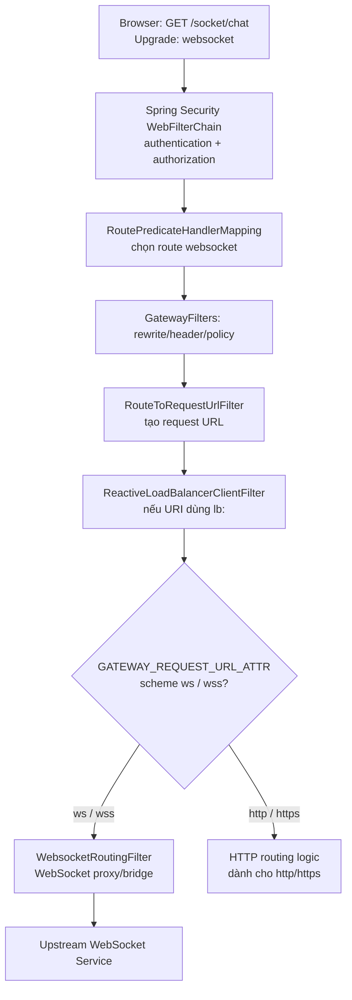

# WebsocketRoutingFilter và quá trình nâng cấp kết nối

## Mục tiêu bài học

Trong chương **WebSocket và truyền luồng**, bài học này giải thích cách **Spring Cloud Gateway Server WebFlux** xử lý một request WebSocket, từ lúc client gửi HTTP handshake cho tới khi hai đầu trao đổi message qua kết nối đã được nâng cấp. Trọng tâm là **`WebsocketRoutingFilter`**, các URI `ws://`, `wss://`, `lb:ws://`, thứ tự filter, **HTTP Upgrade** và những thay đổi về vận hành so với một HTTP request thông thường.

Sau bài học, bạn có thể:

- Mô tả handshake WebSocket qua **HTTP/1.1 GET** và ý nghĩa của **`101 Switching Protocols`**.
- Phân biệt việc **match route** với **nâng cấp giao thức**; biết `WebsocketRoutingFilter` được dùng khi request URL đích có scheme `ws` hoặc `wss`.
- Cấu hình route WebSocket trực tiếp, qua TLS và qua **Spring Cloud LoadBalancer**.
- Hiểu Gateway là **WebSocket proxy/bridge**, quản lý kết nối client–Gateway và Gateway–upstream thay vì chuyển tiếp nguyên một request HTTP có body.
- Xác định vai trò của `RouteToRequestUrlFilter`, `ReactiveLoadBalancerClientFilter`, `GatewayFilter` và `WebsocketRoutingFilter`.
- Bảo vệ handshake bằng **authentication, authorization, Origin validation, TLS**, và thiết kế giới hạn số kết nối/message.
- Hiểu giới hạn của `Retry`, `CircuitBreaker`, `RequestRateLimiter` và response filters **sau khi HTTP đã nâng cấp**.
- Kiểm thử handshake, path rewrite, subprotocol, two-way message delivery, proxy timeout, reconnect và connection cleanup.

> **Phạm vi:** Spring Cloud Gateway **Server WebFlux**, Project Reactor và Reactor Netty; không đồng nhất với Gateway Server MVC hoặc HTTP/2 extended CONNECT. Ví dụ dưới đây chủ yếu dùng **WebSocket over HTTP/1.1**. Namespace YAML `spring.cloud.gateway.routes` xuất hiện ở nhiều dòng Gateway Server WebFlux; một số dòng mới chuyển sang `spring.cloud.gateway.server.webflux.routes`. Đối chiếu đúng Spring Boot/Spring Cloud Gateway release train của dự án trước khi triển khai.

## 1. Tại sao WebSocket khác HTTP request–response?

Một API HTTP thông thường có mô hình:

```text
Client → GET /api/orders/42 → Gateway → Backend
Client ← 200 JSON          ← Gateway ← Backend

Request hoàn tất; kết nối HTTP có thể được tái sử dụng.
```

WebSocket bắt đầu bằng **HTTP handshake**, nhưng sau khi nâng cấp, client và server có một **kênh trao đổi message hai chiều** có thể tồn tại nhiều phút hoặc nhiều giờ:

```text
Client ── HTTP Upgrade GET ──▶ Gateway ── WebSocket handshake ──▶ Chat Service
Client ◀── 101 Switching Protocols ── Gateway ◀── Upstream handshake

Client ═══ WebSocket frames ══ Gateway ═══ WebSocket frames ══ Chat Service
         hai chiều liên tục                 hai chiều liên tục
```

Ví dụ nghiệp vụ:

- Chat, thông báo thời gian thực, đồng bộ dashboard.
- Theo dõi tiến độ xử lý bất đồng bộ.
- Cập nhật dữ liệu tương tác mà client và server đều chủ động gửi.
- Game hoặc phiên làm việc có kết nối dài.

WebSocket giảm nhu cầu client liên tục polling, nhưng **không tự đảm bảo** thông điệp đến đúng một lần, thứ tự xuyên nhiều backend instances, lưu trữ sự kiện bền vững hoặc khả năng tiếp tục phiên khi mạng đứt. Những bảo đảm ấy phải được thiết kế ở **tầng ứng dụng**.

### 1.1. So sánh HTTP, SSE và WebSocket

| Khía cạnh | HTTP request–response | SSE (`text/event-stream`) | WebSocket |
| --- | --- | --- | --- |
| Khởi đầu | HTTP request | HTTP GET | HTTP handshake nâng cấp |
| Hướng dữ liệu chủ yếu | Request rồi response | Server → client trên response stream | **Hai chiều** |
| Kết nối | Ngắn hoặc keep-alive tái sử dụng | Một HTTP response kéo dài | Kênh WebSocket kéo dài |
| Cơ chế routing chính ở Gateway | HTTP routing filter | HTTP routing/streaming | **`WebsocketRoutingFilter`** với `ws`/`wss` |
| Khôi phục sau mất kết nối | Gửi request mới | Reconnect; có thể dùng `Last-Event-ID` | Reconnect + resume theo protocol ứng dụng |
| Kiểm soát tải | RPS, response size | Số streams, bytes/s | Số sessions, messages/s, bytes/s |

**Không áp dụng `WebsocketRoutingFilter` cho mọi dữ liệu streaming.** SSE vẫn đi trên HTTP, còn WebSocket sau handshake sử dụng frame protocol riêng. gRPC streaming/HTTP/2 cũng không tự trở thành WebSocket.

## 2. Handshake WebSocket qua HTTP/1.1

Với trình duyệt, client thường bắt đầu bằng:

```javascript
const socket = new WebSocket("wss://api.example.com/socket/chat");
```

Browser tạo một HTTP/1.1 request có các handshake headers. Ví dụ rút gọn:

```http
GET /socket/chat HTTP/1.1
Host: api.example.com
Connection: Upgrade
Upgrade: websocket
Sec-WebSocket-Version: 13
Sec-WebSocket-Key: dGhlIHNhbXBsZSBub25jZQ==
Origin: https://app.example.com
```

`Sec-WebSocket-Key` ở đây chỉ minh họa dữ liệu handshake. Client thực tạo một giá trị nonce hợp lệ; không hard-code key mẫu vào một client WebSocket thật.

Nếu handshake hợp lệ và ứng dụng chấp nhận kết nối, response HTTP/1.1 có dạng:

```http
HTTP/1.1 101 Switching Protocols
Upgrade: websocket
Connection: Upgrade
Sec-WebSocket-Accept: <derived-accept-value>
```

Sau **`101 Switching Protocols`**, kết nối không tiếp tục dưới dạng “mỗi message là một HTTP request mới”. Client và server trao đổi **WebSocket frames** theo protocol tương ứng.

### 2.1. Vai trò từng header

| Header | Phía gửi | Ý nghĩa |
| --- | --- | --- |
| `Connection: Upgrade` | Client/server theo HTTP/1.1 | Báo hiệu thay đổi protocol trên kết nối |
| `Upgrade: websocket` | Client/server theo HTTP/1.1 | Chỉ ra protocol muốn chuyển sang |
| `Sec-WebSocket-Version: 13` | Client | Phiên bản WebSocket phổ biến theo RFC 6455 |
| `Sec-WebSocket-Key` | Client | Nonce của handshake; **không phải token xác thực** |
| `Sec-WebSocket-Accept` | Server | Chứng minh server hiểu handshake, được suy ra từ key |
| `Origin` | Browser | Origin tạo kết nối; có ích cho kiểm tra cross-origin |
| `Sec-WebSocket-Protocol` | Client đề xuất, server chọn | Thỏa thuận một ứng dụng subprotocol, ví dụ `chat.v1` |
| `Sec-WebSocket-Extensions` | Hai phía thương lượng | Ví dụ compression; chỉ dùng khi cả hai thực sự hỗ trợ |
| `Cookie` / `Authorization` | Theo cơ chế client | Credential, phải được xác minh bằng security policy riêng |

**`Sec-WebSocket-Key` và `Sec-WebSocket-Accept` không phải cơ chế authentication hoặc chống CSRF.** Một handshake đúng về mặt RFC vẫn có thể do người dùng không có quyền hoặc một website độc hại khởi tạo.

### 2.2. Hai bước kiểm tra khác nhau

Một WebSocket connection chỉ nên được thiết lập khi cả hai loại điều kiện đều đúng:

1. **Điều kiện giao thức:** handshake hợp lệ, đúng method/version/headers, không vi phạm protocol.
2. **Điều kiện ứng dụng:** người gọi đã được xác thực, có quyền đối với room/channel/tenant, Origin được phép và tài nguyên còn capacity.

Một server có thể phản hồi **401 Unauthorized**, **403 Forbidden** hoặc lỗi HTTP khác **trước khi gửi 101**. Sau khi đã upgrade, lỗi được truyền bằng close frame hoặc message theo protocol ứng dụng; không còn gửi `401` như một HTTP response mới trên cùng WebSocket session.

### 2.3. HTTP/2 không dùng nguyên cơ chế `Connection: Upgrade`

Sơ đồ trên mô tả handshake phổ biến trên **HTTP/1.1**. WebSocket trên HTTP/2 có cơ chế **extended CONNECT** trong các hạ tầng hỗ trợ, không giống việc sao chép `Connection: Upgrade` vào HTTP/2.

**Không giả định** mọi phiên bản Spring Cloud Gateway, proxy, ingress hoặc client hỗ trợ WebSocket over HTTP/2 theo cùng cách. Khi triển khai qua HTTP/2 front-end, kiểm thử toàn tuyến; HTTP/1.1 WebSocket upgrade vẫn là mô hình cần nắm vững.

## 3. `WebsocketRoutingFilter` nằm ở đâu trong Gateway?

Gateway Server WebFlux có nhiều bước trước khi chuyển request tới upstream:



Đây là **mô hình luồng logic**, không phải danh sách chính xác tuyệt đối các class/order trên mọi phiên bản. Một số Gateway filters/global filters có thể chạy trước hoặc sau nhau theo `Ordered`; `lb:` được xử lý theo prefix URI phù hợp. Dù vậy, có ba điểm nền tảng:

1. **Route match** xác định route nào xử lý HTTP handshake ban đầu.
2. Một bước **route URL resolution** xây dựng URI đích, có thể gồm load balancing.
3. Khi route URL đích có scheme **`ws` hoặc `wss`**, `WebsocketRoutingFilter` đảm nhiệm việc **proxy WebSocket**; không phải `NettyRoutingFilter` thông thường cho HTTP response body.

### 3.1. `GATEWAY_REQUEST_URL_ATTR` và scheme

Trong Spring Cloud Gateway, các filter routing sử dụng thông tin request URL đích trên `ServerWebExchange`, thường thông qua attribute:

```java
ServerWebExchangeUtils.GATEWAY_REQUEST_URL_ATTR
```

Route:

```yaml
uri: ws://localhost:9001
```

chỉ đến WebSocket upstream không TLS. Route:

```yaml
uri: wss://socket.internal.example
```

chỉ đến WebSocket upstream qua TLS. Route:

```yaml
uri: lb:ws://chat-service
```

kết hợp **service discovery/load balancing** với WebSocket scheme. Sau khi load balancer chọn service instance, Gateway xử lý URI WebSocket đã được resolve.

**Không nên tự ghi đè `GATEWAY_REQUEST_URL_ATTR` từ một custom filter** nếu chưa hiểu đường routing, load balancer và scheme prefixes. Một thay đổi sai có thể làm request đi vào HTTP routing hoặc upstream không mong đợi.

### 3.2. WebsocketRoutingFilter có tự “nhận mọi GET Upgrade” không?

**Không.** Nó không phải một endpoint WebSocket lắng nghe wildcard mặc định. Request phải được **Gateway chọn route** và route URL được xử lý thành một **đích `ws`/`wss`**.

Ví dụ:

```yaml
uri: http://localhost:9001
```

với `Path=/socket/**` không tương đương route WebSocket `ws://localhost:9001` chỉ vì client đặt `Upgrade: websocket`. Dùng đúng WebSocket scheme khi muốn Gateway xử lý WebSocket.

### 3.3. Vì sao Gateway tạo hai phiên WebSocket?

Một WebSocket gateway proxy thường có **hai chặng**:

```text
Browser ── WS session A ──▶ Gateway ── WS session B ──▶ Backend
```

Gateway đóng vai **WebSocket server** đối với browser và **WebSocket client** đối với backend. Nó tổ chức bridge cho những luồng message hai chiều giữa hai sessions.

Hậu quả:

- Hai chặng có **handshake, timeout, TLS trust và subprotocol negotiation** riêng.
- Không yêu cầu backend nhận nguyên `Sec-WebSocket-Key` mà browser gửi vào Gateway.
- Nếu một chặng đóng hoặc lỗi, Gateway cần giải phóng tài nguyên và đóng/cleanup chặng kia theo lifecycle.
- Một thành phần trung gian như ingress/service mesh còn có thể bổ sung một chặng hoặc chính sách timeout riêng.

Không coi proxy WebSocket là TCP passthrough mù quáng hoặc là HTTP filter bình thường xử lý xong ngay khi status 101 xuất hiện.

## 4. Route WebSocket đơn giản

### 4.1. Upstream trực tiếp qua `ws://`

Giả sử backend WebSocket echo chấp nhận đường dẫn:

```text
ws://localhost:9001/chat
```

Còn browser kết nối với Gateway:

```text
ws://localhost:8080/socket/chat
```

Route:

```yaml
spring:
  cloud:
    gateway:
      routes:
        - id: chat-websocket
          uri: ws://localhost:9001
          predicates:
            - Path=/socket/**
          filters:
            - StripPrefix=1
```

Luồng path:

```text
Client  → GET /socket/chat
Gateway → route chat-websocket được chọn
Filter  → StripPrefix=1
Upstream → WS /chat
```

`StripPrefix=1` loại đoạn đầu `/socket`; nó **không** thay HTTP method, Origin hoặc WebSocket protocol. Nếu backend đã dùng `/socket/chat`, **bỏ `StripPrefix=1`** để không gây 404 trong handshake.

### 4.2. Trực tiếp qua `wss://`

Khi backend hỗ trợ TLS:

```yaml
spring:
  cloud:
    gateway:
      routes:
        - id: secure-chat
          uri: wss://chat.internal.example:9443
          predicates:
            - Path=/socket/**
          filters:
            - StripPrefix=1
```

Khi đó, Gateway là **TLS client** của upstream. Phải xác minh certificate chain, hostname/SNI và chính sách trust. **Không tắt certificate verification** chỉ để làm WSS kết nối được trong production.

### 4.3. `lb:ws://` với service discovery

Khi `chat-service` có nhiều instances:

```yaml
spring:
  cloud:
    gateway:
      routes:
        - id: chat-cluster
          uri: lb:ws://chat-service
          predicates:
            - Path=/socket/**
          filters:
            - StripPrefix=1
```

Đây là dạng URI WebSocket kết hợp prefix **`lb:`** thường được Gateway Server WebFlux hỗ trợ. Hệ thống cần dependency **Spring Cloud LoadBalancer** và một nguồn danh sách service instances (`DiscoveryClient`, danh sách cấu hình hoặc mechanism phù hợp).

**Lưu ý:** route định nghĩa không tự tạo instances và không tự phân phối lại một WebSocket **đã được thiết lập**. Load balancing chủ yếu quyết định upstream instance tại thời điểm thiết lập kết nối mới.

### 4.4. Chọn namespace YAML đúng phiên bản

Các ví dụ trên sử dụng:

```text
spring.cloud.gateway.routes
```

Ở một số dòng mới, route properties nằm dưới:

```text
spring.cloud.gateway.server.webflux.routes
```

Không trộn hai namespace khi chưa xác minh release train. Nếu route không được nạp, WebSocket handshake có thể trả 404 trước khi `WebsocketRoutingFilter` được gọi. Phải kiểm tra **runtime routes** và integration test chứ không chỉ đọc YAML.

## 5. Thử với một WebSocket backend thật

Để học rõ cơ chế, dựng một **ứng dụng WebFlux riêng** đóng vai backend echo. Nó được deploy hoặc chạy trên `localhost:9001`, **khác port với Gateway**.

### 5.1. Backend WebFlux echo handler

Ví dụ dành cho **text messages**:

```java
package com.example.chat;

import java.util.Map;

import org.springframework.context.annotation.Bean;
import org.springframework.context.annotation.Configuration;
import org.springframework.web.reactive.HandlerMapping;
import org.springframework.web.reactive.handler.SimpleUrlHandlerMapping;
import org.springframework.web.reactive.socket.WebSocketHandler;
import org.springframework.web.reactive.socket.WebSocketMessage;
import org.springframework.web.reactive.socket.server.support.WebSocketHandlerAdapter;

@Configuration
public class EchoWebSocketConfiguration {

    @Bean
    WebSocketHandler echoHandler() {
        return session -> session.send(
            session.receive()
                .map(WebSocketMessage::getPayloadAsText)
                .map(session::textMessage)
        );
    }

    @Bean
    HandlerMapping webSocketMapping(WebSocketHandler echoHandler) {
        var mapping = new SimpleUrlHandlerMapping();
        mapping.setOrder(-1);
        mapping.setUrlMap(Map.of("/chat", echoHandler));
        return mapping;
    }

    @Bean
    WebSocketHandlerAdapter webSocketHandlerAdapter() {
        return new WebSocketHandlerAdapter();
    }
}
```

Các dependency WebFlux phù hợp cần có trên ứng dụng backend. Đây là **demo echo text**, không phải một chat server nhiều người dùng có authorization, lưu lịch sử, xử lý binary, heartbeat hay áp lực message.

Hàm `getPayloadAsText()` có chủ đích đọc text. **Không dùng nguyên ví dụ này cho binary frames/file upload** mà không phân nhánh kiểu message và quản lý vòng đời buffers. Với backend thực tế, xác thực người dùng/channel và kiểm soát payload length luôn là trách nhiệm ứng dụng.

### 5.2. Browser client

Khi public ingress terminate TLS và Gateway được công bố tại `api.example.com`, frontend có thể dùng:

```javascript
const socket = new WebSocket("wss://api.example.com/socket/chat");

socket.addEventListener("open", () => {
  console.log("WebSocket connected");
  socket.send("xin chào");
});

socket.addEventListener("message", (event) => {
  console.log("Received:", event.data);
});

socket.addEventListener("close", (event) => {
  console.log("Closed:", event.code);
});

socket.addEventListener("error", () => {
  console.error("Connection failed or closed");
});
```

Nếu Gateway định tuyến chính xác và backend echo hoạt động, browser nhận `"xin chào"` từ upstream qua hai chặng WebSocket.

**Chú ý:** JavaScript API `new WebSocket(...)` của browser **không cho tùy ý đặt `Authorization` header** giống `fetch`. Phải thiết kế xác thực handshake theo mô hình browser được hỗ trợ, không giả định có thể gán bearer header trực tiếp vào constructor.

### 5.3. Đoạn mã này chưa phải chat production

Trong một chat service thực, backend cần:

- Xác định ai được phép vào room.
- Giới hạn kích thước và tần suất messages.
- Cấm payload không hợp lệ, kiểm tra kiểu frame.
- Phát messages tới đúng subscribers/instances.
- Có heartbeat, idle policy và disconnect cleanup.
- Thiết kế resume/offline replay nếu sản phẩm yêu cầu.

**Gateway không tự cung cấp** những bảo đảm nghiệp vụ này chỉ vì route WebSocket hoạt động.

## 6. Path, query string và route predicates trong handshake

Route WebSocket được chọn từ **request ban đầu**, vì vậy `Path`, `Host`, `Header`, `Method` hoặc các route predicates khác vẫn có vai trò khi handshake đang là HTTP request.

Ví dụ:

```yaml
spring:
  cloud:
    gateway:
      routes:
        - id: chat-room
          uri: lb:ws://chat-service
          predicates:
            - Host=api.example.com
            - Path=/socket/rooms/**
          filters:
            - RewritePath=/socket/rooms/(?<room>.*), /rooms/$\{room}
```

**Lưu ý YAML:** ví dụ `RewritePath` chứa placeholder `${room}`; với YAML/properties của Gateway, Spring property placeholder expansion có thể cần escape `$` theo cú pháp phiên bản (thường viết `$\{room}` với định dạng thích hợp). Để tránh nhầm giữa regex capture và Spring placeholders, **kiểm tra route runtime và backend URL thực**. Nếu bài tập không cần regex, dùng `StripPrefix=1` dễ tránh lỗi hơn.

Nếu public path là:

```text
/socket/rooms/42
```

upstream cần nhận:

```text
/rooms/42
```

thì route rewrite phải tạo được path này **trước WebSocket routing**.

### 6.1. Không nhầm path của handshake và message payload

Sau khi kết nối đã nâng cấp, WebSocket message có thể chứa:

```json
{"type":"JOIN","roomId":"42"}
```

`RewritePath` chỉ thay **HTTP request URI khi handshake/routing**, không tự thay `roomId` trong từng WebSocket message sau khi kết nối. Muốn xử lý message, phải làm ở WebSocket handler/protocol application, không dùng HTTP request body filter theo cách thông thường.

### 6.2. Query string không phải nơi an toàn cho bearer token

Ví dụ cần tránh:

```text
wss://api.example.com/socket/chat?access_token=<long-lived-jwt>
```

Query string dễ lọt vào:

- Reverse proxy access logs.
- Browser history/monitoring, error reporting.
- Traces và dashboard thống kê URI.
- URLs bị sao chép hoặc chia sẻ.

Khi browser cần auth mà không có custom Authorization header, cân nhắc **cookie session cùng origin với bảo vệ Origin/CSRF threat model**, hoặc một **vé kết nối ngắn hạn, single-use** được cấp qua một endpoint HTTPS đã xác thực và kiểm tra nonce/audience/expiry. Không đặt access token dài hạn vào query string; nếu dùng one-time ticket, vẫn cần redact logs và giới hạn TTL.

## 7. `Sec-WebSocket-Protocol` và extensions

WebSocket có thể thương lượng một **subprotocol ứng dụng**. Browser:

```javascript
const socket = new WebSocket(
  "wss://api.example.com/socket/chat",
  ["chat.v1"]
);
```

Handshake:

```http
Sec-WebSocket-Protocol: chat.v1
```

Server chỉ được chọn subprotocol trong tập mà client đề xuất và phù hợp với policy của mình. Nếu thành công, response có thể có:

```http
Sec-WebSocket-Protocol: chat.v1
```

### 7.1. Gateway phải bảo toàn ngữ nghĩa negotiation

Vì có **hai WebSocket sessions**, Gateway và upstream có thể tham gia hai lần handshake riêng. Cần kiểm tra:

- Client gửi danh sách subprotocol nào?
- `WebsocketRoutingFilter`/WebSocket client của Gateway có chuyển đúng danh sách tới upstream không?
- Upstream hỗ trợ và chấp nhận subprotocol nào?
- Client nhận được `socket.protocol` như dự kiến không?
- Có proxy nào tự thay/loại `Sec-WebSocket-Protocol` không?

Đừng tự đặt một giá trị `Sec-WebSocket-Protocol` tùy ý qua `SetRequestHeader` để giả được negotiation. Một giá trị mà browser không đề xuất hoặc backend không hiểu có thể khiến handshake thất bại.

**Không dùng subprotocol header như kho chứa secret dài hạn.** Một số client/browser cho phép các chuỗi ở đây, nhưng đó không phải cách thay thế an toàn cho một authentication protocol; nó có thể rò qua logs, có grammar riêng và ý nghĩa là negotiation.

### 7.2. Compression extension không tự “xuyên thấu”

`permessage-deflate` và những WebSocket extensions khác có thể thay đổi framing/compression. Do Gateway là proxy/bridge có hai chặng, **không giả định** mọi extension được thương lượng end-to-end giống nhau hoặc byte frame được chuyển nguyên vẹn.

Với payload lớn/compression, kiểm tra:

- Compatibility giữa browser, Gateway WebSocket client/server và backend.
- Memory/CPU và giới hạn payload đã giải nén.
- `Sec-WebSocket-Extensions` trên từng chặng.
- Bảo mật compression khi dữ liệu nhạy cảm và dữ liệu do attacker kiểm soát bị đặt trong cùng context.

## 8. Bảo mật WebSocket: Origin khác CORS

Một nhầm lẫn quan trọng: **WebSocket browser handshake không sử dụng cơ chế CORS preflight giống một `fetch` cross-origin thông thường**. Browser có thể thử mở WebSocket tới host khác origin; request mang `Origin` để server đánh giá.

Nếu ứng dụng xác thực bằng **cookie tự động gửi** nhưng không kiểm tra Origin, website độc hại có thể mở WebSocket dưới session của nạn nhân trong những điều kiện cookie/browser cho phép. Nguy cơ này thường gọi là **Cross-Site WebSocket Hijacking (CSWSH)**.

### 8.1. Một kịch bản CSWSH

```text
1. Người dùng đăng nhập app.example.com bằng cookie session.
2. Người dùng truy cập attacker.example.
3. Trang độc hại thử new WebSocket("wss://api.example.com/socket/chat").
4. Browser có thể đính kèm cookie hợp lệ theo cookie policy.
5. Nếu Gateway/backend chỉ kiểm tra cookie mà không kiểm tra Origin/quyền,
   kết nối có thể nhận dữ liệu hoặc phát hành động ngoài ý muốn.
```

Không nên kết luận `SameSite` sẽ chặn mọi tình huống: cùng site nhưng khác origin (ví dụ hai subdomains), thuộc tính cookie, policy browser và cấu hình Domain đều ảnh hưởng kết quả.

**CORS headers không phải chính sách bảo mật WebSocket hoàn chỉnh.** Chỉ thêm `Access-Control-Allow-Origin` cho HTTP routes không chứng minh browser WebSocket handshake đã được Origin-checked.

### 8.2. Origin allowlist rõ ràng

Ví dụ với client browser hợp lệ:

```text
https://app.example.com
```

Một chính sách có thể yêu cầu handshake vào `/socket/**` chỉ nhận chính xác Origin trên. So sánh phải bao gồm **scheme, hostname và port** theo contract, không dùng logic:

```text
origin.contains("example.com")
```

vì `attacker-example.com` không phải origin được phép. Nếu cần nhiều origins, dùng allowlist được review, không tự phản chiếu Origin bất kỳ.

### 8.3. WebFilter minh họa Origin check

Ví dụ dành cho **browser-only WebSocket endpoint**:

```java
import org.springframework.core.annotation.Order;
import org.springframework.http.HttpStatus;
import org.springframework.stereotype.Component;
import org.springframework.web.server.ServerWebExchange;
import org.springframework.web.server.WebFilter;
import org.springframework.web.server.WebFilterChain;
import reactor.core.publisher.Mono;

@Component
@Order(-100)
public final class BrowserSocketOriginFilter implements WebFilter {

    private static final String TRUSTED_ORIGIN =
        "https://app.example.com";

    @Override
    public Mono<Void> filter(
            ServerWebExchange exchange,
            WebFilterChain chain) {

        String path = exchange.getRequest()
            .getPath().pathWithinApplication().value();

        if (!path.startsWith("/socket/")) {
            return chain.filter(exchange);
        }

        String origin = exchange.getRequest().getHeaders().getOrigin();
        if (!TRUSTED_ORIGIN.equals(origin)) {
            exchange.getResponse().setStatusCode(HttpStatus.FORBIDDEN);
            return exchange.getResponse().setComplete();
        }

        return chain.filter(exchange);
    }
}
```

Ví dụ minh họa **kiểm soát Origin trước Gateway routing**, không phải toàn bộ security policy:

- Chỉ phù hợp khi endpoint `/socket/**` được thiết kế cho **browser** luôn gửi Origin.
- Non-browser clients có thể không gửi Origin; nếu cần hỗ trợ, tạo policy/client authentication riêng, **không** dùng thiếu Origin làm dấu hiệu đáng tin.
- `@Order` chỉ biểu diễn mức ưu tiên tương đối; phải kiểm thử thứ tự với security/other WebFilters trên phiên bản thực tế.
- Vẫn phải kiểm tra **authenticated principal** và **quyền trong room/channel** ở lớp thích hợp.
- Nếu có nhiều virtual hosts, cần kết hợp Host/Origin allowlists và trusted proxy configuration.

Không coi một custom `GatewayFilter` muộn, chỉ áp trên một route, là lớp duy nhất để bảo vệ mọi đường vào WebSocket.

## 9. Authentication: cookie, JWT và browser limitations

WebSocket handshake bắt đầu bằng HTTP nên có thể tích hợp với **Spring Security WebFlux**. Nhưng cách client mang credential ảnh hưởng thiết kế.

| Loại client | Cách credential thường được gửi | Rủi ro/điều cần kiểm tra |
| --- | --- | --- |
| Browser dùng cookie session | Browser gửi `Cookie` theo Domain/Path/SameSite/Secure | **Origin check**, CSWSH, session validity, room authorization |
| Browser SPA dùng bearer token trong JS | Browser WebSocket API **không đặt được header Authorization tùy ý** | One-time ticket hoặc BFF/cookie session có bảo vệ |
| Native/mobile WebSocket client | Có thể thiết lập `Authorization: Bearer` tùy thư viện | JWT validation, TLS, token rotation, connection lifecycle |
| Service-to-service WebSocket client | mTLS / OAuth2 client credential / header policy | Phân quyền theo service và chống replay |
| Gateway nối upstream qua `wss://` | Gateway đóng vai TLS client | Upstream trust chain, SNI, backend auth, header relay |

### 9.1. Spring Security bảo vệ handshake

Ví dụ **rule authorization** trong WebFlux:

```java
import org.springframework.context.annotation.Bean;
import org.springframework.http.HttpMethod;
import org.springframework.security.config.web.server.ServerHttpSecurity;
import org.springframework.security.web.server.SecurityWebFilterChain;

@Bean
SecurityWebFilterChain gatewaySecurity(ServerHttpSecurity http) {
    return http
        .authorizeExchange(exchanges -> exchanges
            .pathMatchers(HttpMethod.GET, "/socket/**")
                .authenticated()
            .anyExchange().authenticated()
        )
        .build();
}
```

Đây là **khung policy**, không phải cấu hình authentication hoàn chỉnh. Phải có cơ chế đăng nhập/session, OAuth2 Resource Server hoặc identity provider đã được cấu hình; nếu không có, không thể kỳ vọng chỉ `.authenticated()` tạo ra danh tính.

Nếu endpoint browser dùng cookie, tiếp tục bảo vệ **Origin**, cookie flags và quyền tài nguyên. Nếu endpoint native dùng bearer header, xác minh issuer/audience/expiry/scope. Một authenticated connection vẫn cần kiểm tra **authorization cho từng room/message**; user có thể cố gửi `JOIN room-of-another-tenant` sau khi handshake.

### 9.2. CSRF mặc định và handshake GET

Trong nhiều cấu hình Spring Security, CSRF token được yêu cầu cho những HTTP methods **thay đổi trạng thái** như POST/PUT/DELETE, nhưng **WebSocket handshake HTTP/1.1 là GET**. Do đó **chỉ bật CSRF filter mặc định không chứng minh WebSocket handshake được bảo vệ khỏi CSWSH**.

Với cookie authentication:

- Dùng allowlist Origin và authentication.
- Có thể dùng một vé kết nối khó đoán, ngắn hạn khi threat model đòi hỏi.
- Ràng buộc session/tenant và kiểm tra quyền khi subscribe vào kênh.
- Không thay Origin policy bằng CORS preflight giả định.

### 9.3. Không đặt JWT dài hạn trong URL hoặc subprotocol

Một vé ngắn hạn cấp qua HTTPS:

```text
POST /api/socket-ticket
Authorization: Bearer <access-token>
→ one-time ticket có TTL rất ngắn
```

sau đó được dùng cho handshake theo protocol thiết kế có thể là một lựa chọn. Nhưng:

- Vé phải **single-use**, gắn audience, subject và scope/room phù hợp.
- Không được cache/share, được phát qua TLS, được làm sạch khỏi log.
- Gateway/backend phải xác minh vé **trước khi chấp nhận kết nối**.
- Nếu handshake thất bại, cần xử lý expiry/retry mà không phát vé có thể replay vô hạn.

Một hệ thống sử dụng session cookie cùng origin với Origin/CSRF protections thích hợp cũng có thể đơn giản hơn. Không có một cách mang credential duy nhất tối ưu cho mọi client.

## 10. `ws://`, `wss://` và TLS ở hai chặng

Khi browser mở:

```text
wss://api.example.com/socket/chat
```

và Gateway route tới:

```text
wss://chat.internal.example/chat
```

có ít nhất hai TLS sessions:

```text
Browser ── WSS/TLS ──▶ Gateway ── WSS/TLS ──▶ Chat Service
```

Nếu có ingress terminate TLS:

```text
Browser ── WSS ──▶ Ingress ── WS hoặc WSS ──▶ Gateway
                                           └─ WSS ──▶ Backend
```

Chọn WS hay WSS cho **chặng nội bộ** theo trust boundary, network policy và yêu cầu bảo mật. **Client kết nối WSS không tự bảo đảm Gateway–backend cũng dùng TLS**.

### 10.1. Những thứ cần kiểm tra

- Chứng chỉ inbound cho `api.example.com` có hợp lệ, đúng SAN/SNI và chưa hết hạn?
- Ingress hỗ trợ HTTP/1.1 Upgrade/WebSocket bridging?
- Gateway được cấu hình **đúng `ws`/`wss` scheme** ở route?
- Khi Gateway kết nối WSS upstream, có trust store/CA và hostname verification phù hợp?
- Những proxy trung gian có đặt idle timeout thấp hơn thời gian session mong đợi?
- Nếu có `Forwarded`/`X-Forwarded-Proto`, Gateway chỉ tin metadata từ **trusted proxies**?
- Có đường mạng đi vòng ingress để kết nối trực tiếp tới Gateway/management port không?

**Không vô hiệu hóa TLS verification** hoặc tự tin header `X-Forwarded-*` do client gửi để chữa lỗi handshake.

### 10.2. Ingress/proxy phải hỗ trợ Upgrade

Một reverse proxy cấu hình sai có thể làm mất `Upgrade` hoặc `Connection` headers, từ đó không còn HTTP/1.1 WebSocket handshake hợp lệ. Tuy nhiên không nên sao chép cấu hình proxy của một sản phẩm khác vào Gateway:

- Với NGINX, có các directive xử lý WebSocket proxy/Upgrade riêng.
- Với cloud L7 load balancers, WebSocket thường có cấu hình idle timeout/health check.
- Với ingress controllers/service mesh, khả năng WebSocket có thể phụ thuộc version và giao thức giữa các hops.

Kiểm tra request đến **đúng hop** và response ở mỗi đoạn. Không mặc định một đường HTTP GET 200 thành công chứng minh WebSocket Upgrade 101 cũng sẽ thành công.

## 11. Load balancing: chọn instance khi kết nối, không chuyển kết nối đang mở

Một route:

```yaml
uri: lb:ws://chat-service
```

có thể chọn một trong ba instances:

```text
chat-service instance A
chat-service instance B
chat-service instance C
```

Khi handshake thành công tới instance B, client có một phiên gắn với B cho đến lúc connection đóng. **Scale-in hoặc restart B có thể làm kết nối đó bị ngắt**. Gateway/LoadBalancer không tự “di chuyển” một WebSocket session đang mở sang A với state cũ được giữ nguyên.

### 11.1. Có cần sticky session không?

Nhu cầu stickiness phụ thuộc ứng dụng:

- Nếu room/session state chỉ nằm trong RAM của một instance, reconnect vào instance khác có thể mất dữ liệu.
- Nếu state dùng shared cache/broker và message routing được thiết kế phân tán, client có thể reconnect sang instance khác rồi **resubscribe**.
- Sticky routing có thể giảm chuyển instance, nhưng làm lệch tải và không giải quyết node failure hoàn toàn.

Để xây chat/notification nhiều pods, cần xem **message broker, pub/sub, distributed state, presence, event IDs và replay policy**, không chỉ thêm `lb:` vào Gateway route.

### 11.2. Route thay đổi khi session đang tồn tại

Nếu control plane đổi `uri`/route definitions lúc có 10.000 WebSocket connections:

- Những handshake **mới** có thể dùng route mới sau refresh.
- Những connections đã được upgrade thường tiếp tục dùng upstream hiện tại tới khi đóng/lỗi/timeout.
- Rolling restart Gateway có thể chủ động ngắt các kết nối dài.
- Route removal/refresh không phải bảo đảm mọi kết nối cũ bị đóng ngay.

Cần **connection draining**, graceful shutdown, thời hạn phiên tối đa và client reconnect/resume strategy. Cách hoạt động cụ thể khi deploy/restart phải được kiểm thử với Gateway/ingress phiên bản đang chạy.

## 12. Vì sao các GatewayFilter khác hành xử khác với WebSocket?

Handshake là HTTP request, nhưng sau upgrade dữ liệu là WebSocket messages. Đây là ranh giới quan trọng.

| Thành phần | Có ích ở handshake? | Có xử lý từng WebSocket message mặc định không? |
| --- | --- | --- |
| `Path`/`Host` predicates | Có: chọn route ban đầu | **Không** |
| `StripPrefix`/`RewritePath` | Có: sửa URI upstream | **Không** |
| `AddRequestHeader`/`SetRequestHeader` | Có: thêm/sửa header handshake theo contract | **Không** |
| Spring Security WebFilterChain | Có: auth/authorization trước upgrade | **Không tự kiểm tra từng message** |
| `RequestRateLimiter` | Có thể giới hạn số handshake/connection attempts | **Không tự giới hạn message rate** |
| `CircuitBreaker` | Có thể ảnh hưởng kết nối ban đầu theo publisher/filter order | **Không tự cung cấp per-frame circuit breaker** |
| `Retry` | Có thể ảnh hưởng một số lỗi trước khi kết nối hoàn tất theo policy | **Không tự nối lại một session đã upgrade** |
| `ModifyRequestBody`/`ModifyResponseBody` | Dành cho HTTP body, cần thận trọng với handshake | **Không phải WebSocket frame transformer** |
| `NettyRoutingFilter` HTTP | Dành cho HTTP/HTTPS routing | Không thay `WebsocketRoutingFilter` |

### 12.1. Giới hạn handshake không bằng giới hạn message

`RequestRateLimiter` có thể cho phép:

```text
Mỗi user tối đa 5 handshake requests/phút
```

Nhưng một connection đã thiết lập có thể gửi:

```text
10.000 WebSocket messages/giây
```

nếu ứng dụng không có **per-message/per-connection limits** riêng. Vì vậy cần:

- Số WebSocket sessions tối đa theo user/tenant và toàn service.
- Mức messages/s và bytes/s.
- Max frame size và max assembled message size.
- Queue bounds, backpressure và slow-consumer policy.
- Room subscription limits và message authorization.

Rate limiter của Gateway có thể là một lớp bảo vệ handshake, **không tự là WebSocket message firewall**.

### 12.2. Retry không phục hồi phiên đã nâng cấp

Sau khi client nhận `101 Switching Protocols` và bắt đầu gửi frames, retry một HTTP GET ở Gateway sẽ **không tự tái dựng application state**, room subscriptions, đã gửi/nhận messages hoặc sequence numbers.

Khi kết nối mất:

1. Client phát hiện `close`/network error.
2. Client chờ backoff có jitter, áp retry budget.
3. Client thực hiện một handshake mới và xác thực lại.
4. Client gửi subscribe/join với trạng thái cần thiết.
5. Nếu cần exactly-once-like business behavior, dùng message IDs, acknowledgements và deduplication ở ứng dụng.

Không retry vô hạn một connection lỗi tại một tốc độ rất cao; reconnect storms có thể làm ingress/Gateway/upstream quá tải.

### 12.3. CircuitBreaker không thay per-connection timeout

Circuit breaker thường dựa trên các signal của lời gọi reactive mà nó bao bọc. Với kết nối WebSocket lâu dài, ý nghĩa success/failure/timeout khác một HTTP request ngắn:

- Handshake có thể thành công, nhưng socket có thể mất sau 30 phút.
- TimeLimiter dành cho HTTP requests có thể không phù hợp với **toàn lifetime** của WebSocket.
- Circuit theo route không tự nhận biết chất lượng mỗi room/frame.
- Fallback HTTP response sau `101` không thể thay thế một message frame đang gửi.

Thường cần **handshake error policy**, **connection health metrics**, application heartbeat và reconnect policy tách biệt. Không sao chép một cấu hình `CircuitBreaker` dành cho GET REST sang route WebSocket mà chưa test semantics.

## 13. Hai chiều dữ liệu, backpressure và memory

Ở Gateway WebFlux, một WebSocket proxy phải có khả năng truyền:

```text
Browser → Gateway → Backend
Backend → Gateway → Browser
```

Hai chiều có thể diễn ra **đồng thời**. Khác HTTP request body có kết thúc rõ, WebSocket session có thể kéo dài và lượng message không đều.

### 13.1. Không block event loop

Một custom WebSocket handler hoặc filter **không được**:

```java
Thread.sleep(5000);
```

trên Netty event-loop để “đợi message”, cũng không gọi `Mono.block()` cho mỗi frame. Điều đó có thể làm nghẽn nhiều connections khác dùng chung event-loop.

Sử dụng các reactive operators/clients phù hợp, đặt timeouts và giới hạn các operations nặng. Nếu bắt buộc gọi code blocking, cần cô lập trên scheduler/bounded worker có kiểm soát, không để queue vô hạn.

### 13.2. Không gom mọi message vào danh sách vô hạn

Mẫu nguy hiểm:

```java
session.receive()
    .map(WebSocketMessage::getPayloadAsText)
    .collectList();
```

Một WebSocket connection có thể không kết thúc trong nhiều giờ, nên `collectList()` chờ đóng kết nối và tiếp tục giữ mọi message trong memory. Với message stream dài, cần xử lý từng message, giới hạn throughput và không giữ data tùy ý.

### 13.3. Chậm ở một chiều có thể tạo backlog

Nếu backend đẩy 1.000 messages/s mà browser chỉ đọc/giải mã được 100 messages/s, queue có thể tăng nhanh. Cần:

- Bounded buffering/queue hoặc chính sách drop những event không quan trọng.
- Backpressure theo reactive pipeline, không tạo `subscribe()` độc lập không kiểm soát.
- Giới hạn bytes/messages per connection.
- Đóng kết nối slow consumer khi vượt ngưỡng theo contract.
- Metrics về queue length, send latency, bytes và cancellation.

Không khẳng định rằng “dùng Reactor thì tự động không bao giờ OOM”. Backpressure chỉ hiệu quả khi mỗi đoạn pipeline, buffering và network producer tuân thủ thiết kế.

### 13.4. Giới hạn frame và JSON payload

Một client độc hại có thể gửi frame hoặc logical message rất lớn. Cần giới hạn:

```text
max frame payload
max assembled message
max JSON nesting
max decompressed payload
max messages / second
max concurrent sessions
```

Giới hạn có thể nằm ở browser/client, ingress, Gateway WebSocket stack và backend. Không dựa chỉ vào `spring.codec.max-in-memory-size` của HTTP JSON decoding để cho rằng mọi WebSocket frame được kiểm soát đầy đủ; WebSocket codec/frame options có cấu hình riêng theo runtime.

## 14. Heartbeat, idle timeout và connection close

WebSocket hỗ trợ các control frames như **PING**, **PONG** và **CLOSE**. Ứng dụng cũng có thể gửi heartbeat ở **tầng message**, ví dụ:

```json
{"type":"heartbeat","ts":"..."}
```

Hai cơ chế này không đồng nghĩa nhau. Browser JavaScript WebSocket API không expose việc gửi PING frame tùy ý, nên ứng dụng browser đôi khi dùng heartbeat message và kiểm tra timeout ở server.

### 14.1. Idle timeout thường nằm ở nhiều hop

```text
Browser
  ↓
Public load balancer (idle timeout)
  ↓
Ingress controller (read/idle timeout)
  ↓
Gateway WebSocket client/server
  ↓
Backend WebSocket server (session idle timeout)
```

Một hop có idle timeout 60 giây có thể đóng connection dù những hop khác cho phép 30 phút. Ngay cả khi ứng dụng “muốn giữ kết nối mãi”, vận hành cần xác định timeout thực và heartbeat phù hợp.

### 14.2. Close code không phải HTTP status

| WebSocket close code | Ý nghĩa phổ biến | Ghi chú |
| --- | --- | --- |
| `1000` | Normal closure | Client/server chủ động kết thúc bình thường |
| `1001` | Going away | Service shutdown hoặc client rời phiên |
| `1002` | Protocol error | Vi phạm WebSocket protocol |
| `1008` | Policy violation | Ví dụ ứng dụng từ chối payload/quyền |
| `1009` | Message too big | Payload vượt giới hạn |
| `1011` | Server unexpected condition | Ứng dụng server gặp lỗi |

**Không trả `HTTP 503` trên một WebSocket session đã upgrade** để báo backend bận. Sau `101`, ứng dụng cần gửi message lỗi theo protocol hoặc đóng kết nối với close code thích hợp, rồi client có thể reconnect.

Không phải mọi close event đều đến browser với một close code/description hữu ích. Khi mạng đứt đột ngột, client có thể thấy abnormal closure, không có handshake lỗi HTTP rõ ràng.

### 14.3. Reconnect phải bảo vệ server

Một client đơn giản:

```javascript
let attempt = 0;
let socket;

function connect() {
  socket = new WebSocket("wss://api.example.com/socket/chat");

  socket.addEventListener("open", () => {
    attempt = 0;
  });

  socket.addEventListener("close", () => {
    attempt = Math.min(attempt + 1, 6);
    const capMs = Math.min(30000, 500 * (2 ** attempt));
    const delayMs = Math.random() * capMs;
    setTimeout(connect, delayMs);
  });
}

connect();
```

Đây là **logic minh họa cho backoff với jitter**, chưa bao gồm dừng khi người dùng logout, kiểm tra kết nối mạng, trạng thái ứng dụng, max total attempts, refresh ticket hay resend/resubscribe messages. Trong production cần tránh tạo nhiều `WebSocket` trùng, dừng reconnect khi app không còn cần connection, và xử lý trạng thái `1008`/authentication failure khác với mất mạng tạm thời.

## 15. Observability cho WebSocket Gateway

Với HTTP API, chỉ số “request đã hoàn tất sau 200ms” có thể hữu ích. Với WebSocket, handshake có thể mất vài chục ms nhưng **connection vẫn mở 30 phút**.

Nên tách ít nhất:

1. **Handshake attempts:** requests khởi tạo kết nối, status `101`, `401`, `403`, `404`, `502`, timeout.
2. **Active sessions:** số connections đang mở theo route và Gateway replica.
3. **Message/traffic metrics:** messages/s, bytes/s theo chiều, frame sizes và slow consumers.
4. **Lifecycle:** connect duration, close codes, idle timeouts, cancellation, reconnect rate.
5. **Upstream health:** số connections theo backend instance, connect failures và load balancing.

| Metric/tín hiệu | Giúp trả lời |
| --- | --- |
| Handshake success ratio | Bao nhiêu client nhận 101 đúng? |
| Handshake latency p95/p99 | Gateway/WS upstream nâng cấp có chậm? |
| Active WS sessions | Mỗi pod có bao nhiêu kết nối đang mở? |
| WS sessions per tenant/route | Có lạm dụng kết nối không? |
| Upstream connect failures | DNS/LB/TLS/port hoặc service chết? |
| Frame/message rates | Một connection có phát quá nhiều dữ liệu? |
| Bytes inbound/outbound | Sức ép mạng và dữ liệu |
| Close reasons/codes | Disconnect bình thường hay policy/error? |
| Reconnect attempts | Có reconnect storm sau rollout? |
| JVM heap/direct memory/FDs | Socket buffers và file descriptors có bị áp lực? |

### 15.1. Tránh cardinality và rò rỉ dữ liệu

Log an toàn có thể dùng:

```text
route=chat-websocket outcome=upgrade-success status=101
upstreamService=chat-service traceId=<trusted-trace-id>
```

hoặc:

```text
route=chat-websocket phase=close closeCode=1001
durationSeconds=1800
```

Không log:

```text
Cookie: SESSION=...
Authorization: Bearer ...
?ticket=<secret>
messageBody={"privateChat":"..."}
```

Không đặt raw user ID, room ID, WebSocket URI đầy đủ hoặc token vào **metric labels**. Dùng route ID, upstream service name, status category và outcome đã chuẩn hóa.

### 15.2. Đừng hiểu status 101 là “nghiệp vụ thành công”

`101` chỉ có nghĩa HTTP handshake hoàn tất. Backend có thể đóng socket ngay sau 101, từ chối lệnh JOIN hoặc không phát được message. Vì vậy dashboard nên phân biệt:

```text
handshake-success
authenticated-application-session
subscribed-to-room
message-delivered/acknowledged
connection-closed
```

Nếu sản phẩm có SLA gửi thông báo, phải đo **end-to-end message delivery/ack**, không chỉ đếm handshake.

## 16. Kiểm thử handshake và message forwarding

### 16.1. Test ngoài Gateway và qua Gateway

Trước tiên kiểm tra backend echo:

```text
ws://localhost:9001/chat
```

Sau đó kiểm tra route public:

```text
ws://localhost:8080/socket/chat
```

Nếu upstream không hoạt động trực tiếp, đừng bắt đầu bằng việc sửa `WebsocketRoutingFilter`. Tách lỗi:

- Backend handshake handler.
- Gateway route match/path rewrite.
- LoadBalancer/DNS.
- TLS/proxy/ingress.
- Authentication/Origin/CORS confusion.

### 16.2. Dùng một WebSocket client thật

Một công cụ thử WebSocket như `wscat` hoặc `websocat` (nếu tổ chức đã cài và phê duyệt) có thể mở connection:

```bash
# Môi trường phát triển, chưa yêu cầu TLS.
wscat -c "ws://localhost:8080/socket/chat"
```

Sau khi kết nối:

```text
> hello
< hello
```

Với upstream cần Origin browser hợp lệ, công cụ dòng lệnh có thể phải gửi đúng Origin theo client được hỗ trợ; **không coi việc tự đặt Origin bằng CLI là bằng chứng đã chống CSWSH**. Việc đó chỉ kiểm tra allowlist policy có hiệu lực; authentication/authorization vẫn là lớp bảo vệ khác.

### 16.3. `curl` không thay WebSocket client

Có thể dùng `curl` thủ công để quan sát handshake headers/HTTP status trên một số HTTP/1.1 server, nhưng nó **không thay một client WebSocket có xử lý frames, ping/pong, subprotocol và close lifecycle**. Không dùng một lệnh `curl -I` hoặc HTTP GET thường rồi kết luận WebSocket route hoạt động.

Nếu cần kiểm thử RFC 6455 handshake bằng HTTP raw, phải tạo `Sec-WebSocket-Key`, các headers và nâng cấp đúng; sau 101 còn phải thực thi framing/masking rules. Dùng WebSocket client library sẽ đáng tin hơn cho integration tests.

### 16.4. Test end-to-end bằng Reactor WebSocketClient

Đây là một **test scaffold** dùng Reactor Netty WebSocket client; giả định Gateway và echo backend đang chạy:

```java
import java.net.URI;

import org.junit.jupiter.api.Test;
import org.springframework.web.reactive.socket.WebSocketMessage;
import org.springframework.web.reactive.socket.client.ReactorNettyWebSocketClient;
import reactor.core.publisher.Mono;
import reactor.test.StepVerifier;

import static org.junit.jupiter.api.Assertions.assertEquals;

class GatewayWebSocketIntegrationTest {

    @Test
    void echoesMessageThroughGateway() {
        var client = new ReactorNettyWebSocketClient();

        Mono<Void> session = client.execute(
            URI.create("ws://localhost:8080/socket/chat"),
            socket -> {
                Mono<Void> send = socket.send(
                    Mono.just(socket.textMessage("hello"))
                );

                Mono<Void> receive = socket.receive()
                    .next()
                    .map(WebSocketMessage::getPayloadAsText)
                    .doOnNext(text -> assertEquals("hello", text))
                    .then();

                return Mono.when(send, receive);
            }
        );

        StepVerifier.create(session)
            .expectComplete()
            .verify(java.time.Duration.ofSeconds(10));
    }
}
```

Đoạn này chưa là **một suite chạy độc lập**: cần Spring Boot test runtime, classpath Reactor Test, backend stub/WebSocket handler, service discovery hoặc URI tĩnh, security/Origin configuration và cổng test thực. Chạy với backend WebSocket text echo đơn giản giúp xác nhận **messages đi qua cả hai chiều**.

Nếu test timeout hoặc close bất thường, kiểm tra cả client và server close lifecycle. Với test nhiều messages/binary, cần thêm assertions về thứ tự, payload integrity, backpressure và buffer handling.

### 16.5. Ma trận kiểm thử bắt buộc

| Kịch bản | Kỳ vọng |
| --- | --- |
| Browser WS handshake hợp lệ | HTTP/1.1 101, WebSocket session mở |
| Backend echo text | Message gửi đến backend và nhận lại |
| Route path sai | Không match; không tự chuyển vào upstream |
| `StripPrefix` sai | Handshake upstream trả lỗi phù hợp, không silently ignore |
| URI route `http://` thay `ws://` | Không đi đúng WebSocket routing; cần sửa scheme |
| Upstream không chạy | Handshake thất bại có kiểm soát, không leak URI/secret |
| Inbound WSS, outbound WSS | TLS hostname/certificate verification đúng |
| Origin không cho phép | Từ chối handshake theo policy |
| Cookie/session hết hạn | Không upgrade như user hợp lệ |
| User không có quyền room | Không được subscribe/nhận dữ liệu room |
| Client đề xuất subprotocol không hỗ trợ | Negotiation đúng contract hoặc handshake thất bại |
| Frame quá lớn | Bị giới hạn/đóng theo policy |
| Client gửi message quá nhanh | Per-message rate/buffer control có hiệu lực |
| Slow browser consumer | Không có queue không giới hạn |
| Proxy idle timeout | Heartbeat/close/reconnect đúng |
| Gateway restart | Client reconnect/backoff, không mất quyền auth |
| Backend scale-in | Session cũ đóng; reconnect chọn instance hợp lệ |
| Nhiều Gateway replicas | Active sessions và routing đúng theo pod |
| Retry/CircuitBreaker | Không thử lại một established session như HTTP request |
| Tracing/logging | Không ghi cookie, token, chat payload hoặc secret query |

## 17. Chẩn đoán sự cố thường gặp

### 17.1. Nhận `404 Not Found` khi mở WebSocket

Nguyên nhân có thể:

- `Path`/`Host` predicate không match.
- Route chưa được nạp vì sai YAML namespace.
- `StripPrefix` hoặc `RewritePath` tạo URL mà WebSocket handler upstream không nhận.
- Backend WebSocket handler chỉ đăng ký `/chat`, trong khi Gateway gửi `/socket/chat`.

**Cách xử lý:** kiểm tra route runtime, path trước/sau rewrite và request đến backend stub. Không bắt đầu bằng cách thay TLS/timeout khi lỗi thật là path.

### 17.2. HTTP `400` hoặc handshake không nâng cấp

Nguyên nhân:

- Reverse proxy làm mất `Upgrade`, `Connection` hoặc headers protocol.
- Client gửi GET thường thay vì WebSocket handshake.
- Upstream không hỗ trợ WebSocket trên port/path đó.
- Subprotocol/version/handshake không hợp lệ.

**Cách xử lý:** dùng một WebSocket client thật, xem network trace đã redacted và test từng hop. Với WebSocket HTTP/1.1, cần thấy **101** khi thành công, không phải chỉ 200.

### 17.3. `401` hoặc `403` trước handshake

Nguyên nhân:

- Session cookie không được gửi do Domain/Path/SameSite/Secure.
- JWT bị từ chối hoặc chưa có authentication mechanism.
- `Origin` không nằm trong allowlist.
- Security chain match `/socket/**` nhưng thiếu quyền.

**Cách xử lý:** kiểm tra Security WebFilterChain và nhận diện nguồn từ chối, nhưng **không log token/cookie**. Nếu browser WebSocket API không cho đặt Authorization, cần đổi auth design chứ không nới `.permitAll()` vô điều kiện.

### 17.4. `502/503` hoặc handshake timeout

Nguyên nhân:

- `lb:ws://chat-service` không có instance khỏe hoặc thiếu LoadBalancer dependency.
- Network/DNS/TLS tới upstream thất bại.
- Backend không phản hồi handshake kịp, hoặc proxy timeout.
- Route sử dụng `ws` trong khi upstream chỉ mở `wss` hoặc ngược lại.

**Cách xử lý:** test upstream trực tiếp, quan sát selected instance, kiểm tra trust chain, logs phân loại exception và trạng thái discovery/health checks.

### 17.5. 101 thành công rồi kết nối đóng ngay

Nguyên nhân:

- Backend handler ném lỗi sau khi bắt đầu nhận message.
- Browser gửi protocol/payload mà backend không hỗ trợ.
- Origin/auth chỉ được chấp nhận ở handshake nhưng application-level JOIN bị từ chối.
- Proxy/server idle policy hoặc message size limit.
- Một chiều bridge gặp lỗi/cancellation.

**Cách xử lý:** phân biệt handshake success với session close reason; xem close code, duration, payload type (không ghi nội dung nhạy cảm) và backend error category.

### 17.6. WebSocket sống một phút rồi rớt

Đây thường là dấu hiệu **idle timeout** ở load balancer, ingress, gateway hoặc backend, nhưng không nên kết luận chỉ từ đúng con số một phút. Kiểm tra cấu hình từng hop, heartbeat traffic, error logs và mạng của client. Không tăng mọi timeout tới vô hạn; đặt hợp đồng session lifetime và reconnect.

### 17.7. Chỉ một số clients nhận message

Khi `lb:ws://` phân phối WebSocket tới nhiều chat instances, mỗi client có thể gắn với instance khác. Nếu backend chỉ broadcast trong RAM của chính instance, những người dùng ở instance khác sẽ không nhận event.

**Cách xử lý:** thiết kế broker/pub-sub/shared state và room authorization xuyên instances; không nghĩ Gateway load balancing tự có message fanout hoặc stickiness đa phiên.

### 17.8. Có rate limit 10 RPS nhưng message flood vẫn xảy ra

`RequestRateLimiter` của Gateway có thể chỉ đếm **handshake requests**. Một kết nối đã mở vẫn gửi rất nhiều messages. Cần kiểm soát rate và payload ở WebSocket application handler hoặc tầng WebSocket-aware policy.

### 17.9. Cấu hình HTTP Retry nhưng connection không tự reconnect

`Retry` filter không tự khôi phục một established WebSocket session sau khi frames đã trao đổi. Cần reconnect ở client, xử lý tickets/session, resubscribe/replay với message IDs và backoff. Không dùng GET retry để giả exactly-once.

## 18. Checklist triển khai production

| Hạng mục | Câu hỏi kiểm tra |
| --- | --- |
| **Gateway edition** | Đang dùng Server WebFlux và đúng namespace cấu hình? |
| **Route** | `Path`/`Host` predicates, `StripPrefix`/rewrite và URI đúng? |
| **Scheme** | `ws://` hoặc `wss://`, `lb:ws://` khi cần load balancing? |
| **LoadBalancer** | Service instances và health checks hoạt động; test reconnect qua nhiều nodes? |
| **Handshake** | HTTP/1.1 101 và headers hợp lệ xuyên các proxy hops? |
| **Subprotocol** | `Sec-WebSocket-Protocol` negotiated đúng giữa browser/Gateway/backend? |
| **Extensions** | Compression/frame compatibility được kiểm chứng? |
| **Authentication** | Handshake có principal hợp lệ, cookie/bearer/ticket đúng trust model? |
| **Origin** | Browser Origin allowlist, chống CSWSH, không dựa vào CORS preflight? |
| **Authorization** | Quyền room/tenant/message được kiểm tra cả sau handshake? |
| **TLS** | Inbound/outbound WSS trust/SNI/certificate, không tắt verification? |
| **Ingress** | Hỗ trợ Upgrade và có idle timeout/connection limits phù hợp? |
| **Capacity** | Max sessions, message/bytes rates, frame size, memory/file descriptors? |
| **Backpressure** | Bounded buffers và slow-consumer policy, không block Netty? |
| **Heartbeat** | Protocol PING/PONG hoặc application heartbeat đủ cho idle policy? |
| **Lifecycle** | Close frames, cancellation, cleanup, draining/restart và reconnect? |
| **Retry/CircuitBreaker** | Chính sách handshake khác established session; không retry vô hạn? |
| **Observability** | Handshakes, 101/4xx/5xx, active sessions, close code, reconnect, bytes? |
| **Privacy** | Không log `Cookie`, `Authorization`, ticket hoặc message content? |
| **Tests** | Có test end-to-end text/binary, auth/Origin, LB, idle, multi-pod và reconnect? |

## 19. Bài luyện tập có đáp án

### Bối cảnh

Một Gateway có route:

```yaml
spring:
  cloud:
    gateway:
      routes:
        - id: notifications-ws
          uri: lb:ws://notification-service
          predicates:
            - Path=/socket/**
          filters:
            - StripPrefix=1
```

Browser:

```javascript
const ws = new WebSocket(
  "wss://api.example.com/socket/notifications"
);
```

Backend nhận WebSocket ở:

```text
ws://<selected-notification-instance>/notifications
```

**Câu hỏi:**

1. Browser thực hiện một HTTP handshake với method nào theo mô hình HTTP/1.1?
2. Status nào thể hiện quá trình HTTP/1.1 Upgrade thành công?
3. `WebsocketRoutingFilter` được chọn nhờ `Path` predicate hay nhờ scheme URL đích?
4. URI `lb:ws://notification-service` có làm một connection đã mở tự động chuyển instance nếu node chết không?
5. `StripPrefix=1` biến `/socket/notifications` thành đường dẫn nào?
6. Browser `new WebSocket()` có thể tự đặt `Authorization: Bearer` giống `fetch` không?
7. Cấu hình CORS `allowedOrigins` cho GET REST có tự chống CSWSH không?
8. Vì sao cookie `HttpOnly` không đủ để chống website độc hại tự mở socket?
9. Nếu Gateway `RequestRateLimiter` cho 5 handshake/phút, nó có tự chặn user gửi 1.000 messages/giây không?
10. Khi backend trả HTTP 200 thay vì 101 cho handshake, có thể coi WebSocket session đã mở không?
11. Khi nhận 101 thành công rồi stream bị đóng, có thể gửi tiếp một HTTP 503 trên session ấy không?
12. Khi có ba pods notification-service, backend cần gì để broadcast messages xuyên instances?
13. Vì sao cần kiểm thử idle timeout của ingress dù backend có heartbeat?
14. `Retry` GatewayFilter có tự restore subscribed rooms sau disconnect không?
15. Dashboard đếm 101 thành công có đủ để chứng minh messages đã đến người nhận không?

**Đáp án:**

1. **GET** với headers `Upgrade` và `Connection` hợp lệ trên HTTP/1.1.
2. **`101 Switching Protocols`**.
3. `Path` giúp chọn **route**; **scheme `ws`/`wss` trên request URL đích** khiến WebSocket routing thực thi.
4. **Không.** Load balancing chọn một upstream cho phiên mới; một phiên đang mở không tự di chuyển với state.
5. **`/notifications`**.
6. **Không.** Browser WebSocket API không cung cấp cách gán tùy ý Authorization header.
7. **Không.** WebSocket không dùng CORS preflight theo mô hình fetch; cần Origin validation riêng.
8. `HttpOnly` ngăn JS đọc cookie nhưng browser vẫn có thể **tự gửi cookie** theo policy; cần Origin/auth/authorization.
9. **Không.** Handshake rate và per-message rate là hai đại lượng khác nhau.
10. **Không.** Với HTTP/1.1 WebSocket handshake hợp lệ, cần 101 và các handshake headers phù hợp.
11. **Không.** Sau upgrade, lỗi dùng WebSocket message/close semantics, không bắt đầu HTTP response mới.
12. **Broker/pub-sub/shared state** và protocol subscribe/delivery phù hợp; Gateway LB không tự broadcast.
13. Vì một hop trung gian có thể đóng socket theo chính sách riêng; heartbeat phải phù hợp cả mạng và session lifecycle.
14. **Không.** Client/application cần reconnect, xác thực lại và resubscribe/replay nếu cần.
15. **Không.** Cần quan sát authenticated session, message delivery/ack và close/reconnect metrics.

## Tổng kết

**`WebsocketRoutingFilter`** là mắt xích giúp **Spring Cloud Gateway Server WebFlux** định tuyến một WebSocket connection tới upstream `ws://` hoặc `wss://`, kể cả trường hợp `lb:ws://` cần chọn instance qua service discovery/LoadBalancer. HTTP/1.1 handshake bắt đầu bằng GET với `Upgrade: websocket` và khi thành công trả **`101 Switching Protocols`**; từ thời điểm đó, dữ liệu trao đổi là WebSocket frames hai chiều, không còn là chuỗi HTTP request–response thông thường.

Một route đúng không chỉ cần `Path` và URI: phải kiểm thử **rewrite path, protocol headers/subprotocol, TLS ở từng chặng, Origin validation, authentication, authorization, idle timeout, capacity, backpressure và lifecycle khi reconnect**. Những cơ chế HTTP như `Retry`, `CircuitBreaker` và `RequestRateLimiter` cần được đánh giá theo **handshake**, không được mặc định chúng bảo vệ hoặc khôi phục từng message trên established session. Khi kết hợp các lớp kiểm soát đó với giám sát số kết nối, close reasons, messages/bytes và trạng thái backend, Gateway mới có thể phục vụ WebSocket ổn định và an toàn trong kiến trúc microservices.
