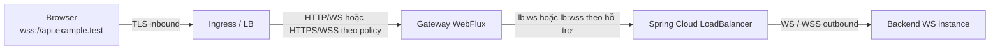
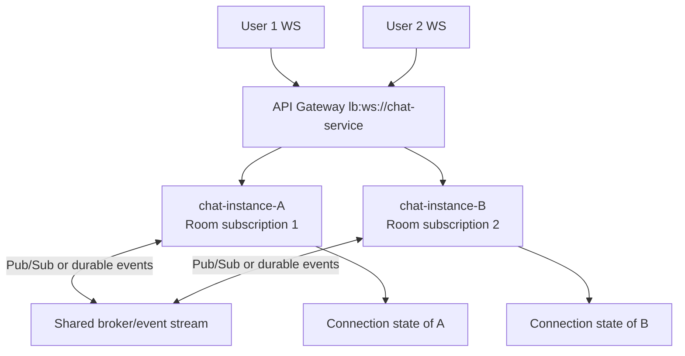

# Kết hợp `lb:ws:` với khám phá dịch vụ khi được hỗ trợ

**Chương:** WebSocket và truyền luồng  
**Module:** `SPRING_CLOUD_GATEWAY` — Spring Cloud Gateway

Một hệ thống chat, bảng điều khiển thời gian thực, game đa người chơi hoặc dịch vụ nhận thông báo có thể sử dụng **WebSocket** để duy trì một kết nối hai chiều giữa client và backend. Khi microservice WebSocket được nhân bản thành nhiều instance, API Gateway không nên phải sửa `ws://host:port` thủ công sau mỗi lần scale. **Spring Cloud Gateway Server WebFlux** hỗ trợ route có tiền tố **`lb:ws://service-id`** để kết hợp **Spring Cloud LoadBalancer / service discovery** với **WebSocket Routing Filter**.

Tuy nhiên, “load balancing WebSocket” **không giống** load balancing từng HTTP request độc lập. WebSocket bắt đầu bằng một **HTTP handshake**, sau đó chuyển giao thức sang kênh dài hạn, truyền nhiều text/binary frames trên cùng connection. Gateway chọn backend ở giai đoạn thiết lập kết nối; các frames tiếp theo gắn với connection đó, **không được phân phối lại qua từng instance**. Khi instance chết, phiên WebSocket có thể bị đóng; việc kết nối lại, xác thực lại, khôi phục subscription và tránh mất/trùng message là trách nhiệm của client và kiến trúc ứng dụng.

Bài học làm rõ cú pháp `lb:ws:`, vai trò `RouteToRequestUrlFilter`, `ReactiveLoadBalancerClientFilter` và `WebsocketRoutingFilter`, cách cung cấp instances qua `SimpleDiscoveryClient` hoặc service registry, cùng một bài lab hai WebSocket backends. Các mục tiếp theo phân tích `wss`/TLS, handshake headers, Origin, OAuth2/session/JWT, route predicates, filter chain, retry/circuit breaker, rate limiting, streaming, SockJS, observability và xử lý sự cố.

> **Phạm vi phiên bản:** Bài lab chính sử dụng **Spring Cloud Gateway Server WebFlux** và Spring Cloud LoadBalancer. Tài liệu WebFlux hiện hành mô tả trực tiếp `lb:ws://serviceid`. Đối với `lb:wss://serviceid`, Gateway Server Web MVC hoặc các release train cũ, hãy đối chiếu hỗ trợ và cơ chế TLS/Upgrade ở đúng phiên bản trước khi triển khai. Prefix route ví dụ `spring.cloud.gateway.server.webflux.routes` dành cho các dòng hiện đại; dự án cũ có thể dùng `spring.cloud.gateway.routes`. Không trộn tùy ý hai hệ cấu hình.

## 1. Mục tiêu học tập

Sau bài này, bạn có thể:

1. Phân biệt HTTP request-response, Server-Sent Events, WebSocket handshake và frames sau khi kết nối được nâng cấp.
2. Đọc đúng `ws://`, `wss://`, `lb://`, `lb:ws://` và điều kiện dùng `lb:wss://`; hiểu vì sao `lb:ws:` không phải là một scheme HTTP độc lập.
3. Giải thích chuỗi **route predicate → route URL → LoadBalancer chọn `ServiceInstance` → WebSocket proxy → backend**.
4. Cấu hình Gateway Server WebFlux với dependency Spring Cloud LoadBalancer và `SimpleDiscoveryClient` cung cấp hai WebSocket instances.
5. Dựng WebSocket echo backend bằng Spring WebFlux, dùng một Gateway URL để kết nối và quan sát instance nhận kết nối.
6. Thiết kế kết nối lại khi một instance chết và phân biệt **load balancing lúc handshake** với **shared session/message state**.
7. Kiểm tra HTTP 101, headers `Upgrade`/`Connection`/`Sec-WebSocket-*`, Origin và các thông số TLS/forwarded headers.
8. Áp dụng authentication, authorization, origin allowlist, limits và observability mà không làm lộ token hoặc phá WebSocket upgrade.
9. Chẩn đoán 403/404/502/503, sai service ID, thiếu discovery/LoadBalancer, handshake fail, sticky-session misunderstanding và proxy timeout.

## 2. WebSocket khác HTTP và SSE ở đâu?

| Đặc điểm | HTTP REST thông thường | Server-Sent Events (SSE) | WebSocket |
|---|---|---|---|
| Thiết lập | HTTP request/response | HTTP GET giữ response mở | HTTP handshake, thường trả **101 Switching Protocols** trên HTTP/1.1 |
| Chiều dữ liệu | Theo từng request, có thể streaming | Server → client liên tục | Hai chiều client ↔ server |
| Đơn vị trao đổi | Request và response | Event stream trong response body | WebSocket messages/frames |
| Route LoadBalancer | Thường chọn backend mỗi request | Chọn lúc bắt đầu HTTP stream | Chọn ở **lúc handshake/kết nối mới** |
| Thời gian sống | Thường ngắn, HTTP keep-alive có thể tái sử dụng TCP | Có thể dài | Có thể dài nhiều phút/giờ |
| Backend mất | Request/stream lỗi hoặc timeout | Client cần mở stream mới | Socket đóng/lỗi, client cần kết nối lại |
| Khôi phục dữ liệu | Client có thể retry HTTP theo policy | `Last-Event-ID` nếu ứng dụng hỗ trợ | Cần protocol resume/sequence riêng của ứng dụng |

**SSE không dùng `ws://`.** Nếu backend có `text/event-stream` và Gateway đang proxy bằng HTTP/HTTPS, đó là streaming HTTP; `WebsocketRoutingFilter` không xử lý SSE như WebSocket frames. Tương tự, HTTP chunked transfer không có nghĩa là WebSocket. Bài tập trung vào WebSocket, không chuyển mọi streaming endpoint thành `lb:ws://`.

### 2.1. Handshake WebSocket

Với WebSocket qua HTTP/1.1, client yêu cầu nâng cấp:

```http
GET /ws/echo HTTP/1.1
Host: localhost:8080
Connection: Upgrade
Upgrade: websocket
Sec-WebSocket-Version: 13
Sec-WebSocket-Key: <random-base64-key>
Origin: http://localhost:3000
```

Nếu route, security, Origin policy và backend đều chấp nhận, server/proxy trả **101** với các headers handshake tương ứng, ví dụ `Sec-WebSocket-Accept`. Sau đó không còn một chuỗi REST GET 200 cho từng message; dữ liệu truyền bằng frames trong connection đã thiết lập.

`Sec-WebSocket-Key` là handshake challenge ngẫu nhiên, **không phải** access token hay một bằng chứng người dùng đã đăng nhập. `Origin` là tín hiệu do browser cung cấp, **không phải authentication**: non-browser clients có thể giả lập header này. `Connection` và `Upgrade` là hop-by-hop headers; proxy cần xử lý riêng đúng giao thức, không chỉ forward tùy ý qua một HTTP client thông thường.

### 2.2. WebSocket text, binary, ping/pong và close

| Loại | Mục đích | Lưu ý qua Gateway |
|---|---|---|
| Text message | Chat, JSON sự kiện | Cần validate schema, kích thước, quyền gửi từng message |
| Binary message | Data nhị phân/media/control data | Giới hạn kích thước và memory; không tự deserialize dữ liệu client không tin cậy |
| Ping/Pong control frames | Kiểm tra liveness ở mức kết nối | Có thể được xử lý bởi client/container; không đồng nghĩa backend business logic còn khỏe |
| Close frame/code | Kết thúc kết nối | Phân biệt đóng chủ động, mất mạng, restart backend và policy violation |

Một kết nối còn TCP/WebSocket open **không bảo đảm** user vẫn có quyền hoặc backend vẫn xử lý nghiệp vụ. Với các ứng dụng nhạy cảm, cần kiểm tra quyền ở lúc handshake **và** mỗi message/subscribe/action khi thích hợp.

## 3. Cú pháp URI: `ws`, `wss` và `lb:ws`

Trong một route Gateway, các URI có ý nghĩa khác nhau:

| URI | Ý nghĩa | Điều kiện |
|---|---|---|
| `ws://localhost:8081` | WebSocket proxy tới host/port cố định, không TLS outbound | Backend hỗ trợ WS |
| `wss://chat.example.test` | WebSocket bảo mật qua TLS tới host cố định | Certificate/trust/hostname đúng |
| `lb://chat-service` | Tên service logic cho HTTP/load balancing thông thường | Spring Cloud LoadBalancer + instance source |
| **`lb:ws://chat-service`** | **Load balance WebSocket** qua service ID `chat-service` | Gateway **Server WebFlux** có WebSocket Routing Filter + LoadBalancer |
| `lb:wss://chat-service` | Biểu diễn kết hợp load balancing và WSS có thể áp dụng ở các phiên bản/cấu hình hỗ trợ | Cần xác minh handshake và TLS outbound thực tế, không tự suy từ `ws` |
| `http://localhost:8081` | HTTP proxy route | Không phải biểu đạt trực tiếp WebSocket outbound `ws` ở WebFlux route |
| `forward:/fallback` | Forward đến handler trong Gateway | Không phải service discovery hay WebSocket tunnel thông thường |

**Viết đúng:** `lb:ws://chat-service` có hai dấu hai chấm tách `lb` và `ws`. Đừng viết nhầm `lb://ws://chat-service`, `lb:ws:chat-service`, `ws:lb://chat-service` hoặc `lb://chat-service/ws` rồi mặc định Gateway WebFlux sẽ khởi tạo WebSocket proxy. Các cú pháp đó có thể được parser hiểu theo cách khác và không đi vào WebsocketRoutingFilter như mong muốn.

### 3.1. Client URL khác route URI

Client trình duyệt mở:

```javascript
const socket = new WebSocket("ws://localhost:8080/ws/echo");
```

Gateway cấu hình:

```yaml
uri: lb:ws://echo-service
predicates:
  - Path=/ws/**
filters:
  - StripPrefix=1
```

LoadBalancer tìm một instance của service ID `echo-service`, ví dụ `localhost:8081`; backend nhận URL path `/echo` sau khi `StripPrefix=1`. Browser **không** cần biết DNS service discovery hoặc những backend ports. Trong production, frontend từ trang HTTPS thường nên dùng `wss://api.example.test/ws/echo`, tránh mixed content và bảo vệ cookie/token trên đường truyền.

### 3.2. `lb:ws://` không tự biến HTTP endpoint thành WebSocket

Nếu LoadBalancer trả instance `host:8081` nhưng ứng dụng ở đó chỉ có `GET /echo` REST controller, backend không có WebSocket handshake handler. Gateway không thể biến REST 200 thành WebSocket 101 chỉ nhờ scheme. Phải có WebSocket endpoint thực sự và hỗ trợ protocol/headers cần thiết ở backend.

### 3.3. `lb://service` và WebSocket của Gateway Web MVC khác nhau

Theo reference **Gateway Server Web MVC** mới, WebSocket proxy có thể nhận URI `ws`/`wss`, hoặc URI `http`/`https`/`lb` với request `Upgrade: websocket`; Web MVC cần `spring-boot-starter-websocket`. Đây là **tài liệu dành cho flavor MVC** và không có nghĩa mọi tính năng/cú pháp của WebFlux tự áp dụng y hệt.

Khi dự án là **Gateway Server WebFlux**, phần này dùng cách được docs WebFlux nêu trực tiếp: **`lb:ws://serviceid`**. Khi là **Gateway Server Web MVC**, hãy theo trang *WebSockets* của chính MVC release train, kiểm thử handshake, message forwarding, ping/pong, path filters và load-balancer riêng.

## 4. Bên trong Gateway WebFlux: những filter nào tham gia?

```mermaid
sequenceDiagram
    autonumber
    actor C as Browser / WS client
    participant G as Gateway (Path/filters)
    participant LB as ReactiveLoadBalancer
    participant D as DiscoveryClient
    participant S as WS backend instance
    C->>G: GET /ws/echo; Upgrade: websocket
    G->>G: Match Path=/ws/**, StripPrefix
    G->>G: RouteToRequestUrlFilter: lb:ws://echo-service
    G->>G: Remove lb prefix, preserve ws scheme
    G->>LB: Choose ServiceInstance(echo-service)
    LB->>D: List instances / health metadata
    D-->>LB: host:port candidates
    LB-->>G: Selected instance
    G->>S: WebSocket handshake to selected host:port
    S-->>G: 101 Switching Protocols
    G-->>C: 101 Switching Protocols
    loop Kết nối đã mở
        C->>G: WebSocket message
        G->>S: Forward on established connection
        S->>G: WebSocket response
        G->>C: Forward to same client
    end
```

Trong mô hình của Spring Cloud Gateway Server WebFlux:

1. **`RoutePredicateHandlerMapping`** tìm route khớp Path/Method/Host/Header predicates.
2. **Route filters** có thể sửa path/headers trong giai đoạn HTTP handshake, ví dụ `StripPrefix`, `RewritePath`, `AddRequestHeader`.
3. **`RouteToRequestUrlFilter`** chuyển route URI thành request URI trong `GATEWAY_REQUEST_URL_ATTR`. Nếu route có prefix `lb` như `lb:ws://echo-service`, nó tách prefix ra `GATEWAY_SCHEME_PREFIX_ATTR` để tầng sau hiểu phải phân giải service.
4. **`ReactiveLoadBalancerClientFilter`** dùng `ReactorLoadBalancer` để chọn `ServiceInstance` cho ID `echo-service`, rồi thay host/port của request URI.
5. **`WebsocketRoutingFilter`** nhận URI kết quả với scheme `ws`/`wss` và dùng Spring WebSocket infrastructure mở connection downstream.
6. Gateway proxy messages giữa hai đầu cho đến khi connection đóng; **không chọn lại instance cho mỗi frame**.

Tài liệu chính thức nêu rõ việc route URL có prefix `lb:ws://` và cơ chế attribute/filter này. Thứ tự thực thi còn phụ thuộc implementation và cấu hình của release train; nếu route bị rewrite/phát hiện 404, kiểm tra route và filter order thực tế thay vì chỉ xét vị trí khai báo trong YAML.

### 4.1. `GATEWAY_REQUEST_URL_ATTR` là request đi đâu?

Một minh họa:

```text
Client request URL:        ws://localhost:8080/ws/echo
Selected route URI:        lb:ws://echo-service
After StripPrefix:         /echo
Scheme prefix attribute:   lb
LB service ID:             echo-service
Selected instance:         localhost:8082
Downstream WS target:      ws://localhost:8082/echo
```

`GATEWAY_REQUEST_URL_ATTR` là trạng thái nội bộ của một lần routing, không phải một header mà client được phép tự đặt. `ServiceInstance` chứa host/port/secure metadata từ source discovery; chỉ tin registry được quản lý, không để client tự điều khiển service ID ngoài policy.

### 4.2. Khi không có instance

Nếu LoadBalancer không lấy được `ServiceInstance` cho `echo-service`, Gateway có thể trả **503 Service Unavailable** thay vì thiết lập WebSocket. Điều này diễn ra **trước khi có 101**, khác hoàn toàn với một WebSocket session đã kết nối rồi bị mất backend.

Không tự coi mọi 503 đều do discovery: có thể là route upstream, proxy, overloaded Gateway hoặc security/filter khác. Dùng logs route ID/service ID và truy vấn discovery health để xác định tầng lỗi.

## 5. Bài lab: hai WebSocket echo backends

Để thấy rõ việc LoadBalancer chọn **backend cho từng connection mới**, ta chạy hai bản của cùng một ứng dụng WebFlux:

| Thành phần | Địa chỉ | Nhiệm vụ |
|---|---|---|
| WebSocket backend A | `ws://localhost:8081/echo` | Nhận text và trả `instance-A: ...` |
| WebSocket backend B | `ws://localhost:8082/echo` | Nhận text và trả `instance-B: ...` |
| Spring Cloud Gateway WebFlux | `ws://localhost:8080/ws/echo` | Route `lb:ws://echo-service`, chọn A hoặc B |

Ví dụ **không cần Eureka/Consul**: `SimpleDiscoveryClient` lấy hai instance từ properties của Gateway. Đây là cách học nhanh hành vi discovery/load balancing; với hệ thống thực, dữ liệu instance thường đến từ service registry/Kubernetes và health/readiness lifecycle.

### 5.1. Tạo backend Spring Boot WebFlux

Tạo một project riêng tại Spring Initializr với dependency **Spring Reactive Web (WebFlux)**. Với Spring Boot 3.x, sử dụng Java 17+ và module `spring-boot-starter-webflux`. Trên Boot/release train khác, chọn starter được hỗ trợ tương ứng.

Dependencies Maven minh họa:

```xml
<dependencies>
    <dependency>
        <groupId>org.springframework.boot</groupId>
        <artifactId>spring-boot-starter-webflux</artifactId>
    </dependency>
</dependencies>
```

**Không cần** starter Gateway hoặc Spring Cloud LoadBalancer trong **backend echo**; việc chọn một trong hai instances diễn ra ở Gateway. Chỉ cần backend thực hiện WebSocket handshake và trả messages.

### 5.2. `application.yml` của backend

```yaml
server:
  port: ${PORT:8081}

spring:
  application:
    name: echo-websocket-backend

demo:
  instance-id: ${INSTANCE_ID:instance-A}
```

Hai environment variables `PORT`/`INSTANCE_ID` giúp chạy cùng một jar ở hai cổng với marker khác nhau. Trong production có thể dùng pod name/instance ID đáng tin, nhưng tránh tự gửi tên node hoặc metadata nhạy cảm cho client; ở đây marker chỉ phục vụ bài lab.

### 5.3. Class khởi động

`WebSocketBackendApplication.java`:

```java
package com.example.wsbackend;

import org.springframework.boot.SpringApplication;
import org.springframework.boot.autoconfigure.SpringBootApplication;

@SpringBootApplication
public class WebSocketBackendApplication {
    public static void main(String[] args) {
        SpringApplication.run(WebSocketBackendApplication.class, args);
    }
}
```

### 5.4. WebSocketHandler và mapping

`WebSocketConfiguration.java`:

```java
package com.example.wsbackend;

import java.util.Map;
import org.springframework.beans.factory.annotation.Value;
import org.springframework.context.annotation.Bean;
import org.springframework.context.annotation.Configuration;
import org.springframework.web.reactive.HandlerMapping;
import org.springframework.web.reactive.handler.SimpleUrlHandlerMapping;
import org.springframework.web.reactive.socket.WebSocketHandler;
import org.springframework.web.reactive.socket.WebSocketMessage;
import org.springframework.web.reactive.socket.server.support.WebSocketHandlerAdapter;

@Configuration
public class WebSocketConfiguration {

    @Bean
    WebSocketHandler echoHandler(
            @Value("${demo.instance-id}") String instanceId) {
        return session -> session.send(
            session.receive()
                .filter(message ->
                    message.getType() == WebSocketMessage.Type.TEXT)
                .map(message -> session.textMessage(
                    instanceId + ": " + message.getPayloadAsText()))
        );
    }

    @Bean
    HandlerMapping webSocketMapping(WebSocketHandler echoHandler) {
        SimpleUrlHandlerMapping mapping = new SimpleUrlHandlerMapping();
        mapping.setUrlMap(Map.of("/echo", echoHandler));
        mapping.setOrder(-1);
        return mapping;
    }

    @Bean
    WebSocketHandlerAdapter webSocketHandlerAdapter() {
        return new WebSocketHandlerAdapter();
    }
}
```

Giải thích:

- `WebSocketHandler` làm việc với `WebSocketSession` và Reactor `Flux`/`Mono`, không dùng Servlet `HttpSession`.
- `session.receive()` phát incoming messages. Code filter **chỉ nhận text** và trả text có prefix của instance.
- `session.send(...)` gửi outgoing text trên **cùng một connection**; không gọi `block()` trong reactive event loop.
- `SimpleUrlHandlerMapping` ánh xạ endpoint `/echo`. Đây không phải HTTP REST controller `@GetMapping("/echo")`.
- `WebSocketHandlerAdapter` cho WebFlux xử lý handshake/handler đúng loại.
- Code chỉ phục vụ lab: chưa có authentication, quota, frame-size limit, JSON validation, idle timeout, broker, và không chuyển binary messages. Không sử dụng như chat service production.

**Lưu ý backpressure:** Reactor giúp điều phối luồng dữ liệu reactive ở backend, nhưng client WebSocket, outbound buffering và mạng vẫn có giới hạn. Nếu peer chậm trong khi nguồn gửi nhanh, cần thiết kế flow control, bounded buffering và xử lý đóng phiên; không dùng bộ nhớ vô hạn để gom messages.

### 5.5. Chạy hai backend instances

Build một lần khi dùng Maven Wrapper:

```bash
./mvnw -DskipTests package
```

Sau đó, trên macOS/Linux trong hai terminal độc lập (thay tên jar đúng với project thực tế):

```bash
# Terminal A
PORT=8081 INSTANCE_ID=instance-A \
  java -jar target/echo-websocket-backend.jar

# Terminal B
PORT=8082 INSTANCE_ID=instance-B \
  java -jar target/echo-websocket-backend.jar
```

Lệnh `target/echo-websocket-backend.jar` là **tên minh họa**: Maven thường tạo tên chứa version như `target/echo-websocket-backend-0.0.1-SNAPSHOT.jar`. Hãy dùng đúng tên jar do build của bạn tạo; không đoán đường dẫn trong script production.

Windows PowerShell dùng hai cửa sổ/terminal:

```powershell
# Terminal A
$env:PORT = "8081"
$env:INSTANCE_ID = "instance-A"
java -jar .\target\echo-websocket-backend-0.0.1-SNAPSHOT.jar

# Terminal B
$env:PORT = "8082"
$env:INSTANCE_ID = "instance-B"
java -jar .\target\echo-websocket-backend-0.0.1-SNAPSHOT.jar
```

Nếu đang dùng IntelliJ IDEA hoặc công cụ quản lý tiến trình, có thể tạo hai run configurations với `PORT` và `INSTANCE_ID` khác nhau; nguyên tắc vẫn là **hai JVM/processes**, không chạy hai lần `spring-boot:run` tranh chấp cùng cổng.

### 5.6. Kiểm tra từng backend trước Gateway

Dùng một WebSocket client như `wscat` (Node.js) hoặc client tương đương:

```bash
# Nếu đã cài wscat:
wscat -c ws://localhost:8081/echo

# Mở phiên khác:
wscat -c ws://localhost:8082/echo
```

Trong phiên A, nhập `hello` rồi gửi; ví dụ:

```text
> hello
< instance-A: hello
```

Trong phiên B:

```text
> hello
< instance-B: hello
```

Nếu chưa có công cụ, có thể dùng `npx wscat -c ws://localhost:8081/echo` khi môi trường cho phép tải package, hoặc dùng client WebSocket có sẵn; không cần cài global package trên server production. Nếu kết nối trực tiếp backend chưa thành công, kiểm tra handler mapping/cổng/backend logs trước khi debug LoadBalancer.

**Không sử dụng cURL GET thông thường để giả lập trọn vẹn phiên WebSocket.** Gửi GET mà thiếu handshake chuẩn chỉ xác minh endpoint HTTP không đủ; một số phiên bản cURL có hỗ trợ protocol/headers khác nhau nhưng không thay thế được việc gửi/nhận frames bằng WebSocket client.

### 5.7. Endpoint HTTP phụ để phân biệt lỗi discovery

Thêm `BackendProbeController.java` trong **backend project**:

```java
package com.example.wsbackend;

import java.util.Map;
import org.springframework.beans.factory.annotation.Value;
import org.springframework.web.bind.annotation.GetMapping;
import org.springframework.web.bind.annotation.RestController;

@RestController
public class BackendProbeController {

    private final String instanceId;

    public BackendProbeController(
            @Value("${demo.instance-id}") String instanceId) {
        this.instanceId = instanceId;
    }

    @GetMapping("/probe")
    public Map<String, String> probe() {
        return Map.of(
            "service", "echo-websocket-backend",
            "instance", instanceId,
            "status", "UP");
    }
}
```

Sau khi restart hai backend (nếu đã chạy), thử:

```bash
curl -i http://localhost:8081/probe
curl -i http://localhost:8082/probe
```

Đây là **HTTP endpoint riêng**, không chứng minh WebSocket handshake sẽ thành công. Nhưng nó giúp xác nhận đúng port/process, và có thể dùng route `lb://echo-service` của Gateway để phân biệt discovery cơ bản với lỗi Upgrade/WebSocket.

## 6. Cấu hình Spring Cloud Gateway Server WebFlux và LoadBalancer

Tạo **một project Gateway riêng**; không nhét Spring Cloud Gateway vào backend chỉ để dùng WebSocket. Với Maven và Spring Cloud BOM tương thích Spring Boot:

```xml
<dependencies>
    <dependency>
        <groupId>org.springframework.cloud</groupId>
        <artifactId>spring-cloud-starter-gateway-server-webflux</artifactId>
    </dependency>
    <dependency>
        <groupId>org.springframework.cloud</groupId>
        <artifactId>spring-cloud-starter-loadbalancer</artifactId>
    </dependency>
    <dependency>
        <groupId>org.springframework.boot</groupId>
        <artifactId>spring-boot-starter-actuator</artifactId>
    </dependency>
</dependencies>
```

**Trọng tâm:** `spring-cloud-starter-loadbalancer` cung cấp cơ chế `ReactorLoadBalancer` cho route `lb:ws://`. Một route dùng service ID **không đủ** nếu không có LoadBalancer và nguồn `ServiceInstance`; Gateway không thể tự biến tên `echo-service` thành địa chỉ mà chưa được cung cấp instances.

### 6.1. Cấu hình `application.yml` của Gateway

```yaml
server:
  port: 8080

spring:
  application:
    name: websocket-lb-gateway-lab

  cloud:
    discovery:
      client:
        simple:
          instances:
            echo-service:
              - uri: http://localhost:8081
              - uri: http://localhost:8082

    gateway:
      server:
        webflux:
          routes:
            - id: websocket-echo-lb
              uri: lb:ws://echo-service
              predicates:
                - Path=/ws/**
                - Method=GET
              filters:
                - StripPrefix=1
                - AddRequestHeader=X-Lab-Gateway, websocket-echo-lb

            - id: echo-probe-http
              uri: lb://echo-service
              predicates:
                - Path=/probe
                - Method=GET

management:
  endpoints:
    web:
      exposure:
        include: health,info
```

Giải thích:

- `spring.cloud.discovery.client.simple.instances.echo-service` cung cấp hai `ServiceInstance` của cùng một service ID. Đây là một **bộ instances tĩnh để dạy discovery abstraction**, không phải đăng ký/tự phát hiện health tự động như Eureka/Consul/Kubernetes.
- `uri: lb:ws://echo-service` yêu cầu Gateway proxy WebSocket qua một instance được chọn bằng LoadBalancer.
- `Path=/ws/**` là đường public ở Gateway; `StripPrefix=1` làm backend thấy `/echo` từ request `/ws/echo`.
- `Method=GET` phù hợp handshake WebSocket trên HTTP/1.1; nếu dùng cơ chế RFC 8441 extended CONNECT trên HTTP/2, hỗ trợ phải được kiểm tra riêng, **không** suy rằng route GET này hỗ trợ mọi kiểu WebSocket over HTTP/2.
- `AddRequestHeader=X-Lab-Gateway` dùng quan sát HTTP handshake; nó không có ý nghĩa đối với từng WebSocket frame và không phải bằng chứng xác thực.
- Route `echo-probe-http` sử dụng `lb://echo-service` để gọi HTTP `/probe`. Nó là route **HTTP tách biệt**; trả 200 ở đây chỉ chứng minh service discovery/HTTP LB có thể hoạt động.
- Không cần khai `websocket-routing.enabled: true` nếu dùng mặc định của Gateway Server WebFlux và filter được autoconfigure; khi tùy chỉnh, có thể kiểm tra `spring.cloud.gateway.server.webflux.global-filter.websocket-routing.enabled` trên bảng configprops của phiên bản.

**Cảnh báo về DNS và container:** hai địa chỉ `localhost:8081`/`localhost:8082` đúng khi Gateway và cả backend chạy **trên cùng máy**. Trong Docker Compose/Kubernetes, instance URI phải dùng hostname/service address mà **process Gateway** truy cập được. Nếu cổng `8081` được map trên host nhưng backend ở container khác, `localhost:8081` trong Gateway container thường sai.

### 6.2. Biểu diễn property dạng flattened

Đôi khi Helm, environment variables hoặc `application.properties` dùng dạng:

```properties
spring.cloud.discovery.client.simple.instances.echo-service[0].uri=http://localhost:8081
spring.cloud.discovery.client.simple.instances.echo-service[1].uri=http://localhost:8082
```

Đây là cùng ý tưởng với danh sách YAML. Với môi trường production dùng Kubernetes/Eureka/Consul, không viết cứng các endpoints trong `simple.instances`; registry/discovery adapter phải cung cấp host, port, health/readiness và metadata. Khi nhiều nguồn `DiscoveryClient` cùng hiện diện, cần kiểm tra thứ tự/kết quả composition trên release train đang chạy.

### 6.3. Chạy Gateway

Khởi động backend A và B trước, sau đó chạy Gateway:

```bash
./mvnw spring-boot:run
```

Trên Windows PowerShell:

```powershell
.\mvnw.cmd spring-boot:run
```

Nếu Gateway không khởi động, kiểm tra:

1. Spring Boot/Spring Cloud BOM tương thích, starter `spring-cloud-starter-gateway-server-webflux` đúng phiên bản.
2. Có `spring-cloud-starter-loadbalancer` và không trộn `spring-boot-starter-web` vào Gateway WebFlux ngoài chủ đích.
3. Property namespace route là `spring.cloud.gateway.server.webflux.routes` với phiên bản mới, hoặc prefix cũ đúng release train.
4. YAML indentation đúng, URI `lb:ws://echo-service` không bị editor chuyển thành một scheme khác.
5. Gateway port `8080` không trùng backend ports `8081`/`8082`.

### 6.4. Kiểm tra HTTP LoadBalancer trước WebSocket

```bash
curl -i http://localhost:8080/probe
curl -i http://localhost:8080/probe
curl -i http://localhost:8080/probe
```

Body có thể cho biết backend `instance-A` hoặc `instance-B`. Với LoadBalancer mặc định trong một số cấu hình, các lần GET có thể chọn instance theo cơ chế gần round-robin, nhưng **không nên khẳng định bắt buộc luân phiên A/B/A**: selection strategy, cache, health, concurrency và phiên bản có thể thay đổi. Điều cần xác minh là **cả hai instances có thể được chọn** và service ID được phân giải.

**HTTP probe thành công không tự đảm bảo WebSocket thành công.** HTTP request có thể được proxy bởi Netty HTTP routing, trong khi WebSocket handshake cần `WebsocketRoutingFilter`, backend WS handler và hỗ trợ Upgrade từ ingress.

## 7. Kiểm thử `lb:ws://` qua một Gateway URL

### 7.1. Mở một phiên WebSocket mới

```bash
wscat -c ws://localhost:8080/ws/echo
```

Kết nối thành công, nhập:

```text
> hello
< instance-A: hello
> world
< instance-A: world
> another-message
< instance-A: another-message
```

`instance-A` ở đây chỉ là **ví dụ**: nếu LoadBalancer chọn B, bạn sẽ thấy `instance-B`. Điều quan trọng là **mọi message trong một phiên WebSocket vẫn tới cùng một backend instance**. Gateway không tạo một LoadBalancer request mới cho mỗi `hello` hoặc `world`.

### 7.2. Mở nhiều phiên độc lập

Trong terminal khác:

```bash
wscat -c ws://localhost:8080/ws/echo
```

Phiên mới có thể được chọn sang B:

```text
> hello
< instance-B: hello
```

Thử đóng/mở nhiều lần, ghi `instance-A`/`instance-B` được chọn. Nếu chỉ thấy A trong một mẫu nhỏ, không kết luận LoadBalancer hỏng: kiểm tra service instances thực nhận, load-balancing strategy, số kết nối và các bộ lọc health/sticky, đồng thời tăng số lần thử có kiểm soát.

### 7.3. Quan sát HTTP 101

Trong trình duyệt, mở DevTools → Network → WS, kết nối WebSocket rồi xem handshake:

```http
HTTP/1.1 101 Switching Protocols
Upgrade: websocket
Connection: Upgrade
Sec-WebSocket-Accept: ...
```

Client thư viện có thể hiển thị handshake theo cách khác hoặc trừu tượng hóa status; tiêu chí tốt nhất là **socket mở được, gửi/nhận frames, và không có lỗi**. Nếu thấy HTTP 200 thay vì 101 cho handshake đúng trên HTTP/1.1, có thể request rơi vào REST endpoint/HTTP route hoặc một ingress chưa hỗ trợ upgrade.

### 7.4. Thử kết nối mới khi một backend dừng

Trong **môi trường lab**:

1. Mở một kết nối đến Gateway, ghi backend instance được chọn.
2. Dừng **backend B**.
3. Đóng kết nối cũ (nếu chưa bị đóng) và tạo nhiều kết nối mới.
4. Quan sát những phiên mới có thể được chọn đến A hoặc bị lỗi nếu SimpleDiscoveryClient vẫn báo instance B.
5. Khởi động lại B và lặp lại.

**Bài học then chốt:** `SimpleDiscoveryClient` chứa một danh sách cấu hình tĩnh; dừng process B **không tự loại B khỏi danh sách**. LoadBalancer vẫn có thể chọn B và thất bại khi handshake. Trong service registry thật, health/readiness/TTL và refresh cơ chế discovery giúp giảm khả năng chọn instance không khỏe, nhưng luôn tồn tại một cửa sổ race condition giữa lựa chọn instance và kết nối thật.

### 7.5. Phân biệt “backend đang chết” với “backend vừa chết sau handshake”

| Tình huống | Khi nào xảy ra | Client quan sát |
|---|---|---|
| Instance B không tồn tại trong discovery | Trước chọn instance | LoadBalancer có thể trả 503, không có HTTP 101 |
| B còn trong registry nhưng cổng đã đóng | Khi Gateway mở outbound connection | Có thể 5xx/handshake failure, không có session thành công |
| B chết **sau** HTTP 101 | Trong một phiên đang chạy | WebSocket close/error, mất phiên; reconnect để chọn instance khác |
| A vẫn khỏe nhưng phiên đang nằm trên B | Trong connection dài hạn | Gateway không tự chuyển frames của phiên B sang A |
| Registry cập nhật, B bị gỡ | Sau vài giây/độ trễ discovery | **Các kết nối mới** tránh B khi LoadBalancer đã thấy dữ liệu mới |

Không dùng `retry` đơn giản của HTTP để cam kết khôi phục messages đã phát trong một WebSocket session. Khi đã nhận 101, client và backend phải có cơ chế session recovery/replay hoặc sequence/ack nếu yêu cầu không mất sự kiện.

### 7.6. Một kiểm thử về path rewrite

Thử tạm bỏ `StripPrefix=1` khỏi route `websocket-echo-lb`, rồi kết nối:

```bash
wscat -c ws://localhost:8080/ws/echo
```

Backend lab chỉ có mapping `/echo`, vì vậy handshake có thể thất bại với 404/không upgrade. Khôi phục filter rồi thử lại. Đây là lỗi **path đến WebSocket handler** chứ không phải lỗi LoadBalancer. Nếu route `Path=/ws/**` được chọn nhưng backend không có `/ws/echo`, không thêm Redis/discovery để chữa sai path.

## 8. Thay SimpleDiscoveryClient bằng service registry thật

`SimpleDiscoveryClient` là cách cấp danh sách instances **tĩnh** qua config. Trong production, các backend thường scale/restart, nên cần discovery/registry hoặc platform networking có khả năng phản ánh trạng thái mới.

### 8.1. Các nguồn instance thường gặp

| Nguồn | Cách cung cấp instance | Điều cần lưu ý |
|---|---|---|
| `SimpleDiscoveryClient` | Properties `simple.instances.*` | Dễ test, không tự theo dõi instance chết |
| Eureka | Backend đăng ký service ID/host/port, heartbeat, Gateway client truy vấn registry | TTL/cache/lease expiration không tức thời; đúng host/port và networking |
| Consul | Service registration + health checks | Trạng thái health/checks, ACL và độ trễ discovery |
| Kubernetes DiscoveryClient | Thông tin Kubernetes Services/Endpoints/EndpointSlices theo adapter | Quyền RBAC, namespace, readiness, refresh/watch |
| Custom `DiscoveryClient`/`ServiceInstanceListSupplier` | Tự cấp instances/metadata từ kho riêng | Cần xử lý concurrency, stale endpoints và reactive API phù hợp |

Để chuyển từ lab sang registry:

1. Thêm dependency **discovery client tương ứng** với Spring Boot/Spring Cloud BOM.
2. Cấu hình backend đăng ký tên `echo-service` và host/port mà **Gateway truy cập được**.
3. Cấu hình Gateway kết nối registry và xác minh danh sách `ServiceInstance`.
4. Giữ route `uri: lb:ws://echo-service` nếu flavor/version hỗ trợ và service ID không đổi.
5. Bỏ `simple.instances.echo-service` trong môi trường thực để tránh lẫn nguồn instances ngoài ý định.
6. Kiểm tra readiness/draining, số lượng kết nối, thứ tự LoadBalancer và failover khi rolling deployment.

**Không cần `@EnableDiscoveryClient` trong nhiều cấu hình Spring Cloud hiện đại** chỉ để bật client registration; việc có implementation tương ứng trên classpath thường đủ để tham gia autoconfiguration. Tuy vậy, discovery configuration và service registration vẫn phải thực sự hoạt động; chỉ thêm một starter mà registry chưa có service là chưa đủ.

### 8.2. Service ID phải khớp

Nếu backend đăng ký tên `notification-ws` nhưng Gateway route vẫn khai:

```yaml
uri: lb:ws://echo-service
```

thì LoadBalancer tra **`echo-service`**, không tự suy ra `notification-ws` từ URL path. Một số registry áp quy tắc viết hoa/chuyển chuẩn service ID; hãy kiểm tra tên thực được discovery trả về thay vì đoán từ `spring.application.name`.

### 8.3. Kubernetes Service DNS so với Spring Cloud LoadBalancer

Trên Kubernetes có hai mô hình khác nhau:

**Mô hình A — K8s Service điều phối ở tầng network:**

```yaml
uri: ws://echo-service.apps.svc.cluster.local:8081
```

Gateway mở kết nối đến **DNS name của Kubernetes Service**. Kubernetes/Service proxy phân phối connections đến Pods, còn route không nhất thiết gọi `ReactiveLoadBalancerClientFilter` của Spring Cloud.

**Mô hình B — Spring Cloud LoadBalancer chọn Pod/instance:**

```yaml
uri: lb:ws://echo-service
```

Gateway cần một `DiscoveryClient`/`ServiceInstanceListSupplier` có thể cung cấp endpoints tương ứng. Đây là **load balancing ở tầng Spring Cloud**, không đồng nhất với K8s Service LB.

**Không coi một service DNS reachable là bằng chứng `lb:ws://` đã được cấu hình.** Nếu mục tiêu chỉ là proxy một K8s Service có sẵn, `ws://service-dns` có thể đủ và đơn giản hơn; nếu muốn Spring Cloud LoadBalancer policy/metadata/zone affinity, cần thêm nguồn instances tương thích.

### 8.4. Rolling deployment không tự di chuyển connection

Khi một backend Pod đang giữ hàng nghìn WebSocket connections cần bị thay thế:

1. Đặt instance vào trạng thái **not-ready/draining** để các connection mới không chọn nó.
2. Đảm bảo discovery/LoadBalancer nhìn thấy thay đổi trước khi chấm dứt process khi có thể.
3. Cho các connection cũ thời gian hoàn tất hoặc gửi thông báo chuyển server theo **application protocol**.
4. Đóng connections với close code/reason phù hợp, client thực hiện reconnect backoff/jitter.
5. Khôi phục room subscriptions, message cursor/sequence qua shared broker nếu cần.

Chỉ giảm replica count rồi mong WebSocket tự chuyển từ B sang A là không đúng: connection TCP/WebSocket gắn với một tiến trình trong suốt vòng đời.

### 8.5. Dựa trên LoadBalancer để “chia đều” có đủ không?

Không hẳn. Một backend có 2.000 sessions đang mở và backend khác có 100 sessions, nhưng HTTP request-based round-robin có thể tiếp tục chọn hai bên gần như nhau cho **các handshake mới**. Nó không tự đo số kết nối đang mở, số messages/giây hay outbound buffer.

Với hệ thống chat lớn, nên cân nhắc:

- LoadBalancer policy có tính đến **current connections/capacity** nếu hệ thống cung cấp số liệu tin cậy.
- Health/readiness khi backend đang overload, tránh nhận kết nối mới.
- Rate limits/quota cho số connection mở và số messages.
- Room/tenant affinity hoặc consistent hashing **nếu** có yêu cầu kiến trúc, kèm cơ chế rebalance.
- Broker pub/sub hoặc persistent stream để không phụ thuộc toàn bộ message state vào một JVM.

## 9. `wss`, TLS và metadata `ServiceInstance.isSecure`

WebSocket có hai URI schemes thông dụng:

- `ws://`: WebSocket không mã hóa trực tiếp ở chặng đang xét.
- `wss://`: WebSocket bảo mật qua TLS, tương tự quan hệ giữa HTTPS và HTTP.

Trong kiến trúc API Gateway:



**TLS của trình duyệt → Gateway và Gateway → backend là hai chặng riêng.** Nếu ingress kết thúc TLS, Gateway có thể nhận HTTP/WS nội bộ; điều đó không tự quyết định chặng outbound có mã hóa hay không. Thông thường production nên có TLS/mTLS cho các chặng vượt qua ranh giới mạng tin cậy.

### 9.1. Lựa chọn schema và `isSecure`

Tài liệu `ReactiveLoadBalancerClientFilter` nêu `ServiceInstance.isSecure` có thể ảnh hưởng outbound scheme trong route LoadBalancer. Tuy nhiên, **khi URI route mang scheme prefix như `lb:ws://`**, thông tin `GATEWAY_SCHEME_PREFIX_ATTR` khiến **scheme của route được ưu tiên** so với giá trị secure metadata trong một số đường xử lý. Vì thế:

- Đừng khai `lb:ws://echo-service` rồi mặc định `isSecure=true` sẽ âm thầm biến chặng downstream thành `wss://`.
- Nếu cần **WSS outbound**, hãy kiểm tra hỗ trợ `lb:wss://echo-service` trong **Gateway Server WebFlux release train đang dùng**, cấu hình backend certificate/secure metadata/port và kiểm thử handshake thực.
- Nếu route dùng `ws://` qua mạng không tin cậy, đó là rủi ro bảo mật dù client đã dùng HTTPS/WSS đến ingress.
- Nếu backend chỉ nghe WebSocket **không TLS** mà Gateway bắt `wss://`, TLS handshake sẽ thất bại; không thể sửa bằng thay một header HTTP.

Tài liệu WebFlux khẳng định trực tiếp cú pháp `lb:ws://serviceid`. Tương tự `lb:wss://serviceid` là **biến thể cần xác minh ở đúng bản và cấu hình trust**, không coi hỗ trợ WSS service discovery là mặc định ở tất cả Gateway flavors/versions.

### 9.2. Không tắt certificate verification

Với WSS outbound, xác minh certificate chain, hostname/SNI, CA/truststore, TLS versions và mTLS nếu yêu cầu. Nếu backend dùng internal CA hoặc service mesh, hãy cấu hình trust đúng, không dùng insecure trust-all chỉ vì môi trường lab chạy self-signed certificate.

Một HTTP `502 Bad Gateway` hoặc lỗi handshake TLS có thể bị hiểu nhầm là LoadBalancer không tìm thấy instance. Phải xem logs:

```text
No service instance for echo-service       -> discovery/LB
Connection refused localhost:8082          -> instance được chọn nhưng cổng đóng
SSLHandshakeException / hostname mismatch  -> TLS/trust/certificate
404 from /ws/echo                          -> path/handler
403 Origin rejected                        -> Origin/security
```

Các dòng là **mẫu minh họa**, không phải chính xác exception message của mọi framework version.

### 9.3. Ingress/proxy cần hỗ trợ WebSocket Upgrade

Một proxy/ingress trước Gateway có thể:

- Không giữ `Upgrade: websocket`/`Connection: Upgrade` đúng cách;
- Đóng idle connection quá sớm;
- Giới hạn message size/connection count thấp;
- Không hỗ trợ HTTP/1.1 Upgrade trên chặng đã chọn;
- Không định tuyến hostname/path đúng khi TLS termination.

Khi gọi `ws://localhost:8080/ws/echo` trực tiếp thành công nhưng `wss://api.example.test/ws/echo` qua ingress lỗi, hãy kiểm tra **ingress** trước khi thay đổi `lb:ws://`. Có thể request chưa đến Gateway hoặc headers bị sai trước route selection.

### 9.4. Forwarded headers sau TLS termination

Khi browser gọi HTTPS/WSS public nhưng Gateway thấy HTTP/WS nội bộ, xác định URL public là gì để thực hiện same-origin checks và security redirect đúng. Với reverse proxy **đáng tin**, Spring Boot có thể dùng:

```yaml
server:
  forward-headers-strategy: framework
```

**Bảo mật quan trọng:** chỉ tin `Forwarded`/`X-Forwarded-*` khi proxy phía trước đã **xóa/ghi đè headers do client tự khai**. Nếu không, attacker có thể giả `X-Forwarded-Proto`/`Host` để tác động origin policy hoặc URL generation. Property này không phải một cách miễn phí để “bỏ qua” origin check hoặc tự bảo đảm TLS.

## 10. Origin và authentication trong WebSocket handshake

**WebSocket handshake từ browser không dùng cơ chế CORS preflight giống `fetch` thông thường.** Browser WebSocket API gửi `Origin`, và Gateway WebFlux có chính sách allowed origins riêng cho WebSocket. Tài liệu Gateway hiện hành cho biết:

- Mặc định chấp nhận các handshake **same-origin** hoặc **không có `Origin`** (thường là non-browser clients).
- Cross-origin bị từ chối với **403 Forbidden** nếu không nằm trong allowlist.
- Thuộc tính `spring.cloud.gateway.server.webflux.websocket.allowed-origins` hoặc `allowed-origin-patterns` có thể mở rộng origins được phép.

### 10.1. Cho phép một frontend dev riêng origin

Giả sử frontend dev chạy `http://localhost:3000`, Gateway ở `http://localhost:8080`. Hai URL khác origin vì **khác port**; browser có thể nhận 403 nếu giữ chính sách same-origin.

Trong **application.yml của Gateway WebFlux**, bổ sung:

```yaml
spring:
  cloud:
    gateway:
      server:
        webflux:
          websocket:
            allowed-origins:
              - http://localhost:3000
```

Khi thử browser:

```javascript
const ws = new WebSocket("ws://localhost:8080/ws/echo");
ws.onopen = () => ws.send("hello");
ws.onmessage = (event) => console.log(event.data);
ws.onerror = (event) => console.error("WebSocket error", event);
ws.onclose = (event) =>
  console.log("Closed:", event.code, event.reason);
```

**Lưu ý:** Browser JavaScript ở trên phải thực sự chạy từ trang có origin `http://localhost:3000`. Việc chỉ gõ mã ở một trang khác sẽ gửi Origin của trang đó, không tự đổi Origin thành localhost:3000.

Trong lab, có thể dùng `wscat` để gửi Origin có chủ ý:

```bash
# Origin được allowlist.
wscat -c ws://localhost:8080/ws/echo -o http://localhost:3000

# Origin không nằm trong allowlist; dự kiến bị từ chối.
wscat -c ws://localhost:8080/ws/echo -o http://evil.example.test
```

Nếu phiên bản wscat không hỗ trợ `-o`, dùng `--origin` hoặc client có tính năng đặt Origin header tương đương. Không dùng một HTTP GET thông thường để kết luận browser origin check đã đúng.

### 10.2. Allowed origins không phải danh sách user được phép

`Origin: http://localhost:3000` chỉ mô tả nguồn gốc trang web theo chính sách browser; một chương trình HTTP/WebSocket non-browser có thể gửi Origin giả. Vì thế:

- **Allowed origins** giới hạn trang web nào có thể mở kết nối trong browser flow.
- **Authentication** xác định principal (session, JWT, client certificate...).
- **Authorization** quyết định user/service có quyền kết nối, tham gia room, xem dữ liệu hoặc gửi từng loại message không.
- **Per-message authorization** vẫn cần nếu một phiên mở lâu mà quyền có thể thay đổi hoặc từng command có policy riêng.

Đừng thay authentication bằng `Header=Origin,...` route predicate. Predicate chỉ phục vụ route selection, không tự chứng thực người dùng.

### 10.3. Bẫy cross-site WebSocket hijacking

Với ứng dụng dùng **session cookie**, một trang tấn công có thể cố mở WebSocket đến Gateway mà browser tự gửi cookie phù hợp. Nếu backend chỉ kiểm tra cookie mà không kiểm soát Origin hoặc CSRF-like handshake protection, cross-site WebSocket hijacking có thể xảy ra.

Biện pháp gồm:

1. Chỉ cho phép frontend origins thực sự tin cậy, không dùng wildcard `*` khi socket có quyền đọc/ghi dữ liệu riêng.
2. Bảo vệ cookie `Secure`/`HttpOnly`/`SameSite` phù hợp, sử dụng HTTPS/WSS.
3. Xác thực session/token ở HTTP handshake trước khi trả 101.
4. Áp authorization trên action/subscription/message, không chỉ trên path.
5. Có chính sách session expiration/revocation và xử lý khi user logout trong lúc socket đang mở.
6. Hạn chế connection count/messages và audit các hành vi nhạy cảm.

**Origin check bổ sung nhưng không đủ để ngăn client ngoài browser hoặc malicious authenticated user.** Ngược lại, CORS headers của REST API không tự mở quyền WebSocket: cần policy được Gateway WebFlux sử dụng cho WebSocket handshake.

### 10.4. Làm sao browser gửi credentials?

API `new WebSocket(url, protocols)` của browser **không cho JavaScript tùy ý gắn header `Authorization: Bearer ...`** như `fetch`. Một số cách thường gặp:

| Cách | Ưu điểm | Rủi ro/lưu ý |
|---|---|---|
| Cookie phiên đã đăng nhập qua OIDC/BFF | Browser tự đính kèm theo cookie policy, không cần token trong JavaScript | CSRF-like websocket hijacking, SameSite/Secure, logout/expiry, sticky state |
| WebSocket client native/mobile đặt Authorization header | Rõ token contract | Chỉ dùng khi client library cho phép; JWT validation vẫn cần |
| Ticket một lần ngắn hạn cấp trước qua HTTPS | Không cần đưa access token dài hạn vào URL | Ticket phải single-use, expiry ngắn, ràng buộc origin/user/route, chống replay |
| Token trong URL query | Đôi khi dễ với browser WebSocket API | **Rất dễ lộ** qua access logs, traces, browser history, monitoring và proxy |
| Token trong `Sec-WebSocket-Protocol` | Có thể truyền thông tin qua handshake | Header này vốn dùng để thương lượng subprotocol, có thể bị phản chiếu/log; phải cân nhắc protocol, library và bảo mật |

**Khuyến nghị:** ưu tiên mô hình được security architecture phê duyệt, thường là browser session/BFF hoặc ticket ngắn hạn qua HTTPS. Không đưa bearer access token sống lâu vào `wss://...?...` hoặc một subprotocol string chỉ để “lách” hạn chế API trình duyệt.

### 10.5. SecurityWebFilterChain trong Gateway

Nếu thêm Spring Security để bảo vệ route WebSocket:

```xml
<dependency>
    <groupId>org.springframework.boot</groupId>
    <artifactId>spring-boot-starter-security</artifactId>
</dependency>
```

Một cấu hình **tối thiểu để minh họa ranh giới** trên Gateway WebFlux:

```java
package com.example.gateway;

import org.springframework.context.annotation.Bean;
import org.springframework.context.annotation.Configuration;
import org.springframework.security.config.annotation.web.reactive.EnableWebFluxSecurity;
import org.springframework.security.config.web.server.ServerHttpSecurity;
import org.springframework.security.web.server.SecurityWebFilterChain;

@Configuration
@EnableWebFluxSecurity
public class GatewayWsSecurityConfig {

    @Bean
    SecurityWebFilterChain securityWebFilterChain(ServerHttpSecurity http) {
        return http
            .authorizeExchange(auth -> auth
                .pathMatchers("/probe").permitAll()
                .pathMatchers("/ws/**").authenticated()
                .anyExchange().denyAll())
            .httpBasic(org.springframework.security.config.Customizer
                .withDefaults())
            .build();
    }
}
```

Đây là cấu hình **minh họa policy**, không phải yêu cầu thêm vào lab công khai ở phần 6. Khi bật Security như trên, route `/ws/**` bắt buộc có principal; **browser WebSocket API không gửi arbitrary Basic/Bearer header**, nên một login/session flow riêng hoặc client native đã xác thực mới phù hợp. Để dùng browser OIDC login, cấu hình `oauth2Login`, OAuth2 Client registration và WebSession phù hợp; để dùng JWT bearer từ native client, cấu hình `oauth2ResourceServer` và token validation theo audience/issuer. Không trộn tất cả mà không xác định auth contract.

**Không tắt toàn bộ CSRF/Security chỉ để HTTP handshake qua 101.** CSRF trên các HTTP endpoints thay đổi trạng thái, Origin và quyền WebSocket messages là các ranh giới khác nhau; đánh giá theo threat model và Spring Security integration.

### 10.6. Backend cũng cần bảo vệ

Gateway đã xác thực browser nhưng backend WebSocket vẫn có thể bị gọi trực tiếp nếu network cho phép. Tùy mô hình:

- Backend kiểm tra token/audience/scopes hoặc session context đáng tin.
- Chặng Gateway→backend dùng TLS/mTLS và network isolation.
- Headers identity nội bộ chỉ được chấp nhận từ Gateway **đã xác thực bằng cơ chế mạnh**.
- Mỗi join-room/send-message có authorization ứng dụng; không coi `X-User-Id` client tự khai là danh tính.

`TokenRelay` có thể chuyển access token trên **handshake request** nếu Gateway route và OAuth2 Client đã có authorized client phù hợp, nhưng **không được mặc định** token đúng audience của WebSocket backend. Sau 101, filter không tự “gửi lại TokenRelay” với mỗi message. Cần test compatibility theo release train và bảo đảm backend xác thực đúng loại token.

## 11. Các Gateway filters tác động WebSocket ở đâu?

Đối với WebFlux WebSocket route, nhiều route filters chạy trong **HTTP exchange dẫn tới handshake**; sau khi nâng cấp, dữ liệu đi qua WebSocket connection. Không nên đem toàn bộ giả định request-response áp vào mỗi frame.

| Filter/chức năng | Hợp lý trong WebSocket flow? | Giới hạn quan trọng |
|---|---|---|
| `Path`/`Host`/`Header`/`Method` predicates | Chọn route trước handshake | Không chọn lại cho từng message |
| `StripPrefix`, `RewritePath`, `SetPath` | Sửa đường backend WebSocket handshake | Sai path thường gây 404/handshake fail |
| `AddRequestHeader`/`RemoveRequestHeader` | Thay headers trước outbound handshake | Không tự thay headers ở các WebSocket frames |
| `TokenRelay` | Có thể áp credential vào outbound handshake theo OAuth2 client | Không thay authorization per-message; cần đúng audience |
| `RequestRateLimiter` | Có thể giới hạn **số lần mở kết nối** theo route/key | Không tự giới hạn số messages/giây sau 101 |
| `RequestSize` | Áp trên HTTP request body nếu có | Không thay WebSocket frame/message size guard |
| `Retry` | Cần đánh giá cực kỳ thận trọng trước handshake | Không đảm bảo replay/cứu frames sau connection thành công |
| `CircuitBreaker` | Có thể dùng để bảo vệ một số lỗi trước khi mở kênh nếu integration hỗ trợ | Không tự di chuyển socket khi backend chết giữa phiên |
| `ModifyRequestBody`/`ModifyResponseBody` | Dùng cho HTTP bodies, không phải WebSocket messages | Không tự chuyển đổi payload từng frame |
| `LocalResponseCache` | Cache HTTP responses đủ điều kiện | Không cache phiên WebSocket hoặc frames dài hạn |
| `SecureHeaders`/CORS | Có thể ảnh hưởng HTTP handshake headers | Không thay chính sách origin WebSocket và quyền message |

### 11.1. Không tự xóa các headers nâng cấp giao thức

Một custom filter có thể vô tình bỏ:

```http
Upgrade: websocket
Connection: Upgrade
Sec-WebSocket-Key: ...
Sec-WebSocket-Version: 13
Sec-WebSocket-Protocol: ...
```

Trong HTTP thông thường, `Connection` và `Upgrade` là hop-by-hop headers; Gateway WebSocket routing infrastructure có trách nhiệm thực hiện lại bước handshake ở chặng downstream. **Đừng dùng `RemoveRequestHeader=Upgrade` hoặc tự viết hop-by-hop cleanup tùy tiện** trên WebSocket route rồi mong browser vẫn nhận 101. Gateway chuẩn có cơ chế xử lý riêng; việc thêm các filter HTTP quá rộng có thể phá handshake.

### 11.2. `Sec-WebSocket-Protocol` không phải một header tùy tiện

Client và server có thể thương lượng subprotocol như một giao thức message định nghĩa trước (ví dụ phiên bản protocol ứng dụng). Nếu Gateway hoặc proxy xóa/chỉnh `Sec-WebSocket-Protocol` sai, handshake có thể thành công nhưng ứng dụng nhận sai protocol hoặc browser từ chối negotiation.

**Test subprotocol** gồm:

1. Client đề xuất một danh sách protocol hợp lệ.
2. Backend chọn protocol theo contract.
3. Gateway proxy response handshake có giá trị hợp lệ.
4. Client xác nhận subprotocol đã được chọn.

Không nhét access token dài hạn vào `Sec-WebSocket-Protocol` nếu chưa có security design, vì header có thể xuất hiện trong logs/response negotiation.

### 11.3. Compression và `Sec-WebSocket-Extensions`

Đối với WebSocket compression như `permessage-deflate`, client/backend có thể thương lượng extension trong handshake. Cấu hình compression cần nhất quán với proxy implementation, payload memory và CPU, không chỉ bật HTTP response compression cho route rồi mặc định WebSocket frames sẽ được nén.

Các headers `Sec-WebSocket-Extensions`/`Sec-WebSocket-Protocol` được thương lượng theo protocol; một custom response filter ghi đè chúng có thể gây lỗi tương thích. Đặc biệt với dữ liệu nhạy cảm, cân nhắc compression-related side channels theo threat model.

## 12. SockJS fallback: khi một kết nối không đi qua WebSocket

Một số ứng dụng dùng **SockJS** để hỗ trợ môi trường mà WebSocket không khả dụng. SockJS có thể sử dụng WebSocket **hoặc** các transport trên HTTP như XHR polling/streaming. Những transport này **không tự biến thành WebSocket frames**, dù client library đặt tên API tương tự.

Tài liệu Gateway Server WebFlux lưu ý: nếu sử dụng SockJS fallback qua HTTP thông thường, nên cấu hình **route HTTP** bên cạnh **route WebSocket**.

Ví dụ chỉ để diễn giải ranh giới:

```yaml
spring:
  cloud:
    gateway:
      server:
        webflux:
          routes:
            # SockJS metadata HTTP transport (ví dụ /websocket/info).
            - id: sockjs-info-http
              order: -10
              uri: lb://chat-service
              predicates:
                - Path=/websocket/info/**

            # WebSocket transport.
            - id: chat-websocket
              order: 0
              uri: lb:ws://chat-service
              predicates:
                - Path=/websocket/**
```

**Đây chưa phải cấu hình SockJS production hoàn chỉnh.** SockJS sử dụng thêm các URL cho các HTTP transports (XHR send/polling/streaming). Nếu bạn chỉ thêm `/websocket/info/**` thì những HTTP transport còn lại có thể bị route `lb:ws://` nhận sai và thất bại. Phải đối chiếu **URL scheme thực của client SockJS và backend**; xây các route HTTP cụ thể, thứ tự ưu tiên và path rewriting để chúng đi qua `lb://`/`http://`, trong khi WebSocket transport đi qua `lb:ws://`.

### 12.1. Vì sao dễ bị lỗi?

Ví dụ một SockJS client thực hiện tuần tự:

```text
GET  /websocket/info            -> HTTP JSON metadata
GET  /websocket/{server}/{session}/websocket -> WebSocket Upgrade
POST /websocket/{server}/{session}/xhr_send  -> HTTP request
GET  /websocket/{server}/{session}/xhr_streaming -> HTTP response stream
```

Nếu mọi path `/websocket/**` đều được chuyển như WebSocket outbound, request `xhr_send` có thể bị xử lý sai protocol. Một route WebSocket **chỉ phù hợp** với các requests thực sự muốn nâng cấp thành WebSocket. Đừng sửa bằng cách “buộc mọi HTTP response trả 101”.

### 12.2. Session affinity của SockJS có thể khác WebSocket nguyên bản

Một WebSocket connection đã thiết lập tự gắn với một backend trong suốt vòng đời. Nhưng các **XHR polling/sending requests của SockJS** có thể là **nhiều HTTP requests** cùng một logical SockJS session. Nếu mỗi request được LoadBalancer chọn instance khác, backend có thể không tìm thấy SockJS session hoặc trạng thái subscription.

Vì vậy, với SockJS HTTP fallback, có thể cần:

- Sticky routing dựa trên session ID/route key an toàn;
- Shared session state hoặc broker phục vụ mọi instance;
- Cơ chế sticky session được framework/ingress hỗ trợ đúng transport;
- Đánh giá cookie/tenant isolation nếu key dùng session identity.

**Đừng suy** rằng vì `lb:ws://` giữ một WebSocket connection trên một node, toàn bộ **SockJS fallback HTTP** cũng tự sticky.

## 13. Streaming dài hạn: quản lý kết nối, idle timeout và backpressure

WebSocket có thể duy trì kết nối trong nhiều phút/giờ. Với hàng nghìn sessions, CPU, heap/direct memory, TCP connections, TLS buffers và file descriptors trở thành tài nguyên quan trọng.

### 13.1. Ba loại thời gian không được nhầm

| Timeout/thời hạn | Áp dụng ở đâu? | Rủi ro cấu hình sai |
|---|---|---|
| TCP connect/TLS handshake timeout | Khi Gateway kết nối backend | Quá ngắn gây fail giả; quá dài làm request treo |
| WebSocket opening handshake timeout | Khi upgrade được thương lượng | Có thể bị đóng trước 101, không phải một data frame |
| Idle timeout | Connection không truyền dữ liệu trong thời gian dài | Proxy đóng một phiên hợp lệ vì thiếu ping/pong/app heartbeat |
| Write/send timeout | Khi peer chậm và outbound buffers bị đầy | Backpressure không được kiểm soát, memory tăng |
| Authentication/session lifetime | Chính sách user/token | Phiên WebSocket có thể còn mở sau khi cookie/token hết hạn |
| Application heartbeat/ack deadline | Giao thức nghiệp vụ | Không phát hiện backend business logic bị treo dù TCP còn sống |

Không lấy một giá trị `spring.cloud.gateway.server.webflux.httpclient.response-timeout` của HTTP để mặc định quyết định **mọi connection WebSocket bị đóng sau đúng N giây**; behavior còn tùy WebSocket client implementation và phiên bản. Hãy kiểm tra các timeout của Netty/server/ingress/backend riêng.

### 13.2. Cấu hình frame payload và ping proxy trên Gateway WebFlux

Theo bảng Configuration Properties hiện hành có các khóa:

```yaml
spring:
  cloud:
    gateway:
      server:
        webflux:
          httpclient:
            websocket:
              max-frame-payload-length: 65536
              proxy-ping: true
```

- `max-frame-payload-length` giới hạn **payload của một WebSocket frame** ở phần HTTP client/WebSocket proxy tương ứng; không tự thay tất cả giới hạn message aggregation, inbound server, binary decoding hoặc application JSON size.
- `proxy-ping` cho phép proxy ping frames downstream theo cấu hình của Gateway WebFlux; bảng configprops hiện hành ghi mặc định `true`. Kiểm tra bản đang chạy trước khi đặt một chính sách heartbeat dựa trên assumption.
- **Phân biệt Server Web MVC:** tài liệu MVC nêu vì đặc tính Servlet WebSocket API, ping có thể được container trả pong và không relay như WebFlux; vì vậy không sao chép hành vi ping giữa hai flavors.

Đặt giới hạn theo nhu cầu real-time thực tế. Một chat text 1–16 KB có yêu cầu khác với telemetry binary frames lớn hoặc file upload; WebSocket không phải lựa chọn thay thế miễn phí cho object storage/multipart upload.

### 13.3. Ping/Pong không chứng minh application khỏe

Một Pong có thể do proxy/container trả hoặc một tầng network vẫn còn sống, trong khi backend đang kẹt thread pool hoặc không xử lý room events. Để biết ứng dụng hoạt động, dùng **application-level heartbeat** có payload/sequence/ack:

```json
{
  "type": "heartbeat",
  "seq": 12345,
  "sentAt": "2026-11-24T10:00:00Z"
}
```

Backend phản hồi theo contract:

```json
{
  "type": "heartbeat_ack",
  "seq": 12345
}
```

Đây là **giao thức ứng dụng tự định nghĩa**, không phải frame Ping/Pong của RFC 6455. Khi dùng message heartbeat, cần authentication, limits và tránh phát sinh tải vô ích khi có hàng triệu sessions.

### 13.4. Client reconnect có giới hạn

Khi connection đóng do restart/network:

```text
CONNECTING
    |
    v
OPEN --> nhận/gửi messages
    |
    v
CLOSED/ERROR
    |
    v
Wait exponential backoff + jitter
    |
    v
Authenticate / CONNECTING / Re-subscribe
```

Không reconnect bằng vòng lặp không delay: sau rolling restart hoặc outage, hàng nghìn clients có thể cùng tạo “reconnect storm” làm Gateway/registry/backend quá tải.

Một chính sách ứng dụng ví dụ:

- Lần đầu thử lại sau ~1 giây cộng jitter.
- Tăng dần 2, 4, 8, 16 giây đến giới hạn 30 giây.
- Khi kết nối mở lại, reset backoff sau thời gian ổn định.
- Nếu bị từ chối 401/403 hoặc policy violation, không retry vô hạn; cần yêu cầu đăng nhập/chỉnh quyền.
- Khi reconnect, gửi last received sequence để server hỗ trợ resume/replay nếu giao thức có cơ chế đó.

Những con số là **minh họa chính sách**, không phải defaults của Gateway hoặc Spring WebFlux. Server nên giới hạn authentication/connection attempts và có breaker/quotas phù hợp ở tầng admission.

### 13.5. Giới hạn tổng số connections

Giả sử:

```text
50.000 concurrent WebSockets
x 16 KiB outbound buffer/session (minh họa)
= ~800 MiB chỉ tính một nhóm buffer,
chưa kể socket, TLS, broker subscription, objects, threads
```

Không dùng phép nhân minh họa đó như số liệu memory thực của một phiên bản Reactor Netty; phải đo dưới tải. Mục tiêu là cho thấy **memory tăng theo concurrent sessions và buffered frames**, không chỉ theo RPS.

Ở Gateway nên có admission/rate limit cho handshake, giới hạn tổng connection (được implement/quan sát phù hợp), outbound size/send timeout và bảo vệ backend khi proxy đang mở nhiều kết nối.

## 14. Session affinity, message broker và chia sẻ trạng thái

WebSocket session nằm trên một backend instance đã được chọn. Nhưng **người gửi trên A và người nhận trên B** vẫn có thể cần giao tiếp. LoadBalancer không giải quyết bài toán này.



### 14.1. Mỗi backend chỉ biết connection của mình

Giả sử user 1 mở connection qua A và user 2 qua B. Khi user 1 gửi message cho một room:

1. A xác minh sender và quyền gửi.
2. A publish event đến một broker hoặc một cơ chế fan-out đã thiết kế.
3. B nhận event, kiểm tra recipients/subscriptions cục bộ.
4. B gửi message qua connection của user 2.

Chỉ có `lb:ws://chat-service` **không tạo bước 2–3**. Nếu không có shared messaging architecture, một backend có thể chỉ gửi được cho users đang kết nối đến **chính backend đó**.

### 14.2. Chọn loại broker theo delivery contract

| Cơ chế | Phù hợp | Hạn chế |
|---|---|---|
| Redis Pub/Sub | Event live không cần replay/guarantee mạnh | Subscriber offline có thể mất message |
| Redis Streams | Event có ID/consumer model, khả năng replay | Cần thiết kế retention/ack/consumer groups |
| Kafka/Pulsar | Event stream bền, ordering theo partition, replay | Vận hành phức tạp, không đảm bảo global order miễn phí |
| Database event log/outbox | Audit và khôi phục theo transaction | Throughput/latency theo DB và mô hình fan-out |
| STOMP broker relay | Pub/sub protocol cho ứng dụng dùng STOMP/Spring Messaging | Gateway WebSocket proxy không tự tạo STOMP broker |

Nếu hệ thống yêu cầu **at-least-once delivery**, client có thể nhận trùng message; dùng ID/deduplication. Nếu yêu cầu thứ tự theo room, partition/event ordering key phải được thiết kế. Không coi Redis Pub/Sub là một hàng đợi bền chỉ vì nó chạy trên Redis.

### 14.3. Reconnect sang instance khác

Ví dụ:

```text
Trước disconnect: user-42 -> instance-A, lastSeenSeq=100
Instance A restart
Sau reconnect:    user-42 -> instance-B, resumeFrom=100
Instance B:       xác thực lại + lấy sự kiện 101..N (nếu broker có replay)
```

Không lưu toàn bộ session state chỉ trong `HashMap` của A nếu cần khôi phục ở B. Dữ liệu như room membership, cursor, authorization/subscription metadata có thể cần nơi lưu dùng chung hoặc được client tái gửi và backend kiểm tra lại.

### 14.4. Có cần sticky session không?

Với **một WebSocket connection đã mở**, bạn **không cần sticky load balancing cho từng frame**: connection tự cố định đến backend đã được chọn. Sticky/affinity chỉ trở thành chủ đề quan trọng khi:

- Client reconnect cần quay lại backend có trạng thái local (giải pháp thường kém bền hơn chia sẻ trạng thái).
- SockJS dùng nhiều HTTP requests trong cùng một logical session.
- Hệ thống có room/tenant-sharding, sticky assignment theo khóa đã thiết kế.
- Tầng ingress/broker yêu cầu affinity và có chính sách failover.

Sticky không thay thế session recovery: khi backend được chọn đã chết, client phải có khả năng đến instance khác và tái đồng bộ trạng thái.

## 15. Tương tác với rate limiting, retry và circuit breaker

Một WebSocket connection bắt đầu như HTTP request, nhưng sau 101 thường kéo dài lâu và tạo nhiều messages. Vì vậy một chính sách HTTP gateway thông thường **chỉ bảo vệ một phần vòng đời WebSocket**.

### 15.1. RequestRateLimiter chỉ giải quyết admission ở HTTP route

Giả sử route khai `RequestRateLimiter` theo user:

```text
Client A mở kết nối WebSocket -> HTTP GET handshake được quota đánh giá
  -> HTTP 101
  -> Gửi 10.000 messages trên connection đó
```

Nếu limiter chỉ chạy ở filter chain của handshake, nó có thể tính **một yêu cầu kết nối**, chứ không đếm từng WebSocket message. Do đó cần hai loại giới hạn:

| Tầng | Ví dụ quota | Chủ thể áp dụng |
|---|---|---|
| Gateway handshake/admission | 5 connection attempts/phút/user | RequestRateLimiter/ingress policy |
| Gateway tổng kết nối | 10.000 active sessions/instance | Resource admission/connection manager phù hợp |
| Backend application | 30 messages/giây/session | Per-session command limiter |
| Backend tenant/room | 1.000 recipients, giới hạn fan-out | Authorization + per-tenant quota |
| Payload | Max text/binary frame/message size | WebSocket server, gateway, codec và business policy |

Các con số chỉ là **minh họa**, không phải mặc định Spring Cloud Gateway. Không dùng địa chỉ IP từ `X-Forwarded-For` chưa qua trusted proxy làm danh tính quota vì dễ giả mạo và vì nhiều users có thể dùng chung một NAT.

### 15.2. Retry không thể replay một phiên WebSocket sau 101

Với HTTP REST GET idempotent, filter `Retry` có thể thử lại theo status/exception đã cấu hình. Nhưng khi WebSocket đã mở:

- Client có thể đã gửi messages mà backend đã xử lý;
- Backend có thể đã gửi messages mà client chưa nhận đủ;
- Không có một HTTP request body đơn giản để replay thay cho stream;
- LoadBalancer chọn instance mới không biết room/session state của kết nối cũ.

Do đó, **không coi Retry GatewayFilter là cơ chế WebSocket reconnect/failover**. Nếu muốn retry một handshake lỗi **trước** khi 101, phải xác minh filter/version/operation semantics và giới hạn số attempts; không dùng nó để bảo đảm at-most-once/exactly-once cho messages.

### 15.3. Circuit breaker bảo vệ gì?

Một circuit breaker có thể giúp giảm các **attempts mở connection** tới service đang lỗi nếu integration hỗ trợ đánh giá handshake/connection failure. Tuy nhiên:

- Breaker không tự phát hiện tất cả lỗi ứng dụng sau khi connection đã mở;
- Breaker OPEN không chuyển các WebSocket sessions đang hoạt động;
- `fallbackUri` của HTTP route không tự trở thành một WebSocket connection khác giữ nguyên mọi frames;
- Có thể cần metrics **active connections/close codes** và health signals riêng bên cạnh HTTP 5xx.

Nếu service có nhiều instances, một breaker theo **service ID** có thể coi lỗi của một instance là lỗi chung nếu không phân biệt; lựa chọn breaker per-service/per-instance ảnh hưởng trade-off, cardinality và policy phục hồi.

### 15.4. Route cache và body filters không phải WebSocket data cache

`LocalResponseCache` lưu HTTP responses đủ điều kiện theo logic của filter, không có contract lưu/replay WebSocket messages. `CacheRequestBody`/`ModifyResponseBody` làm việc trên HTTP request/response body chứ không phải per-frame transform. Nếu muốn compression, validation, filtering/protocol translation ở tầng message, hãy thực hiện bằng WebSocket handler/gateway chuyên dụng được thiết kế rõ và kiểm soát streaming/backpressure.

### 15.5. LoadBalancer chọn một instance khi nào?

| Sự kiện | Chọn lại instance? | Hệ quả |
|---|---|---|
| Browser mở WebSocket lần đầu | **Có** | Một ServiceInstance được chọn cho handshake |
| Browser gửi thêm 100 messages trên phiên cũ | **Không** | Tất cả đi theo connection hiện tại |
| Browser mở WebSocket thứ hai | **Có** | Phiên mới có thể vào instance khác |
| Browser reconnect sau close | **Có** | Có thể đến node khác, phải resume state |
| Registry gỡ instance A, connection A vẫn mở | Không tự di chuyển | A có thể tiếp tục đến khi đóng/drain |
| Gateway Pod restart | Không tự bảo toàn connection | Client reconnect qua Gateway khác |

## 16. Quan sát: đếm handshake không đủ

Theo dõi Gateway WebSocket là bài toán **connection lifecycle**, không chỉ một HTTP GET có status `101`.

### 16.1. Các tín hiệu nên thu thập

| Metric/log | Mục đích | Cảnh báo |
|---|---|---|
| Số handshake attempts/success/fail theo route | Có mở connection thành công không? | 101 chỉ phản ánh handshake |
| Mã HTTP khi handshake thất bại (403/404/502/503) | Tách origin/auth/path/LB/TLS | Lỗi có thể xảy ra trước backend |
| Active WebSocket connections theo Gateway/backend | Capacity/concurrency/connection skew | Không tự có metric chuẩn trên mọi version |
| Connection duration histogram | Nhận diện bị đóng sớm | Phân theo route và class close reason |
| WebSocket close codes | Phân biệt normal closure, policy, size, network | Không ghi raw reason chứa PII |
| Message ingress/egress rate | Traffic thực sau 101 | Khác số HTTP request |
| Outbound buffered bytes và slow consumer count | Backpressure/memory risk | Tùy connector/runtime metrics |
| Backend instance selection | A/B skew, unhealthy instances | Tránh log host nội bộ ra client |
| Discovery healthy instance count | Registry có cập nhật đúng không | Health/readiness có độ trễ |
| Reconnect attempts/backoff failures | Outage và reconnect storm | Theo dõi theo nhóm, không gắn user ID raw làm label |
| Broker publish lag/consumer lag | Dữ liệu có bị chậm/mất sau reconnect | Phụ thuộc Redis Streams/Kafka/STOMP broker |
| TLS handshake/transport errors | Phân biệt WSS và LoadBalancer | Không tắt certificate verification |
| Auth/authorization deny và Origin rejects | WebSocket hijacking/cross-origin problems | Không ghi bearer/cookie/secret |

### 16.2. Micrometer/Actuator

Trong Gateway WebFlux, Actuator và Micrometer Observability có thể cung cấp HTTP gateway request timers/route labels và Netty metrics theo dependency/config. Tuy nhiên **không mặc định** có metric “đã mở bao nhiêu WebSocket connections đến instance B” chỉ vì bật Actuator.

Với production, cần instrument ở Gateway/Netty hoặc backend:

```text
gateway_ws_handshakes_total{route="echo-ws",outcome="success"}
gateway_ws_connections_active{route="echo-ws"}
backend_ws_connections_active{instance="instance-A"}
backend_ws_messages_total{direction="inbound",type="text"}
backend_ws_close_total{code="1001"}
```

Đây là **tên metrics tự đề xuất**, không phải tên mà Spring Cloud Gateway tự tạo. Khi thiết kế labels, dùng route ID, status, close code ổn định; **không dùng raw token, user ID, room ID không giới hạn hay URL query** làm metric labels.

Nếu dùng `spring.cloud.gateway.server.webflux.httpclient.websocket.proxy-ping`, quan sát thêm frame/control behavior theo phiên bản; một Pong không đủ chứng minh backend business logic khỏe. Kết hợp application heartbeat và broker metrics.

### 16.3. Logs an toàn cho handshake và disconnect

Nên ghi (khi policy cho phép):

```text
route=websocket-echo-lb
service=echo-service
selectedInstance=instance-A
phase=handshake
result=accepted
durationMs=...
closeCode=1001
reasonCode=backend_shutdown
```

Không ghi nguyên:

```text
Cookie: SESSION=...
Authorization: Bearer ...
Sec-WebSocket-Protocol: <contains-secret>
GET /ws/echo?ticket=<secret>
Full message payload containing customer data
```

HTTP wiretap logging có thể làm lộ handshake credentials và WebSocket payload. Chỉ bật trong lab có dữ liệu giả với phạm vi/thời gian ngắn, không dùng làm cơ chế quan sát mặc định trên production.

### 16.4. Truy vết phải hiểu connection dài hạn

Một HTTP trace/span lúc handshake có thể kết thúc khi connection được nâng cấp hoặc khi HTTP exchange hoàn tất theo implementation. Những messages truyền hàng giờ sau đó **không nhất thiết** được hệ thống tracing tạo span mới tự động.

Nếu ứng dụng cần trace nghiệp vụ:

- Định nghĩa correlation ID trong message envelope khi cần, không nhét toàn bộ user token.
- Gắn trace context an toàn từ handshake sang session/backend operations.
- Tạo spans cho những commands quan trọng, tránh mỗi frame heartbeat thành một trace tốn kém.
- Liên kết broker event ID, sequence và backend instance cho các luồng phát/nhận có lỗi.

Không lấy `traceparent` hoặc WebSocket connection ID làm authentication proof. Các IDs này hỗ trợ quan sát, không cấp quyền.

## 17. Bảng lỗi thường gặp và cách xác định tầng bị lỗi

| Triệu chứng | Nguyên nhân hay gặp | Kiểm tra |
|---|---|---|
| `lb:ws://` bị coi là URI không hợp lệ | Sai cú pháp hoặc Gateway flavor/version không hỗ trợ | URI đúng `lb:ws://service-id`, docs của Server WebFlux |
| `503 Service Unavailable` trước 101 | Không có `ServiceInstance` | Starter LoadBalancer, discovery, service ID, registry |
| HTTP `/probe` chạy nhưng WebSocket lỗi | Discovery khỏe nhưng WS handler/Upgrade/Origin sai | `/echo` ở backend, route URI và handshake |
| WS direct `8081` chạy, qua Gateway 404 | `Path`/`StripPrefix`/route prefix sai | `/ws/echo` → `/echo`, route order |
| WS trả 200 thay vì 101 | Request bị xử lý như HTTP bình thường | Upgrade headers, route `ws`, WebSocketRoutingFilter |
| Cross-origin browser nhận 403 | Gateway Origin allowlist chưa có origin frontend | `websocket.allowed-origins`, browser Origin thật |
| Client wscat không có Origin được, browser không được | Chính sách same-origin/Gateway khác | Browser Origin, ingress forwarded scheme/host |
| Có auth cookie nhưng WebSocket 401 | Session chưa được nhận diện, cookie SameSite/Secure hoặc Security chain | DevTools handshake Cookie/redirect, OIDC session |
| Browser không gửi Authorization header | Browser WebSocket API không hỗ trợ arbitrary headers | Chọn cookie/ticket, không nhét token dài hạn query |
| TLS certificate error với `lb:wss://` | Backend chưa có TLS, trust/SNI/CA sai | Backend secure port, certificate chain, route scheme |
| Kết nối trực tiếp Gateway được nhưng qua ingress fail | Ingress thiếu Upgrade/idle timeout | Proxy config, HTTP/1.1 Upgrade, TLS termination |
| Một số kết nối mới fail khi dừng B | SimpleDiscoveryClient vẫn liệt kê B | Loại B khỏi config/registry, readiness/health refresh |
| A được chọn nhiều hơn B | LoadBalancer strategy/instances/capacity | List instances, selection traces, sample size |
| Messages đầu vẫn đến A dù registry đã gỡ A | Connection cũ chưa đóng | Đúng connection semantics; cần drain/reconnect |
| Client reconnect sang B mất room state | Session state chỉ nằm RAM A | Broker/shared state/resubscribe/sequence replay |
| Mọi frames vào cùng node | Một kết nối được cố định đến node | Hành vi đúng, không phải LB bị hỏng |
| SockJS XHR fallback lỗi | HTTP transport bị route `lb:ws` bắt nhầm | Tách HTTP routes/SockJS transport patterns |
| WebSocket binary message bị bỏ qua | Lab handler chỉ filter TEXT | Implement handler binary riêng và size guards |
| Connection bị đóng sau 60 giây idle | Proxy/ingress idle timeout hoặc heartbeat thiếu | Timeouts từng tầng, ping/pong/app heartbeat |
| Pong vẫn có nhưng không nhận chat messages | Proxy/container trả pong hoặc app logic lỗi | Application heartbeat, broker/room metrics |
| Outbound memory tăng | Slow consumers, unbounded queue, frames lớn | Max frame/message, buffers, backpressure |
| HTTP RateLimiter có hiệu lực nhưng spam message vẫn lọt | Limiter chỉ áp handshake | Per-message/backend quotas |
| Retry/CircuitBreaker không cứu socket đang mở | Chỉ liên quan handshake/HTTP exchange, không rebind frames | Client reconnect và application recovery |
| `Authorization` bị gửi sang service không đúng audience | TokenRelay/filter policy sai | Resource Server validation, service trust boundary |
| Web MVC ping behavior khác WebFlux | Servlet WS API/proxy implementation khác | Trang WebSockets đúng Gateway flavor/release train |
| Route có `wss` mà browser dùng `ws` trên trang HTTPS | Mixed content/security policy | Public WSS endpoint, TLS ingress |

### 17.1. Quy trình debug từ ngoài vào trong

1. **Kiểm tra backend trực tiếp:** `ws://localhost:8081/echo` và `ws://localhost:8082/echo` có trả text được không?
2. **Kiểm tra HTTP discovery:** `GET http://localhost:8080/probe` có thấy instance đúng không?
3. **Kiểm tra route:** `Path=/ws/**`, `Method=GET`, `uri: lb:ws://echo-service`, `StripPrefix=1`.
4. **Kiểm tra LoadBalancer:** service ID, danh sách instances, host/port từ môi trường Gateway.
5. **Kiểm tra handshake status:** 101/403/404/502/503, `Origin`/`Upgrade`/`Sec-WebSocket-*` và auth.
6. **Kiểm tra TLS/ingress:** direct Gateway có được nhưng public URL lỗi không, certificate/forwarded headers đúng chưa.
7. **Kiểm tra frames:** đã 101 nhưng client text không trả? Backend handler/message type/subprotocol/buffering.
8. **Kiểm tra connection lifecycle:** close code, idle/heartbeat, backend drain, reconnect backoff.
9. **Kiểm tra nhiều instance:** selected instance và shared broker/session state, không nhầm healthy routing với app-level delivery.
10. **Kiểm tra logs/metrics an toàn:** thu reason codes, route ID, connection durations, không thu raw secrets.

Mỗi lỗi cần được xử lý **đúng tầng**. 404 do `StripPrefix` sai không được chữa bằng tăng retry; 403 Origin không được chữa bằng tắt Security; 503 thiếu instance không được chữa bằng bật CORS; reconnect mất message không được chữa bằng thêm `lb` lần nữa.

## 18. Bài tập tự thực hành

Chỉ chạy bài tập trong **môi trường lab**, dùng backend echo giả và không gửi dữ liệu thật/credentials thật. Mỗi bài cần ghi **route, service ID, selected instance, handshake outcome, kết quả message**; không dùng token/cookie/raw payload nhạy cảm làm chứng cứ.

### Bài 1 — So sánh `ws://` cố định với `lb:ws://`

Thử lần lượt hai route ở Gateway WebFlux (mỗi lần chỉ bật một route khớp `/ws/**`):

```yaml
# Phương án A: host cố định.
uri: ws://localhost:8081
```

```yaml
# Phương án B: service discovery + LoadBalancer.
uri: lb:ws://echo-service
```

Gửi một loạt connections mới, quan sát marker A/B. Giải thích vì sao phương án A luôn đến một host còn B có thể chọn nhiều instances.

### Bài 2 — Thử route URI sai

Trong config lab, tạm đổi `lb:ws://echo-service` thành một URI sai như `lb://ws://echo-service`. Kiểm tra Gateway startup/route errors và handshake outcome; khôi phục URI đúng. Ghi lại **tầng phát hiện lỗi** thay vì chỉ thấy client connection fail.

### Bài 3 — Backend path

Giữ `Path=/ws/**`, đổi `StripPrefix=1` thành `StripPrefix=0` (hoặc bỏ filter). Backend chỉ có `/echo`; kiểm tra handshake qua `/ws/echo`. Sau đó khôi phục. Phân biệt **route predicate match** với **backend WebSocketHandler mapping**.

### Bài 4 — Không có instance

Tạm đổi service ID trên route thành `missing-service` không có entry trong `SimpleDiscoveryClient`:

```yaml
uri: lb:ws://missing-service
```

Dự đoán handshake outcome trước khi thử. Kiểm tra Gateway logs/service ID và status; khôi phục `echo-service`. Không thay đổi tên instance ở nhiều nơi cùng lúc khiến khó tìm nguyên nhân.

### Bài 5 — Một backend chết

Giữ hai instances A/B trong simple discovery. Dừng B, mở các kết nối mới và ghi những lần bị fail. Vì sao B vẫn có thể được LoadBalancer chọn? Chuyển sang discovery có readiness/health trong môi trường thử khác hoặc cập nhật danh sách tĩnh cho chỉ còn A; so sánh.

### Bài 6 — Một connection, nhiều messages

Mở một WebSocket session và gửi 10 text messages liên tiếp. Ghi tất cả prefixes; vì sao không có sự luân phiên A/B giữa các messages? Sau đó mở session mới và ghi marker mới.

### Bài 7 — Browser Origin

Thử browser từ `http://localhost:3000` kết nối `ws://localhost:8080/ws/echo` trước và sau khi thêm:

```yaml
spring:
  cloud:
    gateway:
      server:
        webflux:
          websocket:
            allowed-origins:
              - http://localhost:3000
```

Giải thích vì sao đây là **WebSocket Origin policy**, không phải CORS preflight và cũng không phải authentication.

### Bài 8 — Bảo vệ bằng session/JWT

Thiết kế hai flows độc lập:

1. Browser đã OIDC login tại Gateway, WebSocket gửi session cookie trong handshake.
2. Native client gửi bearer access token đến Gateway Resource Server, tiếp tục outbound WebSocket theo policy.

Trong mỗi flow, ghi ai xác thực, credential xuất hiện ở đâu, backend có cần token/mTLS không, và quyền gửi message được kiểm tra ở tầng nào. Không cần gửi token thật qua lab public.

### Bài 9 — WSS và trust boundary

Vẽ hai sơ đồ:

```text
Browser wss --> Ingress TLS --> Gateway ws internal
Gateway lb:ws --> backend ws on private trusted network
```

```text
Browser wss --> Ingress TLS --> Gateway secured
Gateway lb:wss --> backend WSS/mTLS (nếu phiên bản hỗ trợ)
```

Chỉ ra chặng nào được mã hóa, chặng nào không, ai kiểm tra hostname/certificate và điều kiện chấp nhận thiết kế này. Vì sao `isSecure=true` không nên được coi là đủ khi URI route cố định `lb:ws://`?

### Bài 10 — SockJS HTTP fallback

Liệt kê các transport URLs của SockJS backend bạn sử dụng; phân loại:

| URL loại | Protocol thực | Route thích hợp |
|---|---|---|
| Handshake WebSocket | WS/WSS | `lb:ws://` hoặc WebSocket route tương thích |
| SockJS info | HTTP GET | `lb://` hoặc HTTP route |
| XHR polling/streaming/send | HTTP request-response/stream | HTTP route, cân nhắc affinity |

Tại sao chỉ một route `Path=/websocket/**` + `lb:ws://` có thể khiến SockJS fallback lỗi? Vì sao SockJS HTTP transport có thể cần sticky session?

### Bài 11 — Thử idle timeout

Trong lab có proxy/nginx/ingress được kiểm soát, đặt idle timeout thấp, mở WebSocket im lặng, ghi thời điểm bị đóng. Sau đó bổ sung ping/pong hoặc application heartbeat theo khả năng client/backend, so sánh. Không tắt timeout vĩnh viễn vì muốn một test pass; chọn ngưỡng phù hợp connection lifetime và resource budget.

### Bài 12 — Hai users trên hai backends

Giả sử user1 kết nối vào A và user2 vào B. Thiết kế message delivery cho cùng chat room qua Redis Pub/Sub, Redis Streams hoặc Kafka. Nêu:

- Làm sao event của A đến B?
- Có mất message nếu B offline không?
- Reconnect vào node mới có thể replay từ sequence nào?
- Authorization room membership được xác minh lại ở đâu?
- Làm sao tránh duplicate messages khi at-least-once delivery?

### Bài 13 — Rate limit handshake so với message

Giả sử một browser mở 1 socket rồi gửi 1.000 messages/s. Nếu Gateway dùng `RequestRateLimiter` 5 handshakes/phút, liệu đã bảo vệ backend khỏi message flood chưa? Thiết kế bổ sung quota theo message/frame, per-user/tenant, tổng concurrent sessions và time window.

### Bài 14 — So sánh Gateway WebFlux và Web MVC

Đọc hai trang reference đúng phiên bản. Nêu khác biệt về:

- Starter `spring-boot-starter-websocket` trong Server Web MVC;
- Cách route MVC có thể dùng `ws`/`wss` hoặc `http`/`https`/`lb` cùng Upgrade;
- WebFlux dùng `lb:ws://` trong docs WebSocket Routing Filter;
- Ping/Pong và proxy behavior;
- Filter nào thực thi ở handshake và filter nào không xử lý messages.

Đừng sao chép một đoạn Java DSL `RouteLocatorBuilder` WebFlux vào MVC `RouterFunction` rồi mong cùng API.

### Bài 15 — Đọc số liệu phân tải

Giả sử sau 1.000 connections:

```text
Instance A: 850 active connections
Instance B: 150 active connections
```

Hãy nêu ít nhất bốn giả thuyết: instance selection policy, stale discovery, backend readiness, connections lâu đời tích tụ, clients/reconnect sticky, node capacity hoặc số connections bị đóng. Tại sao HTTP RPS không phản ánh đúng active WebSocket connections?

### Bảng tự đánh giá

| Tiêu chí | Đạt khi |
|---|---|
| Cú pháp | Viết đúng `lb:ws://echo-service` và phân biệt `ws`/`wss`/`lb` |
| Gateway flavor | Không trộn API Server WebFlux và Server Web MVC |
| Service instances | Có nguồn `ServiceInstance` hợp lệ và LoadBalancer starter |
| Backend lab | Hai WebSocket handlers trên ports 8081/8082 chạy được |
| Path | `/ws/echo` qua Gateway thành `/echo` ở backend |
| Proxy | Handshake 101 và frames được chuyển qua cùng backend |
| Khi instance chết | Không khẳng định session đang mở được tự di chuyển |
| Service discovery | Phân biệt static list với live registry/readiness |
| TLS | Biết khi nào cần WSS và kiểm tra trust/secure metadata |
| Origin/auth | Không dùng CORS/Origin thay authentication |
| Filters | Biết route filters chủ yếu xử lý handshake |
| SockJS | Biết HTTP fallback cần route/affinity riêng |
| Real-time state | Biết cần broker/shared state và reconnect/resume |
| Observability | Có metrics cho active connections/messages/close/reconnect |

## 19. Câu hỏi ôn tập và đáp án định hướng

**1. Tại sao route WebSocket ở Gateway WebFlux dùng `lb:ws://service-id` thay vì chỉ `ws://host`?**  
`lb:ws://` kết hợp **WebSocket routing** với **Spring Cloud LoadBalancer**, để Gateway chọn host/port từ danh sách `ServiceInstance` của một service ID thay vì gắn cứng một backend. Cần starter LoadBalancer và nguồn instances thật sự.

**2. `lb:ws://echo-service` có nghĩa là mỗi WebSocket message đến một instance khác không?**  
Không. LoadBalancer chọn instance khi mở **mỗi kết nối mới**; những messages trong một connection đi trên backend đã chọn. Không rebalance frames giữa lúc connection còn mở.

**3. Browser sẽ thấy URL của backend `localhost:8081` hay `localhost:8082` không?**  
Thông thường browser chỉ kết nối `ws://localhost:8080/ws/echo` hoặc URL public WSS tương ứng. Gateway giải service ID và tạo outbound connection riêng. Không cần cung cấp backend host/port cho frontend.

**4. Cần thêm dependency gì để `lb:ws://` hoạt động trong Gateway Server WebFlux?**  
Gateway WebFlux starter, Spring Cloud LoadBalancer starter và nguồn discovery/instances. `SimpleDiscoveryClient` từ properties có thể đủ cho lab; production có thể dùng Eureka/Consul/Kubernetes DiscoveryClient.

**5. Vì sao đổi `uri: ws://localhost:8081` thành `lb:ws://echo-service` có thể trả 503?**  
Vì `echo-service` chưa có instance, thiếu LoadBalancer/discovery hoặc service ID sai. Trước đó `ws://localhost:8081` không cần service discovery.

**6. `StripPrefix=1` trên route `Path=/ws/**` có tác dụng gì với `/ws/echo`?**  
Nó bỏ segment `ws` để backend handler `/echo` nhận đúng path. Nếu bỏ filter, backend lab không có `/ws/echo` nên handshake có thể lỗi.

**7. HTTP 101 là gì?**  
Trong WebSocket qua HTTP/1.1, `101 Switching Protocols` cho biết hai phía đã chấp nhận nâng cấp từ HTTP sang WebSocket. Sau đó messages đi qua frames, không phải response 200 riêng cho từng message.

**8. Vì sao một phiên WebSocket có thể hỏng khi B chết dù A vẫn khỏe?**  
Phiên đã được kết nối với B từ lúc handshake. Gateway không tự chuyển TCP/WebSocket stream giữa chừng sang A; client phải reconnect và khôi phục session/message state theo giao thức ứng dụng.

**9. `SimpleDiscoveryClient` có tự gỡ B khi JVM B dừng không?**  
Không. Danh sách properties tĩnh vẫn chứa B cho đến khi được cập nhật; registry thật có health/readiness/TTL nhưng cũng có độ trễ.

**10. WebSocket backend có phải luôn dùng Spring WebFlux không?**  
Không. Backend có thể dùng stack WebSocket khác miễn triển khai protocol/handshake tương thích. Bài lab chọn WebFlux để minh họa reactive WebSocketHandler; chính Gateway Server WebFlux mới quyết định các filter/URI của Gateway.

**11. `lb:ws://` và `lb:wss://` khác nhau gì?**  
`ws` không TLS outbound, `wss` dùng TLS outbound nếu Gateway flavor/version hỗ trợ và trust/port đúng. Tài liệu WebFlux mô tả trực tiếp `lb:ws://`; không tự suy mọi bản đều hỗ trợ biến thể WSS mà chưa test.

**12. Khi service instance metadata có `isSecure=true` nhưng route `lb:ws://`, có thể mặc định kết nối outbound mã hóa không?**  
Không nên. Với scheme prefix route, Gateway có cơ chế ưu tiên scheme trong route URI; phải kiểm chứng actual outbound scheme/TLS, không dựa vào metadata duy nhất.

**13. Dùng `wss://` đến ingress rồi `ws://` nội bộ có bảo mật end-to-end không?**  
Không: TLS chỉ bảo vệ đến điểm terminator. Chặng ingress/Gateway/backend cần network trust policy hoặc TLS/mTLS riêng nếu yêu cầu end-to-end/encrypted-in-transit.

**14. `Origin` có thay authentication không?**  
Không. Gateway kiểm tra Origin để chặn cross-origin browser handshake ngoài allowlist, nhưng HTTP clients khác có thể tự đặt header này; vẫn cần session/JWT/mTLS và authorization.

**15. Tại sao một trang `http://localhost:3000` bị 403 khi kết nối `ws://localhost:8080`?**  
Khác port nên khác origin. Gateway WebFlux mặc định chỉ cho same-origin hoặc request không có Origin; cần allowlist origin frontend được tin cậy và kiểm tra browser cookies/security riêng.

**16. Có thể dùng Bearer Authorization từ JavaScript `new WebSocket(...)` không?**  
Browser WebSocket API không cho đặt arbitrary HTTP headers. Có thể dùng cookie BFF hoặc ticket ngắn hạn phù hợp; không đưa access token dài hạn vào query/subprotocol một cách tùy tiện.

**17. `RequestRateLimiter` ở Gateway có giới hạn 100 messages/giây trên WebSocket không?**  
Không mặc định. Filter route có thể áp ở handshake. Per-message quotas phải được triển khai ở WebSocket handler/application hoặc một proxy tầng messages được thiết kế tương ứng.

**18. Circuit breaker có tự chuyển WebSocket đang mở sang backend khác không?**  
Không. Breaker có thể hỗ trợ giảm các connection attempts lỗi, nhưng không di chuyển một session đang chạy và không replay frames.

**19. Tại sao SockJS HTTP fallback có thể cần sticky session?**  
Vì một SockJS logical session có thể tạo nhiều XHR HTTP requests; nếu mỗi request đến instance khác mà session chỉ lưu local, backend sẽ không tìm được session state.

**20. Có phải một WebSocket Pong chứng minh backend đã xử lý message nghiệp vụ không?**  
Không. Ping/Pong có thể được xử lý bởi proxy/container theo flavor; muốn biết business handler còn hoạt động cần heartbeat/ack ở protocol ứng dụng và metrics backend.

**21. Vì sao chat room trên hai backend A/B cần broker?**  
Mỗi instance chỉ nắm local connections. Cần pub/sub/event stream hoặc shared state để messages từ user trên A đến recipients trên B; LoadBalancer không thực hiện fan-out room.

**22. Có nên dùng Redis Pub/Sub để bảo đảm không mất message khi client offline không?**  
Không. Redis Pub/Sub là live delivery và có thể mất message khi subscriber offline. Nếu cần replay/durability, xem Redis Streams/Kafka/persistent event log và thiết kế sequence/ack.

**23. Client reconnect đến B sau khi A chết thì nên gửi dữ liệu gì?**  
Nó cần xác thực lại, đăng ký lại subscriptions và nếu yêu cầu continuity thì gửi last acknowledged sequence/cursor theo application protocol để server replay dữ liệu còn thiếu.

**24. Vì sao HTTP `/probe` chạy được nhưng `ws://.../echo` lỗi?**  
HTTP proxy/discovery đã hoạt động, nhưng WebSocket handler, upgrade headers, Origin, path rewrite, subprotocol hoặc ingress có thể vẫn lỗi. Hai routes dùng cơ chế outbound khác nhau.

**25. Gateway Server Web MVC có luôn dùng cú pháp `lb:ws://` giống WebFlux không?**  
Không được suy đoán. Docs Web MVC hiện hành mô tả WS/WSS hoặc HTTP/HTTPS/LB URI với Upgrade và yêu cầu WebSocket starter; phải theo đúng flavor và release train.

## 20. Checklist trước khi đưa WebSocket Gateway lên production

- [ ] Đã xác định **Gateway Server WebFlux** hay **Server Web MVC**, không trộn route property/filter DSL.
- [ ] Đã chọn Spring Boot/Spring Cloud BOM, starter và property namespace đúng release train.
- [ ] Nếu dùng WebFlux `lb:ws://`, có `spring-cloud-starter-loadbalancer` và `DiscoveryClient`/`ServiceInstanceListSupplier` khả dụng.
- [ ] Service ID trong route khớp tên discovery, host/port reachable từ **network của Gateway**.
- [ ] Có health/readiness/draining cho WebSocket instances, không dựa vào danh sách tĩnh khi production scale thường xuyên.
- [ ] `Path`/`Method`/`StripPrefix`/`RewritePath` đúng với backend WebSocket handler, bao gồm query/subprotocol.
- [ ] Gateway/Ingress hỗ trợ Upgrade và những phiên bản HTTP/WebSocket đang sử dụng.
- [ ] Public URL dùng WSS/HTTPS hợp lý; outbound WS/WSS được chọn theo network trust, không tin `isSecure` mơ hồ.
- [ ] TLS certificate chain, hostname/SNI, truststore, mTLS (nếu cần) được kiểm chứng, không dùng insecure trust manager.
- [ ] Forwarded headers chỉ được tin từ proxy đã quản lý; origin checks không bị Host/Proto spoofing.
- [ ] `websocket.allowed-origins`/`allowed-origin-patterns` chỉ liệt kê frontend tin cậy, không wildcard cho dữ liệu riêng.
- [ ] Authentication rõ cho browser session/OIDC, native bearer token hoặc ticket ngắn hạn; không dựa riêng vào Origin.
- [ ] Backend vẫn áp authorization, tenant isolation và kiểm tra quyền theo message/room/action.
- [ ] TokenRelay (nếu dùng) chỉ chuyển access token đúng audience, không log bearer/cookie/query ticket.
- [ ] Có giới hạn kết nối mới, tổng concurrent connections và per-message/message-size quotas.
- [ ] Có limits cho inbound/outbound frame, slow consumers, buffers, write timeout và backpressure.
- [ ] Có heartbeat/ping policy phù hợp Gateway flavor, cùng application heartbeat nếu cần đo business liveness.
- [ ] Có reconnect backoff + jitter, auth refresh, re-subscription và message resume nếu yêu cầu.
- [ ] Nếu chat nhiều nodes, có broker/shared state, sequence, idempotency, replay và tenant room policy.
- [ ] SockJS HTTP fallback có route HTTP riêng và session affinity khi cần; không ép XHR qua WebSocket route.
- [ ] Retry/CircuitBreaker/RateLimiter được áp đúng **handshake**; không coi chúng là cơ chế phục hồi per-frame.
- [ ] Có metrics connection duration, active sockets, handshake outcomes, close codes, message rate và selected instances.
- [ ] Không public Actuator với full topology; không wiretap raw credentials/messages trên production.
- [ ] Có runbook 403 Origin, 401 auth, 404 path, 502 TLS/Upgrade, 503 discovery, idle disconnect, message loss.
- [ ] Đã kiểm thử rolling deploy, backend drain, Gateway restart, stale discovery, reconnect storm và quota.
- [ ] Có capacity test theo **concurrent sessions + messages/sec + memory**, không chỉ HTTP requests/sec.

## 21. Tổng kết

**`lb:ws://serviceid` là cách Spring Cloud Gateway Server WebFlux kết hợp WebSocket proxy với Spring Cloud LoadBalancer khi bản và dependencies hỗ trợ.** `RouteToRequestUrlFilter` tách `lb` prefix, `ReactiveLoadBalancerClientFilter` chọn `ServiceInstance`, và `WebsocketRoutingFilter` chuyển tiếp WebSocket handshake/messages đến backend được chọn. Với `SimpleDiscoveryClient`, bạn có thể thử hai backends `8081`/`8082` mà không cần cài Eureka/Consul; trong production, service registry/readiness và network policies phải cung cấp instances lành mạnh.

Nguyên tắc không thể bỏ qua: **LoadBalancer chọn instance lúc mở connection mới, không chọn lại cho từng frame và không tự chuyển connection đang chạy khi backend chết.** Nếu chat/telemetry có state, ứng dụng cần shared broker, xác thực/authorization theo message, reconnect/backoff, resume/sequence và capacity planning. Các filters HTTP, retry, rate limiter, circuit breaker, cache hay TLS chỉ bảo vệ những tầng nhất định; không thay thế WebSocket application protocol.

Cuối cùng, **WebSocket khác HTTP REST và SSE**, và **Gateway WebFlux khác Gateway Web MVC** trong cách cấu hình/proxy. Hãy chọn đúng route URI `ws/wss/lb:ws` theo release train, kiểm thử Upgrade/101, service discovery, Origin/cookie/JWT, TLS ở từng chặng và proxy timeouts trước khi đưa hệ thống vào vận hành.

## Tài liệu tham khảo chính thức

1. [Spring Cloud Gateway Server WebFlux — Global Filters: RouteToRequestUrl, ReactiveLoadBalancerClient, Websocket Routing Filter](https://docs.spring.io/spring-cloud-gateway/reference/spring-cloud-gateway-server-webflux/global-filters.html) — mô tả `lb:ws://serviceid`, scheme prefix, websocket routing và allowed origins.
2. [Spring Cloud Gateway — Configuration Properties](https://docs.spring.io/spring-cloud-gateway/reference/configprops.html) — `websocket.allowed-origins`, `global-filter.websocket-routing.enabled`, `httpclient.websocket.max-frame-payload-length` và `proxy-ping`.
3. [Spring Cloud Gateway Server WebFlux — Route Predicate Factories](https://docs.spring.io/spring-cloud-gateway/reference/spring-cloud-gateway-server-webflux/request-predicates-factories.html) — `Path`, `Host`, `Method`, `Header`.
4. [Spring Cloud Gateway Server WebFlux — GatewayFilter Factories](https://docs.spring.io/spring-cloud-gateway/reference/spring-cloud-gateway-server-webflux/gatewayfilter-factories.html) — path/header filters, rate limiting và token relay.
5. [Spring Cloud Gateway Server Web MVC — WebSockets](https://docs.spring.io/spring-cloud-gateway/reference/spring-cloud-gateway-server-webmvc/websockets.html) — hỗ trợ WebSocket MVC, URI/Upgrade, ping/pong, handshake filters và limits.
6. [Spring Cloud Commons — Common Abstractions: DiscoveryClient, SimpleDiscoveryClient, ServiceInstance](https://docs.spring.io/spring-cloud-commons/reference/spring-cloud-commons/common-abstractions.html).
7. [Spring Cloud LoadBalancer — Reference](https://docs.spring.io/spring-cloud-commons/reference/spring-cloud-commons/loadbalancer.html) — selection policies và `ServiceInstanceListSupplier`.
8. [Spring Framework WebFlux — WebSockets](https://docs.spring.io/spring-framework/reference/web/webflux-websocket.html) — `WebSocketHandler`, `SimpleUrlHandlerMapping`, `WebSocketHandlerAdapter`, client và backpressure.
9. [Spring Security — WebFlux Security](https://docs.spring.io/spring-security/reference/reactive/configuration/webflux.html) — Reactive `SecurityWebFilterChain`.
10. [Spring Security — Reactive OAuth2 Login](https://docs.spring.io/spring-security/reference/reactive/oauth2/login/index.html) — browser login/session trước handshake.
11. [RFC 6455 — The WebSocket Protocol](https://www.rfc-editor.org/rfc/rfc6455) — HTTP handshake, framing, control frames và close codes.
12. [RFC 8441 — Bootstrapping WebSockets with HTTP/2](https://www.rfc-editor.org/rfc/rfc8441) — extended CONNECT, không đồng nhất với HTTP/1.1 Upgrade.

> **Lưu ý phiên bản và giới hạn bài lab:** Tài liệu Gateway WebFlux có ví dụ rõ về `lb:ws://`, còn các biến thể WSS, load-balancer behavior và giới hạn tài nguyên cần được đối chiếu theo Gateway/Spring Cloud release train thực tế. Các ví dụ ở cổng `8080–8082` dùng WebSocket text echo và danh sách instances tĩnh, không có broker, authentication thật, TLS hoặc message replay. Đừng dùng nguyên cấu hình lab cho traffic production. Bài viết hoàn thành STEP 4 về nội dung học tập; chưa thay thế vòng QA học thuật STEP 6, integration tests với đúng hạ tầng hoặc security review.
