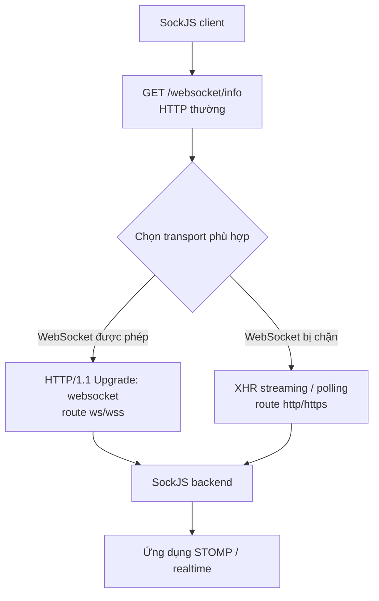
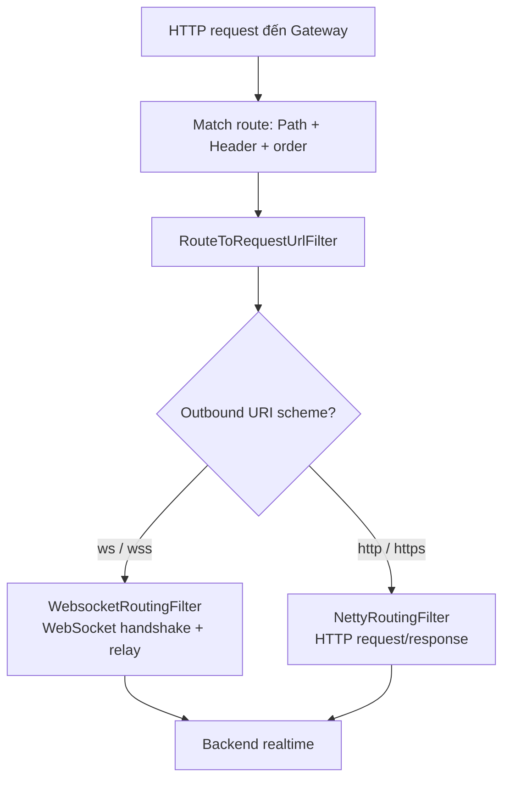
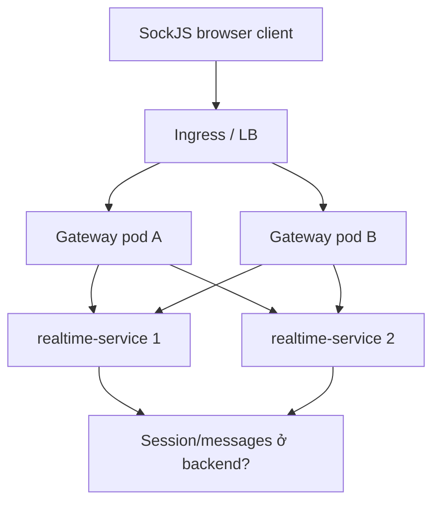

# Định tuyến HTTP riêng cho cơ chế fallback như SockJS

Không phải mọi kết nối thời gian thực đều duy trì được **WebSocket** từ trình duyệt tới backend. Một proxy doanh nghiệp có thể bỏ header `Upgrade`, thiết bị mạng có thể chặn kết nối dài hoặc trình duyệt/client bị hạn chế tính năng. **SockJS** giải quyết một phần bài toán đó bằng cách ưu tiên WebSocket rồi chuyển sang **HTTP streaming** hoặc **HTTP long polling** nếu cần. Nhưng cơ chế fallback chỉ hoạt động nếu **API Gateway có đường định tuyến HTTP thực sự**, không chỉ một route `ws://`.

Trong **Spring Cloud Gateway Server WebFlux**, `WebsocketRoutingFilter` chuyển tiếp kết nối khi URI outbound có scheme `ws` hoặc `wss`; lưu lượng HTTP thông thường đi qua cơ chế HTTP routing. Vì vậy, một endpoint SockJS thường cần **hai nhánh cùng tồn tại**:

1. **Nhánh WebSocket** cho request handshake `Upgrade: websocket`, đi tới backend qua `ws://` hoặc `wss://`.
2. **Nhánh HTTP** cho `GET /info`, XHR streaming, XHR polling, các request `POST .../xhr_send` và preflight khi cần, đi tới backend qua `http://` hoặc `https://`.

Đây là bài của chương **WebSocket và truyền luồng** trong module **SPRING_CLOUD_GATEWAY**. Cách định tuyến phải phối hợp với route predicates, filter chain, rewrite path/header, service discovery/load balancing, xác thực, giới hạn lưu lượng, circuit breaker/retry, TLS và observability để tránh những lỗi như “WebSocket chạy nhưng fallback không hoạt động”, “`/info` trả 200 nhưng client vẫn reconnect vô hạn” hoặc “fallback vô tình vào WebsocketRoutingFilter”.

**Sau bài học, bạn có thể:**

- Phân biệt WebSocket, SockJS WebSocket transport, HTTP streaming và HTTP polling.
- Nhận diện URL SockJS và lý do chỉ tạo HTTP route cho `/info` thường chưa đủ với **toàn bộ** fallback.
- Viết hai routes WebFlux có predicate **`Header=Upgrade`** và **`order`** rõ ràng để cùng phục vụ một prefix.
- Giữ nguyên đường dẫn, query, method và body của các SockJS HTTP transports.
- Cấu hình backend SockJS, frontend SockJS/STOMP, kiểm tra CORS/Origin, TLS, sticky session và timeout.
- Kiểm thử riêng handshake, `/info`, HTTP polling/streaming, phân phối nhiều instances và các tình huống lỗi.

> **Phạm vi phiên bản:** Ví dụ chính dùng **Spring Cloud Gateway Server WebFlux 5.x** với namespace `spring.cloud.gateway.server.webflux.routes`; Gateway Server WebFlux 4.3.x thường dùng `spring.cloud.gateway.routes`. Không sao chép cấu hình WebSocket của **Gateway Server MVC** sang WebFlux: hai sản phẩm có filter/routing stack khác nhau. Mẫu phân nhánh bằng `Upgrade` được trình bày cho **handshake WebSocket HTTP/1.1 truyền thống**; nếu dùng HTTP/2 WebSocket extended CONNECT, cần kiểm thử khả năng hỗ trợ và predicate phù hợp theo ingress/Gateway/server thực tế.

## 1. Vì sao fallback SockJS cần thêm HTTP route?

WebSocket bắt đầu bằng một HTTP handshake rồi chuyển thành kết nối hai chiều:

```http
GET /websocket/000/abc123/websocket HTTP/1.1
Host: api.example.com
Connection: Upgrade
Upgrade: websocket
Sec-WebSocket-Version: 13
Sec-WebSocket-Key: dGhlIHNhbXBsZSBub25jZQ==
Origin: https://app.example.com
```

Khi handshake thành công, server thường trả **`101 Switching Protocols`**, sau đó client/server truyền các WebSocket frames. Phần dữ liệu sau handshake **không còn là các HTTP requests độc lập**.

SockJS fallback thì khác: client có thể gửi **nhiều HTTP requests liên tiếp** tới cùng endpoint:

- `GET /websocket/info` để nhận thông tin transport.
- `GET /websocket/{server-id}/{session-id}/xhr_streaming` mở một HTTP response dài để nhận messages.
- `GET /websocket/{server-id}/{session-id}/xhr` thực hiện một lượt polling.
- `POST /websocket/{server-id}/{session-id}/xhr_send` gửi message từ client lên server.
- `OPTIONS` preflight trong một số tình huống cross-origin.

Những request này **không có handshake WebSocket**. Nếu Gateway đưa chúng vào route `uri: ws://...`, `WebsocketRoutingFilter` có thể cố thực hiện WebSocket handshake không phù hợp, thay vì proxy HTTP, khiến fallback lỗi.



**Quy tắc cốt lõi:** SockJS tạo **cảm giác API kiểu WebSocket** ở client, nhưng cơ chế vận chuyển có thể là HTTP. Gateway phải phân biệt theo **loại transport thực tế**, không chỉ nhìn tên endpoint có chữ `websocket`.

## 2. Bốn khái niệm thường bị gộp nhầm

| Cơ chế | Transport giữa client và Gateway | HTTP status thường thấy | Đặc điểm |
| --- | --- | --- | --- |
| WebSocket thuần | HTTP handshake → WebSocket frames | `101` khi upgrade thành công | Kết nối hai chiều lâu dài |
| SockJS WebSocket transport | HTTP handshake tới một URL con của SockJS → frames | `101` | Có lớp framing/protocol SockJS |
| SockJS XHR streaming | HTTP GET lâu, response stream + POST gửi messages | Thường `200` và response kéo dài | Không dùng `Upgrade` |
| SockJS XHR polling | Nhiều HTTP GET/POST qua cùng session | Tùy transport/request, thường 2xx | Không giữ một WebSocket connection |
| Server-Sent Events (SSE) | HTTP GET với `text/event-stream` | `200`, stream dài | **Không phải** SockJS; hướng server → client |
| Long polling tự viết | HTTP GET treo rồi trả và gọi lại | Thường `200`/`204` theo API | Không nhất thiết theo SockJS protocol |

**SockJS ≠ STOMP ≠ WebSocket ≠ SSE.**

- **WebSocket** là transport hai chiều theo giao thức.
- **SockJS** cung cấp transport negotiation/fallback và framing của nó.
- **STOMP** là message protocol tầng ứng dụng; nó có thể chạy trên WebSocket hoặc thông qua SockJS.
- **SSE** là một HTTP streaming API khác, có yêu cầu routing/timeout riêng.

Một ứng dụng có thể dùng WebSocket thuần không có SockJS; khi đó không cần tự tạo một fallback HTTP route chỉ để “cho đủ hai routes”. Điều kiện là frontend/backend thật sự triển khai SockJS hoặc một cơ chế HTTP fallback tương tự.

## 3. Nhận diện đầy đủ cấu trúc URL SockJS

Theo tài liệu Spring Framework, SockJS client thường **bắt đầu bằng `GET /info`**, sau đó các transport requests dùng dạng:

```text
https://host/myEndpoint/{server-id}/{session-id}/{transport}
```

Nếu public endpoint là `https://api.example.com/websocket`, một phiên chạy có thể tạo:

| Request minh họa | Transport | Route cần tới |
| --- | --- | --- |
| `GET /websocket/info?t=...` | Thăm dò capabilities | **HTTP** |
| `OPTIONS /websocket/info` | CORS preflight nếu phát sinh | **HTTP/CORS handler** |
| `GET /websocket/000/abc123/websocket` + `Upgrade: websocket` | SockJS WebSocket | **WS/WSS** |
| `GET /websocket/000/abc123/xhr_streaming` | HTTP streaming | **HTTP/HTTPS** |
| `GET /websocket/000/abc123/xhr` | HTTP polling | **HTTP/HTTPS** |
| `POST /websocket/000/abc123/xhr_send` | Gửi messages qua HTTP | **HTTP/HTTPS** |
| `GET /websocket/iframe.html` nếu transport/version cần | Tài nguyên hỗ trợ iframe | **HTTP/HTTPS** |

**Chú ý tên:** Trong **URL server**, các suffix thường là `xhr_streaming`, `xhr`, `xhr_send`. Trong tùy chọn **SockJS JavaScript client**, tên transport có thể là `xhr-streaming` hoặc `xhr-polling`. Đừng nhầm dấu gạch dưới ở URL với dấu gạch ngang trong cấu hình client.

`{server-id}` và `{session-id}` do SockJS tạo/áp dụng; Gateway **không nên** xóa hoặc thay chúng bằng `StripPrefix`/`RewritePath` tùy tiện. Các giá trị đó có thể quan trọng khi backend lưu session theo instance.

### Vì sao `/info` chưa đủ?

Nếu chỉ có HTTP route:

```yaml
- id: sockjs-info
  uri: http://localhost:3001
  predicates:
    - Path=/websocket/info/**
```

`GET /websocket/info` có thể thành công, nhưng các request như `/websocket/000/abc123/xhr_streaming` và `.../xhr_send` **không thuộc prefix `/websocket/info/**`**. Nếu route còn lại là `ws://...` với `Path=/websocket/**`, HTTP fallback có thể bị route nhầm vào nhánh WebSocket.

**Kiểm thử `/info` trả 200 là cần thiết, nhưng không đủ để xác nhận SockJS fallback hoạt động end-to-end.**

## 4. WebsocketRoutingFilter khác Netty HTTP routing như thế nào?

Spring Cloud Gateway Server WebFlux xử lý request qua route predicate và filter chain. `RouteToRequestUrlFilter` xây outbound URI từ URI của route; một route có scheme `lb:ws://...` có thể qua `ReactiveLoadBalancerClientFilter` để chọn instance trước khi kết nối.

Các GlobalFilters quan trọng:

| Thành phần | Khi nào tham gia? | Ý nghĩa với SockJS |
| --- | --- | --- |
| `RoutePredicateHandlerMapping` | Tìm route match Path, Header, Host, Method | Phân nhánh WS và HTTP |
| `RouteToRequestUrlFilter` | Xây `GATEWAY_REQUEST_URL_ATTR` | Định dạng scheme outbound |
| `ReactiveLoadBalancerClientFilter` | URI có `lb` prefix | Chọn backend instance |
| `WebsocketRoutingFilter` | URI đích có scheme `ws` hoặc `wss` | Chuyển tiếp WebSocket handshake/session |
| `NettyRoutingFilter` | URI đích là `http` hoặc `https` | Proxy HTTP fallback như `/info`, XHR |
| `NettyWriteResponseFilter` | HTTP client response tương ứng | Ghi phản hồi HTTP về client |
| `GlobalFilter` / `GatewayFilter` | Theo combined filter order | Security/rate limit/headers/path mutations |



**Không chỉ thêm `Upgrade: websocket` vào request rồi mong `uri: http://...` luôn được Gateway WebFlux xử lý bằng WebsocketRoutingFilter.** Tài liệu WebFlux quy định filter WS dựa trên scheme của outbound URI. Ở Gateway **Server MVC**, có cơ chế tự chuyển `http`/`https` với header Upgrade được mô tả riêng; đừng trộn hai tài liệu.

**Không nhầm route ID với routing scheme:** một route tên `websocket-http` vẫn proxy qua HTTP nếu URI là `http://...`; tên ID không kích hoạt WebSocket.

## 5. Mẫu tối giản trong tài liệu Spring Cloud Gateway

Tài liệu Gateway WebFlux 5.1 đưa một ví dụ minh họa hai routes:

```yaml
spring:
  cloud:
    gateway:
      server:
        webflux:
          routes:
            # HTTP route dành cho thăm dò thông tin SockJS
            - id: websocket_sockjs_route
              uri: http://localhost:3001
              predicates:
                - Path=/websocket/info/**

            # Route WebSocket
            - id: websocket_route
              uri: ws://localhost:3001
              predicates:
                - Path=/websocket/**
```

**Điểm đúng:** Ví dụ minh họa quy tắc **cần route HTTP bình thường cùng route WS** khi dùng SockJS fallback. Nó phân biệt scheme `http` và `ws`.

**Giới hạn khi áp dụng cho ứng dụng thật:** HTTP SockJS không dừng ở `/info`. Nếu browser phải dùng `xhr_streaming`, `xhr` và `xhr_send`, cần đảm bảo **toàn bộ URL HTTP fallback** được proxy tới HTTP backend, chứ không rơi vào route WS chung. Với prefix trùng nhau, thứ tự route và predicate `Upgrade` cần được thiết kế rõ ràng.

Vì vậy, mẫu bên dưới mở rộng ý tưởng trên thành **hai routes phân biệt theo WebSocket Upgrade**, để cùng xử lý một public prefix mà không nuốt nhầm XHR requests.

## 6. Cấu hình hai routes hoàn chỉnh: WS Upgrade trước, HTTP fallback sau

Giả sử:

- Gateway WebFlux chạy ở `localhost:8080`.
- SockJS/STOMP backend chạy tại `localhost:3001`.
- Public SockJS endpoint là `/websocket`.
- Backend cũng đăng ký SockJS endpoint `/websocket`, nên **chưa cần rewrite path**.
- WebSocket sử dụng HTTP/1.1 handshake với header `Upgrade: websocket`.
- Trường hợp không có header Upgrade phải được proxy bằng HTTP.

```yaml
spring:
  cloud:
    gateway:
      server:
        webflux:
          routes:
            # Nhánh WebSocket: chỉ match handshake Upgrade.
            - id: sockjs-ws-upgrade
              order: -10
              uri: ws://localhost:3001
              predicates:
                - Path=/websocket/**
                - Header=Upgrade, (?i)websocket

            # Nhánh HTTP: /info, xhr_streaming, xhr, xhr_send, OPTIONS...
            - id: sockjs-http-fallback
              order: 10
              uri: http://localhost:3001
              predicates:
                - Path=/websocket/**
```

### Cách cấu hình này phân nhánh

1. Request `GET /websocket/info` **không có Upgrade** → không match `sockjs-ws-upgrade` → match `sockjs-http-fallback` → proxy HTTP.
2. `GET /websocket/000/s1/websocket` với `Upgrade: websocket` → match nhánh WS (order nhỏ hơn) → WebsocketRoutingFilter.
3. `GET /websocket/000/s1/xhr_streaming` **không có Upgrade** → vào HTTP route.
4. `POST /websocket/000/s1/xhr_send` **không có Upgrade** → vào HTTP route, body được gửi tới backend theo cơ chế HTTP.
5. `OPTIONS /websocket/info` hoặc `OPTIONS` transport path → có thể được xử lý bằng CORS/preflight handler hoặc HTTP route tùy cấu hình; **không phải WebSocket route**.

Dạng `Header=Upgrade, (?i)websocket` sử dụng **Header route predicate factory** với **Java regular expression**; `(?i)` cho phép so khớp không phân biệt hoa/thường đối với giá trị header. Trong YAML shortcut, dấu phẩy tách tên header và regex.

**Cẩn trọng:** Một số client/proxy có thể gửi giá trị `Upgrade` khác thường, thêm nhiều token hoặc normalize khác nhau. Với HTTP/1.1 handshake tiêu chuẩn, giá trị đơn `websocket` thường được dùng. Nếu muốn regex chấp nhận danh sách token, cần thiết kế/test riêng và **không** coi chỉ có header Upgrade là bằng chứng handshake hợp lệ; backend/Gateway vẫn phải xác minh các header chuẩn khác.

### Vì sao phải đặt `order`?

Cả hai routes đều có `Path=/websocket/**`; một WebSocket handshake cũng match predicate Path của HTTP route. Đặt:

- WS `order: -10` → được xét trước khi điều kiện Upgrade khớp.
- HTTP `order: 10` → là fallback cho những HTTP requests bình thường.

Nếu không kiểm soát route order, request WebSocket có thể bị chọn vào HTTP route, dẫn tới handshake `400/404/426` hoặc response HTTP bình thường thay vì `101`.

**Route order** là thứ tự lựa chọn route khi nhiều route predicates cùng match, **không phải GatewayFilter order**. Thay `StripPrefix` hoặc `SetPath` chỉ biến đổi path sau khi route đã chọn, không thay vai trò predicate Upgrade.

## 7. Bảng quyết định cho cấu hình ở mục 6

| Request | Header Upgrade | Route kỳ vọng | Scheme outbound | Tín hiệu đúng |
| --- | --- | --- | --- | --- |
| `GET /websocket/info` | Không | `sockjs-http-fallback` | `http` | JSON/info response |
| `GET /websocket/info?t=123` | Không | HTTP fallback | `http` | Query giữ nguyên |
| `GET /websocket/000/s1/websocket` | `websocket` | `sockjs-ws-upgrade` | `ws` | `101` khi backend chấp nhận |
| `GET /websocket/000/s1/xhr_streaming` | Không | HTTP fallback | `http` | Response 2xx dạng streaming |
| `GET /websocket/000/s1/xhr` | Không | HTTP fallback | `http` | Response polling đúng protocol |
| `POST /websocket/000/s1/xhr_send` | Không | HTTP fallback | `http` | POST tới đúng SockJS session |
| `OPTIONS /websocket/...` | Không | HTTP/CORS | `http` hoặc handler CORS | Preflight hợp lệ |
| `GET /websocket/000/s1/websocket` | Không | HTTP fallback | `http` | Không được coi là WebSocket đã nâng cấp |
| `GET /other` | Không | Không có route trên | — | Route khác/404 tùy app |

Không khẳng định mọi HTTP fallback request nhất thiết trả `200`: tùy protocol, state session, Origin, CSRF và backend, nó có thể trả `204`, `400`, `401` hoặc `404`. Điều phải xác minh trước tiên là **request được chuyển qua nhánh HTTP** thay vì rơi vào WebSocket routing.

## 8. Backend mẫu có SockJS: Spring WebSocket/STOMP trên servlet stack

Gateway WebFlux có thể proxy tới một **backend Spring MVC/Servlet** triển khai SockJS. Đây là một lựa chọn minh họa tương thích tài liệu Spring Framework. **Không cần backend cũng là WebFlux** chỉ vì Gateway dùng Reactor Netty.

Ví dụ trong `realtime-service`:

```java
package example.realtime;

import org.springframework.context.annotation.Configuration;
import org.springframework.messaging.simp.config.MessageBrokerRegistry;
import org.springframework.web.socket.config.annotation.EnableWebSocketMessageBroker;
import org.springframework.web.socket.config.annotation.StompEndpointRegistry;
import org.springframework.web.socket.config.annotation.WebSocketMessageBrokerConfigurer;

@Configuration(proxyBeanMethods = false)
@EnableWebSocketMessageBroker
public class RealtimeWebSocketConfig
        implements WebSocketMessageBrokerConfigurer {

    @Override
    public void registerStompEndpoints(StompEndpointRegistry registry) {
        registry.addEndpoint("/websocket")
            .setAllowedOriginPatterns("http://localhost:8080")
            .withSockJS();
    }

    @Override
    public void configureMessageBroker(MessageBrokerRegistry registry) {
        registry.setApplicationDestinationPrefixes("/app");
        registry.enableSimpleBroker("/topic");
    }
}
```

Nếu frontend chạy ở **origin khác Gateway**, cần cho phép chính origin frontend ở **cả Gateway và backend** theo mô hình triển khai và kiểm thử thực tế. Trong ví dụ local, frontend dùng `http://localhost:8080` nên backend chỉ chấp nhận origin đó; không nên copy nguyên allowlist lên production.

Các điểm bắt buộc:

- `registry.addEndpoint("/websocket").withSockJS()` bật endpoint SockJS trên backend.
- Backend phải lắng nghe ở port `3001` (hoặc cấu hình tương ứng).
- Chỉ Gateway WS route **không tạo ra** SockJS endpoint trên backend.
- SockJS server sử dụng nhiều đường dẫn con dưới `/websocket`, như `/info` và `/{server}/{session}/{transport}`.
- STOMP destination `/app/*` và `/topic/*` thuộc **payload/message protocol**, không phải URL routes `/websocket/info` của Gateway.

Một controller STOMP demo:

```java
package example.realtime;

import org.springframework.messaging.handler.annotation.MessageMapping;
import org.springframework.messaging.handler.annotation.SendTo;
import org.springframework.stereotype.Controller;

@Controller
public class DemoMessageController {

    @MessageMapping("/ping")
    @SendTo("/topic/pong")
    public String ping(String message) {
        return "pong: " + message;
    }
}
```

Ví dụ này chỉ để thử message flow; xác thực/authorization STOMP destinations cần cấu hình riêng trước production. Không gửi PII hoặc token vào public topic.

### Phân biệt frontend endpoint với STOMP destination

```text
Gateway public SockJS endpoint:
  http://localhost:8080/websocket

SockJS requests mà client tự sinh:
  /websocket/info
  /websocket/000/{session}/websocket
  /websocket/000/{session}/xhr_streaming
  /websocket/000/{session}/xhr_send

STOMP application destination:
  /app/ping

STOMP subscription destination:
  /topic/pong
```

**Không tạo route `Path=/app/**` hoặc `Path=/topic/**` ở Gateway chỉ để STOMP messages đi qua. Sau handshake, STOMP frames nằm trong WebSocket/SockJS transport, không được định tuyến như HTTP URL độc lập.

## 9. Frontend SockJS: thử WebSocket và ép fallback HTTP

Với ứng dụng frontend đã cài `sockjs-client` và `@stomp/stompjs` (dùng bundler phù hợp), kết nối qua Gateway bằng URL **HTTP/HTTPS** của SockJS endpoint:

```javascript
import SockJS from "sockjs-client";
import { Client } from "@stomp/stompjs";

const client = new Client({
  // SockJS tự sinh URL /info và chọn websocket/xhr transports.
  webSocketFactory: () =>
    new SockJS("http://localhost:8080/websocket"),

  reconnectDelay: 5000,

  onConnect: () => {
    client.subscribe("/topic/pong", message => {
      console.log("Received:", message.body);
    });

    client.publish({
      destination: "/app/ping",
      body: "hello"
    });
  },

  onStompError: frame => {
    console.error("STOMP error:", frame.headers["message"]);
  }
});

client.activate();

// Khi unmount hoặc đóng ứng dụng:
// await client.deactivate();
```

**Không truyền `ws://...` cho `new SockJS(...)` như thể đây là constructor `new WebSocket(...)`. SockJS client bắt đầu với endpoint HTTP/HTTPS và tự chọn các transport, kể cả WebSocket ở những môi trường cho phép.

### Ép XHR polling để chứng minh HTTP route hoạt động

Trong môi trường thử nghiệm, tạo kết nối chỉ dùng `xhr-polling`:

```javascript
const fallbackClient = new Client({
  webSocketFactory: () =>
    new SockJS(
      "http://localhost:8080/websocket",
      null,
      { transports: ["xhr-polling"] }
    ),

  reconnectDelay: 3000,

  onConnect: () => {
    console.log("Connected through SockJS HTTP fallback");
  }
});

fallbackClient.activate();
```

Mở **Browser DevTools → Network → Fetch/XHR** và quan sát `/websocket/info`, các URL có `/xhr` hoặc `/xhr_send`. Không kỳ vọng có kết nối trong tab WS khi đã ép `xhr-polling`.

**Đây là bài test quan trọng nhất**: WebSocket kết nối được không chứng minh HTTP fallback route đúng; phải ép một transport HTTP để đo riêng.

### Một số lỗi ở frontend

- `client.deactivate()` cần được gọi khi rời màn hình để tránh reconnect loops và rò kết nối.
- Khi frontend dùng HTTPS, SockJS endpoint cũng phải dùng **HTTPS** để tránh mixed content.
- `reconnectDelay` không đồng nghĩa Gateway Retry; mỗi lần reconnect là **session/handshake mới** theo hành vi client.
- Trong production, đừng log token/PII trong `console.error` hoặc thêm access token vào URL query nếu không có cơ chế bảo vệ phù hợp.

## 10. Route prefix khác backend prefix: giữ nguyên SockJS session path

Giả sử public API đặt SockJS dưới `/api/realtime/websocket`, còn backend đăng ký `/websocket`.

Khi đó **cả hai routes** phải rewrite/strip prefix **giống nhau**, để WebSocket và HTTP fallback tới cùng backend endpoint.

```yaml
spring:
  cloud:
    gateway:
      server:
        webflux:
          routes:
            - id: realtime-ws
              order: -10
              uri: ws://localhost:3001
              predicates:
                - Path=/api/realtime/websocket/**
                - Header=Upgrade, (?i)websocket
              filters:
                - StripPrefix=2

            - id: realtime-http-fallback
              order: 10
              uri: http://localhost:3001
              predicates:
                - Path=/api/realtime/websocket/**
              filters:
                - StripPrefix=2
```

Diễn giải:

```text
Public:
  /api/realtime/websocket/info
  /api/realtime/websocket/000/s1/websocket
  /api/realtime/websocket/000/s1/xhr_streaming
  /api/realtime/websocket/000/s1/xhr_send

Sau StripPrefix=2 (bỏ "api" và "realtime"):
  /websocket/info
  /websocket/000/s1/websocket
  /websocket/000/s1/xhr_streaming
  /websocket/000/s1/xhr_send
```

Nếu chỉ `StripPrefix=2` ở route WS mà bỏ ở route HTTP, `/info` hoặc `xhr_send` sẽ tới backend dưới path sai và có thể trả `404`. Ngược lại, nếu StripPrefix=3, mất luôn segment `websocket` mà backend đã đăng ký.

**Không rewrite** `{server-id}`, `{session-id}` và `{transport}` một cách tùy ý. Chúng là thành phần giao thức SockJS. Cũng cần giữ query parameters, POST body và content type.

### Khi nào dùng RewritePath?

`RewritePath` hữu ích khi public prefix không đơn giản là thêm vài segments. Nhưng regex replacement cần escape đúng trong YAML và phải kiểm thử cả WebSocket URL, `/info`, XHR polling và POST. Nếu chỉ muốn loại hai segments cố định, `StripPrefix=2` thường dễ giải thích hơn.

## 11. Khi có service discovery: HTTP và WebSocket dùng hai scheme khác nhau

Trong microservices, thay vì đặt địa chỉ cứng `localhost:3001`, có thể dùng service discovery.

Ví dụ:

```yaml
spring:
  cloud:
    gateway:
      server:
        webflux:
          routes:
            - id: realtime-ws
              order: -10
              uri: lb:ws://realtime-service
              predicates:
                - Path=/websocket/**
                - Header=Upgrade, (?i)websocket

            - id: realtime-http
              order: 10
              uri: lb://realtime-service
              predicates:
                - Path=/websocket/**
```

- `lb:ws://realtime-service`: URI dành cho WebSocket route có prefix `lb` để LoadBalancer chọn service instance.
- `lb://realtime-service`: URI logical bình thường cho HTTP fallback qua LoadBalancer (mặc định outbound HTTP/HTTPS tùy service instance/security config).
- Cần Spring Cloud LoadBalancer starter và một nguồn service instances phù hợp (Eureka, Consul, Kubernetes hoặc SimpleDiscoveryClient).
- Cấu hình URI backend có ý nghĩa quan trọng: **`lb://realtime-service` không tự biến toàn bộ HTTP fallback thành WebSocket**.

### Những giới hạn cần hiểu

**Một HTTP request ≠ một session SockJS.** XHR polling có thể gồm nhiều request nối tiếp trong cùng session. Nếu chúng bị phân phối ngẫu nhiên qua các instances có session state chỉ nằm trong memory, request sau có thể vào instance B dù session được tạo tại A, gây lỗi `404` hoặc mất message.

SockJS URL chứa `{server-id}` có thể hữu ích cho routing trong cluster, nhưng **Spring Cloud LoadBalancer không mặc định cam kết sticky session chỉ vì có segment này**.

Các giải pháp có thể cần:

1. Session affinity ở ingress/LB theo cookie hoặc cơ chế được server hỗ trợ.
2. Chính sách chọn instance dựa trên stable session key nếu kiến trúc cho phép.
3. Backend hỗ trợ shared session state/messaging broker phù hợp; xem xét broker relay/persistence cho STOMP.
4. Readiness và graceful shutdown khi rolling deployment.
5. Kiểm thử long polling qua nhiều backend replicas, không chỉ test một WebSocket connection.

**Cảnh báo:** STOMP broker dùng memory trong từng backend không tự tạo hệ thống pub/sub liên cụm. Route `lb://...` chỉ giải quyết chọn instance, không làm session/broadcast state được chia sẻ.

## 12. CORS HTTP fallback và Origin WebSocket là hai lớp khác nhau

Đây là nguyên nhân phổ biến của tình huống “`/info` hoạt động nhưng browser không mở được kết nối”.

### WebSocket: Origin được kiểm tra ở handshake

Theo tài liệu Spring Cloud Gateway Server WebFlux 5.1, WebSocket handshake **không được browser áp dụng CORS như XHR thông thường**, nên WebsocketRoutingFilter có chính sách **Origin** riêng. Mặc định, cùng-origin hoặc request không có `Origin` được chấp nhận; cross-origin có thể nhận **`403 Forbidden`**.

Nếu frontend ở `https://app.example.com` và Gateway ở `https://api.example.com`, cấu hình Gateway WebFlux có thể cần:

```yaml
spring:
  cloud:
    gateway:
      server:
        webflux:
          websocket:
            allowed-origins:
              - https://app.example.com
```

Đây là **allowlist exact origin minh họa**. Khi cần pattern, version 5.x có `allowed-origin-patterns`; tránh `*` trong production. Backend SockJS cũng cần chính sách Origin tương thích để không từ chối handshake sau khi Gateway đã chấp nhận.

**Origin không phải authentication.** Một non-browser client có thể gửi/không gửi Origin tùy ý. Phải xác thực user/session, kiểm tra quyền STOMP destinations và backend data authorization riêng.

### HTTP fallback: CORS cho XHR streaming/polling

HTTP fallback thực thi **HTTP requests bình thường**, nên browser có thể kiểm tra:

- `Access-Control-Allow-Origin` đúng frontend origin.
- `Access-Control-Allow-Credentials` khi có cookie/session credentials.
- `Access-Control-Allow-Methods` cho `GET`, `POST` và `OPTIONS` cần thiết.
- `Access-Control-Allow-Headers` cho những headers ứng dụng sử dụng.
- Response preflight/actual response không mâu thuẫn với Gateway/ingress/backend.

Spring SockJS server có hỗ trợ sinh CORS headers cho những transport HTTP khi cross-origin được cho phép. Nếu Gateway hoặc một Servlet filter đã thêm CORS headers, SockJS service có thể tránh ghi trùng theo cách framework định nghĩa.

**Không cấu hình cả ba lớp ingress, Gateway, backend cùng viết `Access-Control-Allow-Origin` tùy ý**: browser có thể từ chối nếu có giá trị trùng lặp/mâu thuẫn. Chọn lớp chịu trách nhiệm rõ ràng, đảm bảo response cuối đúng hợp đồng.

### Bảng lỗi CORS/Origin

| Dấu hiệu | Khả năng |
| --- | --- |
| `GET /info` 200 bằng curl, browser bị CORS | Curl không áp dụng browser CORS |
| WebSocket 403 nhưng XHR info OK | Gateway/backend WebSocket Origin policy |
| OPTIONS 404/403 | Preflight không được route/handler xử lý, hoặc bị security chặn |
| Browser báo multiple `Access-Control-Allow-Origin` | Gateway/backend/ingress cùng ghi header |
| Cookie không được gửi trên fallback | SameSite, Secure, domain/path, CORS credentials |
| Same-origin chạy, cross-origin thất bại | Origin allowlist chưa đồng bộ |
| HTTP fallback được nhưng WS thất bại sau proxy | Header Upgrade bị ingress loại bỏ hoặc TLS/Origin sai |

## 13. Reverse proxy, forwarded headers và TLS

Trong production, trình duyệt có thể kết nối:

```text
Browser:
  https://api.example.com/websocket/info
  wss://api.example.com/websocket/.../websocket

Ingress (TLS termination):
  http://gateway:8080/websocket/info
  ws://gateway:8080/websocket/.../websocket

Gateway:
  http://realtime-service/...    cho HTTP fallback
  ws://realtime-service/...      cho WebSocket
```

Kiến trúc trên dùng TLS ở public edge và HTTP nội bộ **chỉ là minh họa**. Production có yêu cầu riêng về mTLS/TLS nội bộ, truststore và network policy.

### Các điểm cần kiểm tra

1. Ingress phải hỗ trợ **WebSocket Upgrade** và truyền các header bắt buộc khi handshake HTTP/1.1.
2. Đặt **idle/read timeout** đủ cho kết nối WS và long polling/streaming.
3. Proxy ngoài cần truyền/ngăn spoof `Forwarded` hoặc `X-Forwarded-*` theo trust boundary.
4. Khi Gateway nằm sau proxy, Spring Cloud Gateway có thể cần `server.forward-headers-strategy` theo hạ tầng để tính đúng public scheme/Host khi kiểm tra same-origin.
5. URL frontend dưới HTTPS không được trỏ SockJS tới `http://` không an toàn (mixed content).
6. Nếu Gateway kết nối HTTPS/WSS tới backend, phải xác minh cert chain, hostname/SNI; không tắt TLS verification để “sửa WebSocket”.
7. Không cho client điều khiển URI outbound `ws://`/`http://` qua raw Host/header/path không được kiểm soát, tránh SSRF/open proxy.

**Đừng đánh đồng TLS của client→Gateway với TLS của Gateway→backend.** Nếu backend cần WSS, cấu hình `wss://` hoặc cơ chế `lb`/secure flag phù hợp và kiểm thử handshake qua Gateway.

## 14. Xác thực, cookies, CSRF và STOMP CONNECT

SockJS fallback có thể phức tạp hơn WebSocket thuần khi liên quan đến session/authentication.

### Ba lớp phân quyền

| Lớp | Trách nhiệm |
| --- | --- |
| Gateway/Spring Security | Cho phép handshake và HTTP fallback endpoints theo identity/route policy |
| SockJS/STOMP server | Gắn principal vào session, kiểm tra CONNECT/subscribe/send theo protocol |
| Backend nghiệp vụ | Xác minh user/tenant có quyền đọc/gửi message, không tin header tùy ý |

**Không** chỉ mở `/websocket/info` cho anonymous rồi mặc định `.../xhr_send` cũng an toàn. Ngược lại, chặn `/info` bằng yêu cầu header `Authorization` mà browser SockJS không gửi được sẽ khiến handshake chưa bắt đầu đã thất bại.

### Browser SockJS và Authorization header

SockJS JavaScript client thường **không cung cấp API tùy ý thêm HTTP headers** cho mọi transport giống một HTTP client thông thường. Vì vậy thiết kế “mọi request `/info` và `xhr_send` đều phải có `Authorization: Bearer ...` do SockJS tự chèn” có thể không thực hiện được.

Những hướng thường dùng:

- Xác thực bằng **cookie/session** cùng domain/SameSite/Secure phù hợp và CSRF.
- Xác thực STOMP `CONNECT` bằng cơ chế messaging interceptor/security được triển khai, đồng thời bảo vệ endpoints trước traffic anonymous/abuse.
- Dùng một lớp BFF/token exchange hoặc cấu trúc endpoint phù hợp nếu không muốn phụ thuộc cookie.

**Không nhét JWT dài hạn vào query string** chỉ để vượt giới hạn custom HTTP headers. URL dễ xuất hiện trong proxy logs, lịch sử và monitoring. Nếu buộc dùng token ngắn hạn trong URI, phải có thiết kế riêng về TTL, scope, không reuse và log redaction.

### CSRF của SockJS POST

Spring Security tài liệu dành cho servlet WebSocket nêu: khi dùng STOMP/SockJS, các POST transports có thể bị ảnh hưởng bởi CSRF web-layer và CSRF ở STOMP `CONNECT`. Cách tích hợp đúng phụ thuộc server và Spring Security version; **không tắt CSRF toàn bộ ứng dụng** chỉ để cho `xhr_send` qua.

Nếu cần ngoại lệ ở HTTP layer cho SockJS transport, giới hạn nó đúng **endpoint SockJS**, giữ bảo vệ CONNECT hoặc cơ chế tương đương và kiểm thử cross-site request. Hạn chế `Origin` kết hợp authentication/authorization **không thay thế** CSRF kiểm soát phù hợp.

## 15. Long polling/streaming và chính sách timeout

Một request HTTP bình thường thường kết thúc nhanh. SockJS XHR streaming hoặc polling lại có thể **giữ kết nối lâu** hoặc chờ server gửi message.

Nếu Global HTTP client response timeout tại Gateway là quá ngắn, fallback có thể bị đóng giữa chừng:

```yaml
spring:
  cloud:
    gateway:
      server:
        webflux:
          httpclient:
            connect-timeout: 1000   # milliseconds
            response-timeout: 5s     # java.time.Duration, global
```

Trong tài liệu Gateway WebFlux, **route metadata** có đơn vị khác:

- `metadata.connect-timeout`: **milliseconds**.
- `metadata.response-timeout`: **milliseconds**.
- Một giá trị **âm** của response-timeout theo route được tài liệu mô tả là **vô hiệu response timeout global cho route đó**.

Một ví dụ **chỉ dành cho HTTP SockJS fallback**:

```yaml
- id: sockjs-http-fallback
  order: 10
  uri: http://localhost:3001
  predicates:
    - Path=/websocket/**
  metadata:
    response-timeout: -1
```

**Cảnh báo vận hành:** `response-timeout: -1` không có nghĩa “mọi kết nối sẽ luôn sống”. Ingress, LB, backend, browser, proxy và socket idle timeouts vẫn tồn tại. Vô hiệu response timeout chỉ phù hợp nếu bạn có **lifecycle, idle policy, heartbeat, connection limits và monitoring** khác.

Một lựa chọn khác là một timeout route đủ dài (ví dụ `60000` = 60 giây), được kiểm thử với long polling/streaming thực tế. Không tự đặt `5` khi muốn 5 giây: trên **route metadata** nó có nghĩa **5 ms**.

### WebSocket timeout không giống HTTP fallback timeout

Sau handshake, WebSocket có vòng đời dài với frames/ping-pong/heartbeats riêng. HTTP client `response-timeout` dành cho Netty HTTP proxy không phải “giới hạn sống chính xác của mọi WebSocket session”. Hãy kiểm tra:

- Ingress idle timeout.
- WebSocket ping/pong ở transport và heartbeat STOMP/SockJS.
- Session/transport timeout của backend.
- Giới hạn concurrent connections/socket file descriptors.
- Mức dữ liệu/frame size và tốc độ gửi.
- Cơ chế graceful shutdown và reconnect backoff.

**Không** bật retry tự động cho một HTTP streaming response đã bắt đầu gửi bytes. Nó không giống retry GET trả JSON trước khi commit, và có thể làm trùng message/vi phạm session protocol.

## 16. RateLimiter, CircuitBreaker và Retry trên nhánh fallback

Đối với APIs JSON thông thường, Gateway có thể dùng `RequestRateLimiter`, `CircuitBreaker` và `Retry` theo route. Nhưng đối với SockJS:

- Một **WebSocket session** có thể tồn tại hàng giờ sau một handshake.
- Một **HTTP polling session** có thể tạo nhiều HTTP requests chỉ để giữ một logical connection.
- `GET /info` và `POST /xhr_send` có tần suất và chi phí khác nhau.
- Một response long streaming đã bắt đầu không thể retry mù quáng như JSON.
- Mỗi lần frontend reconnect có thể tạo **session mới**; retry ngoài ý muốn làm số kết nối tăng.

### Giới hạn lưu lượng theo cái gì?

| Thành phần | Chiến lược kiểm soát |
| --- | --- |
| WebSocket handshake | Giới hạn số lần handshake/new sessions theo identity/IP tin cậy |
| SockJS `GET /info` | Hạn chế probing quá mức nhưng không chặn client hợp lệ |
| SockJS `xhr_send` | Giới hạn message/rate theo user/session ở backend |
| Long-polling requests | Theo dõi request rate và concurrent open requests |
| Persistent WS session | Giới hạn số connections/identity, message size, buffer và idle |
| Reconnect loop | Exponential backoff/jitter phía client; giám sát failures |

Một rate limiter tính “N request/giây” áp chung cho mọi `/websocket/**` có thể bất công với SockJS polling vì cùng một phiên sinh nhiều HTTP requests hơn WebSocket native. Nên phân loại endpoint/transport và đo hành vi thực trước khi chọn quota.

### Tránh Retry với SockJS POST/long streaming

- `POST /.../xhr_send` có body và side effects theo message delivery: retry thiếu idempotency có thể gửi lại message.
- `GET /.../xhr_streaming` là response dài: sau khi đã commit, retry không thể tự trả lại “từ đầu” một cách trong suốt.
- WebSocket handshake lỗi cần client **reconnect có backoff**, không mặc định Gateway Retry tái sử dụng session bị lỗi.
- Circuit breaker có thể hữu ích để hạn chế handshake mới khi backend lỗi, nhưng phải test phạm vi filter và fallback response; một `fallbackUri` trả JSON không phải SockJS session hợp lệ.

**Không áp dụng nguyên block `Retry`/`CircuitBreaker` của REST API cho WebSocket/SockJS routes mà không có integration test về protocol.**

## 17. Trình tự kiểm thử tối thiểu bằng curl và browser

### 17.1. Kiểm tra backend trước

Trước khi debug Gateway, thử gọi trực tiếp backend SockJS:

```bash
curl -i \
  "http://localhost:3001/websocket/info"
```

Nếu backend thật sự bật SockJS ở `/websocket`, thường nhận được response JSON có các trường thông tin transport như `websocket`, `cookie_needed` và dữ liệu nhận diện khác theo implementation.

Nếu gọi trực tiếp đã trả `404`, lỗi nằm ở backend path/server config hoặc nó chưa bật SockJS; chỉnh route Gateway không thể tạo ra endpoint chưa tồn tại.

### 17.2. Kiểm tra nhánh HTTP thông qua Gateway

```bash
curl -i \
  "http://localhost:8080/websocket/info"

curl -i \
  -H "Origin: http://localhost:8080" \
  "http://localhost:8080/websocket/info"
```

Kiểm tra:

- Response đi từ SockJS backend, không phải `404` do route mismatch.
- JSON/info và các response headers phù hợp.
- Không thấy `101 Switching Protocols` ở một request HTTP info.
- Tên route trong trace/log nên là `sockjs-http-fallback`.

### 17.3. Kiểm tra preflight HTTP nếu frontend cross-origin

```bash
curl -i -X OPTIONS \
  "http://localhost:8080/websocket/info" \
  -H "Origin: https://app.example.com" \
  -H "Access-Control-Request-Method: GET"
```

Đừng chỉ xem HTTP status; kiểm tra các `Access-Control-Allow-*` và consistency với backend/ingress. Một preflight do WebFlux CORS handler xử lý có thể **không thực thi toàn bộ GatewayFilter chain**, nên không nhất thiết được log như HTTP route bình thường.

### 17.4. Kiểm tra handshake WebSocket

Dùng browser/WS client phù hợp với SockJS hoặc một tool kiểm tra handshake; với WebSocket route khi backend chấp nhận, kết quả kỳ vọng là **HTTP `101`**. Nếu dùng một HTTP client gửi thiếu `Sec-WebSocket-Key`, `Connection` hoặc `Sec-WebSocket-Version`, request có thể bị từ chối **dù route chọn đúng**.

Mẫu handshake request để kiểm tra headers:

```http
GET /websocket/000/session123/websocket HTTP/1.1
Host: localhost:8080
Connection: Upgrade
Upgrade: websocket
Sec-WebSocket-Version: 13
Sec-WebSocket-Key: dGhlIHNhbXBsZSBub25jZQ==
Origin: http://localhost:8080
```

**Không dùng `curl -H "Upgrade: websocket"` đơn độc rồi kết luận backend sai nếu không nhận 101**. WebSocket handshake cần các headers phù hợp; ngay cả handshake thành công vẫn chưa chứng minh STOMP/SockJS frames hoạt động. Dùng một client hiểu giao thức SockJS và kiểm tra message exchange.

### 17.5. Buộc HTTP fallback trong frontend

Sử dụng `transports: ["xhr-polling"]` ở mục 9. Mở Network panel và theo dõi:

1. `GET /websocket/info`.
2. `GET /websocket/{server}/{session}/xhr`.
3. `POST /websocket/{server}/{session}/xhr_send` khi gửi message.
4. Backend nhận và trả message theo đúng STOMP/SockJS.
5. Route được chọn là **HTTP fallback**, không phải WS.
6. Không có reconnect storm hoặc CORS/CSRF errors.

Một request `GET /websocket/000/test/xhr` gửi bằng curl mà không có SockJS session hợp lệ có thể trả `404`/`400`. Điều đó **không đủ để kết luận route sai**. Phải dùng SockJS client tạo session đúng.

## 18. Kiểm thử route order và khả năng phân tách transports

Một bảng test acceptance gợi ý:

| Test | Request/điều kiện | Kỳ vọng |
| --- | --- | --- |
| T1 | `GET /websocket/info` | Match HTTP route và trả info |
| T2 | `GET /websocket/info?t=1` | Query được truyền đúng |
| T3 | Handshake `Upgrade: websocket` tới SockJS WS URL | Match WS route, handshake đúng |
| T4 | `xhr-polling` bị ép ở frontend | Dùng HTTP route, STOMP flow hoạt động |
| T5 | `xhr-streaming` bị ép ở frontend | HTTP stream không bị cắt sớm |
| T6 | `POST .../xhr_send` | Body tới đúng session, không bị retry trùng |
| T7 | OPTIONS cross-origin | CORS headers/status phù hợp |
| T8 | Origin không có trong allowlist | WS bị chặn theo policy; HTTP CORS đúng |
| T9 | Backend down | Không có infinite retry/reconnect storm |
| T10 | Hai backend instances sau `lb` | SockJS session không bị nhảy instance vô chủ đích |
| T11 | TLS termination ở ingress | Public scheme/Origin/forwarded headers đúng |
| T12 | Rolling deploy backend | Reconnect có backoff, session lifecycle rõ |
| T13 | Route prefix đổi | `StripPrefix` nhất quán cả WS và HTTP |
| T14 | Rate limit cao/tải lớn | HTTP fallback không bị quota bất công |
| T15 | Không có Upgrade vào `.../websocket` | Không bị tự nhận là WS connection hợp lệ |

### Đo route thật sự được chọn

Đừng chỉ suy từ `Path`. Khi hai routes match cùng prefix, kiểm tra `routeId` trong Gateway metrics/log và xem routes qua Actuator read-only nếu được bật:

```bash
# Chỉ từ mạng quản trị đã bảo vệ, khi Actuator được expose.
curl -s \
  http://localhost:8080/actuator/gateway/routes

curl -s \
  http://localhost:8080/actuator/gateway/routes/sockjs-ws-upgrade

curl -s \
  http://localhost:8080/actuator/gateway/routes/sockjs-http-fallback
```

Actuator có thể dùng management port riêng, không phải 8080. Đừng expose route config chứa upstream topology ra Internet.

**Không cố dùng `GlobalFilter` để “tự đổi WS thành HTTP” cho XHR request sau khi route đã match sai**. Cách dễ kiểm soát hơn là phân biệt route bằng predicate và order ngay từ đầu.

## 19. Vận hành ở nhiều replicas: session affinity và graceful drain

Với một Gateway replica và một backend SockJS, bài test local thường dễ thành công. Nhưng trên Kubernetes, hai tầng scale riêng:



WebSocket session là **kết nối TCP lâu dài**; sau khi được establish, nó thường gắn với một Gateway pod và một backend connection cho tới khi đóng. HTTP polling lại có **nhiều request**; mỗi request có thể đi qua Gateway/backend khác nhau.

Các câu hỏi production:

1. SockJS backend có lưu session state local không?
2. HTTP polling `GET` và `POST xhr_send` của cùng `session-id` có được định tuyến tới cùng backend không?
3. Khi backend pod bị shutdown, kết nối cũ đóng như thế nào?
4. Ingress có giữ sticky routing hoặc chỉ round-robin request?
5. Broker message state có được chia sẻ qua external broker không?
6. Khi reconnect, client có backoff/jitter, tự dọn session cũ và kiểm tra quyền lại không?

**Không tuyên bố** rằng việc cấu hình `lb://realtime-service` đủ bảo đảm sticky session. Cần thiết kế affinity/shared state hoặc chọn backend/session architecture có hỗ trợ scale.

### Heartbeat và health

SockJS có cơ chế heartbeat ở transport/protocol; STOMP có heart-beat negotiation riêng. Heartbeat giúp phát hiện kết nối chết và duy trì một số middleboxes, nhưng **không thay** application health/readiness hay backpressure management.

Khi pod chuẩn bị bị gỡ:

- Bỏ khỏi readiness trước khi nhận kết nối/session mới.
- Cân nhắc drain time để kết nối cũ hoàn tất/đóng có chủ đích.
- Tránh cắt toàn bộ long polls cùng lúc gây reconnect storm.
- Quan sát active WS sessions, HTTP in-flight polls, error/reconnect rate.
- Khuyến khích client reconnect có exponential backoff + jitter.

## 20. Observability cần tách nhánh WebSocket và HTTP fallback

Một hệ thống chỉ đo `GET /websocket/info` có thể bỏ qua phần tốn tài nguyên nhất là kết nối dài hoặc HTTP polling.

| Chỉ số/log | Mục đích |
| --- | --- |
| Route ID `sockjs-ws-upgrade` và `sockjs-http-fallback` | Xem transport mix |
| Số WebSocket handshakes và `101` | Biết tỉ lệ WS thành công |
| `403` từ Origin policy | Phát hiện cấu hình CORS/Origin sai hoặc abuse |
| `GET /info` errors/latency | Kiểm tra giai đoạn negotiation |
| XHR polling/streaming request counts | Nhận diện fallback thật sự đang chạy |
| Số connections/long-polls đang mở | Đo tài nguyên socket/memory |
| HTTP `4xx/5xx` trên fallback | Phân biệt session/CORS/backend errors |
| WebSocket close codes | Phân tích timeout, authentication, protocol, size |
| Backend instance và session correlation | Phát hiện non-sticky routing |
| Ingress idle timeout/disconnects | Phát hiện middlebox cắt kết nối |
| Reconnect attempt rate | Phát hiện thundering herd |
| Payload size / send buffer / backpressure | Ngăn memory pressure |
| Rate-limit `429` và circuit breaker state | Phát hiện policy không phù hợp |

**Không mặc định framework export đầy đủ các metrics trên**. Một phần cần instrumentation ở ingress/Gateway/backend và client. Dùng route ID, transport type, outcome và service instance ID có cardinality kiểm soát; tránh dùng **SockJS session ID**, JWT, URL chứa token hoặc raw IP làm metric label.

Khi debug, có thể tạm tăng log cho các thành phần liên quan trong staging và dùng trace ID thống nhất. Không bật body/frame logging đầy đủ trong production: messages có thể chứa dữ liệu riêng tư hoặc secrets.

## 21. Troubleshooting: triệu chứng và nguyên nhân

| Triệu chứng | Nguyên nhân có thể | Cách kiểm tra |
| --- | --- | --- |
| `GET /info` 404 | Sai prefix/path, chưa bật SockJS server, route HTTP thiếu | Test backend trực tiếp, xem route ID |
| `/info` 200 nhưng fallback không hoạt động | Chỉ route HTTP `/info/**`; `xhr/xhr_send` đi vào WS route | Ép xhr-polling, bổ sung HTTP catch-all |
| WebSocket handshake trả 404/400 | WS route bị HTTP route shadow, thiếu Upgrade, backend endpoint sai | Kiểm tra predicate Header, order, backend |
| WebSocket `403` khi cross-origin | Gateway/backend Origin allowlist | Kiểm tra `Origin`, allowed origins |
| Browser CORS error với XHR | CORS HTTP fallback sai/trùng, OPTIONS bị chặn | Inspect preflight và `Access-Control-Allow-*` |
| Client reconnect liên tục | WS bị proxy chặn, fallback thiếu, CSRF/session lỗi | Browser Network + backend logs |
| `xhr_send` trả 404 | Request tới sai instance hoặc session không tồn tại | Theo dõi session ID ở backend, affinity |
| `xhr_send` 403 | CSRF/auth policy không phù hợp | Kiểm tra security và STOMP CONNECT |
| `xhr_streaming` bị ngắt sau vài giây | Gateway/ingress response timeout quá ngắn | So sánh route metadata, ingress idle timeout |
| WebSocket sống, HTTP fallback không nhận messages | HTTP routing/session state/cookie lỗi | Ép XHR và kiểm tra GET/POST cùng session |
| Browser báo mixed content | Trang HTTPS gọi SockJS HTTP | Chuyển public URL sang HTTPS |
| Backend WSS TLS handshake lỗi | Truststore/certificate/SNI sai | Sửa TLS, không disable cert validation |
| CORS pass nhưng WS 403 | CORS và WS Origin là hai lớp | Kiểm tra Gateway websocket origin allowlist |
| Cross-origin cookie bị thiếu | SameSite/Secure/domain/credentials | DevTools Cookies/Request headers |
| XHR response bị buffer rồi mới hiển thị | Ingress/proxy buffering/compression | Tắt buffering phù hợp và test streaming |
| Không thấy WebSocket 101 sau curl test | Curl thiếu handshake headers hoặc backend từ chối protocol | Dùng SockJS/WebSocket client đúng |
| RateLimiter trả 429 cho polling | Quota không phù hợp transport mix | Phân route/transport, đo request rate |
| Message bị lặp sau retry | Retry `POST xhr_send`, reconnect logic hoặc app không idempotent | Tắt retry mù quáng, kiểm tra message ID |
| Chỉ lỗi khi có nhiều backend pods | Session không sticky hoặc broker không chia sẻ | Test LB, affinity, shared state |
| STOMP subscription không nhận được topic | Backend broker config/destination/security | Phân biệt STOMP destination với HTTP path |
| WS OK qua Gateway local nhưng lỗi sau ingress | Upgrade forwarding/idle timeout/trusted headers | So sánh direct vs ingress handshake |
| `lb:ws://` route trả 503 | Discovery không có instance hoặc URI config sai | Kiểm tra registry/LoadBalancer |
| Bị route sai sau cấu hình thêm REST API | Route Path overlap/order | Xem `/actuator/gateway/routes` và route IDs |

### Quy trình debug ngắn

1. **Backend:** `GET /websocket/info` trực tiếp có hoạt động không? Backend đã `withSockJS()` chưa?
2. **Route:** WS `ws/wss` và HTTP `http/https` có cùng endpoint path không? Header Upgrade và order đúng không?
3. **XHR:** Ép `xhr-polling` để xem request thật đi qua nhánh nào; đừng dừng ở `/info`.
4. **Browser security:** Origin WebSocket, CORS HTTP, cookie và CSRF.
5. **Transport:** Header Upgrade có qua ingress; TLS và forwarded headers có đúng?
6. **Timeout/streaming:** Gateway, proxy, backend có cắt long-poll/stream sớm?
7. **Scale:** HTTP requests của cùng SockJS session có vào cùng backend hoặc có shared state?
8. **Policies:** Retry, rate limiter, circuit breaker có gây resend hoặc ngắt session?
9. **Observability:** Route ID, selected instance, session lifecycle và close codes.

## 22. Bài tập củng cố

### Bài tập 1 — Chọn route cho HTTP fallback

Có hai routes:

```yaml
- id: info-http
  uri: http://localhost:3001
  predicates:
    - Path=/websocket/info/**

- id: websocket-all
  uri: ws://localhost:3001
  predicates:
    - Path=/websocket/**
```

**Hỏi:** Khi SockJS client chuyển sang `GET /websocket/000/s1/xhr_streaming`, request có chắc đi HTTP không?

**Đáp án:** Không. URL không nằm dưới `/websocket/info/**`, nhưng lại khớp `/websocket/**`. Cần một **HTTP fallback route bao trùm các transport HTTP** và predicate/order phân biệt WebSocket handshake.

### Bài tập 2 — Phân loại URL

| URL | Route |
| --- | --- |
| `GET /websocket/info` | HTTP |
| `GET /websocket/001/s1/websocket` với Upgrade | WS |
| `GET /websocket/001/s1/xhr` | HTTP |
| `POST /websocket/001/s1/xhr_send` | HTTP |

**Hỏi:** Có nên tạo `Method=GET` cho HTTP route chung?

**Đáp án:** Nếu thêm `Method=GET`, `POST xhr_send` có thể không match HTTP route. Muốn filter method, phải có policy bao đủ `GET`, `POST` và xử lý `OPTIONS` cần thiết; cấu hình nền ở mục 6 để HTTP route không giới hạn method.

### Bài tập 3 — Order bị đảo

HTTP route `order=-10` có `Path=/websocket/**`, WS route `order=10` có cùng Path và Header Upgrade.

**Hỏi:** WS handshake có thể bị HTTP route chiếm không?

**Đáp án:** Có. HTTP route rộng được ưu tiên trước. Cần WS route có order nhỏ hơn (ưu tiên cao hơn) và Header predicate chính xác.

### Bài tập 4 — Prefix public khác backend

Public path là `/api/realtime/websocket/info`, backend SockJS path là `/websocket/info`.

**Hỏi:** `StripPrefix=2` cần áp dụng cho những routes nào?

**Đáp án:** **Cả WS lẫn HTTP fallback.** Nếu chỉ áp dụng một route, một transport hoạt động và transport kia bị 404/không khớp session.

### Bài tập 5 — Security

Frontend ở `https://app.example.com`, Gateway ở `https://api.example.com`, backend dùng cookie authentication.

**Hỏi:** Có đủ khi chỉ thêm CORS `Access-Control-Allow-Origin` ở HTTP route không?

**Đáp án:** Chưa. WebSocket có Origin policy riêng; cần allowed origins phù hợp ở Gateway/backend, cookie SameSite/Secure/CORS credentials, CSRF/STOMP CONNECT nếu áp dụng và authorization cho destinations.

### Bài tập 6 — Load balancing

Có hai backend instances A/B. `GET xhr_streaming` của session S đến A; `POST xhr_send` của cùng session S đến B; B không tìm thấy session.

**Hỏi:** Có nên tăng Retry lên 5 để sửa?

**Đáp án:** Không. Đây có thể là vấn đề **session affinity/state**. Cần sticky routing hoặc kiến trúc session/broker phù hợp; Retry mù quáng tăng tải và có nguy cơ trùng messages.

### Bài tập 7 — Streaming timeout

Global response timeout là `5s`; route HTTP fallback có `metadata.response-timeout: 5000`.

**Hỏi:** Có đảm bảo XHR streaming luôn sống 60 giây không?

**Đáp án:** Không. Route metadata `5000` là 5 giây và các proxy/backend có timeout khác. Cần chọn timeout đủ cho transport hoặc disable global timeout per-route có kiểm soát, kết hợp idle/connection limits.

### Bài tập 8 — Trạng thái 200 và 101

`GET /websocket/info` trả 200, WS handshake trả 101, nhưng client không nhận message.

**Hỏi:** Routing đã chắc đúng hoàn toàn chưa?

**Đáp án:** Chưa. Cần kiểm tra STOMP CONNECT/SUBSCRIBE/SEND, backend broker config, auth/CSRF, session state, transport framing và request thật trong mode fallback.

### Câu hỏi tự kiểm tra nhanh

**1. SockJS client có luôn dùng WebSocket nếu backend đã bật withSockJS không?**

> Không. Client thương lượng transport; có thể chọn HTTP streaming hoặc polling khi WebSocket không khả dụng.

**2. Vì sao WS route cần `ws://`?**

> Ở Gateway Server WebFlux, WebsocketRoutingFilter được kích hoạt khi URI outbound có scheme `ws` hoặc `wss`.

**3. Vì sao HTTP fallback route không nên bị giới hạn chỉ ở `/info`?**

> Vì XHR streaming/polling và `xhr_send` dùng các URL con khác dưới cùng SockJS endpoint.

**4. `Origin` có giống JWT authentication không?**

> Không. Nó là tín hiệu bảo vệ cross-origin ở browser, không chứng minh identity.

**5. HTTP polling có nhất thiết được giữ trên cùng Gateway/backend instance không?**

> Không. Nếu backend session state local thì cần session affinity hoặc shared state; LoadBalancer mặc định không đảm bảo sticky theo SockJS session.

**6. Có nên Retry tự động `POST xhr_send` khi timeout không?**

> Không mặc định. Request đầu có thể đã gửi message; retry có thể nhân đôi side effect.

## 23. Checklist trước khi vận hành SockJS fallback qua Gateway

- [ ] Backend thật sự hỗ trợ **SockJS** (ví dụ `withSockJS()`), không chỉ WebSocket thuần.
- [ ] Xác nhận endpoint prefix public và backend tương ứng.
- [ ] Tạo **route WS/WSS** cho handshake và **route HTTP/HTTPS** cho fallback.
- [ ] HTTP route bao phủ `/info`, `xhr_streaming`, `xhr`, `xhr_send` và tài nguyên hỗ trợ nếu có.
- [ ] Phân nhánh HTTP/1.1 handshake bằng `Header=Upgrade, (?i)websocket` cùng route order rõ ràng.
- [ ] Kiểm tra header `Connection: Upgrade`, `Sec-WebSocket-Key`, `Sec-WebSocket-Version` đi qua ingress.
- [ ] Không gán method GET duy nhất cho HTTP fallback vì `xhr_send` dùng POST.
- [ ] Dùng `StripPrefix`/`RewritePath` **đồng nhất** cho cả hai routes khi đổi public prefix.
- [ ] Không xóa/rewrite `{server-id}`, `{session-id}` và transport segment sai protocol.
- [ ] Với Gateway WebFlux 5.x/4.3.x, đặt đúng configuration namespace; không sao chép Gateway MVC behavior.
- [ ] Nếu dùng `lb:ws://` và `lb://`, xác minh dependency discovery/LoadBalancer và backend instances.
- [ ] Không tự cho rằng SockJS HTTP session sticky chỉ vì đã load balance.
- [ ] Kiểm thử browser SockJS client ở mode WebSocket và **forced xhr-polling/xhr-streaming**.
- [ ] Kiểm tra `GET /info`, POST `xhr_send` và response stream/polling thực tế, không chỉ 200 ở info.
- [ ] Cấu hình WebSocket Origin allowlist và HTTP CORS riêng, tránh duplicate/`*` với credentials.
- [ ] Xác minh cookie SameSite/Secure, authentication, STOMP destination authorization và CSRF.
- [ ] Bảo đảm TLS/trusted proxy forwarded headers và không tắt certificate validation.
- [ ] Kiểm tra HTTP response timeout, ingress idle timeout, SockJS heartbeat, streaming buffering.
- [ ] Không Retry mù quáng SockJS POST hoặc response đã streaming/commit.
- [ ] Đặt rate limiting/connection limits công bằng với HTTP polling và WebSocket sessions.
- [ ] Giám sát WebSocket `101`/`403`, HTTP fallback `2xx/4xx/5xx`, reconnects, open sessions và proxy errors.
- [ ] Thử multi-pod backend, rolling deployment, sticky session/shared broker, graceful drain.
- [ ] Không log JWT/session ID/full message payload làm metric labels.
- [ ] Có runbook phân biệt lỗi route, CORS/Origin, TLS, auth, timeout và SockJS protocol.

## Kết luận

Khi sử dụng **SockJS làm fallback cho WebSocket**, **Spring Cloud Gateway Server WebFlux** cần phân biệt **WebSocket handshake** với **những HTTP requests bình thường** của SockJS. WebsocketRoutingFilter xử lý URI `ws/wss`, trong khi `GET /info`, `xhr_streaming`, `xhr` và `POST xhr_send` phải có nhánh `http/https` thích hợp. Vì vậy, chỉ khai báo WebSocket route — hoặc chỉ bổ sung một HTTP route cho `/info` rồi coi là hoàn tất — chưa đủ để đảm bảo toàn bộ fallback hoạt động.

Cấu hình đáng kiểm soát là **hai routes cho cùng prefix**: WS route ưu tiên cao với predicate `Upgrade: websocket` và HTTP catch-all phía sau. Khi path public khác backend, cả hai phải có rewrite/strip nhất quán. Hãy kiểm thử bằng **SockJS client ép xhr-polling**, không chỉ bằng `curl /info` hoặc handshake `101`, vì mỗi phép thử chỉ kiểm chứng một phần protocol.

Cuối cùng, fallback HTTP có các yêu cầu riêng về **CORS, CSRF, cookies, response timeout, HTTP streaming, session affinity, retries và rate limits**. Kết hợp route predicates, filter order, service discovery, TLS, authentication và observability sẽ giúp API Gateway phục vụ các clients thời gian thực ngay cả khi WebSocket transport không khả dụng.

## Tài liệu tham khảo

- [Spring Cloud Gateway Server WebFlux 5.1 — Websocket Routing Filter và SockJS HTTP fallback](https://docs.spring.io/spring-cloud-gateway/reference/spring-cloud-gateway-server-webflux/global-filters.html)
- [Spring Cloud Gateway Server WebFlux 4.3 — Global Filters và Websocket Routing](https://docs.spring.io/spring-cloud-gateway/reference/4.3/spring-cloud-gateway-server-webflux/global-filters.html)
- [Spring Cloud Gateway Server WebFlux — Header Route Predicate Factory](https://docs.spring.io/spring-cloud-gateway/reference/spring-cloud-gateway-server-webflux/request-predicates-factories.html)
- [Spring Framework — SockJS Fallback, /info, URL structure, CORS](https://docs.spring.io/spring-framework/reference/web/websocket/fallback.html)
- [Spring Framework — Enable STOMP, withSockJS()](https://docs.spring.io/spring-framework/reference/web/websocket/stomp/enable.html)
- [Spring Security — WebSocket Security, Origin và SockJS CSRF](https://docs.spring.io/spring-security/reference/servlet/integrations/websocket.html)
- [Spring Cloud Gateway Server WebFlux — HTTP Timeouts](https://docs.spring.io/spring-cloud-gateway/reference/spring-cloud-gateway-server-webflux/http-timeouts-configuration.html)
- [Spring Cloud Gateway Server WebFlux — Route Metadata Configuration](https://docs.spring.io/spring-cloud-gateway/reference/spring-cloud-gateway-server-webflux/route-metadata-configuration.html)
- [Spring Cloud Gateway Server WebFlux — Actuator API](https://docs.spring.io/spring-cloud-gateway/reference/spring-cloud-gateway-server-webflux/actuator-api.html)
