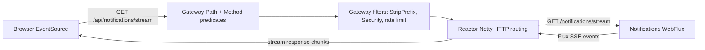

# Server-Sent Events và truyền phản hồi liên tục qua Spring Cloud Gateway

## 1. Bài toán: đẩy cập nhật từ microservice tới client mà không polling liên tục

Trong kiến trúc microservices, **Spring Cloud Gateway** tiếp nhận HTTP request, chọn tuyến bằng **route predicate**, chạy **GatewayFilter/GlobalFilter chain**, sửa path/header, dùng service discovery/load balancing và có thể áp dụng xác thực, rate limiting, circuit breaker, retry, TLS và quan sát request. Một số API trả JSON xong là đóng response; những API khác cần **giữ kết nối mở và gửi dữ liệu dần theo thời gian**.

Ví dụ giao diện quản trị đơn hàng muốn hiển thị trạng thái `ORDER_CREATED`, `PAYMENT_CONFIRMED`, `SHIPPED` ngay khi service phát sự kiện. Nếu browser gọi `GET /orders/status` mỗi hai giây, hệ thống phải xử lý nhiều HTTP requests kể cả khi dữ liệu không đổi. Một lựa chọn là **Server-Sent Events (SSE)**: client mở một HTTP GET duy nhất, server gửi **nhiều sự kiện theo chiều server → client** trên response còn mở.

```mermaid
sequenceDiagram
    participant B as Browser EventSource
    participant G as Spring Cloud Gateway
    participant N as Notifications service
    B->>G: GET /api/notifications/stream
    G->>N: GET /notifications/stream
    N-->>G: HTTP 200 + Content-Type: text/event-stream
    G-->>B: HTTP headers; connection stays open
    N-->>G: id: 101 / event: notification / data: {...}
    G-->>B: SSE event 101
    N-->>G: : heartbeat
    G-->>B: SSE heartbeat comment
    N-->>G: id: 102 / event: notification / data: {...}
    G-->>B: SSE event 102
    Note over B,N: Stream continues until disconnect/cancel/failure
```

**Kết quả cần học được:**

1. Phân biệt **SSE**, WebSocket, polling và JSON response thông thường.
2. Đọc đúng định dạng `text/event-stream`: `data`, `event`, `id`, `retry`, dòng trống và heartbeat.
3. Trả `Flux<ServerSentEvent<?>>` từ **Spring WebFlux backend**, proxy qua **Gateway Server WebFlux** mà không gom toàn bộ body.
4. Cấu hình route/path, `streaming-media-types`, connect/response timeouts, các lớp proxy buffering và keepalive.
5. Xử lý `EventSource` reconnect, `Last-Event-ID`, replay, duplicate/out-of-order events và giới hạn backpressure.
6. Bảo vệ luồng bằng TLS, authentication/authorization/CORS, giới hạn số kết nối và quan sát an toàn.
7. Kiểm thử bằng `curl -N`, browser và tình huống lỗi mạng/nhiều replicas.

> **Phạm vi:** ví dụ dựa trên **Spring Cloud Gateway Server WebFlux 4.3+/5.x** và Spring WebFlux backend. Ở các dòng mới, route nằm dưới `spring.cloud.gateway.server.webflux.routes`; WebFlux 4.2 trở về trước thường dùng `spring.cloud.gateway.routes`. Gateway Server **Web MVC** có cách xử lý streaming và cấu hình riêng, không sao chép nguyên Java/WebFlux routing APIs sang MVC.

## 2. SSE khác WebSocket và HTTP JSON như thế nào?

| Đặc tính | HTTP JSON thường | SSE | WebSocket |
|---|---|---|---|
Giao thức truy cập ban đầu | HTTP request/response | **HTTP GET** với một response mở lâu | HTTP handshake/upgrade hoặc cơ chế tương đương trên HTTP/2 |
Hướng truyền trong kết nối | Một request → một response | **Một chiều: server → client** | **Hai chiều** |
Định dạng dữ liệu | JSON body theo API | UTF-8 `text/event-stream`, các fields trên dòng | Text/binary frames |
Browser API đơn giản | `fetch()` | `EventSource` | `WebSocket` |
Tự reconnect ở browser | Do ứng dụng tự làm | `EventSource` có logic reconnect theo chuẩn | Ứng dụng thường tự triển khai |
Resume sau ngắt mạng | Do API thiết kế | `Last-Event-ID` là **tín hiệu cursor**, replay do backend thiết kế | Do ứng dụng/protocol thiết kế |
Heartbeat | HTTP request mới hoặc cơ chế khác | Comment line `: keepalive` | Ping/pong control frames |
Hợp với bài toán | CRUD, lấy trạng thái một lần | Notifications, tiến độ, dashboard, logs gần thời gian thực | Chat hai chiều, cộng tác, điều khiển realtime |

**SSE không dùng `ws://`/`wss://`.** Với Gateway, SSE vẫn đi qua route **HTTP/HTTPS** bình thường và phần response body được gửi theo luồng. WebSocket đòi hỏi WebSocket routing/upgrade riêng; đặt `uri: ws://...` cho một endpoint SSE là sai công nghệ.

SSE cũng không phải “server đẩy một HTTP response mới mỗi giây”. Một response HTTP có thể kéo dài nhiều phút/giờ, chứa nhiều event frames, và HTTP headers chỉ được gửi **một lần** khi response bắt đầu.

### 2.1. Nhìn ở mức mạng

```text
Client                Gateway                  Backend
  | GET /stream           |                       |
  |---------------------->| GET /stream            |
  |                       |---------------------->|
  |                       |  HTTP 200, headers     |
  | HTTP 200, headers     |<----------------------|
  |<----------------------|                       |
  |                       |  data: event A\\n\\n    |
  |<----------------------|<----------------------|
  |                       |  : heartbeat\\n\\n     |
  |<----------------------|<----------------------|
  |                       |  data: event B\\n\\n    |
  |<----------------------|<----------------------|
  |       ... same HTTP response / live connection ...       |
```

Ở HTTP/1.1, response không biết trước `Content-Length` thường được gửi bằng **chunked transfer encoding**. Ở HTTP/2, dữ liệu đi qua **DATA frames** và không dùng HTTP/1.1 `Transfer-Encoding: chunked`. Không hard-code các hop-by-hop headers như `Connection` hoặc `Transfer-Encoding` để “bật SSE”; hãy để HTTP server/client xử lý đúng giao thức.

## 3. Định dạng `text/event-stream`: phải kết thúc mỗi event bằng dòng trống

Một response SSE có header:

```http
HTTP/1.1 200 OK
Content-Type: text/event-stream;charset=UTF-8
Cache-Control: no-store, no-transform

retry: 3000
id: 101
event: order-update
data: {"orderId":"A-42","status":"PAID"}

: keep-alive

id: 102
event: order-update
data: {"orderId":"A-42","status":"SHIPPED"}

```

Đoạn trên là **wire-format minh họa**. SSE event kết thúc ở **dòng trống** sau block; nếu server viết nhiều dòng `data:` liên tiếp, browser ghép chúng bằng newline thành một event data. Comment có dấu `:` ở đầu dòng không tạo event cho JavaScript nhưng giữ đường truyền hoạt động.

| Trường SSE | Ví dụ | Ý nghĩa |
|---|---|---|
`data:` | `data: {"status":"PAID"}` | Nội dung event, thường serialize JSON **thành một chuỗi** |
`event:` | `event: order-update` | Tên event để client dùng `addEventListener("order-update", ...)` |
`id:` | `id: 101` | ID/cursor được browser ghi nhớ để gửi `Last-Event-ID` khi reconnect |
`retry:` | `retry: 3000` | Gợi ý độ trễ reconnect **tính bằng mili-giây**; phải là số nguyên không âm theo cú pháp hợp lệ |
`: ...` | `: heartbeat` | Dòng chú thích/keepalive, không dispatch như event |
Dòng trống | Sau các fields | Kết thúc block, đưa event vào bộ phân tích |

**ID không phải delivery guarantee.** Viết `id: 101` giúp browser **nhớ con trỏ**, nhưng **backend phải chủ động lưu/replay sự kiện từ nguồn bền vững** mới có thể gửi bù event 102 nếu kết nối đứt giữa chừng. Nếu backend chỉ phát `Flux.interval()` và không lưu lịch sử, reconnect có thể **mất sự kiện**, dù header `Last-Event-ID` có mặt.

**Không tự gửi dữ liệu chứa newline không kiểm soát** vào cú pháp thô `data:` nếu không encode đúng. Trong Spring WebFlux, ưu tiên `ServerSentEvent<T>` và message writer để tránh tạo frame sai.

### 3.1. `Last-Event-ID` khi reconnect

```http
GET /api/notifications/stream HTTP/1.1
Host: api.example.test
Accept: text/event-stream
Last-Event-ID: 102
```

`EventSource` gửi header này **khi tự kết nối lại** sau khi đã nhận `id: 102`. Gateway thường chuyển tiếp header inbound khi route HTTP proxy bình thường; một custom filter/ingress có thể làm mất nó nếu xóa header hoặc thay request.

Backend cần xác thực **cursor là dữ liệu từ client**: giới hạn chiều dài, charset/format, tenant/stream, quyền đọc lịch sử và trường hợp cursor đã quá cũ. Không cho client dùng một cursor tùy ý để đọc sự kiện của tenant khác.

### 3.2. `retry:` không phải retry HTTP POST của Gateway

`retry: 3000` thuộc **SSE protocol**, hướng dẫn browser thời điểm reconnect. Nó **khác** `Retry` GatewayFilter: filter có thể phát lại một backend call HTTP, làm tăng số downstream attempts; với response đã bắt đầu streaming, không thể giả định retry nối tiếp thân response một cách an toàn.

Browser `EventSource` có reconnect tích hợp nhưng **không có chính sách jitter/exponential backoff tùy ý** như client chuyên dụng. Ở hệ thống đông người, khi server mất kết nối hàng loạt, cần cân nhắc reconnect storm, quotas, backoff và cơ chế kiểm soát từ client/app.

## 4. Spring WebFlux backend phát `Flux<ServerSentEvent<?>>`

Ứng dụng backend cần dùng Spring WebFlux; một controller có `produces=MediaType.TEXT_EVENT_STREAM_VALUE` là cách trực tiếp để Spring dùng SSE message writer và gửi các phần tử dần theo thời gian.

### 4.1. Dependencies tối thiểu cho backend

```xml
<!-- pom.xml của Notifications backend, không phải Gateway -->
<dependency>
    <groupId>org.springframework.boot</groupId>
    <artifactId>spring-boot-starter-webflux</artifactId>
</dependency>
```

Spring Boot/Cloud dependency management cần phù hợp version của hệ thống. Ứng dụng backend phải có `@SpringBootApplication`/`main` và cấu hình cổng để chạy, chẳng hạn:

```yaml
# application.yml của Notifications service
server:
  port: 8081
```

### 4.2. Controller demo có event và heartbeat

```java
package com.example.notifications.demo;

import java.time.Duration;
import java.util.Map;
import java.util.concurrent.atomic.AtomicLong;

import org.springframework.http.MediaType;
import org.springframework.http.codec.ServerSentEvent;
import org.springframework.http.server.reactive.ServerHttpResponse;
import org.springframework.web.bind.annotation.GetMapping;
import org.springframework.web.bind.annotation.RestController;
import reactor.core.publisher.Flux;

@RestController
public class NotificationStreamController {

    // CHỈ DEMO: counter theo một JVM; không phải durable event log.
    private final AtomicLong nextId = new AtomicLong();

    @GetMapping(value = "/notifications/stream",
                produces = MediaType.TEXT_EVENT_STREAM_VALUE)
    public Flux<ServerSentEvent<Map<String, Object>>> stream(
            ServerHttpResponse response) {

        response.getHeaders().setCacheControl("no-store, no-transform");
        // Gợi ý cho Nginx ở những môi trường tôn trọng header này.
        response.getHeaders().set("X-Accel-Buffering", "no");

        Flux<ServerSentEvent<Map<String, Object>>> updates =
            Flux.interval(Duration.ZERO, Duration.ofSeconds(2))
                .map(tick -> {
                    long eventId = nextId.incrementAndGet();
                    return ServerSentEvent.<Map<String, Object>>builder()
                        .id(Long.toString(eventId))
                        .event("notification")
                        .retry(Duration.ofSeconds(3))
                        .data(Map.of(
                            "eventId", eventId,
                            "message", "Demo update"))
                        .build();
                });

        Flux<ServerSentEvent<Map<String, Object>>> heartbeats =
            Flux.interval(Duration.ofSeconds(10))
                .map(ignored ->
                    ServerSentEvent.<Map<String, Object>>builder()
                        .comment("heartbeat")
                        .build());

        return Flux.merge(updates, heartbeats);
    }
}
```

**Những gì ví dụ thật sự thực hiện:**

1. Spring WebFlux phát response `text/event-stream` với HTTP 200 và gửi từng `ServerSentEvent`; nó **không cần `collectList()`**.
2. `Flux.interval` phát một event đầu tương đối sớm, rồi khoảng hai giây/event; heartbeat comment khoảng mười giây.
3. `ServerSentEvent.builder().id(...).event(...).data(...).retry(...)` diễn đạt đúng các fields SSE.
4. `Cache-Control: no-store, no-transform` ngăn lưu dữ liệu stream và báo cho trung gian không biến đổi payload; `X-Accel-Buffering: no` là gợi ý phụ thuộc **Nginx**, không phải tiêu chuẩn toàn bộ reverse proxies.
5. `nextId` tăng trên JVM backend hiện tại, **không lưu event vào database/Redis**. Nếu service restart hoặc có nhiều replicas, IDs có thể lặp; **không áp dụng ví dụ này làm giải pháp resume production**.
6. `Flux.interval` là demo non-blocking, không cần `Thread.sleep()`. Khi client disconnect, subscription có thể bị hủy; cần xử lý cleanup cho tài nguyên ngoài ở ứng dụng thực tế.

Để phản ánh event nghiệp vụ thật, backend nên subscribe/compose từ một **publisher có chính sách replay, authorization, backpressure và retention rõ ràng**, ví dụ một event log/broker phù hợp, thay vì mỗi client tự tạo tick ngẫu nhiên.

### 4.3. Không dùng `collectList()` với stream vô hạn

```java
// SAI: Flux interval không kết thúc -> collectList không bao giờ hoàn thành.
return Flux.interval(Duration.ofSeconds(1))
    .collectList();
```

`collectList()` chờ **toàn bộ** dữ liệu trước khi trả response, trái ngược streaming và có thể giữ bộ nhớ mãi. Với một stream vô hạn, ứng dụng không gửi một response body đã gom xong, gây timeout ở client/proxy. Dùng `Flux` streaming trực tiếp, quản lý lifetime và size limits.

### 4.4. Không trả `Mono<String>` rồi mong nó thành SSE

`Mono<String>` chỉ phát **một phần tử** (hoặc empty), hoàn thành response sau đó; nó không tự tạo một luồng cập nhật liên tục. Một `Flux<String>` cùng `produces=text/event-stream` có thể serialize mỗi phần tử thành SSE data-only, nhưng nếu cần `id`/`event`/`retry`, hãy dùng `Flux<ServerSentEvent<T>>` để contract rõ ràng.

## 5. Gateway WebFlux định tuyến SSE như một HTTP response streaming

Với SSE, request đến Gateway là một HTTP GET. Route predicate chọn đích như API JSON thông thường; **NettyRoutingFilter** chuyển request tới backend HTTP và **NettyWriteResponseFilter** chuyển response về client qua reactive pipeline. Khi streaming được nhận diện đúng, dữ liệu cần được **flush dần**, không đợi toàn bộ response kết thúc.



### 5.1. Dependencies cho Gateway

```xml
<!-- Trong pom.xml của Gateway, dùng BOM Spring Boot/Cloud tương thích -->
<dependency>
    <groupId>org.springframework.cloud</groupId>
    <artifactId>spring-cloud-starter-gateway-server-webflux</artifactId>
</dependency>
<dependency>
    <groupId>org.springframework.boot</groupId>
    <artifactId>spring-boot-starter-actuator</artifactId>
</dependency>
```

`spring-boot-starter-actuator` là **tùy chọn** để quan sát; route SSE cơ bản không cần Redis, WebSocket starter hay Resilience4j chỉ để proxy `text/event-stream`. Nếu đích route là `lb://notifications-service`, thêm `spring-cloud-starter-loadbalancer` và nguồn service instances theo kiến trúc.

Gradle:

```groovy
dependencies {
    implementation 'org.springframework.cloud:spring-cloud-starter-gateway-server-webflux'
    implementation 'org.springframework.boot:spring-boot-starter-actuator'
}
```

### 5.2. `application.yml` cho route SSE riêng

```yaml
# Gateway Server WebFlux 4.3+/5.x — demo local, backend localhost:8081
server:
  port: 8080

spring:
  cloud:
    gateway:
      server:
        webflux:
          # Danh sách MIME types Gateway nhận diện là streaming.
          streaming-media-types:
            - text/event-stream
          httpclient:
            connect-timeout: 2000       # Milliseconds
          routes:
            - id: notifications-sse
              uri: http://localhost:8081
              predicates:
                - Path=/api/notifications/stream
                - Method=GET
              filters:
                - StripPrefix=1
              metadata:
                connect-timeout: 2000
                response-timeout: -1
```

Giải thích:

1. `Path=/api/notifications/stream` và `Method=GET` giúp phân biệt SSE route với `POST /api/notifications` hay một endpoint JSON khác.
2. `StripPrefix=1` chỉ bỏ segment `/api`: backend nhận `GET /notifications/stream` đúng với controller mục 4.
3. `uri: http://localhost:8081` cho backend demo, **không phải `ws://`**. Trong Docker/Kubernetes, thay localhost bằng DNS service thật hoặc `lb://notifications-service` khi có Spring Cloud LoadBalancer.
4. `streaming-media-types` là property có trong configuration properties của Gateway Server WebFlux 5.x. Liệt kê `text/event-stream` tường minh để nhận diện response streaming; không đổi MIME sang `application/json` chỉ vì phần `data` chứa JSON.
5. `metadata.response-timeout: -1` theo tài liệu Gateway **vô hiệu hóa global HTTP client response timeout cho route đó**. Đây là lựa chọn **demo cho stream lâu dài**, **không phải khuyến nghị luôn tắt mọi timeout trong production**.
6. `connect-timeout: 2000` là **mili-giây**; không nhầm với `response-timeout` global khai báo dạng `java.time.Duration`, ví dụ `5s`. Ở metadata theo route, response timeout sử dụng **mili-giây** hoặc giá trị âm để bỏ timeout global như tài liệu mô tả.

**Không nhầm `response-timeout=-1` với “kết nối bất tử”.** Ingress, load balancer, firewall, CDN, browser và backend có **idle timeout/absolute connection timeout** riêng. Network partition, server restart, pod eviction, TLS close hoặc proxy buffering vẫn có thể cắt stream. Gateway cần có giới hạn số connections, auth và chính sách tài nguyên riêng.

### 5.3. Khi có global response timeout ngắn

Giả sử các API JSON dùng:

```yaml
spring:
  cloud:
    gateway:
      server:
        webflux:
          httpclient:
            connect-timeout: 1000
            response-timeout: 5s
```

Nếu SSE route sử dụng cấu hình global không phù hợp, bạn có thể quan sát stream bị đóng/timeout. Với Gateway WebFlux, tài liệu cho phép override:

```yaml
# Đặt trong định nghĩa của riêng route SSE:
metadata:
  connect-timeout: 2000
  response-timeout: -1
```

**Điểm cần xác minh bằng test:** thời điểm timeout áp dụng có thể phụ thuộc Reactor Netty, vòng đời response, các filters và version Gateway. Không chỉ đọc property rồi khẳng định chắc chắn một response đang có heartbeat sẽ sống mãi; thử stream thực với thời gian **dài hơn các ngưỡng timeout** ở cả Gateway và ingress.

### 5.4. Java DSL tương đương

Trong Gateway WebFlux, có thể dựng route trực tiếp bằng `RouteLocatorBuilder`:

```java
package com.example.gateway.routes;

import static org.springframework.cloud.gateway.support.RouteMetadataUtils.CONNECT_TIMEOUT_ATTR;
import static org.springframework.cloud.gateway.support.RouteMetadataUtils.RESPONSE_TIMEOUT_ATTR;

import org.springframework.cloud.gateway.route.RouteLocator;
import org.springframework.cloud.gateway.route.builder.RouteLocatorBuilder;
import org.springframework.context.annotation.Bean;
import org.springframework.context.annotation.Configuration;

@Configuration(proxyBeanMethods = false)
public class NotificationRoutes {

    @Bean
    RouteLocator sseRoute(RouteLocatorBuilder builder) {
        return builder.routes()
            .route("notifications-sse", r -> r
                .path("/api/notifications/stream")
                .and()
                .method("GET")
                .filters(f -> f.stripPrefix(1))
                .uri("http://localhost:8081")
                .metadata(CONNECT_TIMEOUT_ATTR, 2000)
                .metadata(RESPONSE_TIMEOUT_ATTR, -1))
            .build();
    }
}
```

Đây là cách **thay thế** route YAML cùng ID; không khai báo cả hai trong một ứng dụng test. Property `streaming-media-types` vẫn có thể được đặt trong YAML. Route order, filter order, global filters và bảo mật WebFlux của Gateway vẫn hoạt động theo logic routing chung.

### 5.5. Gateway HTTP route và WebSocket route khác nhau

Để đối chiếu, một route **WebSocket thật** mới dùng `ws://` hoặc `wss://` với `WebsocketRoutingFilter`:

```yaml
# Ví dụ định tuyến WebSocket KHÁC SSE:
- id: chat-websocket
  uri: ws://localhost:8082
  predicates:
    - Path=/api/chat/ws
  filters:
    - StripPrefix=1
```

Đây là **một route item**, phải đặt dưới `routes:` trong YAML nếu sử dụng. Nó không thay thế `notifications-sse`; `ws://` không phải HTTP SSE. Với SSE, browser dùng `EventSource` chứ không gửi WebSocket Upgrade.

## 6. Streaming bị “dồn cục” thường do proxy buffering hoặc serialization

Bạn tạo `Flux.interval(2s)` nhưng client chỉ thấy 5–10 events cùng lúc sau 30 giây. Không nên lập tức quy lỗi cho Gateway: dữ liệu có thể bị buffer ở backend codec, một custom filter, Gateway, ingress, CDN hoặc chính client/tool xem output.

### 6.1. Những điểm có thể làm mất streaming

| Lớp | Lỗi thường gặp | Cách kiểm tra |
|---|---|---|
Backend WebFlux | Dùng `collectList()`, `block()` hoặc trả `application/json` dạng collection | Gọi backend trực tiếp bằng `curl -N` |
Backend message writer | Không khai báo `produces=text/event-stream`, encode sai event delimiter | Kiểm tra `Content-Type` và khoảng cách giữa events |
Custom Gateway filter | Đọc/gom body rồi mới ghi, `ModifyResponseBody` cho stream vô hạn | Tạm bỏ filter trong môi trường test; đo thời gian từng chunk |
Global/local response cache | Cố cache response 200 vô hạn hoặc can thiệp body/headers | **Không gắn `LocalResponseCache`** cho SSE, tắt global HTTP cache ở Gateway |
Gateway streaming recognition | MIME type không đúng hoặc routing config sai | Đối chiếu `streaming-media-types` và header response |
Nginx/reverse proxy | `proxy_buffering on`, read timeout ngắn | Cấu hình riêng location SSE, so sánh direct/proxy |
CDN/WAF/load balancer | Giới hạn thời gian kết nối/stream hoặc buffering | Kiểm tra provider docs và headers, timeout measurements |
Client console | `curl` có thể buffer stdout nếu không dùng `-N` | Dùng `curl -N -i`; browser DevTools/Network |
Compression | Proxy/gzip có thể giữ dữ liệu để gom trước khi flush | Kiểm tra `Content-Encoding` và flush behavior; loại compression cho stream khi cần |

### 6.2. Nginx: ví dụ location SSE cần vô hiệu hóa buffering

Ví dụ cấu hình ở **Nginx ingress/reverse proxy** (không đặt vào `application.yml` của Gateway):

```nginx
location /api/notifications/stream {
    proxy_pass http://gateway-internal:8080;
    proxy_http_version 1.1;
    proxy_set_header Host $host;

    proxy_buffering off;
    proxy_cache off;
    proxy_read_timeout 1h;
}
```

Đoạn trên chỉ minh họa các directive ảnh hưởng streaming. Trong production, phải có TLS, network/identity headers, security/CORS, allowed upstreams và timeout theo SLA riêng. `proxy_read_timeout 1h` không có nghĩa mọi connection tự sống một giờ: nó chịu ảnh hưởng hoạt động đọc và các timeout khác; **không đặt giờ quá dài cho mọi API**.

Header backend `X-Accel-Buffering: no` được **một số cách triển khai Nginx** tôn trọng, nhưng không bảo đảm CDN/proxy khác cũng tắt buffer. Kiểm tra thực tế trên đường client → ingress → Gateway → backend.

### 6.3. Heartbeat phải đi hết các lớp mạng

Khi không có event nghiệp vụ, một dòng comment:

```text
: heartbeat

```

có thể giúp phát byte qua kết nối để tránh **idle read timeout** của proxy. Tuy nhiên heartbeat chỉ hữu ích nếu **thực sự được flush** tới proxy/client. Nó không chữa **absolute connection lifetime**, không tự xử lý network partition, không thay TLS keepalive và không bảo đảm client còn đọc đúng dữ liệu.

Không phát heartbeat dày vô hạn: 100.000 client × một heartbeat/giây cũng tạo lưu lượng và CPU encode. Chọn cadence dựa vào idle timeout ngắn nhất có ý nghĩa trên đường đi và khả năng chịu tải, ví dụ 15–30 giây ở một số hệ thống, rồi đo thực tế.

### 6.4. Không tạo `Content-Length` cố định cho luồng vô hạn

Response SSE kéo dài thường không biết trước độ dài toàn bộ body. Không tự set `Content-Length` bằng một số cố định, không ép buffer toàn body để tính độ dài. Hãy để WebFlux/Netty gửi chunk/data frames phù hợp với HTTP version.

## 7. Browser `EventSource`: đọc event, reconnect và đóng kết nối

### 7.1. Client cùng origin

Với trang dashboard phục vụ cùng origin với Gateway:

```javascript
// Mã chạy trong trình duyệt, không cần thư viện WebSocket.
const source = new EventSource("/api/notifications/stream");

source.addEventListener("open", () => {
  console.log("SSE connected");
});

source.addEventListener("notification", (event) => {
  const payload = JSON.parse(event.data);
  console.log("event id:", event.lastEventId, "message:", payload.message);
  // Cập nhật giao diện theo event id, tránh insert trùng.
});

source.addEventListener("error", () => {
  // Lỗi mạng không nhất thiết đồng nghĩa stream vĩnh viễn đóng.
  // readyState: CONNECTING (0), OPEN (1), CLOSED (2).
  console.warn("SSE state:", source.readyState);
});

// Khi component/page không còn cần luồng:
function stopNotifications() {
  source.close(); // Ngăn kết nối/reconnect tiếp tục.
}
```

Vì backend gửi `event: notification`, browser dùng `addEventListener("notification", ...)`. `source.onmessage` chỉ nhận event **không khai báo tên sự kiện**; nếu chỉ lắng nghe `onmessage`, bạn có thể không thấy các event đặt tên.

`EventSource` tự cố kết nối lại theo quy tắc HTTP/`retry:` khi network drop trong những trường hợp cho phép. Nhưng nó **không hiểu ý nghĩa nghiệp vụ của event**, không tự deduplicate, không biết một ID có bị missing và không lưu lịch sử khi browser được mở lại như một đối tượng `EventSource` mới.

### 7.2. Không có cách đặt Bearer header tùy ý trong native `EventSource`

Browser native `EventSource(url)` **không có tùy chọn đặt header `Authorization: Bearer ...` tùy ý**. Hai cách phổ biến:

1. **Same-origin BFF/session cookie**: browser gửi cookie thích hợp khi mở SSE; Gateway xác thực session/OAuth2 login và, nếu cần, relay token đúng audience tới backend. Cookie phải có `Secure`, `HttpOnly`, `SameSite` và CSRF/cookie policy phù hợp.
2. **Client streaming dựa trên `fetch()`**: có thể đặt Bearer header, nhưng phải tự xử lý `ReadableStream`, UTF-8 decoding qua chunk boundaries, SSE parser, reconnect và `Last-Event-ID`. Đây **không** còn là native EventSource tự động.

**Không đặt access token trong URL query string** như `/stream?token=eyJ...`: URLs có thể xuất hiện trong history, reverse proxy logs, analytics, trace và referrer. Nếu ứng dụng dùng bearer API thuần cho browser, hãy cân nhắc BFF hoặc fetch stream với credential được quản lý an toàn.

### 7.3. Cross-origin SSE và cookie

Nếu dashboard ở `https://dashboard.example.test` và Gateway ở `https://api.example.test`, đây là **cross-origin**. Khi cần gửi cookies, native client có thể tạo:

```javascript
const source = new EventSource(
  "https://api.example.test/api/notifications/stream",
  { withCredentials: true }
);
```

Gateway phải bật **CORS chỉ cho origin được phép**, cho phép credentials nếu thiết kế cookie yêu cầu, và không dùng wildcard origin khi `allowCredentials=true`:

```yaml
# Trong spring.cloud.gateway.server.webflux của Gateway.
globalcors:
  cors-configurations:
    '[/api/notifications/stream]':
      allowedOrigins:
        - https://dashboard.example.test
      allowedMethods:
        - GET
      allowedHeaders:
        - Last-Event-ID
        - Authorization
      allowCredentials: true
```

Đây là **fragment thuộc spring.cloud.gateway.server.webflux**, không phải một file YAML độc lập cùng cấu trúc gốc. Phải kiểm tra response `Access-Control-Allow-Origin` có giá trị origin cụ thể, `Access-Control-Allow-Credentials` và cookie policy thực tế. CORS chỉ là policy **trình duyệt**; một client CLI vẫn có thể gửi HTTP, nên backend/Gateway vẫn cần authentication và authorization.

Cross-site cookies có thể cần `SameSite=None; Secure`; chính sách third-party cookies của browser có thể khiến cookie không được gửi như dự kiến. Khi có thể, ưu tiên same-origin API qua BFF để giảm độ phức tạp CORS/cookie.

### 7.4. Không quên đóng kết nối

Mỗi `EventSource` là một kết nối/HTTP stream đang mở. Khi tab/component bị hủy, gọi `source.close()`; với SPA, nhớ cleanup trong lifecycle hook. Không tạo `new EventSource(...)` ở mỗi render mà quên đóng cái cũ—điều đó có thể mở hàng chục stream cho một người.

Ở HTTP/1.1, browser thường có giới hạn số kết nối đồng thời với cùng domain (nhiều triển khai phổ biến quanh **6 kết nối**, tính cả nhiều tabs). HTTP/2 hỗ trợ multiplex nhiều streams trên kết nối, với giới hạn concurrent streams được thương lượng; **không coi HTTP/2 là không giới hạn**. Đo số connections và các trường hợp user mở nhiều tabs.

## 8. Resume đúng nghĩa: `Last-Event-ID` không tự bảo đảm replay

### 8.1. Vì sao demo `AtomicLong` không đủ?

Controller mục 4 phát event mới khi có subscription. Nếu client đã nhận `id: 12` rồi mất mạng, sau đó reconnect tới:

- Cùng pod: `AtomicLong` có thể tăng tiếp lên 18, nhưng các events 13–17 **không được lưu** để phát bù.
- Pod khác: counter có thể bắt đầu từ 1, gây **trùng ID hoặc thứ tự sai**.
- Sau restart: ID quay về giá trị ban đầu nếu không có persistent store.

Do đó, đừng khẳng định browser gửi `Last-Event-ID: 12` là server tự “tiếp tục đúng từ 13”. **Gateway thường chỉ chuyển tiếp header; Notifications service chịu trách nhiệm khôi phục**.

### 8.2. Thiết kế production theo event log

Giải pháp cơ bản dùng một **event store bền vững** (database append-only log, Kafka topic với cơ chế cursor phù hợp, Redis Streams hoặc dịch vụ sự kiện tương đương), và phân quyền theo tenant:

```mermaid
sequenceDiagram
    participant B as Browser
    participant G as Gateway
    participant S as Notifications
    participant E as Durable event store
    B->>G: GET /stream, Last-Event-ID: 102
    G->>S: Forward Last-Event-ID: 102
    Note over S: Authenticate user/tenant; validate cursor
    S->>E: Read authorized events AFTER cursor 102
    E-->>S: events 103,104
    S-->>G: SSE id 103, id 104
    G-->>B: SSE events 103,104
    Note over S,E: Atomically bridge catch-up and live updates
    E-->>S: new event 105
    S-->>G: SSE id 105
    G-->>B: SSE event 105
```

Thiết kế contract:

| Câu hỏi | Quyết định cần có |
|---|---|
`id` đại diện cho gì? | Sequence/offset duy nhất trong một **stream scope**; không dùng `System.currentTimeMillis()` đơn thuần làm ID toàn cục |
`Last-Event-ID` thuộc stream nào? | Validate quyền user/tenant và stream ID, không đọc event stream của user khác |
Không có cursor? | Phát snapshot hiện tại hay events trong một khoảng retention đã định |
Cursor quá cũ đã bị compact/expire? | Báo yêu cầu **full resync** theo protocol riêng thay vì âm thầm bỏ qua mất dữ liệu |
Reconnect tới pod khác? | Dùng nguồn lưu trạng thái/replay **chung**, không dựa vào memory mỗi pod |
Gửi replay rồi chuyển sang live? | Phải tránh **khoảng hở** giữa hai pha gây mất event hoặc lặp không kiểm soát |
Client nhận event trùng? | Consumer phải **idempotent**: dedupe theo event/aggregate version |
Sự kiện đến khác thứ tự? | Sắp xếp/đối chiếu sequence theo domain, nhận biết gaps và resync |
Giữ lịch sử bao lâu? | Chính sách retention, quyền xóa dữ liệu, tải lưu trữ và quyền đọc |

### 8.3. Pseudocode minh họa protocol replay

```text
PSEUDOCODE — KHÔNG phải Java chạy trực tiếp:

principal = requireAuthenticatedUser()
streamScope = authorizeNotificationStream(principal, requestedStream)
cursor = validateCursor(Last-Event-ID, streamScope)

subscription = eventStore.openAtomicCatchupAndLiveSubscription(
    streamScope,
    afterExclusive = cursor
)

for each event in subscription (ordered):
    if event.authorizedFor(principal):
        emitSse(id=event.sequence, event="notification", data=event.payload)
    else:
        doNotExposeEvent()

onClientDisconnect:
    disposeSubscription()
```

**Tính nguyên tử/không-gap là yêu cầu thiết kế**, không phải khả năng mặc định của một API `Flux.concat(replay, live)`. Nếu bạn lấy snapshot log, đọc lịch sử, rồi mới subscribe live, event xuất hiện giữa hai thao tác có thể bị mất. Backend/broker phải cung cấp cơ chế offset/cursor và subscription đảm bảo ranh giới chính xác.

### 8.4. Khi nhận cursor không hợp lệ

Header `Last-Event-ID` do client có thể tự đặt bằng `curl`, không phải proof of identity. Chặn chuỗi quá dài, ký tự không hợp lệ, cursor ngoài retention hoặc không thuộc stream/tenant. API có thể trả HTTP `400`/`409` **trước khi bắt đầu stream**, hoặc dùng một sự kiện control/resync được contract định nghĩa sau khi stream đã mở; đừng âm thầm replay dữ liệu của người khác.

Một response `204 No Content` có ý nghĩa đặc biệt trong chuẩn EventSource: browser được hướng dẫn **ngừng reconnect**. Chỉ dùng khi thực sự muốn dừng subscription; không dùng 204 cho mọi lần stream tạm hết dữ liệu.

## 9. Backpressure, hàng đợi và giới hạn tài nguyên

Spring WebFlux/Reactor cho phép downstream subscriber truyền tín hiệu **demand** trong pipeline. Tuy nhiên dữ liệu đến từ event broker, socket buffer và browser không mặc nhiên tuân thủ một limit end-to-end duy nhất. SSE có thể trở thành nguồn mất bộ nhớ khi client đọc chậm.

### 9.1. Nguy cơ khi một client quá chậm

```text
Producer: 1000 events/s
Slow client: 20 events/s
Unbounded per-client queue: tăng ~980 events/s
Sau 10 phút: hàng trăm nghìn events chờ / connection
```

Không dùng `onBackpressureBuffer()` **không giới hạn** ở một publisher liên tục tốc độ cao rồi coi là an toàn. Những yếu tố cần xác định là:

- **Số sự kiện tối đa trong queue mỗi subscriber** và memory budget.
- **Overflow policy**: drop oldest/latest, fail/disconnect rồi reconnect/replay, hoặc giảm tốc producer nếu có thể.
- Có được phép **mất event** không? Dashboard số liệu mới nhất có thể chấp nhận coalesce; giao dịch tài chính không được mất dữ liệu im lặng.
- **Event payload size**, tốc độ serialize JSON, buffer/flush và mức tải CPU.
- Số lượng kết nối cùng lúc và fan-out (một event phát cho bao nhiêu clients).

### 9.2. Không dùng `Flux.interval` như nguồn audit bền vững

`Flux.interval` rất phù hợp để dạy non-blocking stream nhưng **không phải durable event store**. Khi downstream không tiêu thụ kịp, cách xử lý backpressure của timer có thể phát lỗi; ứng dụng phải quyết định cách báo lỗi, ngắt kết nối và resume. Không giả định mọi tick đều được browser nhận.

### 9.3. Cách giảm áp lực đúng

| Biện pháp | Khi phù hợp | Đánh đổi |
|---|---|---|
Giảm tốc phát sự kiện/throttle | Dashboard chỉ cần cập nhật mỗi vài giây | Độ trễ hiển thị tăng |
Gộp/coalesce theo key | Chỉ cần **trạng thái mới nhất** của cùng order | Mất các trạng thái trung gian |
Giới hạn queue và disconnect chậm | Có durable replay cho reconnect | Browser có thể reconnect thường xuyên |
Mã hóa payload gọn | Nhiều kết nối, event JSON lớn | Cần versioned schema |
Giới hạn connections per principal/tenant | Ngăn một account mở hàng nghìn streams | Cần coordination giữa Gateway replicas nếu quota global |
Giới hạn duration rồi yêu cầu reconnect | Token/session hết hạn, rotation, resource cleanup | Phải có replay và retry policy |
Worker/broker riêng | Event fan-out lớn, multi-region | Tăng chi phí và yêu cầu vận hành |

`RequestRateLimiter` kiểu token bucket thường giới hạn **số HTTP request mở stream**, **không** đếm từng `data:` event và không tự giới hạn số SSE connections đang mở. Cần quota **active subscriptions** và per-user/per-tenant concurrency riêng.

## 10. Xác thực, phân quyền, CORS và dữ liệu nhạy cảm

### 10.1. Bảo vệ ngay lúc bắt đầu luồng

API private cần xác minh user/session/token **trước khi bắt đầu trả body SSE**. Ví dụ JWT Resource Server trong Gateway Server WebFlux:

```xml
<!-- Thêm vào pom.xml Gateway khi dùng bearer JWT -->
<dependency>
    <groupId>org.springframework.boot</groupId>
    <artifactId>spring-boot-starter-oauth2-resource-server</artifactId>
</dependency>
```

```yaml
# Một phần application.yml Gateway (nằm dưới spring:)
security:
  oauth2:
    resourceserver:
      jwt:
        issuer-uri: https://idp.example.test/realms/shop
        audiences:
          - notifications-api
```

Đoạn trên là **fragment dưới `spring:`**; nó không tự thêm vào `spring.cloud.gateway...`. Dịch vụ/backend phải kiểm tra token đúng issuer/audience/scope và resource permissions theo hợp đồng; Gateway validation không tự cho backend biết user được xem mọi tenant stream.

```java
package com.example.gateway.security;

import org.springframework.context.annotation.Bean;
import org.springframework.context.annotation.Configuration;
import org.springframework.security.config.Customizer;
import org.springframework.security.config.web.server.ServerHttpSecurity;
import org.springframework.security.web.server.SecurityWebFilterChain;

@Configuration(proxyBeanMethods = false)
public class StreamSecurity {
    @Bean
    SecurityWebFilterChain apiSecurity(ServerHttpSecurity http) {
        return http
            // Chỉ cho API stateless Bearer, KHÔNG áp nguyên cho cookie-session.
            .csrf(csrf -> csrf.disable())
            .authorizeExchange(ex -> ex
                .pathMatchers("/api/notifications/stream")
                    .hasAuthority("SCOPE_notifications.read")
                .anyExchange().denyAll())
            .oauth2ResourceServer(oauth2 ->
                oauth2.jwt(Customizer.withDefaults()))
            .build();
    }
}
```

Spring Security thường ánh xạ JWT scope thành authority `SCOPE_...`. Nếu token đúng `issuer` nhưng có `aud` khác backend, backend vẫn phải từ chối; không nên bỏ audience validation chỉ vì Gateway đã cho qua. Đây là **mô hình Bearer API** phù hợp với `curl` và client có thể đặt Authorization header; **native EventSource trong browser không tự gửi Bearer tùy ý** như đã nêu ở mục 7.

### 10.2. Sau khi response bắt đầu, không đổi HTTP status tùy ý

Luồng được tạo với HTTP `200`, headers đã gửi và một số events đã ra khỏi Gateway. Nếu sau đó:

- User bị thu hồi quyền;
- Backend gặp lỗi;
- Redis/broker dừng;
- Gateway/ingress đóng stream;

thì bạn **không thể đổi response 200 đã commit thành HTTP 401/500** cho cùng response. Có thể gửi **SSE event control/error** theo một schema riêng **khi kết nối còn mở và dữ liệu được phép xuất ra**, rồi đóng connection; client phải hiểu event type. Nếu lỗi mạng khiến không thể ghi, chỉ còn reconnect và cơ chế trạng thái.

**Chính sách auth với kết nối dài:** JWT/session có thể hết hạn **trong lúc stream đang mở**. Hệ thống phải quyết định có giới hạn tối đa connection lifetime, cần revalidation định kỳ hoặc đóng và bắt client reconnect khi hết quyền. Không mặc định authorization kiểm tra một lần lúc GET sẽ bảo đảm thu hồi quyền ngay lập tức.

### 10.3. Ranh giới tin cậy qua Gateway

- Không tin `Last-Event-ID`, `X-User-Id`, `X-Tenant-Id` do client tự gửi là chứng minh danh tính.
- Không đặt token trong `data:` payload trừ khi có lý do thiết kế rất đặc biệt; tuyệt đối không log raw JWT, cookies hoặc SSE payload chứa PII.
- Backend có thể bị gọi trực tiếp nếu network cho phép, nên cần tự bảo vệ resource và identity.
- Dùng HTTPS cho client → Gateway, HTTPS/mTLS hoặc service mesh policies cho Gateway → backend theo kiến trúc; TLS của một chặng không tự mã hóa chặng còn lại.
- Thiết kế CORS theo origin tin cậy, nhưng đừng coi CORS là cơ chế authentication.
- Kiểm tra data retention, user logout và việc cleanup khi subscription bị hủy.

## 11. Circuit breaker, retry, cache, request size và body filters với SSE

| Thành phần Gateway | Thực tế với một SSE stream lâu dài | Lưu ý |
|---|---|---|
`Retry` | Một HTTP GET có thể được thử lại **trước khi response bắt đầu** trong một số trường hợp | Không giả định có thể nối tiếp stream an toàn sau khi body đã commit; dùng EventSource reconnect + replay |
`CircuitBreaker` | Có thể xử lý lỗi connect/timeout hoặc status trước streaming | TimeLimiter ngắn trên **stream không kết thúc** có thể cắt luồng hợp lệ; tách policy |
`LocalResponseCache` | SSE là HTTP 200 nhưng body sống lâu/không kết thúc | **Không bật response caching** cho SSE; không global cache trên route |
`ModifyResponseBody` | Thường cần deserialize/buffer một body | Tránh filter rewrite toàn body cho stream vô hạn; có thể phá flush/backpressure |
`RequestRateLimiter` | Chỉ tính **request mở kết nối**, thường không tính từng SSE event | Cần limit active streams riêng |
`RequestSize` | Request SSE GET thường không body | Không bảo vệ số event/response bytes; kiểm soát bandwidth và payload size ở producer |
`SetResponseHeader` | Có thể đặt cache/security headers trước commit | Không đổi `Content-Type` thành `application/json` hoặc ghi đè header quan trọng sai thời điểm |
`StripPrefix`/`RewritePath` | Xử lý request path trước khi định tuyến | Không can thiệp cách backend tạo event framing |
`WebsocketRoutingFilter` | Dành cho WebSocket `ws://`/`wss://` | Không cần để SSE qua HTTP |

**Một phương án an toàn hơn:** tạo **route SSE riêng** không gắn Retry/response body caching hay TimeLimiter ngắn, điều chỉnh timeout/heartbeat/connection caps phù hợp. Đừng gán một tập default filters cho mọi API rồi mong JSON, upload, SSE và WebSocket đều vận hành giống nhau.

## 12. Thực hành end-to-end với `curl -N`

### 12.1. Chuẩn bị

Chạy hai ứng dụng:

- **Notifications backend:** `localhost:8081`, có controller `/notifications/stream` ở mục 4.
- **Gateway Server WebFlux:** `localhost:8080`, có route `/api/notifications/stream` ở mục 5.

Trong phần đầu thực hành, dùng **môi trường sandbox không có dữ liệu nhạy cảm** và không kích hoạt security chain ở mục 10. Khi bật JWT/bảo mật, cần cấp token thật từ IdP thử nghiệm và thêm `Authorization: Bearer ...` cho `curl`. Ví dụ không tự khởi chạy IdP/registry hoặc tạo token.

### 12.2. Test backend trực tiếp trước

```bash
# -N / --no-buffer: để curl in byte tới stdout ngay khi nhận.
# --max-time: kết thúc thử nghiệm trong 20 giây; stream vốn chưa kết thúc.
curl --http1.1 -N -i --max-time 20 \
  -H 'Accept: text/event-stream' \
  http://localhost:8081/notifications/stream
```

Kỳ vọng:

```text
HTTP/1.1 200 OK
Content-Type: text/event-stream;charset=UTF-8
Cache-Control: no-store, no-transform
X-Accel-Buffering: no

id: 1
event: notification
retry: 3000
data: {"eventId":1,"message":"Demo update"}

id: 2
event: notification
retry: 3000
data: {"eventId":2,"message":"Demo update"}

...
: heartbeat

```

Output là **minh họa định dạng**, không phải chuỗi byte chính xác. JSON key order, headers, event IDs và thứ tự heartbeat có thể khác. Nếu server đã phục vụ client khác, `AtomicLong` có thể bắt đầu bằng ID lớn hơn 1.

Do `--max-time 20` chủ động ngắt stream vốn kéo dài, `curl` có thể kết thúc bằng exit code **28 (operation timed out)**. Trong bài test này, điều đó **không nhất thiết là lỗi backend**; hãy nhìn thời gian các events xuất hiện trước timeout.

### 12.3. Test qua Gateway

```bash
curl --http1.1 -N -i --max-time 20 \
  -H 'Accept: text/event-stream' \
  http://localhost:8080/api/notifications/stream
```

Kỳ vọng khi cấu hình đúng:

1. Response có status `200` và `Content-Type: text/event-stream`.
2. Các event `notification` xuất hiện **dần** chứ không dồn thành một response duy nhất lúc kết thúc.
3. Body có `id`, `event`, `retry`, `data`, comment heartbeat như backend.
4. Gateway đã strip `/api`; backend handler `/notifications/stream` nhận request.
5. Ngắt client bằng `Ctrl+C` hoặc `--max-time` khiến stream được hủy/đóng; kiểm tra server cleanup.

**Điểm cần đo:** so sánh **thời gian nhận từng event** khi gọi trực tiếp backend và khi gọi qua Gateway. Nếu backend gửi mỗi 2 giây nhưng qua Gateway nhận từng cụm 30 giây, điều tra buffering/flush ở Gateway hoặc ingress.

### 12.4. In timestamp khi nhận từng dòng

Trong shell Bash/Linux có `date`:

```bash
curl --http1.1 -N -sS --max-time 16 \
  http://localhost:8080/api/notifications/stream |
  while IFS= read -r line; do
    printf '%s  %s\n' "$(date +%H:%M:%S)" "$line"
  done
```

Đây là cách **ước lượng** thời điểm từng dòng tới terminal, không phải phép đo network timing chính xác từng byte. `curl -N` loại buffering stdout của curl; shell pipeline, codec và môi trường chạy vẫn có thể có ảnh hưởng. Trong load test, nên thu timestamp từ client, Gateway và backend bằng correlation ID/trace phù hợp.

### 12.5. Test `Last-Event-ID`: demo **không replay**

```bash
# Kiểm tra header được client gửi đến Gateway.
curl --http1.1 -N -i --max-time 10 \
  -H 'Accept: text/event-stream' \
  -H 'Last-Event-ID: 42' \
  http://localhost:8080/api/notifications/stream
```

Controller demo mục 4 **không nhận header `Last-Event-ID` và không có durable event store**, nên nó **không phát bù event 43 trở đi** theo đúng nghĩa resume. Bài test này chứng minh ta đã gửi header, **chưa chứng minh Gateway chuyển header tới backend**; cần backend test log/echo **chỉ metadata đã được kiểm soát** hoặc server endpoint có logic kiểm tra `Last-Event-ID` để xác minh end-to-end.

Khi xây hệ thống replay thật, thực hiện bài test:

1. Gửi events 101–105 và ghi nhận client đã nhận ID 102.
2. Ngắt kết nối **trước khi client nhận** 103–105.
3. Mở lại với `Last-Event-ID: 102` và xác minh backend trả 103,104,105 theo quyền.
4. Lặp qua **Gateway pod khác** và sau **backend restart** để chứng minh state nằm ở durable store.
5. Test duplicated ID, cursor không hợp lệ, retention hết hạn và event thuộc tenant khác.

### 12.6. Test header/response đã commit

Giữ một SSE stream đang chạy, sau đó dừng backend. Quan sát:

- Client `EventSource` có thể phát `error` rồi chuyển sang `CONNECTING`.
- Kết nối cũ đã gửi `200`; Gateway không thể thay thành `503` trên cùng response sau khi body bắt đầu.
- Khi browser reconnect, request mới có thể nhận 5xx/connection failure tùy gateway/backend trạng thái lúc đó.
- Khi backend trở lại, browser kết nối lại theo `retry` nếu policy/user agent cho phép.
- Không kết luận khôi phục nghĩa là đã nhận **mọi** events bỏ lỡ; phải test `Last-Event-ID`/replay riêng.

Nếu có `CircuitBreaker` cho route, test cả lúc breaker **OPEN** và lúc luồng **đang mở rồi lỗi**; hai trường hợp khác nhau về HTTP status và khả năng fallback.

### 12.7. Test qua ingress/Nginx

Nếu môi trường có ingress phía trước Gateway:

```bash
# Direct Gateway (trong mạng test cho phép)
curl -N -i --max-time 20 http://localhost:8080/api/notifications/stream

# Qua tên miền ingress HTTPS thật của môi trường test:
curl -N -i --max-time 20 \
  https://api.test.example.test/api/notifications/stream
```

Chỉ dùng hostname/CA hợp lệ theo môi trường; không tự thêm `-k`/`--insecure` để bỏ kiểm tra TLS. Nếu direct Gateway cập nhật đều nhưng qua ingress trả dồn, xem `proxy_buffering`, response compression, idle timeout và CDN configuration. Khi dùng HTTP/2, đổi `--http1.1` thành `--http2` để so sánh nếu curl/build hạ tầng hỗ trợ.

### 12.8. Test authentication

Sau khi bật JWT Resource Server ở mục 10:

```bash
# Thiếu token: Gateway Security nên từ chối trước khi mở stream.
curl -i http://localhost:8080/api/notifications/stream

# Token thật từ môi trường test, có issuer/audience/scope phù hợp:
curl --http1.1 -N -i --max-time 15 \
  -H "Authorization: Bearer $TOKEN_VALID" \
  http://localhost:8080/api/notifications/stream
```

Với protected bearer API, thiếu/không hợp lệ token thường nhận `401`; token hợp lệ thiếu `notifications.read` thường nhận `403`. Khi bearer request có quyền, stream mới được proxy. Native browser `EventSource` sẽ cần phương án credential như BFF/cookie hoặc fetch stream, không chỉ sao chép ví dụ `curl -H`.

## 13. Cần quan sát những gì khi có hàng nghìn kết nối SSE?

SSE khác request JSON ngắn vì một request có thể sống rất lâu; nếu chỉ đếm request/giây, bạn sẽ bỏ sót **active connections** và bộ nhớ chờ gửi.

| Chỉ số | Câu hỏi vận hành | Lưu ý |
|---|---|---|
SSE active connections/streams | Đang có bao nhiêu clients giữ stream? | Theo route, pod, tenant class; tránh tag per-user raw |
Connect/auth success, `401`/`403` | Người dùng có mở được kết nối? | Phân biệt auth lỗi và backend lỗi |
TTFB / time-to-first-event | Mở kết nối xong bao lâu nhận event đầu tiên? | Có thể chưa có dữ liệu, dùng heartbeat để đo đường truyền |
Event delivery latency | Sự kiện từ nguồn tới browser mất bao lâu? | Cần event timestamps và clock synchronization |
Events produced vs delivered | Có backlog, drop, gap hay fan-out lỗi không? | Không suy rằng emit ở backend = browser đã nhận |
Reconnect rate và `Last-Event-ID` distribution | Kết nối có chập chờn không? | Phân tích client/app version và idle timeouts |
Slow clients/queue utilization | Có nguy cơ out-of-memory? | Limit buffer và overflow policy |
Pod/Netty connection pool, file descriptors | Gateway giữ bao nhiêu sockets? | Một SSE stream chiếm tài nguyên lâu dài |
Gateway/ingress close reasons | Ai chủ động đóng kết nối? | Theo cancellation, timeout, upstream reset, TLS |
Auth/session expiration | Các stream có còn hợp lệ sau quyền bị thu hồi? | Có connection lifetime/reauth policy |
HTTP errors trước stream | Có `429`, `502`/`503` hay circuit breaker OPEN? | Không đồng nhất với lỗi giữa stream |

Spring Cloud Gateway có thể phát metrics qua Micrometer/Actuator, nhưng **HTTP request metrics có thể chỉ hoàn tất khi request kết thúc**; với stream sống lâu, đừng coi số completed HTTP requests là số active SSE connections. Cần instrumentation phù hợp ở Gateway/backend/ingress.

### 13.1. Cleanup subscription trong WebFlux

Khi backend dùng broker/Redis pub-sub/Kafka consumer hoặc listener riêng cho mỗi client, phải **giải phóng tài nguyên khi subscription bị cancel**. Reactor có `doFinally` để quan sát các terminal signals:

```java
// Chỉ là đoạn minh họa gắn vào publisher SSE hiện có.
return streamFlux.doFinally(signalType -> {
    // Đếm active stream giảm ở đây, giải phóng subscription/handles.
    // Không gọi blocking I/O trên event loop.
    log.debug("SSE stream finished: {}", signalType);
});
```

`streamFlux` và `log` phải được định nghĩa trong controller/service thực tế. `doFinally` chạy khi complete/error/cancel, nhưng cleanup resource cụ thể phải được gắn đúng vào publisher lifecycle hoặc `usingWhen`/cơ chế tương đương; không tạo thêm subscription bằng `subscribe()` rồi quên hủy.

### 13.2. Logging an toàn

Nên log **route ID, instance ID, stream type, response status trước commit, thời điểm mở/đóng, cancellation reason và trace/request ID**. Tránh log `Authorization`, `Cookie`, toàn bộ `data:` JSON có PII, cursor của tenant khác hoặc identity headers chưa xác minh. Khi bật Netty `wiretap` cho debug, đánh giá rủi ro log nội dung nhạy cảm và chỉ dùng trong sandbox có kiểm soát.

### 13.3. Load balancing và nhiều replicas

Với `uri: lb://notifications-service`, service discovery/load balancing chọn instance khi **mở** request SSE. Một connection đang tồn tại thường tiếp tục bám vào instance đó cho đến khi đóng; load balancer **không chuyển từng event** sang replica khác trong cùng một HTTP response.

Khi reconnect, client có thể được gán backend replica mới. **Session affinity** có thể giảm một số thay đổi đường đi nhưng không thay **durable cursor/replay**; pod vẫn có thể restart hoặc bị scale down. Nếu có hàng chục nghìn subscribers và event fan-out lớn, cần broker/pub-sub layer hợp lý để nhiều replicas cùng nhận dữ liệu cần phát.

## 14. Ma trận lỗi thường gặp

| Triệu chứng | Nguyên nhân khả dĩ | Hướng xử lý |
|---|---|---|
`curl` nhận cả loạt events sau 30s | Backend `collectList`, stdout buffer, Gateway/ingress compression hoặc proxy buffering | So sánh `curl -N` trực tiếp và qua từng hop; tắt buffering trên SSE route |
Client không dispatch event mặc dù thấy `data:` | Thiếu dòng trống cuối event, sai encoding, chỉ nghe `onmessage` khi server gửi named event | Kiểm tra SSE frame và `addEventListener(eventName, ...)` |
`Content-Type: application/json` | Backend mapping sai hoặc filter ghi đè header | `produces=TEXT_EVENT_STREAM_VALUE`; giữ `text/event-stream` |
Gateway route 404 nhưng backend trực tiếp 200 | Path/Method/StripPrefix khác, route order hoặc Security | Kiểm tra route `/api/...` → `/notifications/...`, Actuator và request method |
Stream bị đóng đúng 5s hoặc 60s | Global/per-route response timeout, ingress idle timeout, TimeLimiter hoặc CDN | Kiểm tra nhiều lớp timeout, thử heartbeat và per-route metadata |
Heartbeat xuất hiện ở backend nhưng không ở client | Proxy buffering/flush chưa đúng | Kiểm tra Nginx `proxy_buffering`, `X-Accel-Buffering` và Gateway streaming media types |
Browser `EventSource` không gửi Bearer token | Native API không có custom Authorization header | Dùng session/BFF hoặc fetch streaming có parser/reconnect |
Cross-origin browser báo CORS | Origin/cookie/allowCredentials/SameSite không khớp | CORS origin cụ thể, HTTPS, credentials policy và Security |
`curl` có event nhưng browser không thấy | CORS, named events, auth, proxy hoặc MIME type | Kiểm tra DevTools Network, EventSource events và response headers |
Client reconnect nhưng mất events | Không có durable event store/cursor bị bỏ qua | Implement replay với `Last-Event-ID` và gap-free handoff |
Client thấy events lặp | Replay at-least-once, reconnect race hoặc duplicate producer | Dedup idempotent theo stream/event ID và business version |
Pod A ID 12, pod B ID 1 | Counter/offset ở JVM, không phân tán | Durable stream-scoped IDs, shared event store |
Redis/Kafka publisher nhanh, Gateway OOM | Unbounded fan-out buffer, slow clients | Queue caps, drop/disconnect/resync policy, connection quotas |
`429` chỉ xuất hiện khi mở SSE, không từng event | RequestRateLimiter giới hạn HTTP requests | Active-stream quota/event-volume limits riêng |
JWT hết hạn nhưng stream tiếp tục | Chỉ validate lúc GET handshake | Thiết kế connection lifetime/reauth/revocation |
Backend lỗi sau HTTP 200, client vẫn thấy 200 | HTTP headers đã commit | SSE control event/close + reconnect; không đổi status đã commit |
WebSocket filter không hoạt động với SSE | Dùng `ws://` thay HTTP hoặc nhầm WebSocket upgrade | Định tuyến SSE qua `http://`/`https://` |
SSE hoạt động direct nhưng không qua CDN | CDN không hỗ trợ long-lived streaming, response buffering/timeout | Chọn CDN policy phù hợp, bypass caching/transform hoặc đi đường hỗ trợ SSE |

## 15. Checklist vận hành SSE qua Spring Cloud Gateway

1. **Xác định nhu cầu một chiều:** dùng SSE khi browser chỉ nhận sự kiện; chọn WebSocket nếu thực sự cần kênh hai chiều lâu dài.
2. **Chuẩn SSE:** HTTP GET, `200`, `Content-Type: text/event-stream`, UTF-8, các blocks kết thúc bằng dòng trống.
3. **Backend reactive:** trả `Flux<ServerSentEvent<?>>` hoặc SSE data-only phù hợp, không `collectList()`/`block()` ở event loop.
4. **Route HTTP đúng:** `uri: http(s)://...` hoặc `lb://...`, `Path`/`Method` và `StripPrefix` khớp backend.
5. **Tách streaming route:** `streaming-media-types: [text/event-stream]` khi cấu hình cần thiết; không dùng WebSocket routing cho SSE.
6. **Đặt timeout có chủ đích:** connect timeout, response timeout theo route, proxy/CDN idle timeout và tối đa lifetime; không tắt tất cả timeout vô hạn.
7. **Flush/heartbeat:** kiểm tra byte đi qua từng hop bằng `curl -N`; vô hiệu hóa proxy buffering/compression gây gom chunk trên path SSE.
8. **Không cache response:** không áp `LocalResponseCache` hoặc filter gom body cho stream vô hạn.
9. **Reconnect/replay:** định nghĩa event ID, retention, `Last-Event-ID`, full resync và duplicate handling; test pod failover.
10. **Authorization:** kiểm tra đúng user/tenant/scope ở lúc mở stream và có chính sách khi quyền hết hạn; không tin cursor/header do client tự khai.
11. **Bảo mật trình duyệt:** native EventSource không có tùy chọn Authorization header; chọn BFF/cookie hoặc fetch streaming có parser đúng, CORS origin cụ thể.
12. **Giới hạn tài nguyên:** active connections per principal, queue/backpressure, bandwidth/event size, slow-consumer behavior, rate limiting ở handshake.
13. **Không làm giả kết quả khi lỗi:** không cố đổi status đã commit, tách lỗi trước/sau response và định nghĩa control events nếu cần.
14. **Quan sát đúng:** active streams, reconnect, event latency, gap/drop, memory/Netty sockets, broker lag và cancellation.
15. **Diễn tập sự cố:** ngắt backend, restart Gateway, pod failover, ingress timeout, token expiry, browser nhiều tabs và client đọc chậm.

## 16. Câu hỏi luyện tập và đáp án

**Bài 1 — Chọn giao thức.** Một trang quản trị chỉ cần hiển thị cập nhật trạng thái đơn hàng từ server, không cần gửi dữ liệu liên tục theo chiều ngược lại. Nên cân nhắc SSE hay WebSocket?

**Đáp án:** **SSE** thường đơn giản hơn vì dùng HTTP GET và stream một chiều. WebSocket phù hợp hơn khi cần trao đổi hai chiều realtime qua cùng kết nối, ví dụ chat/cộng tác.

**Bài 2 — MIME type.** Backend trả `Flux<ServerSentEvent<Notification>>` nhưng đặt `Content-Type: application/json`. Có nên để vậy?

**Đáp án:** không. Để browser native EventSource phân tích đúng, response phải có `Content-Type: text/event-stream`, mỗi event được encode theo SSE format. Trong WebFlux dùng `produces=MediaType.TEXT_EVENT_STREAM_VALUE`.

**Bài 3 — Event delimiter.** Một backend chỉ gửi `data: hello\n` mà không có dòng trống kết thúc block. Điều gì có thể xảy ra?

**Đáp án:** browser có thể chưa dispatch sự kiện đang chờ. Cần dòng trống kết thúc một SSE event (`data: hello\n\n`); dùng `ServerSentEvent`/message writer để tránh lỗi tự ghép chuỗi.

**Bài 4 — Named events.** Backend gửi `event: notification`, nhưng frontend chỉ đăng ký `source.onmessage`. Vì sao không thấy sự kiện?

**Đáp án:** `onmessage` xử lý event type mặc định `message`. Với event được đặt tên, dùng `source.addEventListener("notification", handler)`.

**Bài 5 — Gateway URL.** Client gọi `/api/notifications/stream`, backend xử lý `/notifications/stream`. Filter nào phù hợp?

**Đáp án:** `StripPrefix=1` bỏ segment `/api`. Route URI vẫn là HTTP/HTTPS, không phải `ws://`.

**Bài 6 — Timeout.** Các JSON APIs đặt global response timeout 5 giây, SSE cần mở nhiều phút. Cần làm gì?

**Đáp án:** thiết kế route riêng với `metadata.response-timeout: -1` nếu muốn vô hiệu hóa global Gateway response timeout theo tài liệu, và điều chỉnh các lớp timeout khác theo SLA. Phải test thực tế; `-1` không vô hiệu hóa timeout của ingress, firewall hay client.

**Bài 7 — Dữ liệu về thành cụm.** `Flux.interval(2s)` chạy đúng ở backend, nhưng client nhận 15 events cùng lúc sau 30 giây khi đi qua Nginx. Điều tra đâu?

**Đáp án:** so sánh `curl -N` direct backend/Gateway/ingress, kiểm tra `proxy_buffering`, compression/flush, `X-Accel-Buffering` và MIME streaming. Không khắc phục bằng `collectList()` vì sẽ làm vấn đề tệ hơn.

**Bài 8 — Heartbeat.** `: heartbeat` có tạo một JavaScript `notification` event không?

**Đáp án:** không. Đây là dòng comment SSE, thường để giữ kết nối có hoạt động mà không dispatch một event dữ liệu cho browser. Nó phải được flush thật sự mới giúp chống idle timeout.

**Bài 9 — Browser Bearer.** Có thể dùng `new EventSource(url, {headers:{Authorization:"Bearer ..."}})` trong browser native không?

**Đáp án:** không. Native `EventSource` không hỗ trợ custom request headers như vậy. Chọn same-origin session/BFF hoặc dùng `fetch()` streaming và tự xử lý SSE parser/reconnect.

**Bài 10 — Token query.** Vì sao `/stream?access_token=...` không phải lựa chọn bảo mật tốt?

**Đáp án:** URL dễ xuất hiện trong proxy/access logs, monitoring, history, analytics và telemetry. Đưa credential vào header/cookie phù hợp mô hình, dùng HTTPS và quản lý quyền.

**Bài 11 — Replay.** Backend chỉ có `AtomicLong` và `Flux.interval`, browser reconnect với `Last-Event-ID: 42`. Backend có tự bảo đảm gửi 43 trở đi không?

**Đáp án:** không. ID/cursor giúp client báo vị trí, nhưng backend cần **durable event log**, quyền truy cập và thuật toán replay/catch-up không có gap.

**Bài 12 — Nhiều pods.** Client mất kết nối từ Notifications pod A và reconnect tới B; tại sao ID có thể lặp?

**Đáp án:** `AtomicLong` ở mỗi JVM là trạng thái cục bộ. Production cần stable stream-scoped ID từ nguồn chung và replay bền vững; sticky session không thay thế điều đó.

**Bài 13 — Status sau commit.** Luồng đã trả HTTP 200 và gửi 10 events, sau đó backend crash. Gateway có thể đổi lại status của response cũ thành 503 không?

**Đáp án:** không. Headers đã commit. Cần đóng stream, xử lý lỗi/reconnect và định nghĩa event control/error nếu còn khả năng truyền byte; HTTP 503 chỉ có thể thuộc một **response mới** hoặc trường hợp chưa commit.

**Bài 14 — Backpressure.** Producer phát 1000 events/giây nhưng một client chỉ nhận 20/giây. Có nên dùng `onBackpressureBuffer()` vô hạn?

**Đáp án:** không. Queue có thể tăng không giới hạn và làm OOM. Đặt buffer cap, overflow policy, coalesce khi phù hợp, disconnect + replay hoặc giảm tốc producer.

**Bài 15 — Rate limiting.** Gateway có `RequestRateLimiter` 5 HTTP requests/giây và user đang giữ 100 SSE connections mở. Có nghĩa Gateway đã giới hạn số stream đang mở còn 5 không?

**Đáp án:** không. Token bucket theo requests/giây không phải **concurrency limiter**; các kết nối lâu dài cần giới hạn active streams riêng, nhất là theo principal và across Gateway replicas.

**Bài 16 — Auth hết hạn.** JWT hợp lệ lúc mở SSE nhưng hết hạn sau 15 phút, trong khi stream tiếp tục. Hệ thống tự thu hồi quyền theo mỗi event chưa?

**Đáp án:** chưa chắc. Authentication thường được đánh giá lúc kết nối; phải thiết kế lifetime/revalidation/revocation và đóng stream khi chính sách yêu cầu.

**Bài 17 — HTTP/2.** Dùng HTTP/2 cho SSE có làm giới hạn số stream và tài nguyên biến mất không?

**Đáp án:** không. HTTP/2 multiplex, nhưng concurrent streams được thương lượng; server vẫn có CPU, memory, sockets, buffer và policy giới hạn.

**Bài 18 — Retry.** Tại sao không áp `Retry` filter một cách mặc định để tự nối tiếp SSE stream sau khi đã trả sự kiện số 102?

**Đáp án:** response đã commit; Gateway không thể ghép một response mới vào body cũ như không có gì xảy ra. Dùng reconnect và `Last-Event-ID` + replay, kiểm thử dedup và lost events.

## 17. Tài liệu tham khảo chính thức

- [Spring Framework WebFlux – Controller Return Values](https://docs.spring.io/spring-framework/reference/web/webflux/controller/ann-methods/return-types.html): `Flux<ServerSentEvent>`, streaming media type và cách WebFlux encode/flush phần tử.
- [Spring Framework – ServerSentEvent API](https://docs.spring.io/spring-framework/docs/current/javadoc-api/org/springframework/http/codec/ServerSentEvent.html): `id`, `event`, `data`, `retry`, `comment`.
- [Spring Cloud Gateway 5.1 – Configuration Properties](https://docs.spring.io/spring-cloud-gateway/reference/5.1/configprops.html): `spring.cloud.gateway.server.webflux.routes`, `streaming-media-types`, timeout và filter flags.
- [Spring Cloud Gateway – HTTP Timeouts Configuration](https://docs.spring.io/spring-cloud-gateway/reference/spring-cloud-gateway-server-webflux/http-timeouts-configuration.html): global connect/response timeouts, per-route metadata, giá trị âm vô hiệu global response timeout.
- [Spring Cloud Gateway – Global Filters](https://docs.spring.io/spring-cloud-gateway/reference/spring-cloud-gateway-server-webflux/global-filters.html): `NettyRoutingFilter`, `NettyWriteResponseFilter` và filter chain.
- [Spring Cloud Gateway – Route Predicate Factories](https://docs.spring.io/spring-cloud-gateway/reference/spring-cloud-gateway-server-webflux/route-predicate-factories.html): `Path`/`Method`, route selection.
- [Spring Cloud Gateway – StripPrefix GatewayFilter](https://docs.spring.io/spring-cloud-gateway/reference/spring-cloud-gateway-server-webflux/gatewayfilter-factories/stripprefix-factory.html): bỏ prefix để backend nhận đúng path.
- [Spring Security – Reactive OAuth2 Resource Server JWT](https://docs.spring.io/spring-security/reference/reactive/oauth2/resource-server/jwt.html): JWT validation, scope mapping và bảo vệ API WebFlux.
- [WHATWG HTML Living Standard – Server-sent events](https://html.spec.whatwg.org/multipage/server-sent-events.html): wire protocol, `Last-Event-ID`, browser reconnect, `retry`, special response statuses.
- [MDN – EventSource](https://developer.mozilla.org/en-US/docs/Web/API/EventSource): API browser, close, reconnect và hướng truyền một chiều.
- [MDN – Using server-sent events](https://developer.mozilla.org/en-US/docs/Web/API/Server-sent_events/Using_server-sent_events): `data`/`id`/`event`/`retry`, comment heartbeat, kết nối HTTP/1.1 và HTTP/2.
- [Reactor Core – Backpressure](https://projectreactor.io/docs/core/release/reference/coreFeatures/subscribe-backpressure.html): reactive demand và giới hạn/bất đồng bộ khi producer nhanh hơn subscriber.

**Ghi nhớ:** **SSE là một HTTP response mở lâu với `Content-Type: text/event-stream`**, không phải WebSocket. Backend WebFlux phát `Flux<ServerSentEvent<?>>` theo từng phần; Gateway WebFlux phải **proxy/flush theo luồng**, route HTTP đúng path và có timeout/buffering policy dành riêng cho streaming. Browser `EventSource` có thể tự reconnect và gửi `Last-Event-ID`, nhưng **không tự tạo replay hay exactly-once delivery**—đó là trách nhiệm của backend/event store và client idempotency. Hãy bảo vệ xác thực/quyền truy cập, giới hạn active connections/backpressure, kiểm thử trực tiếp lẫn qua ingress bằng `curl -N` và quan sát các luồng dài trước khi triển khai production.
