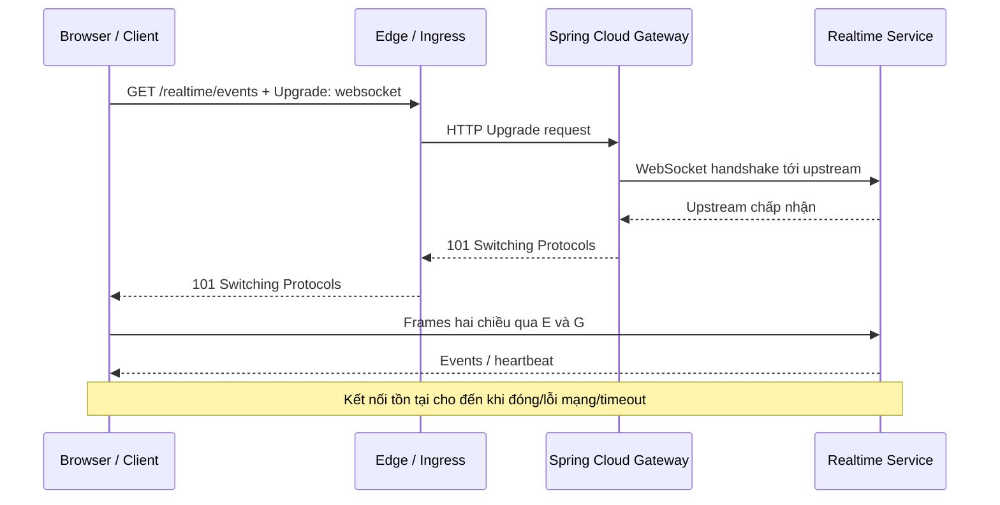
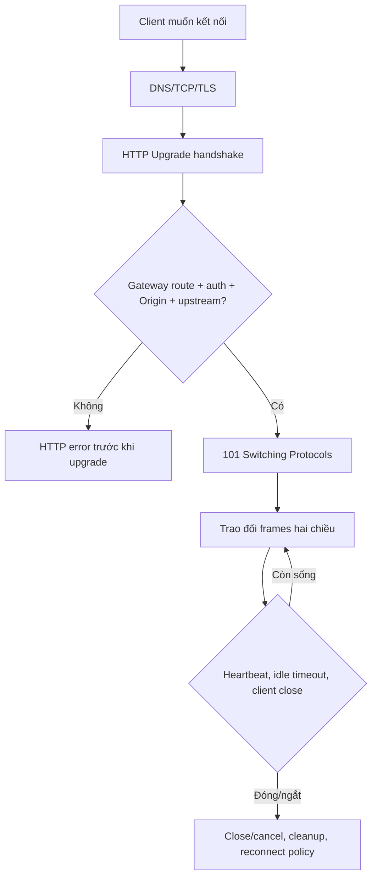
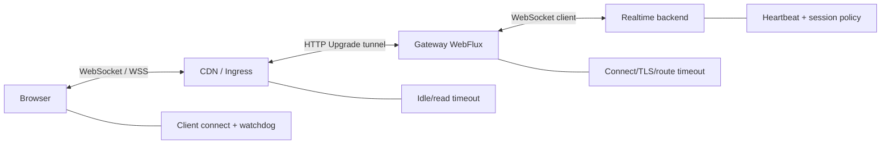
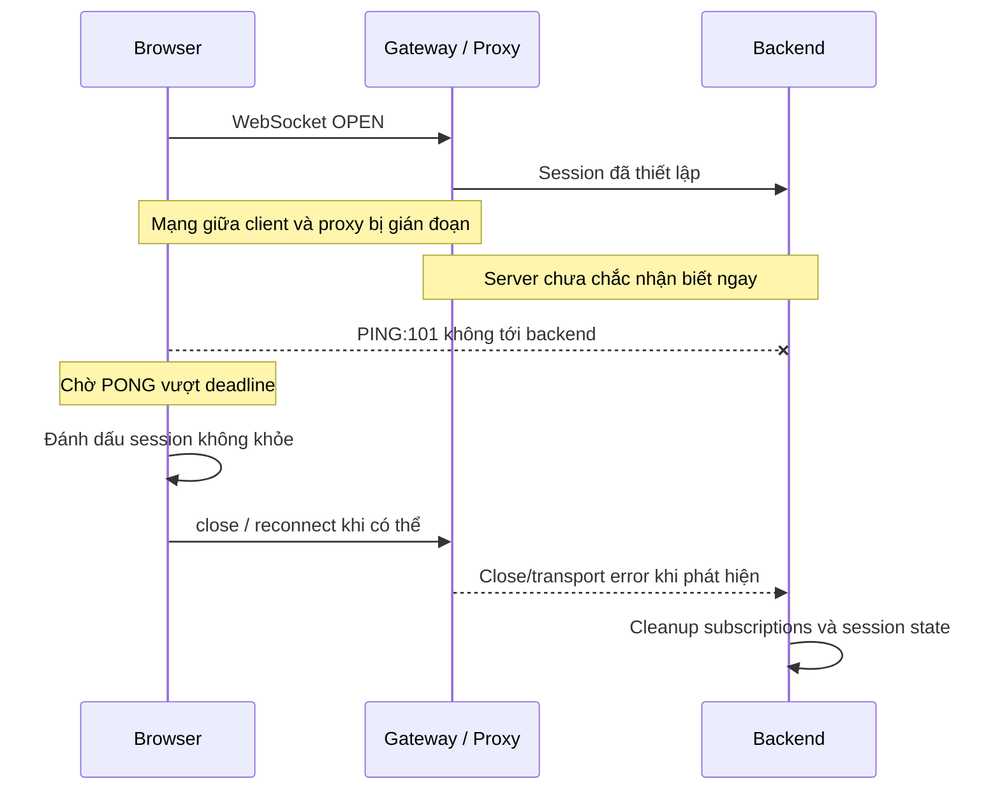
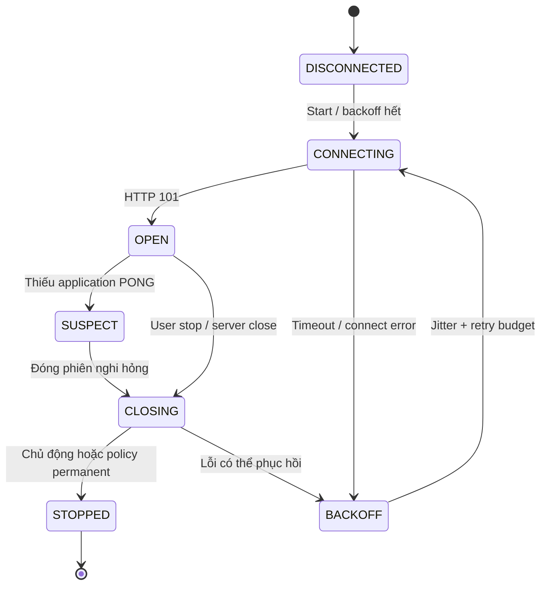
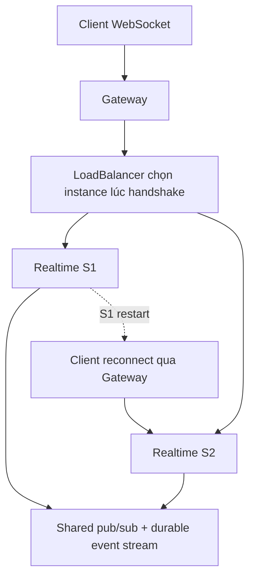
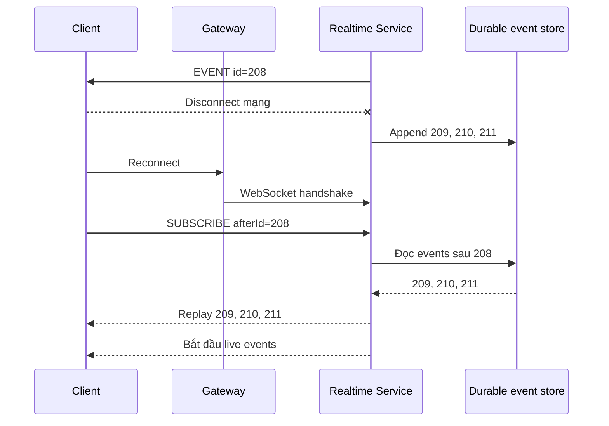

# Timeout, heartbeat và ngắt kết nối phía client trong Spring Cloud Gateway

Một kết nối **WebSocket** thường kéo dài hàng phút, hàng giờ hoặc cho tới khi người dùng đóng ứng dụng. Trong suốt thời gian ấy, Gateway, reverse proxy, load balancer, backend và trình duyệt cùng tham gia duy trì luồng trao đổi hai chiều. Một kết nối có thể đã nhận **HTTP 101 Switching Protocols**, nhưng sau đó bị ngắt khi mạng di động thay đổi, proxy hết thời gian chờ, backend restart hoặc thiết bị chuyển sang chế độ tiết kiệm pin.

Bởi vậy, “WebSocket đã mở” không đồng nghĩa “đường truyền sẽ sống mãi”. Một thiết kế vững cần trả lời ba câu hỏi:

1. **Timeout ở đâu?** Là timeout lúc kết nối/handshake, idle timeout giữa các frame, thời hạn phiên ứng dụng hay timeout của thao tác riêng?
2. **Heartbeat nào chứng minh điều gì?** Ping/Pong ở cấp giao thức chỉ kiểm tra một chặng nhất định; heartbeat ứng dụng có thể kiểm tra cả đường tới backend và khả năng phản hồi nghiệp vụ.
3. **Khi client ngắt thì xử lý thế nào?** Cần đóng phiên, hủy subscription, giải phóng tài nguyên, xác định có nên reconnect, khôi phục dữ liệu bỏ lỡ và tránh nhân đôi thao tác.

Bài thuộc chương **WebSocket và truyền luồng** trong module `SPRING_CLOUD_GATEWAY`. Bối cảnh là API Gateway định tuyến bằng predicate/filter chain, biến đổi path/header, khám phá dịch vụ và load balancing; đồng thời phối hợp JWT, rate limiting, retry, circuit breaker, TLS và observability để vận hành microservices an toàn.

> **Phạm vi:** Ưu tiên **Spring Cloud Gateway Server WebFlux** với Reactor Netty và WebSocket routing. Gateway Server MVC có hạ tầng WebSocket và giới hạn cấu hình khác; không sao chép thuộc tính của MVC sang WebFlux. Các giá trị timeout/heartbeat bên dưới chỉ để học và thử nghiệm, không phải mặc định bắt buộc của mọi phiên bản hoặc hạ tầng.

## 1. Vì sao WebSocket có vòng đời khác HTTP request thông thường?

Với HTTP thông thường, client gửi request, backend trả response và request kết thúc. Với WebSocket qua HTTP/1.1, phía client yêu cầu **Upgrade**, server chấp thuận bằng **101 Switching Protocols**, sau đó kết nối truyền các WebSocket frames hai chiều.



Khi upgrade thành công:

- Không còn mô hình “mỗi thông điệp WebSocket tương đương một request HTTP mới”.
- Header HTTP status như 401/429/503 chủ yếu xuất hiện **trước khi** handshake thành công.
- Các dữ liệu tiếp theo nằm trong **WebSocket frames**: text, binary hoặc control frames.
- Một HTTP client response timeout không tự động tương đương idle timeout của toàn bộ phiên WebSocket.
- Một lần kết nối chọn upstream không có nghĩa mỗi message sẽ được load balancing lại.

### 1.1. Định nghĩa năm mốc thời gian quan trọng

| Mốc | Diễn giải | Ví dụ |
| --- | --- | --- |
| **TCP connect timeout** | Thời gian thiết lập kết nối mạng tới Gateway/upstream. | Không kết nối được host hoặc service. |
| **TLS handshake timeout** | Thời gian thương lượng TLS cho `wss://` hoặc HTTPS/TLS tới backend. | Chứng chỉ/đường mạng không đáp ứng. |
| **HTTP Upgrade handshake deadline** | Thời gian chờ nhận được sự chấp thuận chuyển giao thức. | Chờ 101 hoặc bị 401/403/502. |
| **Idle timeout** | Thời gian không có dữ liệu/frame phù hợp ở một chặng. | Proxy đóng tunnel sau quãng im lặng. |
| **Application heartbeat deadline** | Thời gian client/server cho phép không nhận phản hồi sống của ứng dụng. | Không nhận `PONG:42` trong 12 giây. |

Thêm vào đó còn có **thời lượng phiên tối đa**, **thời gian hết hạn JWT**, **TTL của presence** và **deadline của một command**. Không nên đặt tất cả bằng một giá trị rồi gọi chung là “WebSocket timeout”.

## 2. WebSocket routing trong Gateway Server WebFlux

Spring Cloud Gateway Server WebFlux có **WebSocket Routing Filter**. Khi URI đã định tuyến dùng scheme `ws` hoặc `wss`, cơ chế WebSocket routing chuyển tiếp phiên tới downstream. Nếu muốn chọn instance bằng Spring Cloud LoadBalancer, tài liệu Gateway hỗ trợ tiền tố `lb:ws://service-id`.

Ví dụ một Realtime Service được đăng ký với service ID `realtime-service`:

```yaml
spring:
  cloud:
    gateway:
      server:
        webflux:
          routes:
            - id: realtime-websocket
              uri: lb:ws://realtime-service
              predicates:
                - Path=/realtime/**
              filters:
                - StripPrefix=1
```

Ví dụ định tuyến:

```text
Client:
  wss://api.example.com/realtime/events

Gateway:
  Route realtime-websocket
  StripPrefix=1

Backend:
  WebSocket /events tại một instance của realtime-service
```

**Lưu ý:** `wss://` từ browser tới Gateway chỉ chứng minh TLS cho **chặng client–Gateway**. Upstream trong ví dụ dùng `lb:ws://`; việc bảo vệ chặng Gateway–backend phụ thuộc network/trust boundary, giải pháp TLS/mTLS hoặc cấu hình routing an toàn đã triển khai. Không tuyên bố toàn bộ hành trình đã mã hóa chỉ vì browser dùng WSS.

### 2.1. Namespace route phụ thuộc phiên bản

- Các thế hệ Gateway WebFlux cũ thường dùng `spring.cloud.gateway.routes`.
- Những thế hệ mới dùng `spring.cloud.gateway.server.webflux.routes`.
- Gateway Server MVC sử dụng namespace, API và đặc điểm proxy WebSocket riêng.

Khi một route không hoạt động, kiểm tra **đúng server variant** và starter/dependency trước, không tự sao chép namespace mới vào ứng dụng cũ hoặc ngược lại.

### 2.2. Handshake khác quá trình truyền frames



Một lần `RequestRateLimiter` cho phép handshake không có nghĩa mọi message sau đó đã được rate-limit. Nếu yêu cầu hạn mức theo số frame hoặc hành vi nghiệp vụ, backend phải thực thi policy riêng cho **các message đã nhận**.

## 3. Bản đồ timeout theo từng tầng

Trong thực tế, “WebSocket rớt sau 60 giây” có thể đến từ nhiều lớp:



| Tầng | Loại giới hạn thường gặp | Điều cần đo |
| --- | --- | --- |
| **Browser/client** | Connection establishment deadline, heartbeat deadline, page lifecycle, background timer throttling. | `readyState`, thời gian mở, `CloseEvent`, RTT heartbeat. |
| **CDN/reverse proxy/ingress** | Idle read timeout, connection draining, HTTP Upgrade support, maximum lifetime. | Thời điểm tunnel close và proxy logs. |
| **Gateway** | Upstream connection/TLS handshake, lỗi routing, điều kiện đóng/cancel của phiên. | Route ID, upstream connect errors, active sessions. |
| **Backend WebSocket** | Application inactivity, heartbeat, quyền phiên, message size và tối đa số session. | Last activity, session close reason, resource cleanup. |
| **Mạng/TCP** | NAT mapping, Wi‑Fi ↔ cellular, proxy/firewall reset, broken transport. | TCP reset/FIN, packet loss, thời gian phát hiện. |
| **Hạ tầng deploy** | Rolling restart, pod termination grace period, readiness/draining. | Close codes, reconnect surge, instance restart. |

**Không có một nút timeout toàn cục** có thể bảo đảm mọi kết nối WebSocket sống đúng 30 phút. Mỗi hop có chính sách riêng; ngưỡng thấp nhất hoặc một sự cố bất thường có thể đóng session trước.

### 3.1. Idle timeout không nhất thiết là “thời hạn kết nối tối đa”

- **Idle timeout:** reset khi nhận hoạt động đủ điều kiện; heartbeat có thể giúp giữ kết nối.
- **Maximum connection age:** đóng sau một thời lượng cố định, kể cả có heartbeat.
- **Session/token expiry:** yêu cầu xác thực lại hoặc kết thúc phiên khi identity policy đòi hỏi.
- **Business operation timeout:** một command không được hoàn thành đúng hạn; có thể không cần đóng toàn bộ WebSocket.

Nếu Gateway hoạt động bình thường trong 30 phút nhưng ingress có **maximum connection lifetime = 15 phút**, tăng heartbeat không khiến kết nối sống quá 15 phút.

## 4. Đừng nhầm HTTP timeout với WebSocket idle timeout

Spring Cloud Gateway Server WebFlux có các cấu hình HTTP client như:

- `spring.cloud.gateway.server.webflux.httpclient.connect-timeout`: giới hạn thời gian kết nối outbound theo đơn vị mà phiên bản quy định, thường **mili giây**.
- `spring.cloud.gateway.server.webflux.httpclient.response-timeout`: timeout liên quan phản hồi HTTP theo contract của HTTP client.
- `spring.cloud.gateway.server.webflux.httpclient.ssl.handshake-timeout`: giới hạn thương lượng TLS outbound.
- Một số route còn hỗ trợ metadata `connect-timeout`/`response-timeout` cho HTTP routing.

**Đừng suy rằng đặt `response-timeout: 10s` tự động đóng mọi WebSocket session sau 10 giây im lặng.** Sau HTTP Upgrade, đường xử lý là WebSocket session; hành vi timeout còn phụ thuộc implementation và các proxy hops. Hãy xác nhận bằng kiểm thử phiên bản thực tế.

### 4.1. Cấu hình liên quan WebSocket có thật trong Gateway WebFlux

Ở nhánh WebFlux mới, metadata configuration có các thuộc tính:

```yaml
spring:
  cloud:
    gateway:
      server:
        webflux:
          httpclient:
            websocket:
              proxy-ping: true
              max-frame-payload-length: 65536
```

**Giải thích chính xác:**

- `proxy-ping` liên quan **chuyển tiếp WebSocket Ping frames tới downstream** trong WebSocket HTTP client; trong tài liệu nhánh mới, giá trị mặc định được công bố là `true`.
- `max-frame-payload-length` giới hạn **payload của một frame** theo client/configuration tương ứng, **không phải** thông số timeout, hạn mức tin nhắn nghiệp vụ hay tổng dung lượng một message phân mảnh.
- Giá trị `65536` chỉ minh họa một mức giới hạn cần được chọn theo ứng dụng; không nên áp lên mọi hệ thống binary/streaming mà không đo.

Ở các nhánh cũ, tên tiền tố có thể là `spring.cloud.gateway.httpclient.websocket.*`. Không dùng các thuộc tính `spring.cloud.gateway.server.webmvc.websocket.*` làm hướng dẫn cho Server WebFlux.

### 4.2. `proxy-ping: true` không có nghĩa Gateway tự phát heartbeat

Thuộc tính `proxy-ping` **không phải lịch sinh Ping tự động 20 giây/lần**. Nó liên quan cách WebSocket ping frames được xử lý qua chặng proxy. Muốn một hệ thống gửi heartbeat có chu kỳ, phải triển khai tại **client/server**, dùng API WebSocket hỗ trợ Ping/Pong hoặc **application-level heartbeat** và kiểm chứng thực tế.

Ngay cả khi một Ping nhận Pong, điều đó thường chỉ chứng minh **peer đã trả lời trên chặng được kiểm tra**, không bắt buộc chứng minh toàn bộ xử lý nghiệp vụ ở backend đang khỏe.

### 4.3. Một WebSocket session có thể đang mở nhưng backend không khỏe

Ví dụ proxy có thể trả Ping/Pong ở một chặng, hoặc event loop/backend đang bận nên không gửi được dữ liệu nghiệp vụ. Client thấy connection trạng thái `OPEN` nhưng stream không tiến triển.

Do đó, thiết kế quan sát cần phân biệt:

- Transport vẫn có thể trao đổi control frames.
- Backend ứng dụng thực sự xử lý và trả lời heartbeat.
- Backend còn gửi business events/ack với độ trễ theo SLO.

## 5. Ingress NGINX: ví dụ idle read timeout

Nếu dùng NGINX như reverse proxy phía trước Gateway, tài liệu NGINX mô tả cách proxy kết nối Upgrade và `proxy_read_timeout`. Một ví dụ tối giản cho location chuyên WebSocket:

```nginx
location /realtime/ {
    proxy_pass http://gateway_upstream;
    proxy_http_version 1.1;
    proxy_set_header Upgrade $http_upgrade;
    proxy_set_header Connection "upgrade";

    proxy_read_timeout 75s;
}
```

**Caveat:** Đây là fragment minh họa cho một NGINX config/site cụ thể; ở các phiên bản mới cú pháp/nhu cầu `proxy_http_version` có thể khác, và môi trường dùng nginx-ingress/CDN có cách cấu hình riêng.

`proxy_read_timeout` theo nghĩa NGINX là **khoảng thời gian giữa các lần đọc dữ liệu từ upstream**; nó không phải tổng thời lượng download hoặc một bộ đếm chung từ cả hai chiều. Nếu upstream không gửi dữ liệu nào trong khoảng quy định, NGINX có thể đóng kết nối. Vì thế một client liên tục gửi message **chỉ từ client lên**, nhưng server không phản hồi gì, vẫn có thể gặp idle timeout phía proxy.

### 5.1. Chọn heartbeat phù hợp với proxy read timeout

Giả sử ingress đóng khi **75 giây** không thấy dữ liệu từ Gateway/upstream. Một thiết kế tham khảo:

```text
Ingress proxy_read_timeout:       75 s
Application heartbeat interval:   20 s
Expected PONG deadline:           12 s
Client reconnect backoff:          tối đa 30 s, có jitter
```

Nếu server trả `PONG` trong khoảng hợp lệ, dữ liệu từ upstream có thể duy trì hoạt động của đường proxy. Nhưng không phải mọi CDN/ingress cùng hiểu “activity” như nhau, và một số có hard maximum lifetime bất kể frame; hãy đo bằng integration test.

**Đừng đặt heartbeat interval đúng bằng idle timeout.** Network jitter, GC pause, browser background throttling hoặc scheduling delay khiến frame đến quá muộn.

### 5.2. Các hop khác có idle timeout khác nhau

Nếu chuỗi là:

```text
Browser → CDN → NGINX → Gateway → Backend
```

thì phải kiểm tra tối thiểu:

- Idle timeout giữa browser và CDN.
- Idle timeout/tunnel policy của CDN tới NGINX.
- `proxy_read_timeout`, `proxy_send_timeout` và cấu hình Upgrade ở NGINX.
- Thời gian giữ kết nối ở Gateway WebSocket client/server.
- Backend session inactivity policy và TCP keepalive.

Giải pháp đúng là chọn **ngưỡng nhỏ nhất có tác động** và một heartbeat được nhìn thấy tại các hop cần duy trì, thay vì chỉ tăng một thông số ở Gateway.

## 6. Hai loại heartbeat: protocol Ping/Pong và ứng dụng

WebSocket có **control frames** Ping/Pong ở cấp giao thức. Ngoài ra, ứng dụng có thể tự định nghĩa text/binary message như `PING:123` và `PONG:123`.

| Tiêu chí | **WebSocket Ping/Pong control frames** | **Application heartbeat** |
| --- | --- | --- |
| Loại dữ liệu | Frame giao thức WebSocket. | Text/binary message theo schema ứng dụng. |
| Ai có thể gửi? | API WebSocket server hoặc client hỗ trợ control frames. | Bất kỳ client/server được phép gửi data messages. |
| Browser native `WebSocket` có method `ping()`? | **Không.** Browser không có API công khai để gửi control Ping. | Có thể `socket.send(...)` như mọi message. |
| Kiểm tra peer/hop | Phụ thuộc nơi Ping/Pong được xử lý hoặc proxy. | Có thể yêu cầu **backend app** nhận và phản hồi. |
| Giá trị nghiệp vụ | Không xác minh app có xử lý command. | Có thể kiểm tra app event loop, subscription hoặc quyền phiên. |
| Overhead | Nhẹ, có giới hạn payload control frame. | Có định dạng/parse/validation; cần quota và chống abuse. |

### 6.1. Ping/Pong control frames

Đặc tả WebSocket quy định Ping/Pong là control frames. Khi nhận Ping, peer thường phải trả Pong theo giao thức với payload tương ứng. Nhưng **một proxy/WebSocket stack có thể xử lý control frames ở điểm trung gian**, tùy biến thể và implementation. Vì thế một Pong không phải bằng chứng tuyệt đối backend đã xử lý business request.

Trong **Gateway WebFlux**, property `httpclient.websocket.proxy-ping` giúp kiểm soát hành vi chuyển tiếp ping tới downstream ở các phiên bản hỗ trợ; trong **Gateway Server MVC**, cơ chế servlet WebSocket/proxy có thể khác đáng kể. Không chuyển nguyên kiến thức một biến thể cho biến thể kia.

### 6.2. Application heartbeat

Một hợp đồng tối giản:

```text
Client → Backend: "PING:42"
Backend → Client: "PONG:42"
```

Ứng dụng có thể đưa thêm:

- `sessionId` không nhạy cảm.
- Sequence/correlation ID để ghép Ping với Pong.
- Timestamp để đo RTT, không dùng để phân quyền.
- Thông tin stream offset/lastEventId phục vụ resume.
- Mã phiên bản protocol và heartbeat policy.

**Không đưa JWT, API key hoặc thông tin cá nhân vào heartbeat.** Một heartbeat chỉ cần chứng minh phiên còn phản hồi; payload càng nhỏ càng tốt.

### 6.3. Heartbeat không phải xác thực

Client gửi `PING:42` không chứng minh có quyền đọc stream. Cần xác thực ở handshake và authorization cho message/subscription tương ứng. Nếu token/session bị thu hồi khi WebSocket đang mở, backend cần chính sách session lifetime hoặc revalidation phù hợp, không coi Pong hợp lệ là chứng nhận quyền truy cập.

## 7. Sơ đồ phát hiện kết nối “half-open”

Với mạng di động, việc mất đường truyền có thể không lập tức sinh close frame tới cả hai đầu:



**Half-open** là trạng thái mà một bên vẫn tin kết nối đang tồn tại, trong khi phía còn lại mất đường truyền. TCP keepalive mặc định có thể phát hiện chậm hơn yêu cầu trải nghiệm realtime; application heartbeat thường giúp phát hiện sớm hơn.

Tuy nhiên, ứng dụng không nên xem **không có Ping trong một khoảng cực ngắn** là lỗi chắc chắn: thiết bị vào background, process tạm dừng, GC pause hoặc mạng jitter cũng có thể trì hoãn heartbeat. Chọn **miss threshold**, deadline, reconnect policy theo SLO và điều kiện người dùng.

## 8. Browser native WebSocket: những giới hạn API cần biết

Trình duyệt cung cấp đối tượng `WebSocket` với các trạng thái:

| `readyState` | Số | Ý nghĩa |
| --- | ---: | --- |
| `WebSocket.CONNECTING` | 0 | Đang kết nối/handshake. |
| `WebSocket.OPEN` | 1 | Có thể gửi/nhận messages. |
| `WebSocket.CLOSING` | 2 | Đang tiến hành đóng. |
| `WebSocket.CLOSED` | 3 | Đã đóng hoặc không thể mở. |

Các event quan trọng:

- `open`: handshake thành công.
- `message`: có data message tới ứng dụng.
- `error`: có lỗi; browser thường không cung cấp nguyên nhân kết nối chi tiết.
- `close`: kết nối đóng, có `event.code`, `event.reason` và `event.wasClean`.

**Browser WebSocket API không cung cấp public `ping()`/`pong()` control-frame methods**. Nếu ứng dụng cần một watchdog trong JavaScript, dùng application heartbeat như `PING:<id>`/`PONG:<id>`.

### 8.1. Browser cũng không cho tùy ý set `Authorization` header

Câu lệnh `new WebSocket("wss://...")` không có tùy chọn gửi header `Authorization: Bearer ...` tùy ý như `fetch`. Một số kiến trúc dùng cookie/session, handshake token có vòng đời rất ngắn hoặc một bước xác thực ứng dụng theo protocol riêng.

Không đưa **access token dài hạn** vào query string WebSocket vì URL có thể xuất hiện trong access log, history hoặc telemetry. Cũng không dùng `Sec-WebSocket-Protocol` như nơi nhét raw secret tùy ý chỉ để vượt giới hạn browser API. Hãy chọn authentication pattern được đánh giá bảo mật và kiểm soát scope/retention.

### 8.2. `bufferedAmount` không phải “đã được backend xử lý”

Browser `socket.bufferedAmount` là số byte đang xếp hàng đợi gửi nhưng chưa được chuyển xuống mạng từ browser. Giá trị bằng 0 **không chứng minh** backend đã nhận, xử lý hoặc commit một command.

Nếu WebSocket chuyển lệnh nghiệp vụ có tác dụng phụ, cần **application acknowledgment**, sequence/operation ID và idempotency phía backend. `bufferedAmount` chỉ hữu ích để phát hiện nghẽn ở hàng đợi local của client.

## 9. Ví dụ JavaScript: heartbeat, watchdog và reconnect an toàn

Đoạn sau minh họa một **WebSocket manager phía browser**. Nó sử dụng application heartbeat dạng `PING:<sequence>`, chờ `PONG:<sequence>`, giới hạn reconnect bằng exponential backoff có jitter, và không reconnect sau khi client chủ động đóng.

```javascript
function createRealtimeSocket(url, onData) {
  let ws = null;
  let stopped = false;
  let retryCount = 0;
  let sequence = 0;
  let awaitingPong = null;

  let connectTimer = null;
  let pingTimer = null;
  let pongTimer = null;
  let reconnectTimer = null;

  const CONNECT_TIMEOUT_MS = 10_000;
  const HEARTBEAT_MS = 20_000;
  const PONG_TIMEOUT_MS = 12_000;
  const MAX_BACKOFF_MS = 30_000;
  const BUFFER_LIMIT_BYTES = 1_000_000;

  function clearSessionTimers() {
    clearTimeout(connectTimer);
    clearInterval(pingTimer);
    clearTimeout(pongTimer);
    connectTimer = null;
    pingTimer = null;
    pongTimer = null;
    awaitingPong = null;
  }

  function scheduleReconnect() {
    if (stopped || reconnectTimer !== null) return;

    // Full jitter: tránh hàng nghìn clients reconnect đồng thời.
    const cap = Math.min(
      MAX_BACKOFF_MS,
      1000 * 2 ** Math.min(retryCount++, 5)
    );
    const delay = Math.random() * cap;

    reconnectTimer = setTimeout(() => {
      reconnectTimer = null;
      connect();
    }, delay);
  }

  function sendHeartbeat(current) {
    if (stopped || current !== ws) return;
    if (current.readyState !== WebSocket.OPEN) return;
    if (awaitingPong !== null) return; // Không xếp nhiều ping chồng nhau.

    sequence += 1;
    const id = String(sequence);
    awaitingPong = id;

    current.send("PING:" + id);

    pongTimer = setTimeout(() => {
      if (current !== ws || awaitingPong !== id) return;

      // Đóng phiên nghi ngờ hỏng; onclose quản lý reconnect.
      if (current.readyState === WebSocket.OPEN) {
        current.close(4000, "heartbeat timeout");
      }
    }, PONG_TIMEOUT_MS);
  }

  function connect() {
    if (stopped) return;

    const current = new WebSocket(url);
    ws = current;

    connectTimer = setTimeout(() => {
      if (current === ws &&
          current.readyState === WebSocket.CONNECTING) {
        current.close(); // Kết thúc attempt không hoàn tất handshake.
      }
    }, CONNECT_TIMEOUT_MS);

    current.addEventListener("open", () => {
      if (current !== ws) return;
      clearTimeout(connectTimer);
      connectTimer = null;
      retryCount = 0;

      pingTimer = setInterval(
        () => sendHeartbeat(current),
        HEARTBEAT_MS
      );
    });

    current.addEventListener("message", (event) => {
      if (current !== ws) return;

      const value = String(event.data);

      if (value.startsWith("PONG:") &&
          value.slice(5) === awaitingPong) {
        clearTimeout(pongTimer);
        pongTimer = null;
        awaitingPong = null;
        return;
      }

      onData(value);
    });

    current.addEventListener("error", () => {
      // Browser không cam kết cung cấp nguyên nhân lỗi chi tiết.
      // Đợi close event để cleanup/reconnect.
    });

    current.addEventListener("close", (event) => {
      if (current !== ws) return;
      clearSessionTimers();
      ws = null;

      if (stopped) return;
      if (event.code === 1000 || event.code === 1008) {
        // Bình thường / policy violation: cần workflow riêng.
        return;
      }

      scheduleReconnect();
    });
  }

  function sendBusinessMessage(message) {
    if (!ws || ws.readyState !== WebSocket.OPEN) {
      return false;
    }
    if (ws.bufferedAmount > BUFFER_LIMIT_BYTES) {
      // Không tiếp tục đẩy dữ liệu vào queue local vô hạn.
      return false;
    }

    ws.send(message);
    return true;
  }

  function stop() {
    stopped = true;
    clearTimeout(reconnectTimer);
    reconnectTimer = null;
    clearSessionTimers();

    const current = ws;
    ws = null;
    if (current &&
        (current.readyState === WebSocket.OPEN ||
         current.readyState === WebSocket.CONNECTING)) {
      current.close(1000, "client shutdown");
    }
  }

  return { connect, sendBusinessMessage, stop };
}

// Ví dụ sử dụng trong một ứng dụng:
const realtime = createRealtimeSocket(
  "wss://api.example.com/realtime/events",
  (data) => console.log("Realtime message:", data)
);
realtime.connect();

// Khi người dùng rời màn hình/session: realtime.stop().
```

### 9.1. Đoạn code minh họa điều gì?

- **Handshake timeout phía browser:** nếu còn `CONNECTING` quá ngưỡng, chủ động hủy attempt.
- **Một heartbeat đang chờ:** không phát liên tục các Ping mới khi Pong cũ chưa tới.
- **Watchdog:** khi thiếu Pong trong deadline, client thử đóng phiên.
- **Reconnect có jitter:** tránh tất cả clients cùng kết nối lại ngay sau outage.
- **Manual shutdown:** không mở lại phiên khi user đã rời màn hình.
- **Backpressure tối thiểu:** từ chối thêm business messages khi browser queue quá lớn.
- **Business messages:** không tự phát lại; gửi lại command ghi cần acknowledgement và idempotency riêng.

### 9.2. Giới hạn cần bổ sung cho production

Đây là **ví dụ học tập**, chưa phải thư viện reconnect production hoàn chỉnh:

- Nếu kết nối bị half-open, browser có thể trì hoãn `close`; gọi `close()` **không bảo đảm mạng đóng ngay**. Cần thêm chính sách watchdog recovery/hạn mức phiên và đo thực tế.
- Browser ở background có thể **throttle `setInterval` và `setTimeout`**; đừng dùng timer độ chính xác cao để xác minh liveness.
- Sau mất mạng lâu, client cần cơ chế **resume event stream từ offset** và tránh duplicate messages.
- Nếu server dùng mã đóng custom hoặc `1008` do hết quyền, phải có nhánh **refresh credential/reauth** có kiểm soát, không reconnect bằng token cũ vô hạn.
- Một số môi trường có nhiều tab; cần tránh mỗi tab tạo hàng chục kết nối không cần thiết.
- Callback `onData` phải validate size/schema và xử lý exception; không dùng dữ liệu socket trực tiếp làm HTML nguy hiểm.
- Client cần xét `navigator.onLine`/visibility như tín hiệu gợi ý, nhưng không coi chúng là phép kiểm tra mạng đáng tin.

### 9.3. Vì sao không nên tự resend mọi business message khi reconnect?

Ví dụ một socket gửi lệnh đặt hàng `createOrder`, server đã commit nhưng ACK bị mất. Nếu client reconnect rồi gửi lệnh mới với ID khác, có thể tạo hai đơn. Sử dụng **operation ID/idempotency key** bền qua reconnect, backend dedup và API tra cứu trạng thái. Heartbeat Ping/Pong **không phải ACK của business command**.

## 10. Backend WebFlux: phản hồi application heartbeat

Để client ở mục 9 đo được đường tới **ứng dụng backend**, Realtime Service có thể xử lý text messages `PING:<sequence>` và trả `PONG:<sequence>`.

Một `WebSocketHandler` tối giản:

```java
import java.util.concurrent.atomic.AtomicInteger;

import org.springframework.web.reactive.socket.WebSocketHandler;
import org.springframework.web.reactive.socket.WebSocketMessage;
import org.springframework.web.reactive.socket.WebSocketSession;

import reactor.core.publisher.Flux;
import reactor.core.publisher.Mono;

public final class HeartbeatWebSocketHandler implements WebSocketHandler {

    private final AtomicInteger activeSessions = new AtomicInteger();

    @Override
    public Mono<Void> handle(WebSocketSession session) {
        activeSessions.incrementAndGet();

        Flux<WebSocketMessage> replies = session.receive()
            .filter(message ->
                message.getType() == WebSocketMessage.Type.TEXT)
            .map(WebSocketMessage::getPayloadAsText)
            .filter(text ->
                text.startsWith("PING:") &&
                text.length() <= 40)
            .map(text ->
                session.textMessage("PONG:" + text.substring(5)));

        return session.send(replies)
            .doFinally(signal -> activeSessions.decrementAndGet());
    }

    public int activeSessions() {
        return activeSessions.get();
    }
}
```

**Cách đọc:**

1. `session.receive()` là luồng data message tới backend.
2. Lọc text messages và chỉ trả lời heartbeat đúng format demo.
3. `session.send(replies)` gửi các WebSocket messages phản hồi.
4. `doFinally` giảm bộ đếm khi publisher kết thúc/cancel/lỗi.
5. Không gọi `block()` hoặc tự `subscribe()` trong handler.

**Giới hạn lớn:** Mẫu trên **chỉ xử lý heartbeat**, chưa làm chat, authorization trên message, giới hạn message size, session registry, timeout liveness phía server, hoặc error mapping production. Nó cũng **không chủ động gửi heartbeat** khi client hoàn toàn im lặng; để phát hiện client mất mạng từ backend, cần timeout/heartbeat policy riêng.

### 10.1. Đăng ký handler vào URL

Trong ứng dụng Spring WebFlux backend, có thể đăng ký handler bằng handler mapping:

```java
import java.util.Map;

import org.springframework.context.annotation.Bean;
import org.springframework.context.annotation.Configuration;
import org.springframework.web.reactive.HandlerMapping;
import org.springframework.web.reactive.handler.SimpleUrlHandlerMapping;
import org.springframework.web.reactive.socket.server.support.WebSocketHandlerAdapter;

@Configuration
public class RealtimeWebSocketConfig {

    @Bean
    HandlerMapping webSocketMapping(HeartbeatWebSocketHandler handler) {
        SimpleUrlHandlerMapping mapping = new SimpleUrlHandlerMapping();
        mapping.setUrlMap(Map.of("/events", handler));
        mapping.setOrder(-1);
        return mapping;
    }

    @Bean
    WebSocketHandlerAdapter webSocketHandlerAdapter() {
        return new WebSocketHandlerAdapter();
    }

    @Bean
    HeartbeatWebSocketHandler heartbeatHandler() {
        return new HeartbeatWebSocketHandler();
    }
}
```

Đây là **mẫu cho Realtime Service**, không phải một custom Gateway filter. Khi route Gateway áp `StripPrefix=1`, client `/realtime/events` sẽ được chuyển tới backend `/events` như ví dụ.

### 10.2. `receive()` hoàn tất khi client đóng

Theo mô hình WebFlux WebSocket, `session.receive()` hoàn tất khi kết nối đóng. Với một handler kết hợp stream inbound/outbound đúng cách, lúc client ngắt:

- Inbound được hoàn tất hoặc phát error.
- Outbound publisher có thể bị cancel.
- Reactive subscription phải dừng.
- Resources, user presence, session registry và upstream subscriptions cần được dọn.

Không giữ `session` hoặc `Flux` của một client mãi trong một static collection không có cleanup, nếu không hệ thống sẽ bị memory leak dù socket đã đóng.

### 10.3. `doFinally` thích hợp cho cleanup đồng bộ nhỏ

`doFinally` có thể dùng cho giảm counter, xóa entry trong map in-memory hoặc ghi metric nhanh. **Không dùng nó để thực hiện I/O blocking** như ghi database qua JDBC đồng bộ hoặc gọi Redis HTTP trong event loop.

Nếu cleanup cần I/O reactive có bảo đảm hoàn tất, phải thiết kế lifecycle/cleanup pipeline riêng, xử lý cancellation và timeout. Nếu dùng **presence với Redis TTL**, TTL/reconciliation có thể cần thiết vì crash node khiến `doFinally` không được chạy.

## 11. Khi client ngắt kết nối: close frame, TCP reset và silent failure

Không phải mọi kiểu ngắt đều giống nhau.

### 11.1. Client chủ động đóng

Nếu user rời màn hình, app gọi:

```javascript
socket.close(1000, "Leaving page");
```

Đây là yêu cầu bắt đầu **WebSocket closing handshake**. Khi kết thúc bình thường, hai bên có thể thấy close code phù hợp và giải phóng session.

Browser chỉ cho phép caller chọn mã `1000` hoặc custom mã `3000–4999` khi gọi `close(code, reason)`. Không cố gửi `1006` như mã close vì `1006` là giá trị được dành riêng cho quan sát đóng bất thường, không được truyền như close frame.

### 11.2. Mạng mất đột ngột

Khi client tắt Wi‑Fi, thiết bị ngủ hoặc mạng NAT xóa mapping:

- Gateway/backend có thể **không nhận close frame ngay**.
- Một số phiên nhận TCP reset/FIN, một số chờ keepalive/idle timeout.
- Client có thể quan sát `CloseEvent.code === 1006` khi bất thường.
- Application heartbeat/lease timeout giúp phát hiện session không còn hữu ích nhanh hơn.

**Không có close event ngay không chứng minh socket còn sống**. Cần giới hạn tài nguyên và xử lý half-open.

### 11.3. Gateway hoặc backend restart

Rolling deployment có thể làm các WebSocket sessions bị đóng. Client nên chuẩn bị reconnect theo backoff và **resume subscription** thay vì mặc định mọi session sẽ sống qua pod restart. Close code có thể là 1001/1012/1013 hoặc bất thường tùy bên nào đóng và proxy có chuyển close frame được không.

### 11.4. Đóng do bảo mật/chính sách

Backend có thể đóng khi user bị thu hồi quyền hoặc gửi message vi phạm policy. Nếu backend dùng `1008 Policy Violation` hoặc custom code được hợp đồng định nghĩa, client không nên retry tự động vô hạn bằng cùng credential. Cần làm mới auth hoặc hiển thị lỗi phù hợp.

### 11.5. Close status không phải HTTP response status

**Sau khi 101 hoàn tất**, không còn cơ chế trả HTTP `401`/`429` trên cùng WebSocket session như một HTTP response mới. Nếu vi phạm quota theo message, ứng dụng có thể gửi error event rồi đóng với mã WebSocket phù hợp hoặc từ chối command theo schema, tùy hợp đồng.

Đừng dùng HTTP status trong JSON và gọi đó là “WebSocket handshake trả 429” sau khi kết nối đã upgrade.

## 12. Close codes quan trọng và chính sách reconnect

| Close code | Ý nghĩa thường gặp | Gợi ý xử lý |
| --- | --- | --- |
| `1000` | Normal Closure. | Thường **không** auto reconnect nếu do user/app chủ động kết thúc. |
| `1001` | Going Away. | Có thể reconnect có giới hạn nếu service/app tiếp tục cần stream. |
| `1002` | Protocol Error. | Kiểm tra protocol/schema/version; tránh retry vô hạn. |
| `1003` | Unsupported Data. | Client gửi loại message không được hỗ trợ; sửa client. |
| `1005` | Reserved: không có status code được gửi. | Có thể thấy trong quan sát; **không được gửi** trên wire. |
| `1006` | Abnormal Closure, không nhận close frame hợp lệ. | Reconnect có backoff và điều tra network/proxy. **Không được gửi**. |
| `1007` | Payload không hợp lệ, ví dụ UTF-8 sai. | Sửa dữ liệu/protocol; không retry cùng payload lỗi. |
| `1008` | Policy Violation. | Thường dừng reconnect tự động, xử lý authentication/policy. |
| `1009` | Message Too Big. | Giảm payload; không retry vô hạn cùng message. |
| `1011` | Unexpected server condition. | Có thể retry có giới hạn; cần server metrics. |
| `1012` | Service Restart. | Reconnect backoff + jitter, có thể resume stream. |
| `1013` | Try Again Later. | Retry theo policy sau một khoảng chờ; tránh storm. |
| `1015` | Reserved: TLS handshake failure trong quan sát. | Chẩn đoán TLS/CA; **không gửi** trên wire. |
| `3000–4999` | Application/private codes khi có hợp đồng. | Client/server thống nhất ý nghĩa và recovery. |

**Không suy chắc nguyên nhân chỉ từ một code.** Proxy có thể đóng kết nối không chuyển close frame từ backend, khiến client nhận `1006` dù backend đã gửi mã đóng hợp lệ trước đó. `event.wasClean` cũng chỉ phản ánh điều kiện đóng theo browser, không bảo đảm business operations đã commit.

### 12.1. Một state machine reconnect



Nếu session hết quyền, client cần chuyển sang **AUTH_REQUIRED** hoặc trạng thái tương đương thay vì cứ backoff rồi kết nối lại với token không còn hợp lệ.

## 13. Phía server: quản lý presence, subscriptions và cleanup

WebSocket thường gắn với những dữ liệu cần giải phóng:

- Mapping session ID → user/tenant/room.
- Subscription tới Redis Pub/Sub, Kafka, Reactor `Flux` hoặc message broker.
- Counter active connections theo route, tenant, instance.
- Presence “online/offline”.
- Buffers dùng cho messages chưa gửi.
- Timer heartbeat, authorization refresh và inactivity watchdog.
- Reference tới backend task chạy dài.

### 13.1. Không dùng presence in-memory như nguồn sự thật toàn cụm

Khi Gateway hoặc backend có nhiều replicas:

```text
User u1 → Gateway A → Realtime instance S1
User u2 → Gateway B → Realtime instance S2
```

Nếu room membership được giữ chỉ trong `ConcurrentHashMap` của S1, S2 không biết mọi session của phòng chat đó. Khi S1 crash, map biến mất mà không phát “offline” event đến S2.

Thiết kế có thể dùng:

- Session registry cục bộ để quản lý subscriptions của chính instance.
- Shared presence store với **lease/TTL**, kết hợp heartbeat renew và expiry.
- Pub/Sub hoặc stream broker để fan-out giữa instances.
- Reconciliation nếu một node chết mà không chạy cleanup hook.

### 13.2. Cleanup nên idempotent

Một session có thể phát nhiều tín hiệu kết thúc từ close, error và cancellation. Hàm cleanup cần an toàn khi được gọi lặp:

```text
cleanup(sessionId):
    removeLocalSessionIfPresent(sessionId)
    cancelSubscriptionsIfPresent(sessionId)
    decrementCounterOnlyOnce(sessionId)
    publishOfflineOnlyIfLeaseOwnershipStillValid(sessionId)
```

Đây là **pseudocode**; không chỉ decrement một biến đếm ở ba callback khác nhau mà không có guard.

### 13.3. Đừng đồng nhất disconnect với logout

Người dùng đóng tab có thể làm WebSocket ngắt nhưng **không tương đương logout**. Session đăng nhập/cookie/JWT có thể vẫn hợp lệ. Presence, authentication session và business subscription là ba vòng đời khác nhau.

### 13.4. Graceful shutdown

Khi backend hoặc Gateway dừng để deploy:

1. Ngừng nhận kết nối mới ở instance đang drain.
2. Cho một thời gian chuyển tiếp phù hợp với termination grace period.
3. Nếu protocol cho phép, gửi event thông báo maintenance/reconnect.
4. Đóng các phiên đang mở theo cơ chế hỗ trợ.
5. Hủy subscriptions và flush state bền vững cần thiết.
6. Client reconnect qua instance khác với jitter.
7. Backend dùng replay offset/last event ID để khôi phục events bị lỡ.

Không hứa “không mất kết nối” trong rolling deployment. Mục tiêu thực tế là **reconnect có kiểm soát và không mất dữ liệu nghiệp vụ**.

## 14. Load balancing với `lb:ws://` và kết nối lâu dài

Gateway chọn một upstream instance **khi thiết lập phiên WebSocket**. Tại thời điểm đã nối:

- Các frames của session tiếp tục đi qua kết nối đã thiết lập.
- Không load balance mỗi message sang một backend mới.
- Khi upstream instance chết, WebSocket session có thể ngắt.
- Client reconnect có thể được đưa tới instance khác.
- Session state chỉ giữ ở instance cũ không tự tồn tại ở instance mới.



### 14.1. Sticky sessions có giải quyết mọi vấn đề không?

Không. Sticky routing có thể giảm chuyển instance khi reconnect, nhưng không chống được pod restart, scaling, regional failover hoặc network disruption. Nếu business yêu cầu “không mất message”, cần **replay/resume** từ shared durable store hoặc protocol phù hợp, không chỉ sticky sessions.

### 14.2. Nhiều kết nối lâu dài làm thay đổi capacity planning

Một Gateway có thể xử lý nhiều request HTTP ngắn bằng connection pooling, nhưng WebSocket giữ kết nối lâu:

- Số file descriptors/socket connections tăng theo active sessions.
- TLS, ping/pong và frame proxying vẫn tiêu tốn CPU/network.
- Buffers/slow consumers gây memory pressure.
- Một instance có thể ít HTTP RPS nhưng có hàng chục nghìn active connections.
- Một lần rollout có thể tạo **reconnect surge** lớn hơn traffic bình thường.

Đo active sessions, fan-out rate và message bytes, không chỉ `requests/second`.

## 15. Backpressure và slow consumers

Ngay cả khi socket đang `OPEN`, client có thể đọc chậm hơn tốc độ backend gửi. Ví dụ server đẩy 500 notifications/giây, browser chỉ render được 50/giây:

```text
Inbound 500 events/s
UI xử lý 50 events/s
Queue backlog tăng ≈ 450 events/s
→ Tăng memory, latency và rủi ro đóng connection
```

Spring WebFlux/Reactor có cơ chế reactive streams giữa các publishers/subscribers trong ứng dụng, nhưng không có nghĩa toàn bộ mạng/browser tự bảo đảm backpressure ở cấp business messages. Browser `WebSocket` API truyền thống không cung cấp backpressure end-to-end cho toàn pipeline.

### 15.1. Chiến lược giới hạn

- Giới hạn kích thước frame/message, số connections, subscription và số event/s theo user/tenant.
- Dùng bounded buffer, chính sách drop/coalesce cho những event có thể mất, hoặc close slow consumer nếu bắt buộc.
- Với dữ liệu không được mất, ghi vào durable stream và cho client resume thay vì giữ vô hạn trong RAM.
- Cho phép client gửi demand/ack/window ở tầng protocol riêng nếu cần.
- Theo dõi `bufferedAmount` phía browser và queue depth phía backend.
- Không dùng `onBackpressureBuffer()` không giới hạn cho một nguồn realtime vô hạn.

### 15.2. Heartbeat cũng có thể bị nghẽn

Một application `PONG` nằm sau hàng nghìn business messages trong queue có thể bị trễ, khiến client tưởng session chết dù mạng vẫn hoạt động. Cần ưu tiên control/heartbeat messages trong thiết kế queue hoặc chọn deadline phản ánh worst-case latency.

Tương tự, nếu backend bị GC pause dài, heartbeat timeout quá ngắn có thể làm cả cụm client reconnect đồng loạt và gây tải bổ sung.

## 16. WebSocket khác SSE và HTTP streaming ở điểm nào?

Chương **WebSocket và truyền luồng** cũng thường gặp **Server-Sent Events (SSE)** và streaming HTTP.

| Tiêu chí | WebSocket | SSE / `text/event-stream` |
| --- | --- | --- |
| Giao tiếp | Hai chiều trên một kết nối đã upgrade. | Chủ yếu server → client trên response HTTP kéo dài. |
| Handshake | WebSocket Upgrade, thường HTTP 101. | HTTP GET và response `200` với `text/event-stream`. |
| Heartbeat | Control Ping/Pong hoặc application heartbeat. | Comment/event keep-alive do server gửi. |
| Browser client | `WebSocket` API, phải tự thiết kế reconnect. | `EventSource` có reconnect semantics, nhưng cần cấu hình server/proxy. |
| Resume | Protocol ứng dụng tự định nghĩa offset/ack. | Có cơ chế `id:`/`Last-Event-ID`, nhưng backend phải lưu và phục hồi dữ liệu. |
| Client → server | Gửi WebSocket messages. | Cần HTTP request riêng nếu muốn gửi dữ liệu. |
| Timeout | Idle timeout của các hop WebSocket tunnel. | HTTP streaming response timeout/buffering/idle behavior của proxies. |
| Security | Xác thực handshake và từng message/operation khi cần. | Xác thực HTTP request/authorization cho stream và dữ liệu từng event. |

**Không dùng cấu hình WebSocket Ping/Pong làm lời giải cho SSE**, vì SSE không có WebSocket control frames.

### 16.1. SSE heartbeat kiểu comment

Một SSE stream có thể phát comment giữ kết nối:

```text
: keep-alive

id: event-123
event: notification
data: {"message":"order-ready"}

: keep-alive

```

Dòng bắt đầu bằng dấu hai chấm là **SSE comment**; browser EventSource không đưa nó tới application `message` handler như event nghiệp vụ. Một server có thể gửi comment định kỳ để tránh các proxy coi HTTP response là idle, nhưng vẫn phải kiểm tra buffering và timeout ở hạ tầng.

### 16.2. Ví dụ SSE WebFlux

```java
import java.time.Duration;

import org.springframework.http.MediaType;
import org.springframework.http.codec.ServerSentEvent;
import org.springframework.web.bind.annotation.GetMapping;
import org.springframework.web.bind.annotation.RestController;

import reactor.core.publisher.Flux;

@RestController
public class HeartbeatSseController {

    @GetMapping(
        value = "/events",
        produces = MediaType.TEXT_EVENT_STREAM_VALUE
    )
    public Flux<ServerSentEvent<String>> events() {
        return Flux.interval(Duration.ofSeconds(20))
            .map(tick -> ServerSentEvent.<String>builder()
                .comment("keep-alive")
                .build());
    }
}
```

**Giới hạn:** Đây chỉ là SSE keepalive, chưa phát business events, chưa có `id` để resume, chưa có kiểm soát auth/authorization và cleanup. `Flux.interval` kết thúc/cancel theo HTTP connection lifecycle, nhưng không tự cung cấp tính bền vững cho dữ liệu.

Nếu dùng Gateway route HTTP cho SSE, cần kiểm tra `response-timeout`, buffering/compression ở reverse proxy và header `Cache-Control` phù hợp. SSE không tự “được WebSocket Routing Filter xử lý” chỉ vì cùng là streaming.

### 16.3. `Last-Event-ID` không tự phát lại events

Browser EventSource có thể gửi `Last-Event-ID` khi reconnect, nhưng **backend phải biết cách đọc event ID và truy vấn durable event log** để phục hồi các events đã bỏ lỡ. Nếu backend chỉ tạo dữ liệu trong RAM rồi restart, không có cơ chế magic nào khôi phục chúng.

## 17. Authentication, Origin và các chính sách an toàn

WebSocket handshake là một HTTP request, nên có thể chịu Spring Security/authentication trước upgrade. Nhưng khi đã nhận 101, session dài có các rủi ro riêng.

### 17.1. Origin không giống CORS preflight

Theo tài liệu Spring Cloud Gateway WebFlux, WebSocket routing filter kiểm tra `Origin` của handshake; browser không áp mô hình **CORS preflight** truyền thống cho WebSocket giống `fetch`. Ở một số nhánh WebFlux mới, cấu hình có thể dùng:

```yaml
spring:
  cloud:
    gateway:
      server:
        webflux:
          websocket:
            allowed-origins:
              - "https://app.example.com"
```

Tài liệu Gateway WebFlux nhánh mới mô tả mặc định chấp nhận same-origin hoặc handshake không có header `Origin`; cross-origin handshake không được phép có thể nhận `403` trước upgrade.

**Quan trọng:**

- `Origin` là tín hiệu browser cần kiểm tra, không thay xác thực vì client ngoài browser có thể tự gửi hoặc bỏ header.
- Cấu hình origin phải là allowlist cụ thể; tránh wildcard cho hệ thống dùng cookie.
- Khi Gateway sau reverse proxy, việc xác định host/scheme thật phụ thuộc trust boundary của `Forwarded`/`X-Forwarded-*` và cấu hình forward-headers.
- Nếu thấy 403 ở handshake, không tự kết luận backend heartbeat lỗi.

### 17.2. JWT hết hạn trong khi session vẫn mở

Một JWT có thể được xác minh khi handshake bắt đầu và hết hạn sau vài phút trong lúc WebSocket vẫn tồn tại. Việc có đóng session ngay không phụ thuộc tự động chỉ vào JWT expiration nếu không có logic thực thi lại.

Các lựa chọn theo threat model:

1. Giới hạn **maximum session lifetime** không vượt thời hạn auth cho phép.
2. Backend chủ động đóng hoặc yêu cầu **reauthentication** khi policy yêu cầu.
3. Xác minh quyền cho **từng command/subscription nhạy cảm**.
4. Khi token bị thu hồi, dùng event/revalidation phù hợp thay vì chỉ chờ client ngắt tự nhiên.

Đừng dùng application heartbeat để gia hạn quyền truy cập vô thời hạn nếu tổ chức không có chính sách refresh identity tương ứng.

### 17.3. Quota không chỉ ở handshake

`RequestRateLimiter` theo route có thể giới hạn số **HTTP handshakes mới**; nó không tự trừ token cho mọi message trên một WebSocket đã mở. Cần thêm:

- Max concurrent sessions/user.
- Max subscriptions/session.
- Rate-limit message/command ở backend.
- Max payload size, bounded outgoing queue.
- Chặn message gửi liên tục nhằm tạo heartbeat abuse.
- Chính sách người dùng/tenant/quyền truy cập theo loại event.

### 17.4. Circuit breaker và retry chỉ áp ở đâu?

Không nên mặc định một Gateway `Retry` hoặc `CircuitBreaker` xử lý từng WebSocket frame sau upgrade như từng HTTP request. Với một session đã mở, logic phục hồi nằm ở WebSocket client/backend protocol: close, reconnect, resume và xử lý idempotent. Route-level filters có thể tác động handshake hoặc đường routing ban đầu theo version, nhưng **không thay thế** application-level recovery.

## 18. Khôi phục luồng dữ liệu sau reconnect

Heartbeat giải quyết vấn đề “phát hiện mất kết nối”. Nó **không tự giải quyết** “những event nào đã bị bỏ lỡ”.

Giả sử client đã nhận event số 208, mất kết nối trong 5 giây và server phát event 209, 210, 211:



### 18.1. Các thành phần cần có

- **Event ID/offset** ổn định, có thứ tự theo stream/partition tương ứng.
- Store hoặc broker có retention đủ dài để replay.
- API subscribe/resume với `afterId`/cursor đã được xác thực và ràng buộc vào quyền truy cập.
- Cơ chế tránh **gap giữa replay và live subscription**, ví dụ kết hợp log tail hoặc atomically ghi nhận cursor.
- Client dedup các events có thể bị gửi lại.
- Quy định khi cursor quá cũ/đã hết retention.

### 18.2. At-least-once và duplicate event

Một event có thể được gửi lần đầu rồi gửi lại khi reconnect. Client nên dedup theo **event ID**, không tự coi “hai payload giống nhau” là một event. Với command ghi, dùng idempotency key/operation ID riêng; event ID và command ID là hai khái niệm khác nhau.

### 18.3. Gói tin bất thường không phải lý do tạo lại nghiệp vụ

Nếu connection drop sau khi client gửi `CONFIRM_PAYMENT` nhưng chưa nhận ACK, reconnect rồi gửi command mới có thể nhân đôi side effect. Backend phải có **idempotent operation** và đường tra cứu trạng thái, không chỉ bảo đảm socket mở lại.

## 19. Observability: đo cả handshake lẫn vòng đời session

Một dashboard WebSocket hữu ích cần nhìn xa hơn số request HTTP.

| Chỉ số | Điều nó giúp phát hiện |
| --- | --- |
| Handshake attempts / success / failure theo route | Lỗi auth, Origin, DNS, service discovery, TLS. |
| Handshake latency p50/p95/p99 | Chậm kết nối, upstream connect/101. |
| Active WebSocket sessions theo instance/route | Capacity và tình trạng connection leak. |
| Session lifetime distribution | Ngắt ở một ngưỡng cố định như 60 giây hay theo hành vi người dùng. |
| Close codes và abnormal closure rate | 1000, 1001, 1006, 1008, 1011, 1012... |
| Heartbeat RTT và deadline misses | Độ trễ đường ứng dụng, nghẽn hoặc false positives. |
| Reconnect attempts / backoff duration | Reconnect storm sau outage. |
| Frames/messages in/out và bytes | Traffic và network capacity. |
| Outbound queue depth / dropped events | Slow consumers/backpressure. |
| Resume offset gap / replay failures | Khả năng phục hồi dữ liệu. |
| Backend instance shutdown/restart | Tương quan với số session bị rớt. |
| Proxy idle timeout/reset count | Xác định hop cắt kết nối. |

Các tên metric như `gateway_websocket_sessions_active` hoặc `realtime_heartbeat_rtt_seconds` là **gợi ý thiết kế**, không phải khẳng định Spring Cloud Gateway tự cung cấp mọi metric đó. Instrumentation có thể cần nằm ở browser, ingress, Gateway và backend.

### 19.1. Không nhầm HTTP 101 với toàn bộ phiên thành công

HTTP 101 chỉ xác nhận handshake. Nó không phản ánh:

- Client đã nhận bao nhiêu events.
- Backend có xử lý heartbeat không.
- Session tồn tại trong bao lâu.
- Có bao nhiêu message bị drop.
- Client có resume được sau reconnect không.

Một Gateway có 99,9% handshake success vẫn có thể có trải nghiệm realtime tồi nếu 80% connections đóng sau 60 giây.

### 19.2. Truy vết theo connection ID nhưng tránh dữ liệu nhạy cảm

Có thể sinh một connection ID nội bộ khi handshake và đưa vào structured logs từ Gateway/backend với authorization phù hợp. Không dùng raw token, email, session cookie hoặc mỗi user ID làm metric label có cardinality cao.

Với WebSocket lâu dài, một trace duy nhất giữ mở cả giờ có thể khó quản lý; có thể tách metrics, logs và application event tracing với correlation đã được bảo vệ.

### 19.3. Quan sát tách các mã lỗi trước và sau 101

- **Trước 101:** 401/403 từ auth hoặc Origin, 404 route không match, 429 rate limiter, 502/503 upstream lỗi.
- **Sau 101:** WebSocket close code, EOF/reset, heartbeat timeout, application error frame.

Một browser WebSocket `error` event không nhất thiết hiển thị HTTP status chi tiết; cần ingress/Gateway logs và devtools Network tab để chẩn đoán handshake failures.

## 20. Quy trình kiểm thử end-to-end

Giả sử:

- Browser gọi `wss://api.staging.example/realtime/events`.
- Gateway WebFlux route `realtime-websocket` đến `lb:ws://realtime-service`.
- NGINX ingress có `proxy_read_timeout 75s`.
- Backend `/events` phản hồi `PING:<id>` bằng `PONG:<id>`.
- Browser gửi heartbeat mỗi 20 giây và đợi tối đa 12 giây cho Pong.

**Chỉ thử gián đoạn mạng/kill pod trên môi trường staging cô lập, không trực tiếp tác động production.**

### 20.1. Kiểm tra handshake

Mở trình duyệt và xem Network → WS:

1. URI có đúng `wss://` và path sau `StripPrefix` không?
2. Handshake có đạt `101 Switching Protocols` không?
3. Nếu 401/403, kiểm tra auth và Origin trước khi sửa heartbeat.
4. Nếu 404, kiểm tra Path predicate/backend handler.
5. Nếu 502/503, kiểm tra service discovery, upstream instance và TLS.

Một công cụ WebSocket client như `wscat`/`websocat` (nếu môi trường test có cài đặt) cũng có thể giúp quan sát frames. `curl -i` có ích cho một số phần HTTP handshake, nhưng không tự biến thành WebSocket test client xử lý đầy đủ Ping/Pong/frames.

### 20.2. Kiểm tra application heartbeat

Trong WS frames, kỳ vọng:

```text
Client -> Server: PING:1
Server -> Client: PONG:1

Client -> Server: PING:2
Server -> Client: PONG:2
```

Nếu chỉ có Pong ở cấp giao thức nhưng không có `PONG:1` từ ứng dụng, backend có thể chưa xử lý message; kiểm tra đường proxy và handler.

### 20.3. Mô phỏng idle timeout

Trong staging, tắt heartbeat ứng dụng **tạm thời** và để kết nối im lặng lâu hơn idle threshold. Quan sát:

- Hop nào đóng trước?
- Client thấy `1006` hay mã khác?
- Gateway và backend có nhận cancellation/close không?
- Active session count có giảm hay giữ leak?
- Bật heartbeat lại có giúp session sống ổn định hơn không?

Không kết luận chỉ từ timer trong browser; so sánh proxy/Gateway/backend logs với timestamp thống nhất.

### 20.4. Mô phỏng mất mạng

Ngắt Wi‑Fi/đổi mạng hoặc sử dụng công cụ mô phỏng network failure cho client test. Xác minh:

- Client phát hiện quá hạn heartbeat theo policy.
- Không có vòng lặp reconnect cực nhanh.
- Session cũ được cleanup ở backend hoặc hết TTL theo policy.
- Client resume events đúng offset sau khi kết nối lại.
- Không lặp các business commands đã commit.

### 20.5. Mô phỏng backend restart

Rolling restart một instance Realtime Service:

- Các sessions trên instance đó có thể ngắt.
- Client reconnect có jitter và được load balancer đưa tới instance khỏe.
- Không mất quyền/tenant context hoặc subscription authorization.
- Resume từ event ID đúng và không làm tăng consumer/subscription leak.

### 20.6. Kiểm tra tab background

Đưa tab vào background trong thời gian dài rồi quay lại. Vì browser có thể throttle timers, cần đảm bảo ứng dụng không:

- Đánh dấu mọi client background là “mất mạng” vì timer chậm.
- Mở nhiều WebSocket trùng sau khi tab active lại.
- Tiếp tục dùng socket cũ khi heartbeat đã timeout mà không khôi phục state.
- Resend commands có side effect mà thiếu idempotency.

### 20.7. Kiểm tra slow consumer

Tạo một client test xử lý message chậm. Đo queue depth/`bufferedAmount`, event drop policy, memory và số session. Một hệ thống đúng có thể **đóng slow consumer có kiểm soát** để bảo vệ cụm thay vì giữ connection và dùng hết RAM.

## 21. Ma trận kiểm thử và tiêu chí chấp nhận

| Tình huống | Cần xác minh |
| --- | --- |
| Route `lb:ws://` đúng | Request được chuyển tới một instance backend; không lẫn HTTP route. |
| WSS phía client | TLS handshake thành công, host/certificate hợp lệ. |
| Origin không được phép | Handshake bị từ chối trước 101 theo policy. |
| JWT không hợp lệ | Không cho vào session; không “thử heartbeat để xác thực”. |
| Handshake quá chậm | Client/gateway kết thúc attempt theo deadline và báo lỗi rõ. |
| Proxy idle threshold | Xác nhận thời điểm đóng khi không có downstream traffic. |
| Protocol Ping/Pong | Kiểm tra chặng nhận Pong, không giả định backend processing. |
| Application `PING/PONG` | Backend phản hồi với đúng sequence, không chỉ proxy tự Pong. |
| Pong bị delay | Client xử lý watchdog/backoff mà không reconnect storm. |
| Browser background | Không tạo hàng loạt duplicate sessions khi quay lại. |
| Normal close 1000 | Không auto reconnect nếu app đã chủ động rời phiên. |
| Abnormal close 1006 | Retry có backoff, giới hạn và telemetry. |
| Policy close 1008 | Không retry vô hạn với credential/payload lỗi. |
| Close do restart | Client reconnect, resubscribe, resume events. |
| Mất mạng half-open | Server cleanup hoặc lease TTL, client không treo mãi. |
| Slow consumer | Bounded queue, metric và chính sách đóng/drop rõ ràng. |
| Message size vượt policy | Chặn/đóng theo protocol, không làm cạn memory. |
| Nhiều Gateway replicas | Reconnect có thể đổi instance, state/resume vẫn đúng. |
| JWT hết hạn giữa phiên | Hành vi reauth/close theo hợp đồng đã kiểm thử. |
| Quota theo message | Backend giới hạn command/frame, không chỉ handshake. |
| Business command sau timeout | Idempotency/operation ACK tránh thực thi lặp. |
| SSE stream | Keepalive comment và HTTP buffering/timeout hoạt động độc lập. |
| Rolling deploy | Không làm tăng memory leak/subscription leak/reconnect surge. |

## 22. Các lỗi thường gặp và hướng khắc phục

| Triệu chứng | Nguyên nhân có thể | Hướng kiểm tra |
| --- | --- | --- |
| WebSocket mở được rồi rớt sau 60 giây. | Proxy idle/read timeout hoặc maximum lifetime. | Kiểm tra ingress/CDN logs, hướng data, thử heartbeat. |
| Client gửi Ping nhưng NGINX vẫn timeout. | Chỉ có traffic client→upstream, không có dữ liệu upstream→proxy. | Đảm bảo backend trả heartbeat và kiểm tra `proxy_read_timeout`. |
| Thấy Pong nhưng backend không gửi event. | Pong có thể được xử lý ở một hop khác hoặc app bị nghẽn. | Dùng application PING/PONG và business-event latency. |
| Đã đặt `proxy-ping: true` nhưng không có Ping định kỳ. | Property liên quan proxying, không tự tạo schedule. | Thiết kế heartbeat ở endpoint/client. |
| Dùng browser `socket.ping()` thì lỗi. | Browser không có method control Ping. | Dùng application heartbeat qua `send()`. |
| 403 khi tạo WebSocket. | Origin policy hoặc Spring Security từ chối handshake. | Kiểm tra allowed origins, JWT, Cookie, forward headers. |
| 401 sau khi kết nối lâu. | Mã HTTP không thể xuất hiện như một response mới sau upgrade. | Phân biệt log handshake mới với close/application message. |
| `readyState=OPEN` nhưng stream đứng yên. | Half-open, app bị nghẽn, subscriptions lỗi. | Heartbeat watchdog, business offset, backend metrics. |
| Browser thấy 1006 sau backend restart. | Mất close frame qua proxy hoặc TCP bị reset. | Tương quan log restart/ingress và session close. |
| Server mãi không xóa user online. | Không detect half-open, cleanup không chạy khi crash. | Presence lease/TTL và reconciliation. |
| Reconnect làm tạo hai đơn hàng. | Client gửi lại command với operation ID mới. | Idempotency key và result reconciliation. |
| Thay `httpclient.response-timeout` mà không thay thời điểm rớt. | Không phải timeout điều khiển lifecycle WebSocket. | Xác định timeout thật tại ingress/transport/backend. |
| Client reconnect tức thì hàng nghìn lần. | Thiếu backoff/jitter/retry budget. | Full jitter, cap và readiness/drain policy. |
| Reconnect sang backend khác mất sự kiện. | Session state nằm local, không có resume. | Durable event stream, cursor, broker fan-out. |
| Message truyền chậm làm memory tăng. | Unbounded queue, slow consumer. | Bounded buffers, drop/coalesce, close policy. |
| Client gửi heartbeat đủ nhưng token đã hết hạn. | Liveness khác auth validity. | Session lifetime/reauth/authorization per command. |
| `lb://` route xử lý như HTTP, không websocket. | Sai scheme/route config hoặc Upgrade. | Dùng `ws/wss` và `lb:ws://` theo version WebFlux. |
| SSE bị rớt sau proxy timeout. | SSE dùng HTTP response streaming, không WebSocket. | Comment keepalive, buffering và HTTP timeouts. |
| Nhiều response 101 nhưng user vẫn báo lag. | Chỉ đo handshake, chưa đo frame/session quality. | Heartbeat RTT, active sessions, queue, resume gaps. |

## 23. Bài tập vận dụng có đáp án

### Bài 1 — Heartbeat và proxy read timeout

NGINX có `proxy_read_timeout 60s`. Client mỗi 20 giây gửi `PING` lên server, nhưng server không bao giờ trả lại dữ liệu. Vì sao có thể vẫn rớt sau khoảng 60 giây?

**Đáp án:** NGINX `proxy_read_timeout` liên quan thời gian đọc từ upstream. Client gửi lên chưa chắc tạo traffic từ upstream về. Backend cần trả dữ liệu/Pong nhìn thấy qua hop hoặc thay chính sách timeout phù hợp.

### Bài 2 — `proxy-ping`

Một developer bật `spring.cloud.gateway.server.webflux.httpclient.websocket.proxy-ping=true` và kỳ vọng Gateway tự sinh Ping mỗi 15 giây. Nhận định đúng không?

**Đáp án:** Không. Property điều khiển hành vi proxy Ping frames theo phiên bản; không phải cấu hình lịch heartbeat tự động.

### Bài 3 — Ping trong browser

Frontend gọi `socket.ping()` trên native `WebSocket` rồi báo lỗi. Cần sửa thế nào?

**Đáp án:** Browser native WebSocket API không expose control Ping. Thiết kế application heartbeat như `socket.send("PING:42")` và backend phản hồi `PONG:42`.

### Bài 4 — Close code 1006

Browser nhận `CloseEvent.code = 1006`. Có nên backend gửi close frame 1006 để thống nhất không?

**Đáp án:** Không. 1006 là mã reserved báo abnormal closure trong quan sát, không gửi trên wire. Backend có thể đóng bằng mã hợp lệ; proxy/network lỗi vẫn khiến browser quan sát 1006.

### Bài 5 — Người dùng rời màn hình

User bấm “Rời phòng”, frontend đóng socket `1000`. App tự reconnect ngay. Điều gì sai?

**Đáp án:** Không phân biệt intentional close và recoverable failure. Sau user stop/1000 theo hợp đồng, phải dừng retry và cleanup timers/subscriptions.

### Bài 6 — Backend không nhận close ngay

Mobile client mất mạng đột ngột; backend vẫn báo user online trong vài phút. Có phải backend bug chắc chắn không?

**Đáp án:** Không thể kết luận. Mạng half-open có thể không phát FIN/close kịp. Cần server-side liveness timeout, presence lease/TTL và cleanup sau expiry.

### Bài 7 — JWT hết hạn giữa WebSocket session

JWT hợp lệ ở handshake nhưng hết hạn sau 5 phút. Vì heartbeat vẫn Pong, user có đương nhiên được tiếp tục truy cập tất cả dữ liệu không?

**Đáp án:** Không. Liveness không thay quyền truy cập. Backend cần chính sách session expiration/reauth hoặc kiểm tra quyền cho commands/subscriptions tương ứng.

### Bài 8 — Retry một lệnh thanh toán

Client gửi message `PAY`, response ACK mất, socket reconnect rồi client gửi lại như một operation mới. Có rủi ro gì?

**Đáp án:** Có thể charge hai lần. Cần operation ID/idempotency key ổn định và kết quả có thể tra cứu, không chỉ reconnect transport.

### Bài 9 — LB route và instance

Gateway chọn instance S1 khi handshake, sau đó S1 bị restart. Message kế tiếp có tự nhảy sang S2 trên cùng socket không?

**Đáp án:** Không. Kết nối tới S1 có thể ngắt; client cần reconnect và được load balance lại, rồi resume subscription từ offset.

### Bài 10 — SSE và WebSocket

SSE endpoint trả `text/event-stream` qua HTTP GET. Có thể giải quyết idle bằng `WebSocket Ping` không?

**Đáp án:** Không. SSE không dùng WebSocket frames; server có thể gửi SSE comment keepalive và cần cấu hình buffering/HTTP timeouts đúng.

### Bài 11 — Buffer tăng

Server gửi nhanh, browser `bufferedAmount` tăng cao. Điều đó có chắc backend chưa commit messages không?

**Đáp án:** Không. `bufferedAmount` phản ánh bytes chưa gửi từ browser, không phải ACK nghiệp vụ. Cần tách flow control/backpressure khỏi business acknowledgment.

### Bài 12 — Origin và CORS

Browser tạo WebSocket từ origin không được cho phép và nhận 403. Developer thêm CORS preflight `OPTIONS` là chắc giải quyết?

**Đáp án:** Không. WebSocket handshake không dùng CORS preflight như fetch; cần kiểm tra WebSocket Origin policy, JWT/cookie và reverse-proxy forwarded headers.

### Bài 13 — Load balancer có 10.000 active sockets

Gateway chỉ có vài trăm HTTP RPS nhưng memory/file descriptors tăng. Có nên chỉ theo dõi RPS để kết luận capacity còn nhiều?

**Đáp án:** Không. WebSocket giữ kết nối lâu và tiêu tốn tài nguyên theo active sessions, queues, TLS và fan-out. Cần đo active connections, lifetime và slow consumers.

### Bài 14 — Pong trễ khi server bận

Pong trễ 15 giây khi backend bị GC pause, client đặt deadline 2 giây nên hàng nghìn clients reconnect đồng thời. Cần làm gì?

**Đáp án:** Chọn deadline theo SLO/jitter và worst-case latency thực tế, có backoff, full jitter, bounded reconnect, đồng thời điều tra backend pause/queue pressure. Không đặt watchdog quá nhạy.

### Bài 15 — Resume thiếu dữ liệu

Client đã nhận event 208, mất kết nối và sau reconnect server chỉ gửi live event 212. Như vậy heartbeat và reconnect đã đủ chưa?

**Đáp án:** Chưa. Phải có cursor/event ID, durable log, replay 209–211 và cơ chế chống gap/duplicate nếu nghiệp vụ yêu cầu không mất event.

## 24. Checklist trước khi vận hành production

- [ ] Đã xác định đúng **Spring Cloud Gateway Server WebFlux** và dùng `ws/wss` hoặc `lb:ws://` theo phiên bản.
- [ ] Gateway route `Path`, `StripPrefix` và backend WebSocket endpoint khớp.
- [ ] WebSocket HTTP Upgrade được hỗ trợ ở CDN/ingress/proxy và TLS/certificate hợp lệ.
- [ ] Phân biệt connect timeout, TLS handshake, Upgrade handshake, idle timeout và max session lifetime.
- [ ] Không mặc định HTTP `response-timeout` điều khiển thời gian sống của WebSocket.
- [ ] Đã đo idle threshold ở từng hop, nhất là hướng dữ liệu từ upstream tới proxy.
- [ ] Heartbeat interval nhỏ hơn timeout phù hợp và có biên an toàn cho jitter/GC/background.
- [ ] Biết `proxy-ping` là proxy behavior, không phải schedule Ping tự động.
- [ ] Client/browser dùng **application heartbeat** nếu cần, không gọi `socket.ping()`.
- [ ] Application Ping/Pong có sequence/timeout; tránh ping chồng chất.
- [ ] Client phân biệt intentional close, auth/policy close và network failure.
- [ ] Không gửi close codes 1005/1006/1015 trên wire; xử lý 1000/1008/1011/1012/1013 đúng policy.
- [ ] Reconnect có retry budget, backoff, jitter và dừng khi user rời session.
- [ ] Có guard đối với half-open connection, browser background timer throttling và slow consumer.
- [ ] Session cleanup hủy subscriptions, buffers, timers và presence lease; không memory leak.
- [ ] Multi-replica có shared pub/sub/state hoặc cơ chế resume không phụ thuộc sticky session.
- [ ] Có event ID/cursor và durable replay khi không được phép mất event sau reconnect.
- [ ] Business commands ghi có idempotency/ACK; heartbeat không thay thế business confirmation.
- [ ] Authentication/authorization ở handshake và theo message/session lifetime khi cần.
- [ ] Origin allowlist phù hợp WebSocket; không dùng CORS wildcard/cookie một cách tùy tiện.
- [ ] Browser token/cookie được bảo vệ; không đặt secret dài hạn vào URL/subprotocol tùy ý.
- [ ] Max active sessions, frame/message size, send queues và per-message rate limit được giới hạn.
- [ ] Có observability cho handshake 101/error, active sessions, session duration, 1006, heartbeat RTT, reconnects, resume gaps.
- [ ] Đã test idle timeout, network switch, pod restart, rolling deploy, browser background, auth expiry và CORS/Origin.
- [ ] Với SSE, đã kiểm tra HTTP streaming keepalive/buffering/Last-Event-ID riêng, không lẫn WebSocket.
- [ ] Không dùng wiretap/raw frame logging chứa JWT, cookie hoặc message nhạy cảm trong production.

## 25. Tài liệu tham khảo để đối chiếu phiên bản

Khi triển khai, đối chiếu với reference docs và môi trường cụ thể:

1. **Spring Cloud Gateway Server WebFlux — WebSocket Routing Filter và allowed origins:**  
   https://docs.spring.io/spring-cloud-gateway/reference/spring-cloud-gateway-server-webflux/global-filters.html
2. **Spring Cloud Gateway — Configuration Properties** (đối chiếu `httpclient.websocket.proxy-ping`, `max-frame-payload-length`, timeout/SSL):  
   https://docs.spring.io/spring-cloud-gateway/reference/configprops.html
3. **Spring Framework WebFlux — WebSocket handler, receive/send, session lifecycle:**  
   https://docs.spring.io/spring-framework/reference/web/webflux-websocket.html
4. **NGINX — WebSocket proxying và idle read timeout:**  
   https://nginx.org/en/docs/http/websocket.html
5. **MDN — WebSocket API, browser limitations, CloseEvent codes và bufferedAmount:**  
   https://developer.mozilla.org/en-US/docs/Web/API/WebSockets_API

Không dùng WebMVC documentation để suy các giới hạn của WebFlux. Nếu ứng dụng chạy một nhánh cũ, hãy mở tài liệu **đúng version** thay vì áp mọi thuộc tính từ mục latest.

## 26. Tổng kết

**Timeout, heartbeat và ngắt kết nối phía client** là ba phần của cùng một vấn đề nhưng không thể thay cho nhau. WebSocket có các giai đoạn riêng: **TCP/TLS**, **HTTP Upgrade 101**, **phiên truyền frames lâu dài**, và **close/cancellation**. Mỗi proxy, Gateway và backend có timeout khác nhau; một HTTP response timeout không tự thay WebSocket idle timeout. `httpclient.websocket.proxy-ping` của Gateway WebFlux liên quan xử lý/chuyển tiếp Ping frames, **không** tự thiết lập lịch heartbeat.

Ở phía browser, native `WebSocket` **không cung cấp Ping control-frame API**. Một ứng dụng có thể triển khai `PING:<sequence>`/`PONG:<sequence>`, watchdog và reconnect có exponential backoff/jitter. Server phải phân biệt client đóng bình thường, half-open connection, auth/policy failure và backend restart; dọn subscriptions/presence có kiểm soát. Sau reconnect, **event cursor/replay** và **idempotency cho business commands** mới giải quyết được nguy cơ mất hoặc lặp dữ liệu.

Khi kết hợp route `lb:ws://`, timeout đúng từng hop, application heartbeat, graceful close, authorization, backpressure, replay và observability, `SPRING_CLOUD_GATEWAY` có thể phục vụ kết nối realtime ổn định hơn mà không nhầm một kết nối còn mở với một luồng ứng dụng thực sự khỏe mạnh.
