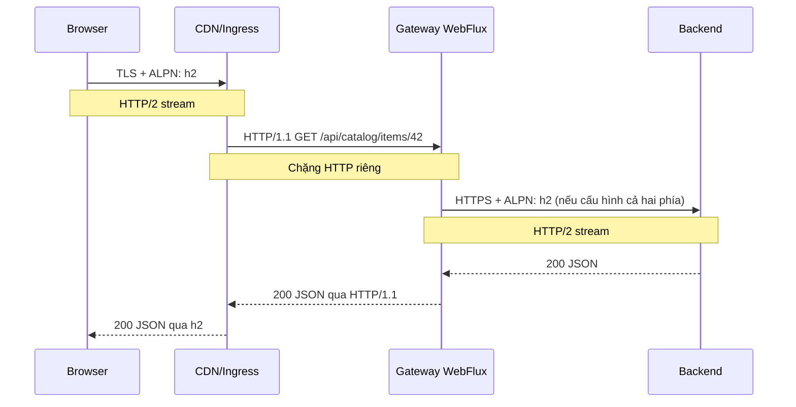
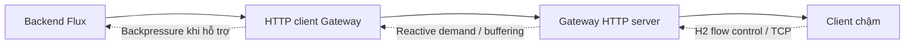

# HTTP/2 và điều kiện hỗ trợ xuyên suốt các chặng

## 1. Vấn đề: client dùng HTTP/2 chưa chắc backend cũng dùng HTTP/2

Trong hệ thống microservices, **Spring Cloud Gateway** xử lý route predicate, filter chain, biến đổi đường dẫn/header, discovery, xác thực, rate limiting, circuit breaker, retry, TLS và quan sát request. Ở chương **WebSocket và truyền luồng**, một câu hỏi rất thực tế là: *Khi trình duyệt đã kết nối HTTP/2 tới cổng vào, liệu mọi lời gọi, WebSocket và luồng streaming có tự động đi bằng HTTP/2 đến microservice không?*

**Không.** Một reverse proxy/Gateway có thể **kết thúc một kết nối HTTP** rồi **tạo kết nối HTTP khác** tới upstream. Giao thức được thương lượng **độc lập trên từng chặng**.

Ví dụ:

```text
Browser ─── h2 + TLS ───> Ingress / Load Balancer
                              │
                        HTTP/1.1 + TLS
                              │
                              v
                      Spring Cloud Gateway
                              │
                        HTTP/1.1 hoặc h2/h2c
                              │
                              v
                         catalog-service
```

Việc Browser DevTools ghi `h2` trên request **chỉ chứng minh kết nối đến bên nhận trực tiếp** (thường là CDN/Ingress). Nó **không chứng minh** Gateway đang nhận HTTP/2 hoặc `catalog-service` đang nhận HTTP/2. Thậm chí request HTTP/2 từ client có thể được proxy thành HTTP/1.1 mà vẫn đúng nghiệp vụ.

Sau bài, bạn sẽ:

1. Phân biệt **HTTP/1.1**, **HTTP/2 over TLS (`h2`)** và **cleartext HTTP/2 (`h2c`)**.
2. Mô hình hóa **từng hop**: client ↔ CDN/ingress ↔ Gateway ↔ backend, kể cả TLS termination và ALPN.
3. Cấu hình **HTTP/2 inbound** ở Spring Boot WebFlux, rồi tách nó khỏi cấu hình **HTTP client outbound** của Gateway.
4. Kiểm thử giao thức **thực sự được thương lượng** bằng `curl`, log backend và các phép thử trên từng chặng.
5. Phân biệt HTTP/2 thông thường, **SSE/streaming**, **WebSocket HTTP/1.1 Upgrade** và **WebSocket over HTTP/2 (RFC 8441)**.
6. Thiết kế timeout, flow control, TLS, auth, filter chain và quan sát request khi sử dụng HTTP/2 trong production.

> **Phạm vi:** Ví dụ dựa trên **Spring Cloud Gateway Server WebFlux 5.0.x** với namespace `spring.cloud.gateway.server.webflux`, Spring Boot 4.x tương thích và Reactor Netty. Các đoạn cấu hình certificate/keystore và địa chỉ là **ví dụ lab**; không có chứng chỉ hoặc dịch vụ nào được tạo/chạy trong bước viết bài. Server Web MVC có runtime Servlet riêng, phải kiểm tra container/tính năng của biến thể đó trước khi áp dụng.

## 2. HTTP/2 giải quyết vấn đề gì, và không giải quyết gì?

HTTP/2 thay đổi **cách biểu diễn thông điệp HTTP trên kết nối**: frame nhị phân, nhiều **streams** trên một TCP connection, HPACK header compression, flow control và stream prioritization. Nó vẫn truyền các ngữ nghĩa HTTP quen thuộc như method, status, URI và headers.

| Khía cạnh | HTTP/1.1 | HTTP/2 |
|---|---|---|
| Dạng truyền | Request/response textual start line + headers | Binary frames; header block, DATA, SETTINGS, RST_STREAM... |
| Nhiều request đồng thời | Có thể dùng nhiều connections; pipelining ít được dùng | **Multiplexing** nhiều streams trên một connection |
| Header compression | Không có HPACK ở tầng giao thức | HPACK, có trạng thái theo **mỗi kết nối** |
| Flow control | Không có WINDOW_UPDATE HTTP/2 | Window cấp **stream** và **connection** |
| TLS | HTTP/1.1 có thể chạy trên HTTP hoặc HTTPS | `h2` qua TLS, `h2c` qua cleartext |
| WebSocket cổ điển | `Upgrade: websocket`, phản hồi 101 | Không dùng nguyên cách Upgrade H1; cần extended CONNECT nếu triển khai WS trên H2 |
| Server-Sent Events | Có, response giữ mở | Có, DATA frames của một stream giữ mở |
| gRPC chuẩn | Không được thiết kế cho native gRPC | gRPC thường cần HTTP/2, trailers và streaming semantics |

**HTTP/2 không tự làm application non-blocking.** Nếu một custom GatewayFilter gọi `block()`, backend dùng truy vấn đồng bộ quá lâu hoặc proxy buffer cả response trước khi gửi, vẫn có thể nghẽn. HTTP/2 cũng **không sửa** lỗi auth, timeout, sai circuit breaker, dữ liệu lớn hoặc phân quyền.

### 2.1. Stream HTTP/2 không phải WebSocket session

- **HTTP/2 stream:** một luồng trao đổi HTTP độc lập trong connection HTTP/2; có thể là GET JSON, SSE, download hoặc một gRPC call.
- **WebSocket session:** kết nối/message protocol hai chiều khác HTTP request-response thông thường; thường bắt đầu bằng **HTTP/1.1 Upgrade** trong Spring Cloud Gateway WebFlux route `ws://` / `wss://`.
- **Reactor Flux/Mono:** abstraction bất đồng bộ trong Java; **không phải** bản thân một HTTP/2 stream, mặc dù dữ liệu Flux có thể được serialize dần vào response.

Không đánh đồng `Flux<ServerSentEvent<?>>`, một HTTP/2 stream và WebSocket. Ba thứ có lifecycles, framing, backpressure và loại client khác nhau.

## 3. Bốn điều kiện cần để một chặng chạy HTTP/2

Một chặng từ A tới B chỉ thật sự sử dụng HTTP/2 khi thỏa các điều kiện **trên chính chặng đó**:

1. **Client của chặng A** hỗ trợ và được cấu hình thử HTTP/2 (H2 hoặc H2C).
2. **Server của chặng B** có HTTP/2 listener/protocol handler tương thích.
3. **Cách thương lượng phù hợp:** TLS + ALPN cho `h2`, hoặc cơ chế H2C thích hợp cho cleartext.
4. **Network/TLS/proxy không làm hỏng kết nối:** certificate, trust, SNI, hostname, firewall, reverse proxy và policy phải cho phép.

Thêm nữa, với **tính năng ứng dụng** như WebSocket, gRPC hoặc SSE, các hop phải hỗ trợ **kiểu trao đổi tương ứng**, không chỉ hỗ trợ giao thức H2 cơ bản.

### 3.1. TLS, ALPN, h2 và h2c

| Thuật ngữ | Là gì? | Lưu ý khi dùng với Gateway |
|---|---|---|
| `h2` | HTTP/2 qua TLS | Client/server thương lượng bằng **ALPN** trong TLS handshake |
| `h2c` | HTTP/2 cleartext | Chỉ nên dùng khi chặng mạng đã tin cậy và chính sách cho phép; không có bảo vệ TLS |
| `ALPN` | TLS extension thương lượng protocol application | Kết quả có thể là `h2` hoặc `http/1.1` |
| `SNI` | TLS extension chọn certificate/site theo hostname | Khác ALPN; SNI không tự bật HTTP/2 |
| `H2C upgrade` | Bắt đầu HTTP/1.1 rồi yêu cầu đổi sang H2C | Cần client và server hiểu quy trình upgrade |
| `H2C prior knowledge` | Client bắt đầu giao thức H2C trực tiếp | Không có fallback H1 nếu bên kia không hiểu |

**Đừng nhập nhằng H2C upgrade với WebSocket Upgrade**: cả hai có thể nhắc tới HTTP/1.1 Upgrade nhưng **đích giao thức khác nhau**. H2C không phải WebSocket.

### 3.2. Một chuỗi có thể dùng ba giao thức khác nhau



Mỗi hop có thể có **TCP connection pool**, timeout, TLS handshake và số streams đồng thời riêng. HTTP/2 của chặng A **không được “chuyển nguyên frame” qua Gateway như tunnel mặc định**; HTTP request/response semantics được proxy/viết lại ở biên.

### 3.3. Bảng tương thích theo từng hop

| Client → Ingress | Ingress → Gateway | Gateway → backend | Hệ thống có thể hoạt động? |
|---|---|---|---|
| H2 TLS | H1 TLS | H1 TLS | **Có**, đây là topology phổ biến |
| H2 TLS | H1 cleartext trong mạng tin cậy | H1 HTTPS | **Có** về giao thức; cần đánh giá bảo mật chặng cleartext |
| H2 TLS | H2 TLS | H1 HTTP | **Có** về giao thức; lưu ý backend chặng cuối không mã hóa |
| H1 TLS | H2C nội bộ | H2 TLS | **Có**, nếu proxy biết mở H2C ở hop giữa |
| H2 TLS | H2 TLS | H2 TLS | **Có**, nếu *từng* client/server và proxy hỗ trợ |
| H2 TLS | H1 TLS | Gateway bật inbound H2 nhưng outbound H1 | **Vẫn có thể dùng H1 outbound**; bật inbound không ép backend H2 |
| H2 TLS | H2C prior knowledge nhưng server chỉ H1 | Bất kỳ | **Lỗi giao thức** ở hop Ingress → Gateway |

**Điều cần nhớ:** “HTTP/2 xuyên suốt các chặng” là **một tập hợp điều kiện phải xác minh**, không phải hệ quả của một nút bật trên CDN.

## 4. Cấu hình Spring Boot WebFlux nhận HTTP/2 (inbound)

### 4.1. Spring Boot điều khiển listener phía server

Trên Gateway Server WebFlux dùng Reactor Netty, Spring Boot hỗ trợ:

```yaml
server:
  port: 8443
  http2:
    enabled: true
  ssl:
    key-store: file:./certs/gateway-local.p12
    key-store-type: PKCS12
    key-store-password: ${GATEWAY_KEYSTORE_PASSWORD}
```

Đây là cấu hình **listener HTTPS của chính Gateway**. Có TLS và certificate, Spring Boot/Netty có thể thương lượng `h2` bằng ALPN với client hỗ trợ; client H1 có thể dùng H1 khi server/ngăn xếp cấu hình fallback H1.

**Đây chưa phải cấu hình client Gateway → backend.** Thậm chí URI route `https://backend.internal` không tự đảm bảo Gateway outbound sử dụng HTTP/2.

### 4.2. Chứng chỉ lab, không dùng cho production

Trên máy phát triển, người học có thể tự tạo file `certs/gateway-local.p12` với keystore password chỉ dành cho lab:

```bash
mkdir -p certs
keytool -genkeypair \
  -alias gateway-local \
  -keyalg RSA -keysize 2048 \
  -validity 7 \
  -storetype PKCS12 \
  -keystore certs/gateway-local.p12 \
  -storepass changeit -keypass changeit \
  -dname 'CN=localhost,OU=Lab,O=Training,L=Local,ST=Local,C=VN' \
  -ext 'SAN=dns:localhost,ip:127.0.0.1'

export GATEWAY_KEYSTORE_PASSWORD=changeit
```

**Lưu ý:** Ví dụ lệnh trên dành cho shell kiểu Unix trong môi trường thực hành; trên PowerShell cần điều chỉnh cú pháp/biến môi trường. Không commit keystore/private key hoặc password vào Git; production dùng certificate từ CA đáng tin, secret manager và quy trình rotation.

### 4.3. Khi TLS được kết thúc ở Ingress

Nếu TLS kết thúc tại ingress và Gateway nhận cleartext:

```yaml
# Gateway nội bộ sau ingress; chỉ bật trong mạng đã kiểm soát.
server:
  port: 8080
  http2:
    enabled: true
```

Không bật SSL ở đây nghĩa là **Spring Boot có thể dùng h2c**; tuy nhiên ingress cũng phải được cấu hình **thực sự mở H2C tới Gateway**. Nhiều ingress mặc định proxy HTTP/1.1, nên request vẫn có thể là H1. Đừng cấu hình `h2c` trên Gateway với kỳ vọng proxy tự đổi giao thức.

**Đánh đổi bảo mật:** `h2c` không mã hóa traffic giữa ingress và Gateway. Chỉ dùng khi đã có mạng tin cậy hoặc overlay/mTLS bảo vệ bằng cơ chế khác và phù hợp policy. Không phơi H2C public trên Internet chỉ để tránh cấu hình TLS.

### 4.4. Kiểm tra ALPN và phiên bản thực tại client

```bash
# Kỳ vọng h2 nếu Gateway TLS và curl có HTTP/2 support.
curl --noproxy '*' -vk --http2 \
  'https://localhost:8443/actuator/health'

# So sánh HTTP/1.1 trên cùng listener.
curl --noproxy '*' -vk --http1.1 \
  'https://localhost:8443/actuator/health'

# Chỉ xem HTTP version theo curl, không suy từ body.
curl --noproxy '*' -sk --http2 \
  -o /dev/null -w 'HTTP %{http_version} code %{http_code}\n' \
  'https://localhost:8443/actuator/health'
```

`-k` **chỉ dùng trong lab self-signed**; production phải xác minh chứng chỉ đúng. Nếu chưa thêm/cho phép Actuator health, dùng **một route ứng dụng** đã cấu hình thay vì dựa vào health endpoint mặc định. `curl --http2` là yêu cầu **thử** HTTP/2, không nhất thiết cưỡng bức H2 nếu client/server fallback H1; xem `%{http_version}` và ALPN trong verbose output.

### 4.5. Thử H2C bằng curl trên môi trường nội bộ

```bash
# Chỉ áp dụng khi server HTTP cleartext thực sự hỗ trợ H2C prior knowledge.
curl --noproxy '*' -v --http2-prior-knowledge \
  'http://127.0.0.1:8080/actuator/health'
```

Nếu server chỉ hỗ trợ HTTP/1.1, request H2C prior knowledge có thể lỗi mà không có fallback. `--http2` và `--http2-prior-knowledge` **không giống nhau** trên cleartext; kiểm tra phiên bản curl và server. Không dùng H2C trên một hop production chưa được duyệt.

## 5. Gateway gửi HTTP/2 tới backend: cấu hình outbound riêng

### 5.1. Vì sao server.http2.enabled không đủ?

Một ứng dụng Spring Cloud Gateway Server WebFlux đồng thời đóng **hai vai trò**:

| Vai trò | Thành phần chính | Cấu hình liên quan |
|---|---|---|
| **HTTP server** (nhận request từ client/ingress) | Reactor Netty `HttpServer` do Spring Boot cấu hình | `server.http2.enabled`, `server.ssl.*` |
| **HTTP client** (gửi request sang backend) | Reactor Netty `HttpClient` do Gateway quản lý | `spring.cloud.gateway.server.webflux.httpclient.*` và `HttpClientCustomizer` |
| **WebSocket proxy client** | WebSocket routing infrastructure | `ws://` / `wss://` và các WebSocket settings |

Tài liệu Reactor Netty ghi rõ **HTTP client mặc định sử dụng HTTP/1.1** và cần cấu hình protocol để chủ động hỗ trợ HTTP/2. Vì vậy, dù client vào Gateway bằng H2, backend vẫn có thể nhận H1 nếu Gateway HTTP client không được tùy chỉnh.

**Đừng nhầm** các property `server.http2.enabled` (inbound server) và `spring.cloud.gateway.server.webflux.httpclient.*` (outbound). Bảng configuration properties Gateway 5.0.x có timeout, TLS, proxy, connection pool và WebSocket options nhưng không nên **bịa** một khóa như `httpclient.http2.enabled` rồi kỳ vọng framework nhận nó.

### 5.2. HttpClientCustomizer của Gateway

Khi muốn thử H2 **cho các HTTP routes outbound HTTPS**, Spring Cloud Gateway cung cấp interface `HttpClientCustomizer`:

```java
package com.example.gateway;

import org.springframework.cloud.gateway.config.HttpClientCustomizer;
import org.springframework.context.annotation.Bean;
import org.springframework.context.annotation.Configuration;
import reactor.netty.http.HttpProtocol;

@Configuration
public class GatewayOutboundProtocolConfig {

    @Bean
    HttpClientCustomizer preferHttp2ForOutboundHttps() {
        return client -> client.protocol(
            HttpProtocol.HTTP11,
            HttpProtocol.H2
        );
    }
}
```

Ý nghĩa:

- `HttpProtocol.HTTP11` và `HttpProtocol.H2` cho phép client TLS **thương lượng H2 hoặc rơi về HTTP/1.1** theo ALPN khi backend hỗ trợ.
- Với route `uri: https://catalog.internal.test:8444`, HTTP client của Gateway phải có **TLS phù hợp**; chỉ `.protocol(H2)` không thay thế TLS trust/certificate configuration.
- Đây là `HttpClientCustomizer` **được áp dụng lên HTTP client dùng bởi Gateway**, không mặc định riêng cho một route. Vì thế **phải kiểm thử mọi route bị ảnh hưởng** và tránh vô tình phá route H1, proxy enterprise hoặc upstream không hỗ trợ H2.
- `HttpProtocol.H2` **không phải** `H2C`. Nếu route dùng `http://` cleartext, cần chính sách/thiết kế H2C riêng, không giả định H2 TLS được thương lượng trên một URL HTTP.

Một bean customizer có thể phù hợp trên **profile/staging riêng dành cho upstream HTTPS hỗ trợ H2**. Không bật hàng loạt trong Gateway hỗn hợp gồm HTTP, HTTPS, WebSocket và legacy services mà chưa kiểm tra compatibility.

### 5.3. Ví dụ route HTTPS đến backend hỗ trợ h2

```yaml
spring:
  cloud:
    gateway:
      server:
        webflux:
          routes:
            - id: catalog-https
              uri: https://catalog.internal.test:8444
              predicates:
                - Path=/api/catalog/**
                - Method=GET
              filters:
                - StripPrefix=2
          httpclient:
            connect-timeout: 2000
            response-timeout: 5s
            ssl:
              handshake-timeout: 10s
              # Nếu backend dùng private CA, cấu hình CA đáng tin tại đây:
              # trusted-x509-certificates:
              #   - file:./certs/internal-ca.crt
```

Điều kiện bắt buộc:

1. Backend hostname `catalog.internal.test` phải phân giải được **từ môi trường Gateway**.
2. Backend listener `8444` phải bật TLS và HTTP/2/ALPN, hoặc hỗ trợ HTTP/1.1 fallback.
3. Gateway phải **tin certificate chain** và kiểm tra đúng hostname/SNI. Private CA phải được phân phối an toàn.
4. `HttpClientCustomizer` mục 5.2 phải được nạp; cấu hình TLS outbound được áp dụng đúng chặng.
5. Logs/metrics/packet trace cần chứng minh **ALPN kết quả** cho Gateway → backend, không chỉ kết quả client → Gateway.

Trên production, không bật `use-insecure-trust-manager: true` hay tắt hostname verification để “cho H2 chạy”. Nếu TLS handshake/ALPN thất bại, cần sửa trust, DNS, SNI, cipher/protocol TLS hoặc server config thay vì bỏ xác minh chứng chỉ.

### 5.4. Thử h2c outbound chỉ trong môi trường cô lập

Nếu backend lab thực sự hỗ trợ **H2C prior knowledge** trên `http://localhost:8081`, có thể dùng một **configuration profile khác**:

```java
package com.example.gateway;

import org.springframework.cloud.gateway.config.HttpClientCustomizer;
import org.springframework.context.annotation.Bean;
import org.springframework.context.annotation.Configuration;
import org.springframework.context.annotation.Profile;
import reactor.netty.http.HttpProtocol;

@Configuration
@Profile("h2c-lab")
public class GatewayH2cLabConfig {

    @Bean
    HttpClientCustomizer h2cOnlyOutbound() {
        return client -> client.protocol(HttpProtocol.H2C);
    }
}
```

Khi dùng `HttpProtocol.H2C` **một mình**, Reactor Netty mô tả đây là chế độ **prior knowledge**, không tự fallback về H1. Hãy chỉ áp dụng trên một Gateway lab chỉ có backend H2C tương thích. Nếu cần thử H2C upgrade và H1 fallback, API cho phép cấu hình **`HTTP11, H2C`** cùng nhau, nhưng phải test đúng server/proxy trên chặng ấy.

**Không bật đồng thời hai beans** mục 5.2 và 5.4 trong cùng một profile rồi kỳ vọng thứ tự tùy biến tự giải quyết mọi trường hợp. Với hệ thống có upstream đa giao thức, thiết kế client/provider riêng hoặc giữ HTTP/1.1 outbound khi không có nhu cầu cụ thể.

### 5.5. Khi nào không cần ép H2 từ Gateway ra backend?

Chấp nhận HTTP/1.1 outbound thường là lựa chọn hợp lý nếu:

- Một Gateway đã dùng connection pooling và backend có latency thấp.
- Ingress và Gateway tập trung ở network nội bộ có đủ bandwidth.
- Backend chỉ hỗ trợ HTTP/1.1 và tính năng SSE đang chạy ổn.
- Việc bật H2 làm phức tạp TLS, proxy doanh nghiệp, test hoặc WebSocket traffic.
- Chưa có metric chứng minh H2 cải thiện throughput/latency so với H1.

**H2 là một lựa chọn về transport/hiệu năng**, không phải mục tiêu bắt buộc cho mọi chặng. Điều bắt buộc là **giao thức được từng phía hỗ trợ và bảo mật đúng**.

## 6. Lab đầy đủ: client HTTP/2 → Gateway → backend HTTP/1.1

Lab đầu tiên minh họa trường hợp **hỗn hợp** rất thường gặp. Ta bật H2 **ở inbound Gateway**, để backend dùng H1 mặc định. Như vậy người học thấy rõ kết quả không được suy diễn từ phía client.

### 6.1. Dependency

Tạo hai ứng dụng Spring Boot theo BOM tương thích:

```xml
<!-- Project gateway-demo -->
<dependency>
  <groupId>org.springframework.cloud</groupId>
  <artifactId>spring-cloud-starter-gateway-server-webflux</artifactId>
</dependency>

<!-- Project stream-demo, khai báo ở POM RIÊNG -->
<dependency>
  <groupId>org.springframework.boot</groupId>
  <artifactId>spring-boot-starter-webflux</artifactId>
</dependency>
```

Chỉ chọn một starter phù hợp cho mỗi project; không thêm Servlet/Web MVC starter vào Gateway WebFlux chỉ để xử lý SSE. Nếu dùng các version Spring Boot thay đổi tên artifact của starter, phải theo BOM/tài liệu của phiên bản cụ thể.

### 6.2. Backend WebFlux có JSON và SSE

Ứng dụng **stream-demo** chạy cổng `8081`. File `StreamDemoApplication.java`:

```java
package com.example.stream;

import java.time.Duration;
import java.util.Map;
import org.springframework.boot.SpringApplication;
import org.springframework.boot.autoconfigure.SpringBootApplication;
import org.springframework.http.MediaType;
import org.springframework.http.codec.ServerSentEvent;
import org.springframework.web.bind.annotation.GetMapping;
import org.springframework.web.bind.annotation.PathVariable;
import org.springframework.web.bind.annotation.RestController;
import reactor.core.publisher.Flux;

@SpringBootApplication
@RestController
public class StreamDemoApplication {

    public static void main(String[] args) {
        SpringApplication.run(StreamDemoApplication.class, args);
    }

    @GetMapping("/items/{id}")
    public Map<String, String> item(@PathVariable String id) {
        return Map.of("id", id, "service", "stream-demo");
    }

    @GetMapping(path = "/ticks", produces = MediaType.TEXT_EVENT_STREAM_VALUE)
    public Flux<ServerSentEvent<String>> ticks() {
        return Flux.interval(Duration.ofSeconds(1))
            .take(6)
            .map(index -> ServerSentEvent.<String>builder()
                .id(Long.toString(index))
                .event("tick")
                .data("tick-" + index)
                .build());
    }
}
```

Cấu hình **backend**:

```yaml
server:
  port: 8081
  # Giữ HTTP/1.1 (không bật HTTP/2 cho backend của lab này).
spring:
  application:
    name: stream-demo
```

Vì backend trả **SSE** qua `Flux` nên response giữ mở vài giây và phát dần từng event. Nó vẫn có thể chạy trên HTTP/1.1; **SSE không đòi hỏi HTTP/2**.

### 6.3. Gateway inbound TLS + H2, outbound H1

Trong **gateway-demo**, dùng certificate lab tạo theo mục 4.2:

```yaml
server:
  port: 8443
  http2:
    enabled: true
  ssl:
    key-store: file:./certs/gateway-local.p12
    key-store-type: PKCS12
    key-store-password: ${GATEWAY_KEYSTORE_PASSWORD}

spring:
  application:
    name: gateway-demo
  cloud:
    gateway:
      server:
        webflux:
          routes:
            - id: catalog-http1-backend
              uri: http://127.0.0.1:8081
              predicates:
                - Path=/api/catalog/**
                - Method=GET
              filters:
                - StripPrefix=2

            - id: sse-http1-backend
              uri: http://127.0.0.1:8081
              predicates:
                - Path=/api/events/**
                - Method=GET
              filters:
                - StripPrefix=2
```

**Không nạp `HttpClientCustomizer` mục 5** trong lab này: mục tiêu của nó là minh họa H2 inbound và H1 outbound. `localhost` ở URL backend giả định Gateway/backend cùng máy; với Docker/Kubernetes, phải thay bằng hostname/Service có thể truy cập từ Gateway.

### 6.4. Test JSON và SSE ở HTTP/2 inbound

```bash
# Backend H1 trực tiếp
curl --noproxy '*' -sS -i --http1.1 \
  'http://127.0.0.1:8081/items/42'

# Frontend kết nối H2 TLS đến Gateway
curl --noproxy '*' -sk --http2 \
  -o /dev/null -w 'client-to-gateway HTTP/%{http_version} status %{http_code}\n' \
  'https://localhost:8443/api/catalog/items/42'

# SSE không buffer stdout; hiển thị event phát từng giây.
curl --noproxy '*' -k -N --http2 \
  'https://localhost:8443/api/events/ticks'
```

Output SSE minh họa:

```text
id:0
event:tick
data:tick-0

id:1
event:tick
data:tick-1

...
```

**Kết luận đúng:** `curl` cho biết client → Gateway là H2 nếu `%{http_version}` hiển thị `2`, và SSE được nhận tăng dần. **Chưa đủ chứng minh Gateway → backend H1** chỉ từ response client; trong lab, vì backend chưa bật HTTP/2 và không có customizer H2 outbound, chặng đó được kỳ vọng là H1. Khi đưa vào hệ thống thật, phải kiểm chứng qua **access logs của backend, connection ALPN/packet inspection được cấp quyền hoặc telemetry trên outbound client**.

### 6.5. Bật H2C ở backend không tự đổi Gateway outbound

Nếu sau đó thêm `server.http2.enabled: true` vào backend chạy cleartext, backend **có khả năng nhận H2C**, nhưng Gateway HTTP client vẫn có thể tiếp tục dùng H1. Muốn thử H2C outbound, phải dùng đúng protocol config ở mục 5.4 và một network lab an toàn; không suy từ khả năng server sang việc client đã chuyển giao thức.

## 7. WebSocket: HTTP/2 hoạt động cho GET không có nghĩa WebSocket chạy qua H2

### 7.1. WebSocket HTTP/1.1 cổ điển

WebSocket theo RFC 6455 thường bắt đầu bằng một request HTTP/1.1:

```http
GET /ws/echo HTTP/1.1
Host: gateway.example.test
Upgrade: websocket
Connection: Upgrade
Sec-WebSocket-Key: <random-base64>
Sec-WebSocket-Version: 13
```

Nếu chấp nhận, server trả `101 Switching Protocols` và bắt đầu truyền **WebSocket frames** theo kết nối đã nâng cấp. Với Spring Cloud Gateway Server WebFlux, route có `uri: ws://...` hoặc `wss://...` được **Websocket Routing Filter** xử lý.

Ví dụ route qua WebFlux:

```yaml
# Trích đoạn dưới spring.cloud.gateway.server.webflux.routes:
- id: websocket-echo
  uri: ws://127.0.0.1:8081
  predicates:
    - Path=/ws/**
  filters:
    - StripPrefix=1
```

Client gọi `wss://localhost:8443/ws/echo` (TLS phía Gateway), còn Gateway dùng `ws://127.0.0.1:8081/echo` vào backend lab. **`wss` đến Gateway không làm chặng Gateway → backend tự động thành `wss`**; chọn `wss://` upstream khi cần mã hóa/mTLS theo kiến trúc.

### 7.2. Backend WebFlux WebSocket echo để thực hành

Trong **stream-demo :8081** của mục 6, thêm một class cấu hình:

```java
package com.example.stream;

import java.util.Map;
import org.springframework.context.annotation.Bean;
import org.springframework.context.annotation.Configuration;
import org.springframework.web.reactive.HandlerMapping;
import org.springframework.web.reactive.handler.SimpleUrlHandlerMapping;
import org.springframework.web.reactive.socket.WebSocketHandler;

@Configuration
public class WebSocketEchoConfig {

    @Bean
    HandlerMapping echoWebSocketMapping() {
        WebSocketHandler echo = session ->
            session.send(
                session.receive()
                    .map(message -> message.getPayloadAsText())
                    .map(session::textMessage)
            );

        SimpleUrlHandlerMapping mapping = new SimpleUrlHandlerMapping();
        mapping.setUrlMap(Map.of("/echo", echo));
        mapping.setOrder(-1);
        return mapping;
    }
}
```

Với Spring Boot WebFlux auto-configuration thông thường, `WebSocketHandlerAdapter` đã được khai báo bởi WebFlux configuration; class ở trên chỉ thêm `HandlerMapping`. Nếu xây WebFlux infrastructure thủ công và không dùng WebFlux config mặc định, cần đăng ký adapter đúng package `org.springframework.web.reactive.socket.server.support.WebSocketHandlerAdapter`. Không đăng ký thêm bean trùng khi framework đã cung cấp.

WebSocket backend chỉ **echo message**; đây không phải ứng dụng chat có bảo mật. Trong production cần giới hạn kích thước payload, số connections, quyền user/tenant, Origin và timeout; không echo secrets.

Sau khi thêm route WebSocket ở Gateway và chạy backend, có thể thử bằng một WebSocket client:

```bash
# Ví dụ chỉ khi đã cài websocat, dùng -k CHỈ trong lab self-signed.
websocat -k wss://localhost:8443/ws/echo
# Nhập: xin chao
# Dự kiến nhận lại: xin chao
```

Nếu kiểm tra bằng browser, `new WebSocket("wss://localhost:8443/ws/echo")` cần certificate đã được browser tin; kết quả thất bại do certificate không phải bằng chứng route WebSocket sai.

### 7.3. HTTP/2 không dùng hop-by-hop Upgrade header

Theo **RFC 9113**, HTTP/2 **không cho phép** các header mang semantics connection-specific như `Connection`, `Keep-Alive`, `Proxy-Connection`, `Transfer-Encoding` và `Upgrade`. Vì thế:

```text
HTTP/1.1 WebSocket:
  GET + Connection: Upgrade + Upgrade: websocket
  Response 101 Switching Protocols

HTTP/2 WebSocket (RFC 8441):
  Extended CONNECT + :protocol = websocket
  Không dùng Connection/Upgrade/101 theo handshake H1
```

**Không** cố sửa một request H2 bằng cách thêm thủ công `Connection: Upgrade` hay `Upgrade: websocket` trong Gateway `AddRequestHeader`. Điều đó làm message H2 không hợp lệ. Cần proxy/framework **thực sự hiểu** kiểu handshake được thương lượng.

### 7.4. WebSocket over HTTP/2 theo RFC 8441

RFC 8441 mô tả **Extended CONNECT** để bootstrap WebSocket trên một HTTP/2 stream:

1. H2 server quảng bá `SETTINGS_ENABLE_CONNECT_PROTOCOL = 1`.
2. H2 client chỉ gửi Extended CONNECT khi peer đã báo hỗ trợ.
3. Request dùng pseudo-header `:method=CONNECT` và `:protocol=websocket` cùng `:scheme`, `:authority`, `:path` theo tiêu chuẩn.
4. Sau handshake thành công, WebSocket frames đi bên trong **một H2 stream**; các H2 streams khác có thể multiplex trên cùng connection.

Ví dụ **dạng khái niệm**, không phải raw text headers có thể paste vào curl:

```text
:method = CONNECT
:protocol = websocket
:scheme = https
:authority = gateway.example.test
:path = /ws/echo
origin = https://app.example.test
```

**Giới hạn xác nhận quan trọng:** Tài liệu Gateway Server WebFlux 5.0.x mô tả proxy WebSocket qua `ws/wss` routes, **không cam kết mọi tổ hợp Reactor Netty, Spring Cloud Gateway, Ingress và browser đều hỗ trợ RFC 8441 xuyên suốt**. Chỉ bật H2 cho HTTP server bằng `server.http2.enabled` **không chứng minh Extended CONNECT đã được triển khai ở WebSocket handler/ingress**.

Để thiết kế WebSocket có độ tin cậy cao:

- Nếu một hop chỉ hỗ trợ **WebSocket H1 Upgrade**, cấu hình hop đó để dùng HTTP/1.1 cho WebSocket và kiểm thử; vẫn có thể dùng H2 cho **các request HTTP thông thường**.
- Nếu yêu cầu **RFC 8441**, xác nhận server quảng bá SETTINGS, browser/client hỗ trợ, CDN/Ingress có proxy CONNECT và backend có xử lý tương ứng.
- **Không suy ra** session WebSocket đang chạy H2 chỉ từ việc những GET JSON khác được hiển thị là `h2`.
- Kiểm tra handshake/method/protocol ở từng hop được phép quan sát; JavaScript WebSocket API không tự cho biết nó dùng H1 hay Extended CONNECT.

### 7.5. Origin và authentication trên WebSocket

Browser WebSocket handshake **không sử dụng cơ chế CORS fetch như HTTP API thông thường**; server/Gateway phải kiểm tra `Origin` phù hợp. Gateway WebFlux 5.0.x có các thuộc tính cho phép cấu hình origin của WebSocket:

```yaml
spring:
  cloud:
    gateway:
      server:
        webflux:
          websocket:
            allowed-origins:
              - https://app.example.test
```

Đây là **giá trị ví dụ**, không phải danh sách origin thực tế của một sản phẩm. Không đặt wildcard rộng nếu không có lý do; luôn thực hiện authentication và authorization cho handshake, hạn chế token/cookie được forward xuống upstream, rate limit **số lần kết nối** và giới hạn message size.

**Lưu ý TLS termination:** khi Gateway nằm sau ingress, việc kiểm tra origin/same-origin còn phụ thuộc host/scheme mà Gateway thấy; chỉ tin `Forwarded`/`X-Forwarded-*` từ proxy đã xác thực, không từ client Internet tùy ý.

### 7.6. WebSocket route không tự được HTTP/2 hóa bằng HttpClientCustomizer

`HttpClientCustomizer` ở mục 5 dùng để cấu hình **Reactor Netty outbound HTTP client** của HTTP routes. WebSocket proxy sử dụng hạ tầng WebSocket routing khác. Vì vậy, không suy ra WebSocket `ws://`/`wss://` được vận chuyển qua HTTP/2 chỉ nhờ `client.protocol(H2)`. Hai năng lực **phải được thử độc lập**.

## 8. SSE, NDJSON và truyền luồng trên HTTP/2

### 8.1. SSE phù hợp cả HTTP/1.1 lẫn HTTP/2

**Server-Sent Events (SSE)** là HTTP response có `Content-Type: text/event-stream`, thường giữ mở và đẩy nhiều events từ server tới browser. Nó **một chiều** từ server tới client; nếu cần hai chiều liên tục, cân nhắc WebSocket hoặc giao thức khác.

| Tính năng | SSE | WebSocket |
|---|---|---|
| Kênh | HTTP response giữ mở | WebSocket session |
| Hướng | Server → client | Hai chiều |
| Nội dung | Text event stream | Text/binary message frames |
| HTTP/2 | Truyền như DATA trên một H2 stream | Cần RFC 8441 nếu thật sự dùng H2 |
| Proxy qua H1 | Có thể | Có, nhưng cần Upgrade |
| Khôi phục | EventSource có cơ chế tự reconnect/Last-Event-ID | Ứng dụng phải tự định nghĩa reconnect/ack |
| Buffering | Proxy có thể gây trễ nếu gom body | Message/frame/session có giới hạn riêng |

Khi HTTP/2 stream được thiết lập cho SSE, dữ liệu có thể được gửi **từng DATA frame**, không cần HTTP/1.1 `Transfer-Encoding: chunked`. Nếu Gateway hoặc ingress chờ **đầy đủ response body** mới flush, người dùng vẫn thấy events dồn cục dù protocol là H2.

### 8.2. Tránh buffer response streaming

Một số filter hoặc proxy features dễ ảnh hưởng SSE:

- Body rewrite/aggregation không phù hợp (ví dụ custom `ModifyResponseBody` đọc toàn bộ Flux).
- CDN/Ingress **proxy buffering** hoặc compression không flush đều.
- Response timeout/idle timeout ngắn hơn khoảng thời gian giữa hai events.
- Chậm consumer khiến buffers tăng, `flow control` không được quan sát đúng.
- Connection pool, retry hoặc circuit breaker được áp dụng như request ngắn mà không xét stream đã bắt đầu.

Với SSE public:

```http
HTTP/2 200
content-type: text/event-stream
cache-control: no-cache

id: 1
event: tick
data: tick-1
```

Trên H2, phần trên chỉ là **mô tả logic**; wire format là **frames nhị phân**, không có status line `HTTP/2 200` gửi như HTTP/1.1. Đừng copy đoạn ấy như raw byte capture.

### 8.3. Kiểm tra events đến theo thời gian thực

```bash
# -N tắt buffering phía stdout của curl.
curl --noproxy '*' -k -N --http2 \
  'https://localhost:8443/api/events/ticks'

# So sánh khi ép HTTP/1.1 trên cùng Gateway.
curl --noproxy '*' -k -N --http1.1 \
  'https://localhost:8443/api/events/ticks'
```

Quan sát **thời điểm từng event xuất hiện**. Nếu tất cả 6 events cùng xuất hiện sau 6 giây, điều tra proxy buffering hoặc response aggregation; không kết luận “H2 bị lỗi” chỉ từ nhãn protocol.

### 8.4. NDJSON và gRPC không phải cùng một loại stream

- **NDJSON** có thể gửi nhiều JSON objects phân cách newline trên HTTP/1.1 hoặc HTTP/2, nhưng client phải parse incrementally và proxy không được buffer toàn bộ.
- **gRPC** thường dựa trên HTTP/2, `application/grpc`, message framing và trailers như `grpc-status`. Một Gateway **HTTP proxy thông thường** không được mặc định xem là gRPC-aware ở mọi cấu hình.
- Nếu chặng Gateway → backend **downgrade sang HTTP/1.1**, một gRPC call chuẩn có thể thất bại do mất HTTP/2 semantics, đặc biệt trailers/streaming. Khi vận hành gRPC, dùng proxy/gateway hỗ trợ gRPC end-to-end và test bằng `grpcurl`/client thực trên từng hop.
- gRPC-Web là giao thức khác, cần gateway/translator hỗ trợ; **không tương đương** với native gRPC qua H2.

**Quy tắc:** HTTP/2 có thể giúp multiplex các luồng, nhưng **mỗi ứng dụng/giao thức streaming** vẫn có yêu cầu kỹ thuật riêng mà một cờ HTTP/2 không giải quyết được.

## 9. Chuyển đổi header giữa HTTP/1.1 và HTTP/2

### 9.1. Pseudo-headers của H2

HTTP/2 biểu diễn một số thành phần vốn là request line/Host trong HTTP/1.1 bằng **pseudo-headers**, ví dụ:

```text
:method = GET
:scheme = https
:authority = api.example.test
:path = /api/catalog/items/42
```

`:method`, `:scheme`, `:authority` và `:path` có ngữ nghĩa HTTP protocol; **không phải** các request headers bình thường để tự thêm vào `AddRequestHeader`. Gateway/server adapter chịu trách nhiệm diễn dịch request sang đối tượng HTTP rồi tạo request outbound theo protocol chặng tiếp theo.

### 9.2. Các header hop-by-hop bị cấm trong H2

Theo RFC 9113, một thông điệp HTTP/2 **không được chứa**:

```text
Connection
Keep-Alive
Proxy-Connection
Transfer-Encoding
Upgrade
```

Ngoại lệ `TE` trên HTTP/2 request chỉ có thể mang giá trị `trailers`. Khi chuyển H1 → H2, intermediary **phải loại các header connection-specific**. Đừng buộc Gateway giữ `Transfer-Encoding: chunked` từ H1 lên H2; HTTP/2 DATA frames mang body và có `END_STREAM` để biểu thị kết thúc.

| H1 source | H2 đích | Kết quả đúng |
|---|---|---|
| `Host: api.example.test` | `:authority=api.example.test` | Framework/proxy ánh xạ theo protocol |
| `Connection: keep-alive` | Không có header Connection | Không forward hop-by-hop |
| `Transfer-Encoding: chunked` | DATA frames | Không gửi transfer-encoding chunked |
| `Upgrade: websocket` | Không dùng trên H2 | Dùng H1 Upgrade hoặc Extended CONNECT nếu supported |
| `TE: trailers` | Có thể hợp lệ trên request H2 | Trailers cần end-to-end handling đúng |
| `Authorization: Bearer ...` | Header HTTP thông thường | Vẫn là credential nhạy cảm, không log/relay bừa bãi |

### 9.3. Filter thêm header không phải trình thương lượng HTTP/2

`AddRequestHeader`, `SetRequestHeader` hoặc `RemoveRequestHeader` của Gateway **sửa HTTP metadata**, không đổi protocol stack của TCP/TLS channel. Ví dụ:

```yaml
filters:
  - AddRequestHeader=X-Gateway-Route,catalog
```

không làm backend nhận H2. Ngược lại, tự thêm header `Connection: Upgrade` vào một route HTTPS có H2 có thể làm request bị coi là malformed. **Protocol negotiation thuộc server/client transport**, không phải các GatewayFilters biến đổi nội dung.

### 9.4. Forwarded headers và TLS termination

Ingress kết thúc TLS có thể gửi:

```http
Forwarded: proto=https;host=api.example.test
X-Forwarded-Proto: https
X-Forwarded-Host: api.example.test
```

Spring Boot có thể được cấu hình xử lý forwarded headers theo deployment:

```yaml
server:
  forward-headers-strategy: framework
```

**Điều kiện bảo mật:** Chỉ tin các header trên từ **proxy nằm trong trust boundary đã duyệt**. Internet client có thể tự gửi các header `X-Forwarded-*` giả; ingress phải xóa/ghi đè dữ liệu không tin cậy. Forwarded headers giúp tính đúng scheme/host cho redirect, cookies, Origin check và URL generation, nhưng **không truyền ALPN hoặc bảo đảm upstream là HTTP/2**.

### 9.5. H2 header compression không thay mã hóa

HPACK giúp giảm kích thước header block trên **một H2 connection**, còn TLS mã hóa byte truyền trên **một chặng TLS cụ thể**. HPACK không bảo vệ nội dung qua một hop cleartext `h2c`; nếu Gateway kết thúc TLS rồi dùng H1 cleartext tới backend, credential vẫn có thể lộ trên hop nội bộ khi bị nghe lén.

**Không để TokenRelay/Authorization bị copy sang route upstream ngoài danh sách tin cậy**, dù chặng đầu đã dùng `h2` an toàn.

## 10. Timeout, backpressure và HTTP/2 multiplexing

### 10.1. Multiplexing giảm số kết nối, không loại bỏ giới hạn tài nguyên

Một H2 TCP connection có thể chở nhiều streams. Tuy nhiên, server và client còn chịu:

- `SETTINGS_MAX_CONCURRENT_STREAMS`: giới hạn số streams đồng thời trên connection.
- `WINDOW_UPDATE` và flow-control windows: giới hạn bytes còn được gửi.
- Connection pool, maximum connections, pending acquire, TLS handshake.
- CPU để mã hóa/giải mã HPACK và TLS, kích thước headers/body.
- Chậm receiver, H2 stream reset, TCP congestion và **TCP-level head-of-line blocking** do packet loss.

Không nhầm “multiplexing nhiều streams” với “một connection có thể phục vụ vô hạn khách hàng”. Với nhiều SSE/WebSocket/gRPC sessions lâu dài, cần quản lý số concurrent streams, tải memory và thời gian tồn tại.

### 10.2. Response timeout khi stream giữ mở

Gateway WebFlux cho phép cấu hình Netty HTTP client:

```yaml
spring:
  cloud:
    gateway:
      server:
        webflux:
          httpclient:
            connect-timeout: 2000
            response-timeout: 30s
            pool:
              metrics: true
```

Chỉ dùng ví dụ như **điểm khởi đầu đo đạc**. Với SSE có event cách nhau lâu hoặc stream sống hàng giờ, hãy xác minh **response-timeout thực sự được tính theo cơ chế nào ở phiên bản Reactor Netty/Gateway đang chạy**; đồng thời xét idle timeout của Ingress/LB, service mesh và client. Không tùy tiện tăng tất cả timeout tới vô hạn.

**Timeout budget nên được thiết kế theo hop**:

```text
Client timeout
  > Ingress upstream idle / stream timeout (tùy use case)
  > Gateway network / response timeout phù hợp
  > Backend processing / heartbeat interval phù hợp
```

Bất đẳng thức trên chỉ là **hướng thiết kế**; không phải quy tắc phổ quát: một số timeout là idle, một số là tổng thời gian. Đối với luồng vô hạn, cần **heartbeat**, chính sách reconnect và cancellation rõ ràng thay vì một total deadline ngắn.

### 10.3. Backpressure hoạt động ở nhiều tầng



**Không bảo đảm một mapping 1:1 tuyệt đối** giữa Reactive Streams demand và H2 WINDOW_UPDATE. Reactor Netty, gateway filters, TLS, OS socket và proxies đều có buffers. Mục tiêu là tránh đọc vô hạn từ upstream khi downstream không tiêu thụ được.

Các anti-pattern:

```java
// SAI trong filter cho streaming response:
return responseBody.collectList()
    .flatMap(allChunks -> {
        // Lúc này toàn bộ stream có thể bị giữ trong RAM,
        // hoặc chẳng bao giờ hoàn tất với SSE vô hạn.
        return writeResponse(allChunks);
    });
```

Đây chỉ là **phản ví dụ cấu trúc**, không phải phương thức Java đầy đủ. Với response streaming, dùng proxy/filter có hỗ trợ streaming/backpressure, không tự `block()`, `subscribe()` hoặc `collectList()` không giới hạn.

### 10.4. Retry, circuit breaker và stream đã bắt đầu

Với GET JSON ngắn, retry khi kết nối lỗi đôi khi có thể chấp nhận được. Với stream:

- Request có thể đã gửi headers và một phần body tới client; **không thể bắt đầu lại** như thể chưa gửi gì.
- Một HTTP/2 stream có thể bị `RST_STREAM` hoặc connection nhận `GOAWAY`; client cần phân biệt reset của stream với toàn connection.
- Retry tự động một SSE/gRPC/WebSocket stream có thể gây duplicate events/messages, thay identity hoặc làm hỏng thứ tự.
- Circuit breaker có thể quyết định **khi bắt đầu** stream, nhưng không tự xử lý mọi lỗi **sau khi response đã commit** thành một fallback JSON mới.

Với SSE, ưu tiên event IDs, idempotent consumer và reconnect semantics. Với WebSocket, định nghĩa protocol heartbeat/reconnect/application ACK. Với gRPC, thiết kế retries có điều kiện dựa trên gRPC status, deadlines và idempotency.

### 10.5. Heartbeat ở tầng nào?

| Heartbeat | Kiểm tra điều gì? | Không chứng minh điều gì? |
|---|---|---|
| TCP keepalive | Sự tồn tại của TCP connection theo OS | Backend vẫn đang xử lý dữ liệu nghiệp vụ |
| H2 PING | Peer HTTP/2 ở một connection phản hồi | Tất cả H2 streams/backend instances khỏe |
| WebSocket Ping/Pong | Peer WS của một hop/session phản hồi | Backend nghiệp vụ sau Gateway còn hoạt động nếu Gateway tự trả pong |
| SSE comment/heartbeat | Có bytes đẩy qua HTTP stream | Nội dung data mới/chính xác |
| Application ping/ACK | Theo protocol nghiệp vụ của ứng dụng | Hệ thống khác upstream hoàn toàn khỏe |

**Không đồng nhất H2 PING với WebSocket ping** và không coi keepalive là health check nghiệp vụ.

## 11. An toàn vận hành và quan sát theo từng chặng

### 11.1. Những dữ liệu nên thu thập

| Chặng | Quan sát | Cách xác minh |
|---|---|---|
| Client → CDN/Ingress | HTTP version/ALPN, TLS/SNI, status | Browser DevTools, `curl -v -w` tới edge |
| Ingress → Gateway | Proxy upstream protocol, TLS, upstream connection info | Ingress logs/config + Gateway inbound access logs |
| Gateway → backend | HTTP client protocol/ALPN, pool, TLS/trust, downstream status | Gateway outbound metrics/log và backend inbound protocol logs |
| SSE | Event arrival intervals, disconnect/cancel, buffering | `curl -N` + timestamp trên client |
| WebSocket | Handshake result, frame counts, close codes, heartbeat | WebSocket client + Gateway/backend WS logs |
| H2 transport | Streams active, resets, GOAWAY, connection failures | Reactor Netty/Ingress metrics và trace/packet capture được phê duyệt |

**Một dòng log chứa `HTTP/2` trên edge không đủ để chứng minh end-to-end.** Cần bằng chứng **từng hop**. Tương tự, khi Gateway trả 200, không có nghĩa H2 được dùng, hoặc gRPC trailers được chuyển đúng.

### 11.2. Một vài lệnh kiểm tra ALPN và client support

```bash
# Kiểm tra curl có hỗ trợ HTTP/2 không (thường thấy "HTTP2" trong Features).
curl --version

# Kiểm tra trực tiếp ALPN của listener Gateway TLS lab.
openssl s_client -connect localhost:8443 \
  -servername localhost -alpn h2,http/1.1 < /dev/null

# Kết quả ALPN của kết nối CLIENT, không phải Gateway -> backend.
curl --noproxy '*' -vk --http2 \
  'https://localhost:8443/api/catalog/items/42'
```

OpenSSL hiển thị protocol đã thương lượng (ví dụ `ALPN protocol: h2`) nếu có; còn phải kiểm tra certificate verify result. Đừng lẫn **TLS ALPN h2** với **HTTP application status**. Trong lab self-signed, `curl -k` tắt certificate validation chỉ để thử; **không dùng `-k` trên production**.

Nếu muốn chứng minh **Gateway → backend h2**, dùng hai phép đo:

1. Từ **môi trường Gateway**, thử trực tiếp kết nối TLS/H2 tới backend bằng client hỗ trợ H2 và xác minh ALPN/certificate.
2. Với request proxy thật, quan sát **backend access protocol** và/hoặc **Gateway outbound client telemetry** để biết Gateway đã chọn H2, thay vì suy từ khả năng kết nối trực tiếp.

Kết quả (1) xác nhận **khả năng** của backend, còn (2) xác nhận **thực tế sử dụng** của Gateway.

### 11.3. Access log khác tracing

- **Access logs** có thể hiển thị request protocol, method/path, status và latency ở từng listener; không log toàn bộ URL query có PII.
- **Distributed tracing** dùng trace ID để ghép các request ở các hop; không tự lưu ALPN/protocol version nếu chưa instrument.
- **Gateway metrics** có thể ghi route ID, URI, status, HTTP method, connection pool; availability của protocol tags phụ thuộc library/version.
- **Network captures** cho TLS thường không thấy HTTP frames bên trong nếu không có quyền/khóa giải mã; ALPN vẫn có thể được quan sát trong handshake phù hợp, nhưng capture cần được phê duyệt về bảo mật.

Không bật Netty wiretap/TRACE rộng trên production: có thể lộ `Authorization`, cookies, request bodies, WebSocket messages và dữ liệu cá nhân. Khi cần debug, giới hạn phạm vi/thời gian, mask dữ liệu, theo policy tổ chức.

### 11.4. Đặt timeout và giới hạn để chống cạn tài nguyên

Một Gateway H2 có thể nhận nhiều streams trên một connection, nhưng mỗi SSE/WS stream vẫn có state, buffers và downstream connection/session. Cần:

- Giới hạn connection/streams, header size, frame/message size và body size hợp lý.
- Timeout handshake, idle, heartbeat và shutdown/drain phù hợp.
- Rate limiting theo identity thực (user/client), không chỉ IP hoặc TCP connection count.
- Chặn payload khổng lồ, malformed H2 frames và stream flood bằng reverse proxy/HTTP server đã cập nhật.
- Theo dõi memory/GC, Netty event-loop utilization, pool saturation và backpressure.

**H2 multiplexing không thay thế cơ chế quota/bulkhead.** Một client có thể giữ nhiều streams lâu dài và gây áp lực lớn nếu không có giới hạn.

## 12. Chẩn đoán khi HTTP/2 hoặc streaming không chạy như mong muốn

### 12.1. Bảng triệu chứng theo nguyên nhân

| Triệu chứng | Nguyên nhân khả dĩ | Hướng kiểm tra |
|---|---|---|
| Browser hiển thị `h2` nhưng Gateway log `HTTP/1.1` | Ingress/CDN kết thúc H2 rồi proxy H1 | Xem protocol upstream giữa edge và Gateway, không sửa backend trước |
| `curl --http2` vẫn in `1.1` | Listener không bật H2, ALPN fallback, curl thiếu hỗ trợ H2 hoặc TLS/proxy ở giữa | `curl --version`, `curl -v`, server HTTP/2/TLS config |
| `--http2-prior-knowledge` lỗi ngay | Server H2C không bật hoặc proxy chỉ hiểu H1 | Xác minh H2C listener, test direct trong network được phép |
| Gateway HTTP/2 inbound nhưng backend H1 | HTTP client outbound chưa bật H2 | Kiểm tra `HttpClientCustomizer`/backend capability và logs của hop Gateway → backend |
| Gateway outbound ép H2 và upstream fail handshake | Backend chỉ H1, TLS trust/SNI sai, ALPN không thương lượng | Thử direct `curl --http2` đến backend, kiểm tra cert và client protocols |
| H2C chặng nội bộ lỗi nhưng H1 chạy | Dùng `H2C` prior knowledge tới server chỉ hỗ trợ H1 hoặc chỉ H2C Upgrade | Phân biệt `H2C` và `HTTP11,H2C`, thử bằng curl tương ứng |
| HTTP GET JSON qua H2 thành công, WebSocket thất bại | Gateway/Ingress không hỗ trợ RFC8441 hoặc H1 Upgrade bị chặn | Kiểm tra handshake theo hop; tách route WS qua H1 Upgrade |
| WebSocket response không phải 101 trong H1 case | Sai path, `ws/wss` URI, Origin reject, backend không WS | Xem handshake headers/status và route match |
| WebSocket RFC8441 CONNECT bị từ chối | Peer không quảng bá `SETTINGS_ENABLE_CONNECT_PROTOCOL` hoặc không hỗ trợ Extended CONNECT | Kiểm tra H2 SETTINGS, :protocol và proxy feature tương ứng |
| WebSocket bị chặn 403 | Origin/security policy không cho phép | Kiểm tra danh sách allowed origins, auth/session, trusted forwarded headers |
| WS kết nối nhưng đóng sau idle | Proxy/LB idle timeout, heartbeat/keepalive thiếu | Xem close code, heartbeat tại từng hop, timeout mỗi hop |
| SSE trả đủ events nhưng đến đồng loạt | Proxy buffering, response aggregation hoặc client stdout buffer | Dùng `curl -N`, tắt buffering trên các proxy được kiểm soát |
| SSE bị ngắt sau một khoảng cố định | Response/idle timeout, H2 stream reset hoặc edge timeout | So sánh timeout của Gateway, backend, ingress và client |
| gRPC gọi qua Gateway trả lỗi, REST vẫn chạy | Chặng H1 downgrade hoặc trailers/gRPC routing không tương thích | Dùng gRPC-aware proxy và test native client/trailers end-to-end |
| HTTP/2 có protocol error khi thêm custom header | Forward `Connection`/`Upgrade`/`Transfer-Encoding` hoặc header malformed | Loại hop-by-hop; để framework sinh pseudo-headers |
| H2 stream reset giữa chừng | Peer cancel, flow-control/concurrency limit, backend crash | Correlate `RST_STREAM`, logs, status và client cancellation |
| Nhiều requests chậm dù dùng H2 | TCP packet loss, stream concurrency cap, event loop blocked hoặc backend overload | Kiểm tra TCP metrics, pool, p99, event-loop và backend saturation |
| `curl -k` chạy nhưng browser không | Certificate self-signed/hostname, trust hoặc mixed content | Tin certificate đúng trong lab, cấu hình CA production |
| Sau ingress TLS termination sinh redirect `http://` | Forwarded scheme/host không được áp dụng hoặc bị spoof | Cấu hình trusted proxy và `server.forward-headers-strategy` phù hợp |
| Một gateway instance h2, instance khác h1 | Rollout/config/TLS versions không đồng nhất | So sánh từng pod/instance và pin request đúng instance |

### 12.2. Trình tự điều tra theo từng hop

1. **Vẽ topology** thật: Browser → CDN → Ingress → Gateway → service mesh → backend. Không bỏ qua mesh sidecar; nó cũng có thể kết thúc một hop.
2. Với mỗi hop, ghi **source client, destination server, port, TLS on/off, ALPN/H2C, protocol thực tế**.
3. Từ client, `curl -v --http2` và ghi `%{http_version}`; xác nhận chứng chỉ/TLS.
4. Tại ingress, kiểm tra **upstream protocol**: một listener `listen http2` cho client không tự mở H2 tới backend.
5. Tại Gateway, kiểm tra `server.http2.enabled` **inbound** độc lập với `HttpClientCustomizer` **outbound**.
6. Từ môi trường Gateway, thử trực tiếp backend H2/H2C bằng client phù hợp, đồng thời xác nhận certificate.
7. Gửi request proxy thật và quan sát **backend nhận protocol nào**, route ID, status và response latency.
8. Nếu SSE/WS/gRPC, kiểm tra **streaming/handshake semantics** chứ không chỉ GET JSON.
9. So sánh timeout, retry, buffering, TLS, auth, header filters và response commit ở từng hop.
10. Kết thúc bằng test **recovery** (backend restart, ingress recycle, cancel/reconnect), dùng traces không chứa secrets.

### 12.3. Bảng kiểm kê từng chặng để điền khi vận hành

| Chặng | TLS? | ALPN/H2C? | Protocol thực | Bằng chứng |
|---|---|---|---|---|
| Browser → Edge | Điền thực tế | Điền thực tế | H1/H2 | DevTools + edge logs |
| Edge → Ingress | Điền thực tế | Điền thực tế | H1/H2/H2C | Proxy access/upstream logs |
| Ingress → Gateway | Điền thực tế | Điền thực tế | H1/H2/H2C | Gateway inbound logs |
| Gateway → Backend | Điền thực tế | Điền thực tế | H1/H2/H2C | Backend inbound logs/ALPN |
| Gateway → WS service | Điền thực tế | H1 Upgrade hay RFC8441? | `ws/wss` handshake transport | WS handshake logs |

Đây là **mẫu kiểm kê**, không phải khẳng định một hệ thống thực đã có những hop ấy. Mỗi dòng phải được xác minh và có chủ sở hữu cấu hình/telemetry.

## 13. Ma trận kiểm thử tích hợp

Một pipeline kiểm thử giao thức đúng cần đủ **positive tests**, **negative tests** và **streaming tests**.

| ID | Kịch bản | Kết quả mong muốn |
|---|---|---|
| T1 | HTTPS Gateway có `server.http2.enabled=true`, curl `--http2` | ALPN thương lượng H2 nếu client/server/TLS hỗ trợ |
| T2 | Cùng listener gọi `--http1.1` | H1 hoạt động nếu server cho fallback |
| T3 | Gateway H2 inbound, backend HTTP/1.1 | JSON vẫn đúng; không gán nhầm backend protocol là H2 |
| T4 | Backend bật H2 nhưng Gateway outbound chưa tùy chỉnh | Xác minh thực tế có thể vẫn H1 |
| T5 | Gateway HTTP client `HTTP11,H2` và backend H2 TLS | Có thể thương lượng H2; xác nhận **backend inbound** |
| T6 | Gateway outbound `H2` bắt buộc, backend chỉ H1 | Handshake/protocol failure thay vì silently luôn fallback |
| T7 | H2C prior knowledge tới server H1 | Bị từ chối/lỗi protocol đúng kỳ vọng |
| T8 | H2C tới backend tin cậy, cả hai phía đã cấu hình | Xác nhận connection thật là H2C |
| T9 | SSE `/api/events/ticks` qua H2 | Events đến từng giây, không chờ toàn body |
| T10 | SSE tương tự qua H1 | Vẫn hoạt động; H2 không phải điều kiện bắt buộc |
| T11 | WebSocket `wss://...`, proxy H1 Upgrade | Handshake thành công, echo text, đóng kết nối đúng |
| T12 | WebSocket yêu cầu H2 RFC8441 nhưng peer không hỗ trợ | Có lỗi hoặc dùng H1 khi đường mạng/cấu hình cho phép; không cam kết H2 |
| T13 | WebSocket sai Origin | Bị từ chối theo policy, không chỉ dựa vào CORS REST |
| T14 | Proxy thêm `Connection: Upgrade` vào H2 request | Phát hiện/loại bỏ header không hợp lệ |
| T15 | Backend streaming chậm/client đọc chậm | Backpressure/buffers không tăng vô hạn, timeout đúng |
| T16 | Client hủy giữa SSE stream | Gateway/backend xử lý cancel, giải phóng tài nguyên |
| T17 | Upstream ngắt connection, gửi H2 GOAWAY | Client/Gateway quan sát lỗi và reconnect theo policy |
| T18 | H2 có nhiều streams đồng thời | Concurrency/flow-control đúng, không bỏ qua giới hạn quota |
| T19 | TLS certificate backend hết hạn/sai hostname | Gateway từ chối handshake, không tắt xác minh |
| T20 | Triển khai nhiều Gateway instances | Protocol/TLS/config thống nhất hoặc có rollout policy rõ |
| T21 | gRPC native đi qua H1-only hop | Test fail xác nhận phải có proxy gRPC-aware/h2 đến backend |
| T22 | CDN/Ingress buffer SSE | Tìm sự khác biệt thời điểm nhận event và cấu hình proxy |

### 13.1. Đo thời gian từng event

`curl -N` giúp tắt buffer stdout, nhưng để đo khoảng cách giữa các events chính xác, người học có thể dùng client SSE/WebSocket có **timestamp mỗi event** hoặc công cụ logging đọc stream theo thời gian thực. So sánh:

```text
Timestamp client                 Event
00:00:01.002                     tick-0
00:00:02.005                     tick-1
00:00:03.003                     tick-2
...
```

Đây là **minh họa**, không phải phép đo đã chạy. Nếu chậm dồn do Ingress, bản thân server SSE có thể vẫn phát đều; cần so log backend event emission và client reception.

### 13.2. Test âm tính có ý nghĩa gì?

Với H2, **một lỗi khi ép protocol sai** giúp chứng minh hai phía **không tương thích**, chứ không có nghĩa Gateway “kém hiệu năng”. Ví dụ:

- Ép H2C prior knowledge tới HTTP/1.1-only listener → lỗi dự kiến.
- Ép H2 qua TLS nhưng peer chỉ cung cấp H1 → không có ALPN H2, có thể fail nếu không cho fallback.
- Dùng H1 WebSocket Upgrade trên hop chỉ chấp nhận H2 Extended CONNECT → không handshake thành công.
- Gắn forbidden H2 connection headers → bị coi là malformed.

Không khắc phục bằng việc tắt TLS hoặc đổi mọi proxy sang H2C cleartext. Phải chọn **giao thức chung có hỗ trợ trên từng hop**.

## 14. Checklist đưa HTTP/2 + streaming vào production

- [ ] Có sơ đồ rõ **client → edge → ingress → Gateway → backend**, bao gồm service mesh.
- [ ] Mỗi hop được kiểm tra **protocol thực tế** từ phía server của hop, không chỉ phía client.
- [ ] Bật `server.http2.enabled` cho **đúng server listener** cần nhận H2.
- [ ] Gateway outbound H2 (nếu cần) được cấu hình riêng, không suy từ inbound flag.
- [ ] TLS certificate chain, hostname/SNI, ALPN và trust store đúng trên **từng hop TLS**.
- [ ] H2C chỉ dùng trong mạng/đường truyền phù hợp policy, không cho Internet truy cập cleartext nhạy cảm.
- [ ] Các route H1-only/backend legacy có fallback/segmentation rõ khi dùng `HttpClientCustomizer`.
- [ ] Proxy không forward hop-by-hop headers bị cấm lên HTTP/2; không tự tạo pseudo-headers.
- [ ] Route WebSocket `ws/wss` được kiểm tra **handshake thực tế** (H1 Upgrade hoặc RFC8441 nếu được hỗ trợ).
- [ ] Origin, auth, cookies/TokenRelay và tenant authorization trên WebSocket được áp dụng đúng.
- [ ] SSE dùng `text/event-stream`, có heartbeat/reconnect và không buffer body toàn bộ.
- [ ] gRPC chỉ dùng đường đi gRPC-aware có H2/trailers phù hợp, không giả định H1 proxy tương đương.
- [ ] Timeout/circuit breaker/retry được thiết kế theo **stream lifecycle**, không áp giá trị từ GET ngắn một cách máy móc.
- [ ] Có giới hạn concurrent streams/connections, body/header sizes, WS frame size và memory.
- [ ] Tracing và metrics phân biệt route, hop, protocol, resets, latency, cancellations và TLS failures.
- [ ] Không log raw headers `Authorization`/`Cookie`, WebSocket messages hoặc stream body có PII.
- [ ] Đã test nhiều instances, rolling restart, GOAWAY, slow consumers và recovery.

## 15. Bài tập và câu hỏi tự kiểm tra

**Bài 1 — Mỗi hop một giao thức.** Browser DevTools báo `h2` cho `GET /api/catalog/items/42`. Ingress log ghi upstream `HTTP/1.1`, backend log cũng ghi `HTTP/1.1`. Đây có phải lỗi cấu hình không? Vì sao?

**Bài 2 — Bật inbound.** Một kỹ sư thêm `server.http2.enabled: true` vào Gateway, nhưng backend vẫn thấy H1. Giải thích nguyên nhân và nêu thành phần cần cấu hình tiếp nếu bắt buộc dùng H2 outbound.

**Bài 3 — ALPN.** So sánh `h2` qua TLS với `h2c` cleartext. ALPN xảy ra ở chặng nào khi có Ingress TLS termination?

**Bài 4 — H2C.** Hãy phân biệt H2C prior knowledge với H2C upgrade. Vì sao `curl --http2-prior-knowledge` có thể lỗi trên server vẫn chấp nhận H1?

**Bài 5 — TLS.** Gateway route `uri: https://catalog.internal.test:8444` và customizer hỗ trợ H2, nhưng handshake sai hostname. Có được bật `use-insecure-trust-manager: true` trên production để chữa lỗi không?

**Bài 6 — WebSocket.** Một route `uri: ws://localhost:8081` chạy bình thường khi dùng HTTP/1.1 Upgrade. Tại sao bật HTTP/2 server không đồng nghĩa WebSocket bỗng dùng H2?

**Bài 7 — RFC8441.** Những điều kiện chính của Extended CONNECT WebSocket trên HTTP/2 là gì? Một peer không gửi `SETTINGS_ENABLE_CONNECT_PROTOCOL` có được xem là hỗ trợ không?

**Bài 8 — Header.** Tại sao `Connection: Upgrade`, `Upgrade: websocket` và `Transfer-Encoding: chunked` không nên được forward vào HTTP/2 request?

**Bài 9 — SSE.** Backend phát mỗi giây một event; browser nhận tất cả sau 6 giây. Nêu ba vị trí có thể gây buffering và cách xác minh.

**Bài 10 — HTTP/2 multiplexing.** Vì sao một H2 connection không thể cho vô hạn streams? Nêu ba loại giới hạn/tài nguyên.

**Bài 11 — Stream timeout.** SSE giữ kết nối 20 phút, nhưng Ingress idle timeout 60 giây và server chỉ phát event mỗi 90 giây. Điều gì có thể xảy ra và có hai giải pháp nào?

**Bài 12 — gRPC.** Frontend gRPC gọi qua Gateway tới backend hỗ trợ H2. Giữa đường có một proxy chỉ chuyển HTTP/1.1. Đây có phải cấu hình tương thích với native gRPC không?

**Bài 13 — Quan sát.** Bạn đã thử direct curl H2 tới backend thành công. Điều đó có đủ chứng minh Gateway outbound đang dùng H2 không? Cần bằng chứng nào khác?

**Bài 14 — Security.** TLS kết thúc ở ingress, sau đó dùng H2C qua một mạng shared chưa tin cậy, trong request có bearer token. Rủi ro là gì?

**Bài 15 — Nhiều instances.** Client lúc thương lượng h2, lúc chỉ h1 sau một rolling deploy. Hãy đề xuất quy trình chẩn đoán.

**Bài 16 — Streaming failure.** Sau khi Gateway đã gửi ba SSE events, backend đóng connection. Gateway có thể an toàn retry và trả lại một response mới từ đầu không?

**Bài 17 — Bảng chặng.** Hãy điền bảng mục 12.3 cho một hệ thống có CDN H2, Ingress H1, Gateway inbound H1 và backend H2. Chỉ ra ai có trách nhiệm bật H2 ở hop cuối.

### Gợi ý đáp án

1. **Không nhất thiết lỗi**. H2 ở client → ingress, H1 ở các hop khác vẫn hợp lệ nếu yêu cầu ứng dụng được đáp ứng; cần xét mục tiêu bảo mật/hiệu năng.
2. `server.http2.enabled` chỉ bật inbound. Muốn H2 outbound cần HTTP client hỗ trợ H2 (`HttpClientCustomizer`) và backend TLS/ALPN/trust tương thích.
3. `h2` dùng TLS + ALPN, `h2c` cleartext với upgrade/prior knowledge. ALPN được thương lượng **riêng tại mỗi TLS connection**, không xuyên qua ingress.
4. Prior knowledge bắt đầu H2C ngay và không fallback H1; upgrade bắt đầu H1 rồi xin chuyển. Server H1-only không hiểu H2C prior knowledge.
5. **Không**. Phải sửa certificate SAN, hostname, SNI hoặc trust CA, không tắt xác minh TLS.
6. WebSocket H1 Upgrade dùng `GET/101/Upgrade`; WebSocket H2 cần RFC8441 Extended CONNECT và hỗ trợ của mọi thành phần liên quan. `server.http2.enabled` chưa chứng minh điều đó.
7. Peer phải quảng bá `SETTINGS_ENABLE_CONNECT_PROTOCOL=1`, client dùng Extended CONNECT với `:protocol=websocket` và các pseudo-headers hợp lệ. Không quảng bá thì không được giả định hỗ trợ.
8. RFC9113 cấm hop-by-hop/connection-specific headers trên H2; WebSocket H2 dùng cơ chế handshake khác, body H2 nằm trong DATA frames.
9. Backend encoder, Gateway response/body filter, Ingress/CDN buffering hoặc client output buffering. Dùng `curl -N`, log timestamp phát/nhận trên từng hop.
10. `SETTINGS_MAX_CONCURRENT_STREAMS`, HTTP/2 flow-control windows, memory/CPU/connection pool và TCP congestion đều có giới hạn.
11. Stream có thể bị cắt khi **idle 60 giây**. Dùng SSE heartbeat ngắn hơn idle timeout hoặc chỉnh timeout theo policy/monitoring.
12. **Không mặc định tương thích**. Native gRPC thường cần HTTP/2/trailers; chọn proxy gRPC-aware/h2.
13. **Chưa đủ**; direct curl chỉ chứng minh backend support. Cần backend log protocol của request do Gateway gửi và Gateway outbound ALPN/telemetry.
14. H2C không mã hóa traffic; bearer token có thể bị nghe lén, nhất là mạng shared. Dùng TLS/mTLS từng hop hoặc trusted network theo policy.
15. So pod versions, `server.http2.enabled`, cert/ALPN, ingress routing, TLS configs và listener capabilities; đo từng pod trực tiếp.
16. Không đơn giản. Response đã commit và client đã nhận dữ liệu; retry có thể lặp events. Dùng event IDs/Last-Event-ID và reconnect logic có idempotency.
17. CDN có H2 inbound nhưng Ingress H1 tới Gateway. Bật H2 outbound tại **Gateway HTTP client** và H2 server trên backend; kiểm tra TLS/ALPN/H2C mỗi chặng.

## Tài liệu tham khảo chính thức

- [Spring Boot 4.0 — Embedded Web Servers / Configure HTTP/2](https://docs.spring.io/spring-boot/4.0/how-to/webserver.html) — `server.http2.enabled`, TLS/`h2`, cleartext/`h2c`, Reactor Netty và container-specific support.
- [Spring Cloud Gateway Server WebFlux 5.0 — The HttpClientCustomizer](https://docs.spring.io/spring-cloud-gateway/reference/5.0/spring-cloud-gateway-server-webflux/http-client.html) — tùy biến HTTP client outbound qua `HttpClientCustomizer`.
- [Spring Cloud Gateway 5.0 — Configuration Properties](https://docs.spring.io/spring-cloud-gateway/reference/5.0/configprops.html) — `spring.cloud.gateway.server.webflux.httpclient.*`, TLS, timeout, pool và WebSocket options.
- [Spring Cloud Gateway Server WebFlux 5.0 — Global Filters / Websocket Routing Filter](https://docs.spring.io/spring-cloud-gateway/reference/5.0/spring-cloud-gateway-server-webflux/global-filters.html) — route `ws/wss`, `lb:ws`, WebSocket routing và allowed origins.
- [Spring Framework — WebFlux WebSockets](https://docs.spring.io/spring-framework/reference/web/webflux-websocket.html) — `WebSocketHandler`, WebFlux adapter và session lifecycle.
- [Spring Framework — WebFlux HTTP Streaming](https://docs.spring.io/spring-framework/reference/web/webflux/controller/ann-methods/return-types.html) — `Flux`, `ServerSentEvent` và streaming response.
- [Reactor Netty — HTTP Server, HTTP/2](https://projectreactor.io/docs/netty/release/reference/http-server.html) — `HttpProtocol.HTTP11/H2/H2C`, TLS, ALPN và server protocol support.
- [Reactor Netty — HTTP Client, HTTP/2](https://projectreactor.io/docs/netty/release/reference/http-client.html) — mặc định H1, cấu hình H2/H2C, protocol selection và client negotiation.
- [RFC 9113 — HTTP/2](https://www.rfc-editor.org/rfc/rfc9113.html) — streams, framing, flow control, connection-specific headers, GOAWAY và RST_STREAM.
- [RFC 8441 — Bootstrapping WebSockets with HTTP/2](https://www.rfc-editor.org/rfc/rfc8441.html) — SETTINGS_ENABLE_CONNECT_PROTOCOL, Extended CONNECT và `:protocol=websocket`.
- [RFC 6455 — The WebSocket Protocol](https://www.rfc-editor.org/rfc/rfc6455.html) — HTTP/1.1 Upgrade/101 và WebSocket framing.
- [MDN — Server-Sent Events](https://developer.mozilla.org/en-US/docs/Web/API/Server-sent_events/Using_server-sent_events) — event-stream formatting, EventSource và reconnect.
