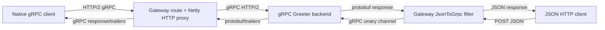
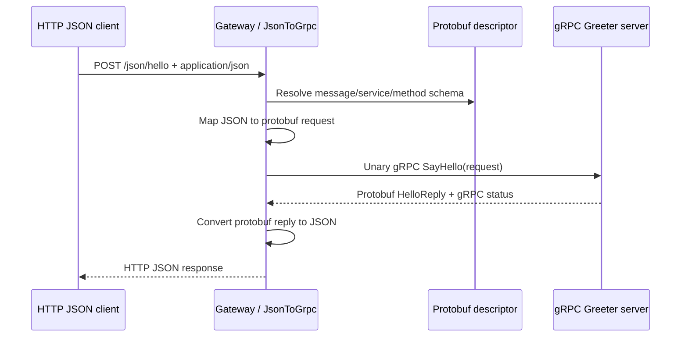
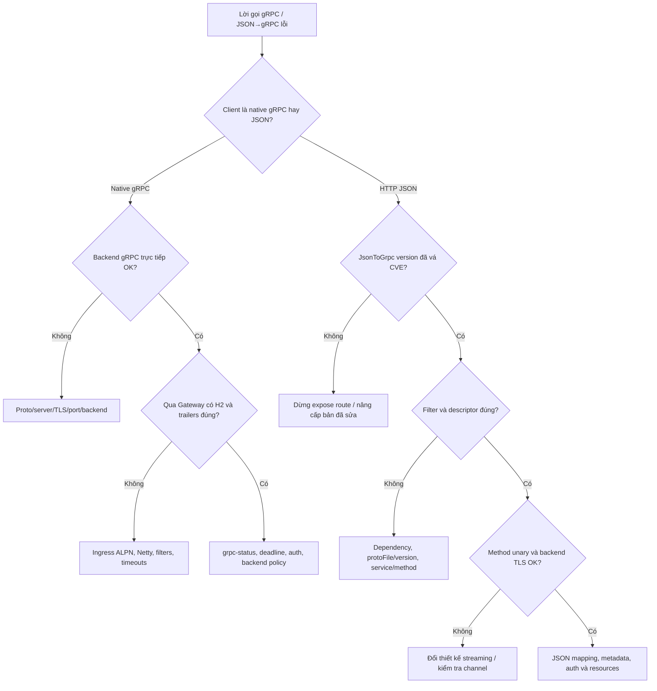

# Giới hạn proxy gRPC và bộ lọc JsonToGrpc theo phiên bản hỗ trợ

Trong kiến trúc microservices, **Spring Cloud Gateway** thường được dùng để chọn route theo path/host/header, biến đổi đường dẫn hoặc header, khám phá backend qua service discovery, xác thực, giới hạn lưu lượng và áp dụng retry, circuit breaker, TLS cùng observability tại cổng vào API. Khi backend nói **gRPC**, đội phát triển có thêm những câu hỏi không xuất hiện ở một REST JSON API thông thường: Gateway có giữ được **HTTP/2** tới backend không? Có giữ đúng **gRPC trailers** và trạng thái `grpc-status` không? Có thể chuyển **JSON từ trình duyệt thành một lời gọi gRPC** không? Nếu lời gọi là **streaming**, những thành phần nào thực sự hỗ trợ?

Hai mô hình dễ bị nhầm:

1. **Proxy gRPC thuần (*gRPC pass-through / transparent routing*):** client gửi một gRPC request dùng HTTP/2; Gateway chọn route và chuyển tiếp lưu lượng đến gRPC server. Gateway không nhất thiết đọc `.proto` hay chuyển JSON.
2. **`JsonToGrpc` GatewayFilter:** client gửi **HTTP JSON**; filter dựa trên protobuf descriptor để chuyển JSON thành một yêu cầu gRPC, gọi phương thức được cấu hình và biến phản hồi trở lại JSON. Theo tài liệu Gateway WebFlux hiện hành, **filter này không hỗ trợ streaming**.

Hai hướng có cùng hệ thống đích nhưng **khác HTTP contract, code path, dependencies, khả năng streaming và rủi ro vận hành**. Bài thuộc chương **WebSocket và truyền luồng** của module **SPRING_CLOUD_GATEWAY**; nội dung tập trung đúng đề tài **giới hạn proxy gRPC và bộ lọc JsonToGrpc theo phiên bản hỗ trợ**.

> **Phạm vi:** Bài ưu tiên **Spring Cloud Gateway Server WebFlux** trên Reactor Netty. Gateway Server Web MVC, Spring Integration gRPC, Spring gRPC client/server và các gRPC-aware ingress/proxies là những công nghệ khác, **không thể thay thế tên API/config cho nhau**. Tên starter và namespace Spring Cloud Gateway thay đổi theo release train; luôn kiểm chứng bằng dependency và tài liệu của bản ứng dụng thực tế.

> **Cảnh báo an ninh cập nhật ngày 24/11/2026:** Spring công bố **CVE-2026-59425 (High)** ngày **19/11/2026**: bộ lọc `JsonToGrpc` ở một số bản Gateway tạo `ManagedChannel` mới mỗi request nhưng không đóng/tái sử dụng, gây rò socket/tài nguyên và nguy cơ **denial of service**. Các dải bị ảnh hưởng và bản vá chính thức được nêu ở **mục 14**. **Không triển khai filter lên route công khai bằng bản đang bị ảnh hưởng.** Xem nguồn: [Spring Security Advisory CVE-2026-59425](https://spring.io/security/cve-2026-59425/).

## 1. Bài toán: một Gateway phục vụ REST JSON và gRPC

Giả sử một hệ thống có dịch vụ chào hỏi `greeter-service`, định nghĩa RPC `Greeter.SayHello`:

```proto
syntax = "proto3";

package demo.greeter.v1;

service Greeter {
  rpc SayHello (HelloRequest) returns (HelloReply);
}

message HelloRequest {
  string name = 1;
}

message HelloReply {
  string message = 1;
}
```

Một **gRPC client native** muốn gọi đúng phương thức qua Gateway:

```text
gRPC client
  -- HTTP/2 + application/grpc + protobuf -->
Spring Cloud Gateway
  -- HTTP/2 + gRPC framing/trailers -->
greeter-service
```

Một **HTTP JSON client** muốn gọi cùng nghiệp vụ mà không có generated gRPC stub:

```text
HTTP JSON client
  -- POST /json/hello {"name":"Ada"} -->
Spring Cloud Gateway / JsonToGrpc
  -- gRPC unary SayHello(HelloRequest) -->
greeter-service
  -- HelloReply protobuf -->
Gateway chuyển thành JSON {"message":"Hello, Ada"}
```

Đối với WebSocket hay server streaming, cách tương tác khác hẳn: có nhiều message trong một kết nối hoặc một RPC. **`JsonToGrpc` không phải WebSocket proxy, không phải gRPC-Web proxy và không phải công cụ JSON↔gRPC streaming tổng quát.**

### Kết quả học tập

- Phân biệt gRPC native, gRPC-Web, WebSocket, HTTP JSON→gRPC.
- Biết điều kiện **HTTP/2, ALPN/TLS, URI, phương thức và headers/trailers** của proxy gRPC.
- Cấu hình route gRPC thuần, hiểu **giới hạn tương thích khi proxy streaming**.
- Cấu hình `JsonToGrpc` cho unary RPC với `service`, `method`, `protoDescriptor`.
- Phân biệt thay đổi **`protoFile`/Java DSL** giữa các thế hệ tài liệu.
- Lập test matrix cho unary/streaming, deadline, cancellation, status, TLS, LoadBalancer và security.
- Nhận diện **CVE-2026-59425**, chọn bản vá và theo dõi tài nguyên `ManagedChannel`.

## 2. gRPC không phải WebSocket, dù cả hai có truyền luồng

| Giao thức/cơ chế | Kênh giao tiếp | Định dạng dữ liệu thường gặp | Kiểu kết nối/call |
| --- | --- | --- | --- |
| **gRPC native** | HTTP/2 (thường TLS+h2) | Protobuf binary + gRPC framing | Unary, server streaming, client streaming, bidirectional streaming. |
| **gRPC-Web** | Browser-friendly HTTP transport | gRPC-Web framing, thường binary/text variant | Có hạn chế theo client/proxy; không phải tương đương native bidi streaming. |
| **WebSocket** | HTTP Upgrade trên HTTP/1.1 hoặc cơ chế khác tùy stack | Frames text/binary tùy ứng dụng | Song công dài hạn, không có gRPC method/trailer semantics mặc định. |
| **REST/JSON** | Thường HTTP/1.1 hoặc HTTP/2 | JSON/HTTP body | Request/response HTTP thông thường, streaming cần cơ chế riêng. |
| **`JsonToGrpc`** | JSON HTTP inbound, gRPC channel outbound | Chuyển JSON ↔ protobuf theo descriptor | **Unary**, không hỗ trợ streaming theo tài liệu chính thức. |

Không suy luận “Gateway hỗ trợ WebSocket” nghĩa là nó tự hỗ trợ **gRPC streaming** hoặc biến gRPC-Web thành native gRPC. WebSocket proxy thường sử dụng URI `ws://`/`wss://` và WebSocket routing path; gRPC native dùng HTTP/2 với `application/grpc` và các semantics đặc thù.

### Bốn kiểu RPC

```proto
service Telemetry {
  // 1 request, 1 response
  rpc GetStatus (StatusRequest) returns (StatusReply);

  // 1 request, nhiều response
  rpc WatchStatus (StatusRequest) returns (stream StatusReply);

  // Nhiều request, 1 response
  rpc UploadEvents (stream Event) returns (UploadSummary);

  // Nhiều request, nhiều response theo hai chiều
  rpc ChatEvents (stream Event) returns (stream Event);
}
```

**Không phải kiểu RPC nào cũng có thể chuyển bằng một JSON HTTP POST duy nhất.** Một HTTP JSON body có thể đại diện tốt cho một unary request, nhưng server/client/bidirectional streaming cần framing, flow control, cancellation và chính sách truyền luồng khác.

## 3. Hai con đường đi qua Gateway



| Câu hỏi | gRPC proxy thuần | `JsonToGrpc` |
| --- | --- | --- |
| Gateway có cần file `.proto`? | Thông thường **không** nếu chỉ proxy opaque gRPC bytes. | **Có** descriptor phù hợp service/method. |
| Inbound là gì? | Native gRPC/HTTP/2. | HTTP JSON request. |
| Outbound là gì? | HTTP/2 gRPC proxy đến backend. | gRPC client/channel gọi method cụ thể. |
| Response đến client? | gRPC framing và status/trailers. | JSON response được chuyển đổi từ protobuf. |
| Có hỗ trợ streaming? | **Phải xác minh từng kiểu trên đúng stack/version**; thiết kế hướng đến pass-through gRPC, nhưng không có bảo đảm cho mọi proxy/filter. | **Không** theo tài liệu `JsonToGrpc`. |
| Cần gRPC Java libs trong Gateway? | Không nhất thiết cho proxy opaque; Spring từng cung cấp ví dụ không có proto/gRPC dependency. | Cần hỗ trợ filter, protobuf/gRPC/marshalling dependency tương ứng phiên bản. |
| Rủi ro chính | HTTP/2 negotiation, trailers, deadlines, cancellation, flow control, proxy buffering. | Descriptor mismatch, JSON mapping, memory/channel lifecycle, không streaming. |

Spring công bố khả năng hỗ trợ gRPC/HTTP/2 trong Gateway **từ 3.1.0 (Spring Cloud 2021.0.0)** và trình bày ví dụ transparent routing không cần định nghĩa proto ở Gateway. Tuy nhiên, blog kỹ thuật năm 2021 không phải chứng chỉ rằng **mọi feature gRPC mới** đều hoạt động đúng trên tất cả các phiên bản. Nguồn: [Spring Cloud Gateway and gRPC](https://spring.io/blog/2021/12/08/spring-cloud-gateway-and-grpc/).

## 4. HTTP/2 và TLS: điều kiện cơ bản cho native gRPC

gRPC native dựa vào **HTTP/2** để thực hiện nhiều stream trên một kết nối, truyền metadata, data frames và trailers. Đầu vào Gateway và chặng Gateway→backend phải bảo toàn giao thức/semantics phù hợp.

### H2 so với H2C

| Cách truyền | Đặc điểm | Thực hành |
| --- | --- | --- |
| **`h2`** | HTTP/2 qua TLS, thường thương lượng bằng ALPN. | Ưu tiên cho client→Gateway và Gateway→backend, đặc biệt production. |
| **`h2c`** | HTTP/2 cleartext. | Có trong một số runtime/infrastructure; **không tự cho rằng Gateway version của bạn hỗ trợ h2c proxy gRPC end-to-end**. |
| **HTTP/1.1** | Không có cơ chế native gRPC HTTP/2 transport. | Không thay được bằng cách chỉ thêm header `Content-Type: application/grpc`. |

Trong blog hỗ trợ gRPC ban đầu, Spring nêu **Gateway yêu cầu h2 với TLS cho ví dụ được hỗ trợ**, dù Reactor Netty có h2c. Một số phiên bản Spring Boot/Netty mới có khả năng h2c ở các context khác. **Đừng tổng quát hóa khả năng của Reactor Netty thành bảo đảm của tất cả Gateway variants**; đối chiếu phiên bản và test.

### Bật HTTP/2 và TLS inbound trên Gateway

```yaml
server:
  port: 8443
  http2:
    enabled: true
  ssl:
    enabled: true
    key-store-type: PKCS12
    key-store: classpath:certs/gateway-lab.p12
    key-store-password: ${GATEWAY_KEYSTORE_PASSWORD}
    key-password: ${GATEWAY_KEY_PASSWORD}
```

Đây là **mẫu cho môi trường thử nghiệm**; keystore phải được tạo/cấp ngoài bài học và có hostname/SAN phù hợp. Trong production dùng secret management/certificate rotation, không commit password hoặc keystore chứa private key vào Git.

**Bật `server.http2.enabled: true` chỉ nói về khả năng HTTP/2 ở inbound server theo Spring Boot runtime.** Nó **không tự cấu hình** mọi outbound HTTP client route thành H2, không bảo đảm ingress/CDN đang dùng H2 tới Gateway, và không giúp tự chuyển gRPC-Web.

### Các chặng cần xác minh

```text
Native gRPC Client
   ⇅ TLS ALPN h2
Ingress / Load Balancer (nếu có)
   ⇅ gRPC/HTTP2 theo topology được hỗ trợ
Gateway WebFlux (Reactor Netty)
   ⇅ TLS ALPN h2
gRPC backend :6565
```

Nếu ingress terminate TLS rồi tạo một request **HTTP/1.1** đến Gateway, native gRPC có thể hỏng dù client→ingress đã là H2. Với ingress bảo toàn gRPC, kiểm tra TLS termination/re-encryption, protocol selection, ALPN và hỗ trợ trailers.

### Không tắt xác minh certificate để sửa lỗi

Lệnh `grpcurl -insecure` và các config kiểu `useInsecureTrustManager` có thể xuất hiện trong blog/demo, nhưng **không phù hợp production**. Hãy cấp CA/trust store phù hợp cho client và Gateway, xác minh hostname/SNI; dùng mTLS khi backend hoặc chính sách nội bộ yêu cầu.

## 5. Native gRPC request có hình dạng gì?

Một native unary gRPC call thường là HTTP/2 POST với:

```http
:method: POST
:scheme: https
:path: /demo.greeter.v1.Greeter/SayHello
:authority: grpc.example.internal
content-type: application/grpc
te: trailers
grpc-timeout: 5S
```

Đây là **biểu diễn khái niệm các HTTP/2 pseudo-headers và metadata**; raw request còn có binary gRPC-framed data và các frame HTTP/2, không phải plain text HTTP request. `grpc-timeout` có thể không hiện diện nếu client không đặt deadline.

### Ý nghĩa các trường

| Thành phần | Ý nghĩa | Điều proxy phải lưu ý |
| --- | --- | --- |
| `:path` | Fully qualified gRPC service/method. | RewritePath/StripPrefix có thể phá method dispatch. |
| `:authority` | HTTP/2 authority; kết hợp TLS SNI/backend routing. | Không tự đặt Host/authority sai backend cert. |
| `content-type: application/grpc` | Cho biết native gRPC payload. | Không biến thành `application/json` trên route proxy. |
| `te: trailers` | Metadata tương thích cho gRPC trailers. | Hop-by-hop header filters có thể ảnh hưởng; cần test. |
| `grpc-timeout` | Deadline/time budget. | Proxy phải không làm deadline trôi hoặc retry vượt thời gian. |
| `grpc-encoding` | Compression nếu có. | Không tự sửa compression mà thiếu giải mã. |
| `grpc-status`/`grpc-message` | Kết quả gRPC ở trailers hoặc headers trong một số lỗi. | Không đánh giá thành công chỉ dựa HTTP status. |

### HTTP 200 không đồng nghĩa gRPC OK

Một gRPC server có thể trả:

```text
HTTP/2 :status = 200
content-type = application/grpc
... response DATA ...
trailers:
    grpc-status = 7
    grpc-message = Permission denied
```

`grpc-status=7` là **PERMISSION_DENIED**, dù tầng HTTP mang `:status=200`. Nếu Gateway/ingress/metrics chỉ ghi HTTP status 200, bạn có thể đánh giá sai tỷ lệ lỗi RPC.

**Kiểm tra gRPC status ở trailers là yêu cầu nghiệm thu riêng**, nhất là các lỗi `UNAUTHENTICATED`, `PERMISSION_DENIED`, `DEADLINE_EXCEEDED`, `UNAVAILABLE` và `RESOURCE_EXHAUSTED`.

## 6. Route gRPC thuần: giữ nguyên method path

Ví dụ route Server WebFlux, khi backend `greeter-service` đang nghe gRPC TLS trên `localhost:6565`:

```yaml
spring:
  cloud:
    gateway:
      server:
        webflux:
          routes:
            - id: grpc-greeter-native
              uri: https://localhost:6565
              predicates:
                - Path=/demo.greeter.v1.Greeter/**
                - Method=POST
```

**Tại sao không thêm `StripPrefix`?** Native gRPC client gửi path là `/demo.greeter.v1.Greeter/SayHello`; backend gRPC dispatcher thường cần đúng path này để tìm service/method. Strip nhầm một segment có thể khiến backend trả `UNIMPLEMENTED` hoặc lỗi routing khác.

Tài liệu Spring có ví dụ sử dụng `Path=/**` để chuyển toàn bộ gRPC traffic đến một backend. Trong production, route nên **giới hạn rõ namespace service/method và hostname/API scope** khi có nhiều backend, để tránh một catch-all ngoài ý muốn.

### Route theo service discovery

Trong môi trường có Spring Cloud LoadBalancer, nguồn `ServiceInstance` và sơ đồ TLS được kiểm soát, có thể xem xét:

```yaml
uri: lb://greeter-service
```

Nhưng **`lb://` không tự bảo đảm H2/TLS**: scheme được suy ra/chuyển đổi phụ thuộc instance metadata, service discovery và implementation/version. Với gRPC TLS, phải xác minh TLS trust, hostname, port, instance metadata và outbound protocol của đúng Gateway version. Nếu dùng load balancing đến nhiều replicas gRPC, test per-RPC routing, connection pooling, stream affinity, deadline và behavior khi instance chết giữa stream.

### Chỉ có URI HTTP(S) không đủ

`NettyRoutingFilter` xử lý downstream URI `http`/`https`, nhưng giao tiếp gRPC native cần **HTTP/2** và gRPC trailers. Nếu config outbound client vô tình dùng HTTP/1.1, một route có URI `https://...` vẫn có thể không proxy được gRPC đúng.

## 7. Giới hạn khi proxy native gRPC: đừng gom mọi thứ thành “streaming OK”

Việc **proxy gRPC over HTTP/2** được Spring minh họa từ Gateway 3.1.x, nhưng các trường hợp dưới đây khác nhau nhiều về độ khó:

| Kiểu call | Payload | Rủi ro khi có Gateway/proxy trung gian | Cần xác minh |
| --- | --- | --- | --- |
| **Unary** | Một request, một response. | HTTP/2, gRPC message framing, trailers/status, TLS. | Happy path và gRPC status lỗi. |
| **Server streaming** | Một request, nhiều response DATA frames. | Buffering, backpressure, idle timeout, kết thúc trailers, client cancellation. | Thứ tự và số message, timing, status trailers. |
| **Client streaming** | Nhiều request messages, một response. | Request-body aggregation, flow control, half-close, max message size. | Backend nhận hết các message và close đúng. |
| **Bidirectional streaming** | Hai chiều có thể cùng phát message. | Full-duplex data, half-close, cancellation, per-stream flow control, proxy/intermediary limitations. | Hai chiều độc lập, disconnect, trailers và deadline. |

**Không suy luận** một bài test unary chạy được nghĩa là cả ba kiểu streaming còn lại được bảo đảm trên version hiện có. Trong một số phiên bản/framework, các lớp filter HTTP tưởng như vô hại có thể buffer body và phá semantics truyền luồng.

### Các giới hạn cụ thể cần đưa vào thiết kế

1. **HTTP/2 negotiated end-to-end**: mỗi chặng phải hỗ trợ đúng H2, không hạ xuống HTTP/1.1 ở giữa.
2. **Trailers**: `grpc-status`/`grpc-message` phải không bị mất khi Netty/proxy chuyển response.
3. **Half-close/cancellation**: khi client dừng gửi request messages nhưng còn chờ response, upstream vẫn phải biết stream request đã hoàn tất; khi client hủy, backend cần được thông báo thích hợp.
4. **Flow control/backpressure**: stream lớn không được buffer không giới hạn trong Gateway hoặc ingress.
5. **Deadlines và idle timeout**: long-lived server streaming có thể bị cắt do timeout HTTP client, load balancer, ingress, firewall hoặc keepalive.
6. **Compression**: nếu `grpc-encoding` được dùng, proxy/filter không được làm hỏng framed data.
7. **Connection reuse**: nhiều gRPC streams thường dùng chung HTTP/2 connection; cân nhắc maximum concurrent streams và lifecycle.
8. **HTTP errors vs gRPC errors**: phân biệt lỗi trước khi thiết lập stream với trailers gRPC báo lỗi sau khi HTTP status 200.

### WebSocket support không “vá” được gRPC

Một route `wss://chat-service` với `WebsocketRoutingFilter` không chuyển một gRPC stream thành WebSocket. Dù cả hai có notion message stream, **gRPC framing, HTTP/2 multiplexing, message/trailer semantics và contract protobuf** là khác nhau.

Nếu browser chỉ hỗ trợ gRPC-Web, cần **gRPC-Web-aware proxy/adapter** hoặc client stack phù hợp. Không kỳ vọng route WebSocket hoặc `JsonToGrpc` tự xử lý `application/grpc-web`.

## 8. JsonToGrpc làm gì và không làm gì?

`JsonToGrpc` là **GatewayFilterFactory** của Spring Cloud Gateway WebFlux, dùng protobuf descriptor để tạo **một lời gọi gRPC** từ HTTP JSON inbound, rồi chuyển gRPC response thành JSON outbound. Các tham số được tài liệu Gateway 5.0.x/5.1.x liệt kê:

- **`service`**: tên ngắn của protobuf service sẽ xử lý lời gọi.
- **`method`**: tên method trong service.
- **`protoDescriptor`**: vị trí file protobuf descriptor set đã được tạo bởi `protoc`.

Ở các tài liệu 3.1.x hoặc một số nhánh cũ, còn có tham số **`protoFile`** (file nguồn `.proto`), và Java DSL có thứ tự tham số khác. **Không tự suy luận rằng cấu hình cũ hay overload cũ vẫn bắt buộc/khả dụng trên 5.0.x/5.1.x.**

Nguồn: [JsonToGrpc GatewayFilter Factory — Spring Cloud Gateway WebFlux](https://docs.spring.io/spring-cloud-gateway/reference/spring-cloud-gateway-server-webflux/gatewayfilter-factories/jsontogrpc-factory.html).

### Trình tự chuyển đổi



Mũi tên tới descriptor là **logic schema lookup/decoding**, không có nghĩa filter phải thực hiện một network call để lấy descriptor trên mỗi request. Chi phí khởi tạo/đọc descriptor và channel cần kiểm chứng theo phiên bản và bản vá.

### Phạm vi unary

Với proto:

```proto
rpc SayHello (HelloRequest) returns (HelloReply);
```

một JSON request có thể ánh xạ tới một protobuf request, và một protobuf response được ánh xạ về JSON.

Ngược lại, các phương thức:

```proto
rpc WatchStatus (StatusRequest) returns (stream StatusReply);
rpc UploadEvents (stream Event) returns (UploadSummary);
rpc ChatEvents (stream Event) returns (stream Event);
```

**không được JsonToGrpc hỗ trợ theo tài liệu chính thức**, dù backend gRPC có thể hỗ trợ và dù native gRPC pass-through của một Gateway version đã được kiểm chứng với một số streaming scenarios.

**Đừng thử thêm một filter `JsonToGrpc` vào route server streaming và chờ nó tự chuyển các message thành SSE hoặc WebSocket frames.** Đó là một adapter khác cần thiết kế rõ.

## 9. Protobuf descriptor: nguồn dữ liệu thiết yếu của JsonToGrpc

`JsonToGrpc` cần biết JSON fields sẽ được map vào **protobuf message schema** nào và tên service/method nào phải gọi. Vì vậy, cần tạo **descriptor set** từ file `.proto`.

### 9.1. Định nghĩa ví dụ

Đặt file `src/main/proto/greeter.proto` trong một dự án mẫu:

```proto
syntax = "proto3";

package demo.greeter.v1;

option java_multiple_files = true;
option java_package = "demo.greeter.v1";

service Greeter {
  rpc SayHello (HelloRequest) returns (HelloReply);
}

message HelloRequest {
  string name = 1;
}

message HelloReply {
  string message = 1;
}
```

Ở đây `package` xác định tên RPC fully qualified `demo.greeter.v1.Greeter/SayHello`. Trong cấu hình filter, tài liệu WebFlux mới sử dụng **tên service ngắn `Greeter`**, `method: SayHello`; nếu behavior của bản Gateway bạn dùng yêu cầu tên đầy đủ, hãy đối chiếu reference/source và test.

### 9.2. Tạo descriptor set bằng protoc

Một lệnh build minh họa:

```bash
protoc \
  --proto_path=src/main/proto \
  --include_imports \
  --descriptor_set_out=src/main/resources/proto/greeter.pb \
  src/main/proto/greeter.proto
```

**Giải thích:**

- `--proto_path` trỏ thư mục để giải quyết `import`.
- `--descriptor_set_out` tạo file **binary descriptor set**, **không phải Java class, không phải JSON, không phải server**.
- `--include_imports` giúp gói descriptor kèm các import cần thiết để giải schema khi có dependency protobuf.
- File output cần được **đóng gói hoặc mount** theo location mà Gateway đọc được.
- `protoc` version cần tương thích với protobuf schema/toolchain của ứng dụng.

Thư mục đầu ra phải tồn tại trước khi chạy, hoặc quy trình build tạo nó. **Không chỉnh tay byte** của file `.pb`; cập nhật descriptor bằng build pipeline và kiểm tra hash/phiên bản.

### 9.3. Vị trí descriptor khi deploy

Tài liệu Gateway đưa ví dụ:

```yaml
protoDescriptor: file:proto/hello.pb
```

`file:` là resource location dạng file. Trong container/k8s, **relative path phụ thuộc working directory**, không tự bằng resource trong JAR. Đối với production, có thể dùng một đường dẫn file được mount và kiểm soát, ví dụ:

```yaml
protoDescriptor: file:/etc/gateway/proto/greeter.pb
```

Chọn resource prefix/location **được hỗ trợ bởi đúng version**. Không mặc định mọi implementation tự hiểu `classpath:` hoặc hot reload descriptor từ JAR. File phải có quyền đọc phù hợp và được đồng bộ theo revision Gateway/proto.

### 9.4. Khi proto đổi schema

Nếu backend thêm/xóa/đổi field, rename method hoặc thay package, descriptor có thể không còn tương thích. Ví dụ đổi:

```proto
message HelloRequest {
  string first_name = 1;
}
```

trong khi HTTP JSON clients vẫn gửi `{"name":"Ada"}`, sẽ tạo lỗi mapping hoặc hành vi sai. Với schema evolution cần:

- Quản lý **proto file/descriptor version** cùng route config.
- Ưu tiên thay đổi backward-compatible theo quy tắc protobuf.
- Kiểm thử JSON field names, snake_case/camelCase, default values, unknown fields, enums, repeated/map/well-known types.
- Không tự giải thích unknown JSON field là harmless; policy parser phụ thuộc implementation.
- Không bật route mới trước khi backend service/method và descriptor sẵn sàng trên mọi replicas.

## 10. Cấu hình JsonToGrpc trên Gateway WebFlux 5.x

Ví dụ **unary JSON→gRPC** sử dụng cùng greeter backend TLS cổng `6565` và descriptor đã mount:

```yaml
spring:
  cloud:
    gateway:
      server:
        webflux:
          routes:
            - id: json-greeter-unary
              uri: https://localhost:6565
              predicates:
                - Path=/json/hello
                - Method=POST
              filters:
                - name: JsonToGrpc
                  args:
                    service: Greeter
                    method: SayHello
                    protoDescriptor: file:/etc/gateway/proto/greeter.pb
```

Trong mô hình này:

1. Client gửi HTTP `POST /json/hello` với `Content-Type: application/json`.
2. Route match theo `Path`/`Method`.
3. `JsonToGrpc` sử dụng protobuf descriptor để gọi unary method `Greeter.SayHello` ở backend đã chỉ định.
4. Backend trả `HelloReply`; Gateway chuyển phản hồi thành JSON.

**Đây là ví dụ cấu hình, chưa phải hệ thống tự chạy**: cần build backend gRPC Greeter, cấp TLS cert, mount descriptor, bảo đảm dependencies cho filter, set Security/CORS/body-size/timeouts và khởi động Gateway đúng BOM.

### Vì sao không dùng `StripPrefix=2`?

`JsonToGrpc` chọn service/method theo args và thực hiện **bridge riêng**; không cần mượn path của HTTP JSON request để tạo đường dẫn gRPC. Trong ví dụ, không có `StripPrefix` để tránh nhầm lẫn. Đối với native gRPC proxy thì path `/demo.greeter.v1.Greeter/SayHello` cần được bảo toàn như mục 6.

### Tại sao URI vẫn là HTTPS?

Filter cần biết đích gRPC để tạo channel/call. `uri: https://localhost:6565` là một **gRPC server qua TLS** trong môi trường lab. Khả năng sử dụng `lb://service` và việc filter lấy host/port cuối cùng từ routing attributes phụ thuộc implementation/version, nên nếu muốn thêm discovery phải thực hiện **integration test thật**, không giả định route JSON→gRPC hoạt động giống hoàn toàn native HTTP proxy.

## 11. Khác biệt cấu hình giữa các thế hệ tài liệu

### Bản 5.0.x/5.1.x — tham số theo reference mới

```yaml
filters:
  - name: JsonToGrpc
    args:
      service: Greeter
      method: SayHello
      protoDescriptor: file:/etc/gateway/proto/greeter.pb
```

### Một số bản 3.1.x/4.x — tài liệu có protoFile

```yaml
spring:
  cloud:
    gateway:
      routes:
        - id: json-greeter-legacy-example
          uri: https://localhost:6565
          predicates:
            - Path=/json/hello
          filters:
            - name: JsonToGrpc
              args:
                protoDescriptor: file:proto/greeter.pb
                protoFile: file:proto/greeter.proto
                service: Greeter
                method: SayHello
```

**Không thể lấy ví dụ này làm cam kết cho mọi bản 4.x**, vì API và bindings đã thay đổi theo release train. Các tài liệu `3.1.x` có `protoFile`; tài liệu `5.0.5` hiển thị ba tham số `service`, `method`, `protoDescriptor`. Hãy so source/reference đúng artifact, test startup và dry-run binding.

### Ví dụ Java DSL của tài liệu Gateway 5.x

```java
import org.springframework.cloud.gateway.route.RouteLocator;
import org.springframework.cloud.gateway.route.builder.RouteLocatorBuilder;
import org.springframework.context.annotation.Bean;
import org.springframework.context.annotation.Configuration;

@Configuration
public class JsonGrpcRoutes {

    @Bean
    RouteLocator grpcBridgeRoutes(RouteLocatorBuilder builder) {
        return builder.routes()
            .route("json-greeter-unary", r -> r
                .path("/json/hello")
                .filters(f -> f.jsonToGRPC(
                    "Greeter",
                    "SayHello",
                    "file:/etc/gateway/proto/greeter.pb"))
                .uri("https://localhost:6565"))
            .build();
    }
}
```

Ở `5.0.5/5.1.x`, tài liệu ví dụ gọi `jsonToGRPC(service, method, protoDescriptor)`. Với bản cũ có `protoFile`, overload/thứ tự có thể khác. **Đừng copy cùng lúc Java DSL và YAML để khai báo route ID trùng**, và đừng sử dụng code này trước khi đã kiểm tra phiên bản có bản vá CVE được nêu ở mục 14.

## 12. Dependencies: gRPC proxy thuần và JsonToGrpc khác nhau

### 12.1. Native gRPC proxy

Trong ví dụ transparent proxy của Spring, Gateway **không cần import proto classes hoặc generated gRPC stubs** để đơn thuần chuyển tiếp lưu lượng. Nó cần:

- **Gateway Server WebFlux** và Reactor Netty theo release train hỗ trợ.
- **HTTP/2 + TLS** được cấu hình đúng trên inbound và outbound.
- Route predicate/routing/netty client hoạt động với backend gRPC thật.
- Các thành phần tùy chọn theo kiến trúc: Spring Security, LoadBalancer/DiscoveryClient, Micrometer/Actuator.

Với những dòng mới, starter Gateway WebFlux thường là:

```xml
<dependency>
    <groupId>org.springframework.cloud</groupId>
    <artifactId>spring-cloud-starter-gateway-server-webflux</artifactId>
</dependency>
```

Ở các dòng cũ có thể là `spring-cloud-starter-gateway`. Dùng một **Spring Cloud BOM tương thích Spring Boot** và kiểm tra phiên bản Netty/Reactor được quản lý; không tự chọn Netty dependencies ngẫu nhiên để “bật gRPC”.

### 12.2. JsonToGrpc bridge

Khi bật `JsonToGrpc`, Gateway phải xử lý:

1. HTTP JSON request body.
2. Protobuf descriptor và JSON↔protobuf conversion.
3. gRPC channel, method descriptor và lời gọi gRPC.
4. Serialization của protobuf reply về JSON.

Vì vậy cần **những thư viện gRPC/Protobuf/JSON mapping mà implementation của phiên bản đó thật sự dùng**, ngoài starter. Các artifact thường gặp trong các ví dụ/integration tests gồm:

| Nhóm dependency | Tác dụng | Lưu ý |
| --- | --- | --- |
| `io.grpc:grpc-netty` hoặc biến thể được framework dùng | gRPC transport/channel. | Dùng dependency được quản lý tương thích, tránh trộn netty shaded/unshaded tùy tiện. |
| `io.grpc:grpc-protobuf` | Protobuf marshalling của gRPC. | Kết hợp version gRPC Java/protobuf tương thích. |
| `io.grpc:grpc-stub` | Generated stubs khi dự án tự gọi gRPC. | Có thể không cần khi bridge dùng dynamic method descriptors; kiểm tra runtime. |
| `com.google.protobuf:protobuf-java` và `protobuf-java-util` | Descriptor, protobuf messages, JSON utilities. | Đối chiếu proto3/well-known types và converter version. |
| Jackson JSON / protobuf dataformat | Đọc JSON, chuyển dữ liệu theo implementation. | **Rất phụ thuộc phiên bản** và khả năng xử lý proto3. |
| `spring-boot-starter-actuator` | Health/metrics/tracing nếu cấu hình. | Không phải dependency bắt buộc để filter tồn tại. |

Không diễn giải bảng này thành “thêm mọi thư viện trên là đủ, bất kể version”. Một issue trong dự án Spring Cloud Gateway ghi nhận lỗi thiếu `ProtobufFactory` ở bản `4.1.0` khi không có Jackson Protobuf dataformat; issue cũng nêu giới hạn proto3 ở dependency/cơ chế đó. Cần kiểm tra **dependency tree, actual runtime và compatibility** thay vì tự bổ sung một artifact rồi giả định đã giải quyết mọi protobuf version. Nguồn thảo luận: [Gateway issue #3424](https://github.com/spring-cloud/spring-cloud-gateway/issues/3424).

### Một dependency excerpt để tham khảo

```xml
<dependencies>
    <dependency>
        <groupId>org.springframework.cloud</groupId>
        <artifactId>spring-cloud-starter-gateway-server-webflux</artifactId>
    </dependency>
    <!-- Chỉ thêm các gRPC/Protobuf artifacts đúng nhu cầu
         và tương thích với phiên bản JsonToGrpc đang dùng. -->
    <dependency>
        <groupId>io.grpc</groupId>
        <artifactId>grpc-netty</artifactId>
    </dependency>
    <dependency>
        <groupId>io.grpc</groupId>
        <artifactId>grpc-protobuf</artifactId>
    </dependency>
    <dependency>
        <groupId>com.google.protobuf</groupId>
        <artifactId>protobuf-java-util</artifactId>
    </dependency>
</dependencies>
```

**Đoạn này không phải một POM tự chạy độc lập.** Gói gRPC/protobuf version cần được quản lý bằng BOM hoặc dependency management phù hợp. Một số starter không cấp sẵn mọi dependency, và một số dependency chỉ xuất hiện trong integration tests hoặc server/mock. Hãy chọn từ **API thực sự được filter gọi** ở artifact đang sử dụng.

### Có cần `grpcurl` trong Gateway không?

Không. `grpcurl` là **công cụ client thử nghiệm độc lập**, không phải thư viện runtime của Spring Cloud Gateway. Bạn có thể dùng nó để:

- Gọi trực tiếp gRPC backend.
- Gọi qua Gateway native gRPC proxy.
- Xác minh trailers/status, reflection/proto, TLS và timeout.

Với JsonToGrpc, một HTTP client như `curl`/Postman là đủ để kiểm thử phần JSON frontend; vẫn nên có gRPC client để kiểm tra backend trực tiếp.

## 13. TLS cho JsonToGrpc và quản lý gRPC channel

Tài liệu `JsonToGrpc` của Gateway WebFlux mô tả filter tạo `NettyChannel` và sử dụng **default `TrustManagerFactory`**. Tài liệu cũng đề cập khả năng tùy biến trust qua một bean loại `GrpcSslConfigurer`, ví dụ với `GRPCSSLContext`. Nhưng không nên sao chép ví dụ `trustAllCerts()` vào production.

### Phân biệt hai HTTP clients

Một Gateway có thể dùng:

- **Reactor Netty HttpClient** cho native HTTP/gRPC pass-through routes.
- **gRPC Java ManagedChannel/Netty channel** do `JsonToGrpc` tạo để gọi backend.

Do đó, chỉ cấu hình trust store/SSL của Netty routing HTTP client **chưa chắc** đã thay đổi trust policy của `JsonToGrpc` gRPC channel. Cần xem cấu hình SSL dành riêng filter theo đúng phiên bản và test certificate verification.

### Yêu cầu production

- Backend gRPC có certificate hợp lệ cho hostname/SNI được kết nối.
- Gateway tin cậy đúng root/intermediate CA, certificate rotation có quy trình.
- Nếu dùng mTLS, client certificate/identity của Gateway được cấp riêng và có audit.
- Không hardcode private key/client secret vào route YAML/metadata/logs.
- Không dùng `InsecureTrustManagerFactory`, `trustAllCerts` hoặc `grpcurl -insecure` để lách xác minh TLS trong production.
- Theo dõi channel count, open sockets, file descriptors, heap/direct memory và request load.
- Kiểm tra version đã xử lý **CVE-2026-59425** trước khi expose `JsonToGrpc` route.

### Không tạo ManagedChannel cho từng request trong code tự viết

Nếu tự tạo bridge thay vì dùng filter:

```java
// Pseudocode minh họa kiểu sai:
return request -> {
    ManagedChannel channel =
        NettyChannelBuilder.forAddress(host, port).build();
    // Gọi RPC rồi quên shutdown channel -> rò socket/tài nguyên.
};
```

Đây là **anti-pattern**, không phải code production hay filter đúng API. gRPC channels là tài nguyên đắt, cần được quản lý vòng đời, tái sử dụng theo chính sách, giới hạn kết nối và đóng đúng khi application shutdown. Dùng bản Gateway đã vá thay vì tự “chữa” bằng cách tăng file descriptor limit.

## 14. Bảo mật theo phiên bản: CVE-2026-59425

Ngày **19/11/2026**, Spring phát hành advisory **High — CVE-2026-59425, “Spring Cloud Gateway JsonToGrpc Filter Leaks gRPC ManagedChannel Resources.”**

### Cơ chế và ảnh hưởng

Theo advisory, `JsonToGrpc` ở những bản bị ảnh hưởng tạo một `Netty-backed ManagedChannel` **cho mỗi HTTP request** đi qua filter, nhưng không đóng hoặc tái sử dụng, làm socket/channel resources tiếp tục được giữ sau khi request kết thúc. Nếu route có thể bị gọi từ nguồn không tin cậy, gửi nhiều request có thể gây **denial of service** do tài nguyên cạn kiệt.

**Phạm vi của CVE được mô tả rõ:** chỉ các ứng dụng **expose route có cấu hình `JsonToGrpc`** ở những phiên bản bị ảnh hưởng. Không nên viết thành “mọi ứng dụng Gateway đều bị lỗi này”, cũng không đồng nhất với native gRPC proxy route **không sử dụng `JsonToGrpc`**.

### Các dải phiên bản bị ảnh hưởng — theo advisory ngày 19/11/2026

| Spring Cloud Gateway | Phiên bản bị ảnh hưởng | Phiên bản sửa được Spring công bố | Phân phối |
| --- | --- | --- | --- |
| Dòng 5.0.x | `5.0.0–5.0.4` | `5.0.5` | **OSS** |
| Dòng 5.0 enterprise | `5.0.0–5.0.4` | `5.0.4.1` | **Enterprise Support only** |
| Dòng 4.3.x | `4.3.0–4.3.6` | `4.3.7` | **Enterprise Support only** |
| Dòng 4.2.x | `4.2.0–4.2.10` | `4.2.11` | **Enterprise Support only** |
| Dòng 3.1.x | `3.1.4–3.1.14` | `3.1.15` | **Enterprise Support only** |

Đây là **thông tin tại thời điểm công bố advisory**, không phải bảng “bản mới nhất mãi mãi”. Cần kiểm tra các bản vá và security advisories mới hơn trước khi chọn version thực tế. Nguồn chính thức: [Spring CVE-2026-59425](https://spring.io/security/cve-2026-59425/).

### Hành động nên làm

1. Kiểm kê ứng dụng Gateway đang chạy `JsonToGrpc`, xác định **version thực tế** (không chỉ version trong bài viết hoặc BOM dự kiến).
2. Đối chiếu dải bị ảnh hưởng với security advisory.
3. **Nâng cấp lên phiên bản đã sửa tương ứng được hỗ trợ**; đây là biện pháp được Spring khuyến nghị. Dòng 5.0 có bản vá OSS `5.0.5`; các bản vá nêu cho 4.3/4.2/3.1 thuộc Enterprise theo advisory.
4. Duy trì access control và rate limiting để giảm abuse, nhưng **không coi chúng là bản vá cho leak**.
5. Sau upgrade, kiểm tra thông lượng, số `ManagedChannel`/sockets, file descriptors và long-running load với unary bridge.
6. Đảm bảo rollback không đưa lại bản chứa CVE khi gặp sự cố khác.

**Không tự tuyên bố “đã vá”** chỉ vì restart Gateway làm sockets giảm hoặc thêm RedisRateLimiter; bug vẫn tồn tại nếu phiên bản bị ảnh hưởng còn phục vụ requests.

### Liên hệ với giới hạn streaming

Rò `ManagedChannel` ảnh hưởng **unary JsonToGrpc route**; không cần có streaming để xảy ra. Ngược lại, việc filter đã được vá leak **không bổ sung streaming support**. Đây là **hai ranh giới độc lập**:

- **Capability:** `JsonToGrpc` không hỗ trợ streaming theo reference.
- **Security/availability:** dùng bản đã vá CVE khi expose unary bridge.

## 15. Authentication, authorization và tránh gửi sai credential

gRPC và JsonToGrpc đi qua cùng một Gateway nhưng không nên tự động dùng cùng một chính sách credential:

| Đường vào | Danh tính Gateway nhìn thấy | Điều cần xác minh |
| --- | --- | --- |
| Native gRPC client có bearer metadata | HTTP/2 gRPC metadata thường chứa `authorization`. | JWT/opaque token ở gateway/backend theo policy, không làm mất metadata. |
| JSON browser client có cookie session | Spring Security OAuth2 Login/BFF có thể nhận user. | Cookie/CSRF/CORS, authorized client/TokenRelay nếu cần. |
| JSON client có bearer JWT | Spring Security Resource Server có thể xác minh inbound token. | Phải quyết định outbound gRPC metadata truyền identity như thế nào. |
| Internal M2M client | Service identity/mTLS/client credentials. | Audience/scope và backend authorization dành cho service. |

### JsonToGrpc không mặc nhiên truyền JWT user đến gRPC metadata

Một filter JSON→gRPC **không tự bảo đảm** tất cả inbound HTTP headers (như `Authorization` hoặc trace headers) được biến thành metadata gRPC theo chính sách bảo mật của backend. Nếu backend cần user identity:

- Xác minh inbound token trước ở Gateway.
- Xác định method nào cần user delegation, service token hay không cần token.
- Cấu hình bridge/interceptor được hỗ trợ để truyền metadata đã kiểm soát (nếu phiên bản hỗ trợ), hoặc viết adapter chuyên dụng.
- Kiểm tra backend thực nhận metadata nào bằng integration tests an toàn, **không log raw token**.
- Không tự gán `X-User-Id` từ client thành trusted gRPC metadata.

Nếu filter không hỗ trợ cách truyền metadata cần thiết, **đừng cố chữa bằng route header mutation ngẫu nhiên**; thay bằng BFF/gRPC adapter riêng có mô hình authorization rõ.

### Không coi JsonToGrpc là một authorization boundary

Route chỉ match `Path=/json/hello` không tự kiểm tra quyền gọi `Greeter.SayHello`. Spring Security, quota và backend authorization phải hoạt động ở vị trí phù hợp. Với phương thức gRPC nhạy cảm, yêu cầu policy theo **service/method** và limit resource usage, không chỉ một path JSON.

### CORS/CSRF

Nếu JSON endpoint cho browser gọi cross-origin:

- CORS preflight OPTIONS phải được xử lý trước những yêu cầu auth không phù hợp với preflight.
- Response 401/403/429/5xx từ Gateway cũng cần CORS headers nếu browser phải đọc status.
- Với session cookie, **CORS không thay CSRF protection** cho POST.
- Tránh wildcard origins cho credentialed CORS.

Native gRPC clients không sử dụng browser CORS theo cách tương tự; **CORS không phải công cụ bảo vệ native gRPC API khỏi caller không tin cậy**.

## 16. Deadline, timeout và cancellation

Đối với gRPC, **deadline** là ngân sách thời gian dành cho RPC. Một lời gọi unary ngắn và một stream giám sát trạng thái kéo dài 30 phút có yêu cầu khác nhau.

| Loại | Nơi áp dụng | Ý nghĩa |
| --- | --- | --- |
| **gRPC deadline/`grpc-timeout`** | gRPC client/call | RPC có thời gian hoàn thành giới hạn; khi hết có thể trả `DEADLINE_EXCEEDED`. |
| **Gateway HTTP client connect/response timeout** | Reactor Netty hoặc gRPC channel riêng | Giới hạn thời gian kết nối/chờ dữ liệu, có thể tạo transport error. |
| **Ingress/LB idle timeout** | Proxy trước/sau Gateway | Có thể cắt stream dài hạn khi lâu không có dữ liệu. |

### Timeline minh họa

```text
Client đặt gRPC deadline: 10 giây
0s    client gọi /Greeter/SayHello
0.1s  Gateway chọn route
0.3s  Gateway gửi upstream
5s    backend vẫn xử lý
10s   deadline hết → client hủy/chấm dứt RPC
10s+  backend nên được thông báo hủy nếu proxy hỗ trợ đúng
```

Nếu Gateway tự retry mà không bảo toàn deadline, retry có thể xảy ra sau khi client đã hủy. Nếu idle timeout ingress thấp hơn thời gian hợp lệ của server streaming, luồng có thể đóng sớm dù backend khỏe.

### Các bài test bắt buộc

- Client hủy unary RPC khi đang chờ; backend có dừng tác vụ và giải phóng resource không?
- Client hủy server-stream sau N messages; stream có đóng ở Gateway/backend không?
- Client streaming gửi hết dữ liệu rồi half-close; backend có nhận terminal signal không?
- Deadline 1 giây khi backend chậm 3 giây: trạng thái gRPC và latency cuối là gì?
- Gateway transport timeout có biến lỗi thành HTTP 502/504 thay vì `grpc-status` không?
- Retry/circuit breaker có vượt quá ngân sách của caller không?

Không sửa tất cả vấn đề bằng cách tăng mọi timeout vô hạn: điều đó có thể làm tích tụ kết nối/resources khi backend bị treo.

## 17. Retry và CircuitBreaker: gRPC status khác HTTP status

Spring Cloud Gateway có các cơ chế `Retry`, `CircuitBreaker` và HTTP timeouts. Nhưng gRPC có kết quả logic **`grpc-status` trong trailers**, nên việc quyết định “request lỗi không” khác một API HTTP chỉ dựa status `5xx`.

| Sự kiện | HTTP status có thể thấy | gRPC status | Ý nghĩa |
| --- | --- | --- | --- |
| Unary RPC thành công | `200` | `OK (0)` | Thành công thật. |
| Caller không có quyền | Có thể `200` | `PERMISSION_DENIED (7)` | Lỗi quyền, không retry mù. |
| Sai service/method | Có thể `200` | `UNIMPLEMENTED (12)` | Kiểm tra proto, method path. |
| Backend quá tải | Có thể `200` | `RESOURCE_EXHAUSTED (8)` | Giới hạn tài nguyên/quota. |
| Backend tạm không sẵn sàng | Có thể `200` | `UNAVAILABLE (14)` | Có thể cân nhắc retry nếu idempotent và deadline còn. |
| Deadline hết | HTTP 200 hoặc transport error | `DEADLINE_EXCEEDED (4)` | Không retry ngoài budget. |
| TLS handshake fail trước gRPC | `502/503` hoặc connect error | Có thể không có trailers | Lỗi transport/TLS. |

### Không mặc định Gateway Retry hiểu gRPC status

Một filter `Retry` cấu hình dựa HTTP `500/502/503` có thể **không coi HTTP 200 với `grpc-status=14` là lỗi cần retry**. Nếu proxy trả HTTP 503 khi kết nối hỏng, client gRPC cũng có thể đang tự retry, tạo **nhiều lớp retry chồng nhau**.

Đề xuất:

1. Chọn rõ **lớp nào có quyền retry**: gRPC client, Gateway, service mesh hay SDK.
2. Chỉ retry RPC **idempotent, an toàn**, có budget và deadline còn hiệu lực.
3. Giới hạn attempts, exponential backoff với jitter.
4. Không retry streaming calls một cách ngây thơ: một phần messages đã được xử lý có thể tạo side effects.
5. Đo incoming RPC count và downstream attempts riêng.
6. Thử lỗi gRPC trailers thật, không chỉ mock HTTP 500.

### CircuitBreaker không tự hiểu mọi gRPC trailers

`CircuitBreaker` GatewayFilter quan sát exception/HTTP failure theo implementation. Nó **không mặc nhiên biết `grpc-status` của mọi gRPC call**. Nếu muốn circuit breaker theo gRPC code, cần interceptor/proxy hoặc instrumentation gRPC-aware được thử trên version thực tế.

### Không dùng body filters làm mất streaming

Các filter đọc/cache/modify toàn bộ HTTP body (ví dụ `ModifyRequestBody`, `ModifyResponseBody`) có thể buffer stream, làm mất backpressure hoặc chờ stream kết thúc. Native gRPC proxy routes nên dùng những filters đã được kiểm thử **không làm thay đổi binary framing, HTTP/2 trailers và half-close semantics**.

## 18. Giới hạn lưu lượng và tài nguyên trên gRPC routes

Một `RequestRateLimiter` giới hạn **incoming HTTP/RPC request**, nhưng gRPC stream có thể truyền hàng nghìn messages qua **một RPC**. Một token tiêu thụ ở đầu stream không đếm số messages/bytes trong suốt vòng đời.

| Lớp | Đơn vị hạn mức | Ví dụ |
| --- | --- | --- |
| **Gateway RequestRateLimiter** | Incoming HTTP/RPC request | 10 RPCs/s cho client. |
| **Concurrent stream limit** | Active gRPC streams | Không cho client chiếm hàng trăm streams dài hạn. |
| **Message size limit** | Byte/protobuf message | Ngăn payload gây OOM. |
| **Message/byte throughput** | Messages hoặc bytes/s | Bảo vệ gRPC streaming ingestion. |
| **Deadline/idle timeout** | Thời gian RPC | Dọn stream bị treo. |
| **Backend business quota** | Tenant/account operation | Bảo vệ nghiệp vụ và quyền tài nguyên. |

`RedisRateLimiter` theo route + user **không tự giới hạn số event** trong một `UploadEvents(stream Event)`. Cần limit tại gRPC server/interceptors hoặc proxy gRPC-aware.

### KeyResolver và danh tính gRPC

`KeyResolver` dùng `exchange.getPrincipal()` chỉ phù hợp khi Spring Security đã xác thực inbound metadata theo cách tương thích. Nếu native gRPC route chỉ forward bearer metadata mà Gateway không thiết lập principal, resolver có thể trả empty; kết quả từ chối hoặc empty-key behavior tùy config/version.

Không dùng raw `X-Customer-ID` do caller tự gửi làm key cấp quota. Với JsonToGrpc JSON endpoint, có thể dùng Spring Security Resource Server hoặc OAuth2 Login BFF theo topology; vẫn cần bảo vệ gRPC backend bằng authorization riêng.

### HTTP 429 khác RESOURCE_EXHAUSTED

`RequestRateLimiter` thường trả **HTTP 429 Too Many Requests** khi từ chối ở Gateway, trong khi gRPC server báo **`RESOURCE_EXHAUSTED (8)`** bằng gRPC trailers. Native gRPC client có thể thấy HTTP 429 plain response như transport/protocol error. Nếu yêu cầu ngữ nghĩa gRPC-native, dùng limiter gRPC-aware hoặc kiểm thử mapping lỗi trên client SDKs thực tế.

## 19. Service discovery và load balancing

gRPC service có thể có nhiều instances; route `lb://service-id` của Gateway phối hợp Spring Cloud LoadBalancer theo version và service discovery. Nhưng HTTP/2 multiplexing làm **một connection có nhiều streams**.

Các câu hỏi cần kiểm tra:

1. Load balancing chọn instance theo request hay pool/reused connection? Active streams có phân phối đều không?
2. `ServiceInstance` chứa đúng scheme TLS, host, port, SNI cho gRPC server?
3. Khi gRPC pod restart, các streams dài hạn được drain/cancel ra sao?
4. Service ID nằm trong allowlist để tránh forwarding credential đến service ngoài trust boundary?
5. Retry/fallback có giữ deadline và tránh duplicate writes không?
6. Các replicas backend có compatible protobuf API/descriptors không?

Với bidirectional streaming dài nhiều giờ, connection-aware balancing, mTLS hoặc graceful stream draining phức tạp, cân nhắc một **gRPC-aware ingress/proxy/client load balancer**. Không có nghĩa Spring Cloud Gateway không dùng được với gRPC; cần lựa chọn theo **khả năng đã kiểm chứng** của stack thực tế.

## 20. gRPC metadata, trailers và HTTP headers filters

Một gRPC request có thể mang:

```text
content-type: application/grpc
te: trailers
grpc-timeout: 5S
grpc-encoding: gzip
authorization: Bearer [redacted]
x-request-id: [correlation]
```

**Không log nguyên văn** header chứa credential. Spring Cloud Gateway có các `HttpHeadersFilters` trước downstream routing. Tài liệu lịch sử của `RemoveHopByHopHeadersFilter` liệt kê `TE` trong nhóm hop-by-hop headers. Trong gRPC, `te: trailers` có vai trò đặc biệt, nên đừng mặc định HTTP proxy thành công nghĩa là trailers/metadata đều được bảo toàn.

Trước khi thay đổi header sanitation:

- Kiểm tra source/reference của đúng version.
- Test unary RPC cả thành công lẫn lỗi với `grpcurl`.
- Xác minh `grpc-status`/`grpc-message` tới gRPC client đúng.
- Test server streaming kết thúc bằng lỗi sau một số messages.
- Không tắt toàn bộ hop-by-hop sanitation để “sửa TE” mà chưa đánh giá request smuggling và proxy behavior.

### RewritePath, authority và TLS

- Native gRPC path `/package.Service/Method` có ý nghĩa protocol.
- `PreserveHostHeader`/`SetRequestHeader=Host` có thể ảnh hưởng authority/TLS virtual hosting.
- `Authorization` không được forwarded tới backend có audience/trust boundary khác.
- `grpc-timeout` phải được diễn giải đúng khi proxy đã tiêu tốn một phần deadline trước khi gửi upstream.

Không dùng một header `Content-Type` do client tự đặt làm bằng chứng caller đã được xác thực.

## 21. Observability: đo cả HTTP status và grpc-status

| Tín hiệu | Lý do |
| --- | --- |
| Route ID và service/method gRPC đã biết | Phân biệt RPC và backend mục tiêu. |
| Gateway replica và revision | Phát hiện config drift khi rollout. |
| HTTP protocol h2/h2c, TLS errors | Chẩn đoán ALPN/certificate. |
| HTTP status | Thấy transport/proxy failures. |
| **`grpc-status`** | Thấy application errors khi HTTP status vẫn 200. |
| Deadline/cancellation, active streams | Kiểm soát long-lived RPCs. |
| Open sockets/file descriptors/ManagedChannels | Phát hiện resource leak và regression. |
| gRPC message byte sizes | Kiểm soát memory/throughput. |
| Retry/circuit breaker/429 | Phân biệt resilience và quota với lỗi business. |

Sự kiện do hệ thống tự instrument, **không phải log mặc định**:

```text
traceId:           [opaque id]
routeId:           grpc-greeter-native
gatewayPod:        gateway-a
rpcService:        demo.greeter.v1.Greeter
rpcMethod:         SayHello
transport:         h2
httpStatus:        200
grpcStatus:        UNAVAILABLE
upstreamService:   greeter-service
latencyMs:         [measured]
```

Không log bearer token, cookie, protobuf payload chứa PII, raw credential metadata hoặc file descriptor/secret vào public dashboards. Tránh user/customer ID làm metric tags có cardinality cao. Spring/Micrometer có thể phát HTTP observations, nhưng **không tự bảo đảm metrics của Gateway đọc được grpc-status trailers**; khi cần, bổ sung instrumentation tại gRPC client/backend hoặc proxy aware.

### Phát hiện leak sau nâng cấp JsonToGrpc

Chạy tải unary có giới hạn và quan sát số requests hoàn tất, open sockets, `ManagedChannel` instances, file descriptors, heap/direct memory và cảnh báo orphan channels. Sau tải, tài nguyên phải ổn định theo lifecycle phiên bản đã vá. **Observability không thay upgrade**: CVE-2026-59425 cần được xử lý bằng phiên bản đã sửa.

## 22. Bài thực hành A: xác minh native gRPC proxy

### 22.1. Môi trường

| Thành phần | Địa chỉ lab | Nhiệm vụ |
| --- | --- | --- |
| gRPC Greeter backend | `localhost:6565` qua TLS/h2 | Triển khai `demo.greeter.v1.Greeter/SayHello`. |
| Spring Cloud Gateway WebFlux | `localhost:8443` qua TLS/h2 | Có route `grpc-greeter-native`. |
| `grpcurl` | Máy test | Gọi native gRPC trực tiếp/via Gateway. |
| `src/main/proto/greeter.proto` | File test | Mô tả service/method, dùng được khi backend tắt reflection. |
| CA/certificate lab | File do nhóm test tạo | Để client tin cậy cert của Gateway và backend. |

**Không dùng production credentials**, không tắt TLS verification trong production và không giả định gRPC server đã chạy chỉ vì có file proto. Backend cần được xây dựng/khởi động và bật TLS/HTTP2 bằng stack gRPC được lựa chọn.

### 22.2. Kiểm tra backend trước

Nếu gRPC server tắt reflection, `grpcurl` có thể dùng proto file:

```bash
grpcurl \
  -cacert ./certs/lab-ca.pem \
  -import-path src/main/proto \
  -proto greeter.proto \
  -d '{"name":"Ada"}' \
  localhost:6565 \
  demo.greeter.v1.Greeter/SayHello
```

Với mock backend triển khai logic chào hỏi, response kỳ vọng:

```json
{"message":"Hello, Ada"}
```

Đây là **kết quả do backend mock tạo**, không phải body mặc định của gRPC hay Spring Gateway. Nếu call trực tiếp đã lỗi, cần sửa server/certificate/proto trước khi debug Gateway.

### 22.3. Gọi qua Gateway

```bash
grpcurl \
  -cacert ./certs/lab-ca.pem \
  -import-path src/main/proto \
  -proto greeter.proto \
  -d '{"name":"Ada"}' \
  localhost:8443 \
  demo.greeter.v1.Greeter/SayHello
```

Điều cần xác minh:

1. Gateway nhận **HTTP/2 h2** và chọn `grpc-greeter-native`.
2. `:path` đến backend vẫn là `/demo.greeter.v1.Greeter/SayHello`.
3. Backend nhận protobuf-framed gRPC request hợp lệ.
4. Response và `grpc-status=OK` đến client đúng.
5. Không có HTTP/1.1 downgrade hoặc gRPC trailer loss.
6. Không log metadata Authorization hoặc protobuf body nhạy cảm.

### 22.4. Thử lỗi gRPC có chủ đích

Trong mock backend, tạo một tình huống trả `PERMISSION_DENIED` hoặc `UNAVAILABLE`. Gọi lại qua Gateway với `grpcurl -vv` hoặc client gRPC có khả năng đọc status/metadata:

```bash
grpcurl -vv \
  -cacert ./certs/lab-ca.pem \
  -import-path src/main/proto \
  -proto greeter.proto \
  -d '{"name":"deny-test"}' \
  localhost:8443 \
  demo.greeter.v1.Greeter/SayHello
```

**Lưu ý:** `"deny-test"` chỉ tạo lỗi nếu **backend mock được lập trình** từ chối giá trị đó. Không suy luận chuỗi dữ liệu đặc biệt là cơ chế mặc định của gRPC. Mục tiêu là chứng minh gRPC error status/trailers không bị Gateway biến sai thành success hoặc mất thông tin.

### 22.5. Tắt sai HTTP/2 để đối chứng

Chỉ trong lab cô lập, thử một Gateway không thương lượng H2. Native gRPC client có thể nhận lỗi protocol/transport khác với một gRPC application error. Sau test, khôi phục cấu hình TLS/H2 đúng.

**Không thử nghiệm bằng cách tắt TLS hoặc cert validation trong môi trường đang có người dùng thật.**

## 23. Bài thực hành B: JSON request → unary gRPC bằng JsonToGrpc

### 23.1. Điều kiện trước khi chạy

1. Chọn **Spring Cloud Gateway version đã vá `CVE-2026-59425`**, ví dụ dòng OSS có `5.0.5` theo advisory nếu khớp release train.
2. Backend Greeter unary từ mục 22 chạy với TLS và method `SayHello`.
3. Protobuf descriptor `greeter.pb` đã được tạo từ `greeter.proto`.
4. Gateway có đủ dependencies/filter factory và đọc được file `file:/etc/gateway/proto/greeter.pb` hoặc location test tương đương.
5. Route `json-greeter-unary` đã được nạp, không có route ID trùng và không có filter khác sửa JSON/response sai contract.
6. Đã thiết kế auth/rate limit/body-size, đặc biệt nếu endpoint có thể truy cập qua Internet.

### 23.2. Tạo descriptor

```bash
protoc \
  --proto_path=src/main/proto \
  --include_imports \
  --descriptor_set_out=src/main/resources/proto/greeter.pb \
  src/main/proto/greeter.proto
```

Đảm bảo mount/copy file descriptor đến location mà Gateway sẽ dùng; chỉ build ra `src/main/resources` **không tự đồng nghĩa runtime container có file tại `/etc/gateway/proto/greeter.pb`**.

### 23.3. Gọi HTTP JSON endpoint

```bash
curl --http2 -i \
  --cacert ./certs/lab-ca.pem \
  -H "Content-Type: application/json" \
  -d '{"name":"Ada"}' \
  "https://localhost:8443/json/hello"
```

Một response mong đợi nếu tất cả thành phần hoạt động và mock trả lời:

```http
HTTP/2 200
content-type: application/json

{"message":"Hello, Ada"}
```

**Response là minh họa, không bảo đảm header/body/error mapping của mọi phiên bản.** Chỉ kiểm thử `curl --http2` cho HTTP JSON inbound; outbound vẫn là gRPC unary channel riêng theo filter, không phải proxy native request từ curl.

### 23.4. Thử dữ liệu không hợp lệ

Gửi JSON sai cú pháp:

```bash
curl --http2 -i \
  --cacert ./certs/lab-ca.pem \
  -H "Content-Type: application/json" \
  -d '{"name":' \
  "https://localhost:8443/json/hello"
```

Backend có thể **không được gọi** nếu JSON parse thất bại ở Gateway. Mã HTTP thực tế phụ thuộc exception handler, filter version và Security; **không tự khẳng định luôn là 400**. Quan sát status, log class an toàn và backend counter.

Thử tiếp:

- JSON thiếu field bắt buộc theo application contract.
- Unknown JSON field hoặc field type sai.
- Payload vượt body-size limit đã cấu hình.
- Proto descriptor dùng method hoặc package không khớp.
- Backend trả `UNAVAILABLE` và `PERMISSION_DENIED`.
- TLS certificate backend không hợp lệ.

### 23.5. Test streaming phải bị phân loại là unsupported

Không thử biến:

```proto
rpc WatchStatus (StatusRequest) returns (stream StatusReply);
```

thành “JSON stream” chỉ bằng cách sửa:

```yaml
method: WatchStatus
```

Trong phần review, đánh dấu **Not Supported by JsonToGrpc** theo reference. Nếu nghiệp vụ thật cần streaming JSON, phải chọn **một adapter hỗ trợ streaming có chủ đích** hoặc dùng native gRPC/gRPC-Web với khả năng tương ứng.

## 24. Bài thực hành C: bốn kiểu RPC qua native proxy

Mở rộng mock gRPC server với:

```proto
syntax = "proto3";

package demo.telemetry.v1;

message Ping { string text = 1; }
message Pong { string text = 1; }

service Telemetry {
  rpc Unary (Ping) returns (Pong);
  rpc ServerStream (Ping) returns (stream Pong);
  rpc ClientStream (stream Ping) returns (Pong);
  rpc BidiStream (stream Ping) returns (stream Pong);
}
```

**Đây là proto thử nghiệm bổ sung**, cần có implementation tương ứng ở backend. Gọi trực tiếp các RPC bằng client gRPC phù hợp, sau đó gọi qua Gateway native proxy; so từng kết quả.

| Loại RPC | Input thử | Kiểm chứng |
| --- | --- | --- |
| Unary | Một Ping | Một Pong, `grpc-status=OK`. |
| Server streaming | Một Ping | N messages theo thứ tự, không bị buffer đến hết stream. |
| Client streaming | Gửi N Ping rồi half-close | Server nhận đủ N và trả một Pong. |
| Bidirectional | Gửi Ping xen kẽ đọc Pong | Hai chiều không deadlock, close/cancel đúng. |

### Đưa transport và cancellation vào bài test

- Gọi stream liên tục ít nhất lâu hơn idle timeout mặc định của một tầng proxy thử nghiệm; xem có bị cắt bất ngờ không.
- Tạm dừng đọc response để quan sát memory/backpressure.
- Ngắt client giữa stream và xác minh backend được hủy/giải phóng resources theo thiết kế.
- Làm backend kết thúc bằng một gRPC error sau 2–3 messages; kiểm tra trailers.
- Restart một backend instance giữa stream; quan sát error propagation/reconnect policy.
- Thử nén message nếu application sử dụng `grpc-encoding`.
- Đo active streams, heap/direct memory, TCP connections và file descriptors.

**Kết luận “native streaming supported” chỉ cho một tổ hợp được test cụ thể**: version Gateway, Spring Boot, Reactor Netty, ingress/LB, backend gRPC, TLS config, filter chain, client SDK và kiểu RPC. Không ghi nhãn hỗ trợ mọi gRPC streaming dựa trên một ca unary PASS.

## 25. Ma trận nghiệm thu theo phiên bản và đường đi

| ID | Kiểm thử | Điều cần đạt |
| --- | --- | --- |
| G01 | Version Gateway được xác định từ runtime | Ghi rõ Boot/Cloud/Gateway/Netty, không dựa tài liệu sai dòng. |
| G02 | `JsonToGrpc` route đang dùng version thuộc CVE? | Bị chặn triển khai hoặc nâng cấp bản đã vá. |
| G03 | Native gRPC unary TLS/h2 | RPC OK và gRPC trailers đúng. |
| G04 | Native gRPC không HTTP/2 | Failure được nhận diện, không báo thành công giả. |
| G05 | gRPC backend certificate sai | Kết nối bị từ chối, không tắt verification. |
| G06 | Native gRPC error `PERMISSION_DENIED` | Client nhận `grpc-status=7` hoặc lỗi tương đương chính xác. |
| G07 | Native gRPC error `UNAVAILABLE` | Client nhận đúng gRPC status, đo retry policy. |
| G08 | Gọi sai gRPC method/path | Không forward sang method khác; backend báo đúng lỗi. |
| G09 | Server streaming | Không mất/nhân bản messages, trailers đúng. |
| G10 | Client streaming | Half-close và kết thúc nhận/đáp ứng đúng. |
| G11 | Bidirectional streaming | Hai chiều vận hành độc lập, không buffer vô hạn. |
| G12 | Client hủy stream | Gateway/backend giải phóng tài nguyên đúng. |
| G13 | gRPC deadline ngắn | Không chạy retry ngoài thời gian yêu cầu. |
| G14 | Ingress hạ H2 xuống H1 | Phát hiện/chặn cấu hình không tương thích. |
| G15 | `lb://` đến gRPC backend | Discovery, scheme, host, TLS và service ID đúng. |
| J01 | JSON unary `JsonToGrpc` | JSON→protobuf→JSON kết quả đúng. |
| J02 | Descriptor file không tồn tại | Startup/request failure rõ ràng, không phản hồi thành công giả. |
| J03 | Descriptor cũ/khác package | Lỗi mapping được phát hiện trước publish. |
| J04 | JSON sai cú pháp | Lỗi có kiểm soát, không lộ stack trace/secret. |
| J05 | JSON payload quá lớn | Giới hạn body/resources có hiệu lực. |
| J06 | JsonToGrpc streaming method | Được đánh dấu unsupported, không triển khai ngoài tài liệu. |
| J07 | gRPC metadata/Authorization outbound | Backend nhận đúng identity hoặc route bị chặn nếu bridge không hỗ trợ. |
| J08 | `ManagedChannel`/socket count dưới tải | Không tăng vô hạn sau upgrade bản đã vá. |
| J09 | CORS preflight, CSRF với browser | Không làm lộ credential; lỗi vẫn đọc được theo policy. |
| J10 | Dòng cũ cần `protoFile` | YAML/Java args đúng phiên bản, không ghép ví dụ 3.x với 5.x. |
| S01 | RateLimiter trên native route | Hiểu 429 HTTP vs gRPC RESOURCE_EXHAUSTED. |
| S02 | Retry/CircuitBreaker | Không dựa duy nhất HTTP 200 để đánh giá gRPC OK. |
| S03 | Hai Gateway replicas | Config/certs/descriptors đồng bộ và metrics per pod. |
| S04 | Rolling upgrade | Không quay về release dính CVE, có smoke test và rollback plan. |

## 26. Chẩn đoán sự cố gRPC và JsonToGrpc

| Triệu chứng | Nguyên nhân có thể | Hướng xử lý |
| --- | --- | --- |
| `grpcurl` gọi trực tiếp server thất bại | Backend chưa chạy, sai proto/service/method, TLS/cert sai. | Sửa backend và direct call trước khi kiểm tra Gateway. |
| Direct gRPC OK, qua Gateway lỗi protocol | HTTP/2/ALPN không được bảo toàn, ingress hạ cấp H1, filter làm mất headers/trailers. | Kiểm tra từng chặng h2, TLS, proxy và gRPC status. |
| RPC trả HTTP 200 nhưng client báo lỗi | `grpc-status` khác 0 trong trailers. | Đo gRPC status, không chỉ HTTP status. |
| `UNIMPLEMENTED` | Sai gRPC `:path` hoặc proto service/method; `StripPrefix` sửa sai đường dẫn. | Giữ `/package.Service/Method` chuẩn, kiểm tra backend registered services. |
| `DEADLINE_EXCEEDED` | Deadline ngắn, backend chậm, proxy idle timeout, retry vượt ngân sách. | So deadline, HTTP timeout, backend latency và stream timing. |
| `UNAVAILABLE` khi backend thay pod | Discovery/LB, HTTP2 connection drain, TLS hoặc server không sẵn sàng. | Quan sát instance health, connection errors, graceful shutdown. |
| Mất status trailers | Header filter/proxy implementation hoặc ingress không giữ gRPC trailers. | Test negative grpcurl -vv và đúng Netty/Gateway version. |
| Native server streaming bị dừng sau vài phút | Idle timeout, keepalive hoặc proxy buffering. | Thử qua từng hop, đo active streams và cancellation. |
| Bidi stream deadlock | Half-close/flow control/full duplex không được bảo toàn. | Test riêng client/server stream, chọn gRPC-aware proxy nếu cần. |
| JSON request 404 ở Gateway | `Path`/`Method` route không match. | Kiểm tra route predicate, thứ tự routes và test POST chính xác. |
| JSON route không nhận `JsonToGrpc` factory | Sai Gateway variant, filter version, bean auto-configuration hoặc starter. | Xem reference/dependency theo release train. |
| Lỗi `NoClassDefFoundError: ProtobufFactory` | Thiếu JSON/protobuf dataformat dependency trong một số bản cũ. | Xem dependency tree, issue #3424, kiểm tra proto3 compatibility. |
| `protoDescriptor` không đọc được | File path tương đối sai working directory, mount thiếu/quyền đọc kém. | Kiểm tra resource location, mount, hash, permissions. |
| Lỗi tìm `service`/`method` | Descriptor không có service/method tương ứng, short/full name khác version. | Xem proto package/service/method và filter binding thực tế. |
| JSON có field bị bỏ qua hoặc lỗi parse | Schema evolution/unknown field/JSON mapping khác. | Test descriptor và field naming, không tự cho là backward compatible. |
| gRPC backend nhận call nhưng JSON response sai | Conversion/field mapping, content type hoặc response body filter khác. | So JSON trực tiếp với protobuf reply của backend mock. |
| JSON route cần streaming nhưng chỉ nhận một response | `JsonToGrpc` không hỗ trợ streaming. | Thiết kế adapter/transport khác, không ép filter. |
| Open sockets/file descriptors tăng theo request | Resource/channel leak; có thể liên quan **CVE-2026-59425** ở các bản bị ảnh hưởng. | **Upgrade phiên bản được vá**, test resource lifecycle. |
| Backend nhận thiếu metadata Authorization | Bridge không truyền/biến đổi headers thành gRPC metadata theo kỳ vọng. | Kiểm tra Security, interceptor/bridge capability và backend auth. |
| Browser báo CORS trên JSON endpoint | OPTIONS không xử lý hoặc response lỗi thiếu CORS headers. | CORS processor ở đúng tầng, không tắt CSRF tùy tiện. |
| `429` trước native gRPC backend | RequestRateLimiter ở Gateway, không phải gRPC RESOURCE_EXHAUSTED. | Kiểm tra quota policy và gRPC client error mapping. |
| `lb://` trả `503` | Không có service instance hoặc metadata port/scheme sai. | DiscoveryClient/LoadBalancer, TLS và instance registration. |
| Sau nâng cấp, endpoint JSON thất bại | DSL/args `protoFile`/`service` khác dòng, dependency không tương thích. | Kiểm tra reference bản mới và test JSON unary trước rollout. |

### Sơ đồ điều tra



## 27. Bảng quyết định chọn kiến trúc

| Nhu cầu | Lựa chọn ưu tiên cần đánh giá | Không nên làm |
| --- | --- | --- |
| Native gRPC unary trong mạng microservices | Gateway WebFlux proxy HTTP/2 TLS **nếu đã test** hoặc gRPC-aware ingress/proxy. | Chỉ đổi `Content-Type` rồi proxy qua HTTP/1.1. |
| Native gRPC server streaming | Giao thức HTTP/2 pass-through đã test trailers, deadlines, flow control; hoặc gRPC-aware proxy. | Giả định unary PASS là streaming PASS. |
| Native gRPC bidirectional streaming dài hạn | Proxy gRPC-aware/mesh hoặc Gateway đã chứng minh full-duplex trên version hiện tại. | Dùng body-modifying JSON filters. |
| Browser gửi JSON để gọi một unary gRPC | `JsonToGrpc` **bản đã vá** hoặc adapter REST→gRPC riêng. | Dùng JsonToGrpc bản dính CVE, hoặc coi nó hỗ trợ streaming. |
| Browser dùng gRPC-Web | gRPC-Web client + translator/proxy hỗ trợ. | Coi gRPC-Web là native gRPC hoặc WebSocket. |
| Browser cần realtime stream từ gRPC backend | Adapter SSE/WebSocket/gRPC-Web server streaming phù hợp contract. | Thêm `JsonToGrpc` rồi mong JSON frames liên tục. |
| Cần user delegation phức tạp/multi-tenant | BFF/adapter có auth và metadata propagation được kiểm soát. | Tự copy raw Authorization sang backend tùy ý. |
| Cần quota per message/bytes trong stream | gRPC-aware limiter/interceptor/mesh. | Chỉ dùng một token bucket ở đầu RPC. |
| Bảo vệ streaming traffic ở edge đa vùng | Capacity planning, load balancing, connection/drain policies và observability đầy đủ. | Dựa vào route `lb://` mà không test H2/TLS/stream lifetime. |

### Quy tắc ra quyết định

**Giao thức và khả năng stream trước, rồi mới chọn GatewayFilter.** Nếu request là unary JSON, `JsonToGrpc` là một lựa chọn có thể thử khi version đã vá. Nếu cần native bidirectional streaming, vấn đề chính là **transport/flow control/trailers**, không phải JSON conversion. Nếu cần browser gRPC-Web, phải có translator tương ứng.

## 28. Kiểm tra tương thích release train và version

| Hạng mục | Cần xem ở đúng phiên bản |
| --- | --- |
| **Spring Cloud Gateway Server WebFlux** | Starter, Reactor Netty, route DSL/namespace, NettyRoutingFilter, HTTP2 support. |
| **Spring Boot / Reactor Netty** | Inbound `server.http2.enabled`, SSL/ALPN, outbound HTTP2 config. |
| **Spring Cloud Gateway 3.1.x** | Tài liệu gRPC proxy/JsonToGrpc legacy, `protoFile`, CVE range nếu áp dụng. |
| **Spring Cloud Gateway 4.x** | Phân loại WebFlux vs MVC, JsonToGrpc args/dependencies, advisory/security patches. |
| **Spring Cloud Gateway 5.0.x/5.1.x** | Namespace `server.webflux`, JsonToGrpc ba args, bug fixes và advisory mới. |
| **gRPC Java / Protobuf** | Version tương thích, generated code, descriptor/schema evolution, codecs. |
| **Jackson/protobuf converter** | Có `ProtobufFactory` hay parser phù hợp proto3 và well-known types không? |
| **Security and TLS** | Inbound auth, outbound channel trust, client certificates, token metadata. |
| **LB/Service discovery** | `lb://` mapping, TLS scheme, service instance port và hostname. |
| **Ingress/CDN/service mesh** | Có giữ H2/trailers và stream lâu dài không? Có tự terminate/translate gRPC-Web không? |

### Điều không được suy ra từ nhãn phiên bản

Một version mới có API `JsonToGrpc` **không tự có nghĩa streaming đã được hỗ trợ**. Tài liệu `5.0.5/5.1.0` vẫn nói **streaming không được hỗ trợ**. Tương tự, Spring Boot có h2c ở một số server modes không bảo đảm Gateway gRPC proxy h2c end-to-end trong mọi phiên bản.

Đặc biệt, **bản vá CVE và khả năng streaming là hai câu hỏi khác nhau**. Ghi rõ release đang chạy, kiểm tra security advisories theo ngày và chạy POC trên đúng artifact.

## 29. Checklist triển khai production

### A. Chọn mô hình và kiểm soát giao thức

- [ ] Xác định route là **native gRPC proxy**, **HTTP JSON→gRPC unary** hay **gRPC-Web/WebSocket/SSE adapter**.
- [ ] Không coi WebSocket và gRPC streaming là một giao thức.
- [ ] Nếu dùng native gRPC, chứng minh **HTTP/2 TLS/ALPN** ở từng hop và không bị downgrade H1.
- [ ] Trên native route, bảo toàn `/package.Service/Method`, metadata và trailers `grpc-status`.
- [ ] Đã test bốn kiểu RPC, đặc biệt stream half-close, cancellation, error after N messages và flow control.
- [ ] Có idle timeout, deadline và connection/stream budget phù hợp với workload.
- [ ] Không dùng body buffering filters cho stream dài hạn nếu chưa chứng minh tương thích.

### B. JsonToGrpc và dependencies

- [ ] Đã kiểm tra **Spring CVE-2026-59425** và dùng version đã sửa phù hợp với release train.
- [ ] Route `JsonToGrpc` chỉ phục vụ **unary RPC**, không hứa hỗ trợ streaming.
- [ ] Dependency gRPC/Protobuf/JSON mapping được chọn theo implementation/version và compatibility.
- [ ] `protoDescriptor` tồn tại, đúng schema, mount path và quyền đọc; được version hóa cùng backend contract.
- [ ] Các tham số `service`/`method`/`protoDescriptor` đúng; `protoFile` chỉ dùng nếu phiên bản yêu cầu.
- [ ] JSON field/default/unknown field/proto3 semantics được test bằng request/response thực.
- [ ] HTTP JSON error mapping và gRPC statuses được ghi nhận đúng, không chỉ dựa HTTP 200.
- [ ] `ManagedChannel` lifecycle, open sockets, file descriptors và memory được quan sát sau stress test.

### C. Security, resilience, discovery

- [ ] Inbound OAuth2/JWT/mTLS identity được xác minh, backend vẫn kiểm tra quyền theo service/method và tài nguyên.
- [ ] Với JsonToGrpc, đã chứng minh metadata Authorization/tracing được chuyển theo policy; không tự suy luận.
- [ ] Tránh token leakage sang URI/service ID ngoài trust boundary, có allowlist egress.
- [ ] TLS trust/hostname/SNI đúng trên cả inbound và outbound gRPC channel; không dùng trust-all.
- [ ] Nếu dùng `lb://`, backend instances, scheme/port và certificate hợp lệ.
- [ ] RequestRateLimiter/RedisRateLimiter không bị coi là giới hạn số messages hoặc concurrent streams.
- [ ] Retry/CircuitBreaker hiểu giới hạn HTTP status vs `grpc-status`; streaming writes không bị replay mù.
- [ ] Backend có message size/concurrency/flow control/deadline safeguards.
- [ ] Browser JSON endpoint có CORS/CSRF policy phù hợp.

### D. Quan sát và rollout

- [ ] Có metrics HTTP + gRPC status/latency/trailers, theo route ID và gRPC service/method có tập tên hữu hạn.
- [ ] Không log bearer token, session cookie, protobuf body chứa PII hay raw user ID trong metric tags.
- [ ] Quan sát active H2 connections/streams và resource utilization dưới tải.
- [ ] Đã kiểm thử trực tiếp backend, native proxy Gateway và JsonToGrpc JSON bridge **riêng**.
- [ ] Các Gateway replicas cùng cert/descriptor/config revision, có smoke tests sau rollout.
- [ ] Rollback không đưa lại phiên bản JsonToGrpc có CVE.
- [ ] Có runbook TLS/ALPN errors, mất trailers, deadline, failed descriptor, grpc-status errors và resource leak.

## 30. Câu hỏi tự kiểm tra

1. Proxy native gRPC và `JsonToGrpc` khác nhau ở inbound/outbound formats và dependencies nào?
2. Vì sao native gRPC dùng HTTP/2 và `Content-Type: application/grpc` nhưng không phải WebSocket?
3. `grpc-status` khác HTTP `:status` thế nào? Một RPC có thể thất bại khi HTTP status 200 không?
4. Vì sao gRPC method path `/package.Service/Method` cần giữ nguyên khi cấu hình `StripPrefix`/`RewritePath`?
5. Tại sao `server.http2.enabled: true` chưa chứng minh backend gRPC có thể nhận H2 qua Gateway?
6. H2 và h2c khác nhau ra sao? Vì sao phải kiểm tra hạn chế theo phiên bản Gateway?
7. gRPC native có những kiểu unary, server streaming, client streaming và bidi streaming nào?
8. Tại sao tài liệu `JsonToGrpc` ghi **streaming is not supported** không đồng nghĩa “mọi proxy gRPC đều không thể stream”?
9. `service`, `method` và `protoDescriptor` trong JsonToGrpc có vai trò gì?
10. File descriptor `.pb` khác file `.proto` và generated Java stub như thế nào?
11. `protoc --descriptor_set_out` và `--include_imports` giúp gì?
12. Vì sao không chắc chắn `protoFile` là bắt buộc trên bản Gateway 5.0.x/5.1.x?
13. Vì sao Java DSL `jsonToGRPC(...)` của tài liệu cũ có thể không tương thích overload mới?
14. **CVE-2026-59425** ảnh hưởng filter nào, cơ chế resource leak là gì và bản vá OSS 5.0 được công bố là bản nào?
15. Có thể chỉ thêm rate limiter hoặc restart để coi CVE-2026-59425 đã sửa chưa?
16. Tại sao cấu hình Netty HTTP client trust có thể không áp dụng cho gRPC ManagedChannel của JsonToGrpc?
17. Trong JSON→gRPC, HTTP Authorization header của user có tự được relay thành gRPC metadata không?
18. Với server streaming, timeout, cancellation, backpressure và trailers cần được test ra sao?
19. Gateway Retry dựa HTTP 5xx có tự retry `grpc-status=UNAVAILABLE` trong HTTP 200 không?
20. Một native gRPC client nhận HTTP 429 khác `RESOURCE_EXHAUSTED` của gRPC backend như thế nào?
21. Vì sao route `lb://greeter-service` chưa bảo đảm TLS scheme và H2 đúng?
22. Browser gRPC-Web có thể được xử lý bằng `JsonToGrpc` hoặc WebSocket filter mặc định không?
23. Vì sao gRPC reflection không phải điều kiện bắt buộc khi test bằng `grpcurl` có `-proto`?
24. Những chỉ số nào có thể phát hiện socket/ManagedChannel leak dưới tải?
25. Khi nào nên chọn gRPC-aware ingress/proxy hoặc adapter riêng thay vì chỉ dùng Gateway HTTP route?

## 31. Tài liệu tham khảo chính thức và phiên bản

Các đường dẫn sau dùng để đối chiếu theo **phiên bản và thời điểm cập nhật**; sự thay đổi API/property/behavior phải được xác minh tại dependency thực:

- [Spring Cloud Gateway — JsonToGrpc GatewayFilter Factory (WebFlux)](https://docs.spring.io/spring-cloud-gateway/reference/spring-cloud-gateway-server-webflux/gatewayfilter-factories/jsontogrpc-factory.html) — tham số hiện hành và ghi chú **streaming không được hỗ trợ**.
- [Spring Cloud Gateway 5.0.x — JsonToGrpc](https://docs.spring.io/spring-cloud-gateway/reference/5.0/spring-cloud-gateway-server-webflux/gatewayfilter-factories/jsontogrpc-factory.html) — đối chiếu cấu hình `service`, `method`, `protoDescriptor` và Java DSL.
- [Spring Cloud Gateway and gRPC — Spring Blog, 08/12/2021](https://spring.io/blog/2021/12/08/spring-cloud-gateway-and-grpc/) — bối cảnh hỗ trợ gRPC từ 3.1.0, HTTP/2+TLS và transparent proxy.
- [Spring Security Advisory CVE-2026-59425, 19/11/2026](https://spring.io/security/cve-2026-59425/) — ManagedChannel leak/DoS, dải bị ảnh hưởng và bản vá theo kênh phân phối.
- [Spring Cloud Gateway — Configuration Properties](https://docs.spring.io/spring-cloud-gateway/reference/configprops.html) — namespace, HTTP client, TLS, Netty và filter enable flags.
- [Spring Cloud Gateway Server WebFlux — Global Filters](https://docs.spring.io/spring-cloud-gateway/reference/spring-cloud-gateway-server-webflux/global-filters.html) — NettyRoutingFilter, load balancing và write-response.
- [Spring Cloud Gateway Server WebFlux — TLS and SSL](https://docs.spring.io/spring-cloud-gateway/reference/spring-cloud-gateway-server-webflux/tls-and-ssl.html) — trust management, certificates và handshake.
- [Spring Cloud Gateway Server WebFlux — How to Include](https://docs.spring.io/spring-cloud-gateway/reference/spring-cloud-gateway-server-webflux/starter.html) — starter/variant.
- [Spring Cloud Gateway — 3.1.x Reference](https://docs.spring.io/spring-cloud-gateway/docs/3.1.10/reference/html/) — tài liệu lịch sử có `protoFile` và không hỗ trợ streaming cho filter.
- [Spring Cloud Gateway issue #3424: JsonToGrpc dependencies](https://github.com/spring-cloud/spring-cloud-gateway/issues/3424) — ví dụ lỗi thiếu Jackson ProtobufFactory ở 4.1.0; là issue, **không phải hợp đồng hỗ trợ mọi version**.
- [Spring gRPC — Server reference](https://docs.spring.io/spring-grpc/reference/server.html) — để xây backend gRPC, tách khỏi Gateway.
- [gRPC Core concepts](https://grpc.io/docs/what-is-grpc/core-concepts/) — unary/streaming, deadlines, metadata.
- [gRPC over HTTP/2 protocol](https://github.com/grpc/grpc/blob/master/doc/PROTOCOL-HTTP2.md) — framing, path, trailers/status và wire protocol.
- [gRPC-Web specification](https://github.com/grpc/grpc/blob/master/doc/PROTOCOL-WEB.md) — phân biệt native gRPC và gRPC-Web.

**Ghi nhớ:** **Proxy gRPC thuần qua Spring Cloud Gateway Server WebFlux** và **`JsonToGrpc`** phục vụ hai hợp đồng khác nhau. Native gRPC yêu cầu xác minh HTTP/2, TLS, metadata/trailers, deadlines và từng kiểu streaming trên đúng version; `JsonToGrpc` đổi **HTTP JSON thành unary gRPC** bằng protobuf descriptor và **không hỗ trợ streaming** theo tài liệu hiện hành. Trước khi expose route `JsonToGrpc`, kiểm tra **CVE-2026-59425** và nâng cấp lên bản đã vá phù hợp. Một hệ thống microservices an toàn còn cần kiểm soát route predicate, filter chain, service discovery, authorization, rate limiting, retry/circuit breaker, memory/channel lifecycle và observability **có nhận biết `grpc-status`**, không chỉ HTTP status.


