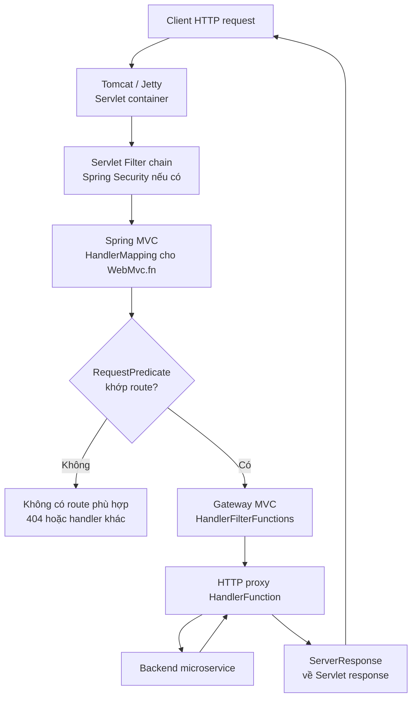
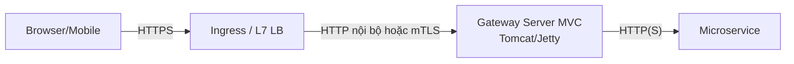
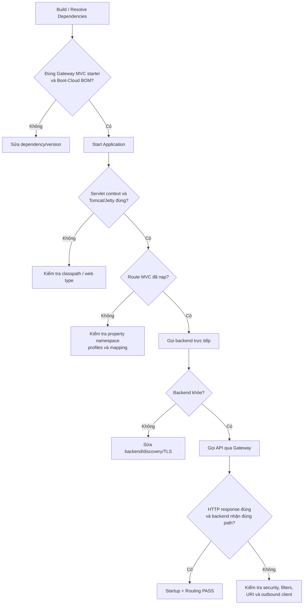

# Khởi tạo đúng starter và lựa chọn Servlet runtime

Một nhóm phát triển muốn đặt **Spring Cloud Gateway** trước các microservice, nhưng hệ thống của họ đang dùng **Spring MVC, Spring Security Servlet và Tomcat**. Nếu tạo project bằng một starter dành cho **Gateway Server WebFlux** rồi chỉ thêm `spring-boot-starter-web`, ứng dụng có thể có dependency conflict, khởi chạy sai loại web application hoặc không nạp route. Ngược lại, nếu đã chọn **Gateway Server Web MVC** mà lại sao chép ví dụ `GlobalFilter`/`ServerWebExchange` của WebFlux, mã sẽ không khớp API và cơ chế thực thi.

Bài học trong chương **Server Web MVC** của module **SPRING_CLOUD_GATEWAY** giải thích cách chọn **đúng starter, đúng hệ phiên bản Spring Boot/Spring Cloud, đúng Servlet runtime** để dựng API Gateway. Từ nền tảng này, Gateway mới có thể xử lý route predicate, filter chain, biến đổi path/header, service discovery, xác thực/phân quyền, rate limiting, circuit breaker, retry, TLS và quan sát request một cách nhất quán.

**Kết quả mong đợi:** Sau bài này, người học có thể tự tạo một Gateway MVC đơn giản, chạy trên Tomcat hoặc Jetty, kiểm chứng request được proxy đến backend, nhận ra ứng dụng đang dùng Servlet hay reactive stack, phân biệt các starter qua phiên bản và chuẩn bị đúng nền tảng để mở rộng bảo mật/quan sát.

> **Phạm vi:** Bài nói về **Spring Cloud Gateway Server Web MVC**, không phải **Gateway Server WebFlux**, **Spring Cloud Gateway Proxy Exchange** hay một ứng dụng Spring MVC chỉ có `@RestController`. Các ví dụ chính dùng nhánh Spring Cloud Gateway 5.x/Spring Boot 4.x, đồng thời chỉ rõ sự khác biệt ở dòng 4.2/4.3. Không trộn artifact/property từ các nhánh tài liệu khác nhau nếu chưa xác minh compatibility.

## 1. Phân biệt ba khái niệm dễ nhầm

**Spring Web MVC (Spring MVC)** là framework web dựa trên **Servlet API** của Spring Framework. Spring Boot có thể chạy ứng dụng Spring MVC trên container Servlet được nhúng như Tomcat hoặc Jetty.

**Spring Cloud Gateway Server Web MVC** là một biến thể **API Gateway Server** chạy trên nền Spring MVC, sử dụng **WebMvc.fn**: các route là các `RouterFunction`/`HandlerFunction` với các predicate và filter functions phù hợp. Nó cung cấp routing, proxying và nhiều concern ngang tầng Gateway.

**Spring Cloud Gateway Server WebFlux** là biến thể API Gateway sử dụng **Spring WebFlux, Reactor và mô hình reactive**, thường chạy trên Reactor Netty. Nó có cơ chế filter, request/response và mô hình runtime khác.

| Câu hỏi | Gateway Server Web MVC | Gateway Server WebFlux |
| --- | --- | --- |
| Nền tảng xử lý request | **Servlet stack + Spring Web MVC/WebMvc.fn** | **Reactive stack + Spring WebFlux/Project Reactor** |
| Kiểu request/response sử dụng trong handler | `ServerRequest` và `ServerResponse` của `org.springframework.web.servlet.function` | `ServerWebExchange`, `ServerHttpRequest`, `ServerHttpResponse` |
| Định tuyến bằng Java | `RouterFunction<ServerResponse>`, Gateway MVC handler functions | `RouteLocator`/`GatewayFilter`/reactive route DSL |
| Mở rộng filter thường gặp | Servlet Filter, `HandlerFilterFunction`, MVC filter functions | `WebFilter`, `GlobalFilter`, `GatewayFilter` |
| Security config | `SecurityFilterChain` và `HttpSecurity` | `SecurityWebFilterChain` và `ServerHttpSecurity` |
| Runtime chính | **Tomcat, Jetty** hoặc Servlet container tương thích theo phiên bản | **Reactive Netty** trong cấu hình Gateway WebFlux tiêu chuẩn |
| Spring Cloud Gateway starter mới | `spring-cloud-starter-gateway-server-webmvc` | `spring-cloud-starter-gateway-server-webflux` |
| Đóng gói thường gặp | Executable JAR + embedded Servlet container | Executable JAR + reactive Netty |
| Loại cấu hình Spring Boot | `WebApplicationType.SERVLET` | `WebApplicationType.REACTIVE` |

**Điểm then chốt:** Chọn MVC hay WebFlux là **chọn nền tảng runtime và lập trình**, không phải đổi tên trong YAML. Việc một thư viện reactive tình cờ xuất hiện trên classpath **không tự biến Gateway MVC thành WebFlux Gateway**; ngược lại, có Tomcat trong một project chưa đủ để chứng minh các route MVC đã được cấu hình đúng.

### 1.1. Server Web MVC không phải Proxy Exchange

Spring Cloud Gateway còn có biến thể **Proxy Exchange**, dùng một đối tượng proxy chuyên dụng trong handler được khai báo bằng annotation. Nó hữu ích cho một số trường hợp proxy từ controller nhưng **không đồng nghĩa** với sản phẩm **Gateway Server** có route definitions và các filter factories tương ứng.

Khi mục tiêu là xây một **cổng vào tập trung** cho nhiều microservice với route predicates, rewrite/filter và khả năng vận hành riêng, hãy chọn **Gateway Server Web MVC** nếu kiến trúc Servlet là lựa chọn đã được xác định. Không lấy dependency của Proxy Exchange thay cho Server Web MVC.

### 1.2. Kiến trúc xử lý request



Trong Web MVC, route được xử lý trên nền **Servlet request/response**. Một `RouterFunction` có thể dùng handler proxy HTTP đặc biệt của Gateway MVC, thay vì luôn phải viết một `@RestController` cho từng route. Các tầng security, path rewriting, load balancing và observability cần đặt đúng vị trí trong luồng này.

## 2. Tên starter thay đổi theo dòng Spring Cloud Gateway

Một trong các lỗi khởi tạo phổ biến nhất là chọn starter theo bài hướng dẫn của **phiên bản khác**.

| Dòng Gateway | Starter cho **Server Web MVC** | Bật/tắt MVC Gateway | Namespace route MVC thường dùng |
| --- | --- | --- | --- |
| **5.x** | `org.springframework.cloud:spring-cloud-starter-gateway-server-webmvc` | `spring.cloud.gateway.server.webmvc.enabled` | `spring.cloud.gateway.server.webmvc.routes` |
| **4.3.x** | `org.springframework.cloud:spring-cloud-starter-gateway-server-webmvc` | `spring.cloud.gateway.server.webmvc.enabled` | `spring.cloud.gateway.server.webmvc.routes` |
| **4.2.x** | `org.springframework.cloud:spring-cloud-starter-gateway-mvc` | `spring.cloud.gateway.mvc.enabled` | `spring.cloud.gateway.mvc.routes` |
| **WebFlux (không phải chủ đề bài)** | `spring-cloud-starter-gateway-server-webflux` trên các dòng mới | Thuộc tính của WebFlux | `spring.cloud.gateway.server.webflux.routes` (mới) |

Với **Gateway 4.2**, tài liệu cũ gọi sản phẩm là **Server MVC**. Từ **4.3** trở đi, tên sản phẩm **Server Web MVC** cùng artifact `-server-webmvc` được sử dụng. Tên artifact là phần của hợp đồng dependency, không phải alias tự động giữa mọi release.

Trong tài liệu và blog rất cũ còn thấy:

- `spring-cloud-starter-gateway`: chủ yếu là starter Gateway reactive cũ, **không dùng thay MVC**.
- `spring-cloud-starter-gateway-mvc`: hợp lệ với một số dòng MVC cũ, **không mặc nhiên đúng với Gateway 5.x**.
- `spring-boot-starter-web`: chỉ là starter Spring Boot web/MVC (tên cũ), **không tự cấp đầy đủ các khả năng Gateway MVC**.
- `spring-boot-starter-webflux`: starter reactive, **không phải nền tảng cần chọn cho Gateway MVC**.

### 2.1. Chọn Boot/Cloud BOM trước khi chọn artifact

Spring Cloud dùng **release train**; mỗi train hỗ trợ những dòng Spring Boot nhất định. Ví dụ theo bảng tương thích Spring Cloud:

| Spring Boot | Spring Cloud release train tương ứng | Ghi chú |
| --- | --- | --- |
| **4.0.x/4.1.x** | **2025.1.x (Oakwood)** | Dành cho nhánh Spring Framework 7/Cloud Gateway 5.x; phải chọn service release tương thích. |
| **3.5.x** | **2025.0.x (Northfields)** | Dòng Gateway 4.3.x; dùng starter `-server-webmvc`. |
| **3.4.x** | **2024.0.x (Moorgate)** | Dòng Gateway 4.2.x; dùng starter `-gateway-mvc`. |

**Không lấy Spring Boot 4.x rồi ghép Spring Cloud 2024.0.x**, hoặc ghép Boot 3.4.x với Gateway 5.x vì “Maven resolve được”. Lỗi có thể xuất hiện dưới dạng dependency incompatibility, thiếu class, auto-configuration không kích hoạt hoặc route không được nạp.

**Quy tắc an toàn:** Chọn Spring Boot release train đã được Spring Cloud chính thức hỗ trợ; import BOM `spring-cloud-dependencies`, để BOM quản lý version của Gateway và Spring Cloud dependencies. Khi phát hành lâu dài, pin các phiên bản cụ thể đã được build/test, cập nhật patch theo chính sách bảo trì.

### 2.2. Phiên bản Java

Các dòng Spring Boot 3.x/4.x yêu cầu nền Java hiện đại (tối thiểu Java 17 cho các dòng này). Một ví dụ dùng **Java 21 LTS** rất phù hợp để học Gateway MVC, nhưng vẫn phải đối chiếu JDK, Boot, Spring Framework, Servlet container và CI image thực tế. **Không dùng `javax.servlet.*` trong Spring MVC mới**; các API Servlet của Spring Framework 6+/Spring Boot 3+ sử dụng `jakarta.servlet.*`.

### 2.3. Vì sao không gán version riêng cho mọi dependency?

Ví dụ nguy hiểm:

```xml
<!-- KHÔNG NÊN: mỗi artifact lấy version độc lập tùy tiện. -->
<dependency>
    <groupId>org.springframework.cloud</groupId>
    <artifactId>spring-cloud-starter-gateway-server-webmvc</artifactId>
    <version>5.1.0</version>
</dependency>
<dependency>
    <groupId>org.springframework.boot</groupId>
    <artifactId>spring-boot-starter-webflux</artifactId>
    <version>3.5.0</version>
</dependency>
```

Đoạn trên **chỉ minh họa anti-pattern**, không phải cấu hình được đề xuất. Một Gateway MVC không nên bị kéo sang starter WebFlux và các thành phần framework không tương thích do phiên bản chắp vá. Thay vì vậy, import BOM/parent đúng rồi khai báo dependency cần thiết **không tự ghi version** trừ khi có lý do kỹ thuật đã được xác minh.

## 3. Cấu hình Maven tối thiểu cho Gateway Server Web MVC

Ví dụ dưới đây định hướng **Spring Boot 4.1.x + Spring Cloud 2025.1.x**, với các phiên bản cụ thể **để minh họa sự tương thích**, không phải khuyến nghị luôn giữ nguyên khi vá bảo mật. Trước khi áp dụng, đối chiếu các patch mới nhất của đúng release train.

### 3.1. File pom.xml cho một ứng dụng độc lập

```xml
<?xml version="1.0" encoding="UTF-8"?>
<project xmlns="http://maven.apache.org/POM/4.0.0"
         xmlns:xsi="http://www.w3.org/2001/XMLSchema-instance"
         xsi:schemaLocation="http://maven.apache.org/POM/4.0.0
             https://maven.apache.org/xsd/maven-4.0.0.xsd">
    <modelVersion>4.0.0</modelVersion>

    <parent>
        <groupId>org.springframework.boot</groupId>
        <artifactId>spring-boot-starter-parent</artifactId>
        <version>4.1.0</version>
        <relativePath/>
    </parent>

    <groupId>com.example</groupId>
    <artifactId>gateway-mvc-demo</artifactId>
    <version>0.0.1-SNAPSHOT</version>
    <name>gateway-mvc-demo</name>

    <properties>
        <java.version>21</java.version>
        <spring-cloud.version>2025.1.5</spring-cloud.version>
    </properties>

    <dependencyManagement>
        <dependencies>
            <dependency>
                <groupId>org.springframework.cloud</groupId>
                <artifactId>spring-cloud-dependencies</artifactId>
                <version>${spring-cloud.version}</version>
                <type>pom</type>
                <scope>import</scope>
            </dependency>
        </dependencies>
    </dependencyManagement>

    <dependencies>
        <dependency>
            <groupId>org.springframework.cloud</groupId>
            <artifactId>spring-cloud-starter-gateway-server-webmvc</artifactId>
        </dependency>
        <dependency>
            <groupId>org.springframework.boot</groupId>
            <artifactId>spring-boot-starter-webmvc-test</artifactId>
            <scope>test</scope>
        </dependency>
    </dependencies>

    <build>
        <plugins>
            <plugin>
                <groupId>org.springframework.boot</groupId>
                <artifactId>spring-boot-maven-plugin</artifactId>
            </plugin>
        </plugins>
    </build>
</project>
```

**Tại sao chỉ cần một starter Gateway MVC chính?**

- Nó kéo các thành phần Gateway Server Web MVC và web stack tương ứng theo dependency graph của dòng phiên bản.
- Không cần thêm `spring-cloud-starter-gateway-server-webflux`.
- Không cần thêm `spring-boot-starter-webflux` để “Gateway có thể HTTP proxy”.
- Trong dòng Boot 4.x, starter web cho MVC được gọi là `spring-boot-starter-webmvc`; Gateway MVC starter thường đã có quan hệ phụ thuộc tương ứng. Có thể bổ sung starter khác cho chức năng riêng, nhưng phải kiểm tra dependency tree thay vì thêm theo cảm tính.
- `spring-boot-starter-webmvc-test` là test starter tương ứng ở nhánh Boot 4. Trong Boot 3.x, test setup thường dùng `spring-boot-starter-test`.

Nếu chỉ đang thử xây ứng dụng nhỏ, đây là cơ sở gọn để biết lỗi đến từ Gateway MVC hay từ một dependency tùy chọn. Chỉ thêm Security, Actuator, LoadBalancer, CircuitBreaker, Redis… **sau khi đã xác định nhu cầu**.

### 3.2. Biến thể Spring Boot 3.5.x/Gateway 4.3.x

Nếu dự án đang ở **Boot 3.5.x**, dùng release train **Spring Cloud 2025.0.x** phù hợp, vẫn chọn:

```xml
<dependency>
    <groupId>org.springframework.cloud</groupId>
    <artifactId>spring-cloud-starter-gateway-server-webmvc</artifactId>
</dependency>
```

Nhưng parent/BOM phải được thay bằng **cặp phiên bản tương thích** cho Boot 3.5. Không copy nguyên parent 4.1.0 ở ví dụ trên rồi chỉ thay một artifact. Starter MVC có khả năng thay đổi theo release train nên đọc đúng tài liệu nhánh.

### 3.3. Biến thể legacy Boot 3.4.x/Gateway 4.2.x

Với Gateway 4.2, tên starter trong tài liệu là:

```xml
<dependency>
    <groupId>org.springframework.cloud</groupId>
    <artifactId>spring-cloud-starter-gateway-mvc</artifactId>
</dependency>
```

và cấu hình dùng `spring.cloud.gateway.mvc.routes`. Sử dụng Spring Cloud BOM **2024.0.x** tương thích Boot 3.4.x theo bảng phiên bản tương ứng. **Đây là ví dụ dành cho hệ cũ**, không nên dùng thay artifact mới trong Boot 4.

## 4. Cấu hình Gradle tương đương

Ví dụ **Gradle Groovy DSL** với Boot 4.1.x và Cloud 2025.1.x:

```groovy
plugins {
    id 'java'
    id 'org.springframework.boot' version '4.1.0'
    id 'io.spring.dependency-management' version '1.1.7'
}

group = 'com.example'
version = '0.0.1-SNAPSHOT'

java {
    toolchain {
        languageVersion = JavaLanguageVersion.of(21)
    }
}

repositories {
    mavenCentral()
}

ext {
    set('springCloudVersion', '2025.1.5')
}

dependencyManagement {
    imports {
        mavenBom "org.springframework.cloud:spring-cloud-dependencies:${springCloudVersion}"
    }
}

dependencies {
    implementation 'org.springframework.cloud:spring-cloud-starter-gateway-server-webmvc'
    testImplementation 'org.springframework.boot:spring-boot-starter-webmvc-test'
}

tasks.named('test') {
    useJUnitPlatform()
}
```

Không khai báo trực tiếp version Gateway starter khi BOM đã kiểm soát nó. Gradle Kotlin DSL cũng có cách import BOM tương ứng; không copy nguyên cú pháp Groovy vào `build.gradle.kts`.

### 4.1. Một nguyên tắc khi hỗ trợ nhiều dự án

Nếu một dự án Maven dùng Boot 3.4.x và một dự án Gradle dùng Boot 4.1.x, **hai dự án không nhất thiết dùng cùng artifact Gateway MVC và cùng YAML namespace**. Nên chuẩn hóa tài liệu theo:

```text
JDK
  -> Spring Boot version
    -> Spring Cloud release train
      -> Gateway Server MVC starter
        -> Servlet container
          -> route namespace / APIs
```

Với một lỗi khởi tạo, hãy tìm **bước đầu tiên sai trong chuỗi**, không chỉ nhìn log `No routes matched` rồi sửa Path.

## 5. Chọn Servlet runtime: Tomcat mặc định và Jetty thay thế

Spring Cloud Gateway Server Web MVC chạy trên **Servlet runtime**, thường **Tomcat** hoặc **Jetty**. Đây là khác biệt quan trọng với Gateway Server WebFlux dùng Netty theo cấu hình reactive chuẩn.

### 5.1. Tomcat — lựa chọn khởi đầu

Với starter Gateway MVC phù hợp, dependency web MVC thường đưa một **embedded Servlet container** vào ứng dụng. Trên Spring Boot phổ biến, Tomcat là lựa chọn mặc định của MVC starter.

**Ưu điểm thực dụng khi bắt đầu:**

- Cấu hình đơn giản, ít loại trừ transitive dependencies.
- Phù hợp ứng dụng Servlet Filter/Spring Security/Servlet stack.
- Hệ sinh thái vận hành và tài liệu Boot có hướng dẫn rõ về thread pool, access log, TLS, graceful shutdown.

**Không coi “Tomcat = nhanh hơn/chậm hơn Netty” là kết luận phổ quát.** Các con số throughput phụ thuộc HTTP client, TLS, keep-alive, payload, thread pool, hậu kiểm auth, backend latency và cách tạo tải. Bắt đầu với sự tương thích và đo tải thực tế.

### 5.2. Jetty — thay container khi có lý do

Để chuyển sang Jetty, phải **loại bỏ Tomcat** khỏi dependency graph và bổ sung **Jetty starter** tương thích Boot. Ví dụ Maven:

```xml
<dependency>
    <groupId>org.springframework.cloud</groupId>
    <artifactId>spring-cloud-starter-gateway-server-webmvc</artifactId>
    <exclusions>
        <exclusion>
            <groupId>org.springframework.boot</groupId>
            <artifactId>spring-boot-starter-tomcat</artifactId>
        </exclusion>
    </exclusions>
</dependency>

<dependency>
    <groupId>org.springframework.boot</groupId>
    <artifactId>spring-boot-starter-jetty</artifactId>
</dependency>
```

Với Gradle:

```groovy
dependencies {
    implementation('org.springframework.cloud:spring-cloud-starter-gateway-server-webmvc') {
        exclude group: 'org.springframework.boot', module: 'spring-boot-starter-tomcat'
    }
    implementation 'org.springframework.boot:spring-boot-starter-jetty'
}
```

**Hãy kiểm tra dependency tree sau khi loại trừ.** Nếu một dependency khác kéo Tomcat trở lại hoặc không có Servlet container phù hợp, ứng dụng có thể khởi động sai hoặc lỗi. Khi chọn Jetty, cập nhật cấu hình quản trị liên quan đến connector/TLS/thread pool/access log đúng theo Boot/Jetty version; **không sao chép nguyên thuộc tính `server.tomcat.*` rồi hy vọng Jetty dùng chúng**.

### 5.3. Undertow có dùng được không?

Một số dòng Spring Boot 3.x từng hỗ trợ Undertow cho Servlet web app. Tuy nhiên khả năng hỗ trợ thay đổi theo dòng Boot; tài liệu Boot 4.x hiện hành nhấn mạnh Tomcat/Jetty. Vì vậy bài này **không giả định Undertow là lựa chọn sẵn có trong mọi Boot/Gateway MVC version**. Nếu tổ chức có yêu cầu Undertow, phải xác minh support matrix của đúng phiên bản trước khi lập kiến trúc.

### 5.4. Embedded JAR hay external Servlet container?

Với ứng dụng Spring Boot Gateway, **executable JAR + embedded Servlet container** thường là lựa chọn đơn giản nhất để:

- Chạy cùng artifact trong local/staging/production.
- Cấu hình cổng, TLS, healthcheck, observability và memory nhất quán.
- Scale nhiều instances phía sau ingress/load balancer.
- Rollout/rollback artifact mà không phụ thuộc cấu hình chung của một external app server.

Do MVC dựa trên Servlet stack, một số mô hình WAR/external container **có thể** được hỗ trợ tùy dòng Boot/Gateway và các ràng buộc triển khai. Đây không phải mặc định cho bài lab. **Đừng nhầm với Gateway Server WebFlux**, vốn có yêu cầu reactive runtime riêng và không thể đơn thuần được triển khai như WAR trên Servlet container theo cách Servlet MVC.

## 6. Ép loại ứng dụng đúng là Servlet

Spring Boot có ba loại web application:

- **`WebApplicationType.SERVLET`:** khởi chạy nền Servlet/MVC.
- **`WebApplicationType.REACTIVE`:** khởi chạy nền reactive/WebFlux.
- **`WebApplicationType.NONE`:** không khởi chạy web server.

Khi dự án dùng Gateway Server Web MVC, lựa chọn là **Servlet**.

### 6.1. Khai báo rõ trong cấu hình bài học

```yaml
spring:
  main:
    web-application-type: servlet
```

Trong một project MVC starter gọn, Spring Boot thường tự phát hiện Servlet stack mà không cần khai báo này. Việc ghi rõ hữu ích khi học hoặc khi kiểm tra phụ thuộc hỗn hợp, nhưng **không thay thế việc xóa dependency Gateway WebFlux sai**.

### 6.2. Class khởi động Java

```java
package com.example.gatewaymvc;

import org.springframework.boot.SpringApplication;
import org.springframework.boot.autoconfigure.SpringBootApplication;

@SpringBootApplication
public class GatewayMvcApplication {

    public static void main(String[] args) {
        SpringApplication.run(GatewayMvcApplication.class, args);
    }
}
```

Class này giống Boot application thông thường, vì servlet auto-configuration và Gateway starter quyết định hạ tầng. **Không cần tự dựng `DispatcherServlet`, `ServletWebServerFactory` hoặc `RouterFunctionMapping`** chỉ để chạy example starter.

### 6.3. Không chọn Servlet chỉ vì cả WebFlux lẫn MVC cùng hiện diện

Trong Spring Boot, nếu cả Spring MVC và WebFlux xuất hiện, MVC thường có ưu tiên khi suy ra loại ứng dụng. Nhưng:

- Điều đó **không có nghĩa** Gateway WebFlux đã chạy.
- Một dependency WebFlux có thể chỉ được thêm vì `WebClient`, không phải reactive web server.
- Nếu cả **hai Gateway server starters** cùng hiện diện, context/classpath có thể trở nên khó suy đoán; hãy loại một nhánh thay vì dựa vào ưu tiên ngầm.
- Nếu cấu hình bị ép `spring.main.web-application-type: reactive` trong project Gateway MVC, WebMvc.fn routes có thể không được nạp như dự kiến.

**Quy tắc:** Với một cổng MVC riêng biệt, chọn **một server gateway flavor**, một stack chính và một servlet container phù hợp. Nếu buộc phải host những chức năng reactive/client trong ứng dụng Servlet, cần phân biệt HTTP client reactive và **server runtime**.

## 7. Cấu hình route MVC đầu tiên

Sau khi có starter và Servlet runtime phù hợp, thêm `src/main/resources/application.yml`:

```yaml
spring:
  application:
    name: gateway-mvc-demo
  main:
    web-application-type: servlet
  cloud:
    gateway:
      server:
        webmvc:
          routes:
            - id: catalog-route
              uri: http://localhost:9090
              predicates:
                - Path=/api/catalog/**
              filters:
                - StripPrefix=1

server:
  port: 8080
```

Giả định backend HTTP chạy tại `http://localhost:9090` với endpoint `GET /catalog/ping`.

```text
Client:
    GET http://localhost:8080/api/catalog/ping

Gateway Server Web MVC:
    Path=/api/catalog/** khớp catalog-route
    StripPrefix=1
    Path đưa tới backend: /catalog/ping

Backend:
    GET http://localhost:9090/catalog/ping
    HTTP 200, JSON {"service":"catalog"}
```

Các điểm quan trọng:

1. `server.port: 8080` là cổng Servlet container **của Gateway**, không phải port của backend.
2. `uri: http://localhost:9090` là backend đích, dùng để học routing mà không phụ thuộc discovery.
3. `predicates: Path=/api/catalog/**` xác định route phù hợp.
4. `StripPrefix=1` bỏ đoạn đầu `api` của path trước khi chuyển tiếp. Không áp dụng nếu backend thực sự cần nguyên `/api/catalog/ping`.
5. Đây là **Gateway MVC property prefix**: `spring.cloud.gateway.server.webmvc.routes`, khác với `server.webflux.routes`.
6. Route config mới và cũ **không nên được đặt đồng thời** như một cách “dự phòng tương thích”; framework chỉ hiểu namespace đúng của phiên bản.

### 7.1. Backend stub để kiểm chứng

Trong một **ứng dụng Spring Boot MVC khác**, chạy trên cổng 9090, tạo controller:

```java
package com.example.catalog;

import java.util.Map;
import org.springframework.web.bind.annotation.GetMapping;
import org.springframework.web.bind.annotation.RestController;

@RestController
public class CatalogDemoController {

    @GetMapping("/catalog/ping")
    public Map<String, String> ping() {
        return Map.of("service", "catalog");
    }
}
```

**Chạy stub ở process/port riêng**, không đặt controller này vào chính application Gateway rồi mong request tới port 9090 tự xuất hiện. Nếu cả hai cùng ở một server port thì bài test không còn minh họa proxying qua mạng. Không dùng backend production cho các bài thử route.

### 7.2. Trình tự chạy và xác minh

1. Khởi động backend stub 9090, bảo đảm gọi trực tiếp `GET http://localhost:9090/catalog/ping` nhận JSON như mong đợi.
2. Khởi động Gateway MVC trên cổng 8080 và kiểm tra log tên Servlet container.
3. Gọi URL **qua Gateway**:

```bash
curl -i http://localhost:8080/api/catalog/ping
```

4. Xác minh status 200 và body:

```http
HTTP/1.1 200 OK
Content-Type: application/json

{"service":"catalog"}
```

5. Thử một path không có route phù hợp để kiểm tra `404` theo cấu hình.
6. Dừng backend stub rồi gọi lại: Gateway có thể trả lỗi proxy/5xx do backend không sẵn sàng, **không đồng nghĩa route không tồn tại**.

**Phản hồi được dự kiến trong bài lab**, không phải kết quả đã được chạy trên workspace. Mã HTTP/headers khi backend lỗi phụ thuộc client/proxy config và exception mapping của phiên bản.

### 7.3. Route không thay thế security

Ví dụ ban đầu **không cấu hình xác thực**, chỉ để người học xác minh starter và runtime. Một Gateway production cần SecurityFilterChain, issuer/audience, role/scope, policy theo HTTP method, TLS và authorization phía backend.

Đừng cho rằng `Path` predicate đã hạn chế đủ ai được gọi API. Predicate chọn route; nó **không phải công cụ phân quyền**.

## 8. Khai báo route bằng Java WebMvc.fn

Ngoài `application.yml`, Gateway MVC có thể định nghĩa tuyến bằng **Spring WebMvc.fn RouterFunction**. Điều này hữu ích nếu cần route được tổ chức bằng Java, gắn filter functions kiểu mạnh và kiểm soát cấu hình qua code.

### 8.1. Một RouterFunction tương đương route YAML

```java
package com.example.gatewaymvc.routes;

import org.springframework.context.annotation.Bean;
import org.springframework.context.annotation.Configuration;
import org.springframework.web.servlet.function.RouterFunction;
import org.springframework.web.servlet.function.ServerResponse;

import static org.springframework.cloud.gateway.server.mvc.filter
    .BeforeFilterFunctions.stripPrefix;
import static org.springframework.cloud.gateway.server.mvc.filter
    .BeforeFilterFunctions.uri;
import static org.springframework.cloud.gateway.server.mvc.handler
    .GatewayRouterFunctions.route;
import static org.springframework.cloud.gateway.server.mvc.handler
    .HandlerFunctions.http;

@Configuration
public class CatalogGatewayRoutes {

    @Bean
    RouterFunction<ServerResponse> catalogRoute() {
        return route("catalog-by-java")
            .GET("/api/catalog/**", http())
            .before(uri("http://localhost:9090"))
            .before(stripPrefix(1))
            .build();
    }
}
```

Đoạn Java minh họa **đúng kiểu API dành cho Web MVC**:

- `RouterFunction<ServerResponse>` từ `org.springframework.web.servlet.function`.
- `GatewayRouterFunctions.route("catalog-by-java")` tạo builder gắn metadata route ID.
- `.GET("/api/catalog/**", http())` match GET và dùng `HandlerFunctions.http()` để proxy.
- `.before(uri(...))` thiết lập đích HTTP.
- `.before(stripPrefix(1))` loại một đoạn path trước khi gửi downstream.

**Lưu ý triển khai:** Không chạy **đồng thời route Java này và route YAML cùng vùng Path** trong bài lab rồi mong kết quả luôn giống nhau. Hai tuyến có thể cùng khớp; thứ tự handler/route và chính sách match làm kết quả không rõ nếu không thiết kế chủ ý. Để học Java DSL, hãy **thay thế** cấu hình catalog YAML hoặc dùng path riêng.

### 8.2. Vì sao không dùng API của Gateway WebFlux?

Ví dụ dưới đây là **API khác**, không phải Web MVC:

```java
// Ví dụ WebFlux — KHÔNG dùng làm RouterFunction MVC.
@Bean
RouteLocator routes(RouteLocatorBuilder builder) {
    return builder.routes()
        .route("reactive", r -> r
            .path("/api/**")
            .uri("http://localhost:9090"))
        .build();
}
```

Trong WebFlux, `RouteLocator` cùng `GatewayFilter` và `ServerWebExchange` phục vụ hệ reactive. Nếu chọn MVC, hãy dùng `RouterFunction`/`HandlerFilterFunction` của **`org.springframework.web.servlet.function`**.

Một ứng dụng có thể có một số lớp Reactor/Mono phục vụ tác vụ khác, nhưng **không được coi sự có mặt của Reactor dependency là bằng chứng dùng reactive Gateway Server**.

### 8.3. URI của route không tự thay path

Tài liệu Gateway MVC nêu rằng **path nằm trong URI đích của route có thể bị bỏ qua** trong cơ chế handler routing. Vì vậy, không dựa vào:

```yaml
# KHÔNG coi /orders ở đích là cách rewrite đáng tin cậy.
uri: http://localhost:9090/orders
predicates:
  - Path=/api/orders/**
```

để đảm bảo backend nhận `/orders/42`. Hãy sử dụng `StripPrefix`, `SetPath` hoặc `RewritePath` tương ứng và **kiểm thử URL thực tế** ở backend. Đây là lý do route mẫu dùng `uri: http://localhost:9090` và filter `StripPrefix=1` tường minh.

### 8.4. Before/After/Advanced filters ở MVC

| Nhóm | Kiểu API thường gặp | Cách dùng |
| --- | --- | --- |
| **Before filter** | `Function<ServerRequest, ServerRequest>` hoặc factory trong `BeforeFilterFunctions` | Sửa request như path/header/URI trước HTTP proxy. |
| **After filter** | `BiFunction<ServerRequest, ServerResponse, ServerResponse>` hoặc `AfterFilterFunctions` | Sửa response sau handler. |
| **Handler filter** | `HandlerFilterFunction<ServerResponse,ServerResponse>` | Bọc điều khiển trước/sau hoặc thực hiện logic nâng cao. |
| **Advanced filters** | Các factory như Retry, CircuitBreaker, Body, Bucket4j, TokenRelay tùy dependency/version | Có lifecycle riêng, có thể cần tham số/state/ordering. |

Các lớp trên nằm trong **Servlet/WebMvc.fn stack**. Không sao chép mã WebFlux `ServerHttpResponseDecorator`, `DataBuffer`, `Mono<Void>` vào một `HandlerFilterFunction` rồi kỳ vọng hai hệ thống tự chuyển đổi.

## 9. Kiểm tra dependency tree thay vì đoán runtime

Build thành công chưa đủ. Có thể hai starter Gateway, nhiều servlet containers hoặc nhiều versions bị kéo vào dependency graph.

### 9.1. Kiểm tra Maven

Các lệnh sau là **hướng dẫn người học thực hành trong project riêng**, không phải thao tác đã chạy trên workspace bài học:

```bash
./mvnw dependency:tree \
  -Dincludes=org.springframework.cloud,org.springframework.boot
```

Trong Windows PowerShell, có thể gọi wrapper Maven bằng `.\mvnw.cmd` với các tham số tương ứng.

Tìm:

1. Có `spring-cloud-starter-gateway-server-webmvc` đúng release train không?
2. Có `spring-cloud-starter-gateway-server-webflux` hoặc `spring-cloud-starter-gateway` reactive cũ không?
3. Có `spring-boot-starter-webmvc`/MVC stack qua transitive dependencies không?
4. Container được chọn là Tomcat hay Jetty, có dependency thừa không?
5. Có artifact Spring Boot/Spring Cloud nào bị ép version ngoài BOM không?

Nếu phát hiện cả hai Gateway flavors, **điều tra dependency kéo chúng vào và loại nhánh không cần**. Không sửa bằng cách ép property `web-application-type: servlet` rồi bỏ mặc classpath lộn xộn.

### 9.2. Kiểm tra Gradle

```bash
./gradlew dependencies --configuration runtimeClasspath
./gradlew dependencyInsight \
  --dependency spring-cloud-starter-gateway-server-webmvc \
  --configuration runtimeClasspath
./gradlew dependencyInsight \
  --dependency spring-boot-starter-tomcat \
  --configuration runtimeClasspath
```

Tìm đường phụ thuộc thực tế: ai kéo Tomcat, Jetty, WebFlux, Netty hoặc một phiên bản Spring Cloud lạ vào classpath? `dependencyInsight` rất hữu ích khi một thư viện bổ sung thay đổi server runtime ngoài dự kiến.

**Đừng xóa `reactor-core` chỉ vì thấy từ “reactor”**: một số thư viện có thể sử dụng Reactor với vai trò utility/client. Điều quan trọng là **server flavor**, Spring Boot application context và Gateway route APIs đã chọn.

### 9.3. Kiểm tra effective cấu hình

Một cấu hình có thể bị override bởi:

- `application-dev.yml` / `application-prod.yml`.
- Environment variables hoặc command-line flags.
- Config Server/Kubernetes ConfigMap/secret.
- Profile khác được bật trong CI/staging.
- Version namespace khác mà framework không nhận.

Vì vậy, cần xác định **effective** `spring.main.web-application-type`, `spring.cloud.gateway.server.webmvc.routes`, `server.port` và mọi thuộc tính server/container trên từng môi trường.

Không dump toàn bộ environment công khai để kiểm tra cấu hình: nó có thể chứa JWT signing keys, database passwords hoặc client secrets. Sử dụng logs/Actuator đã giới hạn quyền và che dữ liệu nhạy cảm.

## 10. Nhận biết Servlet runtime khi ứng dụng khởi động

Khi khởi động Gateway MVC, quan sát log và cấu hình thực tế:

| Dấu hiệu | Khả năng giải thích | Cách xác nhận |
| --- | --- | --- |
| Log có **Tomcat** start trên cổng 8080 | Embedded Tomcat là Servlet server. | Kiểm tra dependency tree, `ServletWebServerApplicationContext`. |
| Log có **Jetty** | Embedded Jetty được chọn. | Xác minh Tomcat đã được loại và Jetty đúng version. |
| Log có **Netty** thay vì Servlet container | Có thể đang chạy reactive server hoặc một client Netty. | Xác định web application context và lớp server thực tế, không chỉ grep một từ. |
| App start nhưng `GET /api/catalog/ping` trả 404 | Route không match hoặc không được nạp. | Kiểm tra đúng MVC starter/property, route ID, path/method. |
| App start rồi request trả 401 | Spring Security đang bảo vệ URL. | Xem `SecurityFilterChain` và token test; không bỏ security để “sửa route”. |
| App start rồi trả 502/503 | Backend lỗi, URI sai, thiếu instance hoặc TLS/network. | Gọi backend trực tiếp và kiểm tra proxy exceptions. |

### 10.1. Mã kiểm tra WebApplicationContext trong lab

Có thể log loại context qua một bean startup **chỉ dùng trong môi trường học**, ví dụ:

```java
package com.example.gatewaymvc;

import org.springframework.boot.ApplicationRunner;
import org.springframework.context.ApplicationContext;
import org.springframework.context.annotation.Bean;
import org.springframework.context.annotation.Configuration;
import org.springframework.boot.web.servlet.context
    .ServletWebServerApplicationContext;

@Configuration
class StartupTypeDiagnostics {

    @Bean
    ApplicationRunner applicationTypeInfo(ApplicationContext context) {
        return args -> {
            if (context instanceof ServletWebServerApplicationContext) {
                System.out.println("Gateway running with Servlet web context");
            } else {
                System.out.println(
                    "Unexpected context: " + context.getClass().getName());
            }
        };
    }
}
```

Đoạn trên chỉ kiểm tra **loại web context**, không chứng minh route hoạt động hoặc request đã được backend xử lý. Với Boot 4, package/server APIs có thể thay đổi theo minor version; hãy đối chiếu API của bản đang dùng. Trong sản phẩm thật, ưu tiên structured logging và các health checks có kiểm soát thay vì `System.out.println`.

### 10.2. Dấu hiệu từ Thread và request handling

Servlet container cung cấp thread model của nó để xử lý request. Với blocking I/O hoặc handler chậm, tài nguyên thread của Servlet server là một ngân sách phải quản lý.

**Không nhìn thread name một lần rồi kết luận kiến trúc**. Trong cùng process có thể tồn tại thread pools của async tasks, HTTP clients, schedulers, log writers hoặc message broker. Cần kết hợp:

- Servlet context thực tế;
- Dependency/runtime;
- Request handler stack;
- Metrics của container và outbound HTTP client.

### 10.3. MVC chạy trên Tomcat không có nghĩa mọi I/O bắt buộc đồng bộ hoàn toàn

Servlet hỗ trợ asynchronous request processing; một số tính năng Gateway MVC có thể tận dụng cơ chế đồng thời/asynchronous của nền tảng hoặc HTTP client. Tuy nhiên **mô hình lập trình và cấu hình không giống WebFlux**, và không được đánh đồng với Reactor Netty event-loop/backpressure semantics.

Lựa chọn MVC hợp lý khi hệ thống, thư viện, đội ngũ và hạ tầng đã chuẩn hóa Servlet APIs. Nếu throughput rất cao và nhiều long-lived streams là nhu cầu chính, hãy benchmark cả hai Gateway flavors trước khi quyết định, thay vì dựa vào slogan “reactive luôn nhanh hơn”.

## 11. Thread pool, connection pool và virtual threads

Khi Gateway đóng vai trò proxy, độ trễ đầu cuối không chỉ là thời gian xử lý predicate:

\[
T_{\text{client}} \approx T_{\text{accept}} + T_{\text{security}}
  + T_{\text{gateway-filter}} + T_{\text{outbound}}
  + T_{\text{backend}} + T_{\text{response}}
\]

Đây là **mô hình tư duy**; các giai đoạn có thể chồng lấn và không phải phép cộng đo đạc tuyệt đối. Nhưng nó nhắc rằng mỗi request có thể giữ tài nguyên ở **cả Servlet server lẫn HTTP client phía outbound**.

### 11.1. Khi backend chậm, Servlet threads và connection pool cần được xem cùng nhau

Ví dụ 200 concurrent requests tới backend có độ trễ 2 giây. Nếu đường proxy giữ tài nguyên đồng thời ở Servlet và HTTP client, bạn có thể gặp:

- Servlet worker threads bị chiếm.
- Outbound connections/pool chạm giới hạn.
- Queue tăng, p95/p99 tăng.
- Retry khuếch đại số attempts.
- Circuit breaker và rate limiter không đủ để giảm độ trễ nếu đặt sai vị trí.

**Không giải quyết mọi 503 bằng cách tăng `server.tomcat.threads.max`**. Đặt quá nhiều threads cũng có chi phí scheduling/memory. Xác định bottleneck từ thread dump, server metrics, HTTP-client connection stats, backend timing và load test.

### 11.2. Cấu hình container phải đúng loại

Ví dụ **cho Tomcat** với giá trị chỉ mang tính minh họa:

```yaml
server:
  port: 8080
  tomcat:
    threads:
      max: 200
      min-spare: 10
```

Nếu chuyển sang Jetty, những thuộc tính dưới `server.tomcat.*` **không còn có mục đích**. Hãy tìm các thuộc tính Jetty tương ứng trong tài liệu Boot đúng version và đo lại trước khi quyết định.

### 11.3. Virtual threads có phải lựa chọn thay WebFlux?

Trong những dòng Boot/JDK hỗ trợ, có thể cân nhắc:

```yaml
spring:
  threads:
    virtual:
      enabled: true
```

Virtual threads có thể giảm chi phí thread cho **nhiều tác vụ chờ I/O**, nhưng **không biến MVC thành WebFlux**. Chúng không tự mở rộng connection pools, database capacity, CPU hoặc memory và không miễn trừ việc áp dụng rate limit/circuit breaker.

Trước khi bật, kiểm tra tác động với Servlet container, thư viện đồng bộ, thread-local context, pinning/blocking behavior, observability và phiên bản JDK. So sánh p95/p99, throughput, CPU/RSS ở tải đại diện; không coi một thuộc tính là “tối ưu miễn phí”.

## 12. Spring Security trong Servlet Gateway MVC

Gateway có thể kiểm tra JWT và phân quyền ngay tại biên, nhưng phải dùng **Spring Security Servlet** thay cho cấu hình Security WebFlux.

### 12.1. Dependencies tùy mục đích

Với Boot 4.x:

```xml
<!-- Bật các dependency này khi thực sự cần security. -->
<dependency>
    <groupId>org.springframework.boot</groupId>
    <artifactId>spring-boot-starter-security</artifactId>
</dependency>

<dependency>
    <groupId>org.springframework.boot</groupId>
    <artifactId>spring-boot-starter-oauth2-resource-server</artifactId>
</dependency>
```

Nếu Gateway tham gia OAuth2 login/Token Relay với vai trò client, có thể cần thêm `spring-boot-starter-oauth2-client` và cấu hình authorized client/IdP phù hợp. **Resource Server JWT và OAuth2 Client/Token Relay là hai vai trò khác nhau**, không tự kích hoạt lẫn nhau.

### 12.2. SecurityFilterChain với HttpSecurity

Ví dụ **một Gateway Bearer-only API**:

```java
package com.example.gatewaymvc.security;

import org.springframework.context.annotation.Bean;
import org.springframework.context.annotation.Configuration;
import org.springframework.security.config.Customizer;
import org.springframework.security.config.annotation.web.builders.HttpSecurity;
import org.springframework.security.web.SecurityFilterChain;

@Configuration
public class GatewaySecurityConfiguration {

    @Bean
    SecurityFilterChain securityFilterChain(HttpSecurity http)
            throws Exception {
        http
            // Chỉ thích hợp với API dùng Bearer token, không dựa trên
            // cookie session tự động gửi từ browser.
            .csrf(csrf -> csrf.disable())
            .authorizeHttpRequests(authorize -> authorize
                .requestMatchers("/actuator/health").permitAll()
                .requestMatchers("/api/catalog/**").authenticated()
                .anyRequest().denyAll()
            )
            .oauth2ResourceServer(resourceServer ->
                resourceServer.jwt(Customizer.withDefaults()));
        return http.build();
    }
}
```

Ví dụ cần một issuer/JWK source hợp lệ và cấu hình Resource Server tương ứng:

```yaml
spring:
  security:
    oauth2:
      resourceserver:
        jwt:
          issuer-uri: https://identity.example.test/issuer
```

**Lưu ý:** Trong một dự án thực tế, phải kiểm tra thêm audience, scope/role, resource ownership ở backend và trust của forwarded headers. Chỉ có `authenticated()` không đủ để chứng minh user được xem mọi tài nguyên.

Nếu ứng dụng dùng **cookie session/login qua browser**, không tự tắt CSRF bằng cách sao chép cấu hình Bearer-only trên. Cấu hình cookie, CSRF, CORS và OIDC session theo mô hình đã chọn.

### 12.3. So sánh Servlet Security với Reactive Security

| Servlet Gateway MVC | Reactive Gateway WebFlux |
| --- | --- |
| `HttpSecurity` | `ServerHttpSecurity` |
| `SecurityFilterChain` | `SecurityWebFilterChain` |
| Servlet `FilterChain` | Reactive `WebFilter` chain |
| `HttpServletRequest`/`HttpServletResponse` | `ServerWebExchange`/reactive response |
| `@EnableWebSecurity` khi cần | `@EnableWebFluxSecurity` khi cần |

**Đừng copy class có `SecurityWebFilterChain` vào MVC Gateway rồi kết luận Spring Security đã bảo vệ route.** Trong Servlet stack, cần bean và request matchers đúng với đường đi HTTP mà client thực sự gọi.

### 12.4. Định tuyến không tạo quyền truy cập mới

Giả sử Route A có `Path=/api/catalog/**`, còn Route B có `Path=/api/**`. Nếu security chain chỉ bảo vệ A nhưng cho phép phần còn lại, B có thể vô tình mở các endpoint ngoài mong muốn. Sử dụng **default deny**, rule theo path/method/authority và test cả URL không match route.

Các endpoints quản trị Actuator (nếu bật) cần security riêng và hạn chế mạng truy cập. Không cho phép client tự gửi header giả danh tính như `X-User-Id` rồi coi đó là JWT đã xác thực.

## 13. Servlet Filters và FormFilter: lưu ý đặc thù

Gateway MVC vận hành cùng **Servlet Filter chain**. Filter được áp dụng **trước WebMvc.fn route matching** theo thứ tự đã cấu hình, có thể làm biến đổi hoặc tiêu thụ request.

Đặc biệt với `application/x-www-form-urlencoded`, Servlet container có thể đọc form fields và gộp chúng với query parameters thành **request parameters**. Spring Cloud Gateway Server MVC có cơ chế **`FormFilter`** để tái tạo form body phù hợp cho downstream trong những tình huống như vậy.

Tài liệu Gateway MVC lưu ý rằng Servlet Filter tự đọc request parameters cần được sắp thứ tự phù hợp **trước `FormFilter`** để tránh làm sai cách body được tái tạo.

Ví dụ khung Servlet Filter với thứ tự:

```java
import jakarta.servlet.Filter;
import jakarta.servlet.FilterChain;
import jakarta.servlet.ServletException;
import jakarta.servlet.ServletRequest;
import jakarta.servlet.ServletResponse;
import java.io.IOException;

import org.springframework.cloud.gateway.server.mvc.filter.FormFilter;
import org.springframework.core.Ordered;

class SampleServletFilter implements Filter, Ordered {

    @Override
    public int getOrder() {
        return FormFilter.FORM_FILTER_ORDER - 1;
    }

    @Override
    public void doFilter(
            ServletRequest request,
            ServletResponse response,
            FilterChain chain) throws IOException, ServletException {
        // Không đọc body một cách vô điều kiện trong ví dụ này.
        chain.doFilter(request, response);
    }
}
```

Đây là minh họa **thứ tự tương đối theo tài liệu**, không phải lý do nên thêm một Filter rỗng vào production. Khi dùng logging/security/form parsers thực tế, cần biết filter nào gọi `getParameterMap()`, `getInputStream()` hoặc `getReader()` và body có bị tiêu thụ hay không.

### 13.1. Servlet Filter khác Gateway MVC HandlerFilterFunction

- Servlet Filter thường áp dụng ở **vùng servlet mapping rộng**, trước route matching.
- `HandlerFilterFunction` áp dụng ở **WebMvc.fn handler/route chain**, xử lý route đã chọn.
- SecurityFilterChain tham gia thông qua Servlet security infrastructure.
- Built-in Gateway MVC filters cung cấp các chức năng đặc thù proxy, rewrite, retry… ở đúng tầng route.

**Không chuyển mọi thứ thành Servlet Filter**. Ví dụ giới hạn lưu lượng theo route ID, rewrite URI chỉ cho `orders-api` hay fallback của Gateway thường nên dùng khả năng của Gateway MVC filter functions hoặc một thiết kế tương đương, không phải một servlet filter chung không biết route nào sẽ được chọn.

### 13.2. Khi request body bị đọc quá sớm

Một custom filter đọc body để log raw JSON trước khi request tới Gateway có thể khiến downstream nhận body rỗng/cắt, trừ khi có wrapper/buffering đúng. Với dữ liệu nhạy cảm, ghi nguyên body vào log còn tạo rủi ro lộ token/PII.

**Chỉ đọc dữ liệu cần thiết**, giữ lifecycle và replay semantics theo Servlet stack. Đừng áp dụng trực tiếp hướng dẫn `Flux<DataBuffer>`/`DataBufferUtils.join` của WebFlux vào HttpServletRequest mà không có adapter.

## 14. TLS, reverse proxy và service discovery không biến mất trong MVC

Chọn Servlet runtime chỉ quyết định hạ tầng HTTP server của Gateway; các yêu cầu sản phẩm vẫn tồn tại:

- **TLS** từ client tới Gateway hoặc ingress; nếu terminate TLS ở ingress, cấu hình forwarded headers và trust boundary chính xác.
- **TLS/mTLS** cho Gateway tới backend khi phù hợp; không tắt certificate validation để tránh lỗi.
- **Service discovery** nếu dùng `lb://service-name`, cần LoadBalancer và DiscoveryClient/instance supplier thích hợp.
- **Rate limiting/circuit breaker/retry** theo đúng factory và dependencies của **Gateway MVC**, không copy cấu hình reactive một cách máy móc.
- **Observability** của cả Servlet container, Gateway routing, outbound HTTP client và backend.

### 14.1. Khi từ http:// chuyển sang lb://

Route ví dụ ban đầu trỏ:

```yaml
uri: http://localhost:9090
```

Khi có discovery:

```yaml
uri: lb://catalog-service
```

Điều kiện là trong application context có cơ chế phân giải service instances và dependency **Spring Cloud LoadBalancer**/registry phù hợp. Không mặc định `lb://catalog-service` sẽ hoạt động khi chỉ có Gateway MVC starter và không có nguồn instances.

**Không dùng hostname trong lb URI làm bằng chứng TLS đã bật.** TLS được xác định bởi scheme/transport và cấu hình client trust/mTLS; service discovery chọn instance chứ không tự bảo đảm kết nối outbound đã an toàn.

### 14.2. Reverse proxy phía trước Gateway

Luồng thường gặp:



Cần quyết định:

- Ai terminate TLS và ai chịu trách nhiệm HSTS/secure cookies?
- Gateway tin `Forwarded`/`X-Forwarded-*` chỉ từ proxy nào?
- Dịch vụ phía sau nhận Host/protocol/path ra sao?
- Có bảo vệ connection giữa Gateway và backend không?
- Có cần rewrite `Location` ở response hoặc preserve host không?

**Không tin trực tiếp header `X-Forwarded-Proto: https` do client Internet tự gửi**. Một app MVC chạy Tomcat phía sau proxy phải có forwarded header strategy và network boundaries phù hợp.

### 14.3. Service discovery và route startup là hai việc khác

Gateway có thể **khởi động thành công** dù backend/discovery chưa có instances, tùy route và loại client. Lỗi thật sẽ xuất hiện khi gửi request (ví dụ 5xx). Ngược lại, cấu hình route không hợp lệ có thể khiến startup fail ngay.

Vì vậy phải có **hai loại kiểm chứng**:

1. **Startup readiness:** Servlet server hoạt động, Gateway MVC route definitions nạp được.
2. **End-to-end readiness:** Các backend trọng yếu có instance, TLS trust hợp lệ, proxy request nhận response theo hợp đồng.

Không chỉ nhìn log “Tomcat started” rồi kết luận Gateway đã sẵn sàng phục vụ toàn bộ microservices.

## 15. Kiểm thử khởi tạo và xác minh Servlet runtime

Bài học về **starter và runtime** nên được kiểm chứng bằng nhiều tầng, từ dependency tới HTTP thực tế.

### 15.1. Lộ trình kiểm thử theo thứ tự



**Không bắt đầu bằng performance test** khi còn chưa chứng minh route đã được nạp và target service nhận đúng path. Hãy cô lập từng lớp để dễ tìm nguyên nhân.

### 15.2. Kiểm thử thủ công với curl

Giả định stub ở cổng 9090 và Gateway ở 8080:

```bash
# 1. Backend trực tiếp
curl -i http://localhost:9090/catalog/ping

# 2. Qua Gateway MVC (StripPrefix=1)
curl -i http://localhost:8080/api/catalog/ping

# 3. Một path không match route
curl -i http://localhost:8080/not-configured

# 4. Test method khác, để xác định rule method thực tế
curl -i -X POST http://localhost:8080/api/catalog/ping
```

Trong route YAML của ví dụ, chỉ có `Path` predicate, **không có Method predicate** nên POST cũng có thể match route và được proxy; việc backend có trả 405 hay không là quyết định ở handler backend. Nếu muốn Gateway chỉ chọn route GET:

```yaml
predicates:
  - Path=/api/catalog/**
  - Method=GET
```

**Không gộp “route match” với “backend chấp nhận method”**. Đây là hai tầng khác nhau. Tương tự, 404 có thể do Gateway không tìm thấy route hoặc do backend trả 404; cần đối chiếu backend access logs/correlation ID.

### 15.3. Kiểm thử bằng @SpringBootTest

Với bài test **end-to-end qua Servlet container thật**, sử dụng:

```java
@SpringBootTest(
    webEnvironment = SpringBootTest.WebEnvironment.RANDOM_PORT
)
class GatewayMvcRoutingIT {
    // Test HTTP client gửi request đến port ngẫu nhiên của Gateway.
    // Backend giả dùng WireMock/MockWebServer/stub độc lập.
    // Assert status, response body, path/method đã được proxy.
}
```

Đây là **khung mô tả bài test**, không phải một class biên dịch độc lập. Nó cần imports, test starter, backend stub, các thuộc tính URI/port được inject và assertions phù hợp.

Nếu cần test ngay HTTP request pipeline và Servlet filters, hãy để Spring Boot khởi chạy **webEnvironment RANDOM_PORT** thay vì chỉ gọi trực tiếp method `@Bean RouterFunction`. Test có thể gửi GET bằng JDK `HttpClient`, RestClient hoặc một HTTP client test được dự án hỗ trợ.

**MockMvc** hữu ích để test Spring MVC mappings và Servlet filters, nhưng nó không tự chứng minh toàn bộ mạng/backend TLS, discovery, connection pool hoặc transport behavior. Với Gateway proxy, một bài integration test có **HTTP stub thật** là rất có giá trị.

### 15.4. Có cần WebTestClient không?

WebTestClient là công cụ thuộc hệ sinh thái Spring WebFlux và có thể có cách dùng với một ứng dụng đang chạy qua HTTP, nhưng **không phải dấu hiệu phải biến Server Web MVC thành WebFlux**. Không thêm WebFlux Gateway starter chỉ để “có WebTestClient”.

Ở dự án Servlet MVC, ưu tiên HTTP integration client, MockMvc hoặc công cụ test phù hợp với Boot version. Đối với API security, dùng test support của **Spring Security Servlet**, không sao chép `mockJwt()` từ reactive test config mà chưa kiểm tra cơ chế test đang sử dụng.

### 15.5. Ma trận test tối thiểu

| ID | Tình huống | Kết quả cần xác nhận |
| --- | --- | --- |
| S1 | Boot/Cloud BOM đúng cặp | Dependency resolve không mâu thuẫn. |
| S2 | Starter Web MVC mới được nạp | Có Server Web MVC infrastructure và route. |
| S3 | Không thêm Gateway WebFlux starter | Không có gateway flavor thứ hai ngoài ý muốn. |
| S4 | Embedded Tomcat mặc định | WebApplicationType Servlet; server listening đúng port. |
| S5 | Đổi sang Jetty có exclude Tomcat | Chỉ chạy Servlet container mong muốn. |
| S6 | `spring.main.web-application-type=servlet` | Startup đúng context. |
| S7 | Đổi sang `reactive` để làm thử | Phát hiện setup sai; không coi đó là mô hình MVC hợp lệ. |
| S8 | YAML `server.webmvc.routes` đúng | Route /api/catalog/** nạp và match. |
| S9 | Dùng nhầm prefix `server.webflux.routes` | Nhận diện route MVC không được nạp. |
| S10 | Dùng nhầm starter `-gateway-mvc` trên dòng mới | Phát hiện dependency không đúng version. |
| S11 | Backend stub trực tiếp trả 200 | Upstream sẵn sàng trước test Gateway. |
| S12 | GET qua Gateway, StripPrefix=1 | Backend nhận /catalog/ping, client nhận đúng JSON. |
| S13 | Backend tắt hoặc timeout | Phân biệt lỗi proxy với route không match. |
| S14 | Path không match | Trả 404/handler khác đúng hợp đồng. |
| S15 | Chỉ có Path, không Method | POST vẫn có thể match, backend quyết định trả 405. |
| S16 | Có Spring Security, thiếu token | 401/redirect đúng policy, không bypass. |
| S17 | Có JWT hợp lệ nhưng thiếu quyền | 403 theo security rule, không phải lỗi route. |
| S18 | `lb://` không có instances | Nhận diện lỗi discovery/LoadBalancer riêng. |
| S19 | Ingress gửi forwarded headers | Scheme, Host, redirect, cookie được xử lý an toàn. |
| S20 | Servlet Filter đọc form parameters | FormFilter và downstream form body vẫn đúng. |
| S21 | Load test 100 concurrent requests | Đo Servlet threads/outbound pool/p99, không OOM. |
| S22 | Đổi Tomcat ↔ Jetty | Cấu hình server và tests vẫn phù hợp container. |
| S23 | Disable `server.webmvc.enabled` | MVC Gateway không đăng ký routes đúng kỳ vọng. |
| S24 | Actuator hoặc management port được bật | Không bị truy cập ghi trái phép qua public interface. |

### 15.6. Tiêu chí PASS phải cụ thể

Không ghi báo cáo “PASS vì ứng dụng không crash”. Một báo cáo test tối thiểu nên có:

```text
Boot version: 4.1.x
Spring Cloud train: 2025.1.x
Gateway flavor: Server Web MVC
Gateway starter: spring-cloud-starter-gateway-server-webmvc
Web application type: SERVLET
Servlet container: Tomcat (embedded)
Gateway port: 8080
Backend target: http://localhost:9090
Route ID: catalog-route
Request: GET /api/catalog/ping
Expected upstream path: /catalog/ping
Actual result: [điền sau khi chạy test]
Security mode: [anonymous test/Bearer-only/cookie session]
```

Những trường trong dấu ngoặc vuông **phải được điền bằng kết quả quan sát**, không được coi ví dụ trên là báo cáo đã chạy. Bài học này không yêu cầu thực hiện build/test trong lúc soạn Markdown; người học sẽ chạy kiểm chứng trong môi trường riêng.

## 16. Chẩn đoán startup và routing: các lỗi thường gặp

### 16.1. “Tomcat chạy nhưng Gateway luôn trả 404”

Kiểm tra theo thứ tự:

1. Artifact có đúng `spring-cloud-starter-gateway-server-webmvc` cho version đang dùng không?
2. `spring.cloud.gateway.server.webmvc.enabled` có đang bị đặt `false` không?
3. Route YAML dùng đúng `spring.cloud.gateway.server.webmvc.routes` hay vô tình là `server.webflux.routes`/`mvc.routes` của version khác?
4. Profile active có chứa routes không, có lỗi indentation YAML không?
5. Predicate `Path`/`Method`/`Host` có match request thực tế không?
6. Có route Java khác hoặc handler khác được ưu tiên không?
7. Backend nhận request và trả 404 hay Gateway trả 404 trước khi đi upstream?

Không thêm `@RestController("/api/catalog/**")` để “cứu” route khi chưa tìm lỗi: việc đó có thể tạo một handler MVC cục bộ thay vì proxy và che mất cấu hình sai.

### 16.2. “ApplicationContext lỗi vì hai web stacks”

Nguyên nhân thường là dependency graph có **Gateway Server Web MVC + Gateway Server WebFlux**, hoặc Spring Boot/Cloud versions không phù hợp. Dùng Maven `dependency:tree` hoặc Gradle `dependencyInsight` để tìm nguồn, chỉ giữ một Gateway server flavor và một cặp BOM chính thức.

**Không xử lý bằng cách xóa ngẫu nhiên Reactor/Netty jars**, vì có thể phá một HTTP client hoặc thư viện khác. Phải biết artifact nào là server starter và artifact nào chỉ là dependency của client.

### 16.3. “Unknown property spring.cloud.gateway.mvc.routes”

Nếu dùng Gateway 4.3/5.x, prefix legacy `spring.cloud.gateway.mvc.routes` không phải prefix được tài liệu mới dùng. Đổi sang:

```yaml
spring:
  cloud:
    gateway:
      server:
        webmvc:
          routes: []
```

Đoạn với `routes: []` chỉ minh họa **vị trí property**, không phải cấu hình có route thực tế. Trên 4.2, dùng đúng prefix legacy của tài liệu 4.2. Không sửa một dự án Boot3/Gateway4.2 theo tài liệu 5.x mà bỏ qua thay đổi artifact.

### 16.4. “NoClassDefFoundError: jakarta.servlet… hoặc javax.servlet…”

Đây có thể là dấu hiệu không tương thích Servlet API/Boot/Framework hoặc thiếu server starter trong dependency graph.

- Với Spring 6+/Boot 3+ sử dụng **`jakarta.servlet.*`**.
- Một thư viện vẫn dùng `javax.servlet.*` có thể quá cũ hoặc dành cho một stack khác.
- Tìm dependency chứa class lỗi rồi cập nhật lên bản tương thích, **không thêm cả hai namespace để vá tạm**.
- Xác nhận executable JAR có embedded Servlet container hoặc WAR có external container đúng version.

### 16.5. “Không tìm thấy bean RouterFunction/handler”

Xem lại:

- `@Configuration` có nằm trong component scan của Spring Boot application không?
- Return type/import có phải `org.springframework.web.servlet.function.RouterFunction`/`ServerResponse`, không phải loại trong `org.springframework.web.reactive.function.server`?
- Có đúng `GatewayRouterFunctions.route` hoặc `RouterFunctions.route` của WebMvc.fn?
- Có gọi `HandlerFunctions.http()` và `BeforeFilterFunctions.uri(...)` theo API phiên bản?
- Có dùng dependency Gateway MVC hay chỉ có spring-webmvc?

Nếu lập trình viên import nhầm reactive classes, code có thể compile trong một project hỗn hợp nhưng **không được Gateway MVC handler mapping sử dụng như dự kiến**.

### 16.6. “Backend URL đã có /prefix nhưng request không đúng path”

Theo hướng dẫn Gateway MVC, path trong route URI có thể bị bỏ qua trong quá trình proxy. **Không dựa vào URI path để rewrite**; dùng `StripPrefix`/`SetPath`/`RewritePath` với giá trị chính xác.

Kiểm tra:

```text
Client path:  /api/catalog/ping
StripPrefix: 1
Backend path: /catalog/ping
```

Nếu backend cần `/ping`, phải strip hai phần thay vì một. Nếu muốn giữ `/api/catalog/ping`, không strip. **Đặt đúng số segment** mới quan trọng, không phải thay port.

### 16.7. “Sau khi thêm Spring Security, tất cả requests bị 401”

Khi `spring-boot-starter-security` hiện diện, Spring Boot có thể tự bảo vệ endpoints. Đây là hành vi an toàn theo mặc định, **không phải routing bị hỏng**.

Tạo `SecurityFilterChain` rõ ràng cho URL công khai/được bảo vệ, cấu hình Resource Server JWT hoặc OIDC Client theo vai trò, rồi test:

- Anonymous request;
- Expired/invalid JWT;
- JWT hợp lệ nhưng thiếu scope;
- JWT hợp lệ và đủ quyền;
- HTTP method nhạy cảm;
- Endpoint Actuator management.

**Không đặt `anyRequest().permitAll()` trên production chỉ để bài curl trả 200.**

### 16.8. “Chuyển Jetty nhưng log vẫn có Tomcat”

Có thể exclude chưa đủ vì một dependency khác kéo Tomcat trở lại. Dùng dependency insight và effective runtime, tìm startup logs của embedded server thực tế. Đừng sửa một loạt thuộc tính `server.jetty.*` khi container đang chạy là Tomcat.

### 16.9. “503 trên lb://catalog-service”

Không mặc định là MVC starter sai. Kiểm tra:

- Có Spring Cloud LoadBalancer dependency phù hợp?
- Có DiscoveryClient/ServiceInstanceListSupplier và service name đúng?
- Registry có instance healthy không?
- Backend TLS trust/hostname/port đúng không?
- Gateway có outbound connection capacity và timeout budget hợp lý không?

Một route hợp lệ có thể **không phục vụ được** nếu backend service không có instance. Hãy tách lỗi routing match khỏi lỗi service resolution.

### 16.10. “Form POST tới backend mất dữ liệu”

Servlet container có thể đọc form parameters và làm thay đổi khả năng phát lại form body. Kiểm tra custom Servlet Filters có đọc parameters sớm, order so với Gateway MVC `FormFilter` và cách backend nhận content-type/encoded body. Không dùng hướng dẫn DataBuffer/WebFlux để chẩn đoán trực tiếp Servlet request stream.

## 17. Lựa chọn Servlet runtime theo điều kiện vận hành

Không có một lựa chọn tối ưu cho mọi công ty. Những tiêu chí hữu ích:

| Tiêu chí | Tomcat | Jetty | Điều quyết định thật sự |
| --- | --- | --- | --- |
| **Mặc định Boot MVC** | Thường là lựa chọn mặc định. | Cần thay dependency. | Tính đơn giản và tiêu chuẩn hạ tầng. |
| **Độ quen thuộc của đội ngũ** | Phổ biến. | Phù hợp nếu tổ chức đã dùng Jetty. | Năng lực debug/thread dump/TLS. |
| **Servlet compatibility** | Servlet API theo Boot version. | Servlet API theo Boot version. | Sự tương thích thư viện, Boot, Servlet container. |
| **Thread/connector tuning** | Cấu hình Tomcat. | Cấu hình Jetty. | Benchmark tải đại diện, không chỉ default. |
| **TLS/mTLS** | Có, tùy version/config. | Có, tùy version/config. | Certificate management, trust, rotation. |
| **Observability** | Thread/request metrics/access log. | Thread/request metrics/access log. | Instrument và dashboard riêng. |
| **Deployment** | Embedded JAR dễ dùng. | Embedded JAR dễ dùng. | Kubernetes/VM và chiến lược rollout. |
| **WebSocket/streaming** | Hỗ trợ tùy stack/version. | Hỗ trợ tùy stack/version. | Contract ứng dụng, cấu hình Gateway và test. |

### 17.1. Khi nên chọn Gateway MVC

- Tổ chức đang có nhiều **Spring MVC/Servlet filters/Spring Security Servlet** và đội ngũ vận hành hiểu rõ Tomcat/Jetty.
- Muốn gateway với **WebMvc.fn** và dễ tái sử dụng các công cụ kiểm thử Servlet.
- Có các thành phần đồng bộ/blocking cần tích hợp và đã lập capacity plan thích hợp.
- API chủ yếu là HTTP request/response thông thường, không có yêu cầu kiến trúc bắt buộc reactive.

### 17.2. Khi nên cân nhắc Gateway WebFlux

- Ứng dụng và đội ngũ đã chuẩn hóa WebFlux/Reactor/Netty.
- Cần pipeline reactive với nhiều concurrent non-blocking operations và các tính năng tương ứng.
- Dùng custom filters dựa trên `GatewayFilter`, `GlobalFilter`, `ServerWebExchange`.
- Có benchmark cho thấy WebFlux phù hợp hơn với workload thực tế và nhóm có năng lực quản trị reactive runtime.

**Không chuyển Servlet app sang WebFlux chỉ để “đúng mốt”**, và cũng không chọn MVC chỉ vì có một thư viện sử dụng blocking API. Gateway ở lớp biên cần thiết kế cho workload, bảo mật, vận hành và chi phí tổng thể.

### 17.3. Độ tin cậy vượt ra ngoài việc chọn container

Một gateway MVC “khởi động đúng” vẫn có thể gây sự cố nếu:

- Auth chain cho phép truy cập quá rộng;
- URI đích không được giới hạn, tạo nguy cơ SSRF;
- Không có rate limiting và backend bị quá tải;
- Retry POST gây ghi trùng;
- Circuit breaker fallback làm lộ dữ liệu;
- TLS giữa Gateway và backend không được xác minh;
- Log ghi nguyên `Authorization`/`Cookie`/PII;
- Không có healthcheck, metrics và shutdown/drain strategy.

**Starter và Servlet runtime là điều kiện cần, không đủ** cho một API Gateway an toàn.

## 18. Bài tập thực hành có đáp án định hướng

### Bài tập A — Chọn starter đúng

Dự án dùng **Spring Boot 4.1.x**, cần một Gateway Servlet với Tomcat. Một đồng nghiệp đề xuất `spring-cloud-starter-gateway-mvc` và `spring-boot-starter-webflux`.

**Đáp án:** Chọn release train Spring Cloud 2025.1.x tương thích, dùng `spring-cloud-starter-gateway-server-webmvc` và Servlet MVC stack; không thêm WebFlux starter nếu không có nhu cầu client riêng. Artifact `-gateway-mvc` thuộc tài liệu MVC 4.2 cũ.

### Bài tập B — Route biến mất sau khi cập nhật version

Hệ thống nâng Gateway 4.2 lên 4.3, nhưng vẫn dùng `spring.cloud.gateway.mvc.routes`. App start được mà route không được nạp.

**Đáp án:** Kiểm tra upgrade guide và đổi sang namespace `spring.cloud.gateway.server.webmvc.routes` cùng starter `-server-webmvc`. Cập nhật đúng BOM/Boot compatibility, không chỉ đổi property.

### Bài tập C — Tomcat hay Netty?

Log có Reactor Netty client khi Gateway gửi HTTP requests, đồng thời startup có Tomcat và context là Servlet. Có thể kết luận Gateway đang chạy WebFlux không?

**Đáp án:** Không. Một HTTP client có thể dùng thư viện reactive trong một app Servlet. Kiểm chứng `WebApplicationType.SERVLET`, dependency server starter và handler mapping MVC.

### Bài tập D — Sai số StripPrefix

Client gọi `/api/catalog/ping`. Backend cần `/ping`, nhưng config `StripPrefix=1`.

**Đáp án:** Một đoạn prefix chỉ bỏ `api`, còn `/catalog/ping`. Trong trường hợp này cần `StripPrefix=2` hoặc một rewrite tương đương; phải kiểm tra path gốc và số segment thực tế.

### Bài tập E — Đổi sang Jetty

Đội ngũ thêm `spring-boot-starter-jetty` nhưng giữ Tomcat transitive, khởi động gặp lỗi container.

**Đáp án:** Exclude `spring-boot-starter-tomcat` từ dependency tree, xác nhận không còn một đường transitive khác kéo nó vào; dùng cấu hình Jetty tương ứng và chạy lại integration tests.

### Bài tập F — JWT security trong MVC

Người học tạo bean `SecurityWebFilterChain` với `ServerHttpSecurity` và thấy endpoints MVC không có behavior mong đợi.

**Đáp án:** Dùng `SecurityFilterChain` và `HttpSecurity` thuộc Spring Security Servlet, cấu hình matcher và JWT Resource Server phù hợp. Test cả 401, 403 và request hợp lệ.

### Bài tập G — Servlet Filter đọc form

Một Filter audit gọi `request.getParameterMap()` cho mọi POST trước khi request được proxy, backend báo mất form body.

**Đáp án:** Kiểm tra tương tác Servlet request parameters và `FormFilter`, order và khả năng tái tạo body. Không đọc form/body vô điều kiện chỉ để log; test downstream bytes thực tế.

### Bài tập H — Ingress TLS

Ingress terminate HTTPS; Gateway MVC nhận HTTP từ ingress. Developer tin mọi `X-Forwarded-Proto` do client tự gửi để tạo redirect HTTPS.

**Đáp án:** Chỉ tin forwarded headers từ proxy đã được xác thực/cấu hình trusted boundaries. Không để user tự chọn scheme hoặc host cho redirect; bảo vệ TLS/mTLS hop nội bộ khi cần.

### Bài tập I — Build thành công nhưng 503

Gateway MVC có route `lb://catalog-service`, không có discovery client và không có service instances.

**Đáp án:** Starter đúng không tự cung cấp backend instances. Cần LoadBalancer/discovery/instance supplier tương thích hoặc chuyển về URI HTTP tĩnh trong lab để cô lập lỗi.

### Bài tập J — Vì sao không thêm cả hai Gateway starters?

Một nhóm muốn “hỗ trợ cả reactive lẫn servlet” trong cùng một API Gateway process nên thêm `-server-webflux` và `-server-webmvc`.

**Đáp án:** Hai biến thể khác runtime, route APIs và filters; không nên kết hợp chỉ để “dự phòng”. Chọn một server flavor cho ứng dụng và xây service/client phù hợp, hoặc tách Gateway deployments nếu có nhu cầu thật sự rõ.

## 19. Checklist khởi tạo project trước khi phát triển API Gateway

1. **Xác định runtime:** Servlet/Tomcat hoặc Jetty, không nhầm với Netty reactive.
2. **Chọn cặp Boot/Cloud tương thích:** pin release train/BOM đã được hỗ trợ.
3. **Chọn đúng starter:** `spring-cloud-starter-gateway-server-webmvc` cho Gateway MVC 4.3/5.x, starter cũ chỉ khi dùng 4.2.
4. **Không trộn hai gateway server flavors:** điều tra và loại dependency ngoài ý muốn.
5. **Xác nhận Java/Jakarta:** JDK phù hợp, `jakarta.servlet.*` cho framework hiện đại.
6. **Kiểm tra embedded server:** Tomcat mặc định hoặc Jetty thay thế có exclude đúng.
7. **Xác nhận web type:** `WebApplicationType.SERVLET` và Servlet application context.
8. **Đúng property namespace:** `spring.cloud.gateway.server.webmvc.routes` với phiên bản mới.
9. **Có một route thử độc lập:** `Path`, `uri`, `StripPrefix` rõ ràng.
10. **Có backend stub riêng:** xác minh proxy qua mạng bằng curl/integration test.
11. **Dùng Java DSL đúng:** `RouterFunction<ServerResponse>`/`HandlerFunctions.http()` của WebMvc.fn khi cần.
12. **Cấu hình Security Servlet:** `HttpSecurity`, `SecurityFilterChain`, JWT/role/scope và backend authorization.
13. **Kiểm tra Servlet Filters:** thứ tự FormFilter, không đọc body tùy tiện.
14. **Tính capacity:** thread pool, outbound connections, timeouts, retry/circuit breaker, backend throughput.
15. **Bảo vệ TLS và trust headers:** không tin Host/X-Forwarded-* từ nguồn không đáng tin.
16. **Đo readiness hai lớp:** app/context/route nạp được và backend thực sự phản hồi.
17. **Bảo mật vận hành:** Actuator, secrets, access logs, rate limiting và observability.
18. **Có đường kiểm thử và rollback:** chạy integration/security/load tests trước rollout, giữ dependency lock/BOM và release artifact.

## 20. Ghi nhớ

1. **Gateway Server Web MVC sử dụng Servlet stack và WebMvc.fn**, không phải Gateway WebFlux trên Reactor Netty.
2. **Chọn đúng tên starter theo phiên bản:** 4.3/5.x dùng `spring-cloud-starter-gateway-server-webmvc`; 4.2 dùng tên cũ `spring-cloud-starter-gateway-mvc`.
3. **Spring Boot và Spring Cloud phải đi thành cặp được hỗ trợ**; import Spring Cloud BOM để tránh tự gán version không tương thích.
4. **Tomcat là điểm khởi đầu phổ biến**, Jetty là lựa chọn thay thế cần quản lý exclusion và cấu hình riêng.
5. **`WebApplicationType.SERVLET` phải đúng với MVC**; đặt property không thay thế việc sửa dependency tree.
6. **Gateway MVC route sử dụng `spring.cloud.gateway.server.webmvc.routes`** trên dòng mới; không copy namespace WebFlux hoặc legacy MVC.
7. **WebMvc.fn dùng `RouterFunction` và `HandlerFilterFunction`**, trong khi WebFlux dùng `GatewayFilter`, `GlobalFilter` và `ServerWebExchange`.
8. **Khởi động server thành công chưa có nghĩa routing thành công**: phải kiểm tra backend stub, path/method, filters và HTTP response thật.
9. **Security, TLS, quota, retry, discovery và observability** vẫn là trách nhiệm thiết kế đầy đủ dù runtime là Servlet.

**Kết luận thực hành:** Khởi tạo Spring Cloud Gateway Server Web MVC đúng cách là chọn **một nền tảng Servlet nhất quán**, một **starter đúng dòng phiên bản**, một **Spring Boot–Spring Cloud BOM tương thích**, và một **container rõ ràng**. Từ một route `Path=/api/catalog/**` qua `StripPrefix` đến backend stub, hãy chứng minh cả ba điều: **ứng dụng chạy bằng Servlet**, **route được Gateway MVC xử lý**, và **request thực sự đi tới backend với path/headers đúng**. Khi nền tảng đó đã được kiểm chứng, mới mở rộng thêm authentication, rate limiting, circuit breaker, retry, TLS và metrics một cách có kiểm soát.

### Tài liệu tham khảo chính thức

- [Spring Cloud Gateway Server Web MVC — How to Include Starter](https://docs.spring.io/spring-cloud-gateway/reference/spring-cloud-gateway-server-webmvc/starter.html): artifact `spring-cloud-starter-gateway-server-webmvc`, thuộc tính enable và Tomcat/Jetty.
- [Spring Cloud Gateway 4.2 — Server MVC Starter](https://docs.spring.io/spring-cloud-gateway/reference/4.2/spring-cloud-gateway-server-mvc/starter.html): artifact legacy `spring-cloud-starter-gateway-mvc` và prefix tương ứng.
- [Spring Cloud Gateway Server Web MVC — How It Works](https://docs.spring.io/spring-cloud-gateway/reference/spring-cloud-gateway-server-webmvc/how-it-works.html): WebMvc.fn RouterFunctions, HTTP proxy HandlerFunctions và các filter functions.
- [Spring Cloud Gateway Server Web MVC — Java Routes API](https://docs.spring.io/spring-cloud-gateway/reference/spring-cloud-gateway-server-webmvc/java-routes-api.html): Java DSL cho RouterFunction/HandlerFunctions.http.
- [Spring Cloud Gateway Server Web MVC — StripPrefix Filter](https://docs.spring.io/spring-cloud-gateway/reference/spring-cloud-gateway-server-webmvc/filters/stripprefix.html): cấu hình YAML và Java filter tương ứng.
- [Spring Cloud Gateway Server Web MVC — Working with Servlets and Filters](https://docs.spring.io/spring-cloud-gateway/reference/spring-cloud-gateway-server-webmvc/working-with-servlets-and-filters.html): servlet form parameters và FormFilter ordering.
- [Spring Cloud Gateway Server Web MVC — Spring Security Integration](https://docs.spring.io/spring-cloud-gateway/reference/spring-cloud-gateway-server-webmvc/spring-security.html): SecurityFilterChain, JWT Resource Server và URL policy.
- [Spring Cloud Gateway — Configuration Properties](https://docs.spring.io/spring-cloud-gateway/reference/configprops.html): namespace `spring.cloud.gateway.server.webmvc.*`.
- [Spring Cloud Release Train Compatibility](https://spring.io/projects/spring-cloud/): bảng Spring Cloud ↔ Spring Boot, BOM và hướng dẫn chọn release train.
- [Spring Boot — Embedded Web Servers](https://docs.spring.io/spring-boot/how-to/webserver.html): cách chọn Tomcat/Jetty, thay embedded servlet container.
- [Spring Boot — Build Systems](https://docs.spring.io/spring-boot/reference/using/build-systems.html): starter Spring MVC ở Boot 4 và quản lý dependency.
