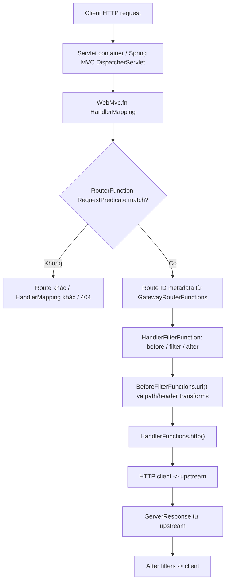

# GatewayRouterFunctions, RouterFunction và HandlerFunctions.http()

## 1. Bài toán: khai báo API Gateway bằng Java trên Servlet stack

Trong hệ thống microservices, **SPRING_CLOUD_GATEWAY** giúp tập trung các nhiệm vụ **định tuyến bằng predicate**, **lọc request/response**, biến đổi đường dẫn/header, kết nối `lb://` với khám phá dịch vụ, xác thực, giới hạn lưu lượng, circuit breaker, retry, TLS và quan sát lưu lượng. Bên cạnh **Gateway Server WebFlux** dựa trên Reactor Netty, Spring Cloud Gateway còn có **Gateway Server Web MVC**, dành cho ứng dụng sử dụng **Spring MVC và Servlet runtime**.

Hãy xét nhu cầu đơn giản:

```text
Client                         Gateway Server MVC             Catalog Backend
GET /edge/catalog/items/42 --> :8080                         :9001
                               | route predicate GET/path |
                               | stripPrefix(2)           |
                               | add gateway headers      |
                               +------ GET /items/42 -------->
                               <--------- 200 OK -------------
<------- 200 + response header
```

Thay vì khai báo tất cả tuyến bằng YAML, chúng ta có thể dùng **Java functional routes**:

```java
@Bean
RouterFunction<ServerResponse> catalogRoute() {
    return GatewayRouterFunctions.route("catalog_http")
            .GET("/edge/catalog/**", HandlerFunctions.http())
            .before(BeforeFilterFunctions.uri("http://127.0.0.1:9001"))
            .before(BeforeFilterFunctions.stripPrefix(2))
            .build();
}
```

Ba API trong tiêu đề có vai trò khác nhau:

- `GatewayRouterFunctions.route("catalog_http")` **khởi tạo builder** cho một route Gateway MVC có route ID.
- `RouterFunction<ServerResponse>` là **kết quả đã xây dựng**, được Spring MVC dùng để tìm handler tương ứng với request.
- `HandlerFunctions.http()` là **handler proxy HTTP** thực hiện chuyển tiếp tới upstream đã được chỉ định thông qua request attribute, thường do `BeforeFilterFunctions.uri(...)` thiết lập.

Bài học thuộc chương **Server Web MVC**. Trọng tâm là hiểu mối quan hệ giữa các API, cách viết tuyến có thể chạy được, cách ghép predicate/before/after filters và cách kiểm chứng **request thật tới backend**, thay vì chỉ học thuộc cú pháp.

### Mục tiêu học tập

Sau bài này, bạn có thể:

1. Phân biệt **Gateway Server MVC** với **Gateway Server WebFlux** về runtime, kiểu route, kiểu request/response và filter.
2. Giải thích vì sao `GatewayRouterFunctions.route(id)` hữu ích hơn `RouterFunctions.route()` khi cần metadata route.
3. Đọc và tạo `RouterFunction<ServerResponse>` với các method `.GET(...)`, `.route(predicate, handler)`, `.before(...)`, `.after(...)` và `.build()`.
4. Sử dụng đúng `HandlerFunctions.http()` và `BeforeFilterFunctions.uri(...)`; tránh API `http(String)` đã deprecated.
5. Ghép `StripPrefix`, `AddRequestHeader`, `RemoveRequestHeader` và `AddResponseHeader` theo hợp đồng bảo mật.
6. Tạo project Maven Spring Boot/Cloud tương thích và hai lớp ví dụ: route Java DSL, route YAML tương đương.
7. Thử bằng `curl` và integration test HTTP thật để phân biệt route miss, method mismatch và lỗi upstream.
8. Áp dụng các kiểm soát identity, rate limiting, TLS, retry, circuit breaker và observability khi mở rộng tới production.

> **Phạm vi phiên bản:** Spring Cloud Gateway **Server Web MVC 4.3.x** (thuộc Spring Cloud 2025.0.x), Spring Boot **3.5.x** và JDK 17+. Starter Maven là `spring-cloud-starter-gateway-server-webmvc`. Các số `*.0` dùng trong lab để minh họa cặp tương thích, **không phải khuyến nghị bản vá mới nhất**. Đừng thay bằng starter WebFlux hoặc sao chép Java API của WebFlux sang MVC.

## 2. Gateway Server MVC và Gateway Server WebFlux khác nhau thế nào?

Hai biến thể thực hiện nhiều nhiệm vụ chung của API Gateway nhưng **không chia sẻ cùng pipeline lập trình**.

| Khía cạnh | **Gateway Server Web MVC** | **Gateway Server WebFlux** |
| --- | --- | --- |
| Web stack | **Spring MVC**, **Servlet**, WebMvc.fn. | Spring WebFlux, Project Reactor/Reactive Streams. |
| HTTP runtime phổ biến | Servlet container như **Tomcat**, Jetty. | Reactor Netty. |
| Route programmatic | `RouterFunction<ServerResponse>` từ `org.springframework.web.servlet.function`. | `RouteLocator`, `RouteLocatorBuilder` của Gateway WebFlux. |
| Request object | `ServerRequest` (Spring WebMvc.fn). | `ServerWebExchange`, `ServerHttpRequest`. |
| Forward handler | `HandlerFunctions.http()` (MVC). | Netty routing và Gateway filter chain reactive. |
| Custom filter | `HandlerFilterFunction`, `Function<ServerRequest,ServerRequest>`, `BiFunction<ServerRequest,ServerResponse,ServerResponse>`. | `GatewayFilter`, `GlobalFilter`, `Mono<Void>`. |
| Routing predicate | `RequestPredicate` và `GatewayRequestPredicates`. | `RoutePredicateFactory`, request exchange. |
| Java DSL khởi đầu | `GatewayRouterFunctions.route("id")`. | `RouteLocatorBuilder.routes()`. |
| YAML prefix 4.3 | `spring.cloud.gateway.server.webmvc.routes`. | `spring.cloud.gateway.server.webflux.routes`. |
| Starter 4.3 | `spring-cloud-starter-gateway-server-webmvc`. | `spring-cloud-starter-gateway-server-webflux`. |

**Đừng nhầm hai kiểu `RouterFunction` cùng tên trong Spring Framework:** MVC dùng `org.springframework.web.servlet.function.RouterFunction`; WebFlux functional endpoints dùng `org.springframework.web.reactive.function.server.RouterFunction`. Bài này chỉ dùng **Servlet MVC**.

Cũng không nên thêm đồng thời cả hai starter Gateway vào một demo rồi đoán Spring Boot chọn stack nào. Điều đó gây nhầm auto-configuration, server runtime và API route. Hãy chọn **một kiến trúc rõ ràng** theo yêu cầu hệ thống.

### 2.1. MVC không có nghĩa "không hỗ trợ các tính năng Gateway"

Gateway MVC vẫn hỗ trợ route predicates, before/after filters, biến đổi path/header, các tích hợp load-balancing, retry/circuit breaker, điều khiển bảo mật và quản trị theo những extension được hỗ trợ. Tuy nhiên, **cú pháp Java và khả năng của từng filter không nhất thiết trùng WebFlux**. Ví dụ `GatewayFilterFactory` reactive không phải drop-in replacement của `HandlerFilterFunction` trong MVC.

MVC có thể phù hợp khi tổ chức dùng sẵn Servlet stack, Spring MVC và những thư viện đồng bộ có yêu cầu tương thích rõ ràng. Với tải lớn, timeout hoặc streaming, vẫn phải đo giới hạn thread/connections/tài nguyên Servlet runtime; đừng suy rằng chuyển sang MVC tự động giải quyết performance.

## 3. Mô hình hoạt động của WebMvc.fn gateway

Gateway Server MVC **không** đưa request qua `FilteringWebHandler` của WebFlux. Route là một **Spring WebMvc.fn `RouterFunction`**, được tích hợp trong cơ chế tìm handler của Spring MVC.



Điểm quan trọng:

1. **`RequestPredicate`** quyết định request nào khớp route (method/path/host/header/query/time...).
2. Builder có thể gắn metadata route ID, phục vụ các tính năng Gateway MVC cần định danh tuyến.
3. **Before filters** biến đổi request hoặc các request attributes trước khi handler thực hiện proxy.
4. **`http()`** đọc URI đích từ request attribute để tạo outbound HTTP request.
5. **After filters** xử lý `ServerResponse` trước khi trả cho client.

Trong `WebMvc.fn`, `ServerRequest` và `ServerResponse` là các abstraction functional tương đối bất biến; một số implemention Gateway có mutable state nội bộ để hỗ trợ proxy. Khi tùy biến request, hãy dùng `ServerRequest.from(request)...build()` hoặc các `BeforeFilterFunctions` được cung cấp, không tự sửa object tùy ý.

### 3.1. Vai trò của `RouterFunction<ServerResponse>`

Một `RouterFunction<T extends ServerResponse>` đại diện cho hàm tìm handler theo request. Về mặt ý tưởng:

```text
RouterFunction<ServerResponse>
       |
       +-- RequestPredicate: GET /edge/catalog/**
       |
       +-- HandlerFunction: HTTP forwarding
       |
       +-- Before/After filter layers
```

Spring Boot có thể tìm những `RouterFunction<ServerResponse>` beans trong ApplicationContext và đưa chúng vào luồng xử lý WebMvc.fn. Vì vậy route Java DSL thường được khai báo trong class `@Configuration` bằng một method `@Bean`.

**Đừng trả `Mono<ServerResponse>` hoặc dùng `ServerWebExchange` trong route MVC này**. Những kiểu đó thuộc reactive stack và không khớp hợp đồng ở đây.

## 4. `RouterFunctions.route()` và `GatewayRouterFunctions.route(id)`

Spring Framework cung cấp builder cơ sở:

```java
import static org.springframework.web.servlet.function.RouterFunctions.route;
import static org.springframework.cloud.gateway.server.mvc.filter.BeforeFilterFunctions.uri;
import static org.springframework.cloud.gateway.server.mvc.handler.HandlerFunctions.http;

@Bean
RouterFunction<ServerResponse> basicMvcGatewayRoute() {
    return route()
            .GET("/basic", http())
            .before(uri("http://127.0.0.1:9001"))
            .build();
}
```

Đây là route hợp lệ trên Spring WebMvc.fn với Gateway MVC handler và before filter.

Gateway MVC còn cung cấp builder chuyên biệt:

```java
import static org.springframework.cloud.gateway.server.mvc.handler.GatewayRouterFunctions.route;
import static org.springframework.cloud.gateway.server.mvc.filter.BeforeFilterFunctions.uri;
import static org.springframework.cloud.gateway.server.mvc.handler.HandlerFunctions.http;

@Bean
RouterFunction<ServerResponse> namedMvcGatewayRoute() {
    return route("basic_mvc_route")
            .GET("/basic", http())
            .before(uri("http://127.0.0.1:9001"))
            .build();
}
```

**Khác biệt cốt lõi:** `GatewayRouterFunctions.route(String routeId)` tạo `RouterFunctions.Builder` và thêm một before filter để lưu **route ID** trong request metadata/attributes. Một số advanced filters/observability cần metadata đó. Đây **không** phải một `RouteLocatorBuilder` reactive được đổi tên.

Nếu dùng cả hai snippet trên cùng lúc và cùng match `GET /basic`, bạn sẽ có **hai functional routes chồng lên nhau**, làm khó giải thích route nào được chọn. Trong thực hành hãy chọn **một** dạng, ưu tiên `GatewayRouterFunctions.route(id)` cho API Gateway thực tế.

### 4.1. Route ID, Path và URI có ba trách nhiệm khác nhau

| Thành phần | Ví dụ | Dùng để làm gì? |
| --- | --- | --- |
| Route ID | `catalog_http` | Định danh tuyến và metadata Gateway. |
| Path predicate | `/edge/catalog/**` | Điều kiện trên **inbound** request. |
| Target URI | `http://127.0.0.1:9001` | Host/port/scheme **outbound**. |
| Path filter | `stripPrefix(2)` | Thay đổi **đường dẫn outbound**. |
| `http()` | Handler proxy | Gửi request tới target sau các biến đổi. |

Trong Gateway MVC, tài liệu cảnh báo **đường dẫn đặt sẵn trong route target URI có thể bị bỏ qua**; muốn đổi path dùng filter path thích hợp thay vì trông cậy vào `uri("https://host/api/v1")` sẽ tự cộng `/api/v1` vào mọi request.

## 5. `HandlerFunctions.http()`: handler chuyển tiếp HTTP

Một route có handler `http()` nghĩa là **proxy request đến downstream**, không phải xử lý nội dung ngay tại Gateway như một controller thông thường.

```java
import static org.springframework.cloud.gateway.server.mvc.handler.HandlerFunctions.http;
import static org.springframework.cloud.gateway.server.mvc.filter.BeforeFilterFunctions.uri;

return GatewayRouterFunctions.route("catalog_http")
        .GET("/edge/catalog/**", http())
        .before(uri("http://127.0.0.1:9001"))
        .build();
```

Trong pipeline MVC 4.3, `http()` không được truyền URL trực tiếp. Nó lấy **destination URI** từ request attribute (được sử dụng nội bộ qua `MvcUtils.GATEWAY_REQUEST_URL_ATTR`), do before filter `uri(...)` hoặc một bước chọn upstream phù hợp thiết lập.

### 5.1. Vì sao tránh `http("https://...")`?

Tài liệu Java Routes API xác nhận từ **Gateway 4.1.7**, các overload `HandlerFunctions.http(String)` và `HandlerFunctions.http(URI)` được đánh dấu **deprecated**. Khuyến nghị là:

```java
// Khuyến nghị trên Gateway MVC 4.3:
route("catalog_http")
        .GET("/edge/catalog/**", http())
        .before(uri("https://catalog.example.test"))
        .build();
```

Thay vì:

```java
// Không dùng làm mẫu cho code mới:
route("catalog_http")
        .GET("/edge/catalog/**", HandlerFunctions.http(
                "https://catalog.example.test"))
        .build();
```

Lý do: tách target URI vào before filter giúp nhất quán với **route request URL attribute**, đặc biệt khi một filter tiếp theo thay đổi URI hoặc dùng load balancing. Nếu quên `uri(...)` và cũng không có filter khác đặt đích, `http()` có thể không có target URI phù hợp để proxy; **phải test outbound thực tế** thay vì chờ request đầu tiên ở production mới phát hiện.

### 5.2. `http()` không phải `RouterFunctions.route()`

Tên gần giống nhưng nhiệm vụ độc lập:

- `route()`: builder **định nghĩa match và handler**.
- `http()`: **handler** của một route, thực hiện chuyển tiếp HTTP.
- `uri(...)`: **before filter** cung cấp địa chỉ upstream.
- `.build()`: hoàn tất builder thành `RouterFunction<ServerResponse>`.

Có thể thay `http()` bằng `HandlerFunction` tự viết để trả response tại chỗ, nhưng khi đó bạn **không tự có proxy behavior**. Với bài này, dùng `http()` để thực sự quan sát request tới backend.

## 6. `RequestPredicate`: GET/path và các điều kiện phức hợp

Cú pháp dễ đọc nhất:

```java
return GatewayRouterFunctions.route("catalog_http")
        .GET("/edge/catalog/**", http())
        .before(uri("http://127.0.0.1:9001"))
        .build();
```

Nó match **GET** và path `/edge/catalog/**`. Nếu gửi `POST` vào cùng URL, route này **không được chọn**. Spring MVC có thể trả 404 hoặc 405 tùy các mappings khác; không nên coi một HTTP status cụ thể là bằng chứng duy nhất route nào đã match.

Ngoài method-specific builder, có dạng chung nhận `RequestPredicate`:

```java
import org.springframework.http.HttpMethod;
import org.springframework.web.servlet.function.RequestPredicates;
import org.springframework.web.servlet.function.ServerResponse;
import org.springframework.web.servlet.function.RouterFunction;

// Dạng minh họa trong method @Bean:
return GatewayRouterFunctions.route("catalog_http")
        .route(
            RequestPredicates.path("/edge/catalog/**")
                .and(RequestPredicates.method(HttpMethod.GET)),
            HandlerFunctions.http())
        .before(BeforeFilterFunctions.uri("http://127.0.0.1:9001"))
        .build();
```

Các điều kiện có thể kết hợp bằng `.and()`/`.or()` theo semantics của `RequestPredicate`. Gateway MVC cũng có `GatewayRequestPredicates` để kiểm tra Host, Header, Query, thời gian và nhiều điều kiện Gateway khác.

**Không lấy thông tin `?user=alice`, `X-Tenant` hoặc `X-Forwarded-For` chưa được xác minh làm bằng chứng phân quyền.** Predicate chỉ chọn route, không tự xác thực principal. Nếu có hai route phân biệt bằng `Host`/header, cần hiểu proxy trust boundary và thứ tự match để tránh bypass.

### 6.1. URI template variables từ path

Ví dụ:

```java
return GatewayRouterFunctions.route("item_http")
        .GET("/edge/catalog/items/{itemId}", http())
        .before(uri("http://127.0.0.1:9001"))
        .build();
```

Biến `{itemId}` do Path predicate trích xuất được lưu trong request attributes dưới convention của WebMvc.fn (`RouterFunctions.URI_TEMPLATE_VARIABLES_ATTRIBUTE`). Gateway cung cấp helper:

```java
Map<String, Object> variables = MvcUtils.getUriTemplateVariables(request);
Object itemId = variables.get("itemId");
```

Ở code thật cần import:

```java
import java.util.Map;
import org.springframework.cloud.gateway.server.mvc.common.MvcUtils;
```

Đây là biến được **trích từ URL request**, không phải claim người dùng đã xác thực. Nếu dùng nó để cấu hình path/header gửi backend, phải kiểm tra format và authorization tương ứng.

## 7. `.before`, `.after`, `.filter`: biến đổi request và response

Spring WebMvc.fn cung cấp ba điểm nối:

| API | Kiểu function về mặt ý tưởng | Dùng cho |
| --- | --- | --- |
| `.before(...)` | `Function<ServerRequest, ServerRequest>` | Thay request/attributes trước khi gọi handler. |
| `.after(...)` | `BiFunction<ServerRequest, ServerResponse, ServerResponse>` | Thay response khi handler hoàn tất. |
| `.filter(...)` | `HandlerFilterFunction<ServerResponse, ServerResponse>` | Bọc handler, có thể chạy code trước/sau hoặc short-circuit. |

Gateway MVC cung cấp:

- `BeforeFilterFunctions` cho `uri`, `stripPrefix`, `addRequestHeader`, `removeRequestHeader`, v.v.
- `AfterFilterFunctions` cho `addResponseHeader`, `removeResponseHeader`, v.v.
- `FilterFunctions` và một số lớp filter đặc thù cho các filter MVC phức tạp.

**Khác với WebFlux:** ở đây không cần `Mono<Void>` hay `GatewayFilterChain`. Functional handler/filter của WebMvc.fn chủ yếu thao tác với `ServerRequest`, `ServerResponse`, `HandlerFunction`.

### 7.1. Ghép các built-in MVC filters

```java
return GatewayRouterFunctions.route("catalog_http")
        .GET("/edge/catalog/**", HandlerFunctions.http())
        .before(BeforeFilterFunctions.uri("http://127.0.0.1:9001"))
        .before(BeforeFilterFunctions.stripPrefix(2))
        .before(BeforeFilterFunctions.addRequestHeader(
                "X-Gateway-Lab", "server-mvc"))
        .after(AfterFilterFunctions.addResponseHeader(
                "X-Gateway-Route", "catalog_http"))
        .build();
```

Nếu client gửi:

```http
GET /edge/catalog/items/42?lang=vi HTTP/1.1
Host: localhost:8080
```

thì backend được kỳ vọng nhận:

```http
GET /items/42?lang=vi HTTP/1.1
X-Gateway-Lab: server-mvc
```

và client nhận thêm `X-Gateway-Route: catalog_http` trong response. Các headers/transport metadata khác do HTTP proxy/container quản lý không nhất thiết giữ byte-by-byte giống inbound.

### 7.2. Vì sao cần quan tâm thứ tự?

- `uri(...)` đặt destination.
- `stripPrefix(2)` đổi path inbound trước khi proxy.
- `addRequestHeader(...)` thêm metadata vào outbound request.
- `addResponseHeader(...)` tác động response trước khi gửi về client.

Khi ghép các filters có tác động cùng một header/path hoặc load balancing, **thứ tự có thể thay đổi kết quả**. Tài liệu MVC về `StripPrefix` lưu ý các bước đổi path cần thực hiện trước một số filter load-balancing để tránh URI sai. Hãy kiểm chứng bằng backend echo và integration tests thay vì suy luận giống thứ tự reactive WebFlux.

**Dấu hiệu sai thứ tự:** backend nhận `/edge/catalog/items/42` thay vì `/items/42`, route match nhưng outbound URL sai, hoặc response header thêm vào không đúng giá trị.

### 7.3. Không biến `AddRequestHeader` thành cơ chế xác thực

Ví dụ `X-Gateway-Lab` là marker demo, không phải danh tính. Nếu một header là `X-Authenticated-User` hoặc `X-Tenant-Id`, client có thể gửi một giá trị giả trước khi đến Gateway.

Trong production:

1. Xác thực JWT/session/API key **trước khi** xây identity header.
2. Xóa/ghi đè header cùng tên do client gửi bằng filter phù hợp.
3. Bảo vệ Gateway → backend bằng TLS/mTLS/network policy để không có đường bypass.
4. Backend vẫn kiểm tra authorization theo tài nguyên/tenant.
5. Không log raw token, cookie, secret hoặc request body nhạy cảm.

`AddRequestHeader` **bổ sung** giá trị; nó không mặc định xóa giá trị cũ. Với header cần trusted provenance, không dùng "add" bên cạnh giá trị giả rồi hy vọng backend chọn đúng.

## 8. Kết hợp hai hoặc nhiều RouterFunction beans

Một ứng dụng có thể định nghĩa nhiều `RouterFunction<ServerResponse>` beans:

```java
@Bean
RouterFunction<ServerResponse> catalogRoute() {
    return GatewayRouterFunctions.route("catalog_http")
            .GET("/edge/catalog/**", HandlerFunctions.http())
            .before(BeforeFilterFunctions.uri("http://127.0.0.1:9001"))
            .before(BeforeFilterFunctions.stripPrefix(2))
            .build();
}

@Bean
RouterFunction<ServerResponse> publicStatusRoute() {
    return GatewayRouterFunctions.route("public_status")
            .GET("/edge/status", HandlerFunctions.http())
            .before(BeforeFilterFunctions.uri("http://127.0.0.1:9001"))
            .before(BeforeFilterFunctions.stripPrefix(1))
            .build();
}
```

Một route nên có **route ID duy nhất**, predicate đủ hẹp và upstream được kiểm soát. Nếu hai routes overlap, framework có quy tắc order/registration; đừng chỉ dựa vào thứ tự các methods trong source Java. Trong bài lab tiếp theo chỉ khai báo **một bean** để test rõ ràng.

**Lưu ý về `@RequestMapping`:** Spring MVC có thể xử lý các controller `@RestController` trong cùng application. Một URL không vào RouterFunction của Gateway chưa chắc trả 404 nếu có MVC controller khác match. Test route miss cần hiểu toàn bộ handler mappings của ứng dụng.

## 9. Thực hành: project Gateway Server MVC tối thiểu

Chúng ta tạo hai chương trình độc lập trên máy học tập:

- **Gateway MVC**: Spring Boot với starter `spring-cloud-starter-gateway-server-webmvc`, lắng nghe `127.0.0.1:8080`.
- **EchoBackend**: HTTP server nhỏ dùng JDK, lắng nghe `127.0.0.1:9001`, in những gì thật sự được proxy.

Route `catalog_http` sẽ match:

```text
GET /edge/catalog/**
```

và chuyển:

```text
GET /edge/catalog/items/42?lang=vi
    |
    | GatewayRouterFunctions.route("catalog_http")
    | .GET("/edge/catalog/**", http())
    | .before(uri("http://127.0.0.1:9001"))
    | .before(stripPrefix(2))
    v
GET http://127.0.0.1:9001/items/42?lang=vi
```

Ta cũng thêm một header request đã được Gateway kiểm soát và một header response để chứng minh before/after filters thực sự chạy.

### 9.1. Maven `pom.xml`

Yêu cầu **Java 17+**, Maven và `curl`. File `pom.xml`:

```xml
<?xml version="1.0" encoding="UTF-8"?>
<project xmlns="http://maven.apache.org/POM/4.0.0"
         xmlns:xsi="http://www.w3.org/2001/XMLSchema-instance"
         xsi:schemaLocation="http://maven.apache.org/POM/4.0.0
                             https://maven.apache.org/xsd/maven-4.0.0.xsd">
    <modelVersion>4.0.0</modelVersion>

    <parent>
        <groupId>org.springframework.boot</groupId>
        <artifactId>spring-boot-starter-parent</artifactId>
        <version>3.5.0</version>
        <relativePath/>
    </parent>

    <groupId>com.example</groupId>
    <artifactId>gateway-mvc-functional-lab</artifactId>
    <version>0.0.1-SNAPSHOT</version>

    <properties>
        <java.version>17</java.version>
    </properties>

    <dependencyManagement>
        <dependencies>
            <dependency>
                <groupId>org.springframework.cloud</groupId>
                <artifactId>spring-cloud-dependencies</artifactId>
                <version>2025.0.0</version>
                <type>pom</type>
                <scope>import</scope>
            </dependency>
        </dependencies>
    </dependencyManagement>

    <dependencies>
        <dependency>
            <groupId>org.springframework.cloud</groupId>
            <artifactId>spring-cloud-starter-gateway-server-webmvc</artifactId>
        </dependency>
        <dependency>
            <groupId>org.springframework.boot</groupId>
            <artifactId>spring-boot-starter-test</artifactId>
            <scope>test</scope>
        </dependency>
    </dependencies>

    <build>
        <plugins>
            <plugin>
                <groupId>org.springframework.boot</groupId>
                <artifactId>spring-boot-maven-plugin</artifactId>
            </plugin>
        </plugins>
    </build>
</project>
```

Nhận xét:

- Dependency `spring-cloud-starter-gateway-server-webmvc` kéo theo các thành phần Gateway MVC và Spring MVC phù hợp; không cần thêm starter WebFlux.
- Spring Boot 3.5.x dùng Servlet runtime phù hợp, ví dụ embedded Tomcat.
- `spring-boot-starter-test` dùng cho JUnit, AssertJ, TestRestTemplate/integration tests ở phần sau.
- BOM `spring-cloud-dependencies` quản lý các dependency Spring Cloud theo một release train tương thích với Boot.
- Không trộn `spring-cloud-starter-gateway-server-webflux`, `spring-boot-starter-webflux` và `spring-cloud-starter-gateway-server-webmvc` vào bài lab rồi mong Java DSL chạy trên một stack duy nhất.

**Lưu ý phiên bản:** `3.5.0`/`2025.0.0` là cặp minh họa phát hành, không có nghĩa đã gồm các bản vá lỗi/bảo mật mới nhất. Khi vận hành hãy chọn patch/release train được tổ chức hỗ trợ và kiểm tra compatibility.

### 9.2. Spring Boot entry point

Tạo `src/main/java/com/example/gateway/GatewayMvcApplication.java`:

```java
package com.example.gateway;

import org.springframework.boot.SpringApplication;
import org.springframework.boot.autoconfigure.SpringBootApplication;

@SpringBootApplication
public class GatewayMvcApplication {

    public static void main(String[] args) {
        SpringApplication.run(GatewayMvcApplication.class, args);
    }
}
```

Giữ class route configuration trong cùng package `com.example.gateway` hoặc subpackage để Spring Boot quét được beans. Không phải tạo Controller để nhận `/edge/catalog/**`; functional RouterFunction xử lý path này.

### 9.3. Route Java DSL đầy đủ

Tạo `src/main/java/com/example/gateway/GatewayMvcRoutes.java`:

```java
package com.example.gateway;

import org.springframework.beans.factory.annotation.Value;
import org.springframework.context.annotation.Bean;
import org.springframework.context.annotation.Configuration;
import org.springframework.web.servlet.function.RouterFunction;
import org.springframework.web.servlet.function.ServerResponse;

import static org.springframework.cloud.gateway.server.mvc.handler.GatewayRouterFunctions.route;
import static org.springframework.cloud.gateway.server.mvc.handler.HandlerFunctions.http;
import static org.springframework.cloud.gateway.server.mvc.filter.BeforeFilterFunctions.uri;
import static org.springframework.cloud.gateway.server.mvc.filter.BeforeFilterFunctions.stripPrefix;
import static org.springframework.cloud.gateway.server.mvc.filter.BeforeFilterFunctions.removeRequestHeader;
import static org.springframework.cloud.gateway.server.mvc.filter.BeforeFilterFunctions.addRequestHeader;
import static org.springframework.cloud.gateway.server.mvc.filter.AfterFilterFunctions.addResponseHeader;

@Configuration
public class GatewayMvcRoutes {

    @Bean
    RouterFunction<ServerResponse> catalogHttpRoute(
            @Value("${lab.backend.uri:http://127.0.0.1:9001}")
            String backendUri) {

        return route("catalog_http")
                .GET("/edge/catalog/**", http())
                .before(uri(backendUri))
                .before(stripPrefix(2))
                // Bỏ marker do client tự đặt trước khi Gateway gắn lại.
                .before(removeRequestHeader("X-Gateway-Lab"))
                .before(addRequestHeader("X-Gateway-Lab", "server-mvc"))
                .after(addResponseHeader(
                        "X-Gateway-Route", "catalog_http"))
                .build();
    }
}
```

**Cách đọc từng dòng:**

1. `@Bean` đăng ký một `RouterFunction<ServerResponse>` với Spring MVC.
2. `route("catalog_http")` cung cấp route ID metadata cho Gateway.
3. `.GET("/edge/catalog/**", http())` gắn predicate method/path với HTTP proxy handler.
4. `.before(uri(backendUri))` chỉ định upstream, đọc từ `lab.backend.uri` (giá trị mặc định là localhost).
5. `.before(stripPrefix(2))` bỏ `edge` và `catalog` khỏi path outbound.
6. `.before(removeRequestHeader("X-Gateway-Lab"))` xóa marker cùng tên từ client.
7. `.before(addRequestHeader(...))` ghi marker demo do Gateway kiểm soát xuống backend.
8. `.after(addResponseHeader(...))` thêm marker vào response cho client.
9. `.build()` hoàn thành functional route.

**Không dùng `X-Gateway-Lab` làm authentication signal.** Nó chỉ chứng minh filter chạy. Nếu backend dùng header nội bộ có ý nghĩa bảo mật, ngoài việc xóa/ghi đè cần xác thực caller, bảo vệ chặng Gateway→backend bằng TLS/mTLS/network policy và ngăn truy cập trực tiếp vào backend.

`@Value` giúp các integration tests tạo một HTTP backend ở port ngẫu nhiên; route không cần hardcode port `9001` khi chạy test. Trong bài lab thủ công, nếu không có `lab.backend.uri`, annotation lấy mặc định.

### 9.4. `application.yml` dành riêng cho Java DSL

Tạo `src/main/resources/application.yml`:

```yaml
server:
  port: 8080

spring:
  application:
    name: gateway-mvc-functional-lab

# Không khai báo spring.cloud.gateway.server.webmvc.routes ở đây:
# tuyến catalog_http đã được tạo bởi Java RouterFunction @Bean.
```

Ví dụ dùng Spring MVC/Tomcat trên cổng 8080. Không bắt buộc đặt `spring.cloud.gateway.server.webmvc.enabled=true` vì starter kích hoạt Gateway MVC theo điều kiện auto-configuration. Nếu muốn **tắt** Gateway MVC trong một ứng dụng có starter, tài liệu nêu property `spring.cloud.gateway.server.webmvc.enabled=false`.

**Đừng copy route YAML tương đương ở mục 11 vào cùng ứng dụng đang có bean Java trên**, nếu không sẽ có hai routes trùng predicate và dễ tạo hành vi khó đoán. Học hai cách khai báo **tách biệt**.

### 9.5. EchoBackend JDK: quan sát đường dẫn và header

Tạo file `EchoBackend.java` trong **thư mục test riêng bên ngoài Spring Boot project**:

```java
import com.sun.net.httpserver.HttpServer;
import java.net.InetSocketAddress;
import java.nio.charset.StandardCharsets;
import java.util.concurrent.atomic.AtomicInteger;

public class EchoBackend {

    public static void main(String[] args) throws Exception {
        AtomicInteger counter = new AtomicInteger();

        HttpServer server = HttpServer.create(
                new InetSocketAddress("127.0.0.1", 9001), 0);

        server.createContext("/", exchange -> {
            int number = counter.incrementAndGet();

            String method = exchange.getRequestMethod();
            String path = exchange.getRequestURI().getRawPath();
            String query = exchange.getRequestURI().getRawQuery();
            String gatewayLab = exchange.getRequestHeaders()
                    .getFirst("X-Gateway-Lab");

            String body = "origin-request=" + number + "\n"
                    + "method=" + method + "\n"
                    + "path=" + path + "\n"
                    + "query=" + query + "\n"
                    + "x-gateway-lab=" + gatewayLab + "\n";

            System.out.println("BACKEND #" + number
                    + " " + method + " " + path
                    + " source=" + gatewayLab);

            byte[] bytes = body.getBytes(StandardCharsets.UTF_8);

            exchange.getResponseHeaders().set(
                    "Content-Type", "text/plain; charset=UTF-8");
            exchange.getResponseHeaders().set(
                    "X-Origin-Request-No", Integer.toString(number));

            exchange.sendResponseHeaders(200, bytes.length);
            try (var response = exchange.getResponseBody()) {
                response.write(bytes);
            }
        });

        server.start();
        System.out.println("EchoBackend ready on 127.0.0.1:9001");
    }
}
```

Backend cố ý in `X-Gateway-Lab` để chứng minh **header cuối cùng** tới downstream. Nó không làm xác thực và không chứa dữ liệu thật. Trong production không log raw `Authorization`, cookie, token, private headers hay response body nhạy cảm theo cách này.

### 9.6. Khởi chạy hai chương trình

Mở hai terminals:

```bash
# Terminal A, thư mục riêng chứa EchoBackend.java
java EchoBackend.java

# Terminal B, thư mục Spring Boot có pom.xml
mvn spring-boot:run
```

Nếu dùng Maven Wrapper: `./mvnw spring-boot:run` (Linux/macOS) hoặc `mvnw.cmd spring-boot:run` (Windows). Đảm bảo cổng `8080` và `9001` đang rảnh; Gateway và backend chạy trên cùng máy/network namespace của lab.

### 9.7. Happy path: method, path và headers

Mở terminal C:

```bash
curl -i \
  -H "X-Gateway-Lab: attacker-value" \
  "http://127.0.0.1:8080/edge/catalog/items/42?lang=vi"
```

Kỳ vọng phần quan trọng của response:

```http
HTTP/1.1 200 OK
Content-Type: text/plain; charset=UTF-8
X-Gateway-Route: catalog_http

origin-request=1
method=GET
path=/items/42
query=lang=vi
x-gateway-lab=server-mvc
```

Số `origin-request` thay đổi nếu đã gọi backend trước đó. **Không cần so thứ tự headers nguyên văn**: servlet container và HTTP proxy có thể tự gắn `Date`, `Connection`, `Transfer-Encoding` hoặc headers khác.

Điều cần xác minh:

- Header `X-Gateway-Route: catalog_http` tới **client**.
- Backend nhận **path `/items/42`**, không phải `/edge/catalog/items/42`.
- Backend nhận query `lang=vi` không bị `StripPrefix` xóa.
- Backend nhận `X-Gateway-Lab=server-mvc`, không có giá trị `attacker-value` từ client.
- Terminal backend có **một** dòng `BACKEND #...` mới.

Nếu các điều này đúng, cả `GatewayRouterFunctions.route`, `RouterFunction`, `HandlerFunctions.http()`, `uri`, before và after filters đã phối hợp thành công.

### 9.8. Khi path không khớp route

```bash
curl -i "http://127.0.0.1:8080/unknown"
```

Nếu không có controller/handler khác, dự kiến 404. Backend counter **không tăng**.

Đừng nhầm route miss với backend tự trả 404. Nếu Gateway match route, gọi backend và backend trả 404, client cũng có thể thấy 404. Muốn phân biệt, kiểm tra logs/counter backend hoặc distributed tracing.

### 9.9. Khi HTTP method không khớp

```bash
curl -i -X POST \
  "http://127.0.0.1:8080/edge/catalog/items/42"
```

Route được khai báo `.GET(...)`, không có POST handler trong demo. Spring MVC có thể trả 404/405 tùy handler mappings. Quan sát quan trọng hơn là request POST **không được chuyển tới EchoBackend**.

Đây là ví dụ cho thấy predicate không tự thực hiện authorization: method/path match chỉ chọn route; một endpoint POST có tác dụng phụ trong production còn cần identity, quyền, CSRF policy khi dùng session, idempotency và validation phù hợp.

### 9.10. Khi backend dừng

Dừng tiến trình EchoBackend nhưng giữ Gateway chạy, sau đó thử:

```bash
curl -i "http://127.0.0.1:8080/edge/catalog/items/42"
```

Kết quả thường là lỗi gateway/server khi outbound connection thất bại, nhưng **không khẳng định cứng mã 500/502/503/504** trên mọi phiên bản hoặc khi có retry/circuit breaker. Kiểm tra logs, exception root cause, connect/response timeout và chính sách fallback. Không "sửa" bằng việc tắt TLS verification hay bỏ qua xác thực.

### 9.11. Thử route không có `uri(...)`

Chỉ trên lab cô lập, **tạm bỏ** dòng:

```java
.before(uri(backendUri))
```

Sau đó khởi động lại và gọi route. Nếu không có before filter/metadata khác đặt destination URI, `HandlerFunctions.http()` **không còn đủ target** như cấu hình bình thường. Đó là lỗi thiết kế route chứ không phải một backend trả response hợp lệ. Khôi phục `uri(backendUri)` sau phép thử.

## 10. Tự động kiểm thử bằng HTTP integration test

Một unit test chỉ kiểm tra `RouterFunction.route(request)` trong mock context có thể xác nhận predicate, nhưng chưa chứng minh HTTP proxy đã chạy. Integration test nên quan sát:

1. Gateway **thực** mở Servlet HTTP port ngẫu nhiên.
2. EchoBackend **thực** mở HTTP port ngẫu nhiên trong quá trình test.
3. `@DynamicPropertySource` đưa port upstream vào `@Value("${lab.backend.uri:...}")`.
4. Test client gửi request HTTP tới Gateway, kiểm tra body/headers.
5. Bộ đếm backend xác minh **đã proxy hay chưa**.

### 10.1. Code integration test (Spring Boot 3.5)

Tạo `src/test/java/com/example/gateway/GatewayMvcIntegrationTest.java`:

```java
package com.example.gateway;

import java.io.IOException;
import java.io.UncheckedIOException;
import java.net.InetSocketAddress;
import java.nio.charset.StandardCharsets;
import java.util.concurrent.atomic.AtomicInteger;

import com.sun.net.httpserver.HttpServer;

import org.junit.jupiter.api.AfterAll;
import org.junit.jupiter.api.Test;
import org.springframework.beans.factory.annotation.Autowired;
import org.springframework.boot.test.context.SpringBootTest;
import org.springframework.boot.test.web.client.TestRestTemplate;
import org.springframework.http.HttpEntity;
import org.springframework.http.HttpHeaders;
import org.springframework.http.HttpMethod;
import org.springframework.http.HttpStatus;
import org.springframework.http.ResponseEntity;
import org.springframework.test.context.DynamicPropertyRegistry;
import org.springframework.test.context.DynamicPropertySource;

import static org.assertj.core.api.Assertions.assertThat;

@SpringBootTest(
        webEnvironment = SpringBootTest.WebEnvironment.RANDOM_PORT)
class GatewayMvcIntegrationTest {

    private static final AtomicInteger BACKEND_CALLS =
            new AtomicInteger();

    private static final HttpServer BACKEND = startBackend();

    private static HttpServer startBackend() {
        try {
            HttpServer server = HttpServer.create(
                    new InetSocketAddress("127.0.0.1", 0), 0);

            server.createContext("/", exchange -> {
                int callNo = BACKEND_CALLS.incrementAndGet();

                String method = exchange.getRequestMethod();
                String path = exchange.getRequestURI().getRawPath();
                String query = exchange.getRequestURI().getRawQuery();
                String marker = exchange.getRequestHeaders()
                        .getFirst("X-Gateway-Lab");

                String text = "method=" + method + "\n"
                        + "path=" + path + "\n"
                        + "query=" + query + "\n"
                        + "x-gateway-lab=" + marker + "\n";

                byte[] bytes = text.getBytes(StandardCharsets.UTF_8);
                exchange.getResponseHeaders().set(
                        "Content-Type", "text/plain; charset=UTF-8");
                exchange.getResponseHeaders().set(
                        "X-Origin-Request-No", Integer.toString(callNo));

                exchange.sendResponseHeaders(200, bytes.length);
                try (var body = exchange.getResponseBody()) {
                    body.write(bytes);
                }
            });

            server.start();
            return server;
        } catch (IOException ex) {
            throw new UncheckedIOException(ex);
        }
    }

    @DynamicPropertySource
    static void backendUri(DynamicPropertyRegistry registry) {
        registry.add("lab.backend.uri", () ->
                "http://127.0.0.1:" + BACKEND.getAddress().getPort());
    }

    @Autowired
    TestRestTemplate client;

    @AfterAll
    static void shutdown() {
        BACKEND.stop(0);
    }

    @Test
    void forwardsPathQueryAndSanitizedHeader() {
        int before = BACKEND_CALLS.get();

        HttpHeaders headers = new HttpHeaders();
        headers.set("X-Gateway-Lab", "attacker-value");

        ResponseEntity<String> response = client.exchange(
                "/edge/catalog/items/42?lang=vi",
                HttpMethod.GET,
                new HttpEntity<Void>(headers),
                String.class);

        assertThat(response.getStatusCode()).isEqualTo(HttpStatus.OK);
        assertThat(response.getHeaders().getFirst("X-Gateway-Route"))
                .isEqualTo("catalog_http");

        assertThat(response.getBody())
                .contains("method=GET")
                .contains("path=/items/42")
                .contains("query=lang=vi")
                .contains("x-gateway-lab=server-mvc")
                .doesNotContain("attacker-value");

        assertThat(BACKEND_CALLS.get()).isEqualTo(before + 1);
    }

    @Test
    void unmatchedPathDoesNotCallBackend() {
        int before = BACKEND_CALLS.get();

        ResponseEntity<String> response = client.getForEntity(
                "/not-routed", String.class);

        assertThat(response.getStatusCode())
                .isEqualTo(HttpStatus.NOT_FOUND);
        assertThat(BACKEND_CALLS.get()).isEqualTo(before);
    }

    @Test
    void unsupportedMethodDoesNotCallBackend() {
        int before = BACKEND_CALLS.get();

        ResponseEntity<String> response = client.postForEntity(
                "/edge/catalog/items/42",
                new HttpEntity<>("payload"),
                String.class);

        // Có thể là 404 hoặc 405 tùy handler mappings.
        assertThat(response.getStatusCode().is4xxClientError()).isTrue();
        assertThat(BACKEND_CALLS.get()).isEqualTo(before);
    }
}
```

### 10.2. Vì sao test này kiểm tra đúng "MVC Gateway"?

- `@SpringBootTest(RANDOM_PORT)` khởi động **Servlet application** thật, không phải WebFlux test slice.
- `TestRestTemplate` gửi HTTP request vào cổng Gateway thực.
- `HttpServer` của JDK lắng nghe port **0** (OS cấp port ngẫu nhiên), tránh phụ thuộc backend :9001 cố định.
- `@DynamicPropertySource` cung cấp `lab.backend.uri` trước khi route bean được tạo.
- Test assert **request tới backend** thông qua body và `AtomicInteger`, không chỉ assert HTTP 200.
- Test nhánh không khớp route có **0 lần** tới backend.
- Test header giả chứng minh cặp `removeRequestHeader`/ `addRequestHeader` hoạt động theo hợp đồng.

Nếu đã có một controller `@RequestMapping("/not-routed")` trong project thật, test 404 cần đổi sang URL chắc chắn không có handler. Test code này giả định project lab **chỉ có route chức năng ở mục 9**.

**Tránh test chạy song song** khi dùng một `AtomicInteger` toàn class để assert delta. JUnit 5 mặc định thường không chạy test methods song song; nếu CI bật parallel execution, cần tách counter theo request ID hoặc bảo đảm test class chạy tuần tự. Với production-grade tests, nên thêm timeout và structured assertions cho TLS/errors để tránh test treo.

### 10.3. Chạy test trong project học tập

```bash
mvn -Dtest=GatewayMvcIntegrationTest test
```

Có Maven Wrapper:

```bash
./mvnw -Dtest=GatewayMvcIntegrationTest test
```

**Phân biệt phạm vi:** đây là lệnh ví dụ cho **người học** chạy trong một Maven project riêng. Worker STEP 4 viết bài Markdown, **không chạy Maven/Gradle build hay Content QA STEP 6 trên repository nội dung**.

### 10.4. Nên mở rộng những test nào?

| Test | Đầu vào | Assertion |
| --- | --- | --- |
| Hợp lệ | GET `/edge/catalog/items/42` | Backend nhận path `/items/42` và một HTTP call. |
| Query string | `?lang=vi` | Backend nhận nguyên query mong muốn. |
| Marker giả | Client đặt `X-Gateway-Lab: attacker-value` | Backend chỉ thấy `server-mvc`. |
| Response after filter | GET hợp lệ | Client có `X-Gateway-Route: catalog_http`. |
| Route miss | GET `/not-routed` | 404 trong lab, backend 0 call. |
| Method mismatch | POST vào GET-only route | 4xx, backend 0 call. |
| Upstream down | Backend port không nghe | Gateway báo lỗi, không được coi là route miss. |
| Timeout | Backend cố ý chậm hơn timeout | Error/fallback theo cấu hình, không có thread leak. |
| Path injection | Path có encoded slash/dot segments | Không gửi path không được cho phép xuống upstream. |
| Multi-route overlap | Hai routes gần nhau | Đúng route được chọn theo order/condition; không bypass auth. |

Đừng viết test chỉ snapshot toàn bộ HTTP headers: Servlet container và proxy có thể thay đổi `Date`, `Connection`, `Transfer-Encoding`, `Content-Length`. Hãy assert **hợp đồng về path, method, header cần bảo vệ, status/body và số lần backend được gọi**.

## 11. Cách khai báo tương đương bằng `application.yml`

**Gateway Server MVC** còn hỗ trợ declarative routes trong YAML. Nếu muốn cấu hình thay vì viết Java DSL, **xóa hoặc vô hiệu hóa** `@Bean catalogHttpRoute(...)` ở mục 9.3, rồi khai báo:

```yaml
server:
  port: 8080

spring:
  application:
    name: gateway-mvc-yaml-lab
  cloud:
    gateway:
      server:
        webmvc:
          routes:
            - id: catalog_yaml
              uri: http://127.0.0.1:9001
              predicates:
                - Path=/edge/catalog/**
                - Method=GET
              filters:
                - StripPrefix=2
                - RemoveRequestHeader=X-Gateway-Lab
                - AddRequestHeader=X-Gateway-Lab, server-mvc
                - AddResponseHeader=X-Gateway-Route, catalog_yaml
```

So sánh:

| Java DSL | YAML tương đương |
| --- | --- |
| `route("catalog_http")` | `id: catalog_yaml` (đổi tên để dễ phân biệt). |
| `.GET("/edge/catalog/**", http())` | `Path=/edge/catalog/**` + `Method=GET`. |
| `.before(uri("http://..."))` | `uri: http://127.0.0.1:9001`. |
| `.before(stripPrefix(2))` | `StripPrefix=2`. |
| `.before(removeRequestHeader(...))` | `RemoveRequestHeader=...`. |
| `.before(addRequestHeader(...))` | `AddRequestHeader=...`. |
| `.after(addResponseHeader(...))` | `AddResponseHeader=...`. |
| `.build()` | Định nghĩa được Gateway tự bind khi khởi động. |

**Không trộn prefix:** MVC 4.3 dùng `spring.cloud.gateway.server.webmvc.routes`. WebFlux 4.3 dùng `spring.cloud.gateway.server.webflux.routes`; các ví dụ Gateway 4.1/4.2 cũ còn có `spring.cloud.gateway.mvc.routes`. Cấu hình sai namespace có thể khiến ứng dụng chạy mà **không có route mong muốn**.

Java DSL phù hợp khi route được tạo có điều kiện theo Spring beans hoặc cần những functions tùy chỉnh. YAML phù hợp khi tuyến tương đối cấu hình thuần, cần thay target/path/filter thông qua quản lý cấu hình. Cả hai đều phải được kiểm thử và review theo cùng quy tắc bảo mật.

### 11.1. Vì sao không đăng ký cả Java và YAML giống hệt?

Nếu cả hai cùng match `GET /edge/catalog/**`, có thể có hai candidates. Những chuyện khó dự đoán sẽ phát sinh:

- Route nào thực sự chạy?
- Response marker `catalog_http` hay `catalog_yaml`?
- Thứ tự giữa RouterFunction bean và route định nghĩa qua cấu hình được tính ra sao?
- Nếu một route có authentication filter/rate limit còn route kia không, liệu có đường bypass?

Một tên route khác **không tự giải quyết overlap predicates**. Thực hành nên chỉ bật một hình thức trong một lần, sau đó khi triển khai thật phải kiểm soát route ID, path/method/host và thứ tự/priority theo semantics của bản đang dùng.

## 12. Mở rộng `GatewayRouterFunctions` với filter tùy chỉnh

Khi muốn xây một `HandlerFilterFunction` đơn giản (ví dụ bắt buộc có `X-Request-Id`), bạn có thể bọc `HandlerFunctions.http()` bằng `.filter(...)`. Mã dưới đây chỉ là **ví dụ minh họa hợp đồng functional API**, không phải bộ xác thực.

```java
import org.springframework.http.HttpStatus;
import org.springframework.web.servlet.function.RouterFunction;
import org.springframework.web.servlet.function.ServerResponse;

import static org.springframework.cloud.gateway.server.mvc.handler.GatewayRouterFunctions.route;
import static org.springframework.cloud.gateway.server.mvc.handler.HandlerFunctions.http;
import static org.springframework.cloud.gateway.server.mvc.filter.BeforeFilterFunctions.uri;

@Bean
RouterFunction<ServerResponse> guardedRoute() {
    return route("guarded_demo")
            .GET("/guarded/**", http())
            .before(uri("http://127.0.0.1:9001"))
            .filter((request, next) -> {
                String id = request.headers()
                        .firstHeader("X-Request-Id");

                if (id == null || !id.matches("[A-Za-z0-9_-]{1,32}")) {
                    return ServerResponse
                            .status(HttpStatus.BAD_REQUEST)
                            .body("Missing or invalid request ID");
                }

                return next.handle(request);
            })
            .build();
}
```

Trường hợp thiếu/sai `X-Request-Id`, filter **không gọi** `next.handle(request)`: request bị chặn tại Gateway với 400. Trường hợp hợp lệ, filter cho handler proxy HTTP đi tiếp.

**Chú ý bảo mật:** giá trị `X-Request-Id` do client tự đặt không phải chứng minh rằng người gọi được phép truy cập. Không dùng nó làm user ID, tenant ID hoặc rate-limit key theo tài khoản. Nếu cần xác thực/phân quyền, dùng **Spring Security trên Servlet stack**, dựa trên principal/JWT/session đã được kiểm tra, và xác minh quyền ở backend.

### 12.1. Custom before filter

Spring MVC functional API cho phép dùng `.before(...)` với `Function<ServerRequest, ServerRequest>`. Chẳng hạn:

```java
.before(request -> org.springframework.web.servlet.function.ServerRequest
        .from(request)
        .header("X-Lab-Stage", "mvc-before")
        .build())
```

Đây là **request transform**, không phải đoạn code `GatewayFilterChain` của WebFlux. Khi thêm header từ dữ liệu không tin cậy, cần hạn chế độ dài và kiểm tra giá trị; khi thay header bảo mật, nên remove/overwrite nguồn không tin cậy thay vì tạo các giá trị trùng.

### 12.2. Custom after filter

Với `.after(...)`, function nhận request và response:

```java
.after((request, response) -> {
    response.headers().set("X-Lab-Stage", "mvc-after");
    return response;
})
```

Nó khác `before` ở việc có `ServerResponse` để thay đổi. Không giả định mọi response đã được bảo đảm an toàn/được phép cache chỉ vì một after filter đặt status hoặc header. Cần test các trường hợp response lỗi, upstream timeout và Servlet response commit.

Với logic phức tạp liên quan request/response body, retry hoặc streaming, ưu tiên filters chính thức và tài liệu phiên bản hiện hành: xử lý body, connection lifecycle và content length không đơn giản chỉ là `ServerRequest.from(...)`.

### 12.3. Không dùng WebFlux `GatewayFilter` nguyên xi

Code như sau thuộc **WebFlux**:

```java
// Đây là minh họa API KHÁC, KHÔNG dùng trong Gateway Server MVC:
GatewayFilter filter = (exchange, chain) ->
        chain.filter(exchange).then(...);
```

Gateway Server MVC cần `HandlerFilterFunction<ServerResponse, ServerResponse>` hoặc before/after functional APIs. Tương tự, **`ServerWebExchange` và `Mono<Void>` không phải kiểu của `RouterFunction<ServerResponse>` MVC**.

## 13. Service discovery và `lb://` trong MVC Java routes

Ở bài lab, target cố định là `http://127.0.0.1:9001`. Trong hệ thống microservices, upstream có thể được tìm qua Spring Cloud LoadBalancer và service discovery.

Đối với **Gateway Server MVC**, Java DSL dùng **`LoadBalancerFilterFunctions.lb("service-id")`**:

```java
import org.springframework.web.servlet.function.RouterFunction;
import org.springframework.web.servlet.function.ServerResponse;

import static org.springframework.cloud.gateway.server.mvc.handler.GatewayRouterFunctions.route;
import static org.springframework.cloud.gateway.server.mvc.handler.HandlerFunctions.http;
import static org.springframework.cloud.gateway.server.mvc.filter.BeforeFilterFunctions.stripPrefix;
import static org.springframework.cloud.gateway.server.mvc.filter.LoadBalancerFilterFunctions.lb;

@Bean
RouterFunction<ServerResponse> catalogDiscoveryRoute() {
    return route("catalog_discovery")
            .GET("/services/catalog/**", http())
            .before(stripPrefix(2))
            .filter(lb("catalog-service"))
            .build();
}
```

**Giải thích:**

- `lb("catalog-service")` dùng Spring Cloud LoadBalancer để chọn instance cho service ID.
- `http()` vẫn là handler HTTP proxy, không cần `http("lb://...")`.
- `stripPrefix(2)` thực hiện trước `lb(...)` vì path biến đổi cần phản ánh đúng vào URL cuối.
- Muốn chạy thật cần dependency **`spring-cloud-starter-loadbalancer`** và nguồn các `ServiceInstance` phù hợp (DiscoveryClient/Eureka/Consul/Kubernetes hoặc static service instances).
- Không khẳng định chắc HTTP 503/404 trong mọi trường hợp thiếu instance khi hệ thống tùy biến error handling; kiểm tra phiên bản/LoadBalancer policy.

**Đây là ví dụ độc lập, không tự chạy bằng backend loopback trong mục 9**. Nó chỉ đúng khi service discovery/load-balancer được cấu hình trong dự án thực. Đừng thêm vào cùng project lab mà không có `catalog-service`, rồi coi kết quả 5xx là lỗi của `GatewayRouterFunctions`.

### 13.1. YAML service discovery tương đương

```yaml
spring:
  cloud:
    gateway:
      server:
        webmvc:
          routes:
            - id: catalog_discovery
              uri: lb://catalog-service
              predicates:
                - Path=/services/catalog/**
                - Method=GET
              filters:
                - StripPrefix=2
```

Hãy **chỉ dùng** Java route hoặc YAML route tương ứng, không định nghĩa trùng. Spring Cloud LoadBalancer cần cấu hình endpoint/instance phù hợp, còn backend vẫn phải kiểm tra JWT/tenant và quyền truy cập tài nguyên.

**Đặc biệt:** đừng đặt `@LoadBalanced` tùy tiện trên HTTP client nội bộ Gateway để thay thế `lb(...)`. Gateway Server MVC có proxy client do framework quản lý; cơ chế chọn instance phải nằm ở **Gateway LoadBalancer filter/URI scheme**, còn `@LoadBalanced` được dùng đúng cho những client beans riêng của ứng dụng khi có nhu cầu.

## 14. Các vấn đề khi chuyển từ WebFlux sang MVC

Một đội đã học Spring Cloud Gateway WebFlux rất dễ mang theo các giả định không phù hợp sang MVC.

| Tưởng rằng... | Thực tế với Server Web MVC |
| --- | --- |
| Mọi route Java đều dùng `RouteLocatorBuilder`. | MVC dùng `RouterFunction<ServerResponse>`, builder có thể tạo bằng `GatewayRouterFunctions.route(id)`. |
| `ServerWebExchange` có mặt trong custom MVC filters. | MVC dùng `ServerRequest`/`ServerResponse`. |
| `HandlerFunctions.http("https://host")` là cách chuẩn mới. | Các overload URI/String đã deprecated; dùng `http()` + `before(uri(...))`. |
| `RouterFunctions.route()` và `GatewayRouterFunctions.route(id)` giống hệt. | Bản Gateway gắn route ID metadata cần cho một số advanced filters. |
| `uri("https://host/base")` luôn cộng `/base` vào request path. | Tài liệu MVC cảnh báo path trong target route URI có thể bị bỏ qua; dùng path filters. |
| `Mono<Void>` điều khiển before/after MVC filter. | WebMvc.fn filters dùng synchronous functional interface, không phải reactive chain. |
| `spring.cloud.gateway.server.webflux.routes` áp dụng cho cả MVC. | MVC dùng `spring.cloud.gateway.server.webmvc.routes`. |
| `ReactiveLoadBalancerClientFilter` giúp MVC chọn instance. | Dùng `LoadBalancerFilterFunctions.lb` hoặc `lb://` config. |
| Mọi header được thêm qua Gateway đều là trusted identity. | Header từ client cần sanitize; auth phải xác minh trước. |
| Có route match là backend chắc chắn trả 200. | Có thể lỗi DNS/TCP/TLS, timeout, load balancer không có instance hoặc downstream 4xx/5xx. |

Nếu dự án cũ có nhiều filter WebFlux tùy biến, migration không chỉ đổi dependency. Cần **thiết kế lại logic filter** theo Servlet request/response lifecycle, thread model, timeout/cancellation và contract tests. Sử dụng rate-limiting/circuit-breaker/retry tương ứng MVC bản đang dùng thay vì copy class từ gói `org.springframework.cloud.gateway.filter.*` reactive.

## 15. An toàn vận hành: auth, quota, retry, circuit breaker, TLS

### 15.1. Authentication/authorization không tự có trong functional route

Một route:

```java
route("public_or_protected")
        .GET("/api/**", http())
        .before(uri("https://backend.example.test"))
        .build();
```

chỉ mô tả **định tuyến**, chưa tự bảo đảm người gọi có quyền. Với Servlet/MVC, tích hợp **Spring Security Servlet FilterChain** để verify JWT/session/OAuth2, khai báo quyền theo endpoint/method và CSRF policy theo kiểu xác thực; backend vẫn cần authorization trên từng resource/tenant.

Nếu endpoint dùng bearer token, phải kiểm tra `iss`, `aud`, `exp`, signature/scope; nếu dùng cookie/session cần chống CSRF cho các request state-changing. Đừng lấy `?user=alice` hay `X-User-Id: alice` làm danh tính được tin.

### 15.2. Rate limiting và Retry

Rate limiter bảo vệ quota của client/account hoặc tổng tải. Retry tạo thêm outbound attempts và có thể làm quá tải backend nếu dùng sai.

- Chọn key rate limit từ principal đã xác thực hoặc nguồn IP/proxy có chính sách trust rõ.
- Xác định quota tính theo **client request** hay **downstream attempt**.
- Không retry bừa bãi 400/401/403/429 hoặc POST/PATCH thiếu idempotency.
- Dùng backoff/jitter và giới hạn số lần retry.
- Xác minh filter order, kết quả `429`/fallback và số HTTP calls đến backend bằng integration test.

### 15.3. Circuit breaker và fallback

Circuit breaker giảm lỗi lan truyền khi upstream chậm/hỏng; fallback phải có status/ngữ nghĩa phù hợp, không trả HTTP 200 giả cho một giao dịch ghi thất bại. Một fallback không được bỏ qua quyền truy cập dữ liệu cá nhân. Dùng API Resilience4j/Spring Cloud CircuitBreaker **đúng cho Server MVC** theo phiên bản, không copy trực tiếp `GatewayFilterFactory` reactive.

### 15.4. TLS/mTLS, proxy trust và forwarded headers

- Đảm bảo chặng client→Gateway và Gateway→backend được bảo vệ bằng TLS theo môi trường.
- Khi dùng mTLS, kiểm tra certificate chain, hostname/SAN, trust store và key rotation.
- Không bật trust-all/disable hostname verification để xử lý lỗi 5xx.
- Chỉ tin `Forwarded`/`X-Forwarded-For` khi ingress/proxy chain được kiểm soát; đừng cho client spoof IP để né quota.
- Giới hạn target URI và service discovery theo allowlist để tránh Gateway trở thành **open proxy/SSRF vector**.
- Không chuyển token/cookie không liên quan tới upstream, không ghi raw credentials vào logs/metrics.

### 15.5. Observability và hợp đồng HTTP

Để vận hành Gateway MVC an toàn, theo dõi:

- Route ID ổn định; request count/status, throughput và p95/p99 latency.
- Backend target/service ID và số downstream attempts khi retry.
- Kết quả filter: path/header transforms, rate limit denied, circuit breaker fallback.
- DNS/TCP/TLS/connect timeout/response timeout.
- Số request từ client so với số request backend nhận.
- Phân biệt 404 tại Gateway (không match) và 404 từ backend (đã proxy).

Không lấy URL/query chứa token, user ID, header authorization hoặc correlation ID biến thiên vô hạn làm metric labels. Với microservices phân tán, dùng trace IDs được validate và không tiết lộ dữ liệu riêng tư qua header response.

## 16. Bảng xử lý sự cố

| Triệu chứng | Nguyên nhân có thể | Hướng kiểm tra |
| --- | --- | --- |
| `GatewayRouterFunctions` không import được | Sai starter/bản Gateway MVC hoặc import nhầm WebFlux. | Dùng `spring-cloud-starter-gateway-server-webmvc`, package `server.mvc.handler`. |
| `RouterFunction` không tương thích | Import `org.springframework.web.reactive.function.server` thay vì `org.springframework.web.servlet.function`. | Đổi đúng WebMvc.fn type. |
| `HandlerFunctions.http()` không proxy | Không có URI request attribute, thiếu `before(uri(...))`, backend down. | Kiểm tra target URI và EchoBackend. |
| IDE báo `http(String)` deprecated | Dùng overload cũ. | Dùng `http()` kết hợp `BeforeFilterFunctions.uri()`. |
| Không match GET path | Path predicate sai, bean không scan hoặc route khác được chọn. | Xem `@Configuration`, `@Bean`, path/method, route ID. |
| POST vào GET route trả 404/405 | Method predicate không match. | Đúng với cấu hình; đừng suy backend bị lỗi. |
| Backend nhận path có `/edge/catalog` | Thiếu/sai `stripPrefix(2)` hoặc order. | Đọc EchoBackend `path`, so count segments. |
| Thêm URI `/api/v1` nhưng path không có prefix | Target URI path bị Gateway MVC bỏ qua theo cơ chế route. | Dùng `prefixPath`, `setPath` hoặc `rewritePath`. |
| Client giả header vẫn đi tới backend | Chỉ dùng `AddRequestHeader`, không xóa/ghi đè giá trị cũ. | Test `RemoveRequestHeader` + add/set và proxy trust. |
| Không thấy response marker | `after(addResponseHeader(...))` chưa chạy hoặc route khác. | Xem route ID/handler mapping và final HTTP response. |
| App startup có hai routes tương tự | Cùng bật Java `@Bean` và YAML có predicate trùng. | Tắt một cách khai báo, kiểm tra route overlap. |
| 502/503 khi dùng `lb("catalog-service")` | Thiếu LoadBalancer, không có instance hoặc mạng backend lỗi. | Kiểm tra service registry, `spring-cloud-starter-loadbalancer` và logs. |
| Có exception liên quan `@LoadBalanced` HTTP client | Áp dụng load-balanced client sai nơi, xung đột với Gateway proxy client. | Giữ `lb(...)` là cơ chế chọn instance của route. |
| 500/502 khi backend HTTPS | CA/SAN/SNI/trust store sai hoặc connect timeout. | Giữ TLS verification, phân loại root cause. |
| Response GET nhanh nhưng backend không nhận | Có cache/fallback/route khác hoặc test giả chưa dùng HTTP thật. | Test backend counter, route selection và filters. |
| `MockMvc` pass nhưng HTTP proxy fail | Test slice không đại diện đầy đủ outbound gateway pipeline. | Thêm `SpringBootTest(RANDOM_PORT)` và backend thật. |
| Có dữ liệu cá nhân sai tenant | Auth/authorization/cache/header trust không đúng. | Tắt cache route nhạy cảm, kiểm tra principal/tenant/backend policy. |

## 17. Checklist kiểm thử và triển khai

### Kiểm thử đường đi cơ bản

- [ ] Maven có starter **Gateway Server Web MVC** đúng release train.
- [ ] `RouterFunction`/`ServerResponse` import từ `org.springframework.web.servlet.function`.
- [ ] Dùng `GatewayRouterFunctions.route("stable_id")` cho routes Gateway.
- [ ] Route match đúng **HTTP method** và path.
- [ ] Handler chuyển tiếp là `HandlerFunctions.http()`, target được đặt bằng `BeforeFilterFunctions.uri(...)` hoặc load-balancing filter.
- [ ] `StripPrefix`/`RewritePath` tạo đúng outbound path.
- [ ] Request headers được sanitize/transform đúng, không chuyển giá trị giả mạo.
- [ ] After filters thêm/xóa response headers như hợp đồng.
- [ ] HTTP backend counter xác nhận request đã được proxy đúng một lần nếu không retry.
- [ ] Không có route overlap giữa Java DSL và YAML.
- [ ] Route miss và method mismatch không gọi upstream.

### Kiểm thử bảo mật, resiliency và vận hành

- [ ] JWT/session/authorization kiểm tra ở Gateway và backend theo phạm vi cần thiết.
- [ ] Route identity/metadata không phải authentication principal.
- [ ] Trusted proxy headers, TLS/mTLS và target URI allowlist được xác minh.
- [ ] Rate-limit key đáng tin, không dùng giá trị client tùy ý để né quota.
- [ ] Retry có backoff, idempotency và giới hạn attempts.
- [ ] Circuit breaker/fallback có đúng status và không lộ dữ liệu.
- [ ] Không cache response private/no-store ngoài chính sách.
- [ ] Giám sát route ID, backend HTTP status, latency, timeout, error rates.
- [ ] Không ghi token, session cookie, PII hoặc mật khẩu vào logs/metric labels.
- [ ] Sử dụng patch Boot/Cloud đang được hỗ trợ và test behavior trên artifact thực.

## 18. Câu hỏi tự kiểm tra

**1. `GatewayRouterFunctions.route("catalog_http")` có tự gửi HTTP request tới upstream không?**

Không. Nó tạo builder với route ID metadata. HTTP forwarding là trách nhiệm của `HandlerFunctions.http()`, cùng với before filter chọn URI đích.

**2. Vì sao kiểu trả về của bean là `RouterFunction<ServerResponse>` chứ không phải `RouteLocator`?**

Vì Gateway **Server Web MVC** dùng **Spring WebMvc.fn** trên Servlet stack. `RouteLocator`/`RouteLocatorBuilder` là API thường dùng trong Gateway WebFlux.

**3. Có thể dùng `HandlerFunctions.http("http://backend")` trên 4.3 không?**

Overload này đã **deprecated** từ 4.1.7. Cách được khuyến nghị là `HandlerFunctions.http()` với `.before(BeforeFilterFunctions.uri("http://backend"))`.

**4. Nếu route `.GET("/edge/catalog/**", http())` nhận POST cùng path thì sao?**

Route GET-only không match POST. Trong ứng dụng lab, thường là HTTP 4xx; backend không được nhận request POST qua route này.

**5. `.before(stripPrefix(2))` làm gì với `/edge/catalog/items/42`?**

Bỏ hai segment đầu là `edge` và `catalog`, do đó backend nhận `/items/42`.

**6. `GatewayRouterFunctions.route(id)` khác `RouterFunctions.route()` ở đâu?**

Bản Gateway gắn **route ID metadata** vào request attributes, giúp các tính năng Gateway MVC có thể nhận biết route. Bản Spring Framework là builder WebMvc.fn chung.

**7. URI trong `BeforeFilterFunctions.uri(...)` có nên chứa `/api/v1` với kỳ vọng tự thêm prefix không?**

Không nên dựa vào giả định đó. Tài liệu MVC cảnh báo path của target route URI có thể bị bỏ qua; hãy dùng `PrefixPath`, `SetPath` hoặc `RewritePath` khi cần đổi đường dẫn.

**8. Khi muốn dùng `lb://catalog-service` trong Java DSL, nên chọn API nào?**

Dùng `LoadBalancerFilterFunctions.lb("catalog-service")` kết hợp `http()` và cấu hình Spring Cloud LoadBalancer/Discovery thích hợp; với YAML, có thể dùng `uri: lb://catalog-service`.

**9. Vì sao thêm `AddRequestHeader=X-Authenticated-User,...` không tự chứng minh người dùng đã đăng nhập?**

Vì header có thể chịu ảnh hưởng từ client nếu không bị loại bỏ/ghi đè và không có bước xác thực. Cần Spring Security, trusted principal và bảo vệ kết nối Gateway–backend.

**10. Test nào mạnh hơn việc chỉ assert client HTTP 200?**

Integration test có **HTTP backend thật**, assert path/query/header backend nhận, route response header và bộ đếm request tăng đúng số lần; kèm negative tests cho method/path không match.

## Kết luận

Trong **Spring Cloud Gateway Server Web MVC**, ba thành phần **`GatewayRouterFunctions.route(id)`**, **`RouterFunction<ServerResponse>`** và **`HandlerFunctions.http()`** tạo thành cốt lõi của Java routing API:

- Builder Gateway định nghĩa **route ID**, predicate, filters và handler.
- `RouterFunction<ServerResponse>` là một **Spring WebMvc.fn route** được Servlet/MVC infrastructure sử dụng.
- `http()` là **handler proxy**; target URI đến từ `BeforeFilterFunctions.uri(...)` hoặc một filter chọn upstream thích hợp.

Dùng `.GET`/`.route(RequestPredicate, HandlerFunction)` để chọn request; dùng `.before` để thiết lập URI, biến đổi path/header; dùng `.after` để chỉnh response. Không sao chép WebFlux `RouteLocatorBuilder`, `ServerWebExchange` hay `Mono<Void>` sang MVC. Với microservices thực tế, luôn kiểm thử HTTP tới backend và giữ **xác thực, phân quyền, rate limiting, circuit breaker, retry, TLS và observability** như các lớp bảo vệ riêng, không nhầm route predicate hoặc marker header với danh tính đáng tin.

### Tài liệu tham khảo chính thức

- [Spring Cloud Gateway 4.3 — Server Web MVC: Java Routes API](https://docs.spring.io/spring-cloud-gateway/reference/4.3/spring-cloud-gateway-server-webmvc/java-routes-api.html)
- [Spring Cloud Gateway 4.3 — Server Web MVC: How It Works](https://docs.spring.io/spring-cloud-gateway/reference/4.3/spring-cloud-gateway-server-webmvc/how-it-works.html)
- [Spring Cloud Gateway 4.3 — Server Web MVC: Starter](https://docs.spring.io/spring-cloud-gateway/reference/4.3/spring-cloud-gateway-server-webmvc/starter.html)
- [Spring Cloud Gateway 4.3 — Gateway Request Predicates](https://docs.spring.io/spring-cloud-gateway/reference/4.3/spring-cloud-gateway-server-webmvc/gateway-request-predicates.html)
- [Spring Cloud Gateway 4.3 — Writing Custom Predicates and Filters](https://docs.spring.io/spring-cloud-gateway/reference/4.3/spring-cloud-gateway-server-webmvc/writing-custom-predicates-and-filters.html)
- [Spring Cloud Gateway 4.3 — MVC StripPrefix Filter](https://docs.spring.io/spring-cloud-gateway/reference/4.3/spring-cloud-gateway-server-webmvc/filters/stripprefix.html)
- [Spring Cloud Gateway 4.3 — MVC AddRequestHeader Filter](https://docs.spring.io/spring-cloud-gateway/reference/4.3/spring-cloud-gateway-server-webmvc/filters/addrequestheader.html)
- [Spring Cloud Gateway 4.3 — MVC AddResponseHeader Filter](https://docs.spring.io/spring-cloud-gateway/reference/4.3/spring-cloud-gateway-server-webmvc/filters/addresponseheader.html)
- [Spring Cloud Gateway 4.3 — MVC LoadBalancer Filter](https://docs.spring.io/spring-cloud-gateway/reference/4.3/spring-cloud-gateway-server-webmvc/filters/loadbalancer.html)
- [Spring Framework — WebMvc.fn Functional Endpoints](https://docs.spring.io/spring-framework/reference/web/webmvc-functional.html)
- [Spring Boot 3.5 — Testing Spring Boot Applications](https://docs.spring.io/spring-boot/3.5/reference/testing/spring-boot-applications.html)
- [Spring Cloud — Release Train & Spring Boot Compatibility](https://spring.io/projects/spring-cloud/)
