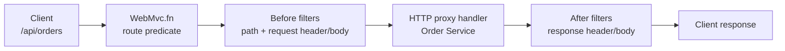

# Đổi đường dẫn, header và nội dung bằng bộ lọc Web MVC

## Mục tiêu bài học

Trong chương **Server Web MVC** của **Spring Cloud Gateway**, chúng ta học cách điều chỉnh **đường dẫn**, **request/response headers** và **HTTP body** bằng các bộ lọc dành riêng cho **Spring Cloud Gateway Server Web MVC**. Đây là một biến thể triển khai Gateway dựa trên **Spring MVC functional endpoints (`WebMvc.fn`)** và **Servlet runtime**, không phải Gateway Server WebFlux dựa trên Reactor.

Bài tập trung vào ba câu hỏi: *khi nào cần biến đổi request trước lúc gửi upstream, khi nào cần biến đổi response trước lúc trả client, và biến đổi ấy có ảnh hưởng gì tới HTTP semantics và bảo mật?*

Sau bài học, bạn có thể:

- Phân biệt **Server Web MVC** với **Server WebFlux**, tránh trộn `RouterFunction<ServerResponse>` của Servlet với `RouteLocator`/`GatewayFilter` của WebFlux.
- Cấu hình route Web MVC đúng namespace và chọn **before filters** hay **after filters** theo thời điểm xử lý.
- Dùng `StripPrefix`, `PrefixPath`, `SetPath`, `RewritePath` để biến đổi request URI.
- Dùng `AddRequestHeader`, `SetRequestHeader`, `RemoveRequestHeader`, `AddResponseHeader`, `SetResponseHeader`, `RemoveResponseHeader` và `RewriteResponseHeader`.
- Biết vì sao **`ModifyRequestBody` và `ModifyResponseBody` của Server Web MVC chỉ cấu hình qua Java DSL** trong tài liệu Spring hiện hành, thay vì thêm chuỗi YAML không được hỗ trợ.
- Xác định ảnh hưởng của body rewrite tới **Content-Type, Content-Length, Content-Encoding, cache validators và bộ nhớ**.
- Thiết kế chính sách header tin cậy, bảo vệ `Authorization`, `Cookie`, `Host`, `Forwarded` và identity headers.
- Kiểm thử URL sau rewrite, headers nhìn thấy ở backend, body serialization, response body và các ca 4xx/5xx.
- Chọn khi nào dùng bộ lọc có sẵn và khi nào phải viết Java filter tùy chỉnh có kiểm soát.

> Phạm vi là **Spring Cloud Gateway Server Web MVC**. Các ví dụ YAML chính dùng prefix `spring.cloud.gateway.server.webmvc.routes` trong những dòng Gateway mới; một số bản cũ dùng `spring.cloud.gateway.mvc.routes`. Luôn đối chiếu Spring Cloud release train, Spring Boot và starter thực tế. Các ví dụ là hướng dẫn học tập, không tự thay thế xác thực, rate limiting, circuit breaker, retry, TLS hoặc quan sát request.

## 1. Đường đi của một HTTP request qua Gateway MVC

Giả sử frontend gọi:

```http
POST /api/orders HTTP/1.1
Host: api.example.com
Authorization: Bearer <access-token>
Content-Type: application/json
X-Request-Source: browser

{"itemId":"BOOK-42","quantity":1}
```

Backend Order Service lại nhận endpoint:

```text
POST http://order-service:8080/orders
```

và yêu cầu một header do Gateway kiểm soát:

```http
X-Gateway-Source: orders-edge
```

Gateway có thể thực hiện:

1. **Match route:** chọn route nhận `/api/orders`.
2. **Before filters:** bỏ prefix `/api`, xóa header không tin cậy, đặt header mới; nếu được cấu hình Java DSL, có thể đọc/biến đổi request body.
3. **HTTP proxy handler:** gửi request đã biến đổi tới upstream.
4. **After filters:** chỉnh header hoặc body response rồi trả về client.



Điểm mấu chốt: **route predicate không tự sửa URL**. Nó chọn route; bộ lọc trước proxy mới thay request URI mà backend nhìn thấy. Tương tự, response body cần được biến đổi bằng một bộ lọc đọc và ghi lại representation, chứ không thể đổi nội dung chỉ bằng `SetResponseHeader`.

### 1.1. `Before` và `After` không chỉ là tên

| Giai đoạn | Dữ liệu có thể xử lý | Ví dụ |
| --- | --- | --- |
| **Predicate / matching** | Method, path, host, headers của request đầu vào | `Path=/api/orders/**` |
| **Before filter** | Request path, request headers, request body trước HTTP proxy | `StripPrefix`, `SetRequestHeader`, `ModifyRequestBody` |
| **Proxy handler** | Gửi request tới backend và nhận response | `HandlerFunctions.http()` |
| **After filter** | Response status/headers/body trước khi trả client | `AddResponseHeader`, `RewriteResponseHeader`, `ModifyResponseBody` |

Trong Java DSL của Web MVC, các hàm được nhóm vào:

```java
org.springframework.cloud.gateway.server.mvc.filter.BeforeFilterFunctions
org.springframework.cloud.gateway.server.mvc.filter.AfterFilterFunctions
```

Điều này giúp nhận biết bước nào biến đổi request, bước nào biến đổi response. **Không lấy `AbstractGatewayFilterFactory` của WebFlux làm mẫu để viết filter cho Web MVC**: API, model thực thi và lifecycle khác nhau.

## 2. Điều kiện chạy: đúng starter, đúng servlet stack

Với Spring Cloud Gateway Server Web MVC thuộc những dòng mới, starter Maven thường là:

```xml
<dependency>
    <groupId>org.springframework.cloud</groupId>
    <artifactId>spring-cloud-starter-gateway-server-webmvc</artifactId>
</dependency>
```

Dùng Spring Cloud BOM tương thích với phiên bản Spring Boot của dự án, thay vì tự chắp vá version của các artifacts.

**Lưu ý lịch sử phiên bản:** các dòng cũ hơn có starter `spring-cloud-starter-gateway-mvc` và prefix `spring.cloud.gateway.mvc.routes`. Dòng mới tổ chức lại tên dưới `server-webmvc`. Khi một ví dụ không chạy, kiểm tra tài liệu của **bản đang sử dụng**, không thử thêm đồng thời cả hai starter và hai prefix để “may ra có cái hoạt động”.

| Thuộc tính | Server Web MVC | Server WebFlux |
| --- | --- | --- |
| Mô hình web | Servlet + Spring MVC `WebMvc.fn` | Reactive + Spring WebFlux |
| Router API mẫu | `RouterFunction<ServerResponse>` | `RouteLocator`, `RouteLocatorBuilder` |
| Response type của functional routing | `org.springframework.web.servlet.function.ServerResponse` | WebFlux handler/response abstractions |
| Filter functions mẫu | `BeforeFilterFunctions`, `AfterFilterFunctions` | `GatewayFilter`, `GatewayFilterFactory`, `GlobalFilter` |
| Runtime thường gặp | Tomcat, Jetty hoặc Servlet container tương thích | Reactor Netty thường gặp |
| Body transform | Java DSL `modifyRequestBody`/`modifyResponseBody` của MVC | `ModifyRequestBody`/`ModifyResponseBody` của WebFlux với API khác |
| Tránh dùng nhầm | `Mono<Void>`, `ServerWebExchange`, `DataBuffer` như filter signatures | `jakarta.servlet.Filter`/MVC `ServerRequest` như API thay thế |

Một ứng dụng có thể chứa thư viện reactive cho mục đích khác, nhưng **điều đó không biến Gateway Server Web MVC thành WebFlux**. Trong bài này, mã Java dùng Java MVC functional endpoints và phương thức callback đồng bộ theo API MVC.

### 2.1. Route YAML tối thiểu

```yaml
spring:
  cloud:
    gateway:
      server:
        webmvc:
          routes:
            - id: orders-basic
              uri: http://localhost:9001
              predicates:
                - Path=/api/orders/**
              filters:
                - StripPrefix=1
```

Với backend test chạy ở `localhost:9001`:

```text
Client gọi:  GET http://localhost:8080/api/orders/42
Backend thấy: GET http://localhost:9001/orders/42
```

Nếu muốn dùng service discovery/load balancing, cần thêm dependencies và cách chọn instance tương thích với Web MVC; khi chỉ học filter, **URI tĩnh tới backend stub** giúp tách vấn đề cấu hình path khỏi vấn đề registry.

### 2.2. Java DSL: `GatewayRouterFunctions.route`

Định nghĩa route tương đương bằng Java:

```java
package com.example.gateway;

import org.springframework.context.annotation.Bean;
import org.springframework.context.annotation.Configuration;
import org.springframework.web.servlet.function.RouterFunction;
import org.springframework.web.servlet.function.ServerResponse;

import static org.springframework.cloud.gateway.server.mvc.filter.BeforeFilterFunctions.stripPrefix;
import static org.springframework.cloud.gateway.server.mvc.filter.BeforeFilterFunctions.uri;
import static org.springframework.cloud.gateway.server.mvc.handler.GatewayRouterFunctions.route;
import static org.springframework.cloud.gateway.server.mvc.handler.HandlerFunctions.http;

@Configuration
class OrdersMvcGatewayRoutes {

    @Bean
    RouterFunction<ServerResponse> ordersBasicRoute() {
        return route("orders-basic")
            .GET("/api/orders/**", http())
            .before(uri("http://localhost:9001"))
            .before(stripPrefix(1))
            .build();
    }
}
```

Mẫu trên dùng `org.springframework.web.servlet.function.*`, **không phải** `org.springframework.web.reactive.function.server.*`. Trước khi ghép nhiều routes, chọn **một cách cấu hình cho một route ID**, tránh vừa khai báo route đó ở YAML vừa tạo lại trong Java DSL làm kết quả routing khó đoán.

## 3. Biến đổi đường dẫn: chọn phép biến đổi đúng

Đổi request path là nhu cầu phổ biến khi Gateway công bố API dưới prefix chung còn backend dùng đường dẫn ngắn hơn.

| Bộ lọc | Tham số | Tác dụng chính | Khi nên dùng |
| --- | --- | --- | --- |
| `StripPrefix` | Số segments cần bỏ | Xóa một số thành phần đầu của path | `/api/orders/42` → `/orders/42` |
| `PrefixPath` | Prefix cần chèn | Thêm prefix vào path | `/orders/42` → `/internal/orders/42` |
| `SetPath` | URI template | Thay path bằng template được mở rộng từ route variables | `/v1/users/42` → `/users/42` |
| `RewritePath` | Java regex + replacement | Thay path theo regex có capture group | `/legacy/abc` → `/new/abc` |

**Không dùng một bộ lọc cho mọi trường hợp**. `StripPrefix` dễ đọc và ít rủi ro hơn regex khi chỉ cần bỏ `/api`; `SetPath` hợp với URI template rõ ràng; `RewritePath` dành cho mapping phức tạp.

### 3.1. `StripPrefix`

Ví dụ:

```yaml
spring:
  cloud:
    gateway:
      server:
        webmvc:
          routes:
            - id: strip-orders
              uri: http://localhost:9001
              predicates:
                - Path=/api/orders/**
              filters:
                - StripPrefix=1
```

Kết quả:

| Client gửi | `parts=1` | `parts=2` |
| --- | --- | --- |
| `/api/orders/42` | `/orders/42` | `/42` |
| `/api/orders` | `/orders` | `/` hoặc dạng path gốc tương đương theo normalization |
| `/api/orders/42/items` | `/orders/42/items` | `/42/items` |

Đếm **path segments**, không đếm ký tự. Không bao gồm query string trong số segments.

Trong Java DSL:

```java
.before(stripPrefix(1))
```

Nếu backend thực sự nhận `/orders/42` nhưng route lại dùng `StripPrefix=2`, lỗi 404 có thể xảy ra dù Gateway match route đúng. Khi debug, luôn ghi riêng **public path** và **upstream path**.

### 3.2. `PrefixPath`

Backend có API:

```text
/internal/orders/42
```

nhưng public route:

```text
/orders/42
```

Thêm:

```yaml
filters:
  - PrefixPath=/internal
```

thì `/orders/42` được gửi lên backend thành `/internal/orders/42`.

Java DSL:

```java
.before(prefixPath("/internal"))
```

Đừng nhầm với thay đổi **host** hay **scheme**. `PrefixPath` chỉ thao tác đường dẫn. Query string, method, authorization và upstream URI cần được giữ/kiểm tra riêng.

### 3.3. `SetPath` với URI template

Với route:

```yaml
predicates:
  - Path=/api/products/{productId}
filters:
  - SetPath=/products/{productId}
```

client gọi:

```text
/api/products/BOOK-42
```

upstream thấy:

```text
/products/BOOK-42
```

`SetPath` dùng **URI template variables** được khai thác từ predicate, không phải Java regex replacement. Nếu path pattern có nhiều segments hoặc biến tùy chọn, cần test mọi pattern hợp lệ để đảm bảo không vô tình tạo URI thiếu segments hoặc route shadowing.

### 3.4. `RewritePath` với named regex capture

Đây là phép rewrite phù hợp khi prefix cần biến đổi theo regex:

```yaml
spring:
  cloud:
    gateway:
      server:
        webmvc:
          routes:
            - id: rewrite-legacy
              uri: http://localhost:9001
              predicates:
                - Path=/legacy/**
              filters:
                - RewritePath=/legacy/?(?<segment>.*), /$\{segment}
```

Ý tưởng:

```text
/legacy/orders/42  →  /orders/42
/legacy/products   →  /products
```

`(?<segment>.*)` là Java regex named capture. `/${segment}` là giá trị replacement theo group, nhưng **trong YAML Spring property placeholder expansion có thể nhận nhầm `${...}`**. Vì vậy tài liệu Spring Cloud Gateway thường dùng **`$\{segment}`** trong YAML để escape. Trong Java DSL, viết replacement bình thường:

```java
.before(rewritePath("/legacy/(?<segment>.*)", "/${segment}"))
```

Đừng thêm dấu nháy/escape theo thói quen mà chưa xác minh chuỗi **sau khi YAML và Spring bind**; tests mới chứng minh request thực đi đúng upstream.

**Lưu ý regex:** `RewritePath` chỉ nên dùng trên route được xác định rõ. Regex quá rộng hoặc không giới hạn input có thể gây path routing sai hoặc tốn CPU. Hãy kiểm thử encoding `%2F`, dấu `/`, dấu `?`, dấu `#`, ký tự Unicode và path traversal normalization trong boundary thực, không tự tạo một “URI sanitizer” bằng regex đơn giản.

### 3.5. Thứ tự với load balancing

Khi Java DSL kết hợp `lb()` hoặc những bước chọn đích động, tài liệu Web MVC lưu ý nên **rewrite path trước load balancing**, nếu không URI cuối có thể không đúng.

Ví dụ ở mức ý tưởng:

```text
Path predicate
  ↓
RewritePath / StripPrefix / SetPath
  ↓
LoadBalancer chọn instance
  ↓
HTTP proxy tới upstream URL cuối
```

Với scheme `lb:` trong YAML, Gateway có cơ chế thứ tự filter riêng. Đừng suy luận thứ tự thực chỉ từ thứ tự các dòng hoặc trộn Java DSL `lb()` với `uri(...)` một cách tùy tiện. Luôn kiểm tra **HTTP path mà backend test nhận**.

## 4. Request headers: thêm, thay thế và xóa

HTTP headers ảnh hưởng tới authentication, caching, content negotiation, CORS, tracing và cách backend diễn giải request. Một thay đổi header phải trả lời **ai sở hữu giá trị** và **có được phép tin dữ liệu client không**.

### 4.1. `AddRequestHeader`

```yaml
filters:
  - AddRequestHeader=X-Gateway-Label, orders-edge
```

Filter thêm giá trị vào header `X-Gateway-Label`. Khi header đã có sẵn, cách thêm có thể làm backend thấy **nhiều values** cho cùng một tên.

Java DSL:

```java
.before(addRequestHeader("X-Gateway-Label", "orders-edge"))
```

Dùng khi backend chấp nhận multi-value hoặc một giá trị bổ sung là đúng contract. **Không dùng `AddRequestHeader` để thiết lập identity header đáng tin** nếu client có thể gửi trước một giá trị khác: backend có thể chọn giá trị đầu và dẫn tới header spoofing.

### 4.2. `SetRequestHeader`

```yaml
filters:
  - SetRequestHeader=X-Gateway-Source, orders-edge
```

Filter **thay toàn bộ giá trị header có tên đó** bằng giá trị được cấu hình. Ví dụ:

```http
X-Gateway-Source: client-forged
```

sau filter sẽ là:

```http
X-Gateway-Source: orders-edge
```

Phù hợp với các header do Gateway sở hữu, nhưng chỉ sử dụng khi tên header đã được **security review**. **Không đặt `Authorization`, `Cookie`, `Host` hoặc `X-Authenticated-User` tùy ý** từ dữ liệu chưa xác thực.

### 4.3. `RemoveRequestHeader`

```yaml
filters:
  - RemoveRequestHeader=X-Debug-Mode
```

Phù hợp khi client có thể gửi một header nội bộ mà backend không nên nhận. Ví dụ ingress/Gateway loại bỏ các header quản trị, diagnostic hoặc client hints không hợp lệ.

Nếu cần truyền một **identity header đã xác minh** xuống backend:

1. Dọn bỏ header client tự gửi ở **trust boundary**.
2. Spring Security/identity-aware component xác minh danh tính.
3. Chỉ sau đó mới sinh header có nguồn gốc đáng tin, theo contract với backend.
4. Backend chỉ tin header khi request thực sự đến qua mạng/proxy được phép, và vẫn thực hiện authorization theo tài nguyên.

`RemoveRequestHeader` đơn độc không tạo ra identity an toàn.

### 4.4. `MapRequestHeader` và multiple values

`MapRequestHeader` có thể sao chép giá trị từ một request header này sang header khác. Cần hiểu khác biệt giữa **copy**, **add** và **set**.

Ví dụ minh họa:

```yaml
filters:
  - MapRequestHeader=X-Client-Locale, X-Locale
```

Nếu `X-Client-Locale` do client kiểm soát, `X-Locale` cũng là **dữ liệu chưa xác thực**. Không map `X-Tenant-ID` vào `X-Verified-Tenant` rồi coi nó là phân quyền.

### 4.5. Request header comparison

| Filter | Khi header đã tồn tại | Mục đích |
| --- | --- | --- |
| `AddRequestHeader` | Có thể giữ giá trị cũ và thêm giá trị mới | Bổ sung metadata |
| `SetRequestHeader` | Thay giá trị cũ | Gateway chiếm quyền sở hữu header |
| `RemoveRequestHeader` | Xóa toàn bộ giá trị theo tên | Không chuyển metadata không nên tin |
| `MapRequestHeader` | Lấy giá trị từ header nguồn và thêm vào header đích theo semantics hỗ trợ | Truyền metadata có kiểm soát |

Tên HTTP header không phân biệt chữ hoa/thường theo giao thức. Tuy vậy, nhiều giá trị của **một tên** có thể có semantics riêng; không nối hoặc gộp `Set-Cookie`, `Authorization` hay các headers đặc biệt một cách tùy tiện.

## 5. Response headers: thay đổi trước khi trả client

Ở pha **after**, Gateway Web MVC có thể bổ sung/xóa/thay headers từ response upstream. Điều này hữu ích để:

- Chuẩn hóa các header hỗ trợ vận hành.
- Ngăn rò rỉ một vài header debug/internal từ backend.
- Điều chỉnh location redirects theo public API host/path.
- Chuẩn hóa policy headers khi Gateway thực sự là điểm sở hữu chúng.

### 5.1. `AddResponseHeader`

```yaml
filters:
  - AddResponseHeader=X-Served-Via, gateway-mvc
```

Java DSL:

```java
.after(addResponseHeader("X-Served-Via", "gateway-mvc"))
```

Nếu upstream cũng trả `X-Served-Via`, client có thể thấy **nhiều values**. Đừng dùng `Add` nếu contract yêu cầu một giá trị duy nhất.

### 5.2. `SetResponseHeader`

```yaml
filters:
  - SetResponseHeader=X-Api-Surface, public-v1
```

Thay các giá trị cùng tên bằng `public-v1`. Điều này không chứng minh backend đã triển khai đúng version; đây chỉ là response metadata. Với các header bảo mật như `Content-Security-Policy` hoặc `Strict-Transport-Security`, cần đánh giá scheme/TLS/ingress, tránh ghi đè policy của tầng bảo mật khác một cách mâu thuẫn.

### 5.3. `RemoveResponseHeader`

```yaml
filters:
  - RemoveResponseHeader=X-Backend-Debug
```

Dùng để chặn một header không nên lộ ra ngoài. Nhưng bảo mật không chỉ là lọc vài header: upstream vẫn có thể để lộ chi tiết nội bộ trong body, `Location` hoặc error messages. Nên có chính sách kiểm thử và error sanitization ở tất cả các tầng.

### 5.4. `RewriteResponseHeader`

Khi response header chứa một chuỗi cần chỉnh:

```yaml
filters:
  - 'RewriteResponseHeader=X-Trace-Info, secret=[^&]+, secret=REDACTED'
```

Giả sử upstream trả:

```http
X-Trace-Info: mode=normal&secret=abc123&flag=true
```

Sau rewrite, mục tiêu là:

```http
X-Trace-Info: mode=normal&secret=REDACTED&flag=true
```

**Lưu ý quan trọng:** regex redaction trong một header chỉ là demo API. Nếu upstream có thể đưa dữ liệu nhạy cảm vào nhiều vị trí/encoding, một regex như `secret=[^&]+` **không bảo đảm không rò secret**. Thiết kế tốt hơn là **không phát secret** vào response ngay từ backend, hoặc dùng allowlist các header an toàn.

### 5.5. `DedupeResponseHeader` và CORS

Khi Gateway và backend cùng thêm CORS headers, browser có thể nhận:

```http
Access-Control-Allow-Origin: https://app.example.com
Access-Control-Allow-Origin: https://app.example.com
```

Một số phiên bản Web MVC có `DedupeResponseHeader` để xử lý trùng giá trị. Tuy nhiên, **dedupe không thay policy CORS**:

- Phải có một tầng **sở hữu CORS** rõ ràng.
- `Access-Control-Allow-Credentials` không được bật cho mọi origin ngoài ý muốn.
- Preflight OPTIONS cần được kiểm tra riêng; route chỉ match GET có thể không xử lý preflight như tưởng tượng.
- 401/403/429/503 cũng cần chính sách response CORS đúng nếu frontend phải đọc lỗi.

Khi nhiều tầng ingress/Spring Security/Gateway/backend cùng thêm CORS headers, nên sửa **chỗ phát thừa** hơn là che mọi lỗi bằng một regex hoặc dedupe rộng.

## 6. Một route YAML kết hợp path và headers

Ví dụ thực tế: public API `/api/orders/**`, backend `/orders/**`, và Gateway quản lý một vài headers:

```yaml
spring:
  cloud:
    gateway:
      server:
        webmvc:
          routes:
            - id: orders-edge
              uri: http://localhost:9001
              predicates:
                - Path=/api/orders/**
              filters:
                - StripPrefix=1
                - RemoveRequestHeader=X-Internal-Operator
                - SetRequestHeader=X-Gateway-Source, orders-edge
                - AddResponseHeader=X-Served-Via, gateway-mvc
                - RemoveResponseHeader=X-Backend-Debug
```

Giả sử client gửi:

```http
GET /api/orders/42 HTTP/1.1
X-Internal-Operator: true
X-Gateway-Source: client-forged
```

Backend sẽ nhìn thấy request có ý nghĩa:

```http
GET /orders/42 HTTP/1.1
X-Gateway-Source: orders-edge
```

và không còn `X-Internal-Operator`, **nếu không có tầng khác chèn lại header đó**. Response nhận về có thể có `X-Served-Via: gateway-mvc` và không có `X-Backend-Debug`.

### 6.1. Không tự coi route trên là đã bảo mật hoàn chỉnh

Ví dụ chưa cấu hình:

- Authentication/authorization bằng Spring Security.
- TLS inbound và TLS outbound.
- Rate limit, concurrency limit, retry hoặc circuit breaker.
- Service discovery (URI đang cố ý dùng backend stub HTTP).
- CORS, CSRF với cookie, quota và validation nghiệp vụ.

Trong kiến trúc microservices, **biến đổi header không thay xác thực**. Nếu Order Service đọc `X-Gateway-Source` để logging thì ổn; nếu dùng nó làm bằng chứng user là admin, đó là lỗi thiết kế trust boundary.

## 7. Biến đổi nội dung request: `ModifyRequestBody`

Khác với path/header filters nhận tham số dạng YAML, **`ModifyRequestBody` của Server Web MVC được tài liệu Spring hướng dẫn cấu hình qua Java DSL**.

Không nên viết:

```yaml
# Không phải cấu hình body transform hợp lệ được
# bảo đảm trong Gateway Server Web MVC:
filters:
  - ModifyRequestBody=String.class,Something
```

Thao tác đổi body cần biết:

- Kiểu dữ liệu đầu vào và kiểu dữ liệu đầu ra.
- `Content-Type` của representation mới.
- Bộ chuyển đổi (message converters) có hỗ trợ kiểu dữ liệu?
- Body rỗng/null sẽ được xử lý thế nào?
- Payload có lớn hoặc streaming không?

### 7.1. Java DSL đổi body text trước upstream

Ví dụ ứng dụng test muốn loại whitespace thừa ở đầu/cuối body text trước khi gửi:

```java
package com.example.gateway;

import org.springframework.context.annotation.Bean;
import org.springframework.context.annotation.Configuration;
import org.springframework.http.MediaType;
import org.springframework.web.servlet.function.RouterFunction;
import org.springframework.web.servlet.function.ServerResponse;

import static org.springframework.cloud.gateway.server.mvc.filter.BeforeFilterFunctions.modifyRequestBody;
import static org.springframework.cloud.gateway.server.mvc.filter.BeforeFilterFunctions.uri;
import static org.springframework.cloud.gateway.server.mvc.handler.GatewayRouterFunctions.route;
import static org.springframework.cloud.gateway.server.mvc.handler.HandlerFunctions.http;

@Configuration
class RequestBodyMvcRoute {

    @Bean
    RouterFunction<ServerResponse> normalizedNotesRoute() {
        return route("normalized-notes")
            .POST("/api/notes", http())
            .before(uri("http://localhost:9001"))
            .before(modifyRequestBody(
                String.class,
                String.class,
                MediaType.TEXT_PLAIN_VALUE,
                (request, body) -> body == null ? "" : body.strip()
            ))
            .build();
    }
}
```

Giả sử client gửi:

```http
POST /api/notes HTTP/1.1
Content-Type: text/plain; charset=UTF-8

    xin chào    
```

Sau transform, upstream được dự kiến nhận một **text representation mới**:

```text
xin chào
```

Đây là minh họa cho transformation có chủ đích, **không phải sanitizer bảo mật**. `String.strip()` không chặn SQL injection, XSS, command injection hoặc payload độc hại.

**Quan trọng:** ví dụ chọn thay body rỗng/null bằng chuỗi rỗng theo business rule của endpoint demo. Trong ứng dụng thật, phân biệt **không có body** với **body rỗng** nếu contract yêu cầu; kiểm tra hành vi của callback `null`/message converters theo phiên bản.

### 7.2. Các tham số có ý nghĩa gì?

```java
modifyRequestBody(
    String.class,            // Input representation
    String.class,            // Output representation
    MediaType.TEXT_PLAIN_VALUE,
    (request, body) -> ...
)
```

| Thành phần | Vai trò |
| --- | --- |
| `String.class` thứ nhất | Kiểu nội dung dùng để đọc/convert request body |
| `String.class` thứ hai | Kiểu nội dung sau biến đổi |
| `MediaType.TEXT_PLAIN_VALUE` | Content type dự kiến của output |
| `(request, body) -> ...` | Callback Java MVC transform body và có thể đọc metadata request |

Chữ ký callback và overload cụ thể thay đổi theo **dòng Gateway**; ở các phiên bản hiện hành, MVC API có callback đồng bộ trả về đối tượng, **không lấy `Mono.just(...)` của WebFlux gắn vào**. Một số tài liệu nhắc `Mono.empty()` ở phần mô tả body rỗng dù mẫu Web MVC trả synchronous object; khi có điểm không nhất quán giữa mô tả và code mẫu, ưu tiên javadoc/test compile của đúng dependency.

### 7.3. Nếu body là JSON object?

Một biến đổi cấu trúc nên dùng DTO rõ kiểu:

```java
record ClientOrder(String itemId, int quantity) { }
record BackendOrder(String itemId, int quantity, String source) { }
```

Callback có thể tạo:

```java
(request, incoming) -> new BackendOrder(
    incoming.itemId(),
    incoming.quantity(),
    "gateway-mvc"
)
```

khi `incoming` đã được chuyển đúng kiểu `ClientOrder`. Nhưng một đoạn đó **chưa đủ** để thành một route chạy độc lập: phải khai báo `modifyRequestBody(ClientOrder.class, BackendOrder.class, MediaType.APPLICATION_JSON_VALUE, ...)`, có Jackson/message converters hỗ trợ records, kiểm tra null/validation và backend contract.

**Đừng biến Gateway thành nơi duy nhất xử lý validation nghiệp vụ hoặc phân quyền**. Backend vẫn phải kiểm tra quantity, item ID, tenant ownership và transaction safety.

### 7.4. Khi nào không nên modify request body?

- File upload/multipart rất lớn.
- Streaming HTTP requests cần latency thấp và memory bounded.
- Body đã mã hóa/compressed mà Gateway không hỗ trợ decoder phù hợp.
- Payload đã ký số: sửa bytes làm signature/MAC không còn hợp lệ.
- Request có `Content-Length`/`Transfer-Encoding` đặc biệt hoặc yêu cầu replay qua Retry.
- Logic cần truy cập dữ liệu nhạy cảm không nên giải mã ở edge.

Trong những trường hợp đó, có thể thay đổi API contract hoặc chuyển transformation vào **backend/BFF** nơi có chính sách dữ liệu phù hợp, thay vì buffer toàn bộ payload trong Gateway.

## 8. Biến đổi nội dung response: `ModifyResponseBody`

Với response từ backend, cần dùng **after filter** vì dữ liệu chỉ tồn tại sau khi đã nhận upstream response.

### 8.1. Java DSL thay một đoạn text

```java
package com.example.gateway;

import org.springframework.context.annotation.Bean;
import org.springframework.context.annotation.Configuration;
import org.springframework.http.MediaType;
import org.springframework.web.servlet.function.RouterFunction;
import org.springframework.web.servlet.function.ServerResponse;

import static org.springframework.cloud.gateway.server.mvc.filter.AfterFilterFunctions.modifyResponseBody;
import static org.springframework.cloud.gateway.server.mvc.filter.BeforeFilterFunctions.uri;
import static org.springframework.cloud.gateway.server.mvc.handler.GatewayRouterFunctions.route;
import static org.springframework.cloud.gateway.server.mvc.handler.HandlerFunctions.http;

@Configuration
class ResponseBodyMvcRoute {

    @Bean
    RouterFunction<ServerResponse> normalizeStatusTextRoute() {
        return route("normalize-status-text")
            .GET("/api/status-text", http())
            .before(uri("http://localhost:9001"))
            .after(modifyResponseBody(
                String.class,
                String.class,
                MediaType.TEXT_PLAIN_VALUE,
                (request, response, body) ->
                    body == null ? "" : body.replace(
                        "legacy:", "current:"
                    )
            ))
            .build();
    }
}
```

Nếu upstream trả:

```http
HTTP/1.1 200 OK
Content-Type: text/plain

legacy:ready
```

client có thể nhận:

```http
HTTP/1.1 200 OK
Content-Type: text/plain

current:ready
```

Các response headers như `Content-Length` phải phản ánh **bytes của output thực**, không được giữ con số tính trên body cũ. Sử dụng factory chính thức giúp việc rewrite đi qua pipeline MVC phù hợp, nhưng vẫn phải kiểm thử HTTP framing và message converter cụ thể.

### 8.2. Vì sao có đối số `response`?

Trong một số overload của MVC `modifyResponseBody`, callback nhận:

```java
(request, response, body) -> ...
```

Nhờ đó, logic có thể xét status hoặc header của upstream response, thay vì chỉ đọc chuỗi body. Dù vậy, **không được coi `response` là quyền sửa tùy ý mọi phần đã commit**. Chữ ký/hàm hỗ trợ có thể khác giữa các phiên bản; hãy dùng mẫu javadoc của dependency hiện hành.

### 8.3. Không “vô tình” biến body JSON thành text không hợp lệ

Ví dụ nếu upstream trả:

```json
{"message":"legacy:ready","count":3}
```

việc `.replace("legacy:", "current:")` trên toàn JSON string có thể làm thay cả những phần không mong muốn; với cấu trúc phức tạp, nên decode thành DTO/JSON tree, thay **chính xác field được phép**, rồi encode lại.

Với dữ liệu cá nhân, chỉ cho phép **allowlist fields** cần trả ra; tránh “xóa field nhạy cảm bằng regex” vì có thể bị lách qua escape, nested object hoặc encoding.

### 8.4. Filter response body không phải fallback

`ModifyResponseBody` thay representation của response đã có. Nó không tự gọi fallback service, không tự làm circuit breaker hoặc retry lỗi upstream. Khi upstream trả 503 hoặc timeout, có thể không có JSON body như trường hợp 200; callback phải có policy hợp lệ cho null, error body và status.

Nếu cần fallback response có nội dung khác hoàn toàn, đánh giá error handling và CircuitBreaker riêng cho Web MVC, thay vì viết callback luôn trả `200 OK` giả khi backend đang lỗi.

## 9. HTTP framing: biến đổi body kéo theo thay đổi metadata

Đây là phần dễ tạo lỗi ẩn nhất khi biến đổi nội dung.

### 9.1. `Content-Length` là **số bytes**, không phải số ký tự

Giả sử:

```text
body cũ: "hello"
body mới: "xin chào"
```

Số ký tự trong Java không nhất thiết bằng **số bytes UTF-8** được gửi ra. Tiếng Việt có dấu, emoji và các ký tự khác có thể dùng nhiều bytes.

```text
Content-Length = kích thước output representation bytes
```

Nếu giữ `Content-Length` của body cũ sau rewrite:

- Client có thể đọc thiếu hoặc chờ thêm bytes.
- Kết nối keep-alive có thể bị lỗi framing.
- Proxy phía trước/sau có thể từ chối hoặc hiểu sai response.
- Test chỉ parse JSON đôi khi không phát hiện lỗi mà HTTP client/proxy khác gặp phải.

**Không tự gọi `.length()` của Java `String` rồi đặt `Content-Length`.** Để framework/message converter tính theo bytes hoặc kiểm soát header một cách phù hợp, rồi xác minh on-wire.

### 9.2. `Transfer-Encoding` không phải thứ nên sao chép mù quáng

Khi output body length chưa xác định trước, HTTP/1.1 có thể dùng cơ chế framing thích hợp như chunked transfer encoding. Nhưng **không được gửi kết hợp header mâu thuẫn** hoặc chuyển nguyên `Transfer-Encoding` từ response upstream sang một representation đã biến đổi mà không kiểm soát.

HTTP/2 có framing khác HTTP/1.1; các hop-by-hop headers như `Connection` không được tự chuyển tiếp như end-to-end application metadata. Gateway và HTTP proxy client/server cần xử lý từng hop đúng giao thức.

### 9.3. `Content-Type` phải mô tả representation mới

Nếu output body trở thành JSON:

```http
Content-Type: application/json
```

Nếu là text:

```http
Content-Type: text/plain; charset=UTF-8
```

Đừng đặt JSON content type trong khi serializer gửi bytes không hợp lệ, hoặc giữ `application/gzip` khi đã giải nén thành text. Với charset, dùng converter tương thích và test Unicode.

### 9.4. `Content-Encoding` và compression

Nếu upstream trả:

```http
Content-Encoding: gzip
```

thì body là **gzip-encoded representation**. Không biến đổi bytes nén bằng một String replacement trực tiếp rồi giữ `Content-Encoding: gzip`.

Các chiến lược:

1. Không dùng response body rewrite trên response nén.
2. Yêu cầu upstream trả representation chưa nén cho route transform, sau đó có thể nén lại ở tầng phù hợp.
3. Dùng một pipeline có decoder/encoder phù hợp, giới hạn decompressed size và test content negotiation.

Không tự giả định `ModifyResponseBody` ở mọi phiên bản MVC đều trong suốt giải nén rồi nén lại. Kiểm chứng bằng test có `Accept-Encoding`, gzip/br và response bytes thực.

### 9.5. Cache validators, range và signature

Sau khi body đổi:

| Metadata | Vấn đề | Hướng xử lý |
| --- | --- | --- |
| `ETag` | Hash/validator của body cũ không còn đúng | Bỏ hoặc tái tính theo representation mới |
| `Last-Modified` | Có thể còn biểu thị nguồn upstream, nhưng semantics phải rõ | Xem cache contract |
| `Content-MD5` / Digest / chữ ký | Không còn khớp bytes mới | Tái tính/ký lại nếu được phép, hoặc không rewrite |
| `Content-Range` | Chỉ ra byte range của representation cũ | Không rewrite theo cách làm hỏng range semantics |
| `Cache-Control` | Response có thể mang dữ liệu theo user | Kiểm tra cache private/public |
| `Vary` | Đặc biệt khi khác representation theo header | Duy trì Vary phù hợp, tránh cache nhầm |

**Không đổi body của `206 Partial Content`, `304 Not Modified`, `204 No Content` hoặc `HEAD` theo logic dành cho full `200 OK` mà không xét HTTP semantics.** Các status/method đó có hạn chế về body và metadata riêng.

## 10. Body rewrite có chi phí CPU, memory và latency

Trong Web MVC, body conversion thường liên quan Servlet request/response streams và HTTP message converters. Dù implementation xử lý streaming/buffering thế nào, việc **muốn sửa toàn bộ JSON/text** thường buộc hệ thống phải quan sát nội dung đủ để parse hoặc tạo representation mới.

Một thao tác có thể làm tăng:

- Memory dùng để giữ input/output representations.
- CPU cho decode/encode JSON, regex hoặc compression.
- Latency trước khi gửi response đầu tiên cho client.
- Garbage collection pressure khi concurrent requests lớn.
- Rủi ro lỗi encoding hoặc request/response bodies rất lớn.

Ví dụ:

```text
100 requests đang xử lý
× mỗi response JSON 10 MiB
≈ 1 GiB dữ liệu output nếu cùng tồn tại một bản trong memory
```

Con số chỉ minh họa quy mô; object graph, string encoding và các bản copy trung gian còn có thể làm memory dùng thực tế **lớn hơn**. Không nên xây body transformer cho file tải xuống, video stream, SSE hoặc request multipart lớn chỉ vì “Gateway có filter”.

### 10.1. Khi không nên sửa body ở Gateway

| Tình huống | Hướng tốt hơn |
| --- | --- |
| Upload file lớn | Multipart streaming/resumable upload và policy tại backend |
| Video/audio streaming | Không buffer toàn bộ representation; dùng streaming proxy |
| SSE lâu dài | Giữ HTTP stream và backpressure policy; không gom hết events để rewrite |
| Tài liệu nén/được ký | Giữ bytes nguyên trạng hoặc xử lý ở thành phần sở hữu representation |
| API có dữ liệu cá nhân nhạy cảm | Dùng DTO/allowlist tại backend/BFF và security review |
| Tương tác idempotency/transaction | Để backend quản lý business semantics; Gateway chỉ transform khi an toàn |

### 10.2. Đồng bộ không có nghĩa được phép block tùy ý

Server Web MVC dùng mô hình Servlet, không phải reactive Netty event-loop như WebFlux. Tuy nhiên, một filter gọi HTTP client chậm, query database hoặc parse body khổng lồ vẫn có thể làm **chiếm worker threads**, tăng queue và p99 latency.

Đừng biến body transformer thành policy engine gọi mạng cho mỗi request mà không có timeout, circuit breaker, concurrency limit hoặc cache hợp lý.

## 11. Bảo mật: đổi header/path có thể làm thay đổi trust boundary

Các bộ lọc có thể thay hành vi request theo cách ảnh hưởng authorization, routing và dữ liệu:

```text
Path rewrite
  → có thể chuyển từ endpoint công khai tới endpoint nội bộ

SetRequestHeader
  → có thể ghi đè metadata bảo mật

ModifyRequestBody
  → có thể đổi fields mà backend dùng để tính quyền

ModifyResponseBody
  → có thể làm lộ hoặc che nhầm dữ liệu nhạy cảm
```

### 11.1. Path-based security: public path và backend path

Ví dụ:

```text
Public: /api/admin/reports
Rewrite: /internal/reports
Backend: Admin Service
```

Spring Security ở Gateway có thể đánh giá **public path trước khi rewrite** theo cấu hình security filter chain; backend lại thấy path sau rewrite. Phải đảm bảo cả hai phía có policy phù hợp:

- Gateway bảo vệ `/api/admin/**` bằng authenticated principal/scopes phù hợp.
- Backend vẫn kiểm tra quyền **truy cập báo cáo**.
- Một route khác không thể rewrite `/public/**` vào `/internal/reports` mà bỏ qua bảo vệ.
- Route order/predicates không tạo một đường bypass.

Không coi URL rewrite là một cơ chế phân quyền. Nó chỉ đổi URI được chuyển tới upstream.

### 11.2. `Host` và `Forwarded` khác một header bình thường

Các header:

```http
Host: api.example.com
Forwarded: proto=https;host=api.example.com
X-Forwarded-For: ...
X-Forwarded-Proto: https
```

có thể ảnh hưởng việc tạo absolute URL, redirect, nhận diện scheme và client IP. Không để client tự gửi forwarded headers rồi tin đó là kết quả xác minh của edge.

Khi Gateway đứng sau load balancer/ingress, hãy cấu hình **trusted proxies** theo khả năng framework, chặn đường bypass và kiểm tra cách các hops ghi đè hoặc bổ sung headers. Nếu mục đích là thay **Host header**, tìm factory được thiết kế như `SetRequestHostHeader`/`PreserveHostHeader` theo phiên bản thay vì sử dụng `SetRequestHeader` mù quáng.

### 11.3. `Authorization` và cookies

Tuyệt đối tránh:

```yaml
filters:
  - AddRequestHeader=Authorization, Bearer some-secret
```

khi secret nằm thẳng trong source configuration hoặc khi tạo header trùng với token user. Token relay cần được thiết kế theo **Spring Security/OAuth2** và backend trust model, không phải nối chuỗi từ một giá trị do client gửi.

Cookie/session có CSRF và SameSite threat model riêng; một header rewrite không tự phòng CSRF. Khi dùng CORS và cookie credential, phải kiểm thử preflight, actual request và error responses.

### 11.4. Header injection và nội dung do client kiểm soát

Nếu filter lấy query parameter hoặc body field rồi đặt vào HTTP header:

```text
userInput → X-Custom-Header
```

phải validate ký tự điều khiển/CRLF, độ dài và semantic allowlist. Không tự ghép header giá trị dài không giới hạn hoặc đặt user input vào `Location` redirect một cách không kiểm soát.

### 11.5. SSRF, path traversal và route destination

`RewritePath` không nên dùng để tạo một URL bất kỳ từ input chưa được xác minh. Route URI cần allowlist scheme/host/service ID; path rewrite cần kiểm tra encoded slash/dot segments và normalization. Đừng tự cho phép người dùng gọi:

```text
/api/redirect?target=http://internal-admin/
```

rồi biến `target` thành upstream URI mà không có chính sách đích. Đó có thể là **SSRF** và bypass network boundaries.

## 12. Tương tác với Retry, CircuitBreaker và quan sát request

Một Gateway có thể kết hợp path/header/body transforms với các cơ chế resilience. Tuy nhiên, **thứ tự filter và semantics của các lần gọi lại** rất quan trọng.

### 12.1. Retry có thể chạy lại transformation không?

Ví dụ pipeline logic:

```text
Transform request body
  ↓
Retry
  ↓
HTTP proxy
```

không nhất thiết giống:

```text
Retry
  ↓
Transform request body
  ↓
HTTP proxy
```

Nếu retry lặp lại một vùng đã bao gồm body transformation, callback có thể được gọi nhiều lần hoặc body nguồn cần được replay. Một operation `body.strip()` có tính ổn định khi chạy lặp; một operation như `"count++"` hoặc "tạo idempotency key mới" có thể dẫn đến **payload khác nhau giữa attempts**.

**Với các thao tác ghi POST/PUT/PATCH**, phải thiết kế idempotency ở backend. Không chỉ vì body có thể đọc lại mà request business có thể retry an toàn.

### 12.2. CircuitBreaker và fallback

Nếu upstream lỗi, CircuitBreaker có thể trả fallback theo policy của phiên bản MVC. Một `ModifyResponseBody` dùng để sửa JSON của Order Service **không được mặc định** rằng fallback response có cùng cấu trúc JSON.

Cần kiểm thử:

- Success response bình thường.
- Error response 4xx/5xx.
- Circuit OPEN / fallback khi không có upstream response.
- Body rỗng, `HEAD` và `204`.
- Response headers khi CORS/security chặn request trước route.

Không fake `200 OK` cho giao dịch thanh toán khi backend chưa xác nhận.

### 12.3. Giữ đúng phân tách request và upstream attempts

Nếu Gateway nhận một request nhưng Retry gọi backend ba lần:

```text
Inbound requests = 1
Outbound HTTP attempts = 3
```

Nếu `ModifyRequestBody` chuyển đổi payload trước retry hoặc ở mỗi attempt, telemetry cần thể hiện đúng điều đó. Không log raw bodies hay token chỉ để so sánh hai attempts.

**Metrics nên có:** route ID, method, HTTP status, latency p50/p95/p99, number of retries, upstream errors, body-transform errors, bytes transferred và response framing failures.

Không gắn raw URI query/user ID/token vào metric labels có cardinality cao.

## 13. Kiểm thử với backend echo

Trước khi thêm JSON transformation phức tạp, hãy dựng một backend stub độc lập ở `localhost:9001` có khả năng:

- Echo **method và path** nhận được.
- Echo những **request headers được chọn**, đã redacted.
- Echo request body hoặc trả response text cố định.
- Phát response header như `X-Backend-Debug`.
- Chủ động trả `200`, `404`, `503`, `204`, `Content-Encoding: gzip` trong từng test riêng.

### 13.1. Thử path và headers bằng curl

Với route YAML ở mục 6:

```bash
curl -i \
  -H "X-Internal-Operator: true" \
  -H "X-Gateway-Source: forged-client" \
  "http://localhost:8080/api/orders/42"
```

Backend test nên xác nhận:

```text
method             = GET
path               = /orders/42
X-Internal-Operator = absent
X-Gateway-Source   = orders-edge
```

Response client nên có:

```http
X-Served-Via: gateway-mvc
```

và **không còn** `X-Backend-Debug` nếu backend phát header đó. Chỉ kiểm tra status 200 là không đủ; route có thể vẫn đi đúng backend nhưng filter không được áp dụng.

### 13.2. Thử body request

Với Java route `normalized-notes`:

```bash
curl -i -X POST \
  "http://localhost:8080/api/notes" \
  -H "Content-Type: text/plain; charset=UTF-8" \
  --data-binary "   xin chào   "
```

Backend echo phải nhận body theo policy:

```text
xin chào
```

Kiểm tra riêng:

- `Content-Type` thực tại upstream.
- `Content-Length` theo **bytes** thực.
- Text Unicode và charset.
- Request body rỗng.
- Body quá lớn/không hỗ trợ media type.
- Một request đã ký số nếu hệ thống có signature validation.

### 13.3. Thử body response

Với Java route `normalize-status-text`, upstream trả:

```http
HTTP/1.1 200 OK
Content-Type: text/plain

legacy:ready
```

Thử:

```bash
curl -i "http://localhost:8080/api/status-text"
```

Kỳ vọng body:

```text
current:ready
```

Đừng chỉ so sánh chuỗi. Xác minh `Content-Type`, bytes thực, Content-Length/Transfer-Encoding và cache headers. Nếu upstream trả gzip, test để phát hiện pipeline transform không hợp lệ hoặc policy skip đúng.

## 14. Test tự động: phải kiểm cả route và nội dung trên wire

### 14.1. Test route YAML

Một bài integration test có thể khởi động Gateway MVC bằng:

```java
@SpringBootTest(webEnvironment =
    SpringBootTest.WebEnvironment.RANDOM_PORT)
class GatewayMvcIntegrationTest {
    // Test client + backend stub cần khởi động và gắn đúng port.
}
```

Trong test thật, dùng một **stub HTTP server riêng** (WireMock, MockWebServer hoặc thư viện tương đương) để:

1. Nhận request của Gateway.
2. Lưu method/path/headers/body.
3. Trả response được kiểm soát.
4. Cho phép assert chính xác number of upstream calls.

`MockMvc` có thể dùng để kiểm tra phía incoming trong Servlet app, nhưng **nó không tự là một upstream HTTP server**. Với proxying, một integration test có backend stub thật sẽ chứng minh đường mạng và HTTP framing tốt hơn.

### 14.2. Những assertions cần có

```text
Given:
  public path = /api/orders/42
  client X-Gateway-Source = forged
  client X-Internal-Operator = true

When:
  GET Gateway /api/orders/42

Then backend:
  receives path = /orders/42
  receives X-Gateway-Source = orders-edge
  has no X-Internal-Operator

Then client:
  receives expected status/body
  receives X-Served-Via
  does not receive X-Backend-Debug
```

Đối với Java body routes, thêm:

```text
POST /api/notes:
  Unicode input with whitespace
  → upstream body normalized exactly once
  → content type and framing valid

GET /api/status-text:
  upstream body legacy:ready
  → client body current:ready
  → no stale validators or content-length mismatch
```

### 14.3. Ma trận kiểm thử

| Ca kiểm thử | Mục tiêu |
| --- | --- |
| Path match đúng | Route được chọn |
| Path không match | Không gọi nhầm backend |
| `StripPrefix=1` và `=2` | Kiểm tra đúng số segments |
| `RewritePath` named group | Escape `${...}` và regex bind đúng |
| `SetPath` URI template | Route variable được mở rộng đúng |
| Client gửi header giả | `SetRequestHeader` thay đúng, `RemoveRequestHeader` xóa đúng |
| Header tên khác casing | Filter xử lý tên không phân biệt hoa/thường |
| Multi-value header | `Add` vs `Set` đúng contract |
| Response debug header | Không lộ qua Gateway |
| CORS preflight | Không bị duplicate/nới origin trái phép |
| JSON request body | Decode/validate/encode đúng |
| Unicode text | Content-Length khớp UTF-8 bytes |
| Body rỗng | Callback null/empty theo policy |
| Response gzip | Không thay bytes nén như text thô |
| `204`, `HEAD`, `304`, `206` | Không tự tạo body/framing sai |
| JWT thiếu/quyền sai | Security từ chối đúng, filter không mở bypass |
| Body lớn | Có size limit và memory không vượt ngưỡng |
| Retry POST | Không tạo side effects trùng |
| Backend timeout/503 | Không fake success hoặc hỏng error body |
| Nhiều Gateway replicas | Filter config nhất quán trên các instances |

### 14.4. Không chạy test chỉ để xem một response 200

Kết quả:

```http
HTTP/1.1 200 OK
```

không chứng minh `RewritePath`, `SetRequestHeader` hay `ModifyRequestBody` thực sự có hiệu lực. Backend có thể trả 200 cho mọi path hoặc bỏ qua header. Test phải quan sát **input thực của backend** và **output thực của client**.

## 15. Chẩn đoán sự cố thường gặp

### 15.1. Cấu hình `filters` trong YAML nhưng không có hiệu lực

**Nguyên nhân:** dùng nhầm `spring.cloud.gateway.routes` của WebFlux, thiếu starter Web MVC, sai namespace theo version, route predicate không match hoặc filter name không tồn tại.

**Cách xử lý:** xác minh dependency và version, route runtime/Actuator nếu được expose an toàn, so sánh request vào backend stub. Không trộn starters chỉ để tìm một filter hoạt động.

### 15.2. Backend trả 404 sau khi thêm `StripPrefix`

**Nguyên nhân:** bỏ quá nhiều segments, path upstream không khớp hoặc route ID/predicate sai.

**Cách xử lý:** log/echo path đã redacted ở backend, kiểm tra từ `/api/orders/42` tới `/orders/42`, rồi điều chỉnh `parts`; không suy luận từ 404 client mà chưa biết 404 ở Gateway hay upstream.

### 15.3. `RewritePath` trả một chuỗi có `${segment}` chưa được thay

**Nguyên nhân:** YAML placeholder escape sai, regex không match, hoặc replacement/binding khác giữa các phiên bản.

**Cách xử lý:** dùng cú pháp Spring khuyến nghị như `/$\{segment}` và integration test thực, hoặc thay bằng `StripPrefix`/`SetPath` nếu yêu cầu đơn giản.

### 15.4. Backend vẫn nhìn thấy header giả của client

**Nguyên nhân:** dùng `AddRequestHeader` thay vì `SetRequestHeader`, filter không được áp hoặc có một proxy chèn lại giá trị.

**Cách xử lý:** dùng `Set` khi Gateway cần sở hữu header, loại bỏ giá trị không tin cậy ở ingress và xác minh trên backend. Không để header client thành identity.

### 15.5. Response có hai `Access-Control-Allow-Origin`

**Nguyên nhân:** Spring Security/Gateway/ingress/backend cùng emit CORS.

**Cách xử lý:** chọn một CORS owner, test OPTIONS/actual requests, chỉ dùng dedupe như biện pháp phụ; không cho wildcard origin để che lỗi.

### 15.6. Client treo sau body transformation

**Nguyên nhân:** `Content-Length` của body cũ, `Transfer-Encoding` không phù hợp hoặc response converter phát bytes không tương thích với headers.

**Cách xử lý:** kiểm tra raw HTTP bytes/headers qua một client thật, để pipeline hỗ trợ tính framing, xóa/recompute validators khi representation thay đổi.

### 15.7. JSON body không parse được sau rewrite

**Nguyên nhân:** callback trả text với JSON content type, serializer không hỗ trợ output class, text replacement làm hỏng escape hoặc JSON nested fields.

**Cách xử lý:** dùng DTO/JSON tree với codec phù hợp, định nghĩa rõ input/output types, test Unicode và schema. Không dùng regex để thao tác JSON cấu trúc.

### 15.8. Gateway tăng memory khi bật `ModifyResponseBody`

**Nguyên nhân:** body phải buffer, payload lớn, nhiều concurrent requests hoặc các bản copy string/JSON khi transform.

**Cách xử lý:** đặt size/concurrency limits, đo memory/GC, tránh rewrite file/streaming; cân nhắc chuyển logic về backend/BFF.

### 15.9. Header `Authorization` bị mất

**Nguyên nhân:** route có `RemoveRequestHeader=Authorization`, một filter trước/sau ghi đè token hoặc OAuth2 relay không được cấu hình đúng.

**Cách xử lý:** đánh giá security boundary và token relay, phân biệt caller credential với service-to-service credential; không chữa bằng cách hard-code token vào YAML.

### 15.10. Response filter không xử lý lỗi 401/503 như mong đợi

**Nguyên nhân:** lỗi có thể được tạo **trước khi route/proxy chạy**, hoặc response body/status khác contract của đường 200. `After` filter không phải một global error handler cho mọi nhánh.

**Cách xử lý:** test riêng lỗi Spring Security, rate limiter, circuit fallback, backend 5xx và connection timeout. Sử dụng error handling đúng tầng thay vì giả định response body filter luôn chạy.

## 16. Checklist production

| Nhóm | Câu hỏi cần xác minh |
| --- | --- |
| **Starter** | Đúng `spring-cloud-starter-gateway-server-webmvc`, Boot/Cloud BOM và Servlet stack? |
| **Version** | Prefix route là `server.webmvc.routes` hay legacy `mvc.routes` đúng bản đang dùng? |
| **Route matching** | `Path`/`Method`/`Host` đúng, route order không shadow route nhạy cảm? |
| **Path transform** | `StripPrefix`/`PrefixPath`/`SetPath`/`RewritePath` được test trên URI thực? |
| **Regex** | Named captures, YAML escape, encoded paths và URI normalization đúng? |
| **Request headers** | `Add`/`Set`/`Remove` đúng semantics multi-value và trust boundary? |
| **Response headers** | Debug headers không lộ; security/CORS headers có một owner? |
| **Body Java DSL** | `ModifyRequestBody`/`ModifyResponseBody` dùng overload MVC đúng, không trộn Reactor API? |
| **Serialization** | Input/output classes, media type, charset và converters tương thích? |
| **Framing** | Content-Length/Transfer-Encoding/Content-Encoding theo bytes output? |
| **Caching** | ETag, Last-Modified, Range, Vary và Cache-Control còn hợp lệ? |
| **Streaming** | Không buffer payload cực lớn, SSE/file/video được xử lý đúng? |
| **Security** | JWT/cookie/CSRF, forwarded headers, Host, path-based authorization an toàn? |
| **Resilience** | Retry/CircuitBreaker không replay body sai hoặc fake thành công? |
| **Observability** | Metrics route/status/latency, body-transform errors và upstream attempts, không log secrets? |
| **Capacity** | CPU, memory, Servlet threads, body size và concurrency limits phù hợp? |
| **Tests** | Có backend stub đo path/header/body, HTTP raw framing, 4xx/5xx, Unicode, gzip, CORS? |

## 17. Bài luyện tập có đáp án

### Bối cảnh

Một Gateway Web MVC công khai API:

```text
GET  /api/catalog/items/BOOK-42
POST /api/notes
```

Backend:

```text
GET  http://localhost:9001/items/BOOK-42
POST http://localhost:9001/api/notes
```

Route GET:

```yaml
spring:
  cloud:
    gateway:
      server:
        webmvc:
          routes:
            - id: catalog-items
              uri: http://localhost:9001
              predicates:
                - Path=/api/catalog/items/**
                - Method=GET
              filters:
                - StripPrefix=2
                - RemoveRequestHeader=X-Internal-Operator
                - SetRequestHeader=X-Gateway-Source, catalog-edge
                - AddResponseHeader=X-Served-Via, gateway-mvc
```

**Câu hỏi:**

1. Vì sao dùng `spring.cloud.gateway.server.webmvc.routes` thay vì prefix WebFlux trên bản MVC hiện hành?
2. `StripPrefix=2` đổi `/api/catalog/items/BOOK-42` thành path gì?
3. Nếu chỉ muốn bỏ `/api` thì dùng `StripPrefix=1` hay `=2`?
4. `SetRequestHeader` khác `AddRequestHeader` ở điểm nào khi client đã gửi cùng tên header?
5. Filter nào phù hợp để bỏ `X-Internal-Operator` trước backend?
6. Khi muốn thêm response header, dùng before hay after?
7. Có nên dùng `RewritePath` để thao tác một JSON field trong request body không?
8. `ModifyRequestBody` có thể được cấu hình bằng một dòng YAML shortcut tùy ý không?
9. Vì sao sau body rewrite không đặt `Content-Length = newText.length()`?
10. Nếu upstream trả gzip, có thể `.replace()` trực tiếp trên compressed bytes rồi giữ `Content-Encoding: gzip` không?
11. Nếu response status là 204, có được tự thêm JSON body như một response 200 bình thường không?
12. `RouterFunction<ServerResponse>` của Web MVC nằm ở package `web.servlet.function` hay `web.reactive.function.server`?
13. `SetRequestHeader=X-Authenticated-User, admin` có tạo quyền admin thật không?
14. Nếu Gateway retry POST có body, chỉ có thể replay bytes là đã bảo đảm không tạo dữ liệu trùng chưa?
15. Vì sao cần backend stub echo path/header/body thay vì chỉ kiểm tra client nhận HTTP 200?

**Đáp án giải thích:**

1. Vì route properties và runtime của Server Web MVC khác Server WebFlux; phải dùng namespace đúng phiên bản.
2. **`/items/BOOK-42`**, vì bỏ hai segments `/api` và `/catalog`.
3. **`StripPrefix=1`**, vì chỉ bỏ segment đầu `/api`.
4. `Set` **thay** các giá trị cũ, `Add` có thể tạo nhiều values.
5. **`RemoveRequestHeader`**.
6. **After**, vì response chỉ có sau upstream call.
7. **Không.** `RewritePath` xử lý URI, không xử lý nội dung JSON.
8. **Không** theo tài liệu Web MVC hiện hành; dùng **Java DSL** và codec phù hợp.
9. Vì HTTP `Content-Length` là **số bytes**, Java String length không phải UTF-8 byte length.
10. **Không.** Cần xử lý compression/decompression đúng và kiểm thử; nếu không, giữ body nguyên trạng.
11. **Không.** Status 204 có semantics không chứa response body.
12. **`org.springframework.web.servlet.function`**.
13. **Không.** Header không thay authentication/authorization và có thể bị giả.
14. **Chưa.** Cần idempotency protocol và backend deduplication.
15. Vì có thể route/backend vẫn trả 200 dù rewrite không hoạt động; phải kiểm tra **upstream input** và **client output**.

## 18. Tài liệu tham khảo chính thức

- [Spring Cloud Gateway Server Web MVC — starter](https://docs.spring.io/spring-cloud-gateway/reference/spring-cloud-gateway-server-webmvc/starter.html): dependencies và mô hình Servlet/WebMvc.fn.
- [RewritePath Filter](https://docs.spring.io/spring-cloud-gateway/reference/spring-cloud-gateway-server-webmvc/filters/rewritepath.html): regex, capture và escaping trong YAML.
- [StripPrefix Filter](https://docs.spring.io/spring-cloud-gateway/reference/spring-cloud-gateway-server-webmvc/filters/stripprefix.html) và [SetPath Filter](https://docs.spring.io/spring-cloud-gateway/reference/spring-cloud-gateway-server-webmvc/filters/setpath.html): thao tác URI.
- [AddRequestHeader Filter](https://docs.spring.io/spring-cloud-gateway/reference/spring-cloud-gateway-server-webmvc/filters/addrequestheader.html), [SetRequestHeader Filter](https://docs.spring.io/spring-cloud-gateway/reference/spring-cloud-gateway-server-webmvc/filters/setrequestheader.html): request headers.
- [AddResponseHeader Filter](https://docs.spring.io/spring-cloud-gateway/reference/spring-cloud-gateway-server-webmvc/filters/addresponseheader.html), [SetResponseHeader Filter](https://docs.spring.io/spring-cloud-gateway/reference/spring-cloud-gateway-server-webmvc/filters/setresponseheader.html): response headers.
- [ModifyRequestBody Filter](https://docs.spring.io/spring-cloud-gateway/reference/spring-cloud-gateway-server-webmvc/filters/modifyrequestbody.html) và [ModifyResponseBody Filter](https://docs.spring.io/spring-cloud-gateway/reference/spring-cloud-gateway-server-webmvc/filters/modifyresponsebody.html): Java DSL cho body rewrite.

## Tổng kết

Trong **Spring Cloud Gateway Server Web MVC**, biến đổi **đường dẫn, request headers và request body** thường được thực hiện bằng **before filters**, còn biến đổi **response headers và response body** thuộc **after filters**. Những factory như `StripPrefix`, `PrefixPath`, `SetPath`, `RewritePath`, `Add/Set/RemoveRequestHeader` và `Add/Set/RemoveResponseHeader` có thể cấu hình rõ theo route. Khi cần đổi **HTTP body**, hãy dùng `ModifyRequestBody`/`ModifyResponseBody` qua **Java DSL của Web MVC**, với đúng input/output types, media types và message converters.

Điều quan trọng không chỉ là “đổi được chuỗi” mà là **giữ nguyên tính đúng đắn của HTTP và an toàn hệ thống**: routing sau rewrite phải đúng, headers không làm lộ hoặc giả danh user, Content-Length/Encoding/ETag phù hợp bytes mới, payload không bị buffer vượt giới hạn, và Security/Retry/CircuitBreaker tiếp tục hoạt động theo contract. Hãy kiểm chứng trên **backend echo/stub và HTTP response thực**, không chỉ dựa vào YAML hợp cú pháp hay một status 200, để Gateway MVC phục vụ microservices ổn định và có thể vận hành được.
