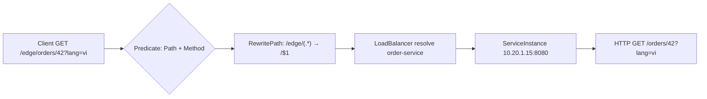
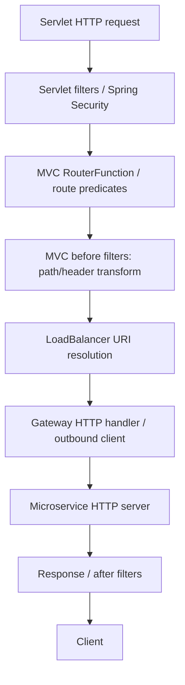

# LoadBalancer filter và thứ tự phối hợp với bộ lọc rewrite

Trong **Spring Cloud Gateway Server Web MVC**, một request thường trải qua ba thao tác khác nhau: **chọn route bằng predicate**, **biến đổi request path**, rồi **chọn instance backend bằng Spring Cloud LoadBalancer**. Nếu phối hợp không đúng thứ tự, Gateway có thể chọn đúng `order-service` nhưng gửi `/edge/orders/42` thay vì `/orders/42`, khiến backend trả `404` dù discovery, kết nối và health check đều bình thường.

Bài thuộc chương **Server Web MVC**, tập trung vào **LoadBalancer filter**, URI `lb://...`, các bộ lọc `RewritePath`/`StripPrefix`/`SetPath` và thứ tự tác động của chúng. Kiến thức được đặt trong bối cảnh Spring Cloud Gateway làm API Gateway cho microservices: route predicate, filter chain, sửa path/header, service discovery, xác thực, rate limiting, circuit breaker, retry, TLS và quan sát request.

> **Phạm vi:** Ví dụ hướng tới **Spring Cloud Gateway Server Web MVC**, chạy trên **Spring MVC/Servlet stack**. Gateway Server WebFlux dùng API và filter chain khác. Tên dependency/starter, prefix cấu hình, API `lb()` và quy tắc ordering nội bộ có thể thay đổi theo phiên bản Spring Cloud Gateway. Hãy xác minh bằng route runtime và integration test; không lấy thứ tự vài dòng YAML làm bằng chứng tuyệt đối rằng framework đã chạy filters đúng thứ tự.

## 1. Tại sao thứ tự filter quyết định URL cuối?

Giả sử frontend gọi:

```http
GET /edge/orders/42?lang=vi HTTP/1.1
Host: api.example.test
Authorization: Bearer <test-access-token>
```

Backend `order-service` chỉ có endpoint:

```http
GET /orders/42?lang=vi HTTP/1.1
```

Gateway cần xử lý:

1. Match request bằng `Path=/edge/orders/**` và `Method=GET`.
2. Bỏ tiền tố `/edge` để path thành `/orders/42`.
3. Dùng `lb://order-service` tìm một instance, ví dụ `10.20.1.15:8080`.
4. Tạo outbound URL `http://10.20.1.15:8080/orders/42?lang=vi`.
5. Proxy request, nhận response, gửi về client.



Nếu LoadBalancer hoặc outbound URL được dựng **trước khi đường dẫn rewrite có hiệu lực**, request cuối có nguy cơ vẫn dùng `/edge/orders/42` và upstream trả `404`. Đây là kiểu lỗi cần kiểm tra bằng HTTP test thật, không chỉ bằng cách đọc route declaration.

### Phân biệt ba khái niệm

| Bước | Câu hỏi | Dữ liệu quyết định |
| --- | --- | --- |
| **Route matching** | “Route nào nhận request?” | Path/Method/Host/Header/Query của incoming request |
| **Path rewriting** | “Upstream phải nhận path nào?” | `RewritePath`, `StripPrefix`, `SetPath`, `PrefixPath` |
| **Load balancing** | “Instance nào của service nhận request?” | `lb://service-id`, danh sách ServiceInstance, thuật toán chọn |
| **HTTP routing** | “Gửi request tới URL nào?” | Scheme, host/port instance, path đã biến đổi, query/headers |

**LoadBalancer không tự làm path rewriting** và `RewritePath` không tự tìm server instance. Hai chức năng giải quyết hai lớp hoàn toàn khác nhau.

## 2. Kiến trúc Server Web MVC trong Gateway

Server Web MVC sử dụng Spring MVC functional endpoint abstractions, thường gồm `RouterFunction`/`ServerRequest`, các **before filters** và HTTP handler của Gateway. Điều này khác Gateway WebFlux dùng reactive `ServerWebExchange`, `GatewayFilter`, `GlobalFilter` và cơ chế Netty tương ứng.



Sơ đồ phản ánh **thứ tự logic mong muốn**. Chi tiết class và special-order behavior có thể khác theo bản Gateway. Một số before filters có thể được áp từ route properties hoặc Java DSL, và LoadBalancer filter có thể được chèn tự động khi URI dùng `lb` scheme.

| Vấn đề | Server Web MVC | Server WebFlux |
| --- | --- | --- |
| Stack | Servlet, Spring MVC | Reactive WebFlux |
| Route API thường dùng | `RouterFunction`/Gateway MVC DSL | `RouteLocatorBuilder`/reactive DSL |
| Request context | MVC `ServerRequest`/Servlet request | `ServerWebExchange` |
| Security | `SecurityFilterChain` + `HttpSecurity` | `SecurityWebFilterChain` + `ServerHttpSecurity` |
| Path transforms | MVC before-filter functions/factories | WebFlux GatewayFilter factories |
| LoadBalancer integration | MVC routing/LoadBalancer filter | Reactive LoadBalancer filter |
| Test thông dụng | Servlet integration, `MockMvc` hoặc real HTTP client | `WebTestClient`/reactive tests |

**Không copy `ReactiveLoadBalancerClientFilter` hoặc `SecurityWebFilterChain` vào ứng dụng Server MVC**. Dù chức năng giống nhau, execution context và API type khác.

## 3. LoadBalancer filter xử lý cái gì?

`lb://order-service` là **URI logic**. `order-service` là service ID, không phải một IP hay hostname cụ thể.

Giả sử DiscoveryClient cung cấp:

```text
order-service:
  - http://10.20.1.15:8080
  - http://10.20.1.16:8080
  - http://10.20.1.17:8080
```

Khi request được phép đi tới upstream, LoadBalancer chọn một `ServiceInstance` rồi kết hợp các thuộc tính instance với request URI:

```text
Logical URI:
  lb://order-service

Rewritten request path:
  /orders/42

Query:
  lang=vi

Selected instance:
  10.20.1.16:8080

Effective target:
  http://10.20.1.16:8080/orders/42?lang=vi
```

**Chọn được instance không có nghĩa backend sẽ trả 200**: method, path, headers, authentication, quyền truy cập, TLS và nghiệp vụ đều có thể gây lỗi.

### LoadBalancer không thay những phần sau

- Không tạo quyền user hoặc quyết định user có thể xem đơn hàng.
- Không tự bỏ `/edge` khỏi path.
- Không bảo đảm attempt retry sẽ chọn một instance khác.
- Không đồng bộ HTTP session hoặc business state giữa instances.
- Không tự khôi phục backend đã bị remove khỏi discovery nhưng còn trong connection pool/cache.
- Không sửa SSL certificate/SNI/truststore sai.
- Không tự điều khiển CircuitBreaker để cô lập lỗi theo instance.

Những giới hạn này giúp tránh chẩn đoán nhầm `404` do rewrite thành lỗi của thuật toán cân bằng tải.

## 4. Đích cân bằng tải bằng `lb://`

Một route MVC declarative có thể dùng URI `lb://order-service`, kết hợp rewrite path.

```yaml
spring:
  cloud:
    gateway:
      mvc:
        routes:
          - id: mvc-orders
            uri: lb://order-service
            order: 10
            predicates:
              - Path=/edge/orders/**
              - Method=GET
            filters:
              - RewritePath=/edge/(.*), /$1
```

Cấu hình trên minh họa **prefix `spring.cloud.gateway.mvc.routes` ở một số dòng phiên bản Server MVC**. Trong những dòng mới, prefix có thể chuyển sang `spring.cloud.gateway.server.webmvc.routes`. Hãy kiểm tra starter/metadata cấu hình của phiên bản được pin thay vì viết đồng thời cả hai rồi mặc định chúng tương đương.

Ý nghĩa mong đợi:

- Route ID là `mvc-orders`.
- Incoming `GET /edge/orders/42` match predicate.
- Rewrite path thành `/orders/42`.
- Logical URI `lb://order-service` được resolve thành instance.
- Proxy HTTP tới instance đã chọn với path mới.

**Dependency cần có:** Gateway Server MVC và Spring Cloud LoadBalancer; ngoài ra cần một nguồn instances, ví dụ discovery server hoặc cấu hình instance supplier phù hợp. Một route `lb://` không thể tự sinh instance khi service ID không tồn tại.

### Không dùng host vật lý thay service ID mà không có mục đích

`uri: http://localhost:8081` gọi thẳng một địa chỉ cụ thể; nó thích hợp cho test cô lập rewrite. `uri: lb://order-service` dùng registry/instance supplier và thích hợp với discovery. Cả hai đều có thể dùng cùng path rewrite nhưng cơ chế chọn outbound host/port khác nhau.

## 5. LoadBalancer filter `lb()` tường minh và thứ tự

Tùy phiên bản, Gateway Server MVC có thể cung cấp `lb()` trong API/factory dành cho before-filter, bên cạnh hình thức nhận diện URI có scheme `lb`.

Mô tả logic cần đạt:

```text
Route: GET /edge/orders/**

Before filters theo thứ tự hiệu lực:
  1. rewritePath("/edge/(.*)", "/$1")
  2. lb("order-service")

Handler:
  proxy tới instance đã chọn với path /orders/**
```

Đây là **pseudocode**, không phải snippet Java chắc chắn compile cho mọi bản. Khi dùng `lb()`, cần đặt thao tác rewrite **trước bước chọn/dựng URL outbound**; chính ordering và việc chèn LoadBalancer filter tự động là điểm đặc biệt phải kiểm chứng theo phiên bản.

### Có nên khai báo cả `lb://` và `lb()`?

Thường nên chọn một **nguồn xác định service đích** rõ ràng. Không tùy tiện:

```text
Route URI: lb://order-service
Another filter: lb("inventory-service")
```

vì có hai nguồn thông tin mâu thuẫn về destination. Nếu framework thực sự yêu cầu phối hợp URI/filter cụ thể, hãy dùng đúng contract của phiên bản; không để code custom lặng lẽ ghi đè target service.

### “Đặt sau” là giai đoạn thực thi, không chỉ thứ tự dòng

Filter có thể:

- Được gọi theo phase `before`/`after`/handler.
- Được thêm tự động vì scheme `lb`.
- Có order hoặc precedence đặc biệt.
- Xuất hiện qua default filters hoặc custom routing extension.

Bởi vậy thứ tự dòng YAML hoặc vị trí một `.before(...)` **chưa đủ** để khẳng định URL outbound đã được rewrite. Cần integration test quan sát path mà upstream nhận.

## 6. Rewrite trước LoadBalancer resolution: quy tắc then chốt

Chuỗi đúng về mặt kết quả:

```text
T0 incoming:
  /edge/orders/42?lang=vi

T1 route matched:
  id=mvc-orders
  Path=/edge/orders/**
  Method=GET

T2 rewrite:
  /orders/42?lang=vi

T3 load balance:
  serviceId=order-service
  instance=10.20.1.15:8080

T4 outbound:
  GET http://10.20.1.15:8080/orders/42?lang=vi
```

Một lỗi ordering có thể khiến target URI đã tạo từ path cũ:

```text
Target dựng sớm:
  http://10.20.1.15:8080/edge/orders/42?lang=vi

Rewrite chạy muộn:
  path ở một request object đã đổi,
  nhưng target URL đã capture lại path cũ

Backend nhận /edge/orders/42 -> 404
```

Đây là **ví dụ failure mode** để kiểm thử, không phải kết luận bản Gateway nào cũng mắc lỗi nếu đổi thứ tự hai dòng. Kiểm chứng bằng chính HTTP request ở backend cho phiên bản đang dùng.

### Tại sao không nên “ép LB chạy trước cho nhanh”?

LoadBalancer cần được kết hợp vào URL cuối cùng. Resolve service quá sớm không đem lại lợi ích đáng kể so với nguy cơ dùng sai path/URI. Mục tiêu không phải tốc độ chọn instance, mà là **đúng route, đúng request target và đúng instance**.

### Quy tắc chẩn đoán

Nếu backend trả `404`, hãy hỏi:

- Nó có **nhận request** không?
- Nó nhận **path nào**?
- Nó được gọi ở **instance nào**?
- Route nào match?
- Rewrite được thực hiện trước hay sau khi outbound URL được dựng?

Nếu backend không nhận request mà Gateway trả `503`, nên điều tra discovery/circuit breaker/connect trước khi kết luận regex path sai.

## 7. So sánh các filter biến đổi đường dẫn

| Filter | Ý nghĩa | Ví dụ |
| --- | --- | --- |
| `StripPrefix` | Bỏ N phân đoạn path đầu tiên | `/edge/orders/42` → `/orders/42` khi N=1 |
| `RewritePath` | Dùng regex để sửa path | `/edge/(.*)` → `/$1` |
| `SetPath` | Thay path bằng template/giá trị theo cấu hình | Dùng khi cần path mới rõ ràng |
| `PrefixPath` | Thêm tiền tố vào path | `/orders/42` → `/v1/orders/42` |
| `RewriteLocationResponseHeader` | Biến đổi header `Location` của **response** | Không sửa request path trước LB |

Các filter không tương đương nhau. **`RewriteLocationResponseHeader` không thay `RewritePath`**; một cái can thiệp response redirect, cái kia ảnh hưởng request đích.

### A. `StripPrefix` cho tiền tố đơn giản

```yaml
filters:
  - StripPrefix=1
```

Với path:

```text
/edge/orders/42   -> /orders/42
/api/v2/orders/42 -> /v2/orders/42
```

`StripPrefix=1` bỏ **một segment**, không phải một ký tự. Nếu upstream kỳ vọng `/orders/**` nhưng cấu hình `StripPrefix=2` trên `/edge/orders/**`, backend sẽ nhận `/42` — lỗi rất dễ gặp.

### B. `RewritePath` cho quy tắc regex

```yaml
filters:
  - RewritePath=/edge/(.*), /$1
```

Regex capture group `(.*)` giữ phần sau `/edge/`, còn `$1` tham chiếu nội dung group thứ nhất trong replacement.

Một dạng ràng buộc rõ hơn:

```text
Regex:       ^/edge/(.*)$
Replacement: /$1

/edge/orders/42 -> /orders/42
/api/orders/42  -> không khớp regex
```

Một số cách viết named capture group cần escape biểu thức property placeholder khi dùng YAML. Ví dụ dùng `$1` tránh phụ thuộc cú pháp named placeholder; vẫn phải kiểm tra parser của **đúng Gateway MVC version**.

### C. Không rewrite hai lần ngoài ý muốn

```yaml
filters:
  - StripPrefix=1
  - RewritePath=/edge/(.*), /$1
```

Sau `StripPrefix=1`, path có thể đã là `/orders/42` và regex `/edge/(.*)` không còn match. Nếu đảo thứ tự, có thể một filter khác lại xóa thêm `/orders`. Chỉ kết hợp nhiều transform khi có hợp đồng cụ thể và test từng bước.

## 8. Route predicate xét path gốc hay path đã rewrite?

Giả sử:

```yaml
predicates:
  - Path=/edge/orders/**
  - Method=GET
filters:
  - RewritePath=/edge/(.*), /$1
```

Route matching thường chạy dựa trên **incoming path**:

```text
GET /edge/orders/42  -> match
GET /orders/42       -> không match route này
POST /edge/orders/42 -> không match Method=GET
```

Chỉ sau khi match, filter mới sửa path cho upstream. Nếu bạn đổi predicate thành `Path=/orders/**` vì nghĩ predicate kiểm tra đường dẫn sau rewrite, Gateway có thể **không bao giờ chạy rewrite** cho request public.

### Host predicate cũng xét incoming Host

`Host=api.example.test` kiểm tra host của client request ở giai đoạn route matching. Khi LB chọn instance `10.20.1.15`, outbound Host có thể là hostname backend hoặc được điều chỉnh theo `PreserveHostHeader`/proxy policy. **Đổi outbound Host không làm matcher tự chạy lại**.

Không dùng Host/headers tự khai từ client làm bằng chứng được quyền vào một tenant. Cần authentication/authorization riêng.

## 9. Java RouterFunction MVC: skeleton dễ hình dung

Một ứng dụng MVC có thể khai báo Gateway RouterFunctions:

```java
@Configuration
public class OrdersMvcGatewayRoutes {

    @Bean
    RouterFunction<ServerResponse> ordersRoute() {
        return route("mvc-orders")
            .GET("/edge/orders/**", http())
            .before(rewritePath("/edge/(.*)", "/$1"))
            .before(uri("lb://order-service"))
            .build();
    }
}
```

Đoạn mã nêu **ý định về thứ tự** theo API Gateway RouterFunctions/BeforeFilterFunctions quen thuộc: chọn route GET, rewrite request path rồi định tuyến tới logical service.

**Để compile:** cần static imports/overloads đúng version từ Gateway Server MVC, `RouterFunction`/`ServerResponse` của Spring MVC và Spring context. Trong một số version, cấu hình `uri` hoặc `lb()` được thể hiện theo API khác; không tự suy rằng skeleton này hoạt động nguyên xi ở mọi starter.

Khi dùng filter `lb()` tường minh, chuỗi dự định có dạng:

```java
// PSEUDOCODE về thứ tự; kiểm tra API lb() trong bản Gateway MVC.
.before(rewritePath("/edge/(.*)", "/$1"))
.before(lb("order-service"))
```

Tuyệt đối không trộn vào MVC một đoạn Java WebFlux:

```java
// Đây là kiểu builder của Gateway WebFlux, không phải MVC DSL.
builder.routes()
    .route("orders", r -> r.path("/edge/orders/**")
        .filters(f -> f.rewritePath("/edge/(.*)", "/$1"))
        .uri("lb://order-service"))
    .build();
```

Hai loại filter đều có chức năng rewrite, nhưng lifecycle, request abstraction và ordering không đồng nhất.

## 10. URL cuối được dựng từ những thành phần nào?

Tại bước proxy outbound, Gateway cần một tổ hợp:

```text
Request method   = GET
Target scheme    = http (hoặc https theo instance/policy)
Target authority = 10.20.1.15:8080
Transformed path = /orders/42
Query            = lang=vi

Effective URL:
  http://10.20.1.15:8080/orders/42?lang=vi
```

Có nhiều nguồn lỗi:

| Thành phần | Ví dụ lỗi | Biểu hiện |
| --- | --- | --- |
| Method | POST thay GET | `405` hoặc logic sai |
| Scheme | HTTP vào backend chỉ hỗ trợ HTTPS | Lỗi kết nối/TLS |
| Host/port | ServiceInstance stale | Connect refused/timeout |
| Rewritten path | `/edge/orders/42` | Upstream `404` |
| Query | Bỏ `?include=items` | Sai dữ liệu trả về |
| Encoding | Decode `%2F` ngoài ý muốn | Sai resource/path traversal |
| Headers | Mất Authorization hoặc sai Host | `401/403`, virtual host mismatch |
| Route order | Catch-all route được ưu tiên | Gọi nhầm service |

### Query cần được bảo toàn khi chỉ rewrite path

Nếu frontend gửi:

```text
/edge/orders/42?include=items&lang=vi
```

thì backend thường phải nhận:

```text
/orders/42?include=items&lang=vi
```

Khi viết custom filter hoặc URI builder, phải phân biệt raw path/decoded path, query string và percent encoding. Không tự nối URI bằng string thiếu kiểm soát rồi làm mất `?` hoặc nhân đôi dấu `/`.

### Regex không được biến path thành authority

Không cho client truyền host/scheme mới qua query hay header để filter rewrite thành bất kỳ URL nào. Gateway phải có allowlist service ID/host và chính sách chống SSRF. `RewritePath` nên chỉ điều chỉnh phần path theo hợp đồng định tuyến.

## 11. ServiceInstance, HTTPS và Host

Một instance có thể được mô tả:

```text
serviceId = order-service
host      = orders.internal.example
port      = 8443
secure    = true
```

Outbound URI cần phù hợp với thông tin TLS, ví dụ:

```text
https://orders.internal.example:8443/orders/42
```

**`lb://` không phải cam kết toàn bộ hop nội bộ dùng HTTPS.** Scheme outbound phụ thuộc ServiceInstance và Gateway integration/version/policy. Cần xác minh khi backend có mTLS hoặc bắt buộc HTTPS.

| Lỗi | Lớp nguyên nhân | Không nên sửa bằng |
| --- | --- | --- |
| Certificate SAN không khớp host | TLS hostname verification | Tắt hostname checks |
| Truststore thiếu CA | TLS client trust | Thay RewritePath |
| SNI sai khi connect IP | TLS host/SNI resolution | Tăng Retry |
| Instance HTTP/HTTPS mismatch | Service metadata/scheme | Đổi Path predicate |
| Backend trả 404 | Request target/path | Đổi thuật toán LoadBalancer |
| Không có instance | Discovery/LoadBalancer | Chỉnh `StripPrefix` |

**LoadBalancer chọn một host hợp lệ chưa chứng minh TLS thành công**, và TLS thành công chưa chứng minh backend có endpoint path đúng.

## 12. Discovery cache và route cache có vòng đời riêng

`order-service` có thể tăng từ hai lên bốn instances:

```text
T0: [A, B]
T1: backend scale-out -> [A, B, C, D]
T2: discovery/cache của LoadBalancer hội tụ
```

Route definition `lb://order-service` không nhất thiết thay đổi. Ngược lại, thay `RewritePath` và refresh route **không tự cập nhật** cache instance/DNS.

Một số tầng riêng biệt:

- **Route definition/runtime cache**: danh sách route và filters đang active.
- **Discovery/LoadBalancer instance cache**: danh sách backend endpoints.
- **DNS resolver**: tên host → IP.
- **HTTP client connection pool**: kết nối TCP/TLS còn dùng lại được.
- **Response cache**: response payload đã lưu.

Không đổ lỗi cho `RewritePath` khi instance vừa bị scale-in nhưng request cũ đi tới một IP không còn phục vụ; kiểm tra selected instance và discovery freshness.

### Retry không bảo đảm instance mới

Attempt thứ hai có thể chọn A, B hoặc vẫn là A tùy LoadBalancer/Retry integration. Một request được retry sau `503` phải **giữ cùng path đã rewrite** theo hợp đồng; nếu attempts có path khác nhau, cần tìm state mutation/filter re-execution bug.

## 13. CircuitBreaker, Retry và filter order

Các filter này có thể tương tác:

```text
Client request
  -> MVC route match
  -> RewritePath
  -> LoadBalancer / outbound attempt
  -> backend status/exception
  -> Retry hoặc CircuitBreaker policy
  -> response/fallback
```

Sơ đồ chỉ là **mô hình chức năng**, không khẳng định thứ tự wrapper/filter cụ thể của một phiên bản.

### Retry

- `retries: 2` thường nghĩa tối đa hai retries sau attempt đầu (nếu request đủ điều kiện).
- Với GET tạm lỗi, retry có thể hữu ích nhưng không sửa được path sai.
- Với POST/PATCH có side effect, cần idempotency key và bảo đảm body replay.
- Nếu Retry bao bọc LB ở vị trí khác, một attempt có thể chọn lại instance hoặc tái sử dụng state; phải kiểm thử.
- Backoff và deadline tổng cần được giới hạn để tránh retry storm.

### CircuitBreaker

- Breaker OPEN có thể từ chối lời gọi trước khi HTTP request tới backend.
- Fallback có thể trả HTTP `503` hoặc một response khác.
- Một breaker cho toàn route có thể ảnh hưởng cả instances còn khỏe.
- Một response `404` do rewrite sai không nhất thiết được policy breaker tính như failure.
- Không dùng breaker để “sửa” lỗi mapping tĩnh; sửa path/route mới là giải pháp.

### RateLimiter

Một request bị rate limiter từ chối `429` có thể không tới LoadBalancer. Không coi HTTP `429` của Gateway là một lần backend lỗi hoặc lý do retry ngay lập tức. Rate key nên dựa vào identity đã xác minh thay vì header `X-User-Id` do client gửi.

## 14. Spring Security trên Server MVC: kiểm tra incoming path

Ở Servlet stack, Security có thể được cấu hình:

```java
@Configuration
public class GatewaySecurityConfiguration {

    @Bean
    SecurityFilterChain security(HttpSecurity http) throws Exception {
        http
            .authorizeHttpRequests(auth -> auth
                .requestMatchers(HttpMethod.GET, "/edge/orders/**")
                    .hasAuthority("SCOPE_orders.read")
                .anyRequest().authenticated())
            .oauth2ResourceServer(oauth2 ->
                oauth2.jwt(Customizer.withDefaults()));
        return http.build();
    }
}
```

Đây là **ví dụ cho MVC**; cần imports, dependency, JWT issuer/audience/scope validation và chính sách chi tiết cho routes còn lại. `anyRequest().authenticated()` không phải authorization policy production đầy đủ cho mọi API.

**Lưu ý:** Security filter thường kiểm tra **incoming path** `/edge/orders/**`. Nếu bạn chỉ bảo vệ `/orders/**` vì nghĩ đó là path sau rewrite, có thể để lộ route public. Backend vẫn cần xác thực/authorization theo resource/audience, không dựa duy nhất vào Gateway.

### Token và Host

- `Authorization` có thể bị loại/thay bởi filter tùy cấu hình; kiểm thử backend thực nhận gì.
- Nếu route đích `lb://order-service` đổi sang service khác, không mặc định token có audience hợp lệ ở service mới.
- `PreserveHostHeader` hoặc forwarded host ảnh hưởng outbound Host, không biến Host header thành bằng chứng quyền.
- Chỉ tin `Forwarded`/`X-Forwarded-*` từ ingress/proxy đáng tin, không tin giá trị client tự khai.

## 15. Cấu hình lab: trước tiên test rewrite với địa chỉ cố định

Để cô lập lỗi path, tạm thời dùng upstream cố định là WireMock/HTTP test server tại `http://localhost:8081`:

```yaml
spring:
  cloud:
    gateway:
      mvc:
        routes:
          - id: orders-fixed-test
            uri: http://localhost:8081
            predicates:
              - Path=/edge/orders/**
              - Method=GET
            filters:
              - RewritePath=/edge/(.*), /$1
```

Khi gửi:

```bash
curl -i "http://localhost:8080/edge/orders/42?lang=vi"
```

Upstream mock phải nhận:

```text
GET /orders/42?lang=vi
```

Test này trả lời câu hỏi “rewrite có đúng không?” mà không bị nhiễu bởi instance selection.

### Sau đó bật LoadBalancer

Đổi URI logical target:

```yaml
uri: lb://order-service
```

Và cung cấp ít nhất một `ServiceInstance` test trỏ tới WireMock. Test lại **cùng path**:

- Route matched.
- Instance được chọn có host/port đúng.
- Backend nhận `/orders/42?lang=vi`.
- Không bị rewrite hai lần.
- Không có unexpected request tới service khác.

**Không nên chỉ kiểm tra client HTTP 200.** Backend có thể trả 200 từ fallback/cache hoặc một route khác; phải kiểm tra request journal của upstream.

## 16. Integration test MVC với real HTTP upstream

Một mảnh test sử dụng `RestClient` và WireMock:

```java
@Test
void rewriteBeforeLoadBalancerUsesCorrectBackendPath() {
    // Fixture:
    // Gateway MVC chạy tại localhost:8080.
    // LoadBalancer test instance cho order-service trỏ tới WireMock.
    // Nếu dùng Security, request có credential test hợp lệ.

    wireMockServer.stubFor(
        get(urlPathEqualTo("/orders/42"))
            .willReturn(aResponse()
                .withStatus(200)
                .withHeader("Content-Type", "application/json")
                .withBody("{\"id\":\"42\"}")));

    RestClient client = RestClient.create();

    String body = client.get()
        .uri("http://localhost:8080/edge/orders/42?lang=vi")
        .retrieve()
        .body(String.class);

    assertThat(body).contains("\"id\":\"42\"");

    wireMockServer.verify(1,
        getRequestedFor(urlPathEqualTo("/orders/42"))
            .withQueryParam("lang", equalTo("vi")));
}
```

Đoạn mã **minh họa**: cần JUnit, AssertJ, WireMock, RestClient version phù hợp, HTTP server thực và test fixture cho LoadBalancer/Security. Test `MockMvc` có thể kiểm tra route/predicate ở Servlet level, nhưng để chứng minh HTTP outbound đúng host/path, **integration test qua HTTP thật và upstream stub** thường trực quan hơn.

### Các negative tests không thể bỏ

- Không match path.
- HTTP method không được route cho phép.
- `StripPrefix=2` làm backend nhận sai path.
- Backend 404 dù Gateway route match.
- No service instance (Gateway lỗi trước upstream).
- Certificate không hợp lệ.
- Retry sau 503 vẫn dùng đúng path ở mọi attempt.
- Gateway replica có config khác.

## 17. Ma trận kiểm thử thứ tự filter và instance selection

| Test | Đầu vào/điều kiện | Kỳ vọng |
| --- | --- | --- |
| T1 | GET `/edge/orders/42` | Upstream nhận `/orders/42` |
| T2 | GET `/edge/orders/42?lang=vi` | Query được giữ theo contract |
| T3 | GET `/orders/42` | Không match route gốc |
| T4 | POST `/edge/orders/42` | Không match GET-only route |
| T5 | `StripPrefix=1` | Bỏ một segment đúng |
| T6 | `StripPrefix=2` | Test phát hiện path `/42` sai |
| T7 | `RewritePath` regex không match | Không tự cho rằng path đã đổi |
| T8 | Rewrite + StripPrefix trùng lặp | Test phát hiện rewrite kép |
| T9 | LoadBalancer có 1 instance | Đúng host/port/path |
| T10 | LoadBalancer có 2 instances | Path đúng bất kể instance được chọn |
| T11 | Không có instance | Phân biệt lỗi discovery với upstream 404 |
| T12 | Instance HTTPS | TLS scheme/SNI/SAN/trust đúng |
| T13 | Backend TLS certificate sai | Reject, không tắt verification |
| T14 | Route order chồng lấn | Route đúng được ưu tiên |
| T15 | Host predicate không match | Không proxy backend |
| T16 | Servlet Security 401 | Upstream nhận 0 request |
| T17 | User thiếu `orders.read` | 403 theo policy |
| T18 | Retry 503 một lần | Mọi attempt giữ path rewrite đúng |
| T19 | CircuitBreaker OPEN | Không tạo upstream call mới nếu bị chặn |
| T20 | RateLimiter 429 | Không xem là lỗi upstream |
| T21 | Route có custom filter sửa URI | Không ghi đè LB target trái ý |
| T22 | Có hai Gateway replicas | Cùng route/filter behavior |
| T23 | Path có percent-encoding | Không decode sai hoặc path traversal |
| T24 | Route URI chứa prefix path | Không nhân đôi prefix |
| T25 | Response backend 307/308 | `Location` phù hợp public contract |
| T26 | Gateway MVC upgrade version | Config namespace và order còn hiệu lực |
| T27 | User tự gửi `X-Forwarded-Host` | Không vượt trust boundary |
| T28 | Runtime route match nhưng body do fallback | Không coi client 200 là bằng chứng upstream success |

Một test tốt kiểm tra cả **positive case** lẫn **failure case**. Đặc biệt, phải assert **method, path, query và upstream request count** để chứng minh chất lượng proxy; status cuối ở client không đủ.

## 18. Quan sát đúng những điểm nào trong production?

| Tín hiệu | Ví dụ | Ý nghĩa |
| --- | --- | --- |
| Gateway replica | `gateway-a` | Xác định process phục vụ |
| Route ID | `mvc-orders` | Biết route đã match |
| Incoming method/path | `GET /edge/orders/42` | Input của predicate |
| Effective rewritten path | `/orders/42` | Kiểm tra transform |
| Logical URI | `lb://order-service` | Target service ID |
| Selected instance | `10.20.1.15:8080` | Kết quả LB |
| Outbound HTTP URI | `http://10.20.1.15:8080/orders/42` | Bằng chứng rewrite + LB |
| Backend status | `200`/`404`/`503` | Kết quả upstream |
| Gateway status | `200`/`404`/`503` | Kết quả cuối client nhìn thấy |
| Retry attempts | `1`, `2`... | Phân biệt nhiều calls |
| Breaker state | CLOSED/OPEN/HALF_OPEN | Có lời gọi bị chặn trước LB không |
| Discovery age/health | Số instance/độ trễ hội tụ | Phân biệt stale instance |

Không phải tất cả trường trên đều được Spring Cloud Gateway MVC tự động xuất dưới cùng một metric. `Micrometer`/Actuator, tracing, LoadBalancer logging và test instrumentation cung cấp những góc nhìn khác nhau. **Không đưa raw token, cookie, PII hoặc query nhạy cảm vào labels**.

### Chỉ một Gateway replica lỗi

Nếu `gateway-a` proxy đúng, `gateway-b` luôn 404, hãy so sánh:

- Starter và Spring Cloud Gateway version.
- Route ID, predicate, order và effective path transforms.
- Default filters/custom before-filters.
- Destination URI.
- Deployment revision và dynamic route refresh.
- Discovery/LoadBalancer instance source.
- Selected backend version: có thể một instance chưa hỗ trợ path mới.

Đừng khởi động lại toàn bộ backend trước khi có bằng chứng.

## 19. Runbook khi LoadBalancer chọn đúng service nhưng request vẫn lỗi

1. **Xác định route stack:** Đang dùng Server Web MVC hay WebFlux? Starter/config prefix đúng chưa?
2. **Kiểm tra incoming request:** Method, Host, path, query nào được gửi vào?
3. **Kiểm tra route match:** Predicate Path/Method/Host có match đường dẫn **gốc** không?
4. **Kiểm tra Security:** 401/403 có xảy ra trước route không?
5. **Kiểm tra path filters:** RewritePath/StripPrefix/SetPath có trùng hoặc sai số segments không?
6. **Kiểm tra thứ tự hiệu lực:** Rewrite đã có tác dụng trước khi LB/outbound URL được tạo chưa?
7. **Kiểm tra logical URI:** `lb://order-service` có đúng service ID không? Có cấu hình `lb()` mâu thuẫn không?
8. **Kiểm tra selected ServiceInstance:** Có host, port, scheme, secure metadata đúng không?
9. **Kiểm tra backend access log:** Upstream thực nhận method/path/query nào?
10. **Nếu backend không nhận request:** Điều tra no-instance, circuit breaker, timeout, TLS/connect và rate limiting.
11. **Nếu backend trả 404:** Điều tra path, backend version, route order, not-found business contract.
12. **Nếu Retry xảy ra:** Đếm attempts, kiểm tra path/instance từng lần; tránh retry POST thiếu idempotency.
13. **Nếu chỉ lỗi một replica:** So sánh route config/refresh/version/filters.
14. **Sau sửa:** Chạy test URI cố định rồi `lb://`, xác nhận đúng URL outbound và response.

### Bảng chẩn đoán nhanh

| Triệu chứng | Khả năng cao | Cách xác minh |
| --- | --- | --- |
| Backend thấy `/edge/orders/42` | Rewrite chưa chạy hoặc quá muộn | Upstream request journal |
| Backend thấy `/42` | StripPrefix quá lớn/rewrite kép | So sánh chain transforms |
| Backend không nhận request, Gateway 503 | No-instance, breaker/transport | LB metrics, trace |
| Backend nhận đúng path nhưng 404 | Backend version/resource không tồn tại | API contract, backend logs |
| 401/403 trước proxy | Servlet Security | Authn/authz logs |
| HTTPS handshake lỗi | Scheme/SNI/trust/cert | TLS client diagnostics |
| Chỉ lỗi ở instance C | Backend rollout lệch path contract | Correlate chosen instance |
| Chỉ lỗi ở gateway-b | Filter order/config drift | Per-replica route/runtime |
| Retry nhiều lần vẫn 404 | Lỗi cấu hình path không tạm thời | Không tăng retries |
| Redirect có `Location` sai | Response Location rewrite | Không dùng request rewrite để sửa response |
| Query bị mất | Custom URI builder lỗi | So sánh raw path/query |

## 20. Bài tập ứng dụng: triển khai hai phiên bản orders

Một Gateway MVC phía trước hai dịch vụ:

- `GET /edge/orders/**` → `order-service` nhận `/orders/**`.
- `GET /edge/v2/orders/**` → `order-service-v2` nhận `/v2/orders/**`.
- `order-service` chạy hai instances HTTP.
- `order-service-v2` chạy hai instances HTTPS.
- Gateway xác thực Bearer JWT; GET cần scope `orders.read`.
- Một route catch-all `Path=/edge/**` cũng tồn tại.

### Phần A — Route v1

```yaml
- id: mvc-orders-v1
  uri: lb://order-service
  order: 20
  predicates:
    - Path=/edge/orders/**
    - Method=GET
  filters:
    - RewritePath=/edge/(.*), /$1
```

Xác nhận `/edge/orders/42` thành `/orders/42`.

### Phần B — Route v2

Thiết kế một route `mvc-orders-v2` để `/edge/v2/orders/42` thành `/v2/orders/42` và target `lb://order-service-v2`. Không dùng `StripPrefix=2` nếu backend vẫn cần phân đoạn `v2`.

### Phần C — Route order

Nếu route catch-all `Path=/edge/**` có `order=0`, còn v1/v2 có `order=20`, nó có thể chiếm traffic. Tạo test chứng minh route ID nào match và sửa order theo hợp đồng.

### Phần D — TLS/Security

Dùng `SecurityFilterChain` bảo vệ **incoming** `/edge/**`. Với backend v2, xác minh ServiceInstance secure metadata, TLS certificate SAN, SNI và truststore. Không cho token `aud=orders-v1` được relay tùy tiện sang v2 nếu backend v2 không chấp nhận audience đó.

### Phần E — Kiểm thử

1. GET v1 chọn instance v1, outbound path `/orders/42`.
2. GET v2 chọn instance v2, outbound path `/v2/orders/42`.
3. POST không match routes GET-only.
4. Request thiếu token không đến backend.
5. No-instance v2 được phân loại là lỗi LB, không phải path rewriting.
6. Backend path sai thì trả lỗi theo contract; tăng Retry không khắc phục.
7. Retry GET phải giữ đường dẫn rewrite giống nhau ở mọi attempt.
8. Hai Gateway replicas phải có cùng route/filter policy.
9. Case ký tự percent-encoded và query được truyền đúng.

### Câu hỏi tự kiểm tra

1. Route matching, path rewrite và LoadBalancer giải quyết ba câu hỏi gì khác nhau?
2. Vì sao rewrite phải có hiệu lực trước khi dựng outbound URL?
3. `lb://order-service` có phải là IP của backend không?
4. Có khác biệt gì giữa route URI có `lb` và `lb()` explicit filter?
5. Tại sao không nên khai báo hai service IDs mâu thuẫn trên cùng route?
6. `StripPrefix=1` làm gì với `/edge/orders/42`?
7. `StripPrefix=2` có thể gây ra path sai nào?
8. `RewritePath` khác `RewriteLocationResponseHeader` ra sao?
9. Predicate `Path` xét incoming hay post-rewrite path?
10. Vì sao nhìn thứ tự YAML chưa đủ chứng minh thứ tự runtime của `lb()`?
11. MVC dùng `SecurityFilterChain` hay `SecurityWebFilterChain`?
12. Một `401` tại Gateway có chứng minh LoadBalancer lỗi không?
13. Gateway có route `lb://` nhưng không có instance thì backend có nhận request không?
14. Vì sao backend 404 không nhất thiết là route predicate không match?
15. Retry có chắc chọn instance khác và sửa 404 không?
16. Route refresh có tự làm mới discovery/DNS cache không?
17. Query `?lang=vi` phải được xử lý ra sao khi rewrite chỉ thay path?
18. Dùng HTTPS backend cần kiểm tra gì ngoài path?
19. Vì sao test chỉ assert client HTTP 200 chưa đủ?
20. Những tín hiệu nào phân biệt path mismatch, LB no-instance, TLS failure và route order?
21. Vì sao two Gateway replicas có thể cho kết quả khác nhau dù chung service ID?
22. Trường hợp nào cần sửa response `Location` thay vì request `RewritePath`?

**Ghi nhớ:** **Route predicate** chọn tuyến, **RewritePath/StripPrefix/SetPath** quyết định đường dẫn backend cần nhận, còn **LoadBalancer** chọn service instance. Trong Spring Cloud Gateway **Server Web MVC**, điều quan trọng là bảo đảm **path rewrite đã có hiệu lực trước bước LoadBalancer/outbound URL resolution**, bất kể framework dùng route URI `lb://` hay `lb()` filter. Hãy kiểm chứng **incoming path → rewritten path → service ID → selected instance → effective outbound URI** bằng integration test, thay vì suy luận từ cấu hình hoặc chỉ nhìn HTTP status cuối.

