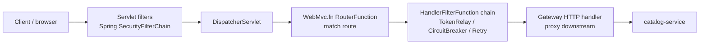
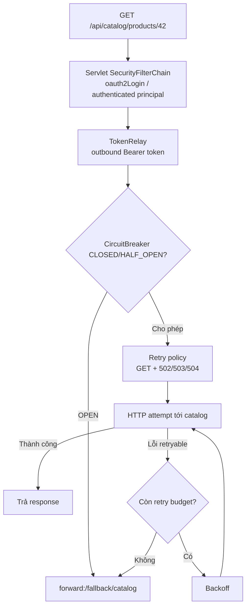
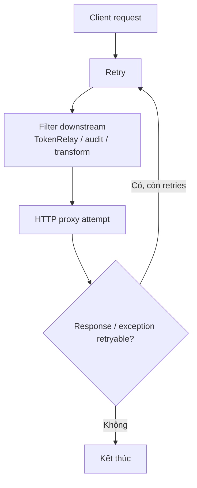
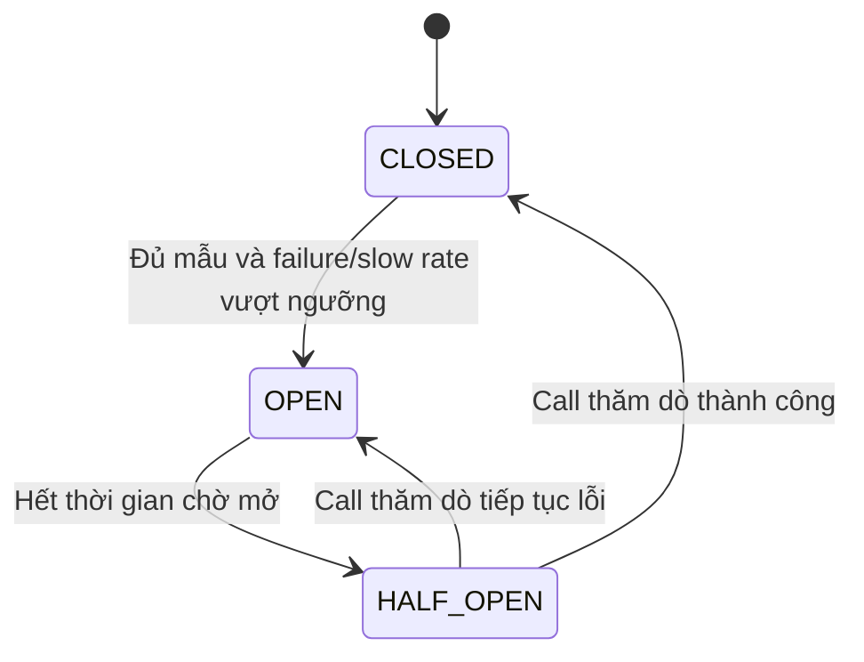
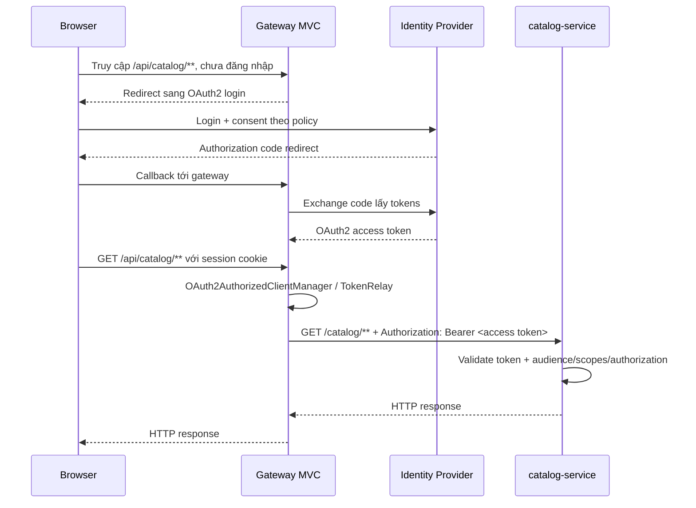
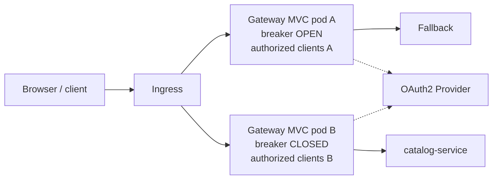

# Retry, CircuitBreaker và TokenRelay trên Web MVC

Một **API Gateway** thường xử lý đồng thời ba câu hỏi: nếu backend lỗi thoáng qua thì có nên **thử lại** không, nếu backend lỗi kéo dài thì khi nào nên **ngắt mạch**, và khi request đã được xác thực thì làm sao **chuyển tiếp access token** đúng cách. Trong **Spring Cloud Gateway Server Web MVC**, ba nhu cầu này lần lượt được hỗ trợ bởi các filter **`Retry`**, **`CircuitBreaker`** và **`TokenRelay`**.

Ví dụ, nhân viên đăng nhập ứng dụng quản trị qua OAuth2/OIDC rồi gọi `GET /api/catalog/products/42`. Gateway có thể lấy access token từ OAuth2 authorized client, đặt vào outbound request tới `catalog-service`, thử lại một lỗi `503` có điều kiện, và trả một fallback `503` rõ ràng nếu dịch vụ chưa thể phục hồi. Nhưng nếu ba filter được ghép sai hoặc copy cấu hình của **Gateway Server WebFlux**, hệ thống có thể retry một lệnh ghi nhiều lần, chuyển tiếp sai token, tạo vòng lặp fallback hoặc nhầm lẫn giữa timeout và circuit breaker.

Bài thuộc chương **Server Web MVC** trong module **SPRING_CLOUD_GATEWAY**. Những kiến thức về route predicate, chuỗi filter, rewrite path/header, service discovery, xác thực, rate limiting, circuit breaker, retry, TLS và quan sát request vẫn quan trọng, nhưng **API thực thi trên Servlet/WebMvc.fn khác WebFlux/Reactor Netty**.

**Mục tiêu bài học:**

1. Hiểu pipeline của Gateway Server Web MVC và phân biệt `HandlerFilterFunction` với `GatewayFilter` reactive.
2. Cấu hình `Retry` cho HTTP GET an toàn; hiểu `retries`, `methods`, `statuses`/`series`, `exceptions`, `backoff` và `cacheBody`.
3. Phân biệt Spring Retry với Spring Framework 7 retry trong Gateway MVC 5.1, kể cả công tắc chọn implementation.
4. Dùng `CircuitBreaker` với Resilience4j, `statusCodes`, `fallbackUri=forward:` và trạng thái CLOSED/OPEN/HALF_OPEN.
5. Dùng `TokenRelay` với `oauth2Login()` hoặc `clientRegistrationId`, hiểu access token thuộc user hay client và ranh giới tin cậy.
6. Thiết kế thứ tự filter, deadline và retry budget để không khuếch đại lỗi hoặc lộ credential.
7. Viết cấu hình YAML/Java DSL, dựng fallback Servlet, thực hành kiểm thử HTTP, OAuth2 và giám sát nhiều Gateway replicas.

> **Phiên bản:** Ví dụ chính dựa trên **Spring Cloud Gateway Server Web MVC 5.1.x** và Spring Framework 7, dùng namespace `spring.cloud.gateway.server.webmvc.routes`. Ở một số nhánh 4.x, namespace cũ là `spring.cloud.gateway.mvc.routes` và cơ chế Retry có khác biệt; **đối chiếu release train đang chạy trước khi sao chép**. Bài không sử dụng `RouteLocatorBuilder`, `ServerWebExchange`, `Mono<Void>`, `GlobalFilter` hoặc các property `server.webflux.httpclient` của Gateway WebFlux.

## 1. Bắt đầu từ đúng sản phẩm: Server Web MVC, không phải WebFlux

**Gateway Server Web MVC** chạy trên **Spring MVC Servlet stack** và **Spring WebMvc.fn**. Thông thường ứng dụng dùng Servlet container như Tomcat hoặc Jetty, một `DispatcherServlet` và các `RouterFunction<ServerResponse>` để định tuyến/proxy.



So sánh:

| Khía cạnh | Gateway **Server Web MVC** | Gateway **Server WebFlux** |
| --- | --- | --- |
| Web stack | Servlet, Spring MVC, WebMvc.fn | Spring WebFlux, Reactor |
| HTTP handler | `HandlerFunctions.http()` | Routing/filtering qua WebFlux Gateway |
| Route Java DSL | `RouterFunction<ServerResponse>`, `GatewayRouterFunctions.route(...)` | `RouteLocator`, `RouteLocatorBuilder` |
| Filter tùy biến | `HandlerFilterFunction`, before/after functions | `GatewayFilter`, `GlobalFilter` |
| Security | `SecurityFilterChain`, `HttpSecurity` | `SecurityWebFilterChain`, `ServerHttpSecurity` |
| OAuth2 authorized client | Servlet OAuth2 client types | Reactive OAuth2 client types |
| Retry trong Gateway 5.1 | Spring Retry hoặc Spring Framework 7 retry | Reactor-based Gateway Retry |
| Circuit breaker integration | Servlet/filter function, Spring Cloud CircuitBreaker | Reactive filter, Reactor-based SCCB |
| Request body retry | `cacheBody` + `AdaptCachedBody` trong MVC | Reactive request body cache/`DataBuffer` |
| HTTP client config | Theo HTTP client của MVC Gateway | Reactor Netty `httpclient` properties |

**Hệ quả:** Không dán nguyên `spring.cloud.gateway.server.webflux.routes` vào MVC và chờ routing hoạt động. Cũng không thay một `HandlerFilterFunction` bằng `GlobalFilter` chỉ vì cả hai gọi là “Gateway filter”.

### Starter và release train

Dự án MVC sử dụng starter:

```xml
<dependency>
  <groupId>org.springframework.cloud</groupId>
  <artifactId>spring-cloud-starter-gateway-server-webmvc</artifactId>
</dependency>
```

Chọn phiên bản Spring Boot/Spring Cloud theo **BOM/release train tương thích**, không tự thêm version rời rạc cho từng starter. Đừng cài cả WebFlux và MVC Gateway starters một cách vô thức: chúng là **hai mô hình proxy khác nhau**, có thể dẫn đến auto-configuration hoặc property binding không như dự kiến.

## 2. Route WebMvc.fn được xây thế nào?

Spring Cloud Gateway MVC cung cấp `GatewayRouterFunctions.route("routeId")`, đặt route ID vào request metadata cần cho những filter nâng cao. Đích HTTP có thể được khai báo qua `BeforeFilterFunctions.uri(...)` và xử lý bằng `HandlerFunctions.http()`.

```java
import org.springframework.context.annotation.Bean;
import org.springframework.context.annotation.Configuration;
import org.springframework.web.servlet.function.RouterFunction;
import org.springframework.web.servlet.function.ServerResponse;

import static org.springframework.cloud.gateway.server.mvc.filter.BeforeFilterFunctions.uri;
import static org.springframework.cloud.gateway.server.mvc.handler.GatewayRouterFunctions.route;
import static org.springframework.cloud.gateway.server.mvc.handler.HandlerFunctions.http;

@Configuration(proxyBeanMethods = false)
class SimpleMvcGatewayRoutes {

    @Bean
    RouterFunction<ServerResponse> catalogRoute() {
        return route("catalog-read")
            .GET("/api/catalog/products/{id}", http())
            .before(uri("http://localhost:8081"))
            .build();
    }
}
```

Khi được proxy, `HandlerFunctions.http()` lấy URI được thiết lập bởi `uri()` trong request attributes. Tài liệu MVC khuyên dùng `http()` kết hợp `before(uri(...))`; các overload `http(String)`/`http(URI)` đã được đánh dấu deprecated ở những phiên bản trước.

**Phân biệt hai ý:** Path predicate quyết định request công khai có match route hay không; URI là đích upstream. Nếu backend mong `/catalog/products/42` nhưng client dùng `/api/catalog/products/42`, cần thêm `StripPrefix` hoặc một path-rewrite filter phù hợp — bản thân `Retry`/`TokenRelay` không tự sửa path.

### Before, after và advanced filters

- **Before filter functions** thường biến đổi `ServerRequest` trước khi proxy.
- **After filter functions** điều chỉnh `ServerResponse` sau khi handler trả kết quả.
- **Advanced filter functions** như `Retry`, `CircuitBreaker`, `TokenRelay` có thể bọc handler và xử lý cả trước/sau.

```text
Servlet security
  → WebMvc.fn route match
    → before/advanced filter chain
      → outbound HTTP handler
    ← response/exception
  ← Servlet response
```

Các filter được ghép theo `RouterFunctions.Builder` và factory của Gateway; cần **kiểm tra thứ tự thực tế bằng integration test**. Đừng tự áp dụng quy tắc numeric `Ordered` của GlobalFilter WebFlux cho WebMvc.fn mà không có căn cứ.

## 3. Ba filter giải quyết ba việc khác nhau

| Filter | Quyết định | Không tự làm |
| --- | --- | --- |
| **`Retry`** | Có gửi thêm attempt sau response status/exception phù hợp? | Không bảo đảm an toàn cho POST, không thay timeout |
| **`CircuitBreaker`** | Có cho call mới đi upstream khi lỗi/slow vượt ngưỡng? | Không xác thực user, không giới hạn trực tiếp in-flight |
| **`TokenRelay`** | Access token OAuth2 nào được gắn vào outbound request? | Không biến token thành hợp lệ ở backend, không làm retry |
| **SecurityFilterChain** | Ai đã xác thực, có quyền truy cập public route không? | Không thay backend authorization |
| **HTTP timeout** | Một attempt được chờ tới khi nào? | Không tự quyết định số retries hoặc breaker OPEN |
| **RateLimiter** | Client/tenant có vượt hạn mức không? | Không chữa upstream failure hoặc refresh token |
| **Fallback** | Trả gì khi proxy call không thành công? | Không chứng minh upstream đã rollback side effect |

Sơ đồ ý tưởng cho một GET đã xác thực:



Đây là **một thiết kế mong muốn**, không phải sơ đồ khẳng định framework luôn bao filter đúng thứ tự như tên trên hình. Điều kiện quyết định là route configuration, thứ tự filter thực tế, trạng thái response đã commit và implementation của version.

## 4. Retry trên Gateway Server Web MVC

`Retry` có thể thử lại request khi HTTP response hoặc exception thuộc policy. Tài liệu Gateway MVC 5.1 liệt kê:

| Tham số | Ý nghĩa |
| --- | --- |
| `retries` | Số lần thử lại **thêm** sau attempt đầu |
| `methods` | Những HTTP methods cho phép retry |
| `statuses` | Những HTTP status cụ thể, ví dụ `SERVICE_UNAVAILABLE` |
| `series` | Nhóm status, ví dụ `SERVER_ERROR` |
| `exceptions` | Những loại exception được thử lại |
| `cacheBody` | Có đọc/cache request body cho việc gửi lại không |
| `backoff.firstBackoff` | Khoảng chờ retry ban đầu |
| `backoff.maxBackoff` | Trần khoảng chờ |
| `backoff.factor` | Hệ số tăng thời gian chờ |

Với `retries: 1`, tối đa có thể có **2 outbound attempts**: lần đầu và một lần retry. Với `retries: 3`, có thể có 4 attempts. Số lần thực tế ít hơn nếu request thành công sớm, không match policy, response đã commit, breaker OPEN hoặc client ngắt kết nối.

### Các mặc định thường gặp trong Gateway MVC 5.1

Khi có Retry filter và không ghi đè:

- **`retries`:** 3.
- **`series`:** nhóm 5xx.
- **`methods`:** GET.
- **`exceptions`:** `IOException`, `TimeoutException` và `RetryException`.
- **`cacheBody`:** false.
- **`backoff`:** không bật.

Các giá trị này là **mặc định được tài liệu MVC nêu**, không phải lời khuyên đem lên production nguyên vẹn. Đặc biệt, retry 3 lần trên mọi 5xx có thể làm backend đang quá tải nhận thêm traffic.

### Cấu hình chỉ retry GET trong lab

```yaml
spring:
  cloud:
    gateway:
      server:
        webmvc:
          routes:
            - id: catalog-read
              uri: http://localhost:8081
              predicates:
                - Path=/api/catalog/**
                - Method=GET
              filters:
                - StripPrefix=1
                - name: Retry
                  args:
                    retries: 1
                    methods: GET
                    statuses: BAD_GATEWAY,SERVICE_UNAVAILABLE,GATEWAY_TIMEOUT
                    backoff:
                      firstBackoff: 100ms
                      maxBackoff: 300ms
                      factor: 2
```

**Nhận xét:**

1. `retries: 1` cho tối đa 2 attempts khi lỗi phù hợp.
2. `methods: GET` không mở Retry cho `POST /api/catalog/**`.
3. `statuses` chỉ định các mã HTTP; `exceptions` có thể vẫn kích hoạt retry theo policy của factory, dù `statuses` không match.
4. `backoff` giảm tốc độ retry đồng loạt; nó không giới hạn deadline end-to-end.
5. `StripPrefix=1` bỏ `api` trước proxy, backend nhận `/catalog/**`.
6. Không nên suy rằng mọi `500` đều được retry chỉ vì default `series` là 5xx khi đã khai báo `statuses`; kiểm thử effective configuration và loại bỏ series không mong muốn theo đúng version.

**Không retry HTTP 400/401/403/404 mặc định.** Những status đó thường là lỗi request, authentication, authorization hoặc resource không tồn tại, không phải sự cố backend transient.

## 5. Spring Retry hay Spring Framework 7 Retry?

Ở **Gateway Server Web MVC 5.1**, implementation của Retry phụ thuộc vào classpath:

- Khi **Spring Retry** có trên classpath, filter dùng `GatewayRetryFilterFunctions` dựa trên Spring Retry theo mặc định.
- Nếu không có Spring Retry, filter sử dụng `FrameworkRetryFilterFunctions` dựa vào tính năng Retry của **Spring Framework 7**.
- Có thể ép chọn Framework Retry dù Spring Retry đang hiện diện bằng property:

```yaml
spring:
  cloud:
    gateway:
      server:
        webmvc:
          use-framework-retry-filter: true
```

Spring Retry đã chuyển sang **maintenance-only**, và tài liệu Gateway dự kiến dần chỉ dùng Framework implementation trong tương lai.

**Tác động thực tế:**

- Hai implementation hướng tới cùng mục đích và các tham số cấu hình được tài liệu MVC mô tả.
- Không nên khẳng định **mọi exception unwrap, body replay, response handling, backoff và metrics** hoàn toàn giống nhau giữa implementations.
- Một dependency transitively đưa Spring Retry vào ứng dụng có thể làm implementation được chọn **thay đổi** dù bạn không đổi YAML.
- Cần ghi nhận phiên bản/implementation ở thời điểm deploy và chạy lại các integration tests sau nâng cấp.
- Không dùng property này để “bật Retry”; nó là **công tắc chọn engine** khi hỗ trợ, còn policy retry vẫn đặt ở route filter.

### Bảng so sánh

| Tình huống | Engine Retry kỳ vọng trên Gateway MVC 5.1 |
| --- | --- |
| Không có Spring Retry trên classpath | Framework Retry (`FrameworkRetryFilterFunctions`) |
| Có Spring Retry, không override | Spring Retry (`GatewayRetryFilterFunctions`) |
| Có Spring Retry và `use-framework-retry-filter=true` | Framework Retry |
| Gateway MVC 4.x | **Kiểm tra docs/version cụ thể**, không tự áp quy tắc 5.1 |
| Gateway WebFlux | **Không áp dụng** bảng chọn engine Servlet này |

## 6. Java DSL cho Retry trên Web MVC

Một cách tạo route bằng `RouterFunction<ServerResponse>`:

```java
import java.time.Duration;
import java.util.Set;

import org.springframework.context.annotation.Bean;
import org.springframework.context.annotation.Configuration;
import org.springframework.http.HttpMethod;
import org.springframework.http.HttpStatus;
import org.springframework.web.servlet.function.RouterFunction;
import org.springframework.web.servlet.function.ServerResponse;

import static org.springframework.cloud.gateway.server.mvc.filter.BeforeFilterFunctions.uri;
import static org.springframework.cloud.gateway.server.mvc.filter.RetryFilterFunctions.retry;
import static org.springframework.cloud.gateway.server.mvc.handler.GatewayRouterFunctions.route;
import static org.springframework.cloud.gateway.server.mvc.handler.HandlerFunctions.http;

@Configuration(proxyBeanMethods = false)
class RetryRoutes {

    @Bean
    RouterFunction<ServerResponse> retryCatalog() {
        return route("catalog-read")
            .GET("/api/catalog/products/{id}", http())
            .before(uri("http://localhost:8081"))
            .filter(retry(config -> config
                .setRetries(1)
                .setMethods(Set.of(HttpMethod.GET))
                .setSeries(Set.of(HttpStatus.Series.SERVER_ERROR))
                .setBackoff(
                    Duration.ofMillis(100),
                    Duration.ofMillis(300),
                    2)))
            .build();
    }
}
```

Trong đoạn Java này, `SERVER_ERROR` là **toàn bộ nhóm 5xx**, rộng hơn YAML chỉ định cụ thể `502/503/504` ở mục 4. Chỉ chọn phạm vi lỗi thực sự phù hợp với backend.

`RetryFilterFunctions.retry(...)` là API tiện ích được tài liệu MVC minh họa. Đừng thay bằng `f.retry(...)` từ `RouteLocatorBuilder` WebFlux. Nếu sử dụng `FrameworkRetryFilterFunctions` trực tiếp hoặc cần hành vi đặc thù, đối chiếu đúng package/signature của version đang dùng.

**Không khai báo đồng thời route Java và YAML trùng ID/Path** nếu chưa có chủ đích về route ordering; khi đó bạn có thể kiểm thử nhầm filter chain.

## 7. Retry body trên MVC: cacheBody và AdaptCachedBody

Đối với `GET` không có body, việc gửi lại thường dễ hơn. Nhưng `POST`/`PUT` có thể mang body mà nguồn dữ liệu của Servlet request không tự đọc lại được sau lần đầu.

Tài liệu Gateway MVC yêu cầu, nếu bật `cacheBody=true`, sử dụng thêm **`AdaptCachedBody`** để gửi nội dung đã cache tới downstream. Ví dụ **chỉ dành cho lab**:

```yaml
spring:
  cloud:
    gateway:
      server:
        webmvc:
          routes:
            - id: sample-write-retry-lab
              uri: http://localhost:8082
              predicates:
                - Path=/lab/echo
                - Method=POST
              filters:
                - name: Retry
                  args:
                    retries: 1
                    methods: POST
                    statuses: SERVICE_UNAVAILABLE
                    cacheBody: true
                    backoff:
                      firstBackoff: 100ms
                      maxBackoff: 300ms
                      factor: 2
                - name: AdaptCachedBody
```

Tài liệu mô tả body cache nằm trong request attribute **`MvcUtils.CACHED_REQUEST_BODY_ATT`**, dạng **`ByteArrayInputStream`**. Đây **không phải** `Flux<DataBuffer>` hay `ServerWebExchangeUtils.CACHED_REQUEST_BODY_ATTR` của WebFlux.

### Những rủi ro quan trọng

- `cacheBody=true` buộc Gateway **đọc toàn bộ body vào bộ nhớ**.
- Với upload/multipart lớn, có thể gây **memory pressure** nếu nhiều request đồng thời.
- Body được đọc lại không có nghĩa nghiệp vụ ở backend tự động idempotent.
- `Content-Length` và `Content-Type` phải còn phù hợp với bytes thực gửi, nhất là khi có transform.
- Nếu response đã được client nhận một phần, retry không thể “rút lại bytes” tùy ý.
- Những request dạng streaming, file upload hoặc thao tác tài chính cần policy riêng; thường **không nên bật Retry**.

**Ví dụ rủi ro:** `POST /payments` timeout sau khi backend đã commit payment. Retry lần hai có thể tạo giao dịch trùng, kể cả khi được chuyển sang instance khác. Cần idempotency key do backend kiểm tra **nguyên tử trong storage chia sẻ**, và cơ chế tra cứu trạng thái giao dịch chưa rõ kết quả.

## 8. Retry là thử lại filter chain sau nó

Tài liệu Gateway MVC nhấn mạnh: **Retry sẽ thực thi lại những filters đứng sau nó**. Điều này ảnh hưởng tới cả TokenRelay và custom filters.



Nếu một filter nằm **bên trong Retry**:

- Nó có thể được gọi nhiều lần trong cùng logical request.
- Nếu filter tạo audit/business side effects, số lần ghi có thể bị nhân.
- Nếu TokenRelay phải tải/refresh authorized client, chi phí có thể phát sinh ở từng attempt tùy chain.
- Nếu thêm correlation ID ngẫu nhiên mỗi lần, các attempts có thể mất liên kết trace.
- Nếu filter dựa vào request body đã được tiêu thụ, replay phải được thiết kế đúng.

**Quy tắc thiết kế:** Tách việc phải chạy **một lần cho logical request** khỏi việc nên chạy **mỗi outbound attempt**. Đặt thứ tự có chủ đích, đọc tài liệu version, rồi **đo số backend attempts** trong test; không suy từ số dòng YAML là đủ.

## 9. CircuitBreaker: ngắt mạch khi upstream liên tục có vấn đề

`CircuitBreaker` sử dụng Spring Cloud CircuitBreaker APIs; một implementation phổ biến là **Resilience4j**. Ý tưởng là ngăn request mới tiếp tục đi vào dependency đang lỗi/slow, chứ không chỉ retry mãi.

Ba trạng thái:

- **CLOSED:** cho call đi và ghi nhận kết quả.
- **OPEN:** từ chối sớm call mới, thường dẫn tới fallback hoặc `503` theo error mapping.
- **HALF_OPEN:** sau thời gian chờ, cho một số call thăm dò phục hồi.



### Resilience4j có những ngưỡng nào?

| Property | Ý nghĩa |
| --- | --- |
| `slidingWindowType` | Đếm theo số call hoặc thời gian |
| `slidingWindowSize` | Kích thước cửa sổ quan sát |
| `minimumNumberOfCalls` | Cần đủ kết quả trước khi đánh giá ngưỡng |
| `failureRateThreshold` | Tỷ lệ lỗi phần trăm làm mở breaker |
| `slowCallDurationThreshold` | Thời gian đánh dấu một call là slow |
| `slowCallRateThreshold` | Tỷ lệ slow calls làm mở breaker |
| `waitDurationInOpenState` | Thời gian ở OPEN trước khi thăm dò |
| `permittedNumberOfCallsInHalfOpenState` | Số call thăm dò được phép |

Ví dụ cần ít nhất **10 calls** và ngưỡng **50% lỗi**: một request lỗi **chưa** đủ để breaker mở; khi đã có ít nhất 10 kết quả trong cửa sổ, 6 thất bại trên 10 có thể làm OPEN.

**CircuitBreaker không giới hạn trực tiếp số request in-flight.** Khi CLOSED, vẫn có thể cho nhiều request chạy đồng thời. Nếu backend cần bảo vệ concurrency, dùng bulkhead/concurrency limit, rate limiting và connection pool limits riêng.

## 10. Cấu hình CircuitBreaker và HTTP status codes

Một route Gateway MVC đơn giản:

```yaml
spring:
  cloud:
    gateway:
      server:
        webmvc:
          routes:
            - id: catalog-breaker
              uri: http://localhost:8081
              predicates:
                - Path=/api/catalog/**
                - Method=GET
              filters:
                - StripPrefix=1
                - name: CircuitBreaker
                  args:
                    name: catalogBreaker
                    fallbackUri: forward:/fallback/catalog
                    statusCodes:
                      - 500
                      - BAD_GATEWAY
                      - SERVICE_UNAVAILABLE
                      - GATEWAY_TIMEOUT
```

### Tại sao phải chỉ định statusCodes?

Có hai nhóm failure khác nhau:

1. **Exception:** kết nối không được, timeout, các lỗi HTTP client hoặc xử lý filter.
2. **HTTP response:** backend thực sự trả về `503 Service Unavailable` hoặc `500 Internal Server Error`.

Không nên tự coi mọi response `5xx` là exception của breaker. Gateway MVC `CircuitBreaker` hỗ trợ **`statusCodes`** để các response status được chọn được ghi nhận theo chính sách.

**Không tự thêm `400/401/403` vào statusCodes**: đây thường là validation/authentication/authorization failures, không phản ánh backend đang mất khả dụng. `404` thường là resource không có, không nên mở breaker chỉ vì người dùng truy cập sai ID.

### Tài liệu Resilience4j và starter: lưu ý về sự không nhất quán

Tài liệu **Spring Cloud CircuitBreaker** phân biệt:

```xml
<!-- Dành cho ứng dụng không reactive, ví dụ Servlet MVC -->
<dependency>
  <groupId>org.springframework.cloud</groupId>
  <artifactId>spring-cloud-starter-circuitbreaker-resilience4j</artifactId>
</dependency>
```

với `spring-cloud-starter-circuitbreaker-reactor-resilience4j` cho ứng dụng **reactive**. Tuy nhiên, tại thời điểm đối chiếu, trang **CircuitBreaker Filter của Gateway Server Web MVC** lại có đoạn liệt kê **reactor** starter. Đây là điểm **khác nhau giữa hai trang tài liệu chính thức**; không nên đoán rằng mọi cặp version đều hoạt động tương đương.

Với dự án **Servlet MVC**, hãy bắt đầu từ hướng dẫn non-reactive của Spring Cloud CircuitBreaker, **xác minh autoconfiguration/bean CircuitBreakerFactory và chạy integration test** trên đúng Spring Cloud BOM. Nếu filter không khởi tạo, điều tra dependency graph và version trước khi thêm bừa cả hai starters.

## 11. Fallback URI sử dụng scheme forward:

Gateway Server Web MVC `CircuitBreaker` hỗ trợ `fallbackUri`, với scheme được tài liệu nêu là **`forward:`**. Khi cần fallback, Gateway forward request tới một **Spring MVC controller/handler** hoặc route nội bộ phù hợp.

```yaml
- name: CircuitBreaker
  args:
    name: catalogBreaker
    fallbackUri: forward:/fallback/catalog
```

Một fallback controller **Servlet MVC**:

```java
import java.util.Map;

import org.springframework.http.CacheControl;
import org.springframework.http.HttpStatus;
import org.springframework.http.MediaType;
import org.springframework.http.ResponseEntity;
import org.springframework.web.bind.annotation.GetMapping;
import org.springframework.web.bind.annotation.RestController;

@RestController
class CatalogFallbackController {

    @GetMapping(
        path = "/fallback/catalog",
        produces = MediaType.APPLICATION_JSON_VALUE)
    ResponseEntity<Map<String, String>> catalogUnavailable() {
        return ResponseEntity
            .status(HttpStatus.SERVICE_UNAVAILABLE)
            .cacheControl(CacheControl.noStore())
            .body(Map.of(
                "code", "CATALOG_UNAVAILABLE",
                "message", "Dịch vụ tạm thời gián đoạn"));
    }
}
```

Vì không có dữ liệu thay thế đáng tin, controller trả `503` thay vì `200` thành công giả. Nếu dùng cache kết quả đã xác minh và API contract cho phép, có thể trả dữ liệu stale với metadata rõ ràng, nhưng phải chống lộ dữ liệu tenant khác.

**Đặc điểm MVC:** Fallback này không cần `Mono<ResponseEntity<?>>`; dùng `@RestController` của Spring MVC. Tài liệu Gateway MVC cho biết exception gây fallback có thể được gắn vào request attribute `MvcUtils.CIRCUITBREAKER_EXECUTION_EXCEPTION_ATTR`, cho phép handler phù hợp đọc để ghi telemetry nội bộ. **Không trả message/stack trace/host nội bộ của exception cho client**.

### Fallback không phải retry và không phải authorization

- Breaker OPEN có thể gọi fallback **ngay**, không gửi upstream request.
- Fallback chỉ là phản hồi thay thế, không làm database transaction rollback.
- Với `POST /payments`, không được giả “thanh toán thất bại chắc chắn” nếu backend có thể đã commit.
- Fallback route/handler không được vô tình forward ngược về backend đang lỗi, tạo vòng lặp.
- Nếu fallback ở một service khác, đó là dependency mới cần timeout/security riêng.
- Người dùng thiếu quyền `403` không được nhận dữ liệu fallback nhạy cảm.
- Response đã commit có thể không thể được thay bằng fallback mới.

### Có nên bật resumeWithoutError?

Gateway MVC còn có tùy chọn `resumeWithoutError` cho một số tình huống exception. Tài liệu lưu ý khi bật, lỗi không được xử lý có thể bị chuyển thành response thành công, trong khi timeout và breaker OPEN vẫn có status tương ứng. **Không bật mặc định cho API nghiệp vụ**; nếu response thành công giả che lỗi, hệ thống đo availability sai và client có thể ra quyết định không an toàn. Thường ưu tiên fallback có status/contract rõ.

## 12. Java DSL của CircuitBreaker cho Web MVC

Sử dụng `CircuitBreakerFilterFunctions`:

```java
import java.net.URI;

import org.springframework.context.annotation.Bean;
import org.springframework.context.annotation.Configuration;
import org.springframework.web.servlet.function.RouterFunction;
import org.springframework.web.servlet.function.ServerResponse;

import static org.springframework.cloud.gateway.server.mvc.filter.BeforeFilterFunctions.uri;
import static org.springframework.cloud.gateway.server.mvc.filter.CircuitBreakerFilterFunctions.circuitBreaker;
import static org.springframework.cloud.gateway.server.mvc.handler.GatewayRouterFunctions.route;
import static org.springframework.cloud.gateway.server.mvc.handler.HandlerFunctions.http;

@Configuration(proxyBeanMethods = false)
class CircuitBreakerMvcRoutes {

    @Bean
    RouterFunction<ServerResponse> breakerRoute() {
        return route("catalog-breaker")
            .GET("/api/catalog/products/{id}", http())
            .before(uri("http://localhost:8081"))
            .filter(circuitBreaker(
                "catalogBreaker",
                URI.create("forward:/fallback/catalog")))
            .build();
    }
}
```

Đây là ví dụ MVC theo API của tài liệu: `circuitBreaker(String, URI)`. Nó chỉ trình bày fallback/exception, không thêm `statusCodes`; khi muốn breaker ghi nhận response 5xx, dùng cấu hình `statusCodes` như mục 10 hoặc overload config hỗ trợ trên version.

**Không sử dụng** `CircuitBreakerGatewayFilterFactory` hoặc `RouteLocatorBuilder` WebFlux làm nền cho MVC route trên.

## 13. Cấu hình Resilience4j cho catalogBreaker

Một cấu hình minh họa:

```yaml
resilience4j:
  circuitbreaker:
    instances:
      catalogBreaker:
        slidingWindowType: COUNT_BASED
        slidingWindowSize: 20
        minimumNumberOfCalls: 10
        failureRateThreshold: 50
        slowCallDurationThreshold: 2s
        slowCallRateThreshold: 60
        waitDurationInOpenState: 10s
        permittedNumberOfCallsInHalfOpenState: 3
```

Tránh cấu hình quá nhạy: nếu mỗi pod chỉ nhận rất ít request, có thể không bao giờ đạt `minimumNumberOfCalls`. Ngược lại, nếu `minimumNumberOfCalls=2`, hai request hỏng lúc khởi động có thể mở breaker khi backend thực tế khỏe.

### TimeLimiter là một lớp giới hạn khác

Resilience4j có `TimeLimiter` để đặt deadline cho execution tương ứng theo integration. Ví dụ:

```yaml
resilience4j:
  timelimiter:
    instances:
      catalogBreaker:
        timeoutDuration: 2500ms
```

**Điều kiện:** Property này chỉ có tác dụng lên request nếu **Spring Cloud CircuitBreaker integration đang dùng TimeLimiter cho execution đó**. Không suy từ việc YAML bind thành công rằng servlet request đã thật sự bị cắt ở 2500 ms; phải test timeout trên đúng starter/version.

Đừng copy property `spring.cloud.gateway.server.webflux.httpclient.response-timeout` vào MVC. **MVC có HTTP client/transport riêng**; chọn timeout tại HTTP client thực tế, Servlet container, ingress và SCCB/Resilience4j theo documentation phiên bản. Quan trọng là tổng **latency budget**, không phải tên property trông giống nhau.

### Breaker state trên nhiều replicas

Resilience4j CircuitBreaker thường giữ state trong **mỗi JVM**. Ba Gateway pods có thể cùng tên breaker `catalogBreaker` nhưng một pod OPEN, pod khác CLOSED vì chúng nhìn thấy lưu lượng/lỗi khác nhau. Không dùng circuit breaker local thay một rate limiter phân tán hoặc một hệ thống global load shedding.

## 14. TokenRelay trên Gateway Server Web MVC

`TokenRelay` là chức năng đưa **OAuth2 access token** vào outbound request tới service. Với một user đăng nhập bằng `oauth2Login()`, Gateway MVC có thể lấy authorized client tương ứng và chuyển token cho backend.



**Phân biệt rõ token:**

- **Session cookie** browser → Gateway dùng để duy trì đăng nhập ở Servlet app.
- **Access token** Gateway → downstream dùng cho resource server.
- **ID token** của OIDC chủ yếu chứng minh identity tới OAuth2 client, **không tự thay access token**.
- **Refresh token**, nếu có, là credential nhạy cảm để làm mới access token; **không chuyển tiếp xuống backend** theo cách thông thường.

`TokenRelay` không có nhiệm vụ xác thực và phân quyền tài nguyên thay backend. Backend vẫn phải kiểm tra **issuer, signature/opaque introspection, expiration, audience, scope/authority và quyền tài nguyên**.

## 15. TokenRelay không có clientRegistrationId

Khi user đã `oauth2Login()`, Gateway MVC có thể dùng:

```yaml
spring:
  cloud:
    gateway:
      server:
        webmvc:
          routes:
            - id: catalog-oauth-user
              uri: http://localhost:8081
              predicates:
                - Path=/api/catalog/**
              filters:
                - StripPrefix=1
                - TokenRelay=
```

`TokenRelay=` là shortcut không truyền registration ID, được tài liệu MVC 5.1 minh họa. Ý định là lấy **access token của currently authenticated user** từ OAuth2 login/authorized client.

Java DSL tương ứng:

```java
import org.springframework.context.annotation.Bean;
import org.springframework.context.annotation.Configuration;
import org.springframework.web.servlet.function.RouterFunction;
import org.springframework.web.servlet.function.ServerResponse;

import static org.springframework.cloud.gateway.server.mvc.filter.BeforeFilterFunctions.uri;
import static org.springframework.cloud.gateway.server.mvc.filter.TokenRelayFilterFunctions.tokenRelay;
import static org.springframework.cloud.gateway.server.mvc.handler.GatewayRouterFunctions.route;
import static org.springframework.cloud.gateway.server.mvc.handler.HandlerFunctions.http;

@Configuration(proxyBeanMethods = false)
class TokenRelayMvcRoutes {

    @Bean
    RouterFunction<ServerResponse> relayUserToken() {
        return route("catalog-user-token")
            .GET("/api/catalog/products/{id}", http())
            .before(uri("http://localhost:8081"))
            .filter(tokenRelay())
            .build();
    }
}
```

**Điều kiện cần:**

1. Ứng dụng có starter OAuth2 Client và cấu hình `spring.security.oauth2.client.*` hợp lệ.
2. `OAuth2AuthorizedClientManager`/authorized client được tạo theo integration Servlet.
3. Security filter chain đã xác thực user bằng `oauth2Login()`.
4. Authorized client chứa access token phù hợp và còn hiệu lực/được refresh nếu cần.
5. Resource server backend **tin issuer, audience và permissions** của token đó.

**Không mặc định** một request `Authorization: Bearer incoming-jwt` đã xác thực qua **resource-server JWT** sẽ tự được `TokenRelay=` chuyển y nguyên khi không có OAuth2 authorized client của user. Đây là mô hình khác; nếu Gateway là OAuth2 Resource Server thuần, cần kiểm chứng cơ chế forward/token exchange phù hợp, không giả thiết hai chế độ là một.

## 16. TokenRelay có clientRegistrationId

Nếu Gateway được cấu hình nhiều OAuth2 client registrations, có thể chọn client được dùng:

```yaml
spring:
  cloud:
    gateway:
      server:
        webmvc:
          routes:
            - id: catalog-with-registration
              uri: http://localhost:8081
              predicates:
                - Path=/api/catalog/**
              filters:
                - StripPrefix=1
                - TokenRelay=backend-api-client
```

Java DSL:

```java
return route("catalog-registration-token")
    .GET("/api/catalog/products/{id}", http())
    .before(uri("http://localhost:8081"))
    .filter(tokenRelay("backend-api-client"))
    .build();
```

`clientRegistrationId` phải khớp **tên registration thực** trong Spring Security OAuth2 Client. Nó không phải user ID, access token string, issuer URL hay hostname backend.

### Token thuộc user hay service?

Một `ClientRegistration` có thể dùng authorization code hoặc một grant khác như client credentials tùy provider/configuration. Vì vậy, **token được lấy theo registration** không mặc nhiên mang đầy đủ danh tính/quyền của user cuối.

| Trường hợp | Token downstream đại diện cho |
| --- | --- |
| `TokenRelay=` sau `oauth2Login()` | Thường là access token của authenticated user |
| `TokenRelay=backend-api-client` với authorization-code | Authorized client tương ứng theo user/registration |
| Registration dùng client credentials | Thường là **service/client identity**, không phải user |
| Gateway là resource server nhận JWT | Phải thiết kế riêng việc forwarding/token exchange nếu không có authorized client phù hợp |

Nếu service cần **on-behalf-of/token exchange** để giới hạn audience/scope cho backend, chỉ forward access token cũ **không tự thực hiện token exchange**. Đặc biệt tránh dùng một service token toàn quyền thay user token cho mọi request khi backend cần kiểm tra quyền theo user.

## 17. OAuth2 Client configuration và Spring Security Servlet

Để dùng TokenRelay theo OAuth2 login, thêm:

```xml
<dependency>
  <groupId>org.springframework.boot</groupId>
  <artifactId>spring-boot-starter-security</artifactId>
</dependency>

<dependency>
  <groupId>org.springframework.boot</groupId>
  <artifactId>spring-boot-starter-oauth2-client</artifactId>
</dependency>
```

Ví dụ cấu hình OIDC cho môi trường test. **Các biến môi trường phải được cấp từ secret manager**, không commit credential vào source control:

```yaml
spring:
  security:
    oauth2:
      client:
        registration:
          gateway-login:
            provider: corporate-idp
            client-id: ${OAUTH_CLIENT_ID}
            client-secret: ${OAUTH_CLIENT_SECRET}
            authorization-grant-type: authorization_code
            scope: openid,profile
        provider:
          corporate-idp:
            issuer-uri: https://idp.example.com/realms/demo
```

Endpoint `issuer-uri` và registration chỉ là ví dụ; IdP thật phải có discovery/token endpoint, redirect URI và client credentials hợp lệ.

Một `SecurityFilterChain` kiểu Servlet:

```java
import org.springframework.context.annotation.Bean;
import org.springframework.context.annotation.Configuration;
import org.springframework.security.config.Customizer;
import org.springframework.security.config.annotation.web.builders.HttpSecurity;
import org.springframework.security.web.SecurityFilterChain;

@Configuration(proxyBeanMethods = false)
class MvcSecurityConfiguration {

    @Bean
    SecurityFilterChain securityFilterChain(HttpSecurity http)
            throws Exception {
        return http
            .authorizeHttpRequests(auth -> auth
                .requestMatchers("/api/**").authenticated()
                .anyRequest().permitAll())
            .oauth2Login(Customizer.withDefaults())
            .oauth2Client(Customizer.withDefaults())
            .build();
    }
}
```

Đây là **ví dụ học thuật tối giản**, không phải production security policy đầy đủ. Ở production, phải kiểm soát đường `/fallback/**`, CSRF trên các state-changing requests, Session Fixation/cookie, Actuator endpoints, CORS và quyền truy cập từng API. Nếu backend yêu cầu scope cụ thể, login registration phải được cấp scope đó và resource server kiểm tra.

**Không dùng `SecurityWebFilterChain` hay `ServerHttpSecurity` từ WebFlux** trong ứng dụng Servlet này.

## 18. Authorized client persistence trên nhiều Gateway pods

Trang tài liệu **TokenRelay MVC** cho biết implementation mặc định dùng **in-memory data store** và khuyến nghị tùy biến `OAuth2AuthorizedClientService` nếu cần độ bền cao hơn.

Trong cluster nhiều Gateway pods:

- User đăng nhập qua pod A và authorized client/token được lưu ở memory A.
- Request tiếp theo đi pod B có thể không truy xuất được authorized client tương ứng nếu lưu cục bộ.
- Session cookie có thể được chia sẻ theo `Spring Session`, nhưng **không tự bảo đảm OAuth2AuthorizedClientService đã được chia sẻ**.
- Rolling deployment/restart pod có thể làm state authorized client mất.
- Token refresh trên hai pods cần tránh race hoặc cập nhật đè credential.

Các lựa chọn:

1. Session affinity có kiểm soát, chỉ khi kiến trúc chấp nhận.
2. Một `OAuth2AuthorizedClientService`/repository có lưu trữ bền vững và bảo mật phù hợp với Servlet OAuth2 client.
3. Thiết kế stateless/token exchange phù hợp nếu không cần session-based login.
4. Kiểm tra refresh-token rotation, encryption-at-rest, TTL và eviction.
5. Integration test login trên A, gọi API qua B, restart A, access token hết hạn và refresh.

**Không dùng bean `ReactiveOAuth2AuthorizedClientService` của WebFlux để thay thế trực tiếp cho MVC Servlet stack.**

## 19. Thứ tự TokenRelay, CircuitBreaker và Retry

Đặt ba filter cạnh nhau không bảo đảm chúng phối hợp như ý. Thứ tự có thể ảnh hưởng:

- Access token được lấy **một lần cho logical request** hay nhiều lần theo retry attempts.
- Breaker đo **kết quả cuối sau Retry** hay **từng attempt**.
- Retry có nhìn thấy fallback response hay không.
- Request body và custom audit có bị thực hiện lại.
- Status `5xx` được chuyển thành breaker failure trước hay sau retry.

### Phương án A: Breaker bọc Retry

```text
TokenRelay
  └── CircuitBreaker
        └── Retry
              ├── outbound attempt #1
              └── outbound attempt #2, nếu retryable
```

Hệ quả **nếu filter chain lồng nhau đúng như trên**:

- TokenRelay thường lấy authorized client ở ngoài chuỗi attempts.
- CircuitBreaker đánh giá kết quả logical call sau Retry; nếu lần thứ hai thành công, breaker có thể không tính attempt đầu như một breaker failure riêng.
- Fallback xảy ra sau khi Retry kết thúc/không xử lý được exception, hoặc breaker OPEN.
- Một deadline TimeLimiter áp dụng ở breaker có thể bao trọn attempts và backoff tùy integration.

### Phương án B: Retry bọc Breaker

```text
Retry
  └── CircuitBreaker
        └── TokenRelay
              └── outbound HTTP attempt
```

Hệ quả có thể xảy ra:

- Mỗi retry có thể đi vào breaker, dẫn tới nhiều recorded calls cho một logical request.
- Breaker có thể OPEN sớm hơn trong một chuỗi lỗi.
- Khi breaker OPEN, Retry có thể gặp lỗi từ chối và thử lại vô ích nếu exception policy quá rộng.
- Nếu fallback trả một response thành công, Retry phía ngoài có thể **không thử lại upstream**.
- TokenRelay có thể chạy nhiều lần, tăng chi phí load/refresh authorized client.

### Cách lựa chọn

**Khởi điểm dễ giải thích cho GET:** TokenRelay ở ngoài, CircuitBreaker bọc Retry ngắn bên trong, rồi HTTP proxy. Nhưng đừng coi **thứ tự dòng YAML** hay **thứ tự gọi `.filter(...)`** là chứng nhận về mọi internal callback khi có `before`/`after`, custom filters và dependency versions.

Hãy test ít nhất:

1. Backend trả 503 rồi 200 → đếm số attempts và breaker recorded outcomes.
2. Backend luôn 503 → thấy fallback sau tối đa số attempts được phép.
3. Breaker OPEN → backend **không** nhận outbound request mới.
4. Token hết hạn giữa các attempts → không có credential leak hoặc 401 bị retry.
5. Login session mất authorized client → policy fail rõ, không tự rơi về anonymous.
6. Fallback 503 → không tạo vòng lặp Retry ngoài ý muốn.

## 20. Cấu hình YAML kết hợp dành cho route đọc dữ liệu

Sau khi hiểu các filter độc lập, ví dụ tích hợp **Gateway MVC 5.x** cho API catalog đọc dữ liệu:

```yaml
spring:
  cloud:
    gateway:
      server:
        webmvc:
          routes:
            - id: catalog-protected-read
              uri: http://localhost:8081
              predicates:
                - Path=/api/catalog/**
                - Method=GET
              filters:
                - StripPrefix=1
                - TokenRelay=
                - name: CircuitBreaker
                  args:
                    name: catalogBreaker
                    fallbackUri: forward:/fallback/catalog
                    statusCodes:
                      - 502
                      - 503
                      - 504
                - name: Retry
                  args:
                    retries: 1
                    methods: GET
                    statuses: BAD_GATEWAY,SERVICE_UNAVAILABLE,GATEWAY_TIMEOUT
                    backoff:
                      firstBackoff: 100ms
                      maxBackoff: 300ms
                      factor: 2

            - id: orders-protected-write
              uri: http://localhost:8082
              predicates:
                - Path=/api/orders/**
                - Method=POST
              filters:
                - StripPrefix=1
                - TokenRelay=

resilience4j:
  circuitbreaker:
    instances:
      catalogBreaker:
        slidingWindowType: COUNT_BASED
        slidingWindowSize: 20
        minimumNumberOfCalls: 10
        failureRateThreshold: 50
        waitDurationInOpenState: 10s
        permittedNumberOfCallsInHalfOpenState: 3
```

**Điều kiện chạy được:** Có Gateway MVC, Spring Security OAuth2 Client với registration hợp lệ, CircuitBreaker implementation được auto-configure theo version, backend lab lắng nghe đúng port và một MVC fallback handler tại `/fallback/catalog`. Nếu dùng `lb://catalog-service` thay URI trực tiếp, cần Spring Cloud LoadBalancer và discovery instances.

**Phân biệt route:**

- `catalog-protected-read` có Retry giới hạn; đây là GET nên ít nguy cơ side effect hơn.
- `orders-protected-write` cố ý **không có Retry**, để tránh gửi lại POST tạo đơn khi trạng thái không chắc chắn.
- `TokenRelay=` yêu cầu user đã đăng nhập OAuth2 và authorized client có access token thích hợp.
- `statusCodes` của breaker và `statuses` của Retry là **hai policy độc lập**, tuy có thể dùng cùng các status.
- Fallback trả 503 có JSON định nghĩa rõ và không lộ credentials.
- Cấu hình `resilience4j` cần được test với implementation factory thực tế.

**Cảnh báo:** Đây là mẫu học thuật để tích hợp các cơ chế. Trước production, phải xác minh **filter ordering thực tế trên Gateway MVC 5.x**, security/CSRF, authorized client persistence và các loại timeout; không mặc định mọi code path hiện đúng như sơ đồ lý thuyết.

## 21. JWT đến Gateway đã là token: TokenRelay có cần không?

Có hai kiến trúc thường gặp.

### Kiến trúc A: BFF/Gateway làm OAuth2 login

```text
Browser -- session cookie --> Gateway MVC oauth2Login()
Gateway MVC -- access token --> catalog-service
```

Đây là use case điển hình của `TokenRelay=`. Browser không cần sở hữu access token; Gateway lấy authorized client từ Servlet OAuth2 Client state.

### Kiến trúc B: Gateway là OAuth2 Resource Server

```text
Mobile client -- Authorization: Bearer JWT --> Gateway MVC
Gateway MVC -- ? --> catalog-service
```

Nếu gateway chỉ cấu hình `oauth2ResourceServer().jwt()`, authentication là JwtAuthenticationToken/resource-server context. **Không tự suy ra** `TokenRelay=` sẽ có OAuth2 authorized client của user để lấy token.

Cần chọn rõ:

- Chuyển tiếp incoming Bearer header trong **trust boundary** được kiểm soát nếu downstream được phép nhận cùng token/audience; có chính sách strip/spoof và backend vẫn xác minh token.
- Dùng **OAuth2 token exchange/on-behalf-of** nếu downstream yêu cầu audience hoặc scope khác.
- Dùng service token cho machine-to-machine APIs, không giả làm user.
- Tránh pass-through ngẫu nhiên của incoming `Authorization` nếu gateway đang tạo một token mới: cần quy tắc **một nguồn token có thẩm quyền**.

Vì token có thể mang quyền truy cập lớn, **không log giá trị Authorization**, không cho client chọn `clientRegistrationId` bằng query/header và không relay token tới URI do client kiểm soát.

## 22. Timeout, retry budget và giới hạn đồng thời

Một request GET đi qua Gateway MVC có thể chịu nhiều đồng hồ:

| Lớp | Ví dụ | Cần lưu ý |
| --- | --- | --- |
| Client timeout | 4 giây | Client có thể ngắt trước Gateway |
| Ingress/reverse proxy | 3,5 giây | Proxy timeout không phải MVC retry timeout |
| Gateway HTTP client | 1 giây/attempt | Phụ thuộc HTTP client MVC đang dùng |
| Retry | 1 lần thêm | Có thể tổng 2 attempts |
| Backoff | 100–300 ms | Cộng vào tổng latency |
| CircuitBreaker/TimeLimiter | 2,5 giây nếu integration áp dụng | Có thể bao retry sequence hoặc từng attempt |
| Downstream service | DB/HTTP timeouts riêng | Có thể còn xử lý sau khi gateway timeout |

Ví dụ ý tưởng:

```text
Attempt #1: tối đa 1000 ms chờ upstream
Backoff:     khoảng 100 ms
Attempt #2: tối đa 1000 ms chờ upstream
-------------------------------------
Khoảng 2100 ms, chưa tính DNS/TLS/connect, pool acquire,
auth, Servlet scheduling, proxy overhead và response write.
```

**Không** đặt tất cả timeout bằng 10 giây rồi thêm 3 retries: client có thể đã bỏ cuộc trong khi Gateway tiếp tục tạo tải.

Với Servlet MVC:

- Blocking I/O/request processing có thể tiêu thụ **Servlet threads**; tính thread pool, connection pool và queue.
- Nếu chuyển đổi sang async Servlet, phải kiểm chứng các filter và security context được propagate đúng.
- Bulkhead/concurrency limit và connection pool settings giúp tránh dồn nhiều request khi breaker CLOSED.
- Nếu timeout xảy ra sau khi backend đã nhận POST, client-side cancellation **không chứng minh backend rollback**.
- Không áp dụng `Reactor Netty response-timeout` WebFlux vào Servlet rồi coi latency đã được kiểm soát.

### Retry khuếch đại qua nhiều tầng

Nếu Gateway có `retries=1` (tối đa 2 calls) và service còn retry dependency **2 lần thêm** (tối đa 3), một client request có thể gây **2 × 3 = 6** outbound attempts ở dependency, nếu các lớp được thực thi đầy đủ. Thêm retry từ mobile/ingress có thể tăng tiếp.

Đặt **một retry owner** cho mỗi loại lỗi nếu có thể, có budget tổng và backoff/jitter ở những tầng phù hợp. Retry ngay lập tức trên `503` do quá tải có thể biến sự cố nhỏ thành retry storm.

## 23. TokenRelay và lỗi authentication: điều gì không được retry?

Bốn loại lỗi phải được phân biệt:

| Trạng thái/lỗi | Ý nghĩa thường gặp | Retry? | Breaker failure? |
| --- | --- | --- | --- |
| `401 Unauthorized` | Thiếu/sai/hết hạn token | Thường **không** | Thường **không** |
| `403 Forbidden` | User/token thiếu quyền | Không | Không |
| `429 Too Many Requests` | Vượt quota | Không retry ngay; dùng policy/backoff phía client | Không nên tính là backend failure |
| `404 Not Found` | Path/resource không tồn tại | Thường không | Thường không |
| `502 Bad Gateway` | Lỗi gateway/proxy upstream | Có điều kiện | Thường có |
| `503 Service Unavailable` | Upstream quá tải/down hoặc breaker OPEN | Có điều kiện, budget nhỏ | Có khi phản ánh upstream |
| `504 Gateway Timeout` | Upstream timeout | Có điều kiện | Thường có |
| TCP connect timeout | Chưa kết nối được | Có thể với GET | Có thể |
| TLS certificate/hostname error | Sai trust hoặc cấu hình | Không retry mù quáng | Báo lỗi cấu hình |
| IdP unavailable khi lấy token | Không có token hợp lệ | Không dùng retry backend để chữa | Không mặc định tính vào breaker của catalog |

**Một request đến service với access token sai audience không trở nên hợp lệ khi gửi lần hai.** Cần sửa scopes/audience/registration/token exchange. Tương tự, nếu TokenRelay không tìm được authorized client, không được âm thầm forward request không có Authorization rồi để backend xử lý như anonymous nếu API yêu cầu user.

**403 từ backend không được “fallback sang dữ liệu công khai”** khi dữ liệu gốc nhạy cảm. Phân tách authentication/authorization errors khỏi dependency availability.

## 24. Quan sát và kiểm thử bằng backend giả lập

Một backend demo Servlet chạy ở `localhost:8081` có thể trả `503` ở những lần đầu, sau đó `200` để quan sát Retry. **Chỉ chạy trong staging/lab**, không public:

```java
import java.util.Map;
import java.util.concurrent.atomic.AtomicInteger;

import org.springframework.http.HttpStatus;
import org.springframework.http.ResponseEntity;
import org.springframework.web.bind.annotation.GetMapping;
import org.springframework.web.bind.annotation.RequestMapping;
import org.springframework.web.bind.annotation.RestController;

@RestController
@RequestMapping("/catalog")
class CatalogTestBackend {

    private final AtomicInteger attempts = new AtomicInteger();

    @GetMapping("/products/42")
    ResponseEntity<Map<String, Object>> product42() {
        int attempt = attempts.incrementAndGet();

        if (attempt % 3 != 0) {
            return ResponseEntity
                .status(HttpStatus.SERVICE_UNAVAILABLE)
                .header("X-Test-Attempt", Integer.toString(attempt))
                .body(Map.of("attempt", attempt, "result", "retryable"));
        }

        return ResponseEntity
            .ok()
            .header("X-Test-Attempt", Integer.toString(attempt))
            .body(Map.of("attempt", attempt, "result", "ok"));
    }
}
```

Với `retries=1`, một client GET có thể có hai backend attempts khi lần đầu trả 503. Vì backend chỉ trả 200 ở mỗi attempt thứ ba, kết quả cuối **không phải lúc nào cũng 200**; nó phụ thuộc bộ đếm và request đang chạy khác. Điều cần kiểm chứng là **số lần backend nhận request**, không chỉ response cuối.

### Kiểm thử không đăng nhập

```bash
curl -i \
  http://localhost:8080/api/catalog/products/42
```

Với `oauth2Login()` và `SecurityFilterChain` được cấu hình, browser có thể nhận redirect `302` tới login, còn API client có thể được xử lý khác tùy security entry point. **Không khẳng định mọi anonymous request luôn trả 401**, vì đây là OAuth2 login flow kiểu browser.

### Kiểm thử sau OAuth2 login

Trong trình duyệt, đăng nhập vào Gateway qua IdP test. Sau đó gọi `/api/catalog/products/42` bằng **session hợp lệ**, quan sát:

- Gateway đã chọn route đúng.
- Backend nhận `Authorization: Bearer ...` theo `TokenRelay`.
- Access token được downstream **validate**, không chỉ kiểm tra header tồn tại.
- Retry không retry `401/403`.
- Backend attempt count không vượt policy.
- Nếu backend lỗi kéo dài, breaker chuyển trạng thái sau đủ số mẫu và fallback hoạt động.
- Không có access token, refresh token, cookie session hoặc raw principal in trong logs.

**Không dùng token thật ở lệnh curl được chia sẻ**. Nếu cần script, lưu credential ngoài source/histories và dùng test IdP.

### Kiểm thử với TokenRelay registration ID

Tạo một route riêng dùng `TokenRelay=backend-api-client` và một registration thật; so sánh claims token downstream:

| Kiểm tra | `TokenRelay=` | `TokenRelay=backend-api-client` |
| --- | --- | --- |
| Source token | Authenticated user's authorized client | Registration được chỉ định |
| Có thể là service token? | Thường user token trong oauth2Login flow | Có, tùy grant |
| Audience/scopes | Theo login registration/token được cấp | Theo selected registration/token |
| Nếu thiếu authorized client | Policy lỗi riêng, phải test | Policy lỗi riêng, phải test |
| Nguy cơ sai quyền | Relay token không dành cho backend | Dùng client-wide privilege thay user |
| Backend có cần validate? | **Có** | **Có** |

Đặc biệt không chỉ nhìn token claims để suy ra Gateway đã bảo vệ endpoint; cần test Spring Security access rules và backend authorization.

## 25. Kiểm thử CircuitBreaker OPEN, HALF_OPEN, fallback

Đặt Resilience4j `minimumNumberOfCalls=10`, `failureRateThreshold=50`. Tạo đủ requests mà backend trả lỗi để breaker có cơ sở mở, sau đó:

1. Ghi breaker state qua Resilience4j metrics/events.
2. Khi OPEN, gọi GET mới và kiểm tra backend **không nhận outbound request**.
3. Fallback trả status/body đúng contract, không phản hồi giả 200.
4. Sau `waitDurationInOpenState`, bật backend phục hồi.
5. Gửi một số phép thử và quan sát HALF_OPEN → CLOSED.
6. Nếu backend tiếp tục lỗi, xác minh HALF_OPEN → OPEN.
7. Lặp lại khi bật/tắt Retry để hiểu breaker đếm logical calls hay attempts.
8. Lặp lại trên hai Gateway pods để thấy breaker state có thể khác nhau.

**Không chỉ suy OPEN từ việc client thấy `503`.** `503` có thể do LoadBalancer không có instance, backend trả trực tiếp, fallback hoặc ingress; phải quan sát breaker state và backend attempts.

## 26. Kiểm thử request body, CSRF và idempotency

Mặc dù nội dung chính là GET, môi trường lab nên có một `POST /lab/echo` với Retry/AdaptCachedBody để kiểm tra body. Tiêu chí:

- JSON POST được gửi **đúng bytes** trong mỗi attempt.
- Response 503 trước khi commit được retry theo số lần đã cấu hình.
- Không retry nếu method/status không thuộc policy.
- Body size quá lớn bị chặn theo giới hạn đã đặt.
- Bộ nhớ Gateway không tăng bất thường với nhiều concurrent requests.
- Spring Security CSRF được xử lý theo chính sách Servlet, không bị tắt toàn bộ chỉ để bài lab chạy.
- Nếu backend có side effect, dùng idempotency key và kiểm thử không duplicate transaction.

**Phân biệt:** Spring Security `CsrfFilter` (Servlet) chạy trong security chain, còn `Retry` là Gateway MVC filter function. Bật Retry không tự bỏ qua CSRF, và một request không qua CSRF có thể chưa từng được proxy.

## 27. Production: lưu token, TLS và nhiều replicas

Ba filter này ảnh hưởng cả availability và security, nên không thể vận hành độc lập.

### Access token và TLS

- Mọi outbound target dùng TokenRelay phải là **backend tin cậy**; không relay token tới URI lấy từ input client.
- Xác minh TLS certificate/hostname cho kết nối Gateway → backend; cần mTLS nếu policy yêu cầu.
- Không gửi access token qua HTTP công khai hoặc mạng không được bảo vệ.
- Không log `Authorization`, `Cookie`, token response hay client secret.
- Hạn chế scopes/audience theo least privilege; backend không tin header `X-User-Id` do client tự khai báo.
- Khi token expired, dùng OAuth2AuthorizedClientManager/provider làm mới theo policy; không “retry 401 năm lần” để giải quyết sai audience/credentials.

### Nhiều Gateway replicas



- Breaker state thông thường **local trong từng pod**.
- OAuth2AuthorizedClientService mặc định in-memory cũng thường **local**.
- Session persistence/affinity và authorized client persistence phải được thiết kế nhất quán.
- Rolling deploy/instance replacement có thể ảnh hưởng token state, breaker metrics và time-to-recover.
- Backend service instances có thể được chọn qua Spring Cloud LoadBalancer, nhưng retry next-instance **không phải bảo đảm mặc định của Retry MVC**.
- Retry traffic từ nhiều pods cần jitter/backoff hoặc tổng global rate limiting để tránh cùng tăng tải.

### Actuator và observability

Theo dõi:

| Tín hiệu | Dùng để |
| --- | --- |
| Route ID / HTTP status | Phân biệt route đang lỗi |
| Retry attempt count / backoff | Đo amplification |
| Breaker state / failure rate / slow-call rate | Đo upstream health |
| Fallback count | Phát hiện sự cố bị che bằng response thay thế |
| OAuth2 token acquisition/refresh errors | Phân biệt IdP issue và backend issue |
| 401/403 từ downstream | Phát hiện audience/scope/authorization mismatch |
| Servlet active threads / queue | Tìm bottleneck của MVC runtime |
| Outbound connection pool / timeout | Đo network pressure |
| p95/p99 latency theo route | Kiểm tra SLO sau retry/fallback |
| Session/authorized-client persistence errors | Phát hiện lỗi scale multi-pod |

Metric names phụ thuộc version và integration Resilience4j/Micrometer; không mặc định mọi trường đều được tự động export. Các Actuator endpoints cần authentication/authorization và mạng quản trị. Không đưa raw token, principal hoặc URL chứa PII thành metric labels.

## 28. Troubleshooting nhanh

| Triệu chứng | Nguyên nhân cần xem | Cách xử lý |
| --- | --- | --- |
| `Retry` filter không nhận diện | Sai starter WebFlux/MVC, factory/namespace, version | Kiểm tra Gateway MVC starter và routes binding |
| `CircuitBreaker` không có bean/route fail khi khởi động | Thiếu SCCB implementation hoặc sai dependency variant | Kiểm tra CircuitBreakerFactory/autoconfiguration, BOM |
| YAML routes không được nạp | Dùng `server.webflux.routes` trong MVC | Dùng `server.webmvc.routes` theo 5.x |
| Spring Retry xuất hiện ngoài ý muốn | Dependency transitively thêm Spring Retry | Kiểm tra engine, dùng `use-framework-retry-filter` khi phù hợp |
| 503 liên tục mà breaker không OPEN | Chưa đủ mẫu hoặc chưa đưa 503 vào `statusCodes` | Xem recorded outcomes |
| Breaker OPEN quá nhanh | Đếm attempts trong retry, ngưỡng quá thấp | Kiểm tra filter order và metrics |
| Request mất nhiều giây trước fallback | Retries × timeout + backoff > deadline | Giảm attempts, thiết kế timeout tổng |
| POST tạo đơn trùng | Retry request ghi không idempotent | Dùng deduplication/idempotency key, giảm retry |
| Retry POST body rỗng hoặc lỗi | Chưa bật `cacheBody`/`AdaptCachedBody` đúng | Dùng đúng MVC body handling, test bytes |
| Gateway memory tăng nhanh | Cache toàn bộ request bodies lớn | Giới hạn body, tránh upload retry |
| OAuth2 login được nhưng backend 401 | Token thiếu/sai audience/scope hoặc TokenRelay không áp dụng | Kiểm tra authorized client và backend JWT validation |
| Không có token downstream | Chưa có `OAuth2AuthorizedClientManager`/registration, sai filter | Kiểm tra OAuth2 Client config |
| Client credentials dùng thay user token | Registration ID không đúng mục đích | Chọn grant/registration theo contract |
| Gateway resource-server JWT không relay như dự kiến | `TokenRelay=` không có authorized client oauth2Login | Thiết kế pass-through/token exchange rõ |
| Pod A relay được, B không | Authorized client/session state local | Shared persistence/affinity đã kiểm thử |
| 401 bị retry | Retry policy quá rộng | Loại auth failures khỏi Retry |
| Fallback trả 200 sai | Handler che lỗi upstream | Dùng 503 hoặc dữ liệu stale có nhãn |
| Forward fallback không chạy | Sai `forward:` path, handler không match, response committed | Test MVC controller và filter order |
| TLS handshake lỗi liên tục | Wrong truststore/SNI/hostname | Sửa TLS, không tắt verification |
| CPU/threads tăng mạnh khi backend down | Blocking servlet calls và retry storm | Giới hạn threads/concurrency, timeout, backoff |
| 503 sau `lb://` | Không có instance hoặc discovery lỗi | Kiểm tra LoadBalancer/service registry |

**Trình tự debug:** xác nhận starter MVC và namespace → route ID → Servlet authentication/authorized client → outbound token/audience → Retry engine + methods/statuses → số attempts → breaker state và statusCodes → fallback handler → timeout/TLS/backend → cluster consistency.

## 29. Bài tập củng cố

### Bài tập 1 — Đếm attempts

Route GET có `retries=2`, backend liên tục trả 503, không có breaker OPEN.

**Đáp án:** Tối đa **3 attempts** của Gateway MVC cho logical request, nếu status thuộc policy và response chưa commit.

### Bài tập 2 — Đổi nhầm WebFlux sang MVC

```yaml
spring:
  cloud:
    gateway:
      server:
        webflux:
          routes:
            - id: catalog
              uri: http://localhost:8081
```

**Hỏi:** vì sao không đúng cho MVC starter 5.x?

**Đáp án:** Namespace này dành cho **Gateway Server WebFlux**, không phải `spring.cloud.gateway.server.webmvc.routes`. Phải sửa prefix theo bản MVC đang dùng.

### Bài tập 3 — TokenRelay cho user đăng nhập

Browser đã `oauth2Login()` và có authorized client. Route có `TokenRelay=`.

**Đáp án:** Gateway có thể đặt user's OAuth2 access token vào outbound Authorization header. Backend **vẫn phải** xác minh token và quyền.

### Bài tập 4 — JWT inbound ở Resource Server

Mobile gửi một Bearer JWT, Gateway chỉ bật `oauth2ResourceServer().jwt()`, không có OAuth2 authorized client.

**Hỏi:** `TokenRelay=` chắc chắn chuyển đúng JWT xuống backend không?

**Đáp án:** Không nên giả định. Cần thiết kế pass-through hoặc token exchange phù hợp với trust boundary và xác minh bằng test.

### Bài tập 5 — Request body và Retry

`POST /lab/echo` bật `retries=1` nhưng không có `cacheBody`/`AdaptCachedBody`.

**Đáp án:** Không nên dựa vào khả năng replay body. Với Gateway MVC, khi cần retry request có body, tài liệu mô tả cặp `cacheBody=true` + `AdaptCachedBody`, kèm rủi ro bộ nhớ.

### Bài tập 6 — Circuit breaker trên HTTP status

Backend trả 503 nhiều lần nhưng breaker không có `statusCodes` và chưa ghi nhận exception.

**Đáp án:** Phải kiểm tra policy ghi failures; có thể cần cấu hình `statusCodes: [503]` và xác minh recorded outcomes.

### Bài tập 7 — TokenRelay clientRegistrationId

Route dùng `TokenRelay=service-backend` với `client_credentials` registration.

**Hỏi:** downstream token có chắc là user token không?

**Đáp án:** Không. Nó có thể là **service/client token**. Nếu cần quyền theo user, phải chọn flow/token exchange đúng.

### Bài tập 8 — Fallback sai cho thanh toán

POST payment timeout; fallback trả `200 {"paid": false}`.

**Đáp án:** Gateway không biết backend đã commit hay chưa. Phải báo trạng thái không chắc chắn/tra cứu và có idempotency key, không trả thành công giả.

### Bài tập 9 — Hai pods và token state

User login qua pod A; request tiếp theo vào pod B và TokenRelay không lấy được authorized client.

**Đáp án:** Nếu storage authorized clients/session là in-memory local, pod B có thể thiếu state. Cần shared persistence hoặc affinity theo kiến trúc.

### Câu hỏi nhanh

**1. MVC Retry filter có dùng Mono/Flux trực tiếp như WebFlux Retry không?**

> Không phải cùng stack. Gateway MVC dùng WebMvc.fn handler/filter functions; engine Retry ở MVC 5.1 có thể là Spring Retry hoặc Spring Framework 7.

**2. CircuitBreaker có tự giới hạn số calls đồng thời khi CLOSED không?**

> Không. Cần bulkhead/concurrency limits nếu backend nhạy với in-flight requests.

**3. TokenRelay có biến một token sai scope thành token đủ quyền không?**

> Không. Relay token không phải scope elevation hoặc token exchange.

**4. Vì sao không retry 401/403?**

> Đây thường là lỗi authentication/authorization, không phải sự cố mạng tạm thời.

**5. Trong MVC, fallbackUri hỗ trợ scheme nào theo tài liệu?**

> `forward:`, thường đến MVC handler/controller.

**6. Tại sao không copy `spring.cloud.gateway.server.webflux.httpclient.response-timeout`?**

> Vì đó là cấu hình cho Reactor Netty/WebFlux, không phải bảo đảm giới hạn timeout của Servlet MVC HTTP client.

## 30. Checklist đưa ba filter vào production

- [ ] Xác định đúng **Gateway Server Web MVC** và starter `spring-cloud-starter-gateway-server-webmvc`.
- [ ] Sử dụng đúng route namespace, Java DSL `RouterFunction`/`HandlerFilterFunction` thay vì API WebFlux.
- [ ] Theo dõi Spring Boot/Spring Cloud/Framework version; không copy config từ phiên bản khác.
- [ ] Biết Retry MVC 5.1 chọn Spring Retry hay Framework Retry tùy classpath.
- [ ] Cấu hình `retries` rõ ràng; hiểu `retries=1` là tối đa 2 attempts.
- [ ] Chỉ retry methods, HTTP statuses và exceptions có thể hồi phục.
- [ ] Giới hạn backoff/timeout/deadline, tránh retry storm do nhiều tầng.
- [ ] Không retry POST/PATCH/payment/order trừ khi backend có idempotency hợp lệ.
- [ ] Khi bật `cacheBody`, có `AdaptCachedBody` và giới hạn request size/memory.
- [ ] Biết Retry chạy lại các filters nằm sau nó; tránh nhân audit/billing side effects.
- [ ] Có Spring Cloud CircuitBreaker implementation đúng cho Servlet MVC và BOM tương thích; kiểm thử starter mismatch trong docs.
- [ ] Đặt `statusCodes` cho những HTTP lỗi cần tính vào breaker, không tính 401/403/429 như health failures.
- [ ] Chọn breaker thresholds, minimum calls và HALF_OPEN probes phù hợp lưu lượng.
- [ ] Đặt `fallbackUri=forward:...` tới handler bảo vệ phù hợp, tránh loop và thành công giả.
- [ ] Kiểm thử TimeLimiter/HTTP timeout trên đúng MVC integration; không dùng property Netty WebFlux.
- [ ] Dùng OAuth2 Client/Spring Security Servlet với `OAuth2AuthorizedClientManager` và registration thật.
- [ ] Phân biệt `TokenRelay=` user token với `TokenRelay=clientRegistrationId` theo chosen grant.
- [ ] Không mặc định incoming resource-server JWT được relay qua authorized client login.
- [ ] Resource server backend xác minh issuer, audience, scope và quyền tài nguyên.
- [ ] Không chuyển access/refresh token vào log, URL, tracing labels hoặc backend không tin cậy.
- [ ] TLS outbound và inbound được xác minh, không tắt certificate validation.
- [ ] Thiết kế persistence cho OAuth2 authorized clients/session trên nhiều Gateway pods.
- [ ] Chấp nhận breaker state local theo pod hoặc bổ sung cơ chế load shedding toàn cụm.
- [ ] Đo retries/attempts, breaker OPEN/HALF_OPEN, fallback, downstream 401/403, auth failures và latency.
- [ ] Bảo vệ Actuator/management endpoints bằng auth, RBAC, network isolation và audit.
- [ ] Có integration test cho HTTP 503→200, 503 liên tục, breaker OPEN, thiếu token, scope sai và POST body lớn.
- [ ] Thử mất IdP, backend timeout, TLS failure, rolling restart và client cancellation.
- [ ] Chỉ coi bài hoàn tất kỹ thuật khi gateway thật sự match route, chuyển token đúng, không nhân side effects và trả fallback đúng contract.

## Kết luận

Trên **Spring Cloud Gateway Server Web MVC**, **`Retry`** quyết định những lỗi có thể thử lại và có thể sử dụng **Spring Retry hoặc Framework Retry** tùy classpath/phiên bản. **`CircuitBreaker`** dùng Spring Cloud CircuitBreaker/Resilience4j để ngăn calls mới tới upstream liên tục lỗi, hỗ trợ `statusCodes` và `fallbackUri=forward:`. **`TokenRelay`** sử dụng OAuth2 Client của **Servlet/Spring Security** để gắn access token đúng registration hoặc token của user đã đăng nhập vào outbound request.

Ba filter giải quyết **ba vấn đề khác nhau**, không thay thế nhau. Retry không tự bảo đảm idempotency; breaker không thay concurrency limit; TokenRelay không thay backend authorization và không tự làm token exchange. **Thứ tự filter, response commit, token state, timeout và retry budget** là những quyết định thiết kế phải kiểm thử trên đúng Gateway MVC release train.

Khi kết hợp với route predicate, path/header transformations, service discovery, TLS, rate limiting và observability, các filter này giúp API Gateway bảo vệ backend và chuyển tiếp danh tính an toàn, thay vì tạo retry storm, trả fallback sai hoặc làm lộ access token.

## Tài liệu tham khảo

- [Spring Cloud Gateway Server Web MVC 5.1 — Starter và kiến trúc Servlet](https://docs.spring.io/spring-cloud-gateway/reference/spring-cloud-gateway-server-webmvc/starter.html)
- [Spring Cloud Gateway Server Web MVC — Java Routes API/WebMvc.fn](https://docs.spring.io/spring-cloud-gateway/reference/spring-cloud-gateway-server-webmvc/java-routes-api.html)
- [Spring Cloud Gateway Server Web MVC — Gateway Handler Filter Functions](https://docs.spring.io/spring-cloud-gateway/reference/spring-cloud-gateway-server-webmvc/gateway-handler-filter-functions.html)
- [Spring Cloud Gateway Server Web MVC — Retry Filter, Spring Retry vs Framework 7](https://docs.spring.io/spring-cloud-gateway/reference/spring-cloud-gateway-server-webmvc/filters/retry.html)
- [Spring Cloud Gateway Server Web MVC — CircuitBreaker Filter](https://docs.spring.io/spring-cloud-gateway/reference/spring-cloud-gateway-server-webmvc/filters/circuitbreaker-filter.html)
- [Spring Cloud Gateway Server Web MVC — TokenRelay Filter](https://docs.spring.io/spring-cloud-gateway/reference/spring-cloud-gateway-server-webmvc/filters/tokenrelay.html)
- [Spring Cloud Gateway Server Web MVC — Spring Security Integration](https://docs.spring.io/spring-cloud-gateway/reference/spring-cloud-gateway-server-webmvc/spring-security.html)
- [Spring Cloud CircuitBreaker — Resilience4j Starters và cấu hình](https://docs.spring.io/spring-cloud-circuitbreaker/reference/spring-cloud-circuitbreaker-resilience4j/starters.html)
- [Spring Security Servlet — OAuth2 Client Authorized Clients](https://docs.spring.io/spring-security/reference/servlet/oauth2/client/authorized-clients.html)
- [Spring Security Servlet — OAuth2 Login](https://docs.spring.io/spring-security/reference/servlet/oauth2/login/index.html)
- [Spring Framework — WebMvc.fn / Functional Endpoints](https://docs.spring.io/spring-framework/reference/web/webmvc-functional.html)
