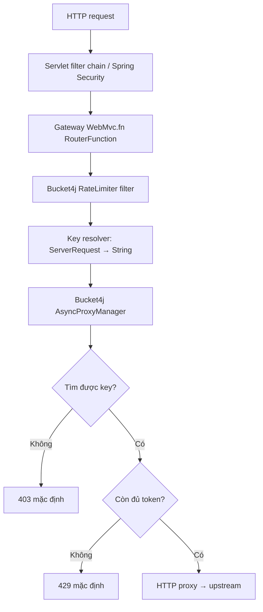
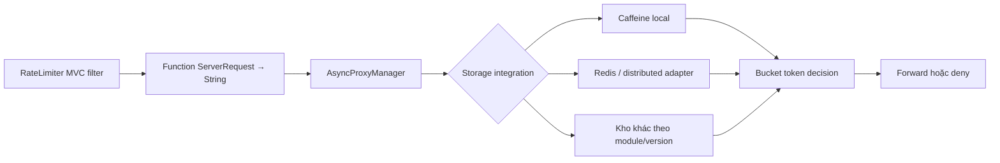
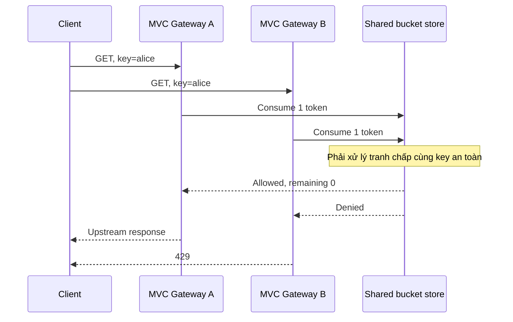
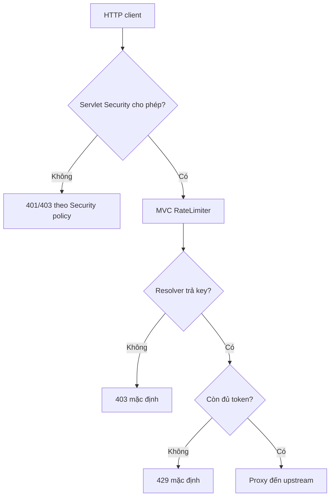
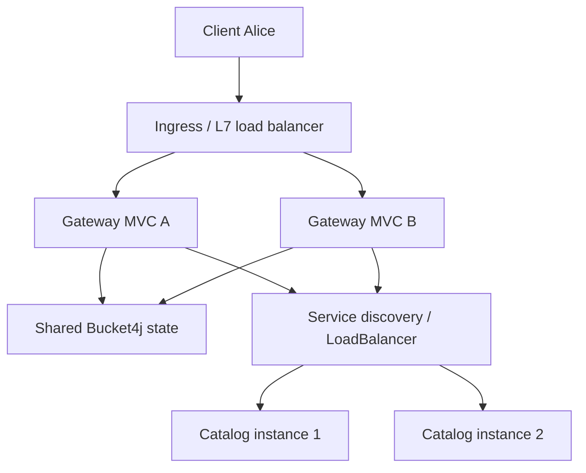

# RateLimiter dựa trên Bucket4j và key resolver của Web MVC trong Spring Cloud Gateway

Một API Gateway thường là điểm vào chung cho các microservices như catalog, orders, payments và reporting. Ngoài chọn route bằng predicate, sửa path/header và khám phá service, Gateway còn cần **giới hạn lưu lượng** để một client gửi burst không làm cạn tài nguyên backend. Với **Spring Cloud Gateway Server Web MVC**, chức năng này được cung cấp qua **RateLimiter Filter dựa trên Bucket4j**.

Hai chi tiết quyết định để cấu hình đúng:

- Bộ lọc của **Server MVC** được gắn bằng **`Bucket4jFilterFunctions.rateLimit(...)`** trong Java DSL của **WebMvc.fn**.
- **Key resolver của MVC** là **`java.util.Function<ServerRequest, String>`**. Theo tài liệu Spring Cloud Gateway Server Web MVC 4.3.5 và 5.1.0, cách cấu hình key resolver được hỗ trợ là **Java DSL**, không phải bean `KeyResolver` reactive tham chiếu bằng SpEL trong YAML như Gateway Server WebFlux.

Bài thuộc chương **Server Web MVC** của module `SPRING_CLOUD_GATEWAY`. Kiến thức liên hệ tới route predicates, filter chain, biến đổi path/header, LoadBalancer/service discovery, xác thực, giới hạn lưu lượng, circuit breaker, retry, TLS và quan sát request để vận hành cổng vào microservices an toàn.

**Sau bài này, bạn sẽ biết** cách viết route MVC có hạn mức, chọn key đúng user/tenant, giải thích 403 và 429, đăng ký kho trạng thái Bucket4j bằng `AsyncProxyManager`, phân biệt local cache với distributed quota, kiểm thử concurrency và tránh sao chép nhầm API của WebFlux.

> **Giới hạn phiên bản:** Code trong bài dựa trên các ví dụ được mô tả trong tài liệu Spring Cloud Gateway **Server Web MVC 4.3.5 và 5.1.0**. Không coi tất cả các module Bucket4j, starter, Java signatures hoặc property giống nhau giữa mọi major version Spring Boot/Spring Cloud. Mỗi dự án phải xác nhận dependency tree, startup và integration test. Không có ghi chú học thuật bổ sung từ đầu vào.

## 1. Rate limiting giải quyết vấn đề gì?

Giả sử một sàn thương mại điện tử có:

| API | Tài nguyên tiêu thụ | Hạn mức giả định |
| --- | --- | --- |
| `GET /api/catalog/**` | Đọc cache/database, render thông tin sản phẩm. | 60 request/giây/user, burst 120. |
| `POST /api/orders` | Tạo đơn và ghi nhiều bảng. | 10 request/phút/account, cần idempotency. |
| `POST /api/payments` | Tạo payment intent hoặc gọi nhà cung cấp. | 3 request/phút/account, đối soát chống trừ tiền lặp. |
| `GET /api/reports/**` | Truy vấn tốn CPU và I/O. | 2 request/phút/tenant hoặc theo chi phí. |

Hạn mức trên chỉ là **ví dụ**, không phải thông số được Spring Cloud Gateway khuyến nghị cho production. Chính sách cần dựa trên throughput thực tế, SLO, năng lực backend, tier khách hàng và cách tính chi phí nghiệp vụ.

Một request hợp lệ về quyền vẫn có thể bị chặn khi hết token. Với Gateway Server MVC RateLimiter, **HTTP 429 Too Many Requests** là phản hồi mặc định khi quota không đủ. Nhưng nếu **không tìm được key**, tài liệu MVC mô tả mặc định từ chối bằng **403 Forbidden**, khác hẳn 429.

### 1.1. Rate limiting không thay thế cơ chế nào?

- **Authentication/authorization:** người dùng có được phép gọi API không?
- **Circuit breaker:** backend có lỗi nhiều đến mức cần tạm ngắt gọi không?
- **Retry:** có nên phát lại request khi timeout/502/503 không?
- **Idempotency:** POST tạo đơn hoặc thu tiền có bị thực hiện lặp không?
- **Concurrency control:** có bao nhiêu request đang xử lý đồng thời?
- **Request size limit:** một body upload có quá lớn không?
- **WAF/CDN:** có cần chống lưu lượng xấu ở ngoài Gateway không?

Limiter thường chặn tại **đầu chuỗi xử lý route**, không có nghĩa nó tự bảo vệ từng thao tác SQL hoặc từng sự kiện WebSocket sau kết nối.

## 2. Nơi RateLimiter chạy trong Gateway Server MVC

Spring Cloud Gateway **Server Web MVC** chạy trên **Servlet runtime** như Tomcat hoặc Jetty và tận dụng **WebMvc.fn**. Các thành phần chủ yếu:

- `RouterFunction<ServerResponse>`: tập luật route HTTP.
- `GatewayRouterFunctions.route("id")`: tạo route Gateway có ID.
- `HandlerFunctions.http()`: handler proxy HTTP.
- `BeforeFilterFunctions.uri(...)`: xác định đích upstream.
- `Bucket4jFilterFunctions.rateLimit(...)`: gắn bộ lọc quota.
- `Function<ServerRequest, String>`: chọn một bucket key.



Sơ đồ mô tả luồng logic chứ không thay thế kiểm tra thứ tự filter thực tế. Một `SecurityFilterChain` có thể trả 401/403 **trước** khi MVC RouterFunction chọn route.

### 2.1. So sánh chính xác với WebFlux

| Mặt so sánh | **Gateway Server Web MVC** | **Gateway Server WebFlux** |
| --- | --- | --- |
| Framework | Spring MVC, Servlet, WebMvc.fn. | Spring WebFlux, Reactor Netty. |
| Route API | `RouterFunction<ServerResponse>`. | `RouteLocator`/GatewayFilter route definitions. |
| Bucket4j filter trong bài | `Bucket4jFilterFunctions.rateLimit`. | `RequestRateLimiter` dùng `Bucket4jRateLimiter` khi cấu hình đúng. |
| Key resolver | `Function<ServerRequest, String>`. | `KeyResolver.resolve(ServerWebExchange)` trả `Mono<String>`. |
| Principal | `request.servletRequest().getUserPrincipal()`. | `exchange.getPrincipal()` reactive. |
| Cách cấu hình resolver | **Java DSL** theo tài liệu MVC. | Bean resolver/SpEL trong route config. |
| Không dùng nhầm | `ServerWebExchange` hoặc `Mono` cho MVC key resolver. | `request.servletRequest()` hoặc MVC `Bucket4jFilterFunctions`. |

**Cùng engine Bucket4j không đồng nghĩa cùng integration API.** Đây là nguồn lỗi khi chuyển Gateway từ WebFlux sang MVC hoặc lấy một ví dụ trên mạng mà không kiểm tra server variant.

## 3. Token bucket: capacity, period và tokens

Bucket4j triển khai một **token bucket** cho mỗi key.

- `capacity`: số token tối đa bucket chứa được; cho phép burst khi bucket đầy.
- `period`: `java.time.Duration` mô tả khoảng refill của chính sách MVC.
- `tokens`: chi phí một request, **mặc định 1** theo tài liệu MVC.
- `key`: danh tính quota, chẳng hạn `user:42` hoặc `tenant:acme`.

Một mô hình trực quan:

```text
Bucket đầy: capacity = 10
Một request tốn: tokens = 1

Request 1  → cho phép, còn khoảng 9
Request 2  → cho phép, còn khoảng 8
...
Request 10 → cho phép, còn khoảng 0
Request 11 → nếu chưa kịp refill, trả 429

Token được nạp lại theo period/refill policy của Bucket4j.
```

**Cảnh báo:** `capacity=10` và `period=1m` không tự động là “hard quota reset đúng 00 giây mỗi phút”. Đó là mô hình token bucket; khả năng refill có thể phân bố theo thời gian, tùy style/implementation. Với yêu cầu hạch toán “tối đa đúng 10 đơn trong một phút lịch UTC”, cần xét chính sách khác hoặc bổ sung bộ đếm cửa sổ lịch.

### 3.1. Ví dụ định lượng

| Cấu hình | Khi bucket đầy và request tới gần đồng thời |
| --- | --- |
| Capacity 20, period 1 phút, tokens 1 | Có thể cho khoảng 20 request đầu qua, rồi chờ token nạp. |
| Capacity 12, period 1 phút, tokens 4 | Cho được 3 request lúc đầu nếu không kịp refill. |
| Capacity 5, period 10 giây, tokens 1 | Burst nhỏ tối đa khoảng 5 request khi đầy. |
| Capacity 1, period 30 giây, tokens 1 | Một request ban đầu; request tiếp theo chờ refill. |

**`tokens` không phải tốc độ nạp.** Nếu tokens = 4, mỗi request tiêu thụ 4 token; đừng hiểu là “refill 4 token/giây”.

### 3.2. Vì sao burst và steady rate khác nhau?

Frontend có thể tải nhiều widget ngay khi mở trang nhưng gần như im lặng trong phần thời gian còn lại. Capacity cho phép một burst ngắn; refill kiểm soát tốc độ dài hạn. Nếu capacity quá nhỏ, user hợp lệ dễ bị 429; nếu quá lớn, một burst có thể bão hòa backend dù tốc độ dài hạn không cao.

## 4. Chọn starter Server MVC đúng

Trong các nhánh tài liệu Spring Cloud Gateway mới, starter **Server Web MVC** là:

```xml
<dependency>
    <groupId>org.springframework.cloud</groupId>
    <artifactId>spring-cloud-starter-gateway-server-webmvc</artifactId>
</dependency>
```

Dùng **Spring Cloud Release Train/BOM** tương thích với Spring Boot. Đừng tự ghép version starter, Bucket4j và Jakarta Servlet khi chưa xác minh compatibility.

Server MVC là **Servlet-based Gateway**. Nếu dự án dùng starter `spring-cloud-starter-gateway-server-webflux` và các lớp `ServerWebExchange`/Netty, các ví dụ dưới đây **không phải** cách cấu hình bộ lọc của biến thể ấy.

### 4.1. Nhận diện lỗi trộn imports

```java
// Đúng với WebMvc.fn:
org.springframework.web.servlet.function.ServerRequest

// Không phải loại ServerRequest dùng trong ví dụ MVC:
org.springframework.web.reactive.function.server.ServerRequest
```

Hai class tên gần giống nhưng không hoán đổi được. Dùng IDE hoặc compiler để kiểm tra import trước khi chẩn đoán lỗi Bucket4j.

## 5. Ví dụ Java DSL hoàn chỉnh: gắn RateLimiter vào route

Ví dụ route MVC bảo vệ API Catalog bằng quota theo principal:

```java
package com.example.gateway;

import java.security.Principal;
import java.time.Duration;

import org.springframework.context.annotation.Bean;
import org.springframework.context.annotation.Configuration;
import org.springframework.web.servlet.function.RouterFunction;
import org.springframework.web.servlet.function.ServerResponse;

import static org.springframework.cloud.gateway.server.mvc.filter.BeforeFilterFunctions.uri;
import static org.springframework.cloud.gateway.server.mvc.filter.Bucket4jFilterFunctions.rateLimit;
import static org.springframework.cloud.gateway.server.mvc.handler.GatewayRouterFunctions.route;
import static org.springframework.cloud.gateway.server.mvc.handler.HandlerFunctions.http;

@Configuration
public class CatalogGatewayRoutes {

    @Bean
    RouterFunction<ServerResponse> catalogRateLimitedRoute() {
        return route("catalog_rate_limited")
            .GET("/api/catalog/**", http())
            .before(uri("https://catalog.internal.example"))
            .filter(rateLimit(config -> config
                .setCapacity(10)
                .setPeriod(Duration.ofMinutes(1))
                .setKeyResolver(request -> {
                    Principal principal =
                        request.servletRequest().getUserPrincipal();

                    return principal == null
                        ? null
                        : "catalog:user:" + principal.getName();
                })))
            .build();
    }
}
```

**Giải thích từng phần:**

1. `route("catalog_rate_limited")` đặt ID để theo dõi và phân biệt route.
2. `GET("/api/catalog/**", http())` chọn request GET và xử lý HTTP proxy.
3. `before(uri(...))` xác định upstream. Ví dụ dùng HTTPS rõ ràng để không phụ thuộc cấu hình discovery.
4. `filter(rateLimit(...))` gắn Bucket4j RateLimiter vào đường xử lý route.
5. `setCapacity(10)`, `setPeriod(Duration.ofMinutes(1))` cấu hình bucket.
6. `setKeyResolver(...)` suy ra key từ Servlet principal.
7. Resolver trả `null` nếu không có principal, tránh `NullPointerException`.

Đây là **ví dụ route**, chưa bao gồm ứng dụng đầy đủ, Bean storage và cấu hình Spring Security. Khi ứng dụng không xác thực request và principal luôn null, kết quả có thể là **403**, không phải một quota anonymous tự động.

### 5.1. Ví dụ chính thức không có null guard

Tài liệu Spring Cloud Gateway có dạng gần như:

```java
.filter(rateLimit(c -> c
    .setCapacity(100)
    .setPeriod(Duration.ofMinutes(1))
    .setKeyResolver(request ->
        request.servletRequest().getUserPrincipal().getName())))
```

Đoạn này giả định request đã có principal. Với route public hoặc Security matcher khác, lời gọi `getName()` có thể gây lỗi null. **Thêm null handling** và quyết định chính sách anonymous trước khi dùng production.

### 5.2. Chỉ nên tạo key trong resolver

Đừng cố đặt một field mutable `lastUser` trên singleton `@Configuration` hoặc filter Bean để dùng lại làm key. Request của Alice và Bob có thể chạy đồng thời; state dùng chung sẽ gây cross-user quota và thậm chí rò thông tin. Resolver nên deterministic, ít side effects và lấy dữ liệu từ request/security context hiện tại.

## 6. Key resolver là `Function<ServerRequest, String>`

Để thấy rõ kiểu, ta có thể tách resolver thành biến:

```java
import java.security.Principal;
import java.util.function.Function;
import org.springframework.web.servlet.function.ServerRequest;

Function<ServerRequest, String> byPrincipal = request -> {
    Principal principal =
        request.servletRequest().getUserPrincipal();

    return principal == null
        ? null
        : "user:" + principal.getName();
};
```

Đây không phải `org.springframework.cloud.gateway.filter.ratelimit.KeyResolver` của WebFlux. MVC resolver:

- Nhận **Servlet-style `ServerRequest`**.
- Trả **`String`** chứ không phải `Mono<String>`.
- Được truyền vào **`setKeyResolver(...)` trong Java DSL**.
- Cần có scope bền vững và thống nhất giữa các Gateway replicas.

### 6.1. Một key cho một ý nghĩa quota

Có nhiều cách chọn scope:

| Hợp đồng quota | Key nên biểu diễn | Ví dụ |
| --- | --- | --- |
| Per-user catalog | User ID đã xác thực. | `catalog:user:723`. |
| Per-tenant order creation | Tenant ID đã xác minh. | `orders:tenant:acme`. |
| Per-API-key partner traffic | ID nội bộ của API key đã xác thực. | `partner:key:914`. |
| Global protection | Một bucket chung có chủ đích. | `reports:global`. |
| Anonymous traffic | IP/client identity qua trusted edge. | `public:ip:203.0.113.10`. |

Một key **không có nghĩa là một HTTP request**. Nếu tạo UUID mới mỗi lần resolve, mọi request được mở bucket mới, khiến limiter gần như vô dụng và làm phình cache.

### 6.2. Ví dụ sai: key cố định khi muốn per-user

```java
// SAI nếu mục tiêu là quota riêng cho từng user:
.setKeyResolver(request -> "all-users")
```

Alice có thể làm cạn bucket khiến Bob bị từ chối. Một key chung chỉ phù hợp nếu chủ đích là **quota global**.

### 6.3. Ví dụ sai: key theo request ID

```java
// SAI cho per-user quota: tạo bucket mới mỗi request.
.setKeyResolver(request ->
    java.util.UUID.randomUUID().toString())
```

Nếu backend state có cache hoặc store phân tán, key cardinality có thể tăng rất nhanh. Dùng stable user/tenant/API key ID, không dùng trace ID, request ID hoặc timestamp làm quota identity.

## 7. Vì sao key resolver MVC phải cấu hình bằng Java DSL?

Tài liệu **RateLimiter Filter** cho Gateway Server MVC 4.3.5 và 5.1.0 nói key resolver được khai báo qua **Java DSL**, không qua external properties.

Một cấu hình **WebFlux** phổ biến như sau **không phải cách cấu hình MVC của bài**:

```yaml
# Ví dụ KHÔNG áp dụng trực tiếp cho RateLimiter Web MVC.
filters:
  - name: RequestRateLimiter
    args:
      key-resolver: "#{@userKeyResolver}"
      redis-rate-limiter.replenishRate: 10
      redis-rate-limiter.burstCapacity: 20
```

Đối với **Server MVC**:

```java
.filter(rateLimit(c -> c
    .setCapacity(100)
    .setPeriod(Duration.ofMinutes(1))
    .setKeyResolver(request -> {
        Principal p =
            request.servletRequest().getUserPrincipal();
        return p == null ? null : p.getName();
    })))
```

**Không kết luận rằng toàn bộ cấu hình route MVC đều buộc phải viết Java.** Điểm cụ thể ở đây là **key resolver** của **Bucket4j RateLimiter** được tài liệu hóa qua Java DSL ở những phiên bản đang xét.

### 7.1. Có thể đọc capacity/period từ external config không?

Có thể tự thiết kế Bean cấu hình để người vận hành thay các con số qua Spring Boot Configuration Properties, sau đó truyền chúng vào route builder:

```java
// Fragment minh họa với quota đã được ứng dụng bind/validate.
.filter(rateLimit(c -> c
    .setCapacity(quota.capacity())
    .setPeriod(quota.period())
    .setKeyResolver(byPrincipal)))
```

Trong fragment, `quota` và `byPrincipal` là đối tượng ứng dụng tự chuẩn bị. Đây **không phải** YAML tự tạo MVC resolver bằng SpEL. Với runtime refresh, còn cần kiểm tra lifecycle filter/router: đổi properties có thể không tự rebuild function đã tạo.

### 7.2. Phân biệt “Bean resolver” với “Bean AsyncProxyManager”

Gateway MVC RateLimiter có thể cần một **`AsyncProxyManager` Bean** cho Bucket4j storage, nhưng điều này **không có nghĩa** resolver của MVC sẽ tự được nhận từ một Spring Bean có tên `userKeyResolver` rồi bind bằng `#{@...}` như WebFlux.

Hai nhiệm vụ riêng:

- **Resolver:** function theo request để suy key.
- **Proxy manager:** thành phần quản lý token state theo key.

## 8. Principal đã xác thực và Spring Security Servlet

Đối với API cần JWT, Spring Security nên xác thực request **trước** khi route sử dụng `getUserPrincipal()`. Gateway Server MVC dùng **Servlet SecurityFilterChain**, không phải reactive `SecurityWebFilterChain` của WebFlux.

Ví dụ cấu trúc ứng dụng:

```java
import org.springframework.context.annotation.Bean;
import org.springframework.context.annotation.Configuration;
import org.springframework.security.config.annotation.web.builders.HttpSecurity;
import org.springframework.security.web.SecurityFilterChain;

@Configuration
class GatewaySecurityConfig {

    @Bean
    SecurityFilterChain security(HttpSecurity http)
            throws Exception {

        http.authorizeHttpRequests(auth -> auth
            .requestMatchers("/api/catalog/**").authenticated()
            .anyRequest().permitAll());

        http.oauth2ResourceServer(oauth2 ->
            oauth2.jwt(jwt -> {}));

        return http.build();
    }
}
```

**Giới hạn:** Đây là ví dụ để thấy principal được tạo bởi Security, **không phải** chính sách production hoàn chỉnh. Cần cấu hình JWT issuer/JWK, bảo vệ routes khác, CSRF, CORS, session, actuator, TLS và quyền nghiệp vụ đúng threat model. Không copy `permitAll()` sang một Gateway production mà không xét mọi endpoint.

### 8.1. Vì sao thấy 401 hoặc 403 trước 429?

- **401:** token thiếu, hết hạn hoặc không hợp lệ theo Spring Security.
- **403 Security:** đã xác thực nhưng thiếu quyền trên route.
- **403 RateLimiter:** request vào limiter nhưng resolver **không tìm được key**; tài liệu MVC ghi mặc định là `FORBIDDEN`.
- **429 RateLimiter:** key hợp lệ nhưng bucket thiếu token.

Một ứng dụng có thể còn bị 429 từ CDN/WAF hoặc backend. Cần tách **nguồn chặn** trong tracing và metrics.

### 8.2. User ID hay tenant ID?

Nếu quota tính theo **người dùng**, principal name có thể phù hợp. Nếu hợp đồng tính theo **tenant**, không dùng một header `X-Tenant-Id` do browser tự gửi. Lấy tenant từ JWT claims đã kiểm tra issuer/audience/signature và ràng buộc quyền của principal với tenant.

### 8.3. Key không thay thế authorization

Biết được chuỗi `catalog:user:723` không khiến request được quyền truy cập tài khoản 723. Backend cần bảo vệ dữ liệu nghiệp vụ; Gateway cần Security chain xác minh identity và quyền phù hợp trên mỗi HTTP request.

## 9. Anonymous request và trusted client IP

Với API công khai, `getUserPrincipal()` có thể null. Một phương án là rate limit theo IP, nhưng cần hiểu trust boundary.

```java
// Chỉ phản ánh địa chỉ peer trực tiếp tới Servlet container.
Function<ServerRequest, String> byPeerIp =
    request -> "public:peer:" +
        request.servletRequest().getRemoteAddr();
```

Nếu Gateway đứng sau NGINX, CDN hoặc Kubernetes ingress, địa chỉ này có thể là **IP của proxy**, khiến tất cả người dùng bị gom vào cùng bucket.

`X-Forwarded-For` cũng **không mặc định đáng tin**: attacker có thể tự điền header nếu edge không lọc. Phải thiết kế trusted proxy IP resolution và chỉ tin các hop đã xác minh.

### 9.1. Những giới hạn của IP-based quota

- Nhiều user có thể chia một IP sau NAT/CGNAT.
- IPv6 có nhiều địa chỉ, nên chính sách per-address/per-prefix phải có chủ đích.
- Mobile devices đổi IP khi chuyển mạng.
- Một attacker có thể sở hữu nhiều IP.
- Proxy hoặc CDN thay đổi đường đi làm IP quan sát khác nhau.

Với abuse nghiêm trọng, thường phải kết hợp CDN/WAF, authentication, bot detection và limits theo account/API key; chỉ IP-based limiter không đủ.

### 9.2. Hạn chế key cardinality

Không tạo key từ path thô, query tùy ý hoặc user-agent string chưa chuẩn hóa. Hãy giới hạn format, độ dài, cardinality và retention. Một key có thể được hash/pseudonymize để tránh lộ email hoặc identifier nhạy cảm trong Redis hay logs.

## 10. Vì sao cần `AsyncProxyManager<String>`?

Bucket4j phải lưu token theo key. Tài liệu Gateway Server MVC mô tả Bean loại **`io.github.bucket4j.distributed.proxy.AsyncProxyManager`**; có thể chuyển từ một proxy manager tương ứng bằng `asAsync()`.



Cần phân biệt:

- `Function<ServerRequest,String>` suy key **trong request path**.
- `AsyncProxyManager` duy trì bucket state **qua các request**.

Chỉ thêm Bucket4j core dependency chưa đủ; phải có integration và Bean mà Gateway MVC RateLimiter thực sự sử dụng.

### 10.1. “MVC” không có nghĩa được thay bean async bằng sync

Mặc dù Server MVC chạy trên Servlet, **integration được tài liệu hóa yêu cầu AsyncProxyManager**. Không tự thay bằng `ProxyManager` synchronous rồi hy vọng Gateway auto-configuration nhận đúng.

Từ “async” cũng không có nghĩa mọi adapter I/O đều hoàn toàn nonblocking hoặc không có chi phí thread; phải đo latency, timeout và threading của backend state.

## 11. Ví dụ Bean Bucket4j với Caffeine local

Một mẫu gần với tài liệu Spring Cloud Gateway:

```java
package com.example.gateway;

import java.time.Duration;

import com.github.benmanes.caffeine.cache.Caffeine;
import io.github.bucket4j.caffeine.CaffeineProxyManager;
import io.github.bucket4j.distributed.proxy.AsyncProxyManager;
import io.github.bucket4j.distributed.remote.RemoteBucketState;

import org.springframework.context.annotation.Bean;
import org.springframework.context.annotation.Configuration;

@Configuration
class Bucket4jLocalStateConfig {

    @Bean
    @SuppressWarnings({"rawtypes", "unchecked"})
    AsyncProxyManager<String> caffeineProxyManager() {
        Caffeine<String, RemoteBucketState> cache =
            (Caffeine) Caffeine.newBuilder()
                .maximumSize(1_000);

        return new CaffeineProxyManager<>(
            cache,
            Duration.ofMinutes(10)
        ).asAsync();
    }
}
```

**Ý nghĩa:**

- `Caffeine` lưu state **trong JVM Gateway hiện tại**.
- `CaffeineProxyManager` là Bucket4j integration tương ứng.
- `asAsync()` tạo Bean kiểu `AsyncProxyManager<String>`.
- `maximumSize(1_000)` giới hạn số entries trong cache, **không phải** 1.000 request/giây.
- `Duration.ofMinutes(10)` là tham số vòng đời/expiration của integration tương ứng, **không phải** period refill của rate limiter.
- Cast generic phản ánh kiểu trong ví dụ Caffeine adapter; chữ ký có thể đổi theo Bucket4j/Caffeine version.

**Không coi đoạn code này là bảo đảm chạy được ở mọi Bucket4j version.** Phải kiểm tra các imports, constructor và dependency tree của dự án; bài STEP 4 không chạy Maven/Gradle.

### 11.1. Dependency Maven minh họa

```xml
<!-- Starter MVC do Spring Cloud BOM quản lý. -->
<dependency>
    <groupId>org.springframework.cloud</groupId>
    <artifactId>spring-cloud-starter-gateway-server-webmvc</artifactId>
</dependency>

<!-- Ví dụ integration Bucket4j JDK 17; kiểm tra version được hỗ trợ. -->
<dependency>
    <groupId>com.bucket4j</groupId>
    <artifactId>bucket4j_jdk17-core</artifactId>
    <version>${bucket4j.version}</version>
</dependency>

<dependency>
    <groupId>com.bucket4j</groupId>
    <artifactId>bucket4j_jdk17-caffeine</artifactId>
    <version>${bucket4j.version}</version>
</dependency>

<dependency>
    <groupId>com.github.ben-manes.caffeine</groupId>
    <artifactId>caffeine</artifactId>
</dependency>
```

Thay `${bucket4j.version}` bằng property do build quản lý theo một version Bucket4j được kiểm chứng; không chọn bản mới nhất bằng cảm tính khi Spring Cloud Gateway pin version khác. Mẫu này chưa thêm Security, Actuator, LoadBalancer hay test dependencies.

### 11.2. Local Caffeine chỉ phù hợp một số trường hợp

Nếu Gateway chạy ba replicas, mỗi replica có **bộ bucket riêng** cho cùng key `user:alice`. Một user có thể được phân phối qua A/B/C và nhận tổng quota lớn hơn hợp đồng. Restart hoặc cache eviction có thể tái tạo bucket với capacity đầy.

Dùng Caffeine local khi:
- Demo/test hoặc chạy một Gateway instance.
- Chính sách cố ý giới hạn **theo từng node**.
- Chấp nhận quota bị phân mảnh và có cơ chế kiểm soát khác ở tầng ngoài.

Không dùng local state để cam kết **quota chính xác toàn cụm** nếu chưa có cơ chế phân chia ngân sách token riêng.

## 12. Phân tán state: Redis, Hazelcast và các adapter khác

Khi cần quota toàn cụm, có thể dùng **Bucket4j distributed adapter** tương thích với Redis/Valkey, Hazelcast, Infinispan/JCache, database hoặc backend khác tùy phiên bản thư viện.

| Tiêu chí | Caffeine local | Distributed store |
| --- | --- | --- |
| State scope | Một JVM Gateway. | Shared state giữa replicas theo adapter. |
| Latency | Thường rất thấp. | Thêm mạng, serialization và concurrency. |
| Restart Gateway | Local state thường mất. | State có thể còn ở store. |
| Multi-replica | Bucket cùng key độc lập. | Có thể chung key nếu config/store nhất quán. |
| Failure mode | Memory pressure, TTL/eviction, crash. | Timeout, partition, failover, replication lag. |
| Vận hành | Đơn giản. | Cần HA, TLS, secret, metrics, backup/recovery. |
| Atomicity | Trong local manager. | Phụ thuộc cơ chế atomic/CAS/transaction của adapter. |

**“Bucket4j hỗ trợ adapter X” không có nghĩa “Spring Cloud Gateway MVC auto-configure X chỉ bằng YAML”.** Cần tạo client/store, tích hợp `AsyncProxyManager`, kiểm tra dependency/serializer và cách Gateway chọn Bean.

### 12.1. Bucket4j + Redis không phải WebFlux RedisRateLimiter

- **WebFlux RedisRateLimiter** của Gateway: implementation/token state riêng với tham số `redis-rate-limiter.replenishRate` và `burstCapacity`.
- **MVC Bucket4j + Redis:** Bucket4j state manager qua adapter Redis; policy theo `capacity`, `period`, `tokens`.
- Chúng không tự dùng chung Redis keys, serialization hoặc quota đã tiêu thụ dù cùng Redis host.

Nếu chuyển từ WebFlux sang MVC, cần kế hoạch migration/rollout, không giả định state tự được mang sang.

### 12.2. Tính nguyên tử khi nhiều Gateway cùng trừ token



Nếu hai replicas cùng đọc trạng thái “còn 1 token” rồi ghi lại không atomic, cả hai có thể cho qua và vượt quota. Cần kiểm tra CAS/transaction/locking/Lua hoặc primitive tương ứng **trong adapter cụ thể**, không chỉ nhìn nhãn “distributed”.

### 12.3. TTL và eviction có thể reset quota

Một bucket chỉ được cho 1 request/phút nhưng state bị xóa sau 5 giây idle có thể được tạo lại đầy token và cho request sớm hơn contract. Hãy xác minh thời gian sống state phù hợp refill horizon, capacity, idle behavior và rủi ro duplicate key.

### 12.4. Đồng bộ key namespace

Gateway A tạo `catalog:user:Alice` còn Gateway B tạo `catalog:user:alice` là **hai buckets khác nhau** trên shared store. Key resolver cần chuẩn hóa identity/operation và thống nhất cách build key giữa các replicas và các phiên bản đang rollout.

## 13. Các tham số cấu hình RateLimiter MVC

Tài liệu Gateway Server MVC mô tả những tham số sau:

| Tùy chọn | Tác dụng | Mặc định được mô tả |
| --- | --- | --- |
| `capacity` | Sức chứa tối đa của bucket. | Cần policy phù hợp. |
| `period` | `Duration` quy định chu kỳ refill. | Cần policy phù hợp. |
| `tokens` | Token trừ cho một request. | **1**. |
| `statusCode` | Status khi không đủ quota. | **429 Too Many Requests**. |
| `headerName` | Header báo số token còn lại. | **`X-RateLimit-Remaining`**. |
| `timeout` | `Duration` chờ distributed bucket trả quyết định. | **Không đặt mặc định**. |
| `keyResolver` | `Function<ServerRequest,String>`. | Cấu hình qua MVC Java DSL. |

**Lưu ý:** Tên setters và khả năng customize từng trường có thể thay đổi theo version. Ví dụ Java chính của bài chỉ dùng ba setter **`setCapacity`**, **`setPeriod`** và **`setKeyResolver`** đã được tài liệu 4.3.5/5.1.0 minh họa rõ.

### 13.1. Header còn token không phải chuẩn chung của mọi limiter

Một response minh họa:

```http
HTTP/1.1 429 Too Many Requests
X-RateLimit-Remaining: 0
Cache-Control: no-store
```

Đây là **minh họa**, không bảo đảm mọi Gateway/CDN/backend đều tự thêm cùng header/body. `Retry-After` nếu cần phải được cung cấp với phép tính/cơ chế đúng theo hợp đồng; không mặc định MVC Bucket4j filter luôn thêm header đó.

### 13.2. `timeout` dành cho storage, không phải upstream response

Timeout distributed bucket giới hạn thời gian lấy quyết định từ **quota state store**. Nó không thay `connectTimeout`, read timeout hoặc response timeout của HTTP proxy tới backend.

Nếu store mất 5 giây để phản hồi trong khi SLO Gateway là 1 giây, cần timeout/error policy phù hợp. Đừng để Servlet request threads bị giữ vô hạn.

## 14. 401, 403 và 429: xác định đúng nguồn



| Status | Có thể do đâu? | Hướng điều tra |
| --- | --- | --- |
| 401 | Authentication ở Servlet Security. | JWT/cookie/issuer/expiry. |
| 403 | Authorization hoặc MVC empty-key denial. | Security matcher/principal/key resolver. |
| 429 | Gateway MVC limiter, WAF/CDN hoặc backend. | Chỉ số token, nguồn response, route/key. |
| 503 | Backend không sẵn sàng/service discovery hoặc storage fail-policy. | LoadBalancer, backend, quota-store logs. |
| 504 | Timeout ở proxy/upstream/khác. | Network deadlines, retry, dependency latency. |

**Không diễn giải 403 là “Bucket4j hết token”**: tài liệu MVC ghi hết quota mặc định là 429, còn missing key mặc định 403.

### 14.1. Khi Spring Security chưa có principal

Nếu `getUserPrincipal()` là null, code mục 5 trả null. Thực tế:
- Security có thể từ chối request trước bằng 401/403.
- Nếu request được permit vào MVC route, RateLimiter không tìm key và trả 403 theo default.
- Nếu cần public IP-based quota, phải dùng resolver phù hợp thay vì cố ép null thành một user giả.

## 15. Store outage: chọn fail-open, fail-closed hay lỗi hệ thống?

Redis hoặc một kho phân tán khác có thể bị timeout, mất kết nối, failover hoặc lỗi quyền truy cập. Một quyết định quota lúc đó là **không xác định**, khác với biết chắc bucket cạn token.

| Chính sách | Hành vi dự kiến | Rủi ro |
| --- | --- | --- |
| **Fail-closed** | Từ chối request khi không xác minh được quota. | Availability giảm trong storage outage. |
| **Fail-open** | Cho traffic đi tiếp khi limiter lỗi. | Có thể gây abuse/backend overload. |
| **Local fallback** | Tạm dùng quota mỗi pod. | Quota toàn cụm có thể vượt hợp đồng. |
| **Trả lỗi phụ thuộc** | Ví dụ 503 theo policy để phân biệt storage failure. | Client bị gián đoạn nhưng có tín hiệu nguyên nhân rõ. |

Không giả định Bucket4j MVC filter hay mọi adapter tự có một chính sách fail-open/fail-closed phù hợp. Phải test ngoại lệ, timeout và mapping response trong dependency/version thực tế.

### 15.1. Retry storage có thể tác động token decision

Một adapter retry thao tác consume sau khi timeout có thể đã áp dụng lần đầu nhưng caller chưa nhận ACK. Phải xác minh adapter có semantics an toàn cho retry, không tự viết vòng retry mù quáng trên một phép trừ token không idempotent.

### 15.2. 429 không nên che giấu lỗi storage

Nếu storage không truy cập được, client nhìn 429 có thể tưởng hết quota. Nên phân loại `quota_denied` khác `quota_storage_error` trong observability và dùng error mapping theo hợp đồng đã kiểm thử.

## 16. LoadBalancer, filter ordering, retry và circuit breaker

Một MVC Gateway route có thể proxy tới `lb://catalog-service` với Spring Cloud LoadBalancer integration phù hợp. **Limiter nên bảo vệ quota của user/tenant**, không phụ thuộc backend instance được chọn sau đó.



### 16.1. Đừng nhầm rate limiting với service discovery

Nếu bucket còn token nhưng `lb://service` không có healthy instance, Gateway có thể trả 503. **Tăng capacity** không tạo thêm backend instances; cần kiểm tra service ID, registration, readiness và routing.

### 16.2. Retry có thể tạo nhiều upstream attempts

Nếu một request đã qua limiter nhưng `Retry` filter tái thực thi một phần downstream chain, tổng số HTTP attempts tới backend có thể cao hơn số client requests. Thứ tự các filter quyết định một retry có tiêu thụ thêm token hay không. **Không khẳng định một cách chung rằng một retry luôn tốn đúng một token** nếu chưa kiểm chứng chain thực tế.

### 16.3. POST và idempotency

Một POST tạo order có thể đã commit trước khi response bị mất. Gateway retry có thể tạo order thứ hai nếu backend không có idempotency key/unique constraint. **Bucket4j không giải quyết vấn đề đó**; limiter chỉ quyết định số request được gửi qua.

### 16.4. Circuit breaker không tự hoàn token

Nếu limiter cho phép nhưng circuit breaker/fallback ngắt gọi backend, token có thể đã bị tiêu thụ theo thứ tự filter. Đừng hứa “backend lỗi sẽ hoàn token” nếu không có cơ chế bồi hoàn được thiết kế và kiểm thử.

## 17. CORS, TLS và quyền dùng quota

Browser có thể gửi CORS preflight trước một request cần `Authorization`. Trong Gateway Server MVC, CORS và Spring Security Servlet có thể xử lý `OPTIONS` ở tầng khác trước router; đừng mặc định RateLimiter được gọi cho preflight.

- Cho phép origin/method/header đúng API contract.
- Không yêu cầu JWT cho preflight một cách sai lệch.
- Đảm bảo response 403/429 có CORS headers phù hợp để frontend đọc status.
- Không cấu hình wildcard origin cùng credentials thiếu kiểm soát.
- Dùng HTTPS tới Gateway; chặng Gateway–backend dùng TLS/mTLS hoặc network policy phù hợp.
- Chỉ tin forwarded client IP headers do trusted ingress tạo và kiểm soát.
- Không dùng `X-User-Id` từ client làm identity quota.

### 17.1. Key resolver không phải điểm kiểm tra authorization

Dù resolver trả `tenant:acme`, backend vẫn cần kiểm tra user có quyền truy cập dữ liệu tenant acme. Rate limiting là một lớp phòng vệ bổ sung, không phải cơ chế phân quyền.

## 18. Observability: đo decision và overhead

Một Gateway có rất ít 429 không nhất thiết đang bảo vệ tốt. Có thể:
- Resolver tạo key mới mỗi request.
- Không gắn filter vào route đang nhận traffic.
- State phân mảnh vì nhiều replicas dùng Caffeine local.
- Store lỗi nhưng chính sách fail-open.
- CDN đã chặn từ trước.
- Capacity được tăng quá lớn.

Các chỉ số cần thiết:

| Chỉ số | Công dụng |
| --- | --- |
| HTTP request count/latency theo route/method/status | Biết traffic đầu vào. |
| Limiter allowed/denied decisions | Biết tần suất chặn thực tế. |
| Empty-key/403 decisions | Phát hiện lỗi principal/key resolver. |
| 429 by route/quota tier | Phát hiện abuse hoặc quota quá chặt. |
| Bucket state lookup/consume latency | Đo bottleneck ở storage. |
| Store exceptions/timeouts | Phân biệt lỗi kho với hết token. |
| Active key count/eviction rate | Cảnh báo key cardinality, TTL sai. |
| Upstream RPS/latency | Đo hiệu quả bảo vệ backend. |
| Gateway replica count/config revision | Giải thích quota thay đổi khi scaling. |

Các metric names trong dashboard có thể do ứng dụng tự instrument; không khẳng định Spring Cloud Gateway mặc định xuất đủ mọi metric kể trên.

### 18.1. Tránh metric labels có cardinality cao

Không label metrics theo raw `userId`, email, idempotency key, JWT, request path chứa UUID hoặc arbitrary header. Dùng route ID, quota tier, decision và store backend category. Logs truy vết một user cần quyền và retention riêng.

### 18.2. HTTP 429 không đủ chứng minh upstream được bảo vệ

Test tốt nhất đo **bao nhiêu request tới upstream**. Nếu Gateway trả 429 nhưng backend vẫn bị gọi (do cấu hình sai hoặc quota ở backend), cần xem lại filter/route matcher/order.

## 19. Kiểm thử integration với mock upstream

Một bài test hiệu quả nên có:
- Spring MVC context có `RouterFunction` dùng `rateLimit`.
- Bean `AsyncProxyManager` thực sự được inject.
- Một fake/real authenticated principal phù hợp.
- Mock upstream có request counter.
- Quota test nhỏ với key ổn định.
- HTTP client hoặc `MockMvc` cho routing tương ứng, tùy Gateway version/harness.

### 19.1. Thử burst cùng user

Giả sử capacity 3, period 60s, tokens 1, bucket mới đầy:

```bash
for i in 1 2 3 4 5; do
  curl -sS -o /dev/null \
    -w "n=$i status=%{http_code}\n" \
    -H "Authorization: Bearer <test-token-alice>" \
    "http://localhost:8080/api/catalog/42"
done
```

Nếu test đủ sát nhau, có thể cho khoảng ba request trước khi trả 429. **Không gán cứng request thứ tư luôn là 429** nếu token refill giữa calls hoặc bucket state từ test khác.

Đếm request mock upstream: request bị limiter deny **không nên** tới backend.

### 19.2. Hai user độc lập

- Alice dùng principal `alice`, gửi burst đến khi hết quota.
- Bob dùng principal `bob`, gửi request riêng.
- Nếu policy per-user, Bob có bucket khác và không tự bị deny do Alice.

Nếu Bob cũng nhận 429, kiểm tra key có bị cố định, hoặc Security principal trên test requests có thực sự khác nhau không.

### 19.3. Không có principal

Gửi request đi vào MVC rate limiter mà không có principal:

- Có thể bị Security chặn trước bằng 401/403.
- Nếu qua được Security nhưng resolver trả null, tài liệu MVC mô tả 403 mặc định.
- Đây **không phải** test token bucket cạn.

### 19.4. Concurrent requests

Gửi nhiều request đồng thời cùng key, dùng mock upstream đếm số requests thực sự nhận. Thử cả cùng replica và **hai Gateway replicas** với shared store để phát hiện race trong consume.

### 19.5. Restart và TTL

Dùng Caffeine local: làm cạn bucket rồi restart Gateway; state có thể mất và token được cấp mới. Dùng distributed store: restart Gateway trong khi storage còn sống, kiểm tra state/TTL có còn và liệu token được tiêu thụ chính xác.

## 20. Ma trận sự cố cần kiểm tra

| Trường hợp | Điều cần xác minh |
| --- | --- |
| Sai import `ServerRequest` | Không compile hoặc resolver không đúng MVC API. |
| Thiếu Bean `AsyncProxyManager` | Context/filter không được cấu hình như kỳ vọng. |
| Key resolver null | 403 theo policy limiter nếu request tới filter. |
| Key cố định | Quota bị chia chung không chủ đích. |
| Key theo UUID mỗi request | Limiter bị bypass, cache/store tăng nhanh. |
| Trusted proxy IP sai | Nhiều users chia một bucket hoặc giả mạo key. |
| Caffeine 1 replica | Quota local có hiệu lực. |
| Caffeine 2 replicas | State phân mảnh; ghi nhận giới hạn. |
| Distributed store concurrent consume | Bất biến atomic consumption đúng. |
| Storage timeout | Không treo request lâu, phản hồi theo failure policy. |
| Storage failover/partition | Không tự coi “distributed” đồng nghĩa strict consistency. |
| TTL/eviction quá ngắn | Không vô tình reset quota. |
| JWT invalid | Không tự tạo principal giả để cấp quota. |
| CORS error response | Browser nhìn được 429/403 nếu origin được phép. |
| Retry POST | Backend idempotency bảo vệ khỏi side effects lặp. |
| Không có service instance | Chẩn đoán 503 tại LoadBalancer, không phải rate limiter. |
| Rolling upgrade | State/serializer/quota revision tương thích. |
| Gateway restart | State giữ/mất phù hợp lựa chọn local/distributed. |
| Rate-limit header bị sửa | Kiểm tra proxy/filter order và API contract. |
| Metric cardinality tăng | Key resolver/labels không tạo vô hạn time series. |

## 21. Những lỗi thường gặp

| Triệu chứng | Nguyên nhân đáng kiểm tra | Hướng xử lý |
| --- | --- | --- |
| Code copy WebFlux `KeyResolver` không compile. | MVC dùng Function và Servlet ServerRequest. | Đổi đúng type/import và Java DSL. |
| `RequestRateLimiter` YAML không có hiệu lực. | Sai server variant/filter. | Dùng `Bucket4jFilterFunctions.rateLimit` cho MVC. |
| Tất cả requests trả 403. | Không có principal hoặc Security chặn. | Phân biệt nguồn 403, dùng resolver đúng. |
| Tất cả requests trả 429. | Bucket cạn, key bị gom, refill config sai. | Kiểm tra capacity/period/tokens và key. |
| Không bao giờ nhận 429. | Không gắn filter, key mới mỗi request hoặc quota quá lớn. | Dùng mock upstream, stable key, test nhỏ. |
| Hai Gateway vượt quota tổng. | Caffeine local per-node. | Dùng shared distributed adapter. |
| Redis cùng host nhưng state không nối với WebFlux RedisRateLimiter. | Hai engine lưu key/state khác. | Lên kế hoạch migration quota. |
| Key chứa raw JWT/email. | Dùng secret/PII làm identity. | Opaque stable ID, hashing và log hygiene. |
| Client đổi `X-User-Id` rồi né quota. | Resolver tin header tự khai. | Dùng authenticated principal/tenant. |
| 403 bị chẩn đoán là hết quota. | Missing key default 403. | Instrument empty-key, kiểm tra principal. |
| 503 bị chẩn đoán là Bucket4j. | `lb://` không có backend instance. | Xem discovery/health/connection errors. |
| RateLimiter tăng latency bất thường. | Storage chậm, timeout dài, blocking lookup. | Đo latency, timeout/failure policy. |
| Cache eviction reset quota. | TTL/maximumSize không phù hợp. | Đánh giá refill horizon và cardinality. |
| POST được retry tạo đơn trùng. | Không có idempotency ở backend. | Dùng idempotency key + transaction/dedup. |
| 429 frontend hiển thị CORS error. | Response bị deny thiếu CORS header. | CORS policy ở đúng lớp/response path. |
| 429 giảm nhưng backend quá tải hơn. | Fail-open, limiter bị bỏ hoặc quota state phân mảnh. | Đo upstream RPS và limiter decisions. |

## 22. Bài tập vận dụng có đáp án

### Bài 1 — Đúng biến thể

Một route dùng `RouterFunction<ServerResponse>` và `Bucket4jFilterFunctions.rateLimit(...)`. Nó thuộc biến thể nào?

**Đáp án:** **Gateway Server Web MVC**. Không phải `RequestRateLimiter` của Server WebFlux.

### Bài 2 — KeyResolver đúng kiểu

Key resolver MVC nên có kiểu gì?

**Đáp án:** `Function<org.springframework.web.servlet.function.ServerRequest, String>`. Không phải `Mono<String>` hay `ServerWebExchange`.

### Bài 3 — Key rỗng

Request không có principal vào được MVC filter, resolver trả null. Response mặc định theo tài liệu là gì?

**Đáp án:** **403 Forbidden**, không phải 429 hết quota. Authentication chain có thể trả lỗi sớm hơn.

### Bài 4 — Quota global ngoài ý muốn

Resolver luôn trả `"all-users"`, Alice làm cạn bucket và Bob nhận 429. Vì sao?

**Đáp án:** Mọi user dùng một bucket. Chỉ dùng key chung nếu muốn quota global; per-user phải dùng stable authenticated user ID.

### Bài 5 — Key theo UUID

Resolver sinh UUID mới cho mỗi request. Điều gì xảy ra?

**Đáp án:** Mỗi request có bucket mới, bypass quota per-user và gây cardinality explosion.

### Bài 6 — Theo peer IP

Gateway đứng sau NGINX; resolver dùng `getRemoteAddr()`. Tại sao người dùng có thể chia quota?

**Đáp án:** Địa chỉ peer là IP NGINX, không nhất thiết IP client thật. Phải dùng trusted proxy client-IP resolution, không tin raw X-Forwarded-For.

### Bài 7 — Tokens lớn hơn 1

Capacity 12, mỗi request tốn 4 token, không refill trong khoảng thử. Có bao nhiêu request qua được từ bucket đầy?

**Đáp án:** **Ba**. Request thứ tư không đủ 4 token.

### Bài 8 — Caffeine nhiều replicas

Có hai Gateway MVC pods, mỗi pod dùng Caffeine local capacity 10. Có chắc user không vượt 10 requests tổng?

**Đáp án:** **Không.** Mỗi pod có state riêng; cần shared Bucket4j store cho quota toàn cụm.

### Bài 9 — Spring Security

Request thiếu Bearer token bị trả 401; user có token nhưng resolver không có key bị 403; user hết token nhận 429. Có thể gom ba status làm một không?

**Đáp án:** Không. Đây là authentication failure, missing key và quota exhaustion.

### Bài 10 — MVC và RedisRateLimiter

Một WebFlux Gateway dùng RedisRateLimiter rồi đổi sang MVC Bucket4j + Redis. Bucket state có tự giữ nguyên không?

**Đáp án:** Không. Hai implementation có schema/keys khác nhau; cần migration/rollout có chủ đích.

### Bài 11 — TTL và reset

Bucket policy 1 request/phút nhưng state bị eviction sau 5 giây idle. Client có thể gọi thêm sớm hơn hợp đồng không?

**Đáp án:** Có thể, vì bucket mới được tạo đầy token. TTL phải phù hợp refill policy, retention và test thực tế.

### Bài 12 — Store outage

Quota store timeout. Có nên mặc định trả 429 cho mọi request?

**Đáp án:** Không. Timeout storage khác quota exhaustion; cần failure policy và status mapping được thiết kế rõ.

### Bài 13 — Retry thanh toán

Gateway đã cho một POST payment qua limiter. Backend commit payment nhưng response mất. Retry POST có được Bucket4j đảm bảo không charge lần hai không?

**Đáp án:** Không. Cần backend idempotency/transaction/provider reconciliation.

### Bài 14 — Client CORS

Frontend nhận “CORS error” khi Gateway thực tế trả 429. Cần kiểm tra gì?

**Đáp án:** CORS preflight và response headers trên nhánh bị rate limit từ chối; không bật wildcard origin thiếu kiểm soát.

### Bài 15 — Bursts và clock

Capacity 3, period 1s, test gửi request tuần tự nhưng request thứ tư đôi lúc vẫn được phép. Có chứng minh Bucket4j thiếu atomicity không?

**Đáp án:** Không. Token có thể được refill giữa requests, hoặc test dùng bucket chưa cô lập. Cần kiểm soát key/time và đo upstream count.

### Bài 16 — 429 bằng 0 sau deploy

429 gần về 0 nhưng backend RPS tăng mạnh. Có chắc hệ thống tốt hơn không?

**Đáp án:** Không. Có thể resolver bị đổi thành key theo request, filter không còn gắn route hoặc storage fail-open. Cần đo decisions, key cardinality và backend load.

## 23. Checklist trước production

- [ ] Xác định ứng dụng là **Spring Cloud Gateway Server Web MVC**, không dùng nhầm API WebFlux.
- [ ] Starter `spring-cloud-starter-gateway-server-webmvc` phù hợp Spring Cloud BOM/Spring Boot.
- [ ] Route dùng `GatewayRouterFunctions.route` và `HandlerFunctions.http` theo đúng WebMvc.fn.
- [ ] Gắn `Bucket4jFilterFunctions.rateLimit(...)` qua Java DSL.
- [ ] Key resolver là **`Function<ServerRequest, String>`** với Servlet ServerRequest.
- [ ] Không dùng WebFlux `KeyResolver`, `Mono`, `ServerWebExchange` hoặc `RequestRateLimiter` YAML cho MVC.
- [ ] `capacity`, `period` và `tokens` đã được chọn theo chi phí API, burst và quota contract.
- [ ] Key theo user/tenant/API key/IP đáng tin, cùng scope trên mọi Gateway replicas.
- [ ] Không tin `X-User-Id`/`X-Tenant-Id` từ client làm identity.
- [ ] Spring Security Servlet xác thực/phân quyền, không coi key là credential.
- [ ] Empty-key policy rõ, phân biệt 403 với 429 hết token.
- [ ] `AsyncProxyManager<String>` Bean hợp lệ, adapter/constructor tương thích Bucket4j version.
- [ ] Caffeine chỉ dùng nếu local/per-node quota phù hợp; dùng distributed store nếu cần quota toàn cụm.
- [ ] Distributed adapter consume atomic, TTL/eviction/serialization/failover đã được thử.
- [ ] Storage timeout/failure semantics không biến lỗi Redis thành 429 giả một cách tùy tiện.
- [ ] Header `X-RateLimit-Remaining` được kiểm tra với filter/version thật.
- [ ] Browser CORS preflight và response 403/429 được kiểm thử.
- [ ] HTTPS/TLS và trusted proxy forwarded headers được cấu hình đúng.
- [ ] Không dùng retry POST thiếu idempotency key và backend dedup.
- [ ] Circuit breaker/load balancing không bị chẩn đoán nhầm thành quota failure.
- [ ] Metric allowed/denied/empty-key, store latency/error, upstream RPS được quan sát.
- [ ] Metric labels không chứa raw user ID/JWT/email hoặc high-cardinality keys.
- [ ] Unit/integration test one-key burst, two users, concurrency, two replicas, restart, outage.
- [ ] Rolling upgrade có migration/versioning quota policy và plan rollback.
- [ ] Đối chiếu tài liệu Server MVC chính xác của phiên bản được deploy.

## 24. Tài liệu chính thức để đối chiếu

Các nguồn tham khảo chính:

1. **Spring Cloud Gateway Server Web MVC 5.1.0 – RateLimiter Filter** (Bucket4j, `Function<ServerRequest,String>`, `AsyncProxyManager`):  
   https://docs.spring.io/spring-cloud-gateway/reference/spring-cloud-gateway-server-webmvc/filters/ratelimiter.html
2. **Spring Cloud Gateway Server Web MVC 4.3.5 – RateLimiter Filter:**  
   https://docs.spring.io/spring-cloud-gateway/reference/4.3/spring-cloud-gateway-server-webmvc/filters/ratelimiter.html
3. **Gateway Server MVC starter và Servlet runtime:**  
   https://docs.spring.io/spring-cloud-gateway/reference/spring-cloud-gateway-server-webmvc/starter.html
4. **Gateway Handler Filter Functions – WebMvc.fn:**  
   https://docs.spring.io/spring-cloud-gateway/reference/spring-cloud-gateway-server-webmvc/gateway-handler-filter-functions.html
5. **Bucket4j Java token bucket library:**  
   https://github.com/bucket4j/bucket4j

Các snippet hướng dẫn không thay phép thử biên dịch và chạy Spring context với dependency tree của một dự án cụ thể. Nên kiểm tra thay đổi API khi nâng cấp Spring Cloud Gateway, Bucket4j, Java và các storage adapters.

## 25. Tổng kết

Trong **Spring Cloud Gateway Server Web MVC**, bộ lọc **RateLimiter** dùng **Bucket4j** để quyết định request có được chuyển đến upstream không. Cách tích hợp là **`Bucket4jFilterFunctions.rateLimit(...)`** trong **WebMvc.fn Java DSL**, còn key resolver là **`Function<ServerRequest, String>`**. Không được copy `RequestRateLimiter` hoặc `Mono<String>`/`ServerWebExchange` của Gateway Server WebFlux sang MVC.

`capacity`, `period` và `tokens` xác định token bucket. Khi thiếu quota, mặc định trả **429 Too Many Requests**; khi key resolver không tìm thấy key, tài liệu MVC mô tả mặc định **403 Forbidden**. Cơ chế này cần **`AsyncProxyManager`** và bucket state storage. **Caffeine local** phù hợp demo hoặc quota per-node; quota toàn cụm phải được thiết kế trên shared store với atomic consumption, TTL, timeout và failure semantics phù hợp.

Để `SPRING_CLOUD_GATEWAY` thực sự bảo vệ microservices, hãy dùng key dựa trên danh tính đã xác thực, phối hợp Servlet Security, CORS, TLS, load balancing, circuit breaker, retry/idempotency và observability. Kiểm thử hiệu quả bằng **số request thực sự tới backend**, không chỉ nhìn một status 429, và luôn kiểm tra đúng biến thể MVC cùng phiên bản thư viện đang chạy.
