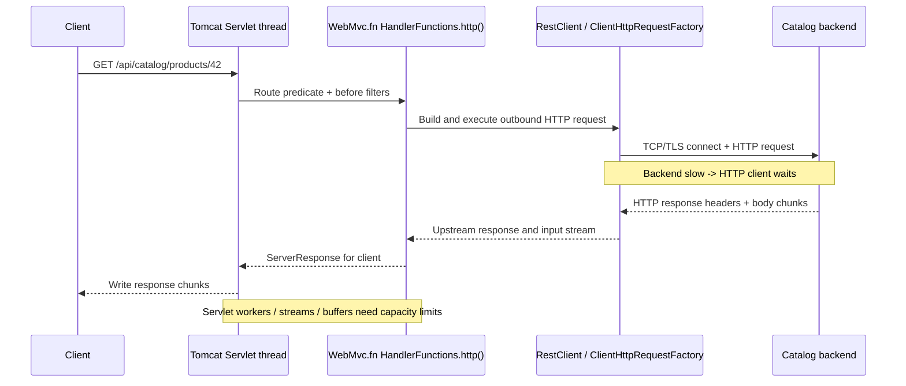
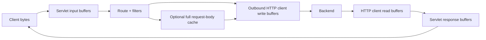
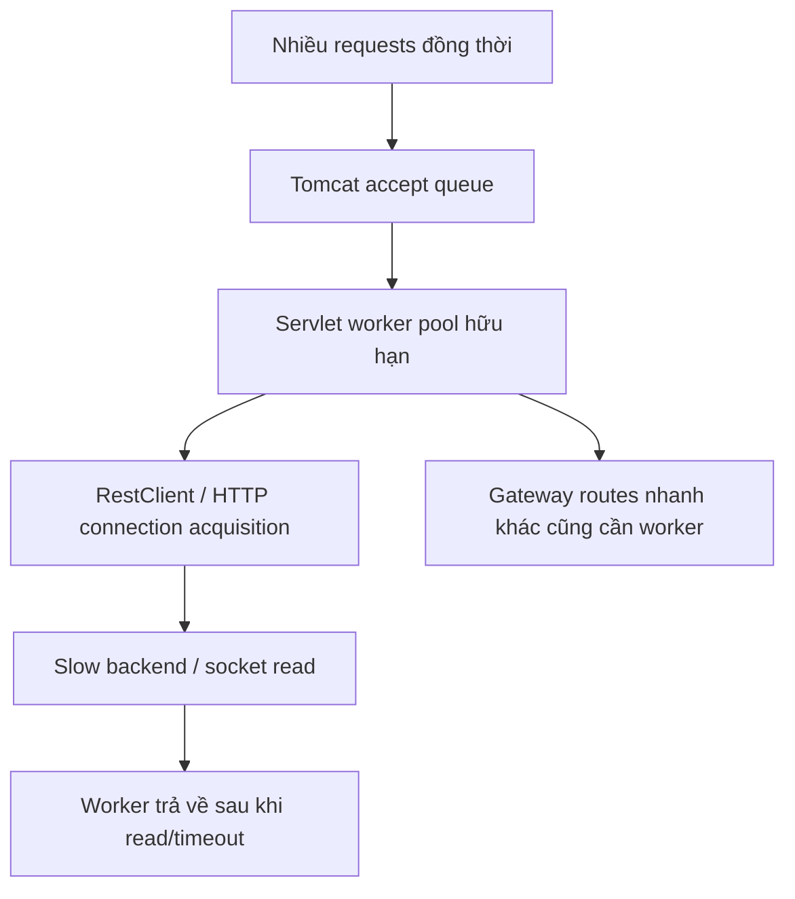
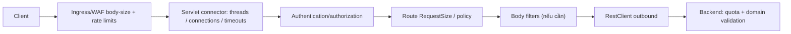
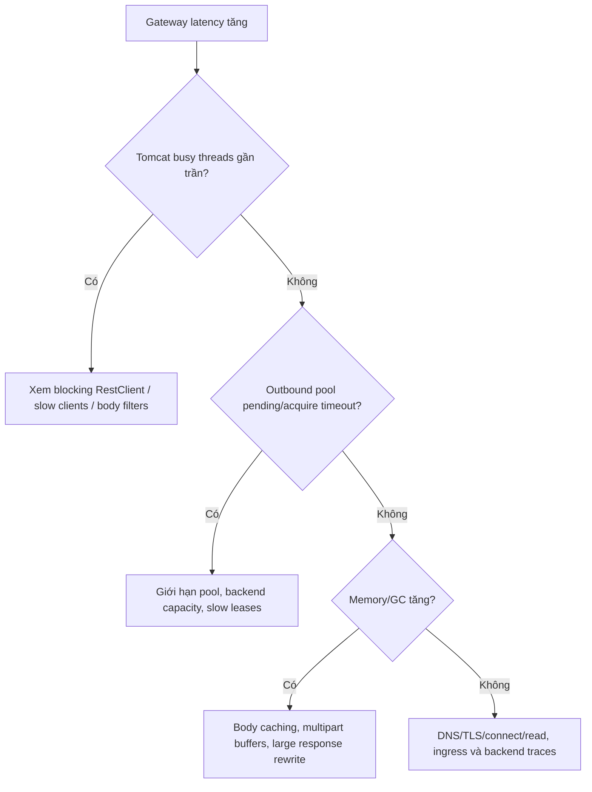

# HttpClient, timeout và bộ đệm trong kiến trúc Servlet của Spring Cloud Gateway Server Web MVC

## 1. Bài toán: Gateway MVC chịu tải thế nào khi backend chậm hoặc response rất lớn?

**Spring Cloud Gateway** là cổng HTTP của kiến trúc microservices: chọn route bằng predicate, chạy filters, biến đổi path/header, khám phá dịch vụ, xác thực, giới hạn lưu lượng, circuit breaker, retry, TLS và quan sát request. Với biến thể **Spring Cloud Gateway Server Web MVC**, các công việc đó chạy trên **Spring MVC/WebMvc.fn và Servlet container** (chẳng hạn Tomcat hoặc Jetty), không phải pipeline Reactor Netty event loop của Gateway Server WebFlux.

Giả sử có Gateway `:8080` chuyển `GET /api/catalog/products/42` tới Catalog `:8081`. Nếu backend chờ database 20 giây, nếu response 500 MB hoặc nếu client tải dữ liệu rất chậm, Gateway có thể chịu:

- **Servlet worker thread bận** chờ HTTP client hoặc ghi response.
- **Kết nối outbound HTTP** bị giữ khi backend trả lời chậm.
- **Bộ đệm** trong request/response pipeline, filter hoặc Servlet container tăng cao.
- **Timeout** ở những lớp khác nhau kết thúc request ở thời điểm khác nhau.
- **Retry** làm tăng downstream attempts và, nếu cache request body, gây áp lực memory.

Mục tiêu bài học là phân biệt chính xác:

1. `HttpClient` **outbound** dùng cho Gateway MVC khi proxy backend, khác với **Servlet container inbound**.
2. `connect timeout`, `read timeout`, `request/async timeout`, TLS timeout và **deadline đầu-cuối**.
3. **Buffer I/O streaming** (ví dụ 16 KiB) khác **cache toàn bộ request/response body** và khác HTTP response cache.
4. Cách cấu hình theo **Spring Boot 3.5 / Boot 4.x** và **Spring Cloud Gateway Web MVC**, tránh nhầm prefix với WebFlux.
5. Mô hình giới hạn thread/connection, upload/download/SSE, các filter xử lý body, lỗi và quan sát hiệu năng.

> **Phạm vi:** bài dùng **Spring Cloud Gateway Server Web MVC 4.3+/5.x**, ví dụ chính với prefix `spring.cloud.gateway.server.webmvc.*`. Khi tham chiếu cấu hình HTTP client, cần xem **Spring Boot version thực tế**: Spring Boot 3.x thường dùng `spring.http.client.*`; Boot 4.x thay bằng `spring.http.clients.*`. Không áp dụng nguyên `spring.cloud.gateway.server.webflux.httpclient.*` cho Server Web MVC.

## 2. Kiến trúc Servlet: hai kết nối HTTP và các điểm chờ



**Hai hướng kết nối phải được quản lý độc lập:**

| Chặng | Đầu vào/đầu ra | Runtime và vấn đề thường gặp |
|---|---|---|
Client → Gateway | **Inbound server** nhận HTTP request | Tomcat/Jetty Servlet thread pool, accept queue, keep-alive, upload limits |
Gateway → backend | **Outbound client** gửi HTTP request | RestClient, `ClientHttpRequestFactory`, JDK/Apache/Jetty HTTP client, connect/read timeout, TLS, connection pool |
Backend → Gateway | Đọc upstream status/headers/body | Response quá chậm, stream đọc dài, compression, upstream disconnect |
Gateway → client | Ghi response | Client chậm, network backpressure, Servlet output buffer, commit status/headers |

Gateway MVC sử dụng các `RouterFunction<ServerResponse>` của **WebMvc.fn**. Theo tài liệu, `HandlerFunctions.http()` là handler proxy HTTP; đích URI có thể được set bằng filter `BeforeFilterFunctions.uri(...)`. Spring Cloud Gateway MVC sử dụng hạ tầng **Spring Boot RestClient** cho các cuộc gọi backend. `RestClient` có API imperative/synchronous, mặc dù HTTP library bên dưới có thể hỗ trợ nhiều chiến lược kết nối/connection pooling.

### 2.1. Tại sao có nhiều loại bộ đệm?



Không có một property `buffer-size` nào điều khiển **mọi ô trong sơ đồ**. Bộ đệm socket, Servlet input/output, streaming buffer, retry body cache, multipart parser, HttpMessageConverter và HTTP caching có mục đích/giới hạn khác nhau.

**Cảnh báo:** Servlet không đồng nghĩa “mọi response đều bị nạp hết vào RAM”. Streaming với `InputStream`/`OutputStream` có thể chuyển dữ liệu theo từng phần, nhưng **một filter đọc body toàn phần** hoặc một HTTP client/request factory cấu hình sai vẫn có thể buộc aggregation.

## 3. Dependency và route mẫu cho Gateway MVC

### 3.1. Chọn đúng starter

```xml
<!-- pom.xml của Gateway; Spring Boot parent + Spring Cloud BOM tương thích -->
<dependency>
    <groupId>org.springframework.cloud</groupId>
    <artifactId>spring-cloud-starter-gateway-server-webmvc</artifactId>
</dependency>
<dependency>
    <groupId>org.springframework.boot</groupId>
    <artifactId>spring-boot-starter-actuator</artifactId>
</dependency>
```

```groovy
// build.gradle của Gateway — versions được quản lý bởi BOM
dependencies {
    implementation 'org.springframework.cloud:spring-cloud-starter-gateway-server-webmvc'
    implementation 'org.springframework.boot:spring-boot-starter-actuator'
}
```

`spring-boot-starter-actuator` là **tùy chọn** cho metrics/health, không bắt buộc để chuyển tiếp HTTP. Starter MVC mang stack WebMVC/Servlet phù hợp; **không đổi sang `spring-cloud-starter-gateway-server-webflux`** chỉ vì nhìn thấy chữ “HttpClient”.

| Stack Gateway | Runtime chính | API route Java | HTTP client điển hình |
|---|---|---|---|
**Server Web MVC** | Servlet, Spring MVC/WebMvc.fn | `RouterFunctions`, `GatewayRouterFunctions.route`, `HandlerFunctions.http` | Spring Boot `RestClient` / `ClientHttpRequestFactory` |
**Server WebFlux** | Spring WebFlux, Reactor Netty | `RouteLocatorBuilder`, `GatewayFilter`, `GlobalFilter` | Reactor Netty `HttpClient` |

Đừng dùng `Mono.block()`, `ServerWebExchange` hoặc `HttpClientCustomizer` của Netty như cấu hình mặc định cho Server MVC. Khi cần sửa filters trong MVC, dùng `BeforeFilterFunctions`, `AfterFilterFunctions` và `HandlerFilterFunction` của WebMvc.fn.

### 3.2. Cấu hình route YAML

```yaml
# application.yml — Server Web MVC 4.3+/5.x
server:
  port: 8080

spring:
  cloud:
    gateway:
      server:
        webmvc:
          routes:
            - id: catalog-via-mvc
              uri: http://localhost:8081
              predicates:
                - Path=/api/catalog/**
              filters:
                - StripPrefix=1
```

Client gọi `GET /api/catalog/products/42`. `StripPrefix=1` bỏ segment `api`, nên backend nhận `GET /catalog/products/42`. Nếu backend thực sự cung cấp `/products/42` thì cần `StripPrefix=2`. Đúng route nhưng sai path có thể gây HTTP 404, **không phải timeout**.

Với Docker/Kubernetes, `localhost:8081` từ process Gateway chỉ trỏ tới chính network namespace/container đó. Thay bằng DNS nội bộ, service name/port hoặc `lb://service-id` kèm Spring Cloud LoadBalancer theo môi trường.

### 3.3. Java DSL tương đương — chỉ dùng một cách đăng ký route

```java
package com.example.gateway.routes;

import static org.springframework.cloud.gateway.server.mvc.filter.BeforeFilterFunctions.stripPrefix;
import static org.springframework.cloud.gateway.server.mvc.filter.BeforeFilterFunctions.uri;
import static org.springframework.cloud.gateway.server.mvc.handler.GatewayRouterFunctions.route;
import static org.springframework.cloud.gateway.server.mvc.handler.HandlerFunctions.http;

import org.springframework.context.annotation.Bean;
import org.springframework.context.annotation.Configuration;
import org.springframework.web.servlet.function.RouterFunction;
import org.springframework.web.servlet.function.ServerResponse;

@Configuration(proxyBeanMethods = false)
public class CatalogMvcRoute {
    @Bean
    RouterFunction<ServerResponse> catalogRoute() {
        return route("catalog-via-mvc")
            .GET("/api/catalog/**", http())
            .before(uri("http://localhost:8081"))
            .before(stripPrefix(1))
            .build();
    }
}
```

`GatewayRouterFunctions.route("catalog-via-mvc")` đặt route ID cho MVC. `http()` thực hiện HTTP proxy; `uri(...)` đặt đích, `stripPrefix(1)` sửa path. Đây là **phương án thay thế** YAML cùng route ID: không đăng ký cả hai trong một bài test vì sẽ khó nhận biết route nào được chọn.

## 4. `HttpClient` outbound trong MVC: RestClient và request factory

### 4.1. RestClient không đồng nghĩa Reactor Netty

Trong Spring Cloud Gateway Server MVC, phần HTTP proxy sử dụng hạ tầng `RestClient` của Spring Boot. `RestClient` là **imperative API**; khi thực thi request, luồng gọi có thể chờ kết quả I/O tùy implementation và Servlet processing strategy.

`ClientHttpRequestFactory` chọn HTTP transport thực tế. Spring Boot có thể tự phát hiện Apache HttpClient, Jetty HttpClient, Reactor Netty HttpClient, JDK `java.net.http.HttpClient` hoặc JDK đơn giản tùy classpath/version, và cho phép chọn implementation tường minh.

| Thành phần | Nhiệm vụ | Vấn đề cần theo dõi |
|---|---|---|
`RestClient` | API gọi HTTP đồng bộ | Vòng đời request/response, error handling |
`ClientHttpRequestFactory` | Adapter tạo/execute HTTP requests | Timeout, TLS, redirect, socket behavior |
Apache HttpComponents (nếu dùng) | HTTP client và connection manager/pool | Max connections, pending leases, stale connections |
JDK HttpClient (nếu dùng) | Client HTTP tiêu chuẩn của JDK | Connect timeout, request timeout, version/proxy |
Servlet container | Nhận request client và ghi response | Thread pool, accept queue, request-size limit |

**Không đặt `spring.cloud.gateway.server.webflux.httpclient.pool.*` hay `wiretap` của Reactor Netty** vào một app chỉ chạy Gateway Server MVC rồi tưởng đã điều chỉnh outbound pool. Với MVC, bắt đầu từ **Spring Boot HTTP client settings** và đúng HTTP request factory đang được chọn.

### 4.2. Spring Boot 4.x: `spring.http.clients.*`

Với Gateway MVC phiên bản phù hợp **Spring Boot 4.x**, các thuộc tính HTTP client chung theo Boot 4:

```yaml
# Ví dụ Spring Boot 4.x (không kết hợp với cấu hình Boot 3.x bên dưới)
spring:
  http:
    clients:
      connect-timeout: 2s
      read-timeout: 5s
      imperative:
        factory: jdk
```

Ý nghĩa:

- `connect-timeout: 2s`: giới hạn thời gian **thiết lập kết nối tới backend** theo implementation được cấu hình; không giới hạn toàn bộ request.
- `read-timeout: 5s`: giới hạn chờ **đọc response** theo semantics request factory/HTTP client. Không mặc nhiên là total wall-clock deadline cho download 2 GB.
- `imperative.factory: jdk`: chọn request factory dùng JDK HTTP client nếu môi trường/version hỗ trợ; khi bỏ dòng này, Boot có thể tự chọn theo classpath.

Đây là **cấu hình toàn cục của Spring Boot HTTP clients**; nó có thể ảnh hưởng các RestClient khác được Boot quản lý, không chỉ route Catalog. Khi ứng dụng có custom RestClient builder/factory beans, cần kiểm tra thực tế Gateway đang dùng client nào, không suy rằng property luôn ghi đè mọi factory tự tạo.

### 4.3. Spring Boot 3.5: tên singular `spring.http.client.*`

Với Spring Boot **3.5.x** (thường đi cùng Spring Cloud Gateway **4.3.x** theo release train tương thích):

```yaml
# Ví dụ cho Spring Boot 3.5.x:
spring:
  http:
    client:
      connect-timeout: 2s
      read-timeout: 5s
      factory: jdk
```

Boot 4 đánh dấu những key `spring.http.client.*` cũ là **deprecated** và chuyển sang `spring.http.clients.*`. Không copy cả hai khối rồi mong hệ thống tự chọn “đúng” tùy ý; hãy đối chiếu **Boot version, configprops và auto-configuration report**.

### 4.4. Các namespace dễ nhầm

| Thuộc tính | Áp dụng cho | Lưu ý |
|---|---|---|
`spring.http.clients.connect-timeout` | Spring Boot 4.x HTTP client defaults | Cùng phạm vi với các imperative clients do Boot quản lý |
`spring.http.clients.read-timeout` | Spring Boot 4.x HTTP client defaults | Semantics tùy request factory |
`spring.http.clients.imperative.factory` | Spring Boot 4.x RestClient transport choice | Không tự tạo riêng một pool cho mỗi route |
`spring.http.client.connect-timeout` | Spring Boot 3.x HTTP client defaults | Boot 4 deprecated |
`spring.cloud.gateway.mvc.http-client.*` | **Các dòng Gateway MVC cũ** | Không khuyên dùng với MVC 4.3+/5.x; đã chuyển dần sang Boot |
`spring.cloud.gateway.server.webflux.httpclient.*` | **Gateway Server WebFlux** | Không dùng làm cấu hình outbound Gateway MVC |
`server.tomcat.*` | **Servlet container inbound** | Không thay thế outbound connect/read timeout |
`spring.mvc.async.request-timeout` | Servlet **async request processing** | Không đồng nghĩa timeout cho mọi `HandlerFunctions.http()` request |

**Cần nhớ:** tài liệu Gateway MVC đã ghi `spring.cloud.gateway.mvc.http-client.ssl-bundle` deprecated từ 4.2 để dùng cấu hình SSL bundle của Spring Boot. Việc lựa chọn client, socket và timeout phải tuân theo bộ dependency hiện tại thay vì giả định một property cổ điển vẫn có hiệu lực.

## 5. Timeout: đừng dùng một con số để gọi là “timeout của Gateway”

Một request đi qua nhiều ranh giới:

```text
Client -> Ingress/WAF -> Tomcat (Gateway MVC)
                   -> outbound HTTP client -> DNS/TCP/TLS -> Backend
                   <- response headers/body <-           <-
Client <- Tomcat response writer / ingress  <-
```

Một số giới hạn thời gian độc lập:

| Loại timeout | Đo thời gian gì? | Đặt ở đâu? | Có phải total request deadline không? |
|---|---|---|---|
**TCP connect** | Chờ mở kết nối socket outbound | `spring.http.clients.connect-timeout` (Boot 4) hoặc request factory | **Không**; không bao gồm backend xử lý |
**TLS handshake** | Chờ thương lượng TLS khi mở kết nối HTTPS | HTTP client/TLS stack, factory-specific | Không |
**Read/response** | Chờ đọc HTTP response theo semantics HTTP client | `spring.http.clients.read-timeout` hoặc request factory | **Không chắc**; thường là chờ dữ liệu, không phải tổng thời gian download |
**Connection acquisition** | Chờ lấy outbound connection từ pool | HTTP client/connection manager cụ thể | Không; khác TCP connect |
**Servlet inbound connection** | Chờ client gửi request-line/HTTP data ở một số giai đoạn | `server.tomcat.connection-timeout` và container settings | Không |
**Servlet async timeout** | Thời gian xử lý một Servlet asynchronous request | `spring.mvc.async.request-timeout` khi thực sự dùng async | Không áp cho mọi blocking proxy request |
**Ingress/CDN idle timeout** | Chờ bytes trên upstream/downstream channel | Load balancer/reverse proxy | Không |
**End-to-end deadline** | Từ client gửi request tới khi hoàn thành/đóng | Hợp đồng client + server, phải thiết kế | **Có**, nếu áp dụng nhất quán |

### 5.1. Connect timeout không cắt backend chậm sau khi kết nối xong

Giả sử Gateway đã nối TCP thành công tới `localhost:8081` trong 10 ms, backend chạy truy vấn 8 giây mới trả status. `connect-timeout: 2s` **không có tác dụng** vì giai đoạn connect đã xong.

Nếu `read-timeout: 5s` áp dụng cho tình huống backend không phát byte response trong 8 giây, outbound client có thể timeout. Nhưng status cuối cùng phía client **không mặc định luôn là HTTP 504**: phụ thuộc request factory, exception mapping của Gateway MVC, Servlet response commit và các error handlers. Cần đo thật để xác nhận `502/503/504/500` theo contract.

### 5.2. Read timeout không nhất thiết là tổng thời gian tải file

Một backend có thể gửi **16 KiB mỗi 2 giây** suốt 30 phút. Nếu timeout được hiểu là **khoảng chờ giữa các hoạt động đọc**, kết nối vẫn có thể sống dù tổng thời gian dài. Một HTTP client implementation khác có thể có request-level deadline bổ sung.

Đừng suy từ tên `read-timeout: 5s` rằng mọi `GET` phải kết thúc **trong 5 giây**. Kiểm tra semantics của **JDK/Apache/Jetty request factory cụ thể** và thử cả “chưa có first byte” lẫn “đang download nhỏ giọt”.

### 5.3. Servlet request timeout không phải outbound HTTP timeout

Ví dụ cấu hình Tomcat:

```yaml
server:
  port: 8080
  tomcat:
    connection-timeout: 10s
    threads:
      max: 200
```

`server.tomcat.connection-timeout` liên quan **inbound connector** ở Servlet server, ví dụ thời gian chờ request line sau khi chấp nhận connection. Nó **không** được chuyền sang `RestClient` khi Gateway gọi backend.

`server.tomcat.threads.max` quản lý số worker threads (với **platform thread model**); nó **không** giải quyết vì sao HTTP client chờ quá lâu. Nếu tăng từ 200 lên 1.000 chỉ để chịu backend chậm, bạn có thể chuyển sự quá tải sang database/HTTP connection pool và tăng bộ nhớ thread.

### 5.4. `spring.mvc.async.request-timeout` chỉ cho async Servlet requests

```yaml
spring:
  mvc:
    async:
      request-timeout: 30s
```

Property trên dành cho **Servlet async request processing**, chẳng hạn controller trả `Callable`, `DeferredResult` hoặc `StreamingResponseBody` theo Spring MVC. `HandlerFunctions.http()` proxy theo cơ chế của Gateway MVC **không tự được bảo đảm** có deadline tương ứng chỉ vì property đó có mặt.

**Cách dùng an toàn:** khi cần deadline cứng cho một route, chọn phương án **được hỗ trợ bởi HTTP client/request factory hoặc một filter/handler phù hợp phiên bản**, phối hợp với timeout ở ingress và client. Đừng copy ví dụ WebFlux:

```yaml
# KHÔNG mặc định hợp lệ cho Gateway Server Web MVC:
metadata:
  connect-timeout: 200
  response-timeout: -1
```

Đây là **mẫu per-route timeout được tài liệu Gateway Server WebFlux mô tả**, không phải lời hứa Gateway MVC dùng nó cùng semantics. Với MVC, kiểm tra API và release cụ thể trước khi áp dụng metadata timeout; nếu không có chức năng per-route, hãy cân nhắc **tách gateway deployment** hoặc thiết kế outbound client riêng có ranh giới rõ ràng.

### 5.5. Tổng deadline và retry budget

Một thiết kế API có SLA tổng `4 giây` có thể đặt giới hạn **minh họa**:

| Thành phần | Ngân sách tham khảo |
|---|---:|
Ingress/queue/predicate/security | 200 ms |
DNS/TCP/TLS connect | 500 ms |
Backend processing/first byte | 2.500 ms |
Đọc/ghi phần response dự kiến | 300 ms |
Dự phòng jitter/logging/correlation | 500 ms |
**Tổng** | **4.000 ms** |

Đây là **ngân sách kế hoạch**, không phải năm bộ đếm được Gateway tự cộng chính xác. Một timeout “per attempt = 3s” cộng `Retry=3` attempts với backoff có thể vượt xa `4s`. Khi thiết kế retry, chỉ retry operations idempotent, giới hạn attempts, backoff và số request đồng thời; backend cần kiểm tra idempotency với mutations.

**Không dùng cách đơn giản “timeout càng lớn càng an toàn”:** timeout quá dài khiến Servlet workers và outbound connections bị giữ, tăng queue, có thể khiến toàn Gateway mất khả năng đáp ứng.

## 6. Thread pool Servlet và connection pool outbound

### 6.1. Vì sao backend chậm làm cạn workers?

Spring MVC truyền thống xử lý một request đồng bộ trên Servlet worker. Khi request gọi backend qua `RestClient` imperative và chờ kết quả, worker có thể bị giữ cho đến khi I/O hoàn thành (trừ những cơ chế xử lý async mà framework/runtime hỗ trợ và được kích hoạt cụ thể).

Nếu có tối đa **200 workers**, mỗi request chiếm worker **5 giây**, khả năng phục vụ thuần túy theo giới hạn chờ xấp xỉ:

\[
\frac{200\ \text{workers}}{5\ \text{giây/request}} \approx 40\ \text{request/giây}
\]

Đây chỉ là **ước lượng minh họa theo thông lượng/độ trễ**; thực tế còn bị chi phối bởi thời gian CPU, connection pooling, accept queue, request mix và hạ tầng. Nó cho thấy **một backend chậm có thể làm route khác bị ảnh hưởng** khi dùng chung pool, dù route kia gọi backend nhanh.



Các dấu hiệu thread starvation:

- p95/p99 latency tăng ở **nhiều route** cùng lúc.
- `tomcat.threads.busy` gần trần và queue chờ tăng (tên metric phụ thuộc Actuator/runtime).
- Backend latency cao, outbound pool pending connections hoặc acquisition timeouts.
- Health probe/API đơn giản cũng chậm nếu dùng chung worker pool.
- Thread dump cho thấy nhiều threads ở `RestClient`/`SocketInputStream.read`/HTTP client internals.

### 6.2. `server.tomcat.threads.max` không tương đương max outbound connections

Ví dụ:

```yaml
server:
  tomcat:
    threads:
      max: 200
    max-connections: 8192
    accept-count: 100
```

Ba con số điều khiển **các khía cạnh inbound Tomcat khác nhau**:

- `threads.max`: worker threads tối đa với platform threads.
- `max-connections`: số kết nối mạng inbound Tomcat chấp nhận/xử lý tại một thời điểm.
- `accept-count`: độ dài hàng đợi inbound chờ khi tài nguyên xử lý bị sử dụng hết.

**Không** con số nào tự cấu hình Apache/JDK outbound HTTP connection pool. Khi dùng Apache HttpClient, cần chọn/đo chính sách `maxTotal`, `maxPerRoute`, connection lease timeout, keep-alive/TTL trên client đã tạo; khi dùng JDK HTTP client, hành vi pool và API cấu hình khác.

Không khẳng định Spring Boot luôn dùng Apache chỉ vì có Maven dependency gián tiếp. Boot phát hiện request factory theo **classpath và override**, vì vậy nên quan sát/request factory thực tế sau mỗi lần đổi dependencies.

### 6.3. Virtual threads với Java 21+

Spring Boot có cấu hình:

```yaml
spring:
  threads:
    virtual:
      enabled: true
```

Khi chạy JDK hỗ trợ và Servlet container có tích hợp đúng, virtual threads có thể làm chi phí giữ một thread trong lúc blocking I/O **thấp hơn** so với platform threads. Nhưng:

1. Không có nghĩa backend/DB có thêm connections hoặc CPU.
2. Không biến `RestClient` thành reactive streaming API.
3. Vẫn cần **semaphore/concurrency bulkhead**, connection pool cap, deadline và timeout.
4. Native/synchronized sections có thể gây contention hoặc pinning tùy JDK/implementation.
5. Một số thuộc tính như `server.tomcat.threads.max` **không còn hiệu lực giống platform threads** khi virtual threads được bật; Boot documentation nêu cụ thể điều này.

**Chiến lược:** thử virtual threads với load test tương đương production, đo p99/heap/GC/connection wait và so sánh trước-sau. Không chỉ bật virtual threads rồi bỏ giới hạn active requests.

## 7. Bộ đệm của Servlet và HTTP client: phân biệt stream với cache toàn body

### 7.1. Bộ đệm cho streaming MIME types

Gateway MVC 5.0/5.1 có hai thuộc tính cấu hình:

```yaml
spring:
  cloud:
    gateway:
      server:
        webmvc:
          streaming-media-types:
            - text/event-stream
            - application/x-ndjson
          streaming-buffer-size: 16384
```

Tài liệu `configprops` mô tả `streaming-buffer-size` mặc định **16384 bytes** (16 KiB) **cho các MIME types được nhận diện là streaming**. Danh sách `streaming-media-types` nêu những response types cần cơ chế chuyển tiếp streaming của Gateway MVC.

**Hiểu chính xác:**

- `16384` là **kích cỡ buffer phục vụ luồng I/O**, không phải trần 16 KiB cho response.
- Không có nghĩa một file 200 MB bị cắt còn 16 KiB.
- Không có nghĩa Gateway chỉ sử dụng 16 KiB heap cho mọi request; socket buffers, HTTP client, Servlet buffers và filters có thể bổ sung memory.
- Không có nghĩa mọi SSE event sẽ được flush đúng 16 KiB hoặc đúng 1 lần/event. Còn phụ thuộc message writer, HTTP client, servlet response, proxy buffering và network.
- Không điều khiển **body cache của Retry** hoặc bộ nhớ của multipart parser.

Với response dạng JSON một lần, không cần gắn `text/event-stream` chỉ để “tối ưu”; `Content-Type` phải phản ánh **hợp đồng thực tế**. Chỉ liệt kê MIME types thực sự được backend phát theo luồng và kiểm tra trace trước/sau.

### 7.2. Dòng dữ liệu từng chunk không đồng nghĩa non-blocking

```text
Backend input stream --[16 KiB]--> Gateway read buffer
                    --[16 KiB]--> Servlet output stream --[network]--> Client
```

Chuyển từng chunk giúp giảm nhu cầu **giữ toàn bộ file trong RAM**; tuy nhiên với **blocking I/O**, worker có thể chờ đọc upstream hoặc ghi xuống một client chậm. HTTP client/Servlet không tự đạt end-to-end backpressure như Reactor; giới hạn concurrent downloads và timeout vẫn quan trọng.

Không để một custom filter viết:

```java
// SAI về khả năng mở rộng với payload không giới hạn:
byte[] entireBody = servletRequest.getInputStream().readAllBytes();
```

Một request 500 MB có thể tạo `byte[]` lớn và bản sao khi chuyển đổi JSON/string; với 50 requests đồng thời, memory nhanh chóng vượt ngân sách heap. Nếu thật sự phải inspect body, đặt giới hạn cứng trước, chọn parser streaming hoặc chuyển kiểm tra sang backend chuyên trách.

### 7.3. Bộ đệm socket và Servlet output buffer

| Buffer | Đơn vị/điểm áp dụng | Rủi ro khi nhầm |
|---|---|---|
TCP send/receive buffers | Hệ điều hành/socket | Tăng buffer không giải quyết backend chậm |
Servlet request input | Container parse/nhận bytes | Có thể giữ thread khi client upload chậm |
Servlet response output | Chưa commit / ghi response | Header/status đã commit không đổi được |
Gateway `streaming-buffer-size` | Chuyển dữ liệu cho streaming MIME types | Không phải request-size limit |
HttpClient buffers | Đọc/ghi outbound request/response | Semantics khác theo JDK/Apache/Jetty |
Retry body cache | Giữ request body để gửi lại | Có thể tăng heap theo bytes × concurrency |
`@RequestBody` + JSON parsing | Deserialize thành object/string | Có thể aggregate body lớn |
Multipart parser/temp storage | Lưu parts ở memory/disk | Đầy disk, temp files, DoS |
LocalResponseCache | Cache response cho request tương lai nếu bật ở stack hỗ trợ | **Không đồng nghĩa streaming buffer** |

`Content-Length`/`Transfer-Encoding` là headers của **hợp đồng truyền tải HTTP**, không phải núm điều chỉnh RAM trực tiếp. Đừng gán sai `Content-Length` sau khi filter sửa body: có thể khiến client chờ vô hạn hoặc cắt response.

## 8. Cache body trong Servlet: request `InputStream` thường chỉ đọc được một lần

Trong Servlet API, `HttpServletRequest.getInputStream()` thường được tiêu thụ **một lượt**. Nếu một `before filter` đọc request body để xác minh HMAC, rồi tiếp tục proxy, backend có thể nhận body rỗng trừ khi Gateway đã **cache và cung cấp lại** dữ liệu.

### 8.1. `AdaptCachedBody` phục vụ việc đọc lại, không phải response cache

Gateway MVC có `MvcUtils.cacheAndReadBody(request, BodyType.class)` và `BeforeFilterFunctions.adaptCachedBody()`. Theo tài liệu chính thức:

1. `cacheAndReadBody(...)` đọc/giải mã và lưu lại body vào request attributes.
2. `adaptCachedBody()` bọc request để các bước sau có thể đọc bytes đã lưu như một input stream mới.
3. **Thứ tự quan trọng:** adapter phải đến **sau** bước đã cache body; đặt trước thì không có dữ liệu và có thể gửi body rỗng.

Ví dụ Java DSL minh họa (chỉ áp cho payload nhỏ, đã được giới hạn):

```java
package com.example.gateway.routes;

import static org.springframework.cloud.gateway.server.mvc.filter.BeforeFilterFunctions.adaptCachedBody;
import static org.springframework.cloud.gateway.server.mvc.filter.BeforeFilterFunctions.uri;
import static org.springframework.cloud.gateway.server.mvc.handler.GatewayRouterFunctions.route;
import static org.springframework.cloud.gateway.server.mvc.handler.HandlerFunctions.http;

import java.util.Optional;
import org.springframework.cloud.gateway.server.mvc.common.MvcUtils;
import org.springframework.context.annotation.Bean;
import org.springframework.context.annotation.Configuration;
import org.springframework.web.servlet.function.RouterFunction;
import org.springframework.web.servlet.function.ServerResponse;

@Configuration(proxyBeanMethods = false)
public class SmallBodyInspectionRoute {
    @Bean
    RouterFunction<ServerResponse> inspectedRoute() {
        return route("inspected-small-body")
            .POST("/api/inspect", http())
            .before(uri("http://localhost:8081"))
            .before(request -> {
                Optional<String> body =
                    MvcUtils.cacheAndReadBody(request, String.class);
                // Chỉ xử lý metadata/hàm kiểm tra nhỏ; KHÔNG log raw body.
                // Khi xác minh HMAC, phải dùng raw bytes và ký đúng canonical form.
                body.ifPresent(value -> {
                    if (value.length() > 1024 * 1024) {
                        throw new IllegalArgumentException("Body too large");
                    }
                });
                return request;
            })
            .before(adaptCachedBody())
            .build();
    }
}
```

**Đây chỉ là ví dụ về thứ tự filter**, chưa phải giải pháp HMAC hoặc giới hạn body an toàn production. `String.length()` đo UTF-16 code units, **không phải số bytes UTF-8 trên mạng**; kiểm tra sau khi đọc body cũng **quá muộn để tránh đã cấp phát RAM lớn**. Trong production, đặt **request-size limit trước khi cache**, kiểm soát bytes thực được đọc, hỗ trợ charset/encoding đúng, xử lý lỗi thành 4xx theo API contract và không log payload riêng tư.

### 8.2. Đặt `RequestSize` cho route có body nhỏ

Gateway MVC hỗ trợ `RequestSize` filter:

```yaml
spring:
  cloud:
    gateway:
      server:
        webmvc:
          routes:
            - id: small-json-import
              uri: http://localhost:8081
              predicates:
                - Path=/api/import/**
                - Method=POST
              filters:
                - StripPrefix=1
                - name: RequestSize
                  args:
                    maxSize: 1MB
```

`RequestSize` có thể từ chối request vượt ngưỡng bằng `413 Payload Too Large` theo tài liệu filter. Nó là **policy của route**, không thay mọi giới hạn container/ingress hoặc giới hạn đọc body trong filter tùy chỉnh. Nếu client nói sai `Content-Length` hoặc dùng chunked upload, phải kiểm thử implementation và các lớp kiểm soát bytes thực.

**Không gộp `small-json-import` ở YAML với route Java `inspected-small-body` rồi nghĩ chúng đương nhiên có cùng `RequestSize`.** Hai routes là hai ví dụ độc lập; nếu muốn kiểm thử HMAC cùng RequestSize, tích hợp đầy đủ policy vào **chính route** đang dùng và xác minh thứ tự.

### 8.3. `Retry cacheBody=true` có thể nhân RAM theo concurrency

Một request có body được gửi sang backend. Khi muốn retry POST, Gateway cần có khả năng **đọc lại body**. Gateway MVC Retry filter có tham số `cacheBody`; khi bật, tài liệu cảnh báo **đọc toàn bộ body vào memory**, và cần phối hợp `AdaptCachedBody`.

Ví dụ **chỉ dùng cho một thao tác demo có idempotency**, không sao chép nguyên sang API thanh toán:

```yaml
spring:
  cloud:
    gateway:
      server:
        webmvc:
          routes:
            - id: idempotent-test-retry
              uri: http://localhost:8081
              predicates:
                - Path=/api/demo/retry
                - Method=POST
              filters:
                - name: RequestSize
                  args:
                    maxSize: 512KB
                - name: Retry
                  args:
                    retries: 1
                    methods: POST
                    series: SERVER_ERROR
                    cacheBody: true
                - name: AdaptCachedBody
```

Giả sử cache body **512 KiB** × **100** requests đồng thời: riêng bytes payload có thể cần khoảng **50 MiB**, **chưa tính** copies, object overhead, HTTP client buffers, Servlet state và các routes khác. Khi số concurrent requests hoặc payload tăng, bộ nhớ có thể tăng rất nhanh.

**Chú ý an toàn:** `POST` không tự idempotent. Backend demo phải yêu cầu **Idempotency-Key** đáng tin, lưu kết quả theo key và xử lý trùng. Retry có thể tạo nhiều downstream attempts, gồm trường hợp lần đầu đã xử lý thành công nhưng response bị mất. Đối với production, ưu tiên tránh retry mutation hoặc thiết kế nghiệp vụ đúng nghĩa trước khi bật.

Nếu filter yêu cầu body cache nhưng `AdaptCachedBody` chưa được gắn/chạy đúng, backend có thể nhận **body rỗng ở lần gọi sau**. Quan sát request counts/backend logs/headers và body checksum ở môi trường test để phát hiện, không chỉ nhìn HTTP 200 của Gateway.

### 8.4. `ModifyRequestBody`/`ModifyResponseBody` cũng có chi phí aggregation

Trong Gateway MVC, tài liệu mô tả các filter sửa request/response body thông qua Java DSL và HTTP message conversion:

```java
// Chỉ minh họa API, xem docs MVC để thêm imports/route context:
.before(modifyRequestBody(
    String.class, String.class, "text/plain",
    (request, body) -> body == null ? "" : body.toUpperCase()))
```

Để sửa body, framework có thể cần **đọc và deserialize toàn bộ representation** trước khi encode lại. Với payload JSON nhỏ có giới hạn, điều đó có thể chấp nhận. Với file tải hàng GB, SSE hoặc NDJSON vô hạn, không nên dùng một bộ lọc chuyển toàn body thành `String`/DTO.

Hãy phân biệt:

- **Streaming copy:** đọc/ghi từng chunk, vẫn có buffer nhưng không cần toàn bộ response trong heap.
- **Body rewrite/deserialize:** có thể giữ toàn bộ body trong RAM để xử lý.
- **HTTP response cache:** lưu response cho những requests **sau**, không liên quan trực tiếp đến body rewrite.

**Không dùng `spring.http.codecs.max-in-memory-size` của WebFlux** làm công tắc chung giới hạn mọi body rewrite trong Servlet Gateway MVC. Tài liệu Spring Boot mô tả property này cho auto-configured WebFlux server/WebClient, **không phải tổng bộ nhớ Servlet input streams**.

## 9. `application/x-www-form-urlencoded`, multipart và Servlet request parameters

### 9.1. Servlet container có thể đọc body khi parse parameters

Với `Content-Type: application/x-www-form-urlencoded`, Servlet container thường kết hợp form fields vào các **request parameters** cùng query parameters. Một `Servlet Filter` gọi `getParameterMap()` trước Gateway có thể kích hoạt parse/tiêu thụ input stream. Gateway MVC có **`FormFilter`** để tái tạo body phù hợp cho downstream.

Tài liệu Gateway MVC quy định: **Servlet Filter đọc request parameters** cần được xếp đúng thứ tự **trước `FormFilter`** theo hướng dẫn cụ thể. Nếu một security/observability filter đọc parameters rồi request body không còn, cần kiểm tra filter order, form reconstruction và bytes thực backend nhận—không đổ lỗi ngay cho outbound HttpClient.

Ví dụ payload cần bảo toàn:

```http
POST /api/payments/form HTTP/1.1
Content-Type: application/x-www-form-urlencoded

reference=INV-42&amount=100
```

Những công việc tự đọc `getInputStream()`, `getReader()` hoặc `getParameterMap()` ở nhiều Servlet filters có thể thay đổi cách body được tiêu thụ; đừng giả định có thể đọc raw bytes nhiều lần mà không wrapper/cache.

### 9.2. Multipart upload là một loại áp lực bộ đệm khác

Với `multipart/form-data`, Servlet container/multipart resolver có thể lưu parts **vào RAM hoặc file tạm**. Spring Boot có các properties:

```yaml
# Ví dụ kiểm soát multipart ở Servlet app, tùy container/version.
spring:
  servlet:
    multipart:
      max-file-size: 10MB
      max-request-size: 12MB
      file-size-threshold: 1MB
```

**Không nhầm:** những thuộc tính này điều khiển phần **multipart parsing** khi nó được kích hoạt; chúng không tự giới hạn mọi `application/octet-stream` raw POST hoặc streaming response. Với upload qua Gateway proxy, cần giới hạn thêm ở ingress/Gateway route/backend, chỗ lưu temp directory, số concurrent uploads và quota dung lượng đĩa.

Nếu không cần inspect file ở Gateway, hạn chế multipart parsing không cần thiết và để **service nghiệp vụ** xử lý streaming, AV scan, checksum và ownership. Nếu cần scan trước khi proxy, cân nhắc **object storage + async scan workflow**, không giữ file lớn trong một Servlet worker/heap.

### 9.3. Hop-by-hop headers và `Content-Length`

Gateway MVC có request/response headers filters liên quan việc loại bỏ các hop-by-hop headers, chuẩn hóa `Transfer-Encoding`, và xử lý `Content-Length` sau body transformation. Không nên:

- Forward nguyên `Connection`, `Transfer-Encoding`, `Keep-Alive` như end-to-end headers.
- Giữ `Content-Length` của body cũ sau khi filter đã sửa byte count.
- Tự ép `Transfer-Encoding: chunked` cho HTTP/2.
- Log raw multipart, form parameters có password/token hoặc toàn bộ binary payload.

Nếu test thấy backend nhận body bị cắt/rỗng hoặc client chờ đến timeout dù backend đã hoàn tất, hãy kiểm tra **Servlet FormFilter**, request-body cache, custom filters và headers framing trước khi tăng read timeout.

## 10. Streaming responses trên Servlet: file lớn, NDJSON và SSE

### 10.1. Large downloads

Khi backend trả `application/octet-stream` vài GB, giải pháp tốt thường là **stream bytes** qua Gateway hoặc cấp signed object-storage URL khi chính sách cho phép. Không sửa response body bằng `String` hay JSON serializer chỉ để thêm một header.

Các áp lực cần theo dõi:

1. **Response read timeout** từ HTTP client đến backend.
2. **Servlet output buffer** và client download bandwidth.
3. Thời gian một worker/connection bị giữ trên Gateway.
4. Header `Content-Length`, `Content-Range`/`Range` nếu backend hỗ trợ resumable downloads.
5. Ingress/CDN maximum response size/idle timeout/compression.
6. Bandwidth và concurrent streams quota theo tenant.

Nếu client tải chậm, backend có thể cũng bị chậm do Gateway không đọc tiếp kịp. `streaming-buffer-size` giúp phân đoạn dữ liệu, nhưng không tạo quota bandwidth hoặc concurrency tự động.

### 10.2. SSE và NDJSON qua Gateway MVC

SSE là một response HTTP `text/event-stream` có thể giữ kết nối lâu; NDJSON là các JSON objects phân tách bằng newline. Cả hai cần **flush từng phần** thay vì chờ body hoàn tất.

```yaml
spring:
  cloud:
    gateway:
      server:
        webmvc:
          streaming-media-types:
            - text/event-stream
            - application/x-ndjson
          streaming-buffer-size: 16384
          routes:
            - id: events-mvc
              uri: http://localhost:8081
              predicates:
                - Path=/api/events/**
                - Method=GET
              filters:
                - StripPrefix=1
```

Nhưng `streaming-media-types` không vô hiệu **read timeout** của HTTP client hay idle timeout của ingress, và không đảm bảo proxy/HTTP client flush từng event byte-for-byte. Hãy thử `curl -N` **trực tiếp backend**, **qua Gateway** và **qua ingress**, so sánh timestamp từng dòng.

**Không áp Retry/body-caching/CircuitBreaker TimeLimiter ngắn mặc định** cho luồng sống dài. Khi response đã commit, Gateway không thể đổi 200 thành 503 theo cách an toàn; client phải có reconnect/resume contract riêng.

### 10.3. Servlet async streaming ở backend: thread budget riêng

Một **backend Spring MVC** có thể trả `StreamingResponseBody`, `SseEmitter` hoặc `ResponseBodyEmitter`; Spring MVC thường dùng cơ chế Servlet asynchronous processing và task executor cho phần ghi. Với backend đó, `spring.mvc.async.request-timeout` và `AsyncTaskExecutor` cần được cấu hình theo dự kiến.

Tuy nhiên, việc backend dùng Servlet async **không làm Gateway MVC tự trở thành Reactor non-blocking**. Ở Gateway vẫn có HttpClient đọc/Servlet response ghi và những giới hạn connection/thread/buffer riêng.

Đối với WebSocket có frame hai chiều, Gateway MVC hỗ trợ proxy WebSocket và một bộ giới hạn **khác** như `spring.cloud.gateway.server.webmvc.websocket.send-buffer-size-limit`. **Không nhầm WebSocket send buffer với `streaming-buffer-size` cho HTTP SSE/NDJSON**.

## 11. Chọn request factory và tùy biến HTTP client đúng phạm vi

### 11.1. Không “đoán” HTTP client dựa vào tên Servlet container

Tomcat là **inbound Servlet runtime**. Nó không tự bắt buộc Gateway MVC dùng Apache HttpClient hay JDK HttpClient cho **outbound calls**. Spring Boot có cơ chế chọn `ClientHttpRequestFactory` dựa trên classpath và cấu hình.

| Lựa chọn outbound | Điều nên kiểm tra |
|---|---|
JDK `java.net.http.HttpClient` | Proxy/TLS/redirects, connect timeout, response/read behavior của request factory |
Apache HttpComponents | ConnectionManager, max total/per route, pool lease timeout, idle eviction, HTTP versions |
Jetty HTTP client | Connection limits, idle timeout, request timeouts và shared resources |
Client auto-detected | Những dependency mới có thể thay đổi implementation được chọn |

Nếu cần HTTP proxy/connection pool đặc biệt, **ưu tiên các cấu hình được Boot/Gateway công bố**. Với HTTP clients nâng cao, có thể dùng `ClientHttpRequestFactoryBuilderCustomizer` hoặc `ClientHttpRequestFactoryBuilder` theo Spring Boot 4; hãy kiểm thử rằng **RestClient do Gateway MVC sử dụng** thực sự được cấu hình theo ý định.

### 11.2. RestClient riêng không tự thay thế HTTP client của Gateway

Đoạn code sau cho một **service tự bạn viết**, không tự đổi `HandlerFunctions.http()` của Gateway:

```java
package com.example.catalog.client;

import java.time.Duration;

import org.springframework.boot.http.client.ClientHttpRequestFactoryBuilder;
import org.springframework.boot.http.client.HttpClientSettings;
import org.springframework.http.client.ClientHttpRequestFactory;
import org.springframework.stereotype.Component;
import org.springframework.web.client.RestClient;

@Component
public class CatalogStatusClient {
    private final RestClient restClient;

    public CatalogStatusClient(RestClient.Builder builder) {
        ClientHttpRequestFactory factory =
            ClientHttpRequestFactoryBuilder.detect().build(
                HttpClientSettings.defaults()
                    .withConnectTimeout(Duration.ofSeconds(1))
                    .withReadTimeout(Duration.ofSeconds(2)));

        this.restClient = builder
            .baseUrl("https://catalog.internal.example")
            .requestFactory(factory)
            .build();
    }

    public String checkHealth() {
        return restClient.get()
            .uri("/health")
            .retrieve()
            .body(String.class);
    }
}
```

API trên minh họa **Spring Boot 4.x `ClientHttpRequestFactoryBuilder`**. Nó không phải code cần thêm vào Gateway để bật `routes`; `/health` là endpoint **giả định**, phải được backend cho phép và bảo vệ. Với Spring Boot 3.x, package/API có thể khác.

**Quan trọng:** tạo `CatalogStatusClient` không có nghĩa Gateway MVC tự sử dụng instance này để proxy `catalog-via-mvc`. Với các route có timeout khác nhau, phải có **extension point chính thức và mapping rõ ràng** giữa route → HTTP client/handler, hoặc tách các workloads/gateway deployments. Không hứa rằng bean `RestClientCustomizer` bất kỳ có thể thay đổi một route cụ thể mà không cần thử.

### 11.3. Tránh retry, redirect và proxy bất ngờ

- **Redirect:** một HTTP client có thể tự follow một số 3xx tùy policy. Với gateway công khai, cần kiểm tra `Location`/hostname/trust policy để không tự gửi Authorization header tới host khác.
- **HTTP proxy:** không nhầm forward proxy outbound của HTTP client với reverse proxy inbound ở Gateway. Nếu chạy qua corporate proxy, cân nhắc allowlist nội bộ và `nonProxyHosts` theo implementation.
- **Connection reuse:** giữ kết nối để giảm TCP/TLS handshake, nhưng cần xử lý idle/stale connections và remote close. Không tự coi reuse là lỗi khi response chậm.
- **DNS:** một kết nối pooled có thể trỏ tới địa chỉ cũ khi service đổi IP; chọn TTL, discovery, connection max age hoặc rolling restart phù hợp hạ tầng.
- **mTLS:** đặt key/cert và trust cho **chặng outbound**; HTTPS client → Gateway không tự mã hóa chặng Gateway → backend.

## 12. TLS và SSL Bundle ở chặng outbound

Với Gateway MVC, tài liệu TLS/SSL cho biết backend proxy calls sử dụng **Spring Boot RestClient infrastructure** và SSL bundles. Với Spring Boot 4, namespace được chuẩn hóa sang `spring.http.clients.ssl.bundle`:

```yaml
# Spring Boot 4.x — ví dụ dùng PEM CA để tin backend nội bộ.
spring:
  http:
    clients:
      connect-timeout: 2s
      read-timeout: 5s
      ssl:
        bundle: catalog-trust
  ssl:
    bundle:
      pem:
        catalog-trust:
          truststore:
            certificate: classpath:catalog-ca.pem

  cloud:
    gateway:
      server:
        webmvc:
          routes:
            - id: catalog-tls
              uri: https://catalog.internal.example
              predicates:
                - Path=/api/catalog/**
              filters:
                - StripPrefix=1
```

`catalog-ca.pem` là **tài liệu chứng chỉ CA tin cậy** ví dụ, không có sẵn trong dự án mẫu. Sử dụng CA và hostname backend thật, kiểm tra SAN/chain và rotation; không dùng insecure trust manager hoặc bỏ hostname verification trong production.

Với **Spring Boot 3.5**, SSL client property nằm dưới `spring.http.client.ssl.bundle` thay vì `spring.http.clients.ssl.bundle`. Một số trang Spring Cloud Gateway TLS docs vẫn minh họa tên singular cũ; **đối chiếu trực tiếp Spring Boot 4 deprecated-property table** khi dùng Boot 4.

**Phân biệt timeout TLS:** `connect-timeout` không nên được coi là giới hạn hoàn chỉnh cho handshake nếu request factory có timeout TLS riêng. Khi TLS lỗi, lỗi cert/hostname có thể xuất hiện rất nhanh hoặc sau handshake timeout. Đừng tăng read-timeout để “chữa” một chứng chỉ không được trust.

## 13. Bảo mật, memory budget và giới hạn tài nguyên

### 13.1. Những lớp cần bảo vệ trước khi xử lý body



Thiết kế giới hạn nhiều lớp:

1. **Ingress:** từ chối request quá lớn và flood càng sớm càng tốt.
2. **Servlet container:** giới hạn connections, request-header size, form/multipart parser, thread budget.
3. **Spring Security:** xác minh Bearer JWT/cookie/session, scopes và tenant trước khi mở đường tới dữ liệu nhạy cảm.
4. **Gateway route:** `RequestSize` cho từng nhóm endpoint; không bật body cache không giới hạn.
5. **Outbound client:** connection pool/bulkhead, connect/read timeouts, TLS trust.
6. **Backend:** xác thực tiếp theo hợp đồng, giới hạn payload/SQL/DB pool và idempotency.

**Không cho route predicate làm authorization:** `Host`/`Path` chỉ chọn tuyến; client có thể gửi Host hoặc query/header tùy ý. Một route tới dịch vụ nội bộ cần được bảo vệ bằng identity, network policy, mTLS và backend resource authorization.

### 13.2. Tính memory budget gần đúng

Giả sử `Retry.cacheBody=true` trên route upload, mỗi request được phép mang **4 MiB**, có **150 requests đồng thời**.

\[
4\ \text{MiB/request} \times 150\ \text{requests}
= 600\ \text{MiB}
\]

Đó mới chỉ là **bytes payload tối thiểu** nếu cache một bản, chưa tính Java arrays/string copies, request attributes, SSL/native buffers, HTTP clients, Servlet container, metrics và các routes khác.

Nếu Gateway container có heap 512 MiB thì chỉ riêng cache bytes theo giả định đã vượt heap. Đừng nâng `-Xmx` vô điều kiện: cần giảm payload/concurrency, tắt body cache, tách upload service hoặc chọn object storage workflow.

**Giới hạn upload khác giới hạn download:** `RequestSize` thường áp cho **request từ client**; nó không giới hạn response body backend 1 GB. Với download, cần giới hạn số kết nối, bandwidth, streaming behavior và response transformation riêng.

### 13.3. Dữ liệu nhạy cảm trong body/headers

- Không log request/response bodies chứa token, PII, payment data hoặc raw `Authorization`.
- Không cache/retry raw credentials hoặc request mutation mà không có chính sách bảo vệ.
- Đừng ghi `Set-Cookie` hoặc `Authorization` vào tracing tags theo raw value.
- Khi bật debug HTTP wire logs tại client/Servlet, giả định **có nguy cơ lộ payload** và chỉ dùng trong sandbox đã redacted.
- Các buffer/request attributes giữ body trong memory có thể làm tăng phạm vi dữ liệu nhạy cảm tồn tại trong JVM; cân nhắc retention, heap dumps và access permissions.
- Khi trả fallback/error sau timeout, không gửi stack trace, internal backend URI hoặc chứng chỉ TLS path cho client.

### 13.4. Client hủy request không luôn làm backend dừng ngay

Nếu browser đóng kết nối khi Gateway MVC đang chờ `RestClient`, HTTP client có thể tiếp tục đọc/hủy request tùy implementation và điểm phát hiện disconnect. Một mutation backend có thể **đã commit** dù Gateway/client thấy timeout hoặc socket reset.

Vì vậy:

- Hành động ghi phải có **idempotency và xác nhận kết quả**.
- Timeout/fallback không tự rollback transaction của backend.
- Retry sau socket reset có thể tạo duplicate nếu không có idempotency key.
- Khi response Servlet đã commit headers, không thể đổi status thành `504` như thể response chưa bắt đầu.

### 13.5. Nên dùng gateway MVC hay WebFlux?

| Điều kiện | MVC có thể phù hợp | WebFlux có thể phù hợp |
|---|---|---|
Hệ thống đã dùng Servlet filters/MVC libraries | **Có**, dễ tích hợp hạ tầng hiện có | Cần đánh giá tương thích |
Những request proxy tương đối ngắn, tải vừa | Có | Có |
Blocking SDK/JDBC trong custom gateway logic | MVC/virtual threads có thể đơn giản hơn | Phải offload đúng đoạn blocking |
Hàng chục nghìn SSE streams/long-lived HTTP requests | Cần đo thread/connection/memory rất kỹ | Event-loop/reactive thường phù hợp hơn, vẫn có giới hạn |
HTTP client timeout/SSL quản lý bằng Boot RestClient | MVC rõ ràng | WebFlux dùng Reactor Netty khác |
Đội ngũ cần WebMvc.fn RouterFunction và Servlet filters | Có | Không phải API tương đương |

Không có biến thể nào tự giải quyết rate limiting, auth, circuit breaker, body-size DoS hoặc backend quá tải. Chọn stack dựa trên **tải thật, khả năng vận hành và sự tương thích** thay vì tên công nghệ.

## 14. Lab: đo connect/read timeout và truyền luồng qua Gateway MVC

### 14.1. Chuẩn bị môi trường sandbox

Bạn cần **hai ứng dụng tách biệt**:

1. **Gateway Server Web MVC:** cổng `8080`, starter MVC, route `catalog-via-mvc` ở mục 3 và HTTP client timeout ở mục 4.
2. **Catalog backend Spring MVC:** cổng `8081`, controller demo dưới đây với endpoints nhanh, chậm, streaming và body echo.

Backend dùng `spring-boot-starter-web` trên Spring Boot 3.x hoặc starter MVC tương ứng trên Boot 4.x, với `@SpringBootApplication`/`main` của ứng dụng backend. Ví dụ controller không cần Spring Cloud Gateway.

**Không chạy thử nghiệm tải hoặc cố tình làm chậm trong production**. Backend dùng `Thread.sleep()` để tạo tình huống trễ **chỉ trong sandbox**.

### 14.2. Controller backend minh họa

```java
package com.example.catalogdemo;

import java.nio.charset.StandardCharsets;
import java.util.Map;

import org.springframework.http.HttpHeaders;
import org.springframework.http.MediaType;
import org.springframework.http.ResponseEntity;
import org.springframework.web.bind.annotation.GetMapping;
import org.springframework.web.bind.annotation.PostMapping;
import org.springframework.web.bind.annotation.RequestBody;
import org.springframework.web.bind.annotation.RestController;
import org.springframework.web.servlet.mvc.method.annotation.StreamingResponseBody;

@RestController
public class CatalogDemoController {

    @GetMapping("/catalog/fast")
    public ResponseEntity<Map<String, Object>> fast() {
        return ResponseEntity.ok(Map.of("status", "fast", "value", 42));
    }

    @GetMapping("/catalog/slow")
    public ResponseEntity<String> slow() throws InterruptedException {
        // CHỈ DEMO: backend không trả response trong 3.5 giây.
        Thread.sleep(3500);
        return ResponseEntity.ok("slow-ok");
    }

    @GetMapping("/catalog/stream")
    public ResponseEntity<StreamingResponseBody> stream() {
        StreamingResponseBody body = out -> {
            for (int i = 1; i <= 5; i++) {
                String event = "data: item-" + i + "\n\n";
                out.write(event.getBytes(StandardCharsets.UTF_8));
                out.flush();
                try {
                    Thread.sleep(700); // CHỈ DEMO: viết từng phần.
                } catch (InterruptedException ex) {
                    Thread.currentThread().interrupt();
                    break;
                }
            }
        };

        return ResponseEntity.ok()
            .contentType(MediaType.TEXT_EVENT_STREAM)
            .header(HttpHeaders.CACHE_CONTROL, "no-store, no-transform")
            .body(body);
    }

    @PostMapping("/catalog/echo")
    public ResponseEntity<Map<String, Object>> echo(@RequestBody String body) {
        // Chỉ thử với payload nhỏ. Không log/echo nội dung nhạy cảm.
        int bytes = body.getBytes(StandardCharsets.UTF_8).length;
        return ResponseEntity.ok(Map.of("receivedBytes", bytes));
    }
}
```

**Vì `StreamingResponseBody` dùng Servlet async support**, backend production cần cấu hình một `AsyncTaskExecutor` có giới hạn và `spring.mvc.async.request-timeout` phù hợp; không để hàng nghìn streaming tasks dùng executor mặc định không giới hạn. Servlet output thực tế vẫn có thể chặn khi client đọc chậm.

`echo(@RequestBody String)` cố tình deserialize **toàn bộ body** để dễ nhìn số bytes, chỉ dành cho payload nhỏ và không dùng làm kiến trúc upload thật. Khi body quá lớn, nên có giới hạn ở **Gateway + backend** trước khi chuyển thành `String`.

### 14.3. Test backend trước

```bash
# Gọi trực tiếp backend; xác nhận đúng endpoint/path và thời gian phản hồi.
curl -i http://localhost:8081/catalog/fast
curl -i -w 'time_total=%{time_total}s\n' \
  http://localhost:8081/catalog/slow

# -N tắt buffering stdout của curl để thấy data từng phần.
curl -i -N --max-time 10 http://localhost:8081/catalog/stream
```

Kỳ vọng:

- `/catalog/fast` trả 200 nhanh.
- `/catalog/slow` trả 200 sau khoảng 3,5 giây nếu không có timeout nào ngắn hơn.
- `/catalog/stream` trả `Content-Type: text/event-stream` và các dòng `data: item-...` lần lượt, không cần chờ đủ năm events mới in ra.

Nếu backend trực tiếp đã không streaming, **đừng bắt đầu bằng cách sửa Gateway**. Kiểm tra controller, Spring MVC async executor, response flushing và bất kỳ proxy nào đang đứng trước backend.

### 14.4. Test qua Gateway MVC

Với `catalog-via-mvc` route `/api/catalog/**` và `StripPrefix=1`:

```bash
curl -i http://localhost:8080/api/catalog/fast

curl -i \
  -w 'status=%{http_code} total=%{time_total}s\n' \
  http://localhost:8080/api/catalog/slow

curl -i -N --max-time 10 \
  http://localhost:8080/api/catalog/stream
```

Khi Gateway Boot 4 đặt `read-timeout: 5s`, lời gọi slow 3,5 giây **có thể hoàn tất** nếu không có timeout thấp hơn. Khi đổi read timeout ở sandbox thành `2s`, một request chờ 3,5 giây trước first byte **có thể gặp timeout**. HTTP status cuối cùng không được cố định sẵn là 504—hãy lưu **status, exception class và Gateway logs**.

Đối với streaming, route MVC phải có cấu hình nhận diện `text/event-stream` ở mục 7/10 nếu runtime không tự nhận diện như mong đợi. Nếu muốn bảo đảm không có lớp timeout nào làm dừng sớm, **không đơn giản tăng read-timeout lên nhiều giờ cho mọi route**; tách policy streaming và xác định idle/lifetime tại ingress/client.

### 14.5. Test request body nhỏ

```bash
printf '{"message":"hello"}' | \
  curl -i -X POST \
    -H 'Content-Type: application/json' \
    --data-binary @- \
    http://localhost:8080/api/catalog/echo
```

Backend `/catalog/echo` trả số bytes nhận được. Khi thêm `RequestSize` hoặc một filter đọc body cho route test, đối chiếu `receivedBytes` trước/sau. Nếu backend nhận 0 bytes, hãy kiểm tra thứ tự `cacheAndReadBody`/`AdaptCachedBody`, Servlet filters và Content-Length/Transfer-Encoding normalization.

**Không cần tạo file thật để test**; lệnh trên gửi một body nhỏ qua stdin. Đừng dùng `@RequestBody String` với file nhiều GB rồi lấy OOM làm “kết quả stress test”.

### 14.6. Test vượt `RequestSize` trong sandbox

Nếu route `small-json-import` ở mục 8.2 đang chạy, có thể gửi hơn 1 MB dữ liệu thử nghiệm từ Linux/Bash:

```bash
# Gửi 2 MB zero bytes trực tiếp qua stdin; CHỈ trong sandbox.
head -c 2097152 /dev/zero | \
  curl -i -X POST \
    -H 'Content-Type: application/octet-stream' \
    --data-binary @- \
    http://localhost:8080/api/import/test
```

Kỳ vọng về **chính sách**: request vượt `maxSize: 1MB` phải bị từ chối, thường `413` theo tài liệu `RequestSize`, trước khi backend nhận đủ payload. HTTP details có thể khác khi ingress/container chặn sớm, client đóng kết nối hoặc chưa match route.

**Không chạy đoạn này với URL production**, không tăng payload vô hạn; đo Gateway heap, connection state và backend logs để xác nhận không bị gửi qua.

### 14.7. Test slow client, không chỉ slow backend

```bash
# Nếu backend có endpoint stream tương ứng:
# giới hạn tốc độ nhận dữ liệu ở phía client test.
curl -i -N --limit-rate 2k --max-time 10 \
  http://localhost:8080/api/catalog/stream
```

Với demo vài chục bytes/event, `2k` có thể vẫn **quá nhanh để tạo backpressure rõ rệt**. Muốn test đáng tin cần endpoint trả đủ lượng dữ liệu (chẳng hạn file test 10 MB với size cap), và đo Servlet worker occupancy, outbound connection duration, heap/native buffers và cancellation sau khi client ngắt.

### 14.8. Test nhiều requests đồng thời — có giới hạn

```bash
# Chỉ 20 requests đồng thời trên sandbox, không chạy load test vào API thật.
for i in $(seq 1 20); do
  curl -sS -o /dev/null \
    -w "request=$i status=%{http_code} t=%{time_total}s\n" \
    http://localhost:8080/api/catalog/slow &
done
wait
```

Đây là kiểm thử nhỏ để quan sát **latency và trạng thái Servlet workers**, không phải benchmark hiệu năng tổng thể. Đừng suy thông lượng production từ 20 requests local; cần warm-up, số pods/CPU, sampling, TLS, request mix, backend/pool capacities và error rate.

## 15. Observability: phân biệt nghẽn ở Servlet, HttpClient hay bộ đệm

### 15.1. Các nhóm metrics nên có

| Nhóm | Ví dụ chỉ số cần theo dõi | Câu hỏi trả lời |
|---|---|---|
Inbound Servlet | Current/busy threads, active connections, accept queue, request latency | Gateway có thiếu worker để nhận request không? |
Outbound HttpClient | Active/idle/leased connections, pending acquisition, DNS/TLS/connect/read latency | Gateway đang chờ pool, mạng hay backend? |
Backend | p95/p99, DB pool wait, error rate | Backend có phản hồi chậm không? |
Memory/GC | Heap used, allocation rate, GC pause, direct/native buffers | Body cache/buffers có tăng quá mức? |
Streaming | Active streams, bytes/s, long-lived requests, client cancellations | Có quá nhiều slow consumers không? |
Retry/CB | Attempts per logical request, circuit state, fallback count | Có đang nhân tải lên backend không? |
Security | 401/403/413/429, rejected requests, auth latency | Policy có chặn đúng nơi không? |

Tên metric chính xác phụ thuộc Spring Boot, Micrometer, Servlet container, HTTP client và exporter. Ví dụ Tomcat có thể phát `tomcat.threads.busy`/`tomcat.threads.current` khi metrics binder phù hợp, nhưng **không giả định luôn có** nếu container/registry/Actuator chưa được bật.

### 15.2. Actuator chỉ mở ở vùng quản trị

```yaml
management:
  endpoints:
    web:
      exposure:
        include: health,info,metrics
```

Khi có Actuator và credentials quản trị hợp lệ:

```bash
curl -i http://localhost:8080/actuator/health
curl -i http://localhost:8080/actuator/metrics
```

Đừng bật `heapdump`, `threaddump` hoặc `env` cho public internet. Với `RestClient` custom transport, một số client metrics cần instrumentation/observation registry cụ thể; việc Gateway có actuator **không tự hứa xuất mọi metric của Apache/JDK connection pool**.

### 15.3. Thread dump và JFR

Nếu Gateway p99 đột ngột tăng:

1. Lấy snapshot thread states từ môi trường quản trị có quyền (JFR/thread dump) theo runbook.
2. Kiểm tra nhiều Servlet workers đang `WAITING`/`TIMED_WAITING` ở HTTP client hoặc đang chờ pool lease.
3. So sánh outbound read timeout và backend latency.
4. Kiểm tra số body cache đang sống, allocations/heap, GC pauses.
5. Xác định route nào có large payload/retries/streams.
6. Kiểm tra request path/Security/filters có đang xử lý body nhiều lần.

Không log raw payload/token chỉ để tìm memory leak. Một heap dump có thể chứa **toàn bộ request bodies đã cache**, nên cần quản lý quyền truy cập và thời hạn lưu trữ rất chặt.

### 15.4. Nguyên nhân thường thấy khi nhìn một triệu chứng



**Đừng tự động nâng cả thread pool và body buffer cùng lúc**. Sửa một biến, đo lại và lưu cấu hình theo release revision để có thể rollback khi hiệu năng xấu đi.

## 16. Chẩn đoán lỗi theo từng lớp

| Triệu chứng | Nguyên nhân khả dĩ | Hướng kiểm tra/xử lý |
|---|---|---|
`spring.cloud.gateway.server.webflux.httpclient.response-timeout` không có tác dụng | Gateway đang chạy **Server Web MVC**, dùng RestClient | Chọn namespace của **Spring Boot HTTP client** đúng version |
Gateway MVC Boot 4 vẫn dùng timeout cũ | Cấu hình `spring.http.client.*` đã deprecated, custom factory hoặc property sai scope | Chuyển sang `spring.http.clients.*`, kiểm tra autoconfig/runtime |
Timeout connect sau khi đổi backend IP | DNS, firewall, TCP unreachable, pool/DNS cache | Test network đến backend, connect timeout, service discovery |
Backend chậm 8s nhưng `connect-timeout=2s` không cắt | TCP connect đã thành công, đang chờ response | Chọn `read-timeout` và end-to-end deadline |
Download kéo 30 phút dù `read-timeout=5s` | Timeout có thể theo hoạt động đọc thay vì total duration | Kiểm tra HTTP client implementation, đo thời gian giữa chunks |
`spring.mvc.async.request-timeout=30s` không cắt proxy request | Async timeout không áp dụng cho mọi đường xử lý MVC imperative | Kiểm tra HandlerFunctions/Servlet lifecycle và outbound timeout |
`server.tomcat.connection-timeout` không chữa backend 504 | Đây là timeout **inbound connector**, không phải outbound read | Phân loại chặng lỗi trước khi điều chỉnh |
Gateway có 200 threads nhưng chỉ đạt thông lượng thấp | Các workers chờ backend/connection pool lâu | Thread dumps, latency, pool pending, backend capacity |
Tăng `server.tomcat.threads.max` nhưng Gateway vẫn nghẽn | Outbound connections/DB/backend quá ít hoặc memory tăng | Giới hạn đồng thời, phân tích saturation theo từng lớp |
`Local streaming-buffer-size=16KiB` bị hiểu là response max-size | Đây chỉ là I/O buffer cho streaming MIME types | Đo memory/throughput; giới hạn payload riêng |
SSE/NDJSON đến từng cụm | MIME không được nhận diện, client/proxy buffering, compression/flush | `streaming-media-types`, `curl -N` qua từng hop, ingress config |
POST form backend nhận body rỗng | `getParameterMap()`/filter đã đọc body, `FormFilter` sai order | Kiểm tra Servlet filter order và form reconstruction |
POST có HMAC filter đọc body xong backend nhận rỗng | Thiếu `cacheAndReadBody`/`AdaptCachedBody` hoặc đặt sai thứ tự | Cache có giới hạn, adapt đúng vị trí, đối chiếu body checksum |
Upload POST lớn gây OOM | `Retry.cacheBody=true`, body convert thành String, nhiều requests đồng thời | `RequestSize`, tắt cache body, quota concurrency |
`RequestSize` từ chối 413 | Payload vượt `maxSize` hoặc bị ingress/container từ chối sớm | Kiểm tra body size và policy; không tăng tùy tiện |
Upload multipart làm đầy disk | Temp files/part parser, max request quá cao, cleanup lỗi | Multipart settings, temp quota, cleanup, object storage |
Backend trả 200 nhưng client nhận lỗi giữa stream | Response Servlet đã commit; connection hoặc output ghi lỗi | Kiểm tra slow client, read/write exception và cancellation |
HTTP 502/500 sau timeout nhưng không phải 504 | Gateway exception/error handler khác nhau theo HTTP client/version | Xem root cause, không gán số status bằng phỏng đoán |
Đổi sang Apache HttpClient thì latency khác | Classpath đổi request factory, pool/timeout semantics khác | Xác nhận factory và cấu hình connection manager |
TLS handshake lỗi dù connect tốt | Chứng chỉ/hostname/SAN/CA sai hoặc handshake timeout | Spring Boot SSL bundle, trust chain, TLS logs đã redacted |
`/api/catalog/fast` trả 404 | `StripPrefix` sai, URI path bị xử lý khác hoặc backend không có handler | Gọi trực tiếp backend, xem route/path |
Gateway virtual threads nhưng DB vẫn đầy connections | Virtual threads giảm chi phí chờ, không tạo thêm DB capacity | Bulkhead, DB pool, outbound connection cap, timeout |
Metrics thiếu outbound pool | Không có instrumented client/registry hoặc pooling implementation khác | Bổ sung instrumentation phù hợp, đừng bịa metric |
Retry POST tạo hai giao dịch | Request đầu đã commit nhưng response thất bại | Idempotency key, dedupe/transaction policy, hạn chế retry |

### 16.1. Thứ tự điều tra ngắn

Khi gặp latency lớn hoặc OOM:

1. **Xác nhận stack**: starter WebMVC hay WebFlux, Boot version, HTTP client factory thực tế.
2. **Tái hiện bằng request tối giản**: backend trực tiếp, Gateway, ingress. Ghi status, headers và duration.
3. **Phân định giai đoạn**: connection acquisition, DNS/TCP/TLS connect, chờ first byte, đọc body, ghi client.
4. **Đo concurrency**: Servlet busy threads, outbound pool, backend/DB connections, streams.
5. **Xem body filters**: RequestSize, Retry cacheBody, AdaptCachedBody, ModifyBody, FormFilter, multipart parsing.
6. **Kiểm tra memory**: heap allocations, full-body cache, temporary files, GC.
7. **Thay đổi có kiểm soát**: một timeout/pool/buffer mỗi lần và ghi kết quả.

## 17. Câu hỏi luyện tập và đáp án

**Bài 1 — Chọn stack.** Gateway dùng `spring-cloud-starter-gateway-server-webmvc` trên Tomcat. Bạn đặt `spring.cloud.gateway.server.webflux.httpclient.response-timeout: 5s`. Có thể kết luận outbound proxy đã có 5s timeout không?

**Đáp án:** không. Property đó dành cho **Server WebFlux/Reactor Netty**. Với MVC hãy dùng cấu hình HTTP client Spring Boot đúng version và kiểm chứng request factory/runtime.

**Bài 2 — HttpClient là gì?** Một Gateway MVC chạy Tomcat. HTTP client outbound có bắt buộc là “Tomcat HttpClient” không?

**Đáp án:** không. Tomcat là **Servlet inbound runtime**. Outbound là RestClient và `ClientHttpRequestFactory`, có thể dựa trên JDK/Apache/Jetty hoặc lựa chọn khác theo classpath và configuration.

**Bài 3 — Timeout connect.** Backend đã nhận TCP connection trong 20 ms nhưng mất 8 giây mới trả byte đầu tiên. Vì sao `connect-timeout: 2s` không ngắt?

**Đáp án:** vì giai đoạn TCP connect đã hoàn thành. Cần xem `read-timeout`/backend processing deadline, và phân biệt first byte với tổng response duration.

**Bài 4 — Boot namespace.** Spring Boot 4 dùng tên property nào thay `spring.http.client.read-timeout`?

**Đáp án:** `spring.http.clients.read-timeout` (clients số nhiều). Với request factory imperative, lựa chọn transport dùng `spring.http.clients.imperative.factory`.

**Bài 5 — Servlet inbound.** Có thể dùng `server.tomcat.connection-timeout` thay HTTP outbound read timeout không?

**Đáp án:** không. Nó liên quan connector nhận kết nối của client vào Tomcat, không điều khiển cuộc gọi RestClient tới backend.

**Bài 6 — Streaming buffer.** `spring.cloud.gateway.server.webmvc.streaming-buffer-size: 16384` có cấm download file trên 16 KiB không?

**Đáp án:** không. Đây là kích cỡ buffer cho MIME types streaming, **không** phải response maximum size hay tổng memory cap.

**Bài 7 — Cache body.** Một filter đọc `request.body()` để kiểm tra signature rồi backend nhận body rỗng. Cần xem điều gì?

**Đáp án:** Servlet input stream thường đọc một lượt. Cần cache body với size limit, dùng `MvcUtils.cacheAndReadBody` rồi `adaptCachedBody()` ở đúng thứ tự. Với HMAC phải xác minh raw bytes theo canonical format.

**Bài 8 — Retry memory.** `Retry.cacheBody=true` trên POST 4 MiB có 150 requests đồng thời. Chỉ tính một bản payload cần khoảng bao nhiêu RAM?

**Đáp án:** khoảng **600 MiB** chưa kể các bản sao và overhead. Vì thế phải giới hạn payload/concurrency, không bật retry body cache mặc định.

**Bài 9 — RequestSize.** `RequestSize` trả 413 ở Gateway. Có nghĩa backend chắc chắn đã nhận đủ body rồi mới từ chối không?

**Đáp án:** không. Mục tiêu filter là chặn request vượt size **trước khi proxy**. Tuy nhiên thời điểm chặn còn phụ thuộc Content-Length/chunking/ingress; cần kiểm tra logs và code version.

**Bài 10 — SSE.** Browser không nhận từng event mà nhận một cụm khi kết nối kết thúc. Tăng `streaming-buffer-size` lên 8 MB có chắc giúp không?

**Đáp án:** không, thậm chí có thể tăng memory/latency. Cần kiểm tra MIME `text/event-stream`, flush, proxy buffering/compression và HTTP client/Servlet behavior qua `curl -N`.

**Bài 11 — Read timeout.** Backend cứ gửi 8 KiB mỗi giây nhưng tổng tải 2 giờ. Có thể khẳng định `read-timeout: 5s` phải cắt sau giây thứ năm?

**Đáp án:** không. Nhiều request factories đo **thời gian chờ đọc** thay vì tổng wall-clock request; xác minh implementation và đặt absolute deadline nếu cần.

**Bài 12 — Virtual threads.** Bật `spring.threads.virtual.enabled=true` có làm backend chịu được vô hạn kết nối đến DB không?

**Đáp án:** không. Virtual threads giảm chi phí giữ luồng chờ ở một số trường hợp, nhưng DB/HTTP pools và tài nguyên backend vẫn hữu hạn.

**Bài 13 — Multipart.** `spring.servlet.multipart.max-file-size` có tự giới hạn mọi raw `application/octet-stream` POST không?

**Đáp án:** không. Nó áp dụng khi multipart parsing thực sự diễn ra. Raw uploads cần request-size policy ở ingress/Gateway/backend phù hợp.

**Bài 14 — FormFilter.** Vì sao Servlet filter đọc `getParameterMap()` có thể ảnh hưởng request body form?

**Đáp án:** Servlet container có thể parse `application/x-www-form-urlencoded` từ input stream; filter order và `FormFilter` của Gateway MVC cần được thiết kế để rebuild body downstream.

**Bài 15 — Timeout status.** Gateway outbound HTTP client timeout. Client chắc chắn nhận 504 chứ?

**Đáp án:** không. HTTP status phụ thuộc exception mapping, error handler và response đã commit hay chưa; cần kiểm tra runtime và định nghĩa API contract riêng.

**Bài 16 — Routing.** Request `/api/catalog/fast` trả 404. Có nên tăng HTTP read timeout?

**Đáp án:** chưa. Trước tiên xác minh `StripPrefix=1` chuyển thành `/catalog/fast` và backend có endpoint đó; 404 do route/path khác timeout.

**Bài 17 — SSL.** Gateway có inbound TLS trên Tomcat. Đã đủ để bảo vệ kết nối Gateway → backend chưa?

**Đáp án:** chưa. Chặng outbound có scheme, truststore, hostname verification và có thể cần mTLS riêng. Dùng SSL bundles của Boot và cấu hình RestClient phù hợp.

**Bài 18 — Custom RestClient.** Bạn tạo `@Bean RestClient catalogClient` với timeout 500 ms. Gateway MVC `HandlerFunctions.http()` tự sử dụng bean đó cho route Catalog đúng không?

**Đáp án:** không thể khẳng định. RestClient riêng chỉ áp dụng nơi bean được inject/sử dụng; cần extension point/routing integration thực sự được hỗ trợ và kiểm thử để đổi HTTP proxy client.

**Bài 19 — Đọc response theo luồng.** Một file download 1 GB được copy từng 16 KiB. Có bảo đảm Gateway không giữ bất kỳ Servlet worker nào trong thời gian download không?

**Đáp án:** không. Streaming giảm nhu cầu aggregate toàn file trong heap, nhưng blocking read/write và slow clients vẫn có thể giữ threads/connections.

**Bài 20 — Ưu tiên tối ưu.** Gateway đang OOM vì Retry cacheBody trên file upload 50 MB, có nên chỉ tăng heap và timeout không?

**Đáp án:** không. Cần bỏ/cô lập body cache, giới hạn request size/concurrency, dùng object storage/streaming workflow, rồi đo memory và xác nhận contract retry/idempotency.

## 18. Tài liệu tham khảo chính thức

- [Spring Cloud Gateway Server Web MVC – How It Works](https://docs.spring.io/spring-cloud-gateway/reference/spring-cloud-gateway-server-webmvc/how-it-works.html): `WebMvc.fn`, `RouterFunction` và `HandlerFunctions.http()`.
- [Spring Cloud Gateway Server Web MVC – Starter](https://docs.spring.io/spring-cloud-gateway/reference/spring-cloud-gateway-server-webmvc/starter.html): starter đúng và môi trường Servlet (Tomcat/Jetty).
- [Spring Cloud Gateway Server Web MVC – Java Routes API](https://docs.spring.io/spring-cloud-gateway/reference/spring-cloud-gateway-server-webmvc/java-routes-api.html): `GatewayRouterFunctions.route`, `BeforeFilterFunctions.uri`, `HandlerFunctions.http`.
- [Spring Cloud Gateway 5.1 – Configuration Properties](https://docs.spring.io/spring-cloud-gateway/reference/5.1/configprops.html): `webmvc.streaming-buffer-size`/`streaming-media-types` và phân biệt với `webflux.httpclient.*`.
- [Spring Cloud Gateway Server Web MVC – TLS and SSL](https://docs.spring.io/spring-cloud-gateway/reference/spring-cloud-gateway-server-webmvc/tls-and-ssl.html): RestClient, Spring Boot HTTP client và SSL bundles.
- [Spring Cloud Gateway Server Web MVC – Working with Servlets and Filters](https://docs.spring.io/spring-cloud-gateway/reference/spring-cloud-gateway-server-webmvc/working-with-servlets-and-filters.html): `FormFilter` và Servlet parameter parsing.
- [Spring Cloud Gateway Server Web MVC – AdaptCachedBody](https://docs.spring.io/spring-cloud-gateway/reference/spring-cloud-gateway-server-webmvc/filters/adaptcachedbody.html): `MvcUtils.cacheAndReadBody`, one-shot input stream và thứ tự filter.
- [Spring Cloud Gateway Server Web MVC – Retry](https://docs.spring.io/spring-cloud-gateway/reference/spring-cloud-gateway-server-webmvc/filters/retry.html): `cacheBody`, `AdaptCachedBody`, body in memory và retry semantics.
- [Spring Cloud Gateway Server Web MVC – RequestSize](https://docs.spring.io/spring-cloud-gateway/reference/spring-cloud-gateway-server-webmvc/filters/requestsize.html): `maxSize` và `413 Payload Too Large`.
- [Spring Cloud Gateway Server Web MVC – ModifyResponseBody](https://docs.spring.io/spring-cloud-gateway/reference/spring-cloud-gateway-server-webmvc/filters/modifyresponsebody.html): Java DSL body rewrite.
- [Spring Boot 4.0 – Common Application Properties](https://docs.spring.io/spring-boot/4.0/appendix/application-properties/): `spring.http.clients.*`, `server.tomcat.*`, `spring.mvc.async.request-timeout`.
- [Spring Boot 4.0 – Deprecated Properties](https://docs.spring.io/spring-boot/4.0/appendix/deprecated-application-properties/): chuyển `spring.http.client.*` sang `spring.http.clients.*`.
- [Spring Boot – Calling REST Services](https://docs.spring.io/spring-boot/reference/io/rest-client.html): RestClient, `ClientHttpRequestFactory`, lựa chọn JDK/Apache/Jetty và client settings.
- [Spring Boot – SSL Bundles](https://docs.spring.io/spring-boot/reference/features/ssl.html): `spring.ssl.bundle` cho outbound truststore/mTLS.
- [Spring Framework – Servlet Asynchronous Processing](https://docs.spring.io/spring-framework/reference/web/webmvc/mvc-ann-async.html): `StreamingResponseBody`, `SseEmitter`, task executor và async timeout.

**Ghi nhớ:** **Server Web MVC chạy trong Servlet container và dùng RestClient/ClientHttpRequestFactory để proxy HTTP**. Hãy tách **outbound connect/read timeout** khỏi **inbound Tomcat/Servlet async timeout** và end-to-end deadline; phân biệt **`streaming-buffer-size` 16 KiB** với **full-body cache** từ `Retry.cacheBody`/`AdaptCachedBody`. Tuning thread pool không thay connection pool; streaming không tự biến blocking I/O thành non-blocking. Muốn vận hành an toàn, giới hạn size/concurrency, tránh cache upload/stream vô hạn, bảo vệ TLS/auth, kiểm thử trực tiếp backend lẫn qua Gateway và quan sát đúng lớp xảy ra lỗi.
