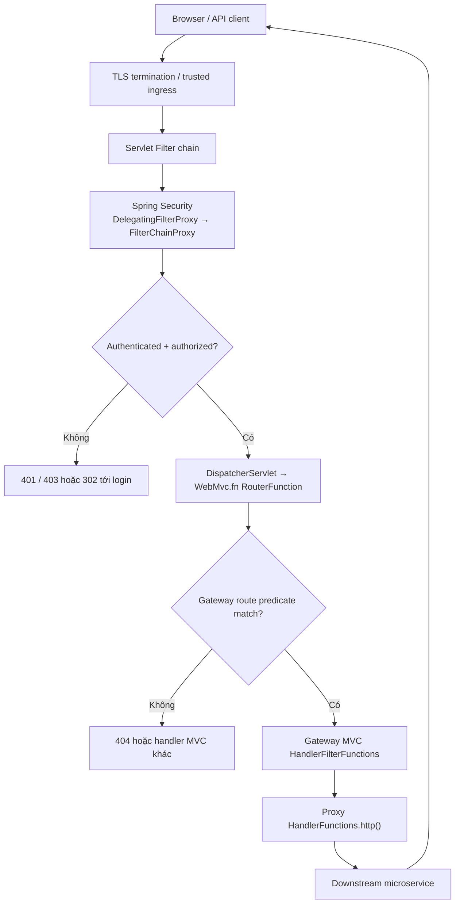
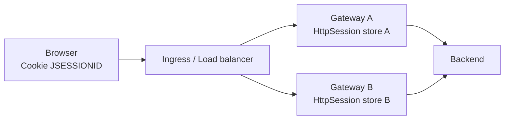
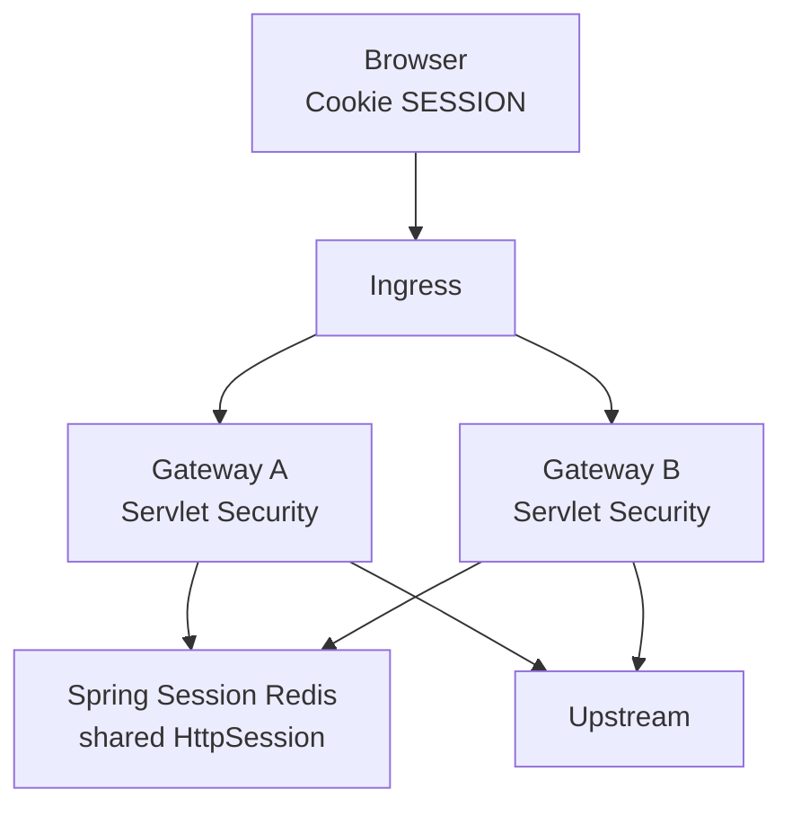
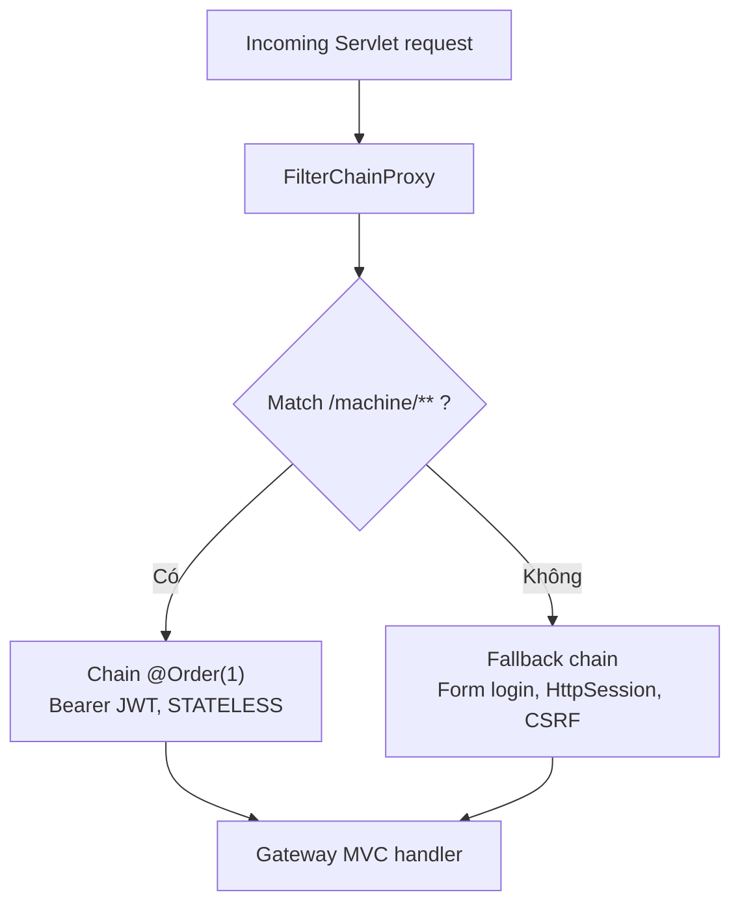
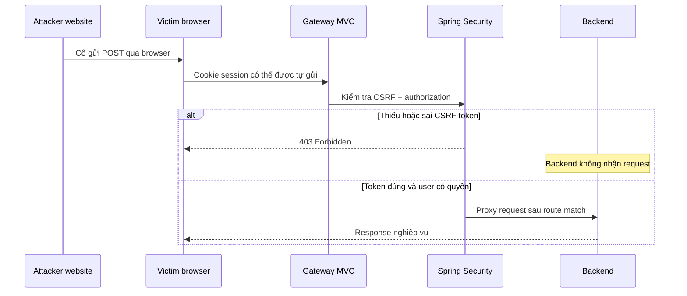
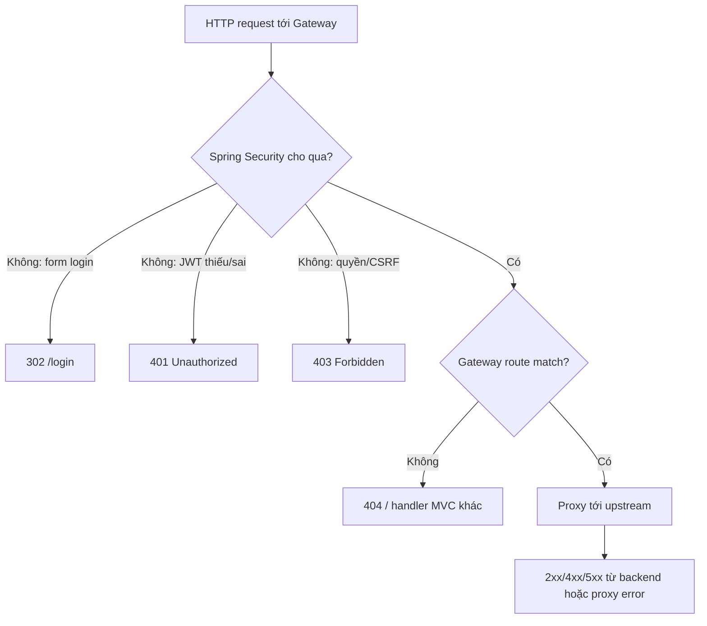

# Tích hợp SecurityFilterChain và quản lý phiên Servlet trong Spring Cloud Gateway Server Web MVC

**Spring Cloud Gateway Server Web MVC** là biến thể Gateway chạy trên **Spring MVC/WebMvc.fn và Servlet container** như Tomcat hoặc Jetty. Nó vẫn đảm nhiệm chức năng cổng vào microservices: chọn tuyến dựa trên predicate, chạy filter cho route, chỉnh path/header, chuyển tiếp đến dịch vụ đích, hỗ trợ khám phá dịch vụ và kết hợp các chính sách xác thực, giới hạn lưu lượng, circuit breaker, retry, TLS và giám sát request. Tuy nhiên, kiến trúc bảo mật của nó **khác Spring Cloud Gateway Server WebFlux**.

Trong Web MVC, một request HTTP đi qua Servlet Filter chain. **Spring Security `SecurityFilterChain`** xử lý xác thực và ủy quyền trước khi request được Spring MVC đưa đến `RouterFunction`/`HandlerFunction` proxy. Nếu sử dụng form login, Spring Security thường lưu `SecurityContext` trong **Servlet `HttpSession`**, còn trình duyệt giữ cookie mang session ID (thường `JSESSIONID`). Vì Gateway có thể chạy nhiều replica, quyết định **phiên nằm ở đâu, cookie được bảo vệ thế nào, có truyền xuống backend hay không** là phần quan trọng của thiết kế.

Bài thuộc chương **Server Web MVC** trong module `SPRING_CLOUD_GATEWAY`. Chúng ta sẽ thực hành đăng nhập bằng Servlet session, gắn `SecurityFilterChain` với một route Gateway, kiểm tra `JSESSIONID`/CSRF/session fixation, sau đó so sánh với JWT stateless, Spring Session Redis và các tình huống production.

> **Phạm vi:** Spring Cloud Gateway **Server Web MVC 5.0.x**, Spring Cloud 2025.1.x, Spring Boot 4.x và Spring Security Servlet tương thích. Namespace route dùng `spring.cloud.gateway.server.webmvc.routes`. Lớp cấu hình của ví dụ là **`HttpSecurity` + `SecurityFilterChain`**, không phải `ServerHttpSecurity` + `SecurityWebFilterChain` của Gateway Server WebFlux. Khi triển khai, dùng bộ phiên bản đã được hỗ trợ và cập nhật bản vá bảo mật của nhánh đang sử dụng; không trộn starters WebFlux và MVC.

## 1. Mục tiêu học tập

Sau bài này, bạn có thể:

1. Giải thích vai trò `DelegatingFilterProxy`, `FilterChainProxy`, `SecurityFilterChain`, Servlet `HttpSession` và `RouterFunction`/`HandlerFunction` của Gateway MVC.
2. Cấu hình `SecurityFilterChain` cho các route public, route yêu cầu đăng nhập và endpoint quản trị với nguyên tắc **default deny**.
3. Phân biệt `securityMatcher` của nhiều Security chains với `requestMatchers` dùng cho authorization bên trong một chain, và phân biệt chúng với `Path` predicate của Gateway.
4. Dựng lab Spring Boot MVC Gateway với form login, `JSESSIONID`, CSRF, session fixation protection và backend Java echo.
5. Chỉ ra lúc nào cần Servlet session và lúc nào nên sử dụng `SessionCreationPolicy.STATELESS` cùng JWT Resource Server.
6. Bảo vệ cookie `HttpOnly`/`Secure`/`SameSite`/`Path`, xử lý logout/timeout/concurrent sessions và tránh lộ cookie Gateway cho backend.
7. Thiết kế nhiều Gateway replicas với Spring Session Redis hoặc đánh giá giới hạn của sticky sessions.
8. Phân biệt `TokenRelay` OAuth2, session của Gateway, token của downstream và ủy quyền của backend.
9. Kiểm thử an toàn cho lỗi 302/401/403/404, CSRF, session expiration, security chain order, logout và failover.

## 2. Bản đồ kiến trúc: Security chạy trước chức năng proxy

Một request thường đi theo các lớp:



```text
Tầng Servlet:
  Servlet container (HttpServletRequest, HttpServletResponse, HttpSession)
    -> Filters (Spring Security và các Filter khác)
    -> DispatcherServlet
    -> Spring MVC handler mapping / WebMvc.fn RouterFunction

Tầng Spring Cloud Gateway Server Web MVC:
  Route predicate (Path, Method, Host, ...)
    -> HandlerFilterFunctions / BeforeFilterFunctions / AfterFilterFunctions
    -> HandlerFunctions.http() -> upstream
```

**Hai “filter chain” không giống nhau:**

| Thành phần | Thuộc lớp nào? | Việc chính |
|---|---|---|
| `SecurityFilterChain` | Spring Security Servlet | Authentication, authorization, CSRF, security context, session, logout |
| `FilterChainProxy` | Spring Security | Chọn **một SecurityFilterChain phù hợp** theo matcher và order |
| `HandlerFilterFunction` | Spring MVC functional routing | Filter một `RouterFunction`/`HandlerFunction`; biến đổi request/response ở route |
| `BeforeFilterFunctions.stripPrefix(...)` | Gateway MVC | Biến đổi path gửi downstream |
| `HandlerFunctions.http()` | Gateway MVC | Forward request HTTP tới upstream |
| `HttpSession` | Servlet container hoặc Spring Session | Trạng thái session của **Gateway** |
| `SecurityContextRepository` | Spring Security | Lưu/đọc authentication context, thường qua `HttpSession` khi stateful |

Spring Security không dựa vào việc một Gateway route có khai báo `Authentication` filter hay không: Servlet Security có thể chặn request **trước khi route matching**. Ngược lại, một `HandlerFilterFunction` không tự cung cấp xác thực/CSRF cho mọi endpoint trong Servlet application.

### 2.1. Thứ tự có ý nghĩa bảo mật

Với `GET /app/api/items` chưa đăng nhập, Spring Security có thể chuyển hướng tới `/login` ngay, nên backend **không được gọi**. Nếu đã đăng nhập, request mới đi tới route Gateway và được proxy. Một request không match Gateway route vẫn có thể bị Spring Security yêu cầu đăng nhập trước khi trả 404, tùy cách bạn cấu hình.

Do đó:

- `302 Found` tới login **không chứng minh** route Gateway đã match.
- `401 Unauthorized` thường đến từ HTTP Basic/JWT authentication entry point.
- `403 Forbidden` thường đến từ authorization hoặc CSRF bị từ chối.
- `404 Not Found` có thể chỉ xuất hiện sau khi request đã vượt Security nhưng không match handler/route.
- `502`/`503` mới gợi ý vấn đề upstream/network sau khi đã qua các bước trước.

### 2.2. Biến thể Web MVC không dùng những API reactive của WebFlux

| Vấn đề | Gateway Server Web MVC | Gateway Server WebFlux |
|---|---|---|
| Runtime web | Servlet, Spring MVC/WebMvc.fn | Reactive WebFlux/Reactor Netty |
| Security builder | `HttpSecurity` | `ServerHttpSecurity` |
| Security chain | `SecurityFilterChain` | `SecurityWebFilterChain` |
| HTTP session | `jakarta.servlet.http.HttpSession` | `WebSession`/reactive session mechanisms |
| Gateway route | `RouterFunction`/`HandlerFunction`, hoặc YAML MVC | `Route`/GatewayFilterFactory, hoặc YAML WebFlux |
| Namespace YAML | `spring.cloud.gateway.server.webmvc.routes` | `spring.cloud.gateway.server.webflux.routes` |
| Session store phổ biến | Servlet session/Tomcat, Spring Session Redis | Reactive session repository nếu cần |
| Khi bảo vệ route | Servlet filters trước Gateway MVC handler | WebFlux security web filters trong reactive chain |

Không dùng `@EnableWebFluxSecurity`, `ServerHttpSecurity`, `SecurityWebFilterChain` hoặc `ReactiveSessionRegistry` cho lab MVC này. Tương tự, không đưa `spring.cloud.gateway.server.webflux.routes` vào một ứng dụng chỉ chạy Gateway MVC rồi chờ route xuất hiện.

## 3. `HttpSession`, `JSESSIONID` và `SecurityContext`

### 3.1. Một vòng đời đăng nhập bằng form login

```mermaid
sequenceDiagram
    participant B as Browser
    participant G as Gateway MVC
    participant S as Spring Security
    participant H as HttpSession store
    participant U as Backend
    B->>G: GET /app/api/items
    G->>S: Servlet security filters
    S-->>B: 302 Location: /login
    B->>G: GET /login và CSRF token
    B->>G: POST /login + username/password + CSRF + cookie
    G->>S: Authenticate credentials
    S->>H: Lưu SecurityContext trong session
    S-->>B: Set-Cookie: JSESSIONID=...; 302 redirect
    B->>G: GET /app/api/items + JSESSIONID
    S->>H: Tra session, đọc Authentication
    S-->>G: Authenticated + authorized
    G->>U: Proxy GET /items
    U-->>G: 200 OK
    G-->>B: 200 OK
```

Trong thực tế, **session có thể được tạo trước khi login** để lưu CSRF token hoặc saved request. Khi login thành công, Spring Security bảo vệ chống **session fixation** bằng cách thay session ID trên Servlet container hiện đại. Vì thế ví dụ sequence ở trên diễn tả các mốc logic, không khẳng định cookie chỉ lần đầu xuất hiện sau khi xác thực.

### 3.2. Cookie chứa ID, không phải toàn bộ authentication object

Khi login thành công, browser thường giữ header:

```http
Set-Cookie: JSESSIONID=<opaque-id>; Path=/; HttpOnly; SameSite=Lax
```

Ở request tiếp theo:

```http
Cookie: JSESSIONID=<opaque-id>
```

Cookie thường chỉ chứa **định danh phiên ngẫu nhiên**; phía server dùng ID để tra `HttpSession`/`SecurityContext`. **Không nhầm `JSESSIONID` với JWT**: session ID không phải là một token tự xác minh được claims và không nên đưa nó vào `Authorization: Bearer`.

Session ID là **bí mật bearer credential**: ai chiếm được cookie hợp lệ có thể giả mạo phiên trong thời gian tồn tại. Do đó phải dùng HTTPS/WSS, `Secure`, `HttpOnly`, `SameSite` phù hợp, kiểm soát session fixation, logout và timeout, đồng thời **không ghi cookie vào logs hoặc chuyển bừa xuống mọi upstream**.

### 3.3. Spring Security lưu authentication thế nào?

Spring Security sử dụng `SecurityContextHolder` để ứng dụng đọc `Authentication` trong phạm vi request, còn `SecurityContextRepository` giúp nạp/lưu context giữa các request.

Trong Servlet stack hiện đại, Spring Security dùng `SecurityContextHolderFilter` và mô hình **lưu SecurityContext tường minh** khi một cơ chế xác thực tùy biến tự đặt authentication. Những cơ chế chuẩn như form login đã xử lý phần lưu thông thường. Nếu bạn tự viết login filter hoặc controller đặt:

```java
SecurityContextHolder.getContext().setAuthentication(authentication);
```

rồi kết thúc response mà **không** gọi `SecurityContextRepository.saveContext(...)` khi cần, request sau có thể lại là anonymous. Đừng viết một “login tự chế” chỉ set ThreadLocal rồi giả định session sẽ tự persist.

Bài thực hành bên dưới dùng **form login chuẩn** thay vì custom authentication filter để có CSRF, session fixation, persistence và logout theo cách framework hỗ trợ.

### 3.4. Khi nào Servlet container tạo `HttpSession`?

Một request public GET đơn giản **có thể không tạo** session. Session có thể được tạo khi:

- CSRF token được lưu qua `HttpSessionCsrfTokenRepository`.
- Spring Security lưu original request trong `RequestCache` trước khi redirect tới login.
- Form login thành công và authentication được lưu.
- Ứng dụng gọi `request.getSession()` (mặc định có thể tạo nếu chưa có).
- Một component khác (OAuth2 login/flash attributes/remember-me theo cấu hình) lưu dữ liệu.

Để **đọc mà không chủ động tạo** session mới, dùng `request.getSession(false)`. Để đo số phiên chính xác, không đếm mỗi HTTP request là một session và không coi `JSESSIONID` luôn xuất hiện ở mọi response.

## 4. Chọn mô hình: stateful session, stateless JWT hay hybrid

Trước khi cấu hình, phải quyết định Gateway đang **làm đại diện đăng nhập cho trình duyệt**, **xác minh bearer token của API client**, hay **kết hợp cả hai**.

| Mô hình | Cơ chế client mang danh tính | Gateway lưu phiên? | Trường hợp phù hợp |
|---|---|---|---|
| **Stateful form login** | Cookie `JSESSIONID` | Có, `HttpSession`/`SecurityContext` | Web admin, browser session/BFF |
| **OAuth2 login + token relay** | Thường cookie session sau OAuth2 login | Thường có session và OAuth2 authorized client | Gateway làm OAuth2 client cho browser, proxy API backend |
| **Stateless JWT resource server** | `Authorization: Bearer <JWT>` mỗi request | Không cần session authentication | Mobile/server-to-server API, token có issuer/audience/scope |
| **Hybrid, nhiều SecurityFilterChain** | Browser dùng cookie, API dùng bearer | Có trên browser chain; API chain nên STATELESS | Cùng Gateway vừa phục vụ browser vừa phục vụ machine clients |
| **API key đã xác minh** | Header/API key | Tùy thiết kế | Partner API; cần quota, rotation, auth policy rõ |

Không có lựa chọn nào mặc định tốt nhất. Stateful session đơn giản hóa nhiều luồng trình duyệt, nhưng đòi session store, CSRF, session fixation và quản trị nhiều replica. Stateless JWT giảm nhu cầu shared session nhưng cần xác minh chữ ký, hạn dùng, issuer, audience, scope, thu hồi và xử lý token leak.

**Quan trọng:** `SessionCreationPolicy.STATELESS` không làm HTTP “an toàn tự động”. Nó chỉ nói Spring Security không dùng `HttpSession` để lưu/lấy `SecurityContext`. Nó không thay xác thực JWT, authorization, CSRF risk assessment hay việc các component Servlet khác có thể tạo session.

## 5. Phụ thuộc Maven: đúng Gateway Server Web MVC

Với Spring Boot 4.x + Spring Cloud Gateway 5.0.x tương thích, dùng:

```xml
<dependencies>
    <!-- Gateway MVC dùng Servlet / WebMvc.fn -->
    <dependency>
        <groupId>org.springframework.cloud</groupId>
        <artifactId>spring-cloud-starter-gateway-server-webmvc</artifactId>
    </dependency>

    <!-- HttpSecurity, SecurityFilterChain và form login -->
    <dependency>
        <groupId>org.springframework.boot</groupId>
        <artifactId>spring-boot-starter-security</artifactId>
    </dependency>
</dependencies>
```

Đây là **đoạn dependencies**, không phải `pom.xml` hoàn chỉnh. Project cần Spring Boot parent/plugin và Spring Cloud BOM đúng release train; không tự gán version của các starter không tương thích. `spring-cloud-starter-gateway-server-webmvc` mang các thành phần Gateway MVC và Servlet web runtime tương ứng; nếu ứng dụng đã khai báo thêm `spring-boot-starter-webmvc` theo convention thì cần kiểm tra không tạo dependency xung đột.

Các dependency tùy chọn:

| Nhu cầu | Dependency |
|---|---|
| OAuth2 login / token relay | `org.springframework.boot:spring-boot-starter-oauth2-client` |
| JWT/opaque token resource server | `org.springframework.boot:spring-boot-starter-oauth2-resource-server` |
| Shared Servlet sessions trong Redis (Boot 4) | `org.springframework.boot:spring-boot-starter-session-data-redis` |
| Quan sát health/metrics/Actuator | `org.springframework.boot:spring-boot-starter-actuator` |

**Không đưa `spring-cloud-starter-gateway-server-webflux` vào lab này.** Nếu vừa có MVC và WebFlux components, việc chọn web application type và security auto-configuration có thể khác kỳ vọng. Bài này chủ đích chạy Servlet, có `jakarta.servlet.http.HttpServletRequest`/`HttpSession`.

### 5.1. Security không tự bảo vệ đúng path nghiệp vụ

Khi chỉ thêm `spring-boot-starter-security`, Boot thường yêu cầu authentication với mọi HTTP request theo chain mặc định. Nhưng nó **không biết** path nào là public, admin, nội bộ, thuộc tenant A hay cần OAuth scopes. Hãy định nghĩa `SecurityFilterChain` tường minh thay vì mặc định mọi path có cùng quyền.

## 6. Lab end-to-end: form login + `JSESSIONID` trước khi proxy

Mục tiêu lab:

- Gateway MVC lắng nghe `127.0.0.1:8080`.
- Route `GET /app/api/**` đi qua Security rồi forward tới `127.0.0.1:9001`.
- Người chưa đăng nhập nhận **302 tới `/login`**, không vào backend.
- Sau khi đăng nhập, browser gửi `JSESSIONID`; request được phép đi backend.
- Route loại bỏ header `Cookie` **trước khi proxy**, tránh chuyển session ID của Gateway tới backend nội bộ không cần biết phiên.
- CSRF bảo vệ `POST /login` và `POST /logout`; Security thay session ID sau login.
- Một endpoint `/_lab/csrf` trên loopback giúp học viên lấy CSRF token bằng `curl`. **Không đưa endpoint này lên Internet/production**.

### 6.1. Tạo ứng dụng Gateway

`GatewayMvcApplication.java`:

```java
import org.springframework.boot.SpringApplication;
import org.springframework.boot.autoconfigure.SpringBootApplication;

@SpringBootApplication
public class GatewayMvcApplication {
    public static void main(String[] args) {
        SpringApplication.run(GatewayMvcApplication.class, args);
    }
}
```

Đặt `GatewayMvcApplication`, security config và controller lab trong **cùng một package hoặc package con** để Spring Boot component scan thấy bean. Với code nhiều file, không tạo các class ở default package cho ứng dụng production.

### 6.2. `application.yml` có route và cookie session

```yaml
server:
  address: 127.0.0.1   # Chỉ dành cho lab trên máy cá nhân
  port: 8080
  servlet:
    session:
      timeout: 15m
      cookie:
        http-only: true
        same-site: lax
        # Không đặt secure: true cho lab HTTP; production phải dùng
        # HTTPS và secure: true trên public cookie.

spring:
  application:
    name: gateway-mvc-session-lab
  cloud:
    gateway:
      server:
        webmvc:
          routes:
            - id: demo-profile
              uri: http://127.0.0.1:9001
              predicates:
                - Path=/app/api/**
                - Method=GET
              filters:
                - StripPrefix=2
                - RemoveRequestHeader=Cookie
```

Route xử lý:

```text
Client:  GET /app/api/items
SecurityFilterChain: yêu cầu role USER
StripPrefix=2: /app/api/items -> /items
RemoveRequestHeader=Cookie: không gửi JSESSIONID tới backend
Backend: GET http://127.0.0.1:9001/items
```

**Vì sao cần `RemoveRequestHeader=Cookie`?** Cookie `JSESSIONID` là credential tại ranh giới tin cậy của **Gateway**. Nếu backend chỉ cần nhận request public hoặc nhận identity qua một cơ chế riêng được thiết kế, nó không nên vô tình thấy session ID của Gateway. Nếu backend thật sự cần cookie riêng, không xóa bừa mọi cookie; phải xây chính sách truyền cookie **theo allowlist tên/đích** và xác nhận session domain/ownership.

`server.servlet.session.timeout` là thời gian bất hoạt của Servlet session. Nó **không** phải tuổi tuyệt đối bảo đảm phiên không bao giờ kéo dài quá một khoảng thời gian từ login; nếu cần absolute lifetime, phải xây chính sách riêng hoặc có identity provider kiểm soát.

### 6.3. `SecurityFilterChain` stateful, CSRF vẫn bật

Tạo `GatewaySecurityConfig.java`:

```java
import org.springframework.context.annotation.Bean;
import org.springframework.context.annotation.Configuration;
import org.springframework.http.HttpMethod;
import org.springframework.security.config.Customizer;
import org.springframework.security.config.annotation.web.builders.HttpSecurity;
import org.springframework.security.config.annotation.web.configuration.EnableWebSecurity;
import org.springframework.security.config.http.SessionCreationPolicy;
import org.springframework.security.core.userdetails.User;
import org.springframework.security.core.userdetails.UserDetailsService;
import org.springframework.security.crypto.bcrypt.BCryptPasswordEncoder;
import org.springframework.security.crypto.password.PasswordEncoder;
import org.springframework.security.provisioning.InMemoryUserDetailsManager;
import org.springframework.security.web.SecurityFilterChain;

@Configuration
@EnableWebSecurity
public class GatewaySecurityConfig {

    @Bean
    SecurityFilterChain gatewaySecurity(HttpSecurity http) throws Exception {
        http
            .authorizeHttpRequests(auth -> auth
                // Form login và công cụ lấy CSRF token CHỈ CHO LAB.
                .requestMatchers("/login", "/_lab/csrf", "/error").permitAll()
                .requestMatchers(HttpMethod.GET, "/_lab/whoami")
                    .authenticated()
                .requestMatchers(HttpMethod.GET, "/app/api/**")
                    .hasRole("USER")
                .anyRequest().denyAll())
            // Mặc định CSRF protection vẫn bật; không .csrf(disable).
            .formLogin(Customizer.withDefaults())
            .logout(logout -> logout
                .logoutUrl("/logout")
                .logoutSuccessUrl("/login?logout")
                .invalidateHttpSession(true)
                .deleteCookies("JSESSIONID")
                .permitAll())
            .sessionManagement(session -> session
                .sessionCreationPolicy(SessionCreationPolicy.IF_REQUIRED)
                .sessionFixation(fix -> fix.changeSessionId()));

        return http.build();
    }

    @Bean
    PasswordEncoder passwordEncoder() {
        return new BCryptPasswordEncoder();
    }

    @Bean
    UserDetailsService users(PasswordEncoder encoder) {
        // CHỈ DÙNG TRONG LAB: không hard-code credentials production.
        return new InMemoryUserDetailsManager(
            User.withUsername("student")
                .password(encoder.encode("demo-only-change-me"))
                .roles("USER")
                .build()
        );
    }
}
```

**Ý nghĩa những dòng quan trọng:**

| Cấu hình | Ý nghĩa |
|---|---|
| `HttpSecurity` | Builder Spring Security **Servlet** |
| `@EnableWebSecurity` | Bật web security infrastructure và đăng ký Servlet security filter chain |
| `permitAll()` cho login/`/_lab/csrf` | Cho browser truy cập login và token trước khi xác thực |
| `hasRole("USER")` | Yêu cầu authority `ROLE_USER` trên route lab |
| `anyRequest().denyAll()` | Từ chối những URL chưa được cho phép |
| `formLogin(...)` | Authentication từ username/password, login page mặc định |
| `logout(...)` | Hủy session, xóa context/cookie và redirect sau logout |
| `SessionCreationPolicy.IF_REQUIRED` | Cho tạo session khi cơ chế bảo mật cần |
| `changeSessionId()` | Bảo vệ chống session fixation |
| `BCryptPasswordEncoder` | Băm mật khẩu cho user lab, tránh password plain-text trong store |

**Không có cấu hình tắt CSRF.** Spring Security sẽ kiểm tra token ở request thay đổi trạng thái như `POST /login`/`POST /logout`. Vì lab có một endpoint GET trả token, việc lấy token không phải authentication; nó là cách tạo/đọc synchronizer token để **trình duyệt cùng site** hoặc `curl` gửi lại trên request tiếp theo.

### 6.4. Endpoint debug session và CSRF — chỉ dùng trên loopback

`LabSessionController.java`:

```java
import java.security.Principal;
import java.util.Map;

import jakarta.servlet.http.HttpServletRequest;

import org.springframework.security.web.csrf.CsrfToken;
import org.springframework.web.bind.annotation.GetMapping;
import org.springframework.web.bind.annotation.RequestAttribute;
import org.springframework.web.bind.annotation.RestController;

@RestController
public class LabSessionController {

    @GetMapping("/_lab/csrf")
    public Map<String, String> csrf(
            @RequestAttribute("_csrf") CsrfToken csrfToken) {
        // getToken() buộc lấy token bị deferred, dành cho lab.
        return Map.of(
            "parameterName", csrfToken.getParameterName(),
            "headerName", csrfToken.getHeaderName(),
            "token", csrfToken.getToken()
        );
    }

    @GetMapping("/_lab/whoami")
    public Map<String, Object> whoami(
            Principal principal, HttpServletRequest request) {

        return Map.of(
            "user", principal.getName(),
            "sessionExists", request.getSession(false) != null
        );
    }
}
```

**Ranh giới:** Endpoint `/_lab/csrf` này **không phải chức năng cần công bố trên production**. Không dùng `Access-Control-Allow-Origin: *`, không cho website bên ngoài đọc token của cùng session có cookie. Token không được đưa vào URL hoặc access logs. `/_lab/whoami` chỉ trả username/sessionExists, **không trả raw session ID**, cookie value hay đối tượng `Authentication`.

`@RequestAttribute("_csrf")` lấy `CsrfToken` do Spring Security đưa vào Servlet request; trong Spring Security hiện đại token có thể lazy/deferred. Đọc `getToken()` buộc tạo/đọc giá trị để client lab dùng trong form POST.

### 6.5. Backend HTTP riêng biệt dùng JDK

Tạo `MvcGatewayBackend.java` trong thư mục lab khác với code Gateway:

```java
import com.sun.net.httpserver.HttpServer;
import java.net.InetSocketAddress;
import java.nio.charset.StandardCharsets;
import java.util.concurrent.atomic.AtomicLong;

public class MvcGatewayBackend {
    public static void main(String[] args) throws Exception {
        HttpServer server = HttpServer.create(
            new InetSocketAddress("127.0.0.1", 9001), 0);
        AtomicLong calls = new AtomicLong();

        server.createContext("/", exchange -> {
            long n = calls.incrementAndGet();
            boolean cookieForwarded =
                    exchange.getRequestHeaders().getFirst("Cookie") != null;

            String body = "{\"backendCall\":" + n
                + ",\"path\":\"" + exchange.getRequestURI().getRawPath()
                + "\",\"cookieForwarded\":" + cookieForwarded + "}";
            byte[] bytes = body.getBytes(StandardCharsets.UTF_8);

            exchange.getResponseHeaders().set(
                "Content-Type", "application/json; charset=utf-8");
            exchange.getResponseHeaders().set(
                "Cache-Control", "no-store");

            exchange.sendResponseHeaders(200, bytes.length);
            try (var out = exchange.getResponseBody()) {
                out.write(bytes);
            }

            System.out.println("upstream request#" + n);
        });

        server.start();
        System.out.println("Backend on http://127.0.0.1:9001");
    }
}
```

Backend **không có auth layer** và chỉ bind `127.0.0.1` trong lab. Trong production, upstream service vẫn phải có chính sách phân quyền theo tài nguyên/tenant, mTLS hoặc workload identity phù hợp; **đừng coi backend công khai là an toàn chỉ vì một Gateway đã kiểm tra đăng nhập**.
Backend trả `cookieForwarded` để xác minh route loại bỏ Cookie, không in cookie value. Khi unauthorized, bộ đếm `backendCall` **không tăng** vì request bị chặn ở Security trước khi proxy.

### 6.6. Khởi động và kiểm tra điều kiện ban đầu

Terminal thứ nhất (JDK 17+):

```bash
java --add-modules jdk.httpserver MvcGatewayBackend.java
```

Terminal thứ hai, tại project Gateway:

```bash
# Linux/macOS
./mvnw spring-boot:run

# Windows PowerShell
.\mvnw.cmd spring-boot:run
```

Kiểm tra backend trực tiếp:

```bash
curl -i http://127.0.0.1:9001/items
```

Phản hồi mẫu:

```http
HTTP/1.1 200 OK
Content-Type: application/json; charset=utf-8
Cache-Control: no-store

{"backendCall":1,"path":"/items","cookieForwarded":false}
```

Trong lab, backend được gọi trực tiếp sẽ tăng count. Các lần thử tiếp theo qua Gateway không nên suy từ `backendCall=1` nếu bạn đã chạy test trước; quan trọng là **có/không tăng** khi request chạm upstream.

## 7. Thực hành đăng nhập và kiểm tra phiên bằng `curl`

Lab dùng HTTP **loopback**; không dùng chuỗi mật khẩu lab làm password production. Trên Windows PowerShell 5.1 hãy dùng `curl.exe` thay vì alias `curl`; câu lệnh Bash dưới đây có thể viết thành một dòng trong PowerShell.

### 7.1. Chưa đăng nhập: Security chặn trước Gateway handler

```bash
curl -i http://127.0.0.1:8080/app/api/items
```

Vì cấu hình `formLogin`, một trình duyệt chưa đăng nhập thường nhận:

```http
HTTP/1.1 302 Found
Location: http://127.0.0.1:8080/login
```

Một số trường hợp Location là đường dẫn tương đối hoặc có query/URL-encoding do container/Security quyết định. Điều phải kiểm tra là **Gateway không proxy tới backend khi unauthorized**. Nếu bạn thấy JSON backend `backendCall` tăng, phải kiểm tra lại `SecurityFilterChain`/matcher trước khi triển khai.

**Không mặc định unauthenticated luôn nhận 401** trong một ứng dụng form login: 302 về `/login` là expected. Với JWT Resource Server hoặc HTTP Basic, unauthenticated thường được trả `401`. Khác biệt là **authentication entry point**, không phải route predicate.

### 7.2. Lấy cookie jar và CSRF token

Đầu tiên lưu cookie trong `cookie-jar.txt`:

```bash
curl -i -c cookie-jar.txt \
  http://127.0.0.1:8080/_lab/csrf
```

Body ví dụ (token thực tế sẽ khác):

```json
{
  "parameterName": "_csrf",
  "headerName": "X-CSRF-TOKEN",
  "token": "<generated-csrf-token>"
}
```

Spring Security có thể tạo `HttpSession` để lưu synchronizer token và gửi `Set-Cookie: JSESSIONID=...`. Trong `curl`, `-c cookie-jar.txt` ghi cookie do server đặt, còn `-b cookie-jar.txt` gửi cookie đã lưu cho request sau.

**Đừng dùng token trong JSON ví dụ**; copy đúng giá trị `token` của request mới vào lệnh tiếp theo. Token CSRF không phải password, không phải JWT và không thay bước xác thực user.

### 7.3. Đăng nhập bằng form POST có CSRF

```bash
curl -i -b cookie-jar.txt -c cookie-jar.txt \
  --data-urlencode "username=student" \
  --data-urlencode "password=demo-only-change-me" \
  --data-urlencode "_csrf=<token-thuc-te-vua-lay>" \
  http://127.0.0.1:8080/login
```

Ở form login chuẩn, kết quả thành công thường là **302 redirect** đến request được lưu trước đó hoặc default success URL; không mong chờ JSON access token. Cookie session có thể được **đổi ID sau login** nhờ `changeSessionId()`; `curl` được yêu cầu vừa gửi vừa ghi lại cookie để theo kịp giá trị mới.

Sau đó:

```bash
curl -i -b cookie-jar.txt \
  http://127.0.0.1:8080/_lab/whoami

curl -i -b cookie-jar.txt \
  http://127.0.0.1:8080/app/api/items
```

Kỳ vọng:

```json
{"user":"student","sessionExists":true}
```

Và từ upstream qua Gateway:

```http
HTTP/1.1 200 OK
Content-Type: application/json; charset=utf-8

{"backendCall":2,"path":"/items","cookieForwarded":false}
```

Số `backendCall` là **minh họa**; nó phụ thuộc số lần bạn gọi backend trước đó. Điều cần kiểm tra là `path=/items` và `cookieForwarded=false`, đồng thời cùng cookie jar làm cho các request tiếp theo được phép.

### 7.4. Kiểm thử CSRF bị thiếu

Nếu gửi thẳng POST login mà **không có CSRF token**:

```bash
curl -i -X POST \
  --data-urlencode "username=student" \
  --data-urlencode "password=demo-only-change-me" \
  http://127.0.0.1:8080/login
```

Bạn thường nhận `403 Forbidden` trước khi authentication hoàn tất. Đó là kết quả mong đợi khi CSRF đang bật cho form login. **Không sửa bằng cách `http.csrf(csrf -> csrf.disable())`** chỉ để lab “đăng nhập được” — làm vậy mất đi một lớp bảo vệ quan trọng khi browser tự gửi session cookie.

Cách sửa đúng: sử dụng form login có hidden input `_csrf`, hoặc client `curl` lấy token từ cùng session rồi gửi lại. SPA cần cơ chế CSRF handler phù hợp, đặc biệt khi dùng `CookieCsrfTokenRepository` và BREACH-protected token masking.

### 7.5. Logout cần CSRF token mới

Sau khi đăng nhập, **lấy CSRF token lần nữa** vì Spring Security có thể xóa/rotate token lúc authentication success:

```bash
curl -i -b cookie-jar.txt -c cookie-jar.txt \
  http://127.0.0.1:8080/_lab/csrf
```

Dùng token mới cho:

```bash
curl -i -b cookie-jar.txt -c cookie-jar.txt \
  --data-urlencode "_csrf=<token-moi-sau-login>" \
  http://127.0.0.1:8080/logout
```

Expected: redirect tới `/login?logout`; session invalidated, `SecurityContext` xóa và cookie được yêu cầu xóa theo cấu hình. Sau logout:

```bash
curl -i -b cookie-jar.txt \
  http://127.0.0.1:8080/app/api/items
```

phải quay lại luồng chưa đăng nhập (thường redirect login). Không coi việc xóa cookie ở browser là đủ nếu **server-side session còn sống**; logout phải invalidate session/server-side state thực sự.

### 7.6. Trình duyệt thật giúp kiểm chứng cookie flags

Với browser:

1. Truy cập `http://127.0.0.1:8080/app/api/items`, xác nhận chuyển đến login.
2. Đăng nhập `student` / password lab trong form được Spring Security tạo.
3. Kiểm tra Network/Storage ở DevTools: cookie `JSESSIONID` có `HttpOnly` và `SameSite=Lax`; trong lab HTTP có thể **chưa có Secure**.
4. Tải lại route `/app/api/items`, xác nhận backend trả response và không nhận cookie.
5. Đăng xuất bằng form confirmation có CSRF, xác nhận request sau không còn quyền.
6. Không ghi hoặc chia sẻ **giá trị cookie thật** trong ticket/screenshot/log.

Nếu production dùng HTTPS tại ingress, `Secure` cần được áp dụng cho cookie public ngay cả khi Gateway nhận HTTP nội bộ phía sau. Xem phần forwarded headers và TLS ở bên dưới.

## 8. Quản lý Servlet session: policy, cookie, timeout, logout

### 8.1. `SessionCreationPolicy` giải quyết gì?

| Policy | Ý nghĩa chính | Dùng khi nào |
|---|---|---|
| `ALWAYS` | Spring Security chủ động tạo HTTP session | Rất ít khi cần trên Gateway API |
| `IF_REQUIRED` | Tạo session nếu cơ chế bảo mật cần | Stateful form login/OAuth2 browser session |
| `NEVER` | Spring Security không tự tạo session, nhưng có thể dùng session đã tồn tại | Những tình huống migration/đặc thù; dễ bị hiểu nhầm |
| `STATELESS` | Spring Security không tạo hoặc sử dụng session để lấy `SecurityContext` | Bearer-only JWT/opaque resource server API |

**`NEVER` không đồng nghĩa `STATELESS`.** Nếu các component khác tạo session, với `NEVER` Spring Security vẫn có thể dùng phiên đã tồn tại. Với `STATELESS`, Security sử dụng `NullSecurityContextRepository`/mô hình stateless thích hợp, không dùng `HttpSession` cho `SecurityContext`.

Trong một Gateway hybrid, đừng cấu hình toàn bộ ứng dụng `STATELESS` rồi mong browser form login tự duy trì cookie; hãy tách Security chains hoặc chọn một mô hình rõ ràng.

### 8.2. Timeout bất hoạt không phải thời gian sống tuyệt đối

`server.servlet.session.timeout: 15m` thường nghĩa sau khoảng **15 phút không có request/activity được tính**, session có thể hết hạn. Không nên tuyên bố session sẽ hết đúng 15 phút từ lúc login vì mỗi request hợp lệ có thể làm thời gian bất hoạt được reset. Servlet container, Spring Session Redis và các middleware có cách thực thi/cleanup cụ thể.

Nếu cần:

- **Idle timeout**: không hoạt động quá lâu → hết phiên.
- **Absolute expiration**: quá X giờ từ login dù đang hoạt động → buộc đăng nhập lại.
- **Revocation**: admin thu hồi ngay một user/session.
- **Concurrent session limit**: cùng user không đăng nhập quá N phiên.

thì cần thiết kế/kiểm thử từng khả năng, không chỉ đặt một property timeout.

### 8.3. Cookie flags có ý nghĩa thế nào?

| Thuộc tính | Mục đích | Lưu ý |
|---|---|---|
| `HttpOnly` | JS không đọc được cookie qua `document.cookie` | Không thay thế XSS defense hoàn toàn |
| `Secure` | Browser chỉ gửi cookie qua HTTPS | Production public TLS nên bật; HTTP lab sẽ không dùng được Secure cookie |
| `SameSite=Lax` | Giảm một số đường CSRF cross-site | Không thay thế CSRF synchronizer token |
| `SameSite=Strict` | Kiểm soát chặt hơn | Có thể ảnh hưởng OAuth2 redirects/deep-link |
| `SameSite=None` | Hỗ trợ cross-site cookie use cases | Đòi `Secure` trên browser hiện đại, tăng CSRF risk |
| `Path` | Giới hạn request path mà browser gửi cookie | Không phải boundary authorization |
| `Domain` | Scope domain/subdomain của cookie | Tránh đặt domain rộng không cần thiết |
| `Max-Age`/`Expires` | Tuổi cookie trên client | Khác thời gian sống session thực ở server |

Production YAML **minh họa HTTPS**:

```yaml
server:
  servlet:
    session:
      timeout: 30m
      cookie:
        http-only: true
        secure: true
        same-site: lax
        path: /
```

Spring Boot 4 hỗ trợ `server.servlet.session.cookie.same-site` trên Servlet session, kể cả khi dùng Spring Session. Đừng đặt `secure: false` cho cookie chứa authentication trên Internet chỉ vì TLS terminate ở proxy; cần cấu hình/proxy trust để nhận biết external scheme hoặc đặt `secure: true` tường minh.

### 8.4. Session fixation protection

Kẻ tấn công có thể cố khiến nạn nhân login bằng một session ID đã biết. Spring Security có cơ chế bảo vệ mặc định trên Servlet container hiện đại: **thay session ID khi xác thực** (`changeSessionId()`).

Các lựa chọn:

- `changeSessionId()`: dùng `HttpServletRequest.changeSessionId()`, giữ session object nhưng đổi ID.
- `newSession()`: tạo session mới và hạn chế copy attributes.
- `migrateSession()`: chuyển các thuộc tính cũ sang session mới.
- `none()`: tắt bảo vệ, **không khuyến nghị**.

Không dùng `none()` chỉ để một test so sánh cookie ID trước/sau cho “ổn định”. Khi có custom login mechanism, bảo đảm `SessionAuthenticationStrategy` được gọi đúng; trong Spring Security hiện đại, cơ chế login tiêu chuẩn xử lý phần này, còn custom filters cần tích hợp tường minh.

### 8.5. Logout là thao tác server-side

Spring Security Servlet mặc định có logout support:

- `POST /logout` với CSRF token hợp lệ khi CSRF bật.
- Invalidate HTTP session.
- Xóa `SecurityContext`/authentication.
- Xóa CSRF token và các thông tin remember-me thích hợp.
- Redirect tới một URL kết thúc đã cấu hình.

`deleteCookies("JSESSIONID")` là biện pháp yêu cầu browser xóa cookie; tên/path/domain của cookie phải khớp cấu hình thực tế, và khả năng xóa có thể phụ thuộc container/proxy. Nếu dùng Spring Session cookie khác tên, điều chỉnh tương ứng. Có thể cân nhắc `Clear-Site-Data` trên HTTPS để dọn state thuộc site theo browser support, nhưng không biến nó thành thay thế việc hủy session trên server.

### 8.6. Giới hạn số phiên đồng thời

Khi chính sách yêu cầu user tối đa một phiên:

```java
http.sessionManagement(session -> session
    .maximumSessions(1)
    .maxSessionsPreventsLogin(true)
);
```

Đây là **đoạn mở rộng** cho `HttpSecurity`, không ghép thêm nguyên một bean `SecurityFilterChain`. Nếu dùng `maxSessionsPreventsLogin(true)`, login thứ hai có thể bị từ chối; nếu không, có thể làm phiên cũ hết hiệu lực theo policy.

Với single JVM, Spring Security cần quản lý registry/sự kiện session lifecycle (ví dụ `HttpSessionEventPublisher` khi cấu hình yêu cầu). Với nhiều replica, một `SessionRegistryImpl` lưu trong RAM **không biết mọi session trên các replica khác**. Nếu cần global concurrency control, thiết kế `SpringSessionBackedSessionRegistry`/repository/indexing phù hợp và kiểm tra semantics trên đúng phiên bản; **chỉ bật Redis sessions không tự chứng minh giới hạn toàn cụm đã đúng**.

## 9. Nhiều Gateway replica: vì sao session không tự chia sẻ?

Trong lab, Tomcat/Gateway giữ session trong **một Servlet JVM**. Khi mở rộng:



Nếu browser login qua A, cookie mang session ID của A. Request tiếp theo đi B có thể **không tìm thấy session**, nên bị redirect login hoặc trả 401 tùy policy. Hai Gateway chạy cùng code **không tự chia sẻ Servlet session**.

### 9.1. Sticky session là tối ưu tuyến, không phải shared state

Load balancer có thể dùng session affinity để gửi request của browser tới cùng Gateway replica. Điều này **có thể giảm** tình trạng chuyển replica làm mất session khi trạng thái chỉ nằm trong JVM, nhưng:

- Replica A restart/scale down thì session cục bộ có thể mất.
- LB rebalance hoặc failover có thể đưa user sang B.
- IP-based affinity có thể phân bố lệch vì NAT/proxy.
- Cookie-based affinity của LB là một cookie khác, có policy và vòng đời riêng.
- Sticky session không tự giải quyết revocation hoặc concurrent session limit trên tất cả nodes.

**Không dùng sticky session làm lời giải duy nhất** nếu yêu cầu login phải sống sót qua rolling deployment/failover. Đo session loss/relogin rate và kiểm soát việc drain.

### 9.2. Shared session store với Spring Session Redis

Spring Session có thể **thay Servlet `HttpSession` bằng implementation lưu ở Redis** thông qua Servlet Filter `springSessionRepositoryFilter`. Khi A/B cùng dùng session repository và namespace:



Lúc này `SecurityContext` được lưu trong session repository có thể được Gateway B đọc khi B nhận cùng cookie ID, **nếu** deployment có config/serialization/namespace đồng nhất và session chưa hết hạn. Đây là **shared session**, không phải share một Java `SecurityContextHolder` ThreadLocal giữa các process.

Thêm starter Spring Boot 4:

```xml
<dependency>
    <groupId>org.springframework.boot</groupId>
    <artifactId>spring-boot-starter-session-data-redis</artifactId>
</dependency>
```

Cấu hình minh họa cho môi trường có Redis được bảo vệ:

```yaml
server:
  servlet:
    session:
      cookie:
        http-only: true
        secure: true
        same-site: lax

spring:
  data:
    redis:
      host: ${REDIS_HOST:localhost}
      port: ${REDIS_PORT:6379}
  session:
    timeout: 30m
    data:
      redis:
        namespace: gateway:mvc:sessions
        flush-mode: on_save
```

**Lưu ý vận hành:**

- Đây là **đoạn YAML cho production có HTTPS**, không dùng nguyên trên lab HTTP vì `secure: true` khiến browser không gửi cookie qua HTTP. Redis cần authentication/TLS/secret management trong môi trường thật.
- Spring Boot hỗ trợ `spring.session.timeout` và có thể fallback sang `server.servlet.session.timeout` ở Servlet app khi không đặt.
- `spring.session.data.redis.namespace` phân tách khóa session giữa ứng dụng/môi trường; cùng Redis nhưng namespace khác **không** chia phiên.
- Boot tự cấu hình `springSessionRepositoryFilter` với starter; không thêm `@EnableRedisHttpSession` vô điều kiện nếu không takeover configuration.
- **Tên cookie thường đổi thành `SESSION`** khi dùng Spring Session. Đừng hard-code mọi logic logout/proxy theo `JSESSIONID`; kiểm tra cookie thực và `CookieSerializer`.
- Nếu monitoring hiển thị session IDs, coi chúng là **credentials nhạy cảm**, không chia sẻ trong logs/chat.
- Khi Redis mất kết nối, xác thực theo session có thể lỗi hoặc timeout; cần failure policy rõ, không hứa hệ thống tự fail-open mà vẫn an toàn.

### 9.3. Shared session chưa đồng nghĩa logout và concurrency policy hoàn chỉnh

Spring Session Redis giúp chia sẻ `HttpSession`, nhưng cần kiểm tra thêm:

1. **Invalidation:** logout ở A khiến request tới B với cookie cũ bị từ chối ở thời điểm mong đợi.
2. **Session index/events:** giới hạn login đồng thời toàn cụm cần registry/repository phù hợp, không chỉ `SessionRegistryImpl` cục bộ.
3. **Serialization:** hai application versions trong rolling update phải đọc được các objects trong session; tránh lưu custom objects lớn không tương thích.
4. **Expiry:** hiểu đúng timeout, Redis TTL, cleanup và độ trễ invalidation.
5. **Security:** Redis chứa session/authentication; bảo vệ bằng auth/TLS, network policy, backup và audit.
6. **Capacity:** đo số session, kích thước, peak users, write rate, memory/connections và Redis latency.
7. **Race conditions:** hai request đồng thời có thể đọc/ghi cùng session; Spring Session không giải quyết mọi xung đột business attributes.

**Đừng biến `HttpSession` thành database nghiệp vụ.** Không lưu cart lớn, token secret tùy ý, object không serialize được hoặc tài liệu tài chính quan trọng vào session chỉ vì Redis có bộ nhớ.

### 9.4. Khi nào dùng JDBC session thay Redis?

Spring Session Servlet còn có JDBC store. Nó có thể hợp lý nếu tổ chức đã có database operation và data policy phù hợp, nhưng write amplification, index/cleanup session, latency và số login rất lớn phải được đo. Chọn store dựa trên SLO, availability và security, không chỉ vì “session cần shared”.

### 9.5. Giới hạn session trên đa replica

Một hệ thống cần **tối đa một phiên/user toàn cụm** phải định nghĩa thế nào là phiên và khi nào bị thu hồi. Nếu chỉ chạy:

```java
.sessionManagement(session -> session.maximumSessions(1))
```

với registry trong mỗi JVM, policy có thể **không bao phủ phiên ở JVM khác**. Cần `SpringSessionBackedSessionRegistry` cùng session repository hỗ trợ indexing và event handling phù hợp, kiểm tra với đúng phiên bản. Test hai browser login cùng user qua **hai replica khác nhau**, xác nhận phiên cũ/new được xử lý đúng chính sách.

## 10. Stateless JWT cho API: không trộn với form session

Một số Gateway chỉ cần xác minh token gửi trong mỗi request; khi đó mô hình cookie session có thể tăng chi phí mà không cần thiết.

### 10.1. `SecurityFilterChain` dành riêng cho bearer-only API

**Ví dụ thay thế lab session** (không đặt cùng bean `GatewaySecurityConfig` trước đó nếu chưa chủ động tích hợp):

```java
import org.springframework.context.annotation.Bean;
import org.springframework.context.annotation.Configuration;
import org.springframework.security.config.Customizer;
import org.springframework.security.config.annotation.web.builders.HttpSecurity;
import org.springframework.security.config.annotation.web.configurers.AbstractHttpConfigurer;
import org.springframework.security.config.http.SessionCreationPolicy;
import org.springframework.security.web.SecurityFilterChain;

@Configuration
class StatelessGatewaySecurity {

    @Bean
    SecurityFilterChain apiSecurity(HttpSecurity http) throws Exception {
        return http
            .authorizeHttpRequests(auth -> auth
                .requestMatchers("/actuator/health").permitAll()
                .anyRequest().authenticated())
            .sessionManagement(session -> session
                .sessionCreationPolicy(SessionCreationPolicy.STATELESS))
            // CHỈ cân nhắc tắt CSRF cho API thật sự bearer-only,
            // không dùng session/cookie tự động gửi của browser.
            .csrf(AbstractHttpConfigurer::disable)
            .oauth2ResourceServer(oauth2 ->
                oauth2.jwt(Customizer.withDefaults()))
            .build();
    }
}
```

Cần starter `spring-boot-starter-oauth2-resource-server` và cấu hình nguồn khóa:

```yaml
spring:
  security:
    oauth2:
      resourceserver:
        jwt:
          issuer-uri: https://identity.example.test/realms/demo
```

Issuer là **URL minh họa**; phải trỏ đến IdP thật có OpenID Connect/JWKs. Ngoài xác thực signature/issuer/expiration, cần validation **audience, authorities và scopes** thích hợp. Không chấp nhận token chỉ vì một thư viện parse được JWT payload.

**Chỉ tắt CSRF theo threat model:** Nếu endpoint vẫn nhận credentials tự động từ browser như session cookie, CSRF vẫn cần bảo vệ. Không viết `csrf.disable()` cho một Gateway có form login rồi cho rằng đã loại trừ tấn công.

### 10.2. Multiple `SecurityFilterChain` cho browser và machine clients

Khi Gateway phục vụ hai nhóm path:



Ví dụ khung Java:

```java
@Bean
@Order(1)
SecurityFilterChain machineApi(HttpSecurity http) throws Exception {
    return http
        .securityMatcher("/machine/**")
        .authorizeHttpRequests(auth -> auth
            .anyRequest().hasAuthority("SCOPE_gateway.read"))
        .sessionManagement(session -> session
            .sessionCreationPolicy(SessionCreationPolicy.STATELESS))
        .csrf(AbstractHttpConfigurer::disable)
        .oauth2ResourceServer(oauth2 ->
            oauth2.jwt(Customizer.withDefaults()))
        .build();
}

@Bean
@Order(2)
SecurityFilterChain browser(HttpSecurity http) throws Exception {
    return http
        // Không đặt securityMatcher để còn bảo vệ các URL khác.
        .authorizeHttpRequests(auth -> auth
            .requestMatchers("/login").permitAll()
            .requestMatchers("/browser/**").authenticated()
            .anyRequest().denyAll())
        .formLogin(Customizer.withDefaults())
        .sessionManagement(session -> session
            .sessionCreationPolicy(SessionCreationPolicy.IF_REQUIRED))
        .build();
}
```

Đây là **đoạn khung**, cần imports (`@Order` của Spring Core, `HttpSecurity`, `SecurityFilterChain`, `Customizer`, `AbstractHttpConfigurer`, `SessionCreationPolicy`) và credential/JWT configuration tương ứng. Không paste cùng bean lab form login trước đó khiến nhiều chains trùng matcher ngoài ý muốn.

### 10.3. `securityMatcher` khác `requestMatchers`

| API | Mục đích |
|---|---|
| `http.securityMatcher("/machine/**")` | Quyết định **SecurityFilterChain này có được chọn** không |
| `authorizeHttpRequests(...requestMatchers(...))` | Quyết định **quyền truy cập** bên trong chain đã được chọn |
| `Gateway Path=/machine/**` | Quyết định **Gateway route** được proxy sau Security |
| `@Order(1)` của Security chain | Ưu tiên **SecurityFilterChain** |
| `route.order` của Gateway MVC | Ưu tiên **Gateway route**, không thay chain order của Spring Security |

Nếu không có **bất kỳ `SecurityFilterChain` nào match** request, request có thể **không được Spring Security bảo vệ**. Vì vậy nên có một catch-all chain tường minh và default deny, thay vì chỉ định `securityMatcher("/api/**")` cho vài path rồi vô tình để admin/debug endpoint không được bảo vệ.

**Quan trọng với URL rewriting:** Servlet Security thường thấy path client gửi tới Gateway **trước khi `StripPrefix` của Gateway chạy**. Hãy bảo vệ `/app/api/**`, không chỉ `/items` là path upstream sau rewrite.

## 11. OAuth2 login, `TokenRelay` và trách nhiệm backend

Khi Gateway MVC là OAuth2 client và browser login qua IdP:

1. Browser được chuyển đến IdP, OAuth2 callback tới Gateway.
2. Gateway lập phiên đăng nhập và giữ authorized client/token theo cấu hình.
3. Các request sau mang **cookie session Gateway**.
4. `TokenRelay` lấy OAuth2 access token tương ứng và đặt `Authorization: Bearer ...` **trên request tới backend**.
5. Backend cần **xác minh token, audience, scope và quyền tài nguyên**.

Gateway MVC hỗ trợ filter `TokenRelay`, ví dụ:

```yaml
spring:
  cloud:
    gateway:
      server:
        webmvc:
          routes:
            - id: catalog-with-oauth2
              uri: https://catalog.internal.example
              predicates:
                - Path=/user-api/catalog/**
              filters:
                - TokenRelay=
                - RemoveRequestHeader=Cookie
```

Ví dụ **không chạy độc lập** nếu thiếu `spring-boot-starter-oauth2-client`, `spring.security.oauth2.client.registration/provider.*`, OAuth2 login, authorized-client manager và URL upstream thật. `TokenRelay` không biến `JSESSIONID` thành JWT tùy ý; nó relay **OAuth2 access token** đã có từ flow được cấu hình.

### 11.1. OAuth2 authorized client persistence trên nhiều replica

Ngoài `HttpSession`, **OAuth2AuthorizedClient`/access token persistence** cũng có thể phải được chia sẻ. Tài liệu Gateway MVC mô tả TokenRelay với default store nằm trong memory; khi nhiều Gateway instances, cần `OAuth2AuthorizedClientService`/repository bền vững, được mã hóa và có quyền truy cập hạn chế. Test cách token refresh/rotation diễn ra giữa các replica.

**Spring Session Redis không tự bảo đảm mọi OAuth2AuthorizedClientService đã trở thành distributed store.** Hai loại state này phải được kiểm tra riêng.

### 11.2. Không truyền session ID Gateway cho backend nếu không cần

| Giá trị | Ai quản lý? | Backend có nên nhận? |
|---|---|---|
| `JSESSIONID`/`SESSION` | Gateway Servlet/Spring Session | **Không** nếu backend không dùng chung session có chủ đích |
| OAuth2 access token | IdP/OAuth2 client | Có thể, khi `TokenRelay` được cấu hình, token đúng audience/scope |
| `X-User-Id` từ client | Client tự khai | **Không tin** nếu chưa có signature/mTLS/sanitization |

Nếu chuyển thông tin user/tenant xuống backend, phải đảm bảo chúng đến từ `Authentication` đã xác minh, có mTLS/signed claims hoặc một mô hình trust boundary rõ. Backend không được bỏ kiểm tra quyền chỉ vì nhận header `X-Authenticated-User` có thể bị client giả.

### 11.3. Phân quyền theo route không thay authorization theo dữ liệu

Gateway có thể kiểm tra user mang `ROLE_USER` và được vào `/app/api/orders/**`, nhưng quyết định **user có sở hữu order ID 42 không** phải được xác minh tại backend hoặc authorization service có đủ dữ liệu. Defense-in-depth:

- Gateway: xác thực, kiểm soát path, quota/rate limiting, TLS và chuẩn hóa headers.
- Backend: domain authorization, tenant isolation, ownership, data filtering.
- IdP: danh tính, token scopes/audience, lifecycle và revocation.
- Session store: giữ `SecurityContext` đáng tin, bảo vệ session ID và invalidation.

Một route `/api/admin/**` không an toàn chỉ vì tên chứa “admin”; phải có Security matcher/authorization policy đúng và test route overlap.

## 12. CSRF, HTTP firewall và ranh giới reverse proxy

### 12.1. Vì sao cookie session cần chống CSRF?

Browser tự gửi cookie có giá trị tới những URL phù hợp `Domain`/`Path`/`SameSite`. Website độc hại có thể cố khiến browser đã đăng nhập gửi `POST`/`DELETE` vào Gateway mà không cần biết session ID.

`CsrfFilter` của Spring Security bảo vệ HTTP methods **không an toàn** bằng token do ứng dụng tạo và kiểm tra. Token phải được gửi trong hidden form field hoặc request header mà attacker không thể tạo đúng chỉ dựa vào cookie.



**SameSite không thay CSRF token.** SameSite có ngoại lệ/browser-specific semantics; đừng coi một cookie `SameSite=Lax` là đủ bảo vệ mọi request thay đổi trạng thái.

### 12.2. Không tắt CSRF chỉ để “cho POST đi qua Gateway”

Một anti-pattern:

```java
// KHÔNG dùng trên Gateway browser xác thực qua session cookie:
http.csrf(csrf -> csrf.disable());
```

Nó có thể khiến request browser mang session cookie nhưng không có CSRF token vẫn được thực hiện. “Dùng API JSON” hoặc “đứng sau ingress” không tự loại trừ CSRF. Với bearer-only API độc lập không dùng browser credentials tự động gửi, có thể cân nhắc tắt CSRF trên **Security chain riêng** sau khi đánh giá threat model.

### 12.3. SPA và `CookieCsrfTokenRepository`

Spring Security hiện đại sử dụng `XorCsrfTokenRequestAttributeHandler` theo mặc định để bảo vệ token khỏi BREACH. Khi SPA đọc cookie CSRF rồi gửi `X-XSRF-TOKEN`, biểu diễn token cookie và masked token ở request attribute có thể khác; sử dụng cấu hình SPA handler phù hợp (ví dụ `csrf.spa()` ở release hỗ trợ) thay vì tự so chuỗi thủ công.

**Không đọc `JSESSIONID` bằng JavaScript để tạo CSRF token**. Session cookie và CSRF token là hai giá trị khác nhau. Giữ `HttpOnly` cho cookie session.

### 12.4. `StrictHttpFirewall` chặn trước route matching

Spring Security Servlet có `StrictHttpFirewall`, có thể từ chối URL bất thường như encoded slash `%2F`, double slash, backslash hoặc chuỗi có nguy cơ normalization khác nhau. Vì vậy `GET /app/api/a%2Fb` có thể nhận `400 Bad Request` **trước khi Gateway route predicate chạy**.

Tài liệu Gateway MVC có ví dụ nới quy tắc encoded slash cho downstream cần URL như vậy, nhưng chỉ áp dụng sau khi đã đánh giá khả năng **authorization bypass, path traversal và normalize path khác nhau** giữa ingress/Gateway/backend. Đừng bật mọi `setAllow...(true)` để làm test 400 biến mất.

### 12.5. Ingress, forwarded headers và `Secure` cookie

Một topology phổ biến:

```text
Browser --HTTPS--> Trusted ingress / LB --HTTP hoặc HTTPS--> Gateway MVC
```

Nếu Gateway nhận HTTP nội bộ, Servlet request có thể thấy scheme `http` thay vì public `https`. Điều này ảnh hưởng redirect `/login`, OAuth2 callback, cookie `Secure` và URL trong `Location`.

Spring Boot có `server.forward-headers-strategy`; chỉ sử dụng khi **trusted ingress strip và ghi lại `Forwarded`/`X-Forwarded-*`** từ client ngoài. Nếu client có thể gửi `X-Forwarded-Host: evil.test` rồi Gateway tin, có thể có host poisoning và redirect sai.

Với public cookie authentication, đặt `server.servlet.session.cookie.secure: true` khi luôn dùng HTTPS, xác minh `Host`/scheme qua ingress, và bảo vệ certificate/SAN/CA của từng TLS hop. Không dùng forwarded headers để xác định role/identity.

### 12.6. Upstream có thể nhận `Cookie` hoặc gửi `Set-Cookie`

```text
Browser --Cookie: JSESSIONID=...--> Gateway Security
Gateway --RemoveRequestHeader=Cookie--> Backend
Backend --Set-Cookie: ...--> Gateway --> Browser?
```

Dù đã xóa Cookie outbound, backend vẫn có thể phát response `Set-Cookie`. Nếu backend không được phép đặt cookie trên public Gateway domain, cần lọc/điều chỉnh header này theo **allowlist route/contract**.

Không xóa **mọi** `Set-Cookie` vô điều kiện nếu các service hợp pháp cần cookie riêng; nhưng cũng không cho upstream không tin cậy ghi đè `JSESSIONID`/`SESSION`, gây session confusion hoặc cookie tossing. Quy định ai được phát cookie nào, với Domain/Path/Secure/SameSite nhất quán.

### 12.7. Quản trị và Actuator phải có bảo vệ riêng

Cân nhắc tách management port/network và bảo vệ endpoints quản trị bằng authenticated role/mTLS. Chỉ công bố health tối thiểu cho health checker, không mở `/actuator/env`, `/actuator/configprops`, `/actuator/loggers` và endpoints điều khiển tuyến cho Internet.

Nếu management chạy trong **application context/port riêng**, phải kiểm tra Security Filter chain ở context đó thay vì mặc định Security chain trên public Gateway port bảo vệ tất cả.

## 13. Observability cho Security và Servlet session

### 13.1. Tín hiệu vận hành nên có

| Tín hiệu đề xuất | Mục đích |
|---|---|
| `auth_success_total` / `auth_failure_total` | Login hợp lệ, sai credentials, lỗi IdP |
| `authorization_denied_total` | Phân biệt 403 do thiếu quyền |
| `csrf_denied_total` | Phát hiện CSRF attack hoặc frontend token rotation lỗi |
| `active_http_sessions` / `session_created_total` | Tải session store và số phiên |
| `session_expired_total` / `session_invalidated_total` | Timeout/logout/revocation |
| `session_repository_latency` / `errors` | Redis/JDBC session bottleneck |
| `login_redirect_rate` | Người dùng bị redirect login bất thường do mất phiên |
| `gateway_route_requests` + status/p95 | Request thực sự đi đến route/backend |
| `cookie_policy_errors` | Cookie Secure/SameSite/Domain không như dự kiến |
| `concurrent_session_rejections` | Hiệu quả chính sách max sessions |
| `jwt_validation_errors` | Chữ ký, issuer, audience, expiry, scopes |
| `token_relay_errors` | OAuth2 authorized client/refresh token lỗi |

Các tên trên là **schema metric gợi ý**, không khẳng định tất cả có sẵn từ Spring Boot/Security/Gateway. Khi sử dụng Micrometer/Actuator, kiểm tra metric names/tags thực tế của release, sau đó instrument ở Servlet filters, authentication events hoặc session store theo nhu cầu.

**Không dùng session ID, access token, raw username/email làm metric tags** vì sẽ làm lộ PII và tạo cardinality cao.

### 13.2. Structured log có kiểm soát

Một sự kiện **minh họa**, không phải output mặc định:

```json
{
  "event": "gateway.security.decision",
  "requestId": "trace-demo-42",
  "routeId": "demo-profile",
  "authMechanism": "FORM_SESSION",
  "authenticated": true,
  "authorizationOutcome": "ALLOW",
  "sessionPresent": true,
  "csrfOutcome": "NOT_REQUIRED_GET",
  "upstreamCalled": true,
  "httpStatus": 200
}
```

Không log:

- `Cookie`/`Set-Cookie` nguyên bản hoặc session ID.
- `Authorization: Bearer ...`, password, OAuth authorization code, refresh token.
- Raw CSRF token, Redis key chứa credential, `SecurityContext` object đầy đủ.
- Toàn response body của account/payment/orders.
- Dữ liệu nhạy cảm trong forwarded headers, query hay exception message.

`requestId`/`traceId` được chuẩn hóa giúp nối Security logs, Gateway route logs và backend logs mà không tiết lộ session ID.

### 13.3. Phân biệt status phát ra ở lớp nào



Một HTTP `403` không luôn nghĩa Gateway route lỗi; cũng không có nghĩa upstream trả `403`. Cần xác định response phát ra từ Servlet Security, Gateway MVC handler, backend hay ingress/WAF bằng trace và logs ở cả hai phía.

### 13.4. Session count không đồng nghĩa active authenticated users

Một user có thể có nhiều devices/browsers; CSRF token request hoặc `RequestCache` có thể tạo `HttpSession` **trước login**. Vì vậy số active sessions khác số active logged-in users. Nếu cần phân biệt, dùng authentication/session events theo policy và giới hạn PII.

### 13.5. Quan sát Spring Session khi scale

Khi chuyển từ 1 lên 8 Gateway replicas:

- So sánh tỷ lệ redirect login/401 bất thường giữa pods.
- Test session tạo ở A được B đọc với cùng cookie.
- Đo Redis latency/connection pool ở peak login và mỗi request.
- Thử Redis timeout/outage trong lab, quan sát response/failure policy.
- Kiểm tra serialization và session lifecycle khi rolling update.
- Xác nhận concurrency limit/revocation ở từng pod.
- Theo dõi HPA CPU/memory và Redis capacity, tránh đổi bottleneck từ Gateway sang store.

Login thành công trên một pod **không chứng minh shared session hoạt động**: phải thử request tiếp theo qua pod khác.

## 14. Kiểm thử tích hợp: Security phải được kiểm tra trước Gateway route

Bảng dưới áp dụng cho lab MVC; với các trường hợp JWT/Redis cần bật cấu hình tương ứng trong một môi trường test tách biệt.

| Ca | Thao tác | Kỳ vọng / điều cần khẳng định |
|---|---|---|
| S01 | GET `/app/api/items` không cookie | Form login flow redirect `/login`, backend không được gọi |
| S02 | GET `/_lab/csrf` cùng cookie jar | Có CSRF token, có thể xuất hiện session cookie |
| S03 | POST `/login` không CSRF | 403, không login thành công |
| S04 | POST `/login` với CSRF nhưng password sai | Authentication failure, không cấp phiên đăng nhập |
| S05 | POST `/login` đúng credentials + token | Redirect success, `SecurityContext` được lưu |
| S06 | GET `/_lab/whoami` với cookie sau login | `user=student`, `sessionExists=true` |
| S07 | GET `/app/api/items` sau login | 200 từ backend, path `/items` |
| S08 | Backend kiểm tra Cookie | `cookieForwarded=false` nhờ `RemoveRequestHeader=Cookie` |
| S09 | GET cùng path không gửi cookie | Chuyển login, không được lấy response của user đã đăng nhập |
| S10 | POST `/logout` đúng CSRF token mới | Session invalidated, browser được yêu cầu xóa cookie |
| S11 | GET sau logout với cookie cũ | Không còn quyền (redirect login hoặc policy tương ứng) |
| S12 | So cookie session ID trước/sau login | Thay ID nếu Servlet session tồn tại và fixation protection chạy |
| S13 | Chờ idle timeout rồi request | Phiên hết hiệu lực, xác thực lại theo policy |
| S14 | Thử GET `/app/api/../../admin` hoặc encoded slash | Không vượt authorization/firewall |
| S15 | POST `/app/api/items` | Route chỉ GET, Security default deny; không proxy |
| S16 | GET `/unknown` | Không tự mở public path; Security/handler xử lý theo policy |
| S17 | Chain @Order(1) cho JWT, token thiếu | 401 ở bearer-only API; không hiện form login |
| S18 | Chain browser có cookie session | Vẫn CSRF protection và form login |
| S19 | Hai Gateway replicas với session in-memory | Có thể mất login nếu request chuyển pod |
| S20 | Hai replicas với Spring Session Redis chung | Cookie session đăng nhập ở A dùng được tại B |
| S21 | Logout trên A, truy cập B với cookie cũ | B phải từ chối session đã invalidate theo policy |
| S22 | Tắt Redis session store trong test | Lỗi có kiểm soát/observability; không fail-open xác thực |
| S23 | Proxy nhận `X-User-Id` do client tự gửi | Backend không coi header là danh tính đáng tin |
| S24 | OAuth2 TokenRelay mà authorized client thiếu | Có tín hiệu lỗi, không tự tạo bearer token giả |
| S25 | Backend trả `Set-Cookie` trùng session cookie Gateway | Chính sách response header bảo vệ cookie boundary |
| S26 | Gọi Actuator admin không quyền | Bị chặn bởi network/authorization phù hợp |
| S27 | Route dynamic mới không có auth rule | Catch-all chain deny thay vì tự mở public |
| S28 | Redis sessions sau rolling deploy | Session format/serializers tương thích, không đăng xuất hàng loạt |

### 14.1. Dùng `MockMvc` + Spring Security Test

Đối với Servlet stack, dùng `MockMvc` (không phải `WebTestClient` reactive mặc định) để kiểm thử Security filter chain. Khi đã thêm test starters cho phiên bản Boot/Security tương ứng:

```java
// Phác thảo unit/integration test: cần imports và @SpringBootTest,
// @AutoConfigureMockMvc cùng những dependencies test tương ứng.
mvc.perform(get("/app/api/items"))
    .andExpect(unauthenticated());

mvc.perform(post("/login")
        .param("username", "student")
        .param("password", "demo-only-change-me"))
    .andExpect(status().isForbidden());

mvc.perform(formLogin()
        .user("student")
        .password("demo-only-change-me"))
    .andExpect(authenticated());
```

`formLogin()` là helper của `spring-security-test`; khi sử dụng, phải cấu hình context/security đúng và quan sát session/cookie. Hai assertion đầu không phải test backend: chúng minh họa security response. **Không chỉ assert HTTP 200**; cần assert user/authority, trạng thái session, CSRF, và đặc biệt backend **không nhận request unauthorized**.

### 14.2. Kiểm thử cookie và session với browser

Kiểm thử browser bổ sung cho MockMvc:

1. Mở DevTools, kiểm tra `Set-Cookie`/`Cookie` và các thuộc tính thực.
2. Xác nhận login thành công thì session ID thay đổi phù hợp.
3. Xác nhận JS không đọc được `HttpOnly` cookie.
4. Xác nhận `Secure` cookie chỉ được gửi qua HTTPS trên public origin.
5. Thử hai tabs cùng session và hai browser sessions độc lập.
6. Chờ idle timeout, đóng/mở browser, logout và refresh trang.
7. Đối với multi-replica, chuyển pod sau login để kiểm tra shared store.
8. Thử CSRF token rotation sau login/logout, không chỉ dùng token cũ mãi mãi.

Khi lưu screenshot/log test, **redact cookie values, passwords, CSRF tokens và OAuth codes**.

### 14.3. Kiểm thử sau TLS termination

Một proxy test cần chứng minh:

- Browser truy cập public HTTPS và nhận cookie `Secure`.
- Login redirect dùng host/scheme công khai hợp lệ.
- `X-Forwarded-Host`/`Proto` từ client giả mạo không thay origin tin cậy.
- Form login/OAuth2 callback không tạo open redirect.
- Backend chỉ nhận headers/cookies được phép, không nhận `JSESSIONID`.
- Không chuyển nguyên `Authorization` cho upstream sai audience.

Một cấu hình chạy ổn trên `127.0.0.1:8080` chưa chứng minh những điều đó đúng trên ingress production.

## 15. Xử lý sự cố thường gặp

| Triệu chứng | Nguyên nhân có thể | Hướng xác minh/sửa |
|---|---|---|
| Gateway MVC không nạp route | Dùng namespace `webflux.routes` hoặc sai starter | Dùng `spring.cloud.gateway.server.webmvc.routes` và starter `server-webmvc` |
| Khai báo `SecurityWebFilterChain` nhưng request không được bảo vệ | Dùng API WebFlux cho Servlet app | Dùng `HttpSecurity` + `SecurityFilterChain` |
| Không đăng nhập thấy `302` thay vì `401` | Form login entry point redirect browser | Đây là expected; API bearer-only dùng resource server để có 401 |
| Login POST bị `403` | Thiếu/sai CSRF token hoặc cookie khác session | Lấy token từ cùng session, kiểm tra form/CSRF handler |
| Sau login trang tiếp tục redirect login | Cookie không được gửi, chưa lưu SecurityContext, session store mất state | Kiểm tra `Set-Cookie`, `Secure`, `SameSite`, SecurityContextRepository và Redis |
| Session ID không đổi sau login | Custom authentication bỏ session fixation strategy hoặc chưa có session | Kiểm tra login standard và `changeSessionId()`, không tắt defense |
| Login thành công ở A nhưng B coi là anonymous | Local Servlet session không chia sẻ | Spring Session store chung, kiểm tra namespace/cookie/serialization |
| Spring Session Redis bật nhưng browser vẫn gửi `JSESSIONID` theo giả định | Cookie name đã đổi hoặc custom serializer | Quan sát response `Set-Cookie` thật, cập nhật logout/filter phù hợp |
| Logout không làm phiên trên B mất hiệu lực | Store/namespace khác hoặc xóa client cookie mà chưa invalidate server session | Kiểm tra Redis state và logout server-side |
| Cookie session không xuất hiện trong browser | `Secure=true` nhưng đang test HTTP hoặc Domain/Path sai | Dùng HTTPS production; cấu hình lab riêng, không hạ Secure trên Internet |
| Cookie bị trình duyệt chặn cross-site | SameSite/third-party restrictions hoặc redirect OAuth2 | Thiết kế cookie domain/SameSite, HTTPS, CSRF; test browser thật |
| OAuth2 login redirect về `http://` thay vì `https://` | TLS terminate ở ingress, forwarded scheme không tin cậy/không xử lý | Sửa ingress forwarded headers và Boot strategy trên trusted proxy |
| CSRF token sau login không dùng được | Token bị rotate/xóa sau authentication | Lấy token mới sau login/logout và cập nhật SPA handler |
| Backend nhận Cookie của Gateway | Chưa có `RemoveRequestHeader=Cookie` hoặc filter không áp dụng đúng route | Kiểm tra Gateway MVC filter, headers upstream |
| Backend trả `Set-Cookie` trùng `SESSION` | Session boundary không được bảo vệ | Tách cookie scopes, lọc response Set-Cookie theo policy |
| Backend trả `403` sau Gateway đã cho qua | Backend có domain authorization riêng | Xem logs/tracing hai lớp, không tự biến 403 thành 200 |
| GET `/app/api/items` trả 404 sau đăng nhập | Route predicate không match, `StripPrefix` sai | Xem route ID, client path và path backend `/items` |
| POST `/app/api/items` bị deny dù có role | Security chỉ cho GET, Gateway route cũng chỉ GET | Bổ sung Method/policy có chủ đích, giữ CSRF cho state changes |
| URL chứa `%2F` trả 400 trước route | `StrictHttpFirewall` chặn | Không nới URL firewall trước khi đánh giá normalization/authorization |
| `@Order(1)` API chain không chạy | `securityMatcher` sai path hoặc order khác che | Kiểm tra FilterChainProxy debug và original request URI |
| Một endpoint hoàn toàn không qua Security | Không `SecurityFilterChain` nào match | Có catch-all chain deny, tránh `web.ignoring()` cho API |
| Stateless API vẫn có session cookie | Component khác tạo session, hoặc request được xử lý ở browser chain | Kiểm tra selected chain, `RequestCache`, CSRF, app code, cookies |
| Dùng Redis nhưng `maximumSessions(1)` không chặn toàn cluster | Registry là in-memory hoặc session indexing chưa đúng | Dùng registry hỗ trợ distributed index, test hai replicas |
| TokenRelay không gửi Bearer | Thiếu OAuth2 authorized client, manager/registration, token hết hạn | Kiểm tra OAuth2 login, authorized client store, TokenRelay config |
| Gateway 500 khi Redis timeout | Session repository không truy cập được | Redis TLS/auth/network, connection pool, timeout và alert |
| CPU/GC tăng theo số user | Session attributes quá lớn, serializer nặng, cache/session churn | Giảm session payload, đo read/write và memory |
| Actuator endpoint bị mở public | Management policy/network riêng thiếu | Tách management port/network, RBAC/mTLS, hạn chế exposure |
| Session cookie bị đưa vào logs | Access/debug logging ghi raw headers | Redact Cookie/Set-Cookie/Authorization và token IDs |
| User thấy form login trên machine-only API | API match nhầm browser chain | Kiểm tra `securityMatcher`/`@Order`, cấu hình bearer entry point |
| CSRF bị disable toàn bộ để fix frontend | Security config không có chain riêng | Bật lại cho browser flow; cấu hình SPA CSRF đúng |

### 15.1. Quy trình điều tra bảy bước

1. **Xác định stack:** Gateway Server Web MVC + Servlet, đúng starter và namespace `webmvc`.
2. **Xác định Security chain:** request match `securityMatcher` nào, `@Order` ra sao, có catch-all không?
3. **Xem authentication:** HTTP 302/401/403 phát từ Spring Security hay từ backend/ingress?
4. **Xem session/cookie:** session có được tạo không, cookie name/flags/Domain/Path, token CSRF và fixation hoạt động không?
5. **Xem route:** Path/Method predicate, `StripPrefix` và `RemoveRequestHeader` trước outbound.
6. **Xem distributed state:** A/B cùng Redis namespace/serializer không, session expiry/revocation có được chia sẻ không?
7. **Xem observability:** trace ID, authentication outcome, session store latency, backend called hoặc không, không dump secrets.

Đừng “sửa lỗi” bằng cách tắt CSRF, bật `anyRequest().permitAll()`, tắt `StrictHttpFirewall` hoặc gửi nguyên Cookie xuống backend. Những thay đổi đó có thể xóa triệu chứng nhưng tạo lỗ hổng.

## 16. Câu hỏi tự kiểm tra

**Câu 1.** Vì sao Gateway Server Web MVC dùng `SecurityFilterChain` thay `SecurityWebFilterChain`?

**Đáp án:** MVC chạy trên Servlet và Spring MVC/WebMvc.fn; Spring Security dùng `HttpSecurity` và Servlet `FilterChainProxy`. WebFlux dùng reactive security pipeline khác.

**Câu 2.** `SecurityFilterChain` có phải Gateway `HandlerFilterFunction` không?

**Đáp án:** Không. SecurityFilterChain là hệ thống lọc request của Spring Security trước Servlet/MVC handler. HandlerFilterFunction nằm trong Gateway MVC route để xử lý/biến đổi request-response.

**Câu 3.** Tại sao chưa login mà `GET /app/api/items` trả 302 thay vì 401?

**Đáp án:** `formLogin` dùng authentication entry point chuyển browser tới `/login`. 401 thường phù hợp hơn với bearer-only resource server/HTTP Basic API.

**Câu 4.** Cookie `JSESSIONID` chứa toàn bộ `SecurityContext` hay chỉ ID?

**Đáp án:** Thường chỉ chứa một opaque session identifier. Context nằm trong Servlet `HttpSession` hoặc Spring Session repository ở server.

**Câu 5.** Vì sao không forward `JSESSIONID` của Gateway đến mọi microservice?

**Đáp án:** Đó là credential của ranh giới Gateway, có thể bị tiết lộ hoặc tái sử dụng nếu upstream không được phép quản lý nó. Loại bỏ Cookie outbound khi không cần; nếu cần identity downstream, dùng token/claim đáng tin theo chính sách.

**Câu 6.** Login thành công có làm session ID đổi không?

**Đáp án:** Với Servlet container hiện đại và session fixation protection mặc định/`changeSessionId()`, session ID được đổi khi xác thực. Điều này giúp chống session fixation.

**Câu 7.** `SessionCreationPolicy.NEVER` có giống `STATELESS` không?

**Đáp án:** Không. NEVER không chủ động tạo session trong Spring Security nhưng có thể dùng session đã có; STATELESS không dùng HttpSession cho SecurityContext.

**Câu 8.** Nếu browser có cookie session, tại sao POST còn cần CSRF token?

**Đáp án:** Browser có thể tự gửi cookie khi website khác khởi tạo request. Token CSRF chứng minh request có nguồn hợp lệ theo synchronizer-token policy, không chỉ mang cookie.

**Câu 9.** Nếu test `Secure=true` cookie trên HTTP localhost không gửi, có nên bỏ Secure ở production không?

**Đáp án:** Không. Lab HTTP phải có profile riêng; production dùng HTTPS/WSS, public cookie Secure và trusted forwarded headers.

**Câu 10.** `SameSite=Lax` có thay thế CSRF protection không?

**Đáp án:** Không. Nó giảm một số đường cross-site request, nhưng cần CSRF token và authorization đúng.

**Câu 11.** Vì sao cùng một `JSESSIONID` login ở Gateway A nhưng B không nhận?

**Đáp án:** Nếu session được lưu trong JVM A, B không có dữ liệu. Cần shared session store như Spring Session Redis hoặc đánh giá giới hạn session affinity.

**Câu 12.** Khi thêm Spring Session Redis, tên cookie còn mặc định là `JSESSIONID` không?

**Đáp án:** Không nên giả định. Spring Session thường dùng cookie `SESSION`; phải quan sát Set-Cookie thực tế và config CookieSerializer.

**Câu 13.** Có Spring Session Redis thì `maximumSessions(1)` tự đúng trên mọi replica chưa?

**Đáp án:** Chưa chắc. Global concurrency control cần session index/registry tương thích và kiểm thử nhiều replica.

**Câu 14.** `securityMatcher("/machine/**")` khác `requestMatchers("/machine/**")` thế nào?

**Đáp án:** securityMatcher quyết định một SecurityFilterChain có áp dụng không; requestMatchers trong authorizeHttpRequests quyết định quyền bên trong chain đã chọn.

**Câu 15.** Vì sao route `StripPrefix=2` không làm Security bảo vệ theo path backend `/items`?

**Đáp án:** Servlet Security chạy trước route filters và nhìn thấy URL client `/app/api/items`. Matcher phải áp dụng path công khai.

**Câu 16.** JWT bearer-only API có thể dùng `SessionCreationPolicy.STATELESS` không?

**Đáp án:** Có, khi request xác thực bằng bearer token được gửi mỗi lần và không dựa vào cookie session. Vẫn cần signature/issuer/audience/scope validation và cân nhắc CSRF theo credentials thực.

**Câu 17.** `TokenRelay` có tự chuyển session ID sang JWT không?

**Đáp án:** Không. Nó chuyển tiếp OAuth2 access token mà Gateway đã có qua cấu hình OAuth2 client/authorized client phù hợp.

**Câu 18.** Vì sao backend không nên chỉ tin `X-User-Id` do client gửi?

**Đáp án:** Client có thể giả mạo header để truy cập dữ liệu tenant/user khác. Cần identity verified qua token/mTLS/signed claims hoặc trusted gateway boundary.

**Câu 19.** Khi logout, chỉ xóa cookie ở trình duyệt là đủ chưa?

**Đáp án:** Chưa. Phải invalidate session/server-side SecurityContext và xác minh session bị từ chối trên các Gateway replica.

**Câu 20.** HTTP 400 trước route matching khi URL có `%2F` có thể đến từ đâu?

**Đáp án:** `StrictHttpFirewall` của Spring Security Servlet; không nới rule trước khi đánh giá rủi ro URL normalization và authorization.

**Câu 21.** Khi OAuth2 login bị redirect tới `http://` sau ingress TLS, cần kiểm tra điều gì?

**Đáp án:** Forwarded host/scheme ở trusted proxy, `server.forward-headers-strategy`, public redirect URI và cookie Secure policy.

**Câu 22.** Cùng Redis nhưng Gateway B vẫn không đọc được session A, có những nguyên nhân nào?

**Đáp án:** Namespace khác, cookie name/Domain/Path sai, serializer/class version không tương thích, Redis connection/security lỗi, session đã expire hoặc nằm ở store khác.

## 17. Checklist triển khai an toàn và bài tập mở rộng

### 17.1. Checklist production cho Gateway Server Web MVC

- [ ] Đã xác nhận dùng **Spring Cloud Gateway Server Web MVC**, starter `spring-cloud-starter-gateway-server-webmvc` và namespace `spring.cloud.gateway.server.webmvc.routes`.
- [ ] Project dùng Spring Boot/Spring Cloud/Spring Security version tương thích và bản vá bảo mật được hỗ trợ.
- [ ] Có bean `SecurityFilterChain` dùng `HttpSecurity`; không trộn reactive `ServerHttpSecurity`/`SecurityWebFilterChain`.
- [ ] FilterChainProxy bảo vệ **toàn bộ public URL space**, có catch-all chain với policy deny khi chưa được phê duyệt.
- [ ] Phân biệt `securityMatcher`, `requestMatchers`, Gateway `Path` predicate, `@Order` Security và `route.order`.
- [ ] Matcher authorization được viết theo **path bên ngoài trước `StripPrefix`/`RewritePath`**, không chỉ URI backend.
- [ ] Login, logout, `/error` và auth callback được đưa vào đúng chain; không bị route catch-all proxy nhầm.
- [ ] Với browser cookie login, **CSRF đang bật** và token được lấy/refresh an toàn; không lạm dụng `csrf.disable()`.
- [ ] Có `SessionCreationPolicy` được chọn tường minh theo form login/OAuth2 hoặc stateless JWT.
- [ ] Session fixation protection còn hoạt động; đăng nhập có chính sách đổi session ID.
- [ ] Cookie session có `HttpOnly`, `Secure` trên HTTPS, `SameSite`, `Domain`/`Path` phù hợp, không ghi raw ID vào logs.
- [ ] Session timeout, absolute lifetime, logout, revocation và concurrent sessions có yêu cầu được định nghĩa và kiểm thử riêng.
- [ ] Không dùng `HttpSession` làm kho nghiệp vụ chứa PII/tokens/objects lớn không kiểm soát.
- [ ] Nếu Gateway chạy nhiều replicas, đã chọn sticky affinity có giới hạn hoặc Spring Session Redis/JDBC phù hợp, và test failover/rolling update.
- [ ] Với Spring Session Redis, kiểm tra **cookie `SESSION` hoặc tên tùy chỉnh**, namespace, timeout, serializer và bảo mật Redis.
- [ ] Test logout trên replica A và request với session cũ trên replica B; không chỉ test một JVM.
- [ ] Giới hạn concurrent sessions toàn cụm dùng repository/index/registry thực sự hỗ trợ distributed state.
- [ ] OAuth2 login/TokenRelay dùng authorized client persistence phù hợp; không giả định Spring Session tự xử lý toàn bộ OAuth2 state.
- [ ] Bearer-only API dùng JWT/Opaque Resource Server validation đúng issuer/signature/audience/scope, không tự tin payload decode.
- [ ] Tắt CSRF **chỉ trong chain bearer-only** nếu mô hình thực sự không nhận browser automatic credentials.
- [ ] Route proxy loại bỏ/rewrite **Cookie và identity headers** ở đúng trust boundary, không chuyển session ID Gateway bừa xuống backend.
- [ ] Backend có authorization theo resource/tenant, không chỉ tin Gateway đã login hoặc header `X-User-Id` từ client.
- [ ] Có TLS/HTTPS ở public ingress, proxy headers được sanitize, login redirect URI và OAuth2 callback đúng origin.
- [ ] Không nới `StrictHttpFirewall` chỉ vì encoded slash gây 400 trước khi đánh giá normalization/security.
- [ ] Actuator/admin endpoint được bảo vệ ở port/context/network thực tế, không vô tình bị `permitAll()`.
- [ ] Đã có integration tests cho login/CSRF/302/401/403/404/session cookie/SessionCreationPolicy.
- [ ] Có observability authentication/session-store/CSRF/route errors, nhưng không log secrets/PII.
- [ ] Có kế hoạch khi Redis/IdP không sẵn sàng, tránh fail-open, thử failover và rollback trong lab.

### 17.2. Bài tập thực hành

1. **Phân biệt layer:** Gọi `GET /app/api/items` chưa login, xem response 302; chứng minh backend counter không tăng. Sau login, chứng minh backend nhận `/items`.
2. **CSRF:** Gửi login POST thiếu token rồi đúng token từ cùng cookie jar, so sánh 403 và 302. Giải thích token cũ sau login có còn hợp lệ không.
3. **Session fixation:** So sánh opaque session ID (chỉ trong môi trường lab riêng, không lưu công khai) trước/sau login. Phân biệt session object và session ID.
4. **Cookie boundary:** Tạm bỏ `RemoveRequestHeader=Cookie` **chỉ trong lab**, quan sát `cookieForwarded` rồi bật lại. Giải thích rủi ro session leak.
5. **Timeout:** Giảm `server.servlet.session.timeout` trong profile test, xác nhận user cần login lại sau inactivity; phân biệt idle timeout và absolute lifetime.
6. **CSRF SPA:** Tạo frontend có `CookieCsrfTokenRepository` và cấu hình handler phù hợp; thử POST có/không có header CSRF, không tắt protection.
7. **JWT chain:** Thêm `/machine/**` có bearer-only SecurityFilterChain, verify unauthenticated trả 401 thay vì form redirect; kiểm tra issuer/audience/scopes.
8. **Multiple chains:** Thử đặt `@Order` sai hoặc `securityMatcher` quá hẹp trong test, chứng minh catch-all deny bảo vệ URL còn lại.
9. **Spring Session Redis:** Chạy hai Gateway processes cùng Redis namespace và cookie name, login A rồi gửi request B. Tắt Redis trong lab để đo failure behavior.
10. **Concurrent sessions:** Đặt tối đa một phiên/user và test hai browser qua hai replicas. Đánh giá cần registry/indexed session repository nào để policy toàn cụm.
11. **OAuth2 login/TokenRelay:** Thử IdP test với `TokenRelay` vào backend kiểm tra bearer audience; kiểm tra authorized-client state khi request chuyển Gateway replica.
12. **TLS proxy:** Dựng ingress test có HTTPS, xác minh `Secure` cookie, forwarded host/scheme, redirect `/login` và không chấp nhận forwarded header giả từ client.
13. **HTTP firewall:** Gửi URL có `%2F`, ghi response 400 và giải thích khác với 404 route miss; không nới firewall trong môi trường thật để test qua.
14. **Security logging:** Tạo structured logs chỉ chứa route ID/outcome/trace ID, viết unit test bảo đảm `Cookie`/`Authorization` không bị in.
15. **Backend ownership:** Tạo backend trả order theo ID; cùng role USER nhưng khác tenant phải không được đọc dữ liệu của nhau dù Gateway đã xác thực.

## 18. Tài liệu tham khảo

1. [Spring Cloud Gateway Server Web MVC 5.0 — How to Include Starter](https://docs.spring.io/spring-cloud-gateway/reference/5.0/spring-cloud-gateway-server-webmvc/starter.html). Starter, Servlet runtime, phân biệt với WebFlux.
2. [Spring Cloud Gateway Server Web MVC 5.0 — How It Works](https://docs.spring.io/spring-cloud-gateway/reference/5.0/spring-cloud-gateway-server-webmvc/how-it-works.html). `RouterFunction`, `HandlerFunctions`, predicate/filter functions.
3. [Spring Cloud Gateway Server Web MVC 5.0 — Spring Security Integration](https://docs.spring.io/spring-cloud-gateway/reference/5.0/spring-cloud-gateway-server-webmvc/spring-security.html). Security starter, `SecurityFilterChain`, JWT, HTTP firewall và `TokenRelay`.
4. [Spring Cloud Gateway Server Web MVC 5.0 — StripPrefix](https://docs.spring.io/spring-cloud-gateway/reference/5.0/spring-cloud-gateway-server-webmvc/filters/stripprefix.html). Biến đổi URL trước khi gửi downstream.
5. [Spring Cloud Gateway Server Web MVC 5.0 — RemoveRequestHeader](https://docs.spring.io/spring-cloud-gateway/reference/5.0/spring-cloud-gateway-server-webmvc/filters/removerequestheader.html). Loại bỏ `Cookie` và headers không cần forward.
6. [Spring Cloud Gateway Server Web MVC 5.0 — TokenRelay](https://docs.spring.io/spring-cloud-gateway/reference/5.0/spring-cloud-gateway-server-webmvc/filters/tokenrelay.html). Chuyển OAuth2 access token và phụ thuộc authorized client.
7. [Spring Security 7 — Java Security Configuration](https://docs.spring.io/spring-security/reference/7.0/servlet/configuration/java.html). Multiple `SecurityFilterChain`, `securityMatcher` và `requestMatchers`.
8. [Spring Security 7 — Authentication Persistence and Session Management](https://docs.spring.io/spring-security/reference/7.0/servlet/authentication/session-management.html). `SecurityContextRepository`, `SessionCreationPolicy`, session fixation, concurrent sessions, timeout.
9. [Spring Security 7 — Cross Site Request Forgery](https://docs.spring.io/spring-security/reference/7.0/servlet/exploits/csrf.html). `CsrfFilter`, synchronizer token, masked token/BREACH và SPA integration.
10. [Spring Security 7 — Logout](https://docs.spring.io/spring-security/reference/7.0/servlet/authentication/logout.html). Invalidate session, clear context, CSRF và cookie cleanup.
11. [Spring Boot 4 — Servlet Web Applications](https://docs.spring.io/spring-boot/4.0/reference/web/servlet.html). `server.servlet.session.*`, session cookies và SameSite.
12. [Spring Boot — Spring Session Auto-Configuration](https://docs.spring.io/spring-boot/reference/web/spring-session.html). Redis/JDBC Servlet session stores, timeout và auto-config.
13. [Spring Session — Spring Boot with Redis](https://docs.spring.io/spring-session/reference/guides/boot-redis.html). Starter Redis, `springSessionRepositoryFilter`, namespace, cookie `SESSION`.
14. [Spring Session — HttpSession Integration](https://docs.spring.io/spring-session/reference/http-session.html). Thay Servlet `HttpSession` bằng repository có shared state.
15. [Spring Security — Servlet HTTP Firewall](https://docs.spring.io/spring-security/reference/servlet/exploits/firewall.html). URL normalization và `StrictHttpFirewall`.
16. [OWASP — Session Management Cheat Sheet](https://cheatsheetseries.owasp.org/cheatsheets/Session_Management_Cheat_Sheet.html). Session IDs, cookie flags, session fixation, expiry và logout.
17. [OWASP — Cross-Site Request Forgery Prevention Cheat Sheet](https://cheatsheetseries.owasp.org/cheatsheets/Cross-Site_Request_Forgery_Prevention_Cheat_Sheet.html). CSRF threats và defense-in-depth.

**Ghi nhớ:** Trong **Spring Cloud Gateway Server Web MVC**, bảo vệ tuyến bằng **Servlet `SecurityFilterChain`** (xây bằng `HttpSecurity`) trước khi Gateway chọn `RouterFunction` và proxy. Nếu chọn **stateful browser login**, `HttpSession` và cookie `JSESSIONID`/`SESSION` là credentials phải được bảo vệ bằng CSRF, HTTPS/`Secure`/`HttpOnly`/`SameSite`, session fixation, logout và shared session store khi scale. Nếu chọn **stateless API**, dùng JWT resource server và chính sách riêng, không mang Servlet session sang mọi request. Luôn tách **authorization của Gateway** khỏi **quyền dữ liệu tại backend**, kiểm tra Security matcher theo path client **trước khi rewrite** và không chuyển tiếp cookie/identity header thiếu kiểm soát xuống microservices.


