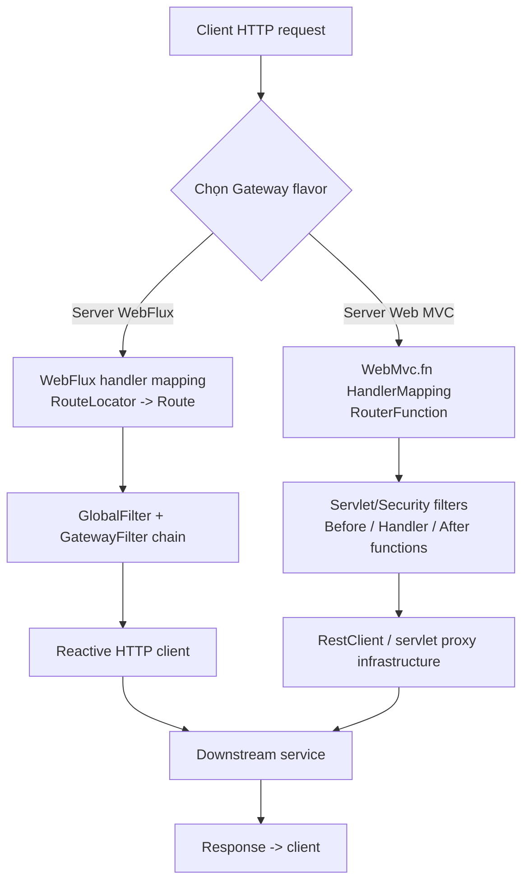
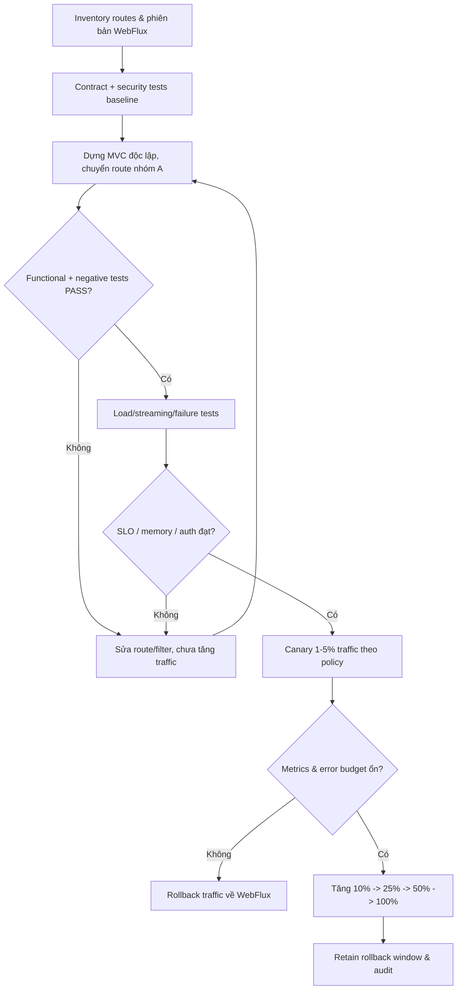

# Giới hạn tính năng so với WebFlux và kiểm thử khi chuyển đổi

**Chương:** Server Web MVC  
**Module:** `SPRING_CLOUD_GATEWAY` — Spring Cloud Gateway

Spring Cloud Gateway có hai triển khai **Server** khác nhau: **Server WebFlux** chạy trên Spring WebFlux/Reactor và **Server Web MVC** xây dựng trên Spring MVC, WebMvc.fn và Servlet runtime. Cả hai đều hướng tới xây dựng API Gateway với route predicates, filter chain, chuyển tiếp request, biến đổi path/header và kết nối dịch vụ; nhưng **không phải một mã nguồn GatewayFilter hoặc một YAML cấu hình có thể hoán đổi nguyên trạng giữa hai stack**.

Khi di chuyển từ WebFlux sang Web MVC, câu hỏi đúng không chỉ là “MVC có filter X không?”. Cần xác định **phiên bản**, **tên starter/property**, **API dùng cho filters**, **cách xử lý I/O và body streaming**, **load balancing**, **security**, **retry/circuit breaker**, **rate limiting**, **TLS**, **WebSocket**, **quan sát request** và **hành vi khi quá tải**. Ngay cả khi hai flavor có cùng filter name như `StripPrefix` hoặc `CircuitBreaker`, chúng có thể dùng lớp/abstraction và quy tắc cấu hình khác nhau.

Bài học tập trung vào **giới hạn chức năng theo từng phiên bản và cách kiểm thử tính tương đương khi chuyển đổi**. Ta sẽ xây dựng một backend mô phỏng, cấu hình hai Gateway chạy độc lập, đối chiếu REST, path, headers, request/response bodies, HTTP errors, security, load balancing và streaming; sau đó lập ma trận “được hỗ trợ / tương đương nhưng cách làm khác / cần xác minh / cần thiết kế lại”. Phần bảo mật và vận hành liên hệ trực tiếp tới mục tiêu của module: route predicate, filter chain, khám phá dịch vụ, xác thực, rate limiting, circuit breaker, retry, TLS và observability.

> **Giới hạn phạm vi:** Ví dụ chính dựa trên **Spring Cloud Gateway Server Web MVC/WebFlux 5.x** với các namespace `spring.cloud.gateway.server.webmvc.*` và `spring.cloud.gateway.server.webflux.*`. Với Gateway 4.x và các bản trước, starter, API, property hay behavior có thể khác. Không đưa một tính năng vào cột “không hỗ trợ” chỉ vì chưa thấy nó trong một trang docs; **phải kiểm tra đúng release train và có integration test**. Server Web MVC **khác** Proxy Exchange MVC — Proxy Exchange không phải một thay thế tương đương cho Gateway Server.

## 1. Mục tiêu học tập

Sau bài này, bạn có thể:

1. Xác định Gateway đang chạy **Servlet/WebMvc.fn** hay **WebFlux/Reactor** và giải thích sự khác biệt về threading, blocking I/O và backpressure.
2. Đối chiếu API `RouterFunction<ServerResponse>`, `HandlerFilterFunction`, `BeforeFilterFunctions`/`AfterFilterFunctions` với `RouteLocatorBuilder`, `GatewayFilter`, `GlobalFilter` và `Mono<Void>`.
3. Viết route `Path`/`Method`/`StripPrefix`/header tương đương bằng YAML và Java DSL **đúng flavor**.
4. Kiểm kê chức năng quan trọng: Retry, CircuitBreaker, Bucket4j/RedisRateLimiter, body rewriting, WebSocket, SSE/streaming, LoadBalancer, TLS, authentication và route management.
5. Thiết kế **contract tests** có thể chạy lại trên hai Gateway, tách khác biệt do Gateway với khác biệt do backend hay hạ tầng.
6. Kiểm chứng semantics của `401`/`403`/`404`/`429`/`502`/`503`, CORS preflight, redirects, cookies, request body và retry.
7. Xây dựng **capacity tests** cho tải cao/slow downstream, không dùng luận điểm “MVC chắc chắn chậm” hoặc “WebFlux chắc chắn nhanh” thay cho số liệu.
8. Lập kế hoạch canary/rollback có SLO, bảo vệ security boundaries và theo dõi routes/metrics trong khi di chuyển.

## 2. Hai mô hình thực thi: Servlet/WebMvc.fn và Reactor/WebFlux

| Khía cạnh | Gateway Server WebFlux | Gateway Server Web MVC |
|---|---|---|
| Web runtime | Spring WebFlux, thường Reactor Netty và event loops | Spring MVC/WebMvc.fn trên **Servlet container** (Tomcat/Jetty, tùy Boot) |
| Ngôn ngữ luồng request | `Mono`, `Flux`, `ServerWebExchange`, `Publisher` | `ServerRequest`, `ServerResponse`, `RouterFunction`, Servlet request |
| I/O downstream | Reactive HTTP client path, thường Reactor Netty | Client dựa trên Spring Boot `RestClient`/HTTP client infrastructure |
| Filter route | `GatewayFilter`/`GatewayFilterFactory` | `HandlerFilterFunction`, `BeforeFilterFunctions`, `AfterFilterFunctions` |
| Filter toàn cục | `GlobalFilter` + `GatewayFilterChain` | Servlet/Spring MVC interceptors/filters và Gateway MVC functions theo extension points tương ứng |
| Thread model | Không chặn event-loop, reactive scheduling | Servlet request/worker threads; có thể dùng **virtual threads** khi được hỗ trợ |
| Backpressure | Reactor hỗ trợ tín hiệu nhu cầu trên các Publisher | Servlet/proxy stream có cơ chế buffering, timeout và flow control riêng; không tự có Reactor backpressure end-to-end |
| Controller trong cùng app | WebFlux handlers | Spring MVC handlers |
| Security filter chain | `SecurityWebFilterChain` | `SecurityFilterChain` |
| Java DSL | `RouteLocatorBuilder` | `GatewayRouterFunctions.route(...)` và WebMvc.fn |

**MVC không có nghĩa mọi thứ nhất định chặn mãi một platform thread.** Các bản Spring Boot hiện đại có thể sử dụng virtual threads, HTTP clients hiệu quả và streaming support. Nhưng **bật virtual threads không biến WebMvc.fn thành Reactor**, không làm `Mono`/`Flux` GatewayFilter chạy được trên Servlet và không tự tạo backpressure cho mọi consumer.

### 2.1. Hình dung một HTTP proxy request



Một filter viết cho `ServerWebExchange` không có cùng signature với một WebMvc.fn `ServerRequest`. Ví dụ WebFlux có thể dùng:

```java
public Mono<Void> filter(ServerWebExchange exchange,
                         GatewayFilterChain chain) {
    return chain.filter(exchange);
}
```

Trong Web MVC, một custom filter thông thường thuộc kiểu:

```java
HandlerFilterFunction<ServerResponse, ServerResponse>
```

và thao tác trước/sau handler dùng những functions tương ứng của Servlet stack. **Không copy interface `GlobalFilter` từ WebFlux sang MVC**; hãy xác định mục đích filter rồi chọn API WebMvc.fn tương đương.

### 2.2. “Không blocking” không phải tiêu chí duy nhất

Với 10.000 kết nối HTTP đồng thời tới một backend phản hồi rất chậm, mô hình cấp phát thread/memory và HTTP connection pool có thể tạo kết quả khác nhau. WebFlux thường có lợi thế khi toàn bộ đường đi non-blocking; MVC với virtual threads có thể phù hợp nhiều workload I/O chờ và tái sử dụng ecosystem Servlet. Nhưng:

- Backpressure của Reactor **không** bảo vệ một đoạn custom code gọi `.block()` trên event-loop.
- Virtual threads **không** xóa bỏ giới hạn outbound socket, TLS, heap, connection pool hoặc backend concurrency.
- Buffering request/response lớn có thể làm cả hai stack cạn bộ nhớ.
- Số lần retry, body caching, logging và compression có thể ảnh hưởng hiệu năng nhiều hơn sự khác biệt tên web stack.

**Quyết định bằng số liệu p95/p99, error rate, memory, threads, active connections và cost** trên cùng contract; không suy từ benchmark không cùng dependencies/configuration.

## 3. Điểm tương đồng và những giới hạn cần kiểm tra theo phiên bản

Thay vì một danh sách “MVC không có A, B, C” dễ lỗi thời, dùng bảng **khoanh vùng migration**:

| Nhóm chức năng | Gateway Server WebFlux | Gateway Server Web MVC | Hành động khi chuyển |
|---|---|---|---|
| `Path`, `Host`, `Method`, `Header`, `Query` predicates | Có các predicate factories | Có WebMvc.fn `RequestPredicate` và custom predicates | Kiểm thử matching, URL encoding, precedence |
| `StripPrefix`, `RewritePath`, header filters | Có `GatewayFilter` factories | Có `Before/AfterFilterFunctions` và cấu hình filters | So sánh path/header thực ở backend |
| HTTP `http`/`https` routing | Netty reactive routing | RestClient-based proxy | Test HTTP status, streaming, timeout, redirect, TLS |
| `lb://service` | `ReactiveLoadBalancerClientFilter` | MVC LoadBalancer filter với `LoadBalancerClient` | Test discovery instance selection và 503 |
| Retry | Reactive Gateway retry filter | MVC `Retry`, bản 5.x chọn Spring Retry hoặc Spring Framework 7 retry | Kiểm tra defaults, body cache, thứ tự filters |
| CircuitBreaker | Spring Cloud CircuitBreaker reactive integration | **Có filter MVC**, hướng dẫn chính thức có starter Reactor | Kiểm tra starter theo filter docs **đúng phiên bản**, fallback/statusCodes |
| Rate limiting | Thường `RequestRateLimiter` + RedisRateLimiter reactive | `RateLimiter` dùng **Bucket4j**, `AsyncProxyManager` | Không chuyển nguyên key resolver/Redis properties |
| Request/response body mutation | `modifyRequestBody/ResponseBody` Java DSL | MVC cũng có `ModifyRequestBody`/`ModifyResponseBody` **Java DSL** | Rewrite code theo signature; test codec, size, no-body |
| Response caching | `LocalResponseCache` với Caffeine | Một số tài liệu MVC cũng liệt kê `LocalResponseCache`; docs có ví dụ chưa nhất quán | Xác minh phiên bản/beans, keys, max-age, privacy |
| WebSocket | `ws`/`wss` và `lb:ws` ở WebFlux | MVC hỗ trợ WebSocket với `spring-boot-starter-websocket` và chính sách Upgrade riêng | Test handshake, ping/pong, size/buffers |
| SSE/chunked streaming | Publisher/backpressure, HTTP streaming | MVC proxy streaming/buffering trên Servlet | Test chunk latency, flush, memory, disconnect |
| Security | Spring Security reactive | Spring Security Servlet | Thay `SecurityWebFilterChain` bằng `SecurityFilterChain`, test 401/403 |
| TLS outbound | Reactor Netty client TLS settings | Spring Boot `spring.http.client` + `spring.ssl.bundle` | Test trust/hostname, mTLS, timeouts |
| Dynamic routes/Actuator | RouteDefinitionRepository, Gateway Actuator API được tài liệu hóa | MVC route lifecycle/WebMvc.fn extension khác | Đừng copy RedisRouteDefinitionRepository WebFlux/Actuator assumptions |
| Global metrics/tracing | Gateway WebFlux tags, Reactor instrumentation | MVC/Servlet + Gateway metrics/observation theo bản | So sánh tag cardinality, route ID, spans |

**Bản chất của bảng:** “Có tính năng ở cả hai” **không bảo đảm parity 100%** về semantics, constructor, headers, error mapping, concurrency và property binding. “Cần xác minh” **không phải** phát biểu tính năng vĩnh viễn thiếu trên MVC. Người triển khai phải khóa version, xem docs của cả hai flavors và chạy bộ contract tests.

### 3.1. Các lỗi suy diễn cần tránh

- **Sai:** “MVC không thể proxy WebSocket”. **Đúng:** docs MVC mới có proxy WebSocket, cần starter riêng, quy tắc Upgrade và buffer limits.
- **Sai:** “MVC không có circuit breaker”. **Đúng:** có `CircuitBreaker` filter; integration starter được docs Gateway MVC chỉ dẫn, nhưng cần xác minh theo bản.
- **Sai:** “MVC không có body modification”. **Đúng:** có `ModifyRequestBody` và `ModifyResponseBody` qua Java DSL; signature khác WebFlux.
- **Sai:** “Cứ copy RedisRateLimiter của WebFlux sang MVC”. **Đúng:** docs MVC `RateLimiter` 5.x hướng dẫn Bucket4j.
- **Sai:** “Cứ copy Retry config từ WebFlux, vì cùng tên filter”. **Đúng:** MVC có `cacheBody`/`AdaptCachedBody`, implementation Spring Retry/Framework Retry khác.
- **Sai:** “Route YAML có cùng `uri` tức forwarding hoàn toàn giống nhau”. **Đúng:** phải xem path, headers, host, redirects, TLS, timeout, status và streaming thực tế.

### 3.2. Luôn cố định bộ phiên bản

Ví dụ ma trận kiểm tra (điền phiên bản **thật** của dự án thay vì sao chép phiên bản minh họa):

| Thành phần | Gateway WebFlux hiện tại | Gateway MVC mục tiêu |
|---|---|---|
| Spring Boot | Ghi exact version | Ghi exact version |
| Spring Cloud BOM/release train | Ghi release train | Ghi release train tương thích |
| Spring Cloud Gateway artifact | `spring-cloud-starter-gateway-server-webflux` | `spring-cloud-starter-gateway-server-webmvc` |
| Spring Framework/Reactor | Theo BOM | Servlet + WebMvc.fn/RestClient |
| Container | Netty/khác theo deploy | Tomcat/Jetty theo starter/deploy |
| HTTP client/TLS | Reactor Netty | RestClient + Boot client/SSL bundle |
| Retry/CircuitBreaker/RateLimiter dependencies | Ghi thực tế | Chọn theo MVC docs/version |
| Observability/Security | Reactive | Servlet |

Không tự điền version của dependency bằng trí nhớ; dùng BOM được quản lý, tài liệu release train và dependency tree khi thực thi ngoài STEP 4. **Không thêm cả hai Gateway starters trong cùng project để “migrating từ từ”** nếu chưa chủ động quản lý web application type, auto-config và route ownership. Bài lab dùng **hai ứng dụng Gateway độc lập** để so sánh an toàn.

## 4. Chuẩn bị migration: chốt hợp đồng thay vì chốt tên filter

Trước khi viết lại code, kiểm kê tất cả route đang chạy ở Gateway WebFlux:

- **Route ID và chủ sở hữu:** route được cấu hình bằng YAML, Java `RouteLocatorBuilder`, service discovery hay repository động?
- **Predicates:** `Path`, `Host`, `Method`, `Header`, `Cookie`, `Query`, `RemoteAddr`, `Weight` và các custom predicate.
- **Filters:** thứ tự `StripPrefix`/`RewritePath`, headers, auth/TokenRelay, retry, circuit breaker, rate limiter, response transformation, caching.
- **Đích:** `http://`, `https://`, `lb://`, `ws://`/`wss://`, `forward:`, gRPC hoặc protocol khác nếu hệ thống sử dụng.
- **Quản lý:** Actuator write/refresh, Config Server, Redis route repository, rollout config, rollback.
- **Dữ liệu:** JSON nhỏ, body lớn, upload multipart, streaming, SSE, WebSocket, chunked transfer, gzip/deflate, conditional requests.
- **Ràng buộc:** authentication/authorization, TLS/mTLS, CORS, quota, SLO, audit và incident runbook.

Đầu ra của khâu inventory nên là **một contract cho mỗi route**, không phải chỉ một dòng `uri`. Một mẫu:

| Thuộc tính | Ví dụ contract `catalog-route` |
|---|---|
| Client | `GET /api/items/{sku}` |
| Routing | `Path=/api/items/**`, backend `/items/{sku}` |
| Downstream | `http://catalog:8081` hoặc `lb://catalog-service` |
| Security | Token JWT hợp lệ, scope `catalog:read` |
| Headers | Không forward `X-Internal-Role` client tự đặt; thêm trace ID tin cậy |
| Status | `200` khi có item; `404` không có; `503` khi backend unavailable |
| Limits | Max body/headers, timeout và concurrency |
| Resilience | Retry GET tối đa N lần trên lỗi tạm; breaker theo service |
| Observability | Route ID, status class, p95/p99, trace propagation |
| Độ nhạy | Response không chứa dữ liệu user-specific nếu dùng public cache |

### 4.1. Ma trận phân loại route

Để tránh migrate mọi thứ đồng thời, phân nhóm:

| Nhóm | Dấu hiệu | Chiến lược |
|---|---|---|
| **A — gần tương đương** | GET JSON, `Path`/`StripPrefix`/header đơn giản | Di chuyển trước, chạy contract test chuẩn |
| **B — cần chỉnh cấu hình** | Rate limit, Retry, security, LoadBalancer, TLS | Chuyển theo MVC integration, kiểm tra defaults |
| **C — cần viết lại code** | Custom `GatewayFilter`, `GlobalFilter`, Reactor context, `Mono`/`Flux` transform | Viết WebMvc.fn/Servlet equivalent và unit tests |
| **D — cần thiết kế lại** | Heavy streaming, WebSocket/SockJS, custom reactive backpressure, dynamic route storage | PoC/benchmark trước, review architecture |
| **E — chưa rõ support** | Protocol hiếm, extension phụ thuộc một phiên bản | Chưa bật trong migration cho đến khi có evidence/tests |

**Không nên coi nhóm D luôn bất khả thi trên MVC.** Ví dụ WebSocket proxy đã được MVC 5.x hỗ trợ, nhưng các semantics về ping/pong, session buffering và retry sau upgrade cần được phân tích khác WebFlux.

## 5. Bài lab chung: backend Spring Boot MVC trả HTTP contract rõ ràng

Ta chuẩn bị ba ứng dụng độc lập:

| Ứng dụng | Port | Vai trò |
|---|---:|---|
| `contract-backend` | `8081` | Backend MVC thử GET, POST, status, redirect, slow và SSE |
| `gateway-webflux` | `8080` | Gateway Server WebFlux hiện tại (baseline) |
| `gateway-webmvc` | `8082` | Gateway Server Web MVC mục tiêu (candidate) |

**Không yêu cầu cùng codebase cho hai Gateway.** Mỗi Gateway có starter và cấu hình riêng; hai ứng dụng đều gọi **cùng backend `8081`**. Khi so response, chuẩn hóa những headers nội bộ có chủ ý khác (`X-Gateway-Flavor`, `Date`, `Server`, `Transfer-Encoding`) nhưng **không bỏ qua** những headers ảnh hưởng hợp đồng API như `Location`, `Content-Type`, `Set-Cookie`, `Cache-Control`, CORS và security headers.

### 5.1. Tạo backend

Trên Spring Initializr, tạo Spring Boot Maven project với **Spring Web**, package `com.example.contract`. Với Spring Boot 3.x, Java 17+; với Boot 4.x, chọn đúng starter do Initializr phiên bản đó cung cấp. Backend `application.yml`:

```yaml
server:
  port: 8081
spring:
  application:
    name: gateway-contract-backend
```

`ContractBackendApplication.java`:

```java
package com.example.contract;

import org.springframework.boot.SpringApplication;
import org.springframework.boot.autoconfigure.SpringBootApplication;

@SpringBootApplication
public class ContractBackendApplication {
    public static void main(String[] args) {
        SpringApplication.run(ContractBackendApplication.class, args);
    }
}
```

`ContractController.java`:

```java
package com.example.contract;

import java.net.URI;
import java.time.Duration;
import java.util.LinkedHashMap;
import java.util.Map;
import java.util.concurrent.atomic.AtomicInteger;
import jakarta.servlet.http.HttpServletRequest;
import org.springframework.http.CacheControl;
import org.springframework.http.HttpStatus;
import org.springframework.http.MediaType;
import org.springframework.http.ResponseEntity;
import org.springframework.web.bind.annotation.GetMapping;
import org.springframework.web.bind.annotation.PathVariable;
import org.springframework.web.bind.annotation.PostMapping;
import org.springframework.web.bind.annotation.RequestBody;
import org.springframework.web.bind.annotation.RequestHeader;
import org.springframework.web.bind.annotation.RestController;
import org.springframework.web.servlet.mvc.method.annotation.SseEmitter;
import org.springframework.web.context.request.ServletWebRequest;

@RestController
public class ContractController {

    private final AtomicInteger calls = new AtomicInteger();

    @GetMapping("/items/{sku}")
    public ResponseEntity<Map<String, Object>> item(
            @PathVariable String sku,
            @RequestHeader(value = "X-Gateway-Flavor",
                           required = false) String gateway,
            HttpServletRequest request) {
        Map<String, Object> body = new LinkedHashMap<>();
        body.put("sku", sku);
        body.put("path", request.getRequestURI());
        body.put("gateway", gateway);
        body.put("callNumber", calls.incrementAndGet());
        return ResponseEntity.ok()
            .cacheControl(CacheControl.noStore())
            .body(body);
    }

    @GetMapping("/cache/{sku}")
    public ResponseEntity<Map<String, String>> cache(
            @PathVariable String sku,
            ServletWebRequest webRequest) {
        String etag = "\"stable-" + sku + "-v1\"";
        long modified = java.time.Instant
            .parse("2026-11-01T00:00:00Z").toEpochMilli();
        CacheControl policy = CacheControl
            .maxAge(Duration.ofSeconds(5)).cachePublic();

        if (webRequest.checkNotModified(etag, modified)) {
            return ResponseEntity.status(HttpStatus.NOT_MODIFIED)
                .eTag(etag)
                .lastModified(modified)
                .cacheControl(policy)
                .build();
        }
        return ResponseEntity.ok()
            .eTag(etag)
            .lastModified(modified)
            .cacheControl(policy)
            .body(Map.of("sku", sku, "version", "v1"));
    }

    @PostMapping(path = "/echo",
                 consumes = MediaType.APPLICATION_JSON_VALUE)
    public ResponseEntity<String> echo(@RequestBody String json) {
        return ResponseEntity.ok()
            .contentType(MediaType.APPLICATION_JSON)
            .header("X-Origin", "contract-backend")
            .body(json);
    }

    @GetMapping("/status/{code}")
    public ResponseEntity<Map<String, Object>> status(
            @PathVariable int code) {
        return ResponseEntity.status(HttpStatus.valueOf(code))
            .body(Map.of("status", code));
    }

    @GetMapping("/redirect")
    public ResponseEntity<Void> redirect() {
        return ResponseEntity.status(HttpStatus.FOUND)
            .location(URI.create("/items/SKU-42"))
            .build();
    }

    @GetMapping("/slow")
    public ResponseEntity<Map<String, String>> slow()
            throws InterruptedException {
        // Chỉ mô phỏng backend MVC; không gọi Thread.sleep trên WebFlux event-loop.
        Thread.sleep(1200L);
        return ResponseEntity.ok(Map.of("mode", "slow"));
    }

    @GetMapping(path = "/events",
                produces = MediaType.TEXT_EVENT_STREAM_VALUE)
    public SseEmitter events() {
        SseEmitter emitter = new SseEmitter(10000L);
        Thread worker = new Thread(() -> {
            try {
                for (int i = 1; i <= 3; i++) {
                    emitter.send(SseEmitter.event()
                        .id(String.valueOf(i))
                        .name("tick")
                        .data("event-" + i));
                    Thread.sleep(300L);
                }
                emitter.complete();
            } catch (Exception ex) {
                emitter.completeWithError(ex);
            }
        });
        worker.setDaemon(true);
        worker.start();
        return emitter;
    }
}
```

**Giới hạn ví dụ:** `status/{code}` chỉ được dùng với status hợp lệ (200, 404, 500, 503...) trong lab; không đưa raw integer status API không kiểm soát vào production. `callNumber` là counter **mỗi backend process** để hỗ trợ quan sát calls/retry, không phải metric có độ bền. Endpoint `/items` có counter động nên dùng `Cache-Control: no-store` và không tuyên bố một ETag ổn định cho body thay đổi. Endpoint `/cache/{sku}` cố ý trả body bất biến v1 với ETag/Last-Modified ổn định và hỗ trợ conditional GET/304 để thử cache semantics. SSE dùng một thread nhỏ chỉ để demo; production nên dùng executor quản lý vòng đời/số lượng tasks thay vì `new Thread` cho mỗi request.

### 5.2. Kiểm thử backend trực tiếp

Khởi động backend:

```bash
./mvnw spring-boot:run
```

Trong terminal khác:

```bash
curl -i "http://localhost:8081/items/SKU-42"
curl -i -X POST "http://localhost:8081/echo" \
  -H "Content-Type: application/json" \
  --data '{"message":"xin chao"}'
curl -i "http://localhost:8081/status/404"
curl -i "http://localhost:8081/cache/SKU-42"
curl -i -H 'If-None-Match: "stable-SKU-42-v1"' \
  "http://localhost:8081/cache/SKU-42"
curl -i "http://localhost:8081/redirect"
curl -i "http://localhost:8081/slow"
curl -N -i "http://localhost:8081/events"
```

Trước khi thử Gateway, ghi lại response từ backend, thời gian và những headers quan trọng. Nếu backend chưa chạy hoặc path không khớp, **không dùng migration Gateway để chữa lỗi backend**.

### 5.3. Vì sao sử dụng cùng một backend?

Nếu WebFlux Gateway dùng backend A còn MVC Gateway dùng backend B, khác biệt JSON/status/latency có thể do **backend deployment** thay vì framework gateway. Cố định backend, input, authentication, dependencies và network hop tối đa có thể. Với test tính lặp lại, những endpoint có counter/timestamp ngẫu nhiên phải được **chuẩn hóa có chủ đích**, không đưa chúng thành false positives.

## 6. Dựng baseline Gateway Server WebFlux

Tạo **project Spring Boot riêng** có Maven dependency:

```xml
<dependency>
    <groupId>org.springframework.cloud</groupId>
    <artifactId>spring-cloud-starter-gateway-server-webflux</artifactId>
</dependency>
```

Spring Cloud BOM phải tương thích với Spring Boot đang dùng. Không chỉ thêm `spring-boot-starter-webflux` mà thiếu Gateway Server starter, và không thêm `spring-boot-starter-web` vào baseline một cách tùy tiện.

Tạo `src/main/resources/application.yml`:

```yaml
server:
  port: 8080

spring:
  application:
    name: gateway-webflux-baseline
  cloud:
    gateway:
      server:
        webflux:
          routes:
            - id: contract-route
              uri: http://localhost:8081
              predicates:
                - Path=/api/**
              filters:
                - StripPrefix=1
                - AddRequestHeader=X-Gateway-Flavor, WebFlux
```

Route `/api/items/SKU-42` được gửi đến `http://localhost:8081/items/SKU-42`. Route không giới hạn `Method` để dùng chung cho GET, POST và SSE tests; **không hiểu việc bỏ Method là authorization policy**: nếu production chỉ cho GET một path, phải giữ nguyên hợp đồng đó.

### 6.1. Java DSL WebFlux tương đương (lựa chọn thay thế)

Nếu baseline sử dụng `RouteLocatorBuilder` thay vì YAML:

```java
package com.example.webfluxgateway;

import org.springframework.cloud.gateway.route.RouteLocator;
import org.springframework.cloud.gateway.route.builder.RouteLocatorBuilder;
import org.springframework.context.annotation.Bean;
import org.springframework.context.annotation.Configuration;

@Configuration
public class ContractWebFluxRoutes {

    @Bean
    RouteLocator contractRoute(RouteLocatorBuilder builder) {
        return builder.routes()
            .route("contract-route", r -> r
                .path("/api/**")
                .filters(f -> f
                    .stripPrefix(1)
                    .addRequestHeader("X-Gateway-Flavor", "WebFlux"))
                .uri("http://localhost:8081"))
            .build();
    }
}
```

**Chọn một:** không khai đồng thời route YAML và Java với cùng `id`/`Path` trong cùng project khi chưa chủ động thiết kế ưu tiên. Java DSL WebFlux dùng `RouteLocator`, không có `RouterFunction<ServerResponse>` của Servlet WebMvc.fn.

### 6.2. Khởi động và kiểm tra

Trong terminal project WebFlux Gateway:

```bash
./mvnw spring-boot:run
```

Kiểm tra:

```bash
curl -i "http://localhost:8080/api/items/SKU-42"
curl -i -X POST "http://localhost:8080/api/echo" \
  -H "Content-Type: application/json" \
  --data '{"message":"baseline"}'
```

Backend dự kiến thấy `gateway=WebFlux` và `path=/items/SKU-42`. Ghi giá trị status, body/headers cần thiết làm **baseline contract**; chưa cần đo performance khi backend/chạy ứng dụng vẫn chưa ổn định.

## 7. Dựng Gateway Server Web MVC cạnh baseline

Tạo **project Spring Boot riêng** dành cho Server Web MVC, Maven dependency:

```xml
<dependency>
    <groupId>org.springframework.cloud</groupId>
    <artifactId>spring-cloud-starter-gateway-server-webmvc</artifactId>
</dependency>
```

Theo docs, starter này sử dụng **Spring MVC + WebMvc.fn**, chạy trên Servlet runtime như Tomcat/Jetty. Không đặt `spring-cloud-starter-gateway-server-webflux` vào project Web MVC chỉ vì đang migration, và không gọi WebMvc.fn là Proxy Exchange.

### 7.1. `application.yml` của Gateway Web MVC

```yaml
server:
  port: 8082

spring:
  application:
    name: gateway-webmvc-candidate
  cloud:
    gateway:
      server:
        webmvc:
          routes:
            - id: contract-route
              uri: http://localhost:8081
              predicates:
                - Path=/api/**
              filters:
                - StripPrefix=1
                - AddRequestHeader=X-Gateway-Flavor, WebMVC
```

Các yếu tố tương đương:

- Route ID `contract-route` giữ nguyên để dễ so metrics/config inventory (hai Gateway vẫn là **hai tiến trình khác nhau**).
- Predicate `Path=/api/**` giữ hợp đồng public URL.
- Filter `StripPrefix=1` giúp backend vẫn nhận `/items/SKU-42`, `/echo`, `/events`.
- Filter `AddRequestHeader` thêm marker khác để nhận diện candidate; production có thể bỏ hoặc thay bằng telemetry nội bộ không đáng tin cho security.
- URI `http://localhost:8081` chỉ dùng ở môi trường local. Trong Docker/Kubernetes, `localhost` của Gateway container không trỏ tới backend service khác.

**Khác biệt namespace:** dòng hiện đại dùng `spring.cloud.gateway.server.webmvc.routes`; bản MVC 4.x có thể dùng `spring.cloud.gateway.mvc.routes`. Không copy `spring.cloud.gateway.server.webflux.routes` từ baseline vì Gateway MVC có thể khởi động nhưng **không tạo route** từ prefix sai.

### 7.2. Java DSL WebMvc.fn tương đương (lựa chọn thay thế)

`RouteLocatorBuilder` không dùng cho Gateway MVC. Java DSL mẫu:

```java
package com.example.mvcgateway;

import org.springframework.context.annotation.Bean;
import org.springframework.context.annotation.Configuration;
import org.springframework.web.servlet.function.RouterFunction;
import org.springframework.web.servlet.function.ServerResponse;

import static org.springframework.cloud.gateway.server.mvc.filter.BeforeFilterFunctions.addRequestHeader;
import static org.springframework.cloud.gateway.server.mvc.filter.BeforeFilterFunctions.stripPrefix;
import static org.springframework.cloud.gateway.server.mvc.filter.BeforeFilterFunctions.uri;
import static org.springframework.cloud.gateway.server.mvc.handler.GatewayRouterFunctions.route;
import static org.springframework.cloud.gateway.server.mvc.handler.HandlerFunctions.http;
import static org.springframework.web.servlet.function.RequestPredicates.path;

@Configuration
public class ContractMvcRoutes {

    @Bean
    RouterFunction<ServerResponse> contractRoute() {
        return route("contract-route")
            .route(path("/api/**"), http())
            .before(uri("http://localhost:8081"))
            .before(stripPrefix(1))
            .before(addRequestHeader("X-Gateway-Flavor", "WebMVC"))
            .build();
    }
}
```

Điểm cần nhớ:

1. `RouterFunction<ServerResponse>` và `http()` từ **org.springframework.cloud.gateway.server.mvc.handler.HandlerFunctions**.
2. `uri(...)` và `stripPrefix(...)` là **BeforeFilterFunctions**, thay đổi outbound request/URI.
3. `path(...)` là WebMvc.fn `RequestPredicate`; khi viết custom predicate, API đầu vào là `ServerRequest` (Servlet), không phải `ServerWebExchange`.
4. Chuỗi `.before(...)` và `.filter(...)` có thứ tự/kiểu wrapper; không mặc định vị trí dòng trong DSL luôn giống thứ tự chạy `GatewayFilter` của WebFlux. Test backend path/headers.
5. Nếu sử dụng Java DSL, **bỏ route YAML cùng ID** để tránh xung đột.

### 7.3. Đừng đặt path đích trong `uri` rồi bỏ `StripPrefix`

Trang *How It Works* của Gateway Server MVC lưu ý **path trong route URI có thể bị bỏ qua**. Vì thế:

```yaml
# Không dùng cách này làm bằng chứng rằng /extra sẽ được giữ:
uri: http://localhost:8081/extra
```

Nếu muốn backend nhận `/items/SKU-42` từ `/api/items/SKU-42`, dùng `StripPrefix`/`SetPath`/`RewritePath` có contract và test tương ứng. Không gộp một phần path vào URI mà chưa xem implementation.

### 7.4. Khởi động MVC Gateway và so sánh nhanh

Trong terminal project MVC Gateway:

```bash
./mvnw spring-boot:run
```

So sánh:

```bash
curl -i "http://localhost:8080/api/items/SKU-42"
curl -i "http://localhost:8082/api/items/SKU-42"

curl -i -X POST "http://localhost:8080/api/echo" \
  -H "Content-Type: application/json" \
  --data '{"message":"same-contract"}'

curl -i -X POST "http://localhost:8082/api/echo" \
  -H "Content-Type: application/json" \
  --data '{"message":"same-contract"}'
```

Kỳ vọng hai Gateway đều forward đến backend, giữ HTTP method, JSON body, `Content-Type` và path đúng; trường `gateway` hoặc một số transport headers **khác có chủ đích**. Nếu MVC trả 404 còn WebFlux 200, kiểm tra **cấu hình route/DSL/prefix** trước khi kết luận MVC thiếu tính năng.

### 7.5. Không copy hạ tầng reactive sang Servlet

Trong MVC candidate không nên tự chuyển nguyên:

```java
GlobalFilter myFilter = (exchange, chain) -> chain.filter(exchange);
```

hoặc:

```java
Mono<Void> response = webClient.get().retrieve()
    .bodyToMono(Void.class);
```

rồi gắn vào `RouterFunction`. Nếu phải tích hợp một client reactive trong service MVC, có thể làm ở tầng ứng dụng riêng, nhưng **Gateway Server MVC proxy route** vốn dùng WebMvc.fn/RestClient, không cần `.block()` vòng qua các Reactor APIs để giả lập GatewayFilter. Trong một migration lớn, custom filters cần được **viết lại theo semantic intent** chứ không chỉ đổi tên import.

## 8. Giới hạn khi chuyển đổi custom predicates và filters

### 8.1. Các abstraction không thể thay thế bằng import

| WebFlux code | MVC equivalent/extension | Việc phải làm |
|---|---|---|
| `RouteLocatorBuilder` | `GatewayRouterFunctions.route(...)` | Viết lại route DSL, xác minh predicates/order |
| `GatewayFilterFactory` | `HandlerFilterFunction`, `BeforeFilterFunctions`, `AfterFilterFunctions` | Thiết kế lại filter API và lifecycle |
| `GlobalFilter`, `GatewayFilterChain` | Servlet Filter/Security filter chain hoặc Gateway MVC extension thích hợp | Xác định filter trước/sau routing, avoid double run |
| `ServerWebExchange` | `ServerRequest`/`ServerResponse` + Servlet request context | Không truy cập mutable exchange attributes theo cách cũ |
| `Flux<DataBuffer>` request body | Servlet request body / WebMvc.fn message readers | Test đọc body, buffering/replay và limits |
| `Mono.just(...)`/`Mono.error(...)` | Giá trị/exception synchronous hoặc API MVC tương ứng | Đổi error propagation và fallback |
| Reactive context | ThreadLocal/SecurityContext/Servlet request context | Test propagation khi dùng virtual threads/async tasks |
| Netty `HttpClient` config | Boot `RestClient`/Servlet proxy client config | Viết lại timeouts, TLS, pooling |

Một WebFlux filter kiểu:

```java
// Tư duy WebFlux: pipeline reactive và response object.
return chain.filter(exchange)
    .doOnError(error -> metrics.record(error));
```

không thể đổi thành `.doOnError(...)` ở MVC bằng cách import Reactor. Trong MVC, cần xác định exception nào được gọi qua `HandlerFilterFunction`/Servlet và tầng nào ghi metrics. Một response `500` hoàn chỉnh có thể **không ném exception**, nên quan sát status phải khác với bắt exception.

### 8.2. Custom before/after filters và tính bất biến của WebMvc.fn

`ServerRequest` và `ServerResponse` của WebMvc.fn là các abstractions tương đối bất biến; Gateway MVC cung cấp các helpers để tạo request/response phục vụ proxy. Với nhu cầu header đơn giản, dùng documented `BeforeFilterFunctions.addRequestHeader` thay cho trực tiếp sửa `HttpServletRequest`.

Ngược lại, một custom Servlet Filter đặt trước Gateway có thể áp lên **mọi** request (kể cả Actuator, login, static resource), không chỉ route nghiệp vụ. Khi chuyển từ route-specific `GatewayFilter` sang Servlet Filter, phải xác định **scope**; không áp rewrite/auth cho đường quản trị ngoài ý định.

### 8.3. Body modification trên MVC có hỗ trợ nhưng API khác

Docs MVC có:

- `ModifyRequestBody` qua Java DSL với `BeforeFilterFunctions.modifyRequestBody`.
- `ModifyResponseBody` qua Java DSL với `AfterFilterFunctions.modifyResponseBody`.

Ví dụ Java DSL MVC chỉ minh họa **ý tưởng đọc JSON string và sửa biểu diễn**:

```java
// Trong WebMvc.fn RouterFunction builder,
// áp dụng filter thích hợp như ví dụ chính thức:
.before(modifyRequestBody(
    String.class,
    String.class,
    "application/json",
    (request, body) -> body == null
        ? "{}"
        : body.trim()))
```

Với code thực, phải kiểm tra overload/signature đúng release train (đặc biệt xử lý no-body), converter/content-type và import. **Không đem nguyên lambda WebFlux** nhận `ServerWebExchange` rồi trả `Mono<?>` vào MVC lambda. Không kỳ vọng copy `ModifyResponseBody` từ YAML nếu docs nói filter chỉ cấu hình qua Java DSL.

Test bắt buộc cho body mutation:

1. `Content-Type: application/json`, UTF-8/Vietnamese characters.
2. Body rỗng, missing body và `Content-Length: 0`.
3. JSON có nested arrays/number/boolean, không thay kiểu dữ liệu ngoài ý muốn.
4. Body lớn vượt size limit và compressed body.
5. `Transfer-Encoding: chunked`/HTTP2 khi có, tránh reliance vào `Content-Length`.
6. Kết quả với `Content-Length`, `Content-Encoding`, ETag và response signature sau biến đổi.
7. Cancel/client disconnect giữa request hoặc response stream.

### 8.4. Bẫy caching body khi Retry

Trong WebFlux, một HTTP request body streaming thường không thể consume tùy ý nhiều lần nếu không có cơ chế cache/replay. MVC cũng không được phép mặc định rằng `InputStream` body đã đọc một lần sẽ tự quay lại đầu. Với **MVC Retry 5.x**, docs nêu:

```yaml
filters:
  - name: Retry
    args:
      retries: 2
      series: SERVER_ERROR
      methods: GET,POST
      cacheBody: true
  - name: AdaptCachedBody
```

Tùy phiên bản, `cacheBody=true` và `AdaptCachedBody` được dùng để gửi lại body. Điều này **có thể đọc toàn bộ body vào memory**; không bật cho uploads lớn chỉ để retry. Đặc biệt, POST thanh toán không an toàn để retry nếu backend có thể đã ghi đơn hàng trước khi mất response. Cần **idempotency key**, retry policy và HTTP body size limit.

## 9. Resilience: Retry, CircuitBreaker và RateLimiter

### 9.1. Retry ở MVC không phải implementation WebFlux

Theo docs MVC 5.x:

- Nếu **Spring Retry** có trên classpath, MVC `Retry` có thể chọn `GatewayRetryFilterFunctions` dựa Spring Retry.
- Nếu không, có thể dùng `FrameworkRetryFilterFunctions` dựa vào retry của **Spring Framework 7**.
- Property `spring.cloud.gateway.server.webmvc.use-framework-retry-filter=true` cho phép ép chọn Framework filter khi Spring Retry hiện diện, nếu phiên bản hỗ trợ.
- Defaults được tài liệu liệt kê gồm khoảng **3 retries**, `5XX`, `GET`; không giả định MVC và WebFlux có cùng constructor/exception list/backoff hay cách body được replay.

Ví dụ route MVC với Retry chỉ dành cho lab:

```yaml
spring:
  cloud:
    gateway:
      server:
        webmvc:
          routes:
            - id: retry-get-lab
              uri: http://localhost:8081
              predicates:
                - Path=/unstable/**
                - Method=GET
              filters:
                - StripPrefix=1
                - name: Retry
                  args:
                    retries: 2
                    series: SERVER_ERROR
                    methods: GET
                    backoff:
                      firstBackoff: 100ms
                      maxBackoff: 500ms
                      factor: 2
```

**Không đồng thời đặt route `/unstable/**` vào baseline đang thử contract** nếu nó làm nhiễu các status tests. Retry phải được test riêng bằng một backend endpoint cố tình trả 500 trong N lần trước khi thành công, đồng thời đếm **số lần backend thực nhận request**. Chỉ so status 200 không thể chứng minh retries đúng số.

### 9.2. CircuitBreaker MVC vẫn tồn tại

Trang `CircuitBreaker` Filter của **Gateway Server Web MVC 5.x** mô tả tích hợp Spring Cloud CircuitBreaker/Resilience4j và hướng dẫn dependency:

```xml
<dependency>
    <groupId>org.springframework.cloud</groupId>
    <artifactId>spring-cloud-starter-circuitbreaker-reactor-resilience4j</artifactId>
</dependency>
```

Đây là một chi tiết **dễ gây nhầm**: tên starter mang `reactor`, dù Gateway MVC là Servlet. Tài liệu **Spring Cloud CircuitBreaker** nói chung vẫn phân biệt starter non-reactive cho các ứng dụng MVC dùng `CircuitBreakerFactory.run(Supplier)`. Nhưng **filter Gateway Server MVC** có hợp đồng tích hợp riêng; không tự thay dependency trong trang docs thành non-reactive starter chỉ vì “MVC”.

Ví dụ YAML MVC:

```yaml
filters:
  - name: CircuitBreaker
    args:
      name: catalogBreaker
      fallbackUri: forward:/fallback/catalog
      statusCodes:
        - 500
        - 503
```

`fallbackUri` của filter hỗ trợ `forward:` tới handler nội bộ Gateway. Một HTTP `500` hoàn chỉnh có thể cần `statusCodes` để breaker coi là failure; khác với downstream exception. Test các trạng thái CLOSED/OPEN/HALF_OPEN, threshold, TimeLimiter, fallback status và security của handler.

**Không gắn `CircuitBreaker` vào route WebSocket MVC rồi mặc định nó giám sát mọi message sau 101**; docs WebSocket MVC nêu rõ retry và circuit breaker filters không áp lên WebSocket messages/session sau upgrade.

### 9.3. RateLimiter: MVC 5.x là Bucket4j

Theo trang MVC `RateLimiter` hiện hành, filter dùng **Bucket4j** token bucket, với `keyResolver` kiểu `Function<ServerRequest,String>`. `keyResolver` tùy chỉnh hiện được tài liệu hóa qua **Java DSL**, không phải tùy ý sao chép SpEL/string config của WebFlux:

```java
// Ý tưởng MVC theo tài liệu, chỉ dùng nếu đã cấu hình
// AsyncProxyManager và dependency Bucket4j thích hợp.
.filter(rateLimit(c -> c
    .setCapacity(100)
    .setPeriod(Duration.ofMinutes(1))
    .setKeyResolver(request -> {
        var principal = request.servletRequest().getUserPrincipal();
        return principal == null ? "anonymous" : principal.getName();
    })))
```

Đoạn là **mảnh DSL** theo hướng dẫn, không phải Java file tự chạy: cần import `Bucket4jFilterFunctions.rateLimit`, type/config `AsyncProxyManager` và thiết kế key resolver chuẩn. Đặc biệt, key `"anonymous"` gom tất cả người dùng chưa xác thực vào một bucket; trong ứng dụng public điều này có thể là policy được lựa chọn, nhưng không luôn hợp lý. Không tin `X-User` do client tự khai nếu chưa qua identity validation.

Với WebFlux, ví dụ phổ biến dùng `RequestRateLimiter`/`RedisRateLimiter` và reactive `KeyResolver`. **Không dùng dependency/property RedisRateLimiter của WebFlux để chứng minh MVC đang rate limit.** Muốn quota nhất quán khi canary giữa hai stacks, cần shared policy/tenant key và thử từ cùng principal qua cả hai gateways.

### 9.4. Retry, rate limit và circuit breaker không thể coi tương đương chỉ từ tên

| Test | Câu hỏi |
|---|---|
| Retry trước/sau breaker | Breaker đếm mỗi lượt thử hay kết quả operation sau retry? |
| POST timeout sau commit | Có side effect trùng không, có idempotency key không? |
| Backend trả 500 | HTTP response có được breaker ghi failure theo `statusCodes` không? |
| Gateway trả 429 | Rate limiter áp theo đúng user/tenant/key như baseline không? |
| Key resolver thiếu principal | Anonymous bị chặn/được phép theo policy nào? |
| Retry body lớn | Có cache body khiến heap tăng bất thường không? |
| Backend unavailable | Timeout/fallback latency và HTTP status có đúng SLO không? |

**Quy tắc:** xác minh hành vi bằng **backend call count + filter metrics + client HTTP status**. Không chỉ nhìn response JSON. Và đừng cấu hình retry vô hạn khi tất cả clients cùng bị outage, vì retry storm có thể khiến backend phục hồi chậm hơn.

## 10. LoadBalancer và khám phá dịch vụ: cùng `lb://`, khác cách tích hợp

Một Gateway route có đích `lb://catalog-service` cần Spring Cloud LoadBalancer và một nguồn `ServiceInstance` (Eureka, Consul, Kubernetes, SimpleDiscoveryClient...). Hai flavors đều có khả năng chọn instance, nhưng không dùng cùng lớp Java.

### 10.1. WebFlux

```yaml
spring:
  cloud:
    gateway:
      server:
        webflux:
          routes:
            - id: catalog-lb
              uri: lb://catalog-service
              predicates:
                - Path=/api/catalog/**
              filters:
                - StripPrefix=2
```

Với WebFlux route, `ReactiveLoadBalancerClientFilter` chọn `ServiceInstance` qua reactive LoadBalancer khi request đi đến route. Nếu không có instance, status thông thường là `503` theo cấu hình hiện hành; `lb://` không tự đăng ký backend.

### 10.2. Web MVC

```yaml
spring:
  cloud:
    gateway:
      server:
        webmvc:
          routes:
            - id: catalog-lb
              uri: lb://catalog-service
              predicates:
                - Path=/api/catalog/**
              filters:
                - StripPrefix=2
```

Trong **MVC Java DSL**, docs dùng `LoadBalancerFilterFunctions.lb(...)`:

```java
// Mảnh WebMvc.fn DSL: thứ tự filter phải được xem xét.
return route("catalog-lb")
    .route(path("/api/catalog/**"), http())
    .before(stripPrefix(2))
    .filter(lb("catalog-service"))
    .build();
```

Với MVC, tài liệu cảnh báo **`lb()` nên sau filters biến đổi path**, nếu không downstream URL có thể sai; khi dùng `lb://` trong cấu hình, gateway tự đặt load-balancer filter theo ordering tương ứng. Không tái sử dụng trực tiếp code `ReactiveLoadBalancerClientFilter`/`ReactorLoadBalancer` của WebFlux.

### 10.3. Không thêm `@LoadBalanced RestClient` vào proxy internal

Gateway Server Web MVC dùng RestClient nội bộ để proxy. Tài liệu MVC `LoadBalancer Filter` có cảnh báo: **không annotate RestClient builder dùng cho Gateway proxy bằng `@LoadBalanced`**, nếu không có thể xảy ra double resolution/service ID null hoặc lỗi runtime. Gateway route dùng **`lb()` filter hoặc `lb://` URI** để phân phối. Chỉ dùng `@LoadBalanced` cho một client của **ứng dụng do bạn tự gọi trực tiếp**, với mục đích tách biệt và bean scope kiểm soát.

### 10.4. Tests bắt buộc khi chuyển LoadBalancer

1. Backend/registry trả đúng service ID (có phân biệt hoa/thường hoặc alias không?).
2. Gateway A và B có cùng số instances khỏe không?
3. URI downstream, scheme HTTP/HTTPS và `ServiceInstance.isSecure` có khác không?
4. Khi instance không tồn tại, client thấy status mong đợi (503/404 theo policy) không?
5. Khi một instance restart, có request bị dồn vào node cũ do stale discovery không?
6. `StripPrefix`/`RewritePath` kết hợp `lb` có đúng thứ tự không?
7. Metrics/tags có đủ route ID và selected service mà không lộ internal host ra public không?

## 11. TLS/HTTPS và security: đây là hai đường cấu hình khác nhau

### 11.1. TLS outbound

Trong WebFlux, outbound client thường là Reactor Netty; cấu hình TLS/handshake/pooling thuộc nhóm `spring.cloud.gateway.server.webflux.httpclient.*` (tên thay đổi theo release train).

Trong Web MVC, tài liệu **TLS and SSL** nêu proxy backend dùng Spring Boot `RestClient` infrastructure và SSL bundles qua:

```yaml
spring:
  http:
    client:
      ssl:
        bundle: gatewayBackend
      connect-timeout: 5s
      read-timeout: 30s
  ssl:
    bundle:
      pem:
        gatewayBackend:
          truststore:
            certificate: classpath:internal-ca.pem
```

Đây là **ví dụ Boot/Gateway phiên bản hỗ trợ `spring.http.client.ssl.bundle`**. Với Spring Boot cũ hơn hoặc bản khác, hãy xem đúng docs; `spring.cloud.gateway.mvc.http-client.ssl-bundle` đã có lộ trình deprecated trong docs Gateway MVC. Đừng copy `useInsecureTrustManager=true` của WebFlux sang MVC, và **không tắt certificate verification trong production** để sửa nhanh lỗi handshake.

TLS public (client → gateway) và TLS outbound (gateway → backend) là **hai chặng độc lập**. Nếu ingress terminate TLS rồi Gateway gọi HTTP nội bộ, không thể khẳng định mã hóa end-to-end chỉ vì browser thấy HTTPS.

### 11.2. Spring Security Servlet và Reactive khác hẳn interface

WebFlux Gateway:

```java
SecurityWebFilterChain
```

Web MVC Gateway:

```java
SecurityFilterChain
```

Một bean Java minh họa Spring Security MVC (project có Spring Security Resource Server + JWT config đúng issuer/audience):

```java
package com.example.mvcgateway;

import org.springframework.context.annotation.Bean;
import org.springframework.context.annotation.Configuration;
import org.springframework.security.config.Customizer;
import org.springframework.security.config.annotation.web.builders.HttpSecurity;
import org.springframework.security.web.SecurityFilterChain;

@Configuration
public class GatewayMvcSecurity {

    @Bean
    SecurityFilterChain securityFilterChain(HttpSecurity http)
            throws Exception {
        http.authorizeHttpRequests(auth -> auth
                .requestMatchers("/actuator/health").permitAll()
                .requestMatchers("/api/**").authenticated()
                .anyRequest().denyAll())
            .oauth2ResourceServer(oauth2 ->
                oauth2.jwt(Customizer.withDefaults()));
        return http.build();
    }
}
```

Ví dụ này **chưa đủ để chạy** nếu chưa khai Spring Security/OAuth2 resource server dependencies và JWT decoder/trusted issuer. Để proxy POST với bearer token qua Servlet security chain, cần test **CSRF policy phù hợp client type**; mặc định CSRF trên state-changing requests có thể trả 403 trước khi route. Không tắt CSRF cho toàn bộ ứng dụng chỉ để một POST lab thành công khi có browser cookie sessions.

**Khi migration:** giữ nguyên yêu cầu scope/role/tenant và hậu kiểm tại backend Resource Server; thay reactive chain bằng Servlet chain nhưng không làm rộng quyền. `TokenRelay` phụ thuộc OAuth2 Client/context và access token audience; nó **không tự tạo authentication**.

### 11.3. StrictHttpFirewall có thể làm route path khác kết quả

Spring Security Servlet `StrictHttpFirewall` có thể từ chối request trước route nếu URL chứa `%2F`, `//`, `\\` hoặc sequences đáng ngờ. Trong WebFlux stack, quy tắc request parsing/security filter có thể khác. Một request `GET /api/files/a%2Fb` có thể bị MVC từ chối `400` **trước khi** route `Path` chạy, dù WebFlux baseline có behavior khác.

**Không nới firewall toàn cục** để “khớp baseline 200” nếu URL encoding đó mở ra path traversal/authorization bypass. Trước hết phải xác định contract thật của backend và normalize/encode ở đúng tầng; nếu bắt buộc hỗ trợ encoded slash, thiết kế threat model và test các dạng double-encoded/path normalization.

### 11.4. CORS preflight và WebSocket Origin

Browser API dùng `fetch` với cross-origin headers có thể gửi preflight `OPTIONS`. Một route `Method=GET`/`Method=POST` sẽ không tự match OPTIONS; CORS có thể được giải quyết bởi Servlet filter/Spring MVC mapping hoặc Gateway configuration tùy version. Hãy kiểm tra **preflight không bị Security trả 401/403 sai** và không gửi request OPTIONS tới backend ngoài ý muốn.

WebSocket **không sử dụng CORS preflight như fetch**, nhưng gửi `Origin` trong HTTP handshake (browser). Docs Gateway MVC có `spring.cloud.gateway.server.webmvc.websocket.allowed-origins`, mặc định same-origin/no-Origin. Đừng dùng một `Access-Control-Allow-Origin: *` của REST API thay cho WebSocket Origin security.

### 11.5. Forwarded headers và trusted proxies

Khi có TLS termination ở ingress, các headers `Forwarded` và `X-Forwarded-*` ảnh hưởng scheme/host/redirect và security decisions. Cả hai flavors có cấu hình trusted-proxy khác nhau theo release train. Khi chuyển:

- Proxy phía trước phải xóa headers `Forwarded`/`X-Forwarded-*` do client tự khai.
- Gateway chỉ tin proxies allowlisted, không tin địa chỉ IP tùy ý.
- Kiểm tra `Host`, `X-Forwarded-Proto` và `Location` redirects thực tế.
- Không ghi raw Authorization/cookie/token vào access logs.

Nếu frontend redirect từ HTTPS sang HTTP sau migration, có thể lỗi trusted proxy/scheme forwarding **chứ không phải** route predicate.

## 12. Streaming, WebSocket và request body lớn là nhóm kiểm thử riêng

### 12.1. SSE/chunked HTTP streaming

Backend `/events` ở lab gửi ba SSE events cách nhau khoảng 300 ms. Gọi qua hai Gateway:

```bash
curl -N -i "http://localhost:8080/api/events"
curl -N -i "http://localhost:8082/api/events"
```

`-N` của cURL yêu cầu giảm buffering ở client; **không ép** proxy ngừng buffering. Hãy quan sát thời gian **event đầu tiên**, khoảng cách giữa events, response `Content-Type: text/event-stream` và hành vi client disconnect. Trong docs/configprops Gateway MVC 5.x có `streaming-media-types` và `streaming-buffer-size`; đây là các knobs cho Servlet proxy, không phải Reactor `Flux` backpressure. Không tuyên bố MVC hoàn toàn không streaming.

Test cần bao gồm:

| Kịch bản | Điều cần kiểm tra |
|---|---|
| SSE ba events nhỏ | Event có được flush sớm hay dồn tới cuối? |
| SSE 5 phút | Gateway/ingress timeouts và memory có ổn không? |
| Client disconnect | Backend worker/stream có được đóng/giải phóng không? |
| Response `Transfer-Encoding: chunked` | Không biến thành body hỏng hoặc đóng sớm |
| HTTP/2 client, HTTP/1.1 backend | Stream semantics và proxy buffering có đúng không? |
| Compression | Có tạo extra buffering/delay hoặc sai content encoding không? |

Không đánh giá SSE chỉ từ “cuối cùng nhận đủ ba dòng”: nếu ba event vốn phải đến cách nhau 300 ms mà proxy gom cả ba sau 1 giây, realtime contract đã khác.

### 12.2. WebSocket MVC **được hỗ trợ**, nhưng có giới hạn riêng

Tài liệu Gateway Server Web MVC mới mô tả **WebSocket proxy** khi có dependency:

```xml
<dependency>
    <groupId>org.springframework.boot</groupId>
    <artifactId>spring-boot-starter-websocket</artifactId>
</dependency>
```

Route có thể dùng `ws://`/`wss://`; hoặc `http://`/`https://`/`lb://` với `Upgrade: websocket` được proxy như WebSocket. Java DSL WebMvc.fn có `HandlerFunctions.websocket()`. Cách này **không đồng nhất** với cú pháp `lb:ws://` được tài liệu WebFlux mô tả: hãy kiểm tra đúng flavor khi cần load balancing WebSocket.

Điểm khác **được docs MVC nhấn mạnh**:

- Text, binary, Pong messages được proxy; **Ping không được relay** qua Servlet WebSocket API, container thường tự trả Pong. Vì vậy Pong từ Gateway **không chứng minh backend khỏe**.
- Các request filters như `StripPrefix`/`AddRequestHeader`/`TokenRelay` tác động lúc handshake; sau connection opening, messages đi theo session.
- Body response filters, Retry và CircuitBreaker **không áp dụng** cho các WebSocket messages sau khi upgrade.
- Servlet WebSocket không có Reactor backpressure; Gateway MVC có send-buffer/time/message-size limits, có thể đóng connection `1009` nếu message quá lớn.

Configuration properties 5.x được docs mô tả:

```yaml
spring:
  cloud:
    gateway:
      server:
        webmvc:
          websocket:
            enabled: true
            connect-timeout: 10s
            send-time-limit: 10s
            send-buffer-size-limit: 512KB
            max-message-size: 64KB
```

Giá trị trên nhằm minh họa **các knobs và defaults được tài liệu hóa**, không phải ngưỡng phù hợp mọi ứng dụng. Với binary stream/chat, thiết kế quotas, connection admission, heartbeat, reconnect và shared broker riêng; không đòi Retry HTTP khôi phục một WebSocket session đã nhận `101`.

### 12.3. Upload/multipart và backpressure

Đối với file upload `POST /upload` hoặc request body `Transfer-Encoding: chunked`:

- Kiểm tra `Content-Type`/multipart boundaries còn đúng và dữ liệu không đổi.
- Đặt giới hạn ở **Servlet container + Gateway + backend**; đừng chỉ xét `Content-Length` vì chunked/HTTP2 có thể không có.
- Không bật `Retry cacheBody=true` cho file lớn khi chưa biết memory budget.
- Test client hủy upload giữa chừng, backend kết nối chậm và socket timeout.
- Đo heap/direct memory/thread/connection pool khi có nhiều uploads song song.
- Nếu WebFlux baseline dùng `DataBuffer` streaming và custom filter không buffer, chuyển sang MVC body filter đọc toàn bộ body có thể đổi đáng kể memory/latency; cần test trên payload thực.

### 12.4. Response caching và conditional requests

Các bản Gateway MVC có trang `LocalResponseCache`, nhưng một số ví dụ trong trang hiện hành còn hiển thị **WebFlux `RouteLocatorBuilder`/prefix cũ**. Đây là dấu hiệu phải đọc **source/issue/release notes đúng bản và viết integration test**, không mù quáng copy snippet.

Kiểm tra riêng GET `Cache-Control: public, max-age=30`, `ETag`, `If-None-Match`, `If-Modified-Since`, `304 Not Modified`, `Vary`, `no-store` và dữ liệu theo user. Trong production, không cache response `/me`/`/orders` có token/cookie bằng một shared cache nếu chưa có thiết kế key/privacy an toàn.

## 13. Bộ contract tests bắt buộc trước khi bật traffic MVC

Không chỉ kiểm tra “GET trả 200”. Hãy tạo **ma trận cho mỗi route** gồm input, expected response và quan sát tại backend, rồi chạy cùng bộ test qua **WebFlux baseline `8080`** và **MVC candidate `8082`**.

### 13.1. Routing và HTTP semantics

| Case | Request mẫu | Điều cần so |
|---|---|---|
| T1 — GET JSON | `GET /api/items/SKU-42` | 200, path backend, body fields/headers |
| T2 — POST JSON | `POST /api/echo` | Body Unicode, Content-Type, method không bị đổi |
| T3 — Không có route | `GET /does-not-exist` | 404 từ Gateway, backend không nhận |
| T4 — Backend 404 | `GET /api/status/404` | 404 từ backend, không tự thành fallback 200 |
| T5 — Backend 500 | `GET /api/status/500` | 500/response body, retry policy khi đã bật |
| T6 — Redirect | `GET /api/redirect` | `302`/`Location`, không âm thầm follow |
| T7 — Query | `GET /api/items/SKU-42?lang=vi&currency=VND` | Query không bị mất |
| T8 — Trailing slash | `GET /api/items/SKU-42/` | Match, normalization, status theo contract |
| T9 — URL encoded | `GET /api/items/a%2Fb` | Firewall/path parsing, không bypass authorization |
| T10 — Headers có nhiều giá trị | `Accept-Language`, `Cookie`, `Forwarded` | Allowed/removed/forwarded headers |
| T11 — Conditional GET | `GET /api/cache/SKU-42` với `If-None-Match`/`If-Modified-Since` | `304` vs `200` và ETag nhất quán |
| T12 — HTTP method khác | `DELETE /api/echo` | `404`/`405` theo route/backend |
| T13 — Backend chậm | `GET /api/slow` | Timeout, status, latency, in-flight calls |
| T14 — Request lớn | `POST /api/echo` với payload test lớn | 413/431 hay 2xx đúng limits |
| T15 — Compression | `Accept-Encoding: gzip` | Body, Content-Encoding/Length/ETag |
| T16 — Stream | `GET /api/events` | Flush từng SSE event, không buffer toàn bộ |

**Không cố ép hai stack trả byte-for-byte giống nhau ở mọi tầng transport.** `Date`, `Server`, chunked framing, header ordering và connection reuse có thể khác hợp lệ. Nhưng **status, dữ liệu nghiệp vụ, quyền truy cập, Location, CORS, cookies, cache-control và semantic headers** phải tuân hợp đồng đã phê duyệt.

### 13.2. Lệnh cURL đối chiếu thủ công

```bash
curl -i "http://localhost:8080/api/items/SKU-42"
curl -i "http://localhost:8082/api/items/SKU-42"

curl -i -X POST "http://localhost:8080/api/echo" \
  -H "Content-Type: application/json; charset=utf-8" \
  --data '{"message":"xin chào, 世界"}'
curl -i -X POST "http://localhost:8082/api/echo" \
  -H "Content-Type: application/json; charset=utf-8" \
  --data '{"message":"xin chào, 世界"}'

curl -i "http://localhost:8080/api/status/404"
curl -i "http://localhost:8082/api/status/404"
curl -i -H 'If-None-Match: "stable-SKU-42-v1"' \
  "http://localhost:8080/api/cache/SKU-42"
curl -i -H 'If-None-Match: "stable-SKU-42-v1"' \
  "http://localhost:8082/api/cache/SKU-42"
curl -i "http://localhost:8080/no-route"
curl -i "http://localhost:8082/no-route"

# Không dùng -L để quan sát Location nguyên trạng.
curl -i "http://localhost:8080/api/redirect"
curl -i "http://localhost:8082/api/redirect"

# -N tắt buffering ở cURL; không vô hiệu buffering của proxy.
curl -N -i "http://localhost:8080/api/events"
curl -N -i "http://localhost:8082/api/events"
```

Mục tiêu là so **hai hệ thống độc lập**; không dùng browser cache tại baseline và cURL không cache tại candidate để so latency. Nếu cần nhìn raw HTTP/2 vs HTTP/1.1, dùng đúng client/flag được tool hỗ trợ và ghi protocol negotiation ở từng chặng.

### 13.3. Chuẩn hóa phần khác có chủ đích, không che lỗi thật

Vì backend lab tăng `callNumber` ở mỗi request, hai response có thể khác dù Gateway tương đương. Dùng `jq` chỉ loại **hai trường test-only**:

```bash
curl -sS "http://localhost:8080/api/items/SKU-42" \
  | jq -S 'del(.callNumber, .gateway)' > /tmp/webflux-body.json
curl -sS "http://localhost:8082/api/items/SKU-42" \
  | jq -S 'del(.callNumber, .gateway)' > /tmp/webmvc-body.json
diff -u /tmp/webflux-body.json /tmp/webmvc-body.json
```

**Không** được loại bỏ khi chuẩn hóa các trường `tenantId`, giá, quyền, response security fields hoặc `Location`. Các fields thay đổi có ý nghĩa nghiệp vụ phải được phát hiện, không che để test pass. Trên Windows, dùng công cụ JSON/diff tương đương thay cho `/tmp`.

### 13.4. Bash smoke test tối giản cho CI

Script mẫu chạy **sau khi cả ba ứng dụng đã sẵn sàng**:

```bash
#!/usr/bin/env bash
set -euo pipefail

check_status() {
  local base="$1" path="$2" expected="$3"
  local actual
  actual=$(curl -sS -o /dev/null -w '%{http_code}' "$base$path")
  if [[ "$actual" != "$expected" ]]; then
    printf 'FAIL base=%s path=%s expected=%s actual=%s\n' \
      "$base" "$path" "$expected" "$actual" >&2
    return 1
  fi
}

for base in http://localhost:8080 http://localhost:8082; do
  check_status "$base" "/api/items/SKU-42" 200
  check_status "$base" "/api/status/404" 404
  check_status "$base" "/api/status/500" 500
  check_status "$base" "/api/redirect" 302
  check_status "$base" "/no-route" 404
done

echo "Smoke statuses PASS; run header/body/security tests separately."
```

Script này **không đủ** làm migration acceptance test: nó chưa kiểm tra headers, JSON/Unicode, origin path, auth, CORS, SSE, load balancing hay concurrency. Sau khi bật Retry/CircuitBreaker, endpoint `/api/status/500` có thể chuyển thành fallback status được phê duyệt; hãy cập nhật expected theo **contract**, không áp một mã 500 cho mọi policy.

### 13.5. Windows PowerShell nhanh

```powershell
curl.exe -i "http://localhost:8080/api/items/SKU-42"
curl.exe -i "http://localhost:8082/api/items/SKU-42"
curl.exe -i "http://localhost:8080/api/status/500"
curl.exe -i "http://localhost:8082/api/status/500"

$body = @{ message = "xin chào" } | ConvertTo-Json -Compress
Invoke-WebRequest -Uri "http://localhost:8082/api/echo" -Method Post -ContentType "application/json; charset=utf-8" -Body ([Text.Encoding]::UTF8.GetBytes($body))
```

`ConvertTo-Json` giúp tạo một body ổn định; so cùng body bytes trên cả hai Gateways. Lệnh chỉ nhằm minh họa, không dùng để gửi dữ liệu cá nhân hoặc bearer token thật.

### 13.6. Test tại ba vantage points

| Vị trí | Quan sát | Lý do |
|---|---|---|
| **Client** | Status, body, headers, latency, SSE frame timing | Hợp đồng bên ngoài |
| **Gateway** | Route ID, predicate match, filter outcomes, retry/breaker, TLS | Tầng thay đổi khi migration |
| **Backend** | Path, method, query, Host/headers, body, số lượt gọi | Chứng minh proxy forward đúng |

Đừng chỉ nhìn client 200 rồi kết luận path đã rewrite đúng nếu backend trả cùng JSON cho nhiều URL. Trong lab, `ContractController` có `path` để kiểm tra.

## 14. Security regression tests: migration không được làm rộng quyền

Security phải là **acceptance gate độc lập** với functional tests. Một route MVC “chạy được” nhưng cho user sai tenant đọc dữ liệu là **migration thất bại**, dù latency có cải thiện.

### 14.1. Authentication/authorization matrix

| Case | Client | Kết quả hợp đồng |
|---|---|---|
| Không token vào route protected | Anonymous | 401 hoặc redirect login theo thiết kế, không đến backend protected |
| Token hết hạn/issuer sai | Auth attempt | 401, không trả fallback chứa dữ liệu |
| Token hợp lệ nhưng thiếu scope | Authenticated | 403, không forward tài nguyên |
| Token đúng scope, đúng tenant | Allowed user | 2xx/4xx nghiệp vụ như backend |
| Header `X-User`/`X-Role` giả mạo | Anonymous or wrong user | Không cấp quyền theo header client tự khai |
| Cookie session khác origin | Browser | SameSite/Origin/CSRF đúng |
| Preflight OPTIONS | Browser | CORS policy đúng, không đòi bearer trên OPTIONS khi không cần |
| Redirect sang external host | Client | Không làm lộ token/cookie qua Location |
| Encoded slash/dot-segment | Client | Firewall/path normalization không bypass deny |
| TokenRelay sang backend khác audience | Authenticated | Không relay token trái audience/trust boundary |
| Management/Actuator | Unauthorized | Không lộ route secrets, không cho write route |

Kết quả 401/403/redirect theo **security contract**, không phải một mã áp cho mọi Spring Boot app. Kiểm tra cả request qua Gateway và backend trực tiếp nếu network cho phép; backend không nên lệ thuộc duy nhất Gateway để bảo vệ dữ liệu nhạy cảm.

### 14.2. CORS preflight

```bash
curl -i -X OPTIONS "http://localhost:8080/api/echo" \
  -H "Origin: https://frontend.example.test" \
  -H "Access-Control-Request-Method: POST" \
  -H "Access-Control-Request-Headers: Authorization,Content-Type"

curl -i -X OPTIONS "http://localhost:8082/api/echo" \
  -H "Origin: https://frontend.example.test" \
  -H "Access-Control-Request-Method: POST" \
  -H "Access-Control-Request-Headers: Authorization,Content-Type"
```

**Lab mặc định chưa khai CORS**, nên chưa thể yêu cầu cả hai trả 200/204/ACAO. Khi migrate hệ thống thực, hãy cấu hình CORS policy tương đương rồi so `Access-Control-Allow-Origin`, `-Methods`, `-Headers`, `-Credentials`, `Vary: Origin`, `Access-Control-Max-Age` và headers bị thêm trùng tại ingress/backend.

Preflight `OPTIONS` không được bị Security/route method predicate chặn sai hoặc đi đến backend ngoài ý muốn. Không khắc phục bằng việc mở mọi Origin/credential trên Internet.

### 14.3. Token forwarding và response privacy

Khi dùng `TokenRelay`, kiểm tra access token được chuyển **chỉ tới đúng audience/backend**, không chảy sang fallback service hay route public. Backend Resource Server vẫn kiểm tra issuer/audience/scopes. Không dùng `RemoveRequestHeader=Authorization` để “sửa 401” nếu backend cần validate token.

Nếu Gateway có caching, response `/me` hoặc đơn hàng gắn user/session cần `Cache-Control` và cache-key isolation đúng; không bật shared response cache để cải thiện p99 khi chưa chứng minh không rò dữ liệu giữa users/tenants.

### 14.4. Security chain scope

Trong MVC, `SecurityFilterChain` thuộc Servlet; nó có thể chạy **trước route selection**. Trong WebFlux, `SecurityWebFilterChain` thuộc reactive web filter chain. Test:

1. Request chưa xác thực bị chặn trước khi route match.
2. Route khác ưu tiên hơn không vô tình bỏ qua authorization.
3. Handler fallback không tiết lộ dữ liệu riêng hoặc stack trace.
4. Actuator/management port được bảo vệ bằng mạng và quyền riêng.
5. Preflight/health endpoints chỉ được mở theo policy.
6. Request URL có ký tự đặc biệt không vượt strict firewall.

Không dùng các đường test chỉ có `200 OK` để đánh giá filter bảo mật; phải có **negative tests**.

## 15. Dynamic routes, Actuator và cấu hình vận hành

### 15.1. WebFlux RouteDefinitionRepository không tự áp vào MVC

Gateway Server WebFlux có `RouteDefinitionLocator`, `RouteDefinitionRepository`, `CachingRouteLocator`, `RefreshRoutesEvent` và Gateway Actuator API được tài liệu hóa riêng. Với deployments dùng Redis route repository hoặc API tạo/xóa route động, đây có thể là **một phần cốt lõi của runtime**.

Gateway Server Web MVC xây dựng route từ WebMvc.fn `RouterFunction` và route configuration riêng. **Đừng giả định rằng bean `InMemoryRouteDefinitionRepository` hoặc `RedisRouteDefinitionRepository` của WebFlux có cùng lifecycle, mapping và Actuator read/write semantics trong MVC**. Để đánh giá migration:

1. Kiểm tra trang reference **Server Web MVC** và configprops ở exact release train.
2. Xác định MVC target có cách nạp route từ config repo, DB hay refresh nào đã được tài liệu hóa.
3. Kiểm tra runtime route refresh có atomically applied không, các requests in-flight ra sao.
4. Nếu không đáp ứng contract dynamic route đang có, đưa vào nhóm **thiết kế lại**; dùng control plane phát hành cấu hình/restart canary hoặc extension chính thức, không copy repository interface phản xạ.
5. Bảo đảm route changes không bypass authentication/rate limiting hoặc route policy.

### 15.2. Không áp đặt WebFlux Actuator endpoint schema cho MVC

WebFlux docs mô tả `POST /actuator/gateway/routes/{id}`, `DELETE` và `POST /actuator/gateway/refresh`. Nếu MVC application cũng có Actuator hoặc custom management endpoint, **không suy** các endpoints này có cùng payload, write privileges, refresh behavior và consistency semantics; phải xác minh đúng implementation/version.

Mọi endpoint cho phép **ghi URI/filters/routes** đều là quyền hạ tầng nhạy cảm, có thể gây SSRF, route shadowing hoặc đưa traffic tới backend ngoài allowlist. Không mở `management.endpoint.gateway.access=unrestricted` trên public network chỉ để test migration. Ưu tiên quản trị riêng qua RBAC/MFA, network isolation, audit và validation.

### 15.3. So sánh bản cấu hình đang chạy, không chỉ YAML trên Git

Một deployment có thể thêm routes từ discovery, environment variables, Config Server hoặc custom repository. Vì vậy **YAML giống nhau trong repo chưa đủ**. Ghi lại:

- Exact app version, Spring Cloud BOM, Gateway starter;
- Route IDs, predicates, filters/order và URI đã được resolve;
- Service discovery instances được quan sát;
- Feature flags/canary weights;
- Security/TLS/timeout config;
- Desired vs applied config revision theo từng replica.

Khi config drift, một gateway instance có thể trả 404 trong khi instance khác trả 200 mà binary code hoàn toàn giống nhau. Cần ghi nhận **runtime state per replica**.

## 16. Kiểm thử hiệu năng và năng lực: đừng so trên một cURL

### 16.1. Mục tiêu kiểm thử

Hãy thiết kế SLO/acceptance **trước khi benchmark**. Ví dụ các ngưỡng minh họa (không phải mặc định của Spring):

| Chỉ số | Baseline WebFlux | Điều kiện MVC candidate |
|---|---|---|
| HTTP success rate | Đo bằng cùng workload | Không thấp hơn ngưỡng hợp đồng |
| p50 latency | Đo ở client | Theo SLO và kỳ vọng |
| p95/p99 latency | Đo ở client | Không vượt SLO/error budget |
| Throughput ổn định | RPS ở concurrency mục tiêu | Đạt capacity cần thiết |
| Heap/direct memory | Peak/RSS/GC | Không vượt limit của Pod/VM |
| Active threads / virtual threads | Đo bằng JVM/runtime | Không bão hòa pool/threads |
| Outbound connections | HTTP pool/active sockets | Không gây quá tải backend |
| Error rate 429/5xx/timeout | Theo route/exception | Không tăng ngoài chính sách |
| Streaming first-event latency | SSE | Không gom dữ liệu sai real-time contract |
| WebSocket active sessions | Concurrent connections | Đạt workload và tài nguyên |
| CPU/GC pause | Máy/Pod | Đạt budget production |

**Không tự điền các giá trị benchmark** nếu chưa chạy. Nếu WebFlux p99 150 ms còn MVC p99 180 ms trên một máy dev, điều đó vẫn chưa thể kết luận production: warm-up, JIT, container limits, backend latency và test tool đều có thể làm sai lệch.

### 16.2. Workload phải phản ánh traffic thật

Ít nhất cần bốn nhóm:

1. **Fast JSON:** nhiều GET/POST nhỏ, benchmark throughput request-response.
2. **Slow downstream:** một tỉ lệ requests đợi 500–2.000 ms để đo queuing/concurrency.
3. **Large body:** uploads 1, 10, 50 MB theo hợp đồng; giới hạn hoặc rejection rõ.
4. **Long-lived connections:** SSE/WebSocket đang mở, có messages/sec thực tế; không chỉ đo handshake rate.

Thêm traffic mix có `404`/`401`/`429`/`503`, retry/circuit breaker và TLS nếu production có. So **cùng dữ liệu, cùng backend và cùng config resources** trước khi so frameworks.

### 16.3. Ví dụ k6 load test HTTP (người học chạy ở môi trường lab)

Một test k6 minh họa, **không phải file phải được tạo trong bước viết bài**:

```javascript
import http from "k6/http";
import { check, sleep } from "k6";

export const options = {
  vus: 20,
  duration: "30s",
  thresholds: {
    http_req_failed: ["rate<0.01"],
    http_req_duration: ["p(95)<500"]
  }
};

const base = __ENV.GATEWAY_URL || "http://localhost:8082";

export default function () {
  const res = http.get(base + "/api/items/SKU-42");
  check(res, { "status 200": r => r.status === 200 });
  sleep(0.2);
}
```

Để so sánh:

```bash
GATEWAY_URL=http://localhost:8080 k6 run gateway-load.js
GATEWAY_URL=http://localhost:8082 k6 run gateway-load.js
```

Người học phải tự đặt `gateway-load.js` trong dự án test riêng **ngoài phạm vi worker STEP 4**; bài học này chỉ trình bày ví dụ. Các thresholds 1% lỗi/p95 500 ms chỉ là **điều kiện lab minh họa**, không nên copy thành mục tiêu production. Không chạy load test vào endpoints public hoặc production không được phép.

### 16.4. Warm-up và cách đọc kết quả

Một quy trình công bằng:

1. Cố định CPU/memory limits, số replicas, backend version và network.
2. Khởi động backend và cả hai Gateway; chờ health ready.
3. Warm-up JVM/JIT và connection pools.
4. Chạy workload WebFlux, MVC trong những khoảng tương đương; đổi thứ tự nhiều lần để tránh bias do backend nóng/lạnh.
5. Thu client latency (p50/p95/p99), `http_req_failed`, CPU, heap/direct memory, threads, GC, sockets, backend call count.
6. Kiểm tra HTTP error semantics và response body vẫn đúng trong lúc load.
7. Lặp lại với retry/circuit breaker/rate limiter/security/TLS bật như production.
8. Test cả failure/recovery, không chỉ steady state.

Nếu MVC có thêm `spring.threads.virtual.enabled=true` ở phiên bản hỗ trợ, so **hai profile MVC (platform threads vs virtual threads)** và không gọi kết quả đó là “công bằng” với WebFlux nếu outbound client/thread model khác biệt chưa được ghi. Đo chênh lệch memory/CPU và client behavior; virtual threads vẫn có nguy cơ pinning, dependency blocking và exhaustion ở pool/socket/DB.

### 16.5. Kiểm thử phản hồi khi backend chết

Trong một môi trường cô lập:

- Dừng một backend instance đã có healthy traffic;
- Đo thời gian lỗi được phát hiện qua discovery và gateway;
- Xem `503` từ LoadBalancer, timeout từ HTTP client, hoặc fallback từ CircuitBreaker;
- Đo queue length, active connections, retries và breaker OPEN;
- Khởi động lại backend, xác minh hệ thống phục hồi không tạo retry storm;
- Với WebSocket, kiểm tra client reconnect chứ không đòi filter HTTP tự chuyển frames.

**Error budget không cho phép bỏ qua security:** một phương án trả 200 nhanh bằng cách bỏ authentication hoặc che 5xx thành 200 là một regression, không phải cải thiện performance.

## 17. Quy trình canary, chuyển traffic và rollback

Một migration Gateway làm thay đổi **điểm vào của toàn bộ microservices**. Nếu tất cả request được đổi sang MVC chỉ sau một smoke test 200, lỗi filter, headers, security hoặc memory có thể ảnh hưởng đồng thời nhiều hệ thống.

### 17.1. Các giai đoạn đề xuất



Các percentages là **ví dụ**; không phải một cadence bắt buộc. Với API nhạy cảm (thanh toán, auth, file upload, WebSocket), có thể cần canary riêng hoặc trì hoãn cho đến khi có đầy đủ kiểm thử.

### 17.2. Traffic splitting không nên dựa trên session/cookie tùy tiện

Nếu dùng ingress hoặc service mesh để chia request giữa `gateway-webflux` và `gateway-webmvc`:

- Cần phân biệt **tỉ lệ request** với **tỉ lệ người dùng/session**.
- Với login session hoặc WebSocket lâu dài, mỗi request/connection được phân phối khác có thể tạo rủi ro state không nhất quán.
- Backend phải nhìn thấy identity/tracing context theo contract ở cả hai nhánh.
- Không đưa toàn bộ `/api/admin/**` hoặc `/api/payments/**` vào canary nếu chưa phê duyệt.
- Không dùng “shadow traffic” để gửi **POST có side effect** đến backend thứ hai trừ khi có cách vô hiệu hóa side effects và dữ liệu giả.

**Canary không được biến thành double-write ngoài ý định.** Với POST tạo đơn hàng, việc gửi một bản sao shadow đến backend thật có thể gây giao dịch trùng.

### 17.3. Hệ thống giám sát cần tách flavor

Gắn một dimension **hữu hạn, đáng tin cậy** như `gatewayFlavor=webflux/webmvc` hoặc deployment label trong metrics/traces/logs. So:

| Signal | WebFlux | MVC | Trigger rollback |
|---|---|---|---|
| p95/p99 latency theo route | Baseline | Candidate | Vượt SLO/error budget |
| HTTP 4xx/5xx classification | Baseline | Candidate | Tăng 401/403/404/5xx ngoài policy |
| Upstream error/timeout | Baseline | Candidate | Gọi backend sai/tăng timeout |
| Retry attempts/backend call count | Baseline | Candidate | Amplification bất thường |
| Auth deny & tenant isolation | Baseline | Candidate | Bất kỳ bypass nào |
| WebSocket/SSE errors | Baseline | Candidate | 101 fail/drop stream/latency vượt ngưỡng |
| Heap/RSS/threads/GC | Baseline | Candidate | Memory/thread exhaustion |
| TLS/connect failures | Baseline | Candidate | Truststore/handshake mismatch |

Giữ route IDs và metric labels có kiểm soát; không để raw URL với user ID thành metric labels cardinality cao. Nếu framework metrics tên/labels khác nhau, định nghĩa mapping ở hệ thống quan sát trước khi so.

### 17.4. Điều kiện rollback

Một runbook nên xác định từ trước:

1. **Rollback ngay** nếu có authorization bypass, lộ token/PII, route sai backend hoặc lỗi bảo mật nghiêm trọng.
2. Rollback nếu tỷ lệ lỗi/timeout/độ trễ vượt ngưỡng đã thống nhất trong khoảng giám sát.
3. Rollback nếu outbound connections/heap/threads tăng vượt capacity và không có biện pháp giảm tải an toàn.
4. Không tiếp tục tăng traffic nếu SSE/WebSocket không duy trì session contract.
5. Khôi phục ingress/mesh route weights về baseline WebFlux trước; không đợi reload toàn bộ config nếu có cơ chế rollback traffic an toàn.
6. Sau rollback, kiểm tra stateful connections: WebSocket sessions đã mở ở MVC không tự chuyển sang WebFlux, client có thể cần reconnect.
7. Lưu incident evidence, exact config revision và differences để sửa trước lần canary tiếp theo.

### 17.5. Rollback binary không hủy side effects

Nếu đã có requests POST/PUT vào backend trong giai đoạn canary, rollback Gateway không đảo ngược giao dịch. Cần idempotency/compensation/reconciliation theo business. Tương tự, đổi từ `lb://service-v2` về `service-v1` không tự thu hồi JWT đã chuyển hay xóa cache ở browser/CDN.

## 18. Bảng lỗi thường gặp khi chuyển WebFlux → Web MVC

| Triệu chứng | Nguyên nhân ưu tiên | Cách kiểm tra/khắc phục |
|---|---|---|
| MVC start nhưng mọi route 404 | Dùng `server.webflux.routes` hoặc prefix MVC 4.x sai | Xem configprops exact version, route runtime |
| Không có proxy HTTP dù code compile | Import `HandlerFunctions.http` sai hoặc path không match | Dùng namespace Gateway Server MVC, test WebMvc.fn |
| WebFlux `GlobalFilter` không hoạt động ở MVC | Sai interface/web stack | Viết lại `HandlerFilterFunction`/Servlet filter |
| `RouterFunction` bean báo type mismatch | Copy `RouteLocatorBuilder` vào MVC | Chọn DSL đúng và không trộn starters |
| Backend nhận `/api/items` thay vì `/items` | Thiếu/sai `StripPrefix` | Dùng backend path echo và route filter order |
| Backend nhận path thiếu segment | Dùng `StripPrefix=2` thay vì 1 | Ghi rõ segment count và test path |
| URI có `/extra` nhưng downstream không có | MVC bỏ qua path trong route URI | Dùng `SetPath`/`RewritePath`/`StripPrefix` |
| `lb://` trả 503 | Thiếu LoadBalancer/DiscoveryClient/instance | Kiểm tra service ID, metadata, routes |
| MVC `lb()` chọn URL sai | Đặt filter trước path transform | Theo docs đặt `lb()` sau `stripPrefix()` |
| Lỗi `Service Instance cannot be null` | RestClient builder bị `@LoadBalanced` hai lần | Để Gateway `lb()`/`lb://` resolve route |
| Retry POST gửi body rỗng/lỗi | Missing `cacheBody`/`AdaptCachedBody`, body đã đọc | Thiết kế replay có giới hạn, test backend calls |
| Heap tăng vọt khi retry upload | Cache body nguyên request vào RAM | Không retry payload lớn, giới hạn body/concurrency |
| CircuitBreaker filter không được tạo | Starter integration khác hoặc sai version | Đối chiếu Gateway MVC CircuitBreaker docs |
| 500 không kích hoạt fallback | Status response không được xem là failure | Cấu hình `statusCodes` và check breaker state |
| RateLimiter config WebFlux không hiệu lực | MVC `RateLimiter` dùng Bucket4j integration | Chuyển dependency, key resolver, distributed state |
| Security 401/403 khác baseline | Servlet `SecurityFilterChain`/CSRF/issuer config | Test negative cases, session/cookie policy |
| Request encoded URL nhận 400 | `StrictHttpFirewall`/path parser | Đánh giá threat model, không nới firewall bừa |
| Browser CORS error | Preflight OPTIONS/mapping/security khác | So ACAO/Vary/Origin/preflight response |
| HTTP redirect Location sai scheme | Forwarded/trusted proxy/TLS termination khác | Kiểm tra Host/X-Forwarded-Proto/redirect |
| TLS backend lỗi sau migration | MVC dùng RestClient/SSL bundle khác Netty | Kiểm tra truststore/SNI/mTLS/timeouts |
| SSE nhận đủ events nhưng bị dồn cuối | MVC streaming buffer/flush hoặc proxy trung gian | Test first-event latency, media-type config |
| WebSocket 403 khi frontend khác origin | MVC WebSocket allowed-origins chưa khai | Cấu hình allowlist, không wildcard user data |
| WebSocket Pong có nhưng backend treo | Servlet container trả Pong tại gateway | Thêm app-level heartbeat |
| WebSocket disconnect khi message lớn | MVC max-message-size/send buffer | Test 1009, limits theo contract |
| MVC Actuator khác WebFlux | API/read-write semantics không tương đương | Kiểm tra docs đúng flavor/version |
| Cache trả dữ liệu stale/sai user | Cache key/Vary/privacy policies sai | Dừng cache route rủi ro, security review |
| Latency tốt nhưng throughput sụt | Thread/connection/pool/GC bão hòa | Load test và JVM/Netty/Servlet metrics |
| WebFlux nhanh hơn MVC trong lab nhưng không rõ vì sao | Không cố định backend/CPU/warm-up | Chuẩn hóa môi trường, chạy lặp |
| 404 chỉ xảy ra một số replicas | Config/route revision drift | Quan sát per-replica routes, discovery |

### 18.1. Quy trình debug có thứ tự

1. **Đúng flavor/version chưa?** Boot, Spring Cloud BOM, starter, Servlet vs WebFlux.
2. **Đã bind route chưa?** `spring.cloud.gateway.server.webmvc.routes` và Route IDs.
3. **Predicate có match không?** `Path`/`Host`/`Method`/`Header` và route priority.
4. **Filter chain đúng không?** `StripPrefix`/`SetPath`, request/response headers, body.
5. **Backend direct ra sao?** Tránh chữa lỗi backend bằng filter của Gateway.
6. **LB/TLS/HTTP client đúng không?** ServiceInstance, RestClient, trust bundle, timeout.
7. **Security có chặn trước routing không?** Servlet `SecurityFilterChain`, CORS preflight, firewall.
8. **Retry/CircuitBreaker/RateLimiter khác version không?** Dependencies, config, metrics.
9. **Streaming/WebSocket khác gì?** Buffered events, 101, Ping/Pong, close codes, memory.
10. **So logs/metrics ở cả ba vantage points**, phân biệt lỗi logic với capacity.

Không “sửa” bằng cách xóa security, nới timeout vô hạn hoặc chuyển mọi response fallback thành 200. Việc đó có thể giấu lỗi migration nhưng phá hợp đồng API.

## 19. Bài tập thực hành

Các bài tập chỉ dành cho **môi trường lab** với dữ liệu giả và backend được kiểm soát. Không chạy benchmark hay làm rơi backend trên production khi chưa có quyền rõ ràng.

### Bài 1 — Nhận diện flavor và extension point

Đưa cho nhóm hai đoạn code:

```java
// A
@Bean
RouteLocator routes(RouteLocatorBuilder builder) { ... }
```

```java
// B
@Bean
RouterFunction<ServerResponse> routes() { ... }
```

Hỏi: A/B thuộc Gateway flavor nào? Những lớp nào có thể dùng làm custom filter trong từng stack? Tại sao `GlobalFilter` WebFlux không thể copy vào WebMvc.fn?

### Bài 2 — Chuyển route đơn giản

Với baseline:

```yaml
uri: http://localhost:8081
predicates:
  - Path=/api/**
filters:
  - StripPrefix=1
  - AddRequestHeader=X-Gateway-Flavor, WebFlux
```

Viết cả YAML MVC và Java DSL WebMvc.fn tương ứng. Dùng backend lab để xác minh path `/items/SKU-42` và body POST `/echo`. Không bật hai route definitions trùng ID cùng lúc trong một project.

### Bài 3 — URL encoding và StrictHttpFirewall

Gửi request:

```text
/api/items/a%2Fb
/api/items/a%252Fb
/api/items/../admin
/api//items/SKU-42
```

So phản hồi WebFlux/MVC trên một môi trường đã được phép test. Nếu MVC trả `400` trước route nhưng WebFlux có behavior khác, xác định Servlet `StrictHttpFirewall`/path normalization và quyết định **policy an toàn** thay vì tự mở encoded slash toàn hệ thống.

### Bài 4 — Retry GET và số lượt backend nhận

Tạo endpoint thử ở backend trả 503 trong hai lần đầu rồi trả 200. Bật Retry GET ở mỗi Gateway theo API riêng, đặt cùng policy số tries/backoff, đo backend call count và latency. Một response cuối 200 có đủ để khẳng định hai implementation tương đương không?

### Bài 5 — Retry POST có body

Gửi `POST /api/echo` với JSON cỡ 1 KiB, sau đó payload cỡ 5 MB, trong **môi trường test**. Với MVC `Retry cacheBody=true` + `AdaptCachedBody`, đo memory và xem JSON có bị gửi lại chính xác không. Thiết kế idempotency trước khi thử bất kỳ POST có side effect.

### Bài 6 — Rate limiting trên cùng user

Cài `RequestRateLimiter` của WebFlux với policy test; ở MVC dùng `RateLimiter`/Bucket4j và `AsyncProxyManager` phù hợp. Chạy từ hai user test, đo request accepted/`429` mỗi user trên hai Gateway. Tại sao không thể chỉ copy `redis-rate-limiter.replenishRate` sang MVC?

### Bài 7 — Circuit breaker và fallback

Sử dụng một backend trả HTTP 500/slow và một handler `/fallback/catalog` trong mỗi Gateway:

1. Bật breaker theo đúng starter của **Gateway filter** mỗi flavor.
2. Cấu hình `statusCodes` và `fallbackUri: forward:/fallback/catalog` khi API hỗ trợ.
3. Thử request thành công, 500, timeout, OPEN/HALF_OPEN.
4. Quan sát response code, call count, breaker metrics.

Giải thích vì sao tên `reactor` trong starter được tài liệu Gateway MVC nêu không thể giải thích chỉ bằng quy tắc “Servlet → non-reactive”.

### Bài 8 — SSE event timing

Gọi `/api/events` bằng cURL `-N` qua WebFlux và MVC. Ghi thời gian xuất hiện từng event `id: 1`, `id: 2`, `id: 3`; so với khoảng 300 ms của backend. Thử ở mức tải có giới hạn; xác định proxy/container/client nào làm buffering nếu ba events chỉ hiển thị lúc kết thúc.

### Bài 9 — WebSocket với Ping/Pong

Khi target Gateway MVC có WebSocket support đã được bật:

- Mở WebSocket đến backend echo;
- Test text/binary và subprotocol;
- Gửi Ping trong client có quyền sử dụng control frames;
- Quan sát Pong và application heartbeat;
- Thử message vượt `max-message-size` trong lab, quan sát close code 1009;
- Dừng backend sau 101, xem client reconnect thế nào.

Tại sao Pong do Servlet container trả không nhất thiết chứng minh backend đang xử lý message?

### Bài 10 — TLS và certificate

Tạo backend HTTPS thử nghiệm có certificate tin cậy nội bộ, cấu hình Gateway WebFlux truststore và MVC `spring.http.client.ssl.bundle` tương ứng. So:

1. Kết nối TLS thành công.
2. Certificate hostname mismatch.
3. Internal CA chưa được trust.
4. mTLS backend yêu cầu client cert.
5. Timeout khi backend không đáp ứng.

**Không tắt hostname/certificate verification** để làm test pass; phải sửa trust và endpoint.

### Bài 11 — Authentication/CSRF/CORS

Thiết kế hai `SecurityFilterChain`/`SecurityWebFilterChain` tương đương theo yêu cầu `/api/**` phải có JWT đúng scope. Gửi:

- No token;
- Invalid JWT;
- Valid token, wrong role;
- Valid token, correct role;
- OPTIONS preflight từ frontend được allowlist;
- POST có cookie session nhưng thiếu CSRF token theo policy.

Ghi status/headers từ client, backend call count và lý do deny. Một phản hồi 403 được coi là **hành vi đúng** trong những trường hợp nào?

### Bài 12 — Cấu hình động

Giả sử production WebFlux đang dùng Redis `RouteDefinitionRepository` và `POST /actuator/gateway/refresh`. Trước khi chuyển sang MVC, hãy viết một bản thiết kế:

1. MVC phiên bản mục tiêu có extension nào để reload route?
2. Nguồn route authoritative là gì?
3. Có thể cập nhật route mà không restart không? Nếu không, có staged config/canary/restart rollout nào?
4. Làm sao bảo đảm per-replica revision giống nhau?
5. Có rollback khi route mới sai không?

Không copy tên bean repository WebFlux như một bằng chứng MVC sẽ nhận route mới.

### Bài 13 — LoadBalancer và path order

Đổi route sang `lb://catalog-service` trong môi trường có hai `ServiceInstance`. Với MVC Java DSL, thử thứ tự `stripPrefix()` và `lb()` theo docs. Kiểm tra backend path nhận được. Cố tình cấu hình sai trong lab, ghi sự khác biệt; khôi phục thứ tự đúng.

### Bài 14 — Benchmark cân bằng

Chạy cùng HTTP GET workload 20 VUs/30s ở hai Gateway, sau warm-up và với CPU/memory limits giống nhau; ghi p50, p95, p99, 5xx, CPU/RSS/GC, threads. Lặp lại khi backend `/slow` và khi SSE streams mở song song.

Viết một kết luận **có điều kiện**: workload nào tốt hơn, vì sao dự đoán, điều gì chưa được chứng minh? Không kết luận “WebFlux luôn nhanh hơn” hoặc “MVC luôn chậm hơn”.

### Bài 15 — Canary/rollback

Thiết kế migration theo route groups A→E từ phần 4, rollout từng bước với nhóm public GET trước; định nghĩa:

- Điều kiện chuyển tiếp sang tỉ lệ traffic cao hơn;
- Security gate/negative tests bắt buộc;
- Khi nào rollback ngay;
- Những sessions WebSocket/SSE đang mở sẽ ra sao khi đổi traffic;
- Ai nhận incident/rollback ownership;
- Làm sao không shadow POST thanh toán thành double-write.

### Tự đánh giá sau thực hành

| Năng lực | Đạt khi |
|---|---|
| Nhận diện stack | Phân biệt Servlet WebMvc.fn với Reactive WebFlux |
| Route semantics | Backend nhận đúng path/method/query/header |
| API DSL | Không trộn `RouteLocatorBuilder` với `RouterFunction` |
| Feature parity | Biết các mục cùng tên nhưng khác dependency/semantics |
| Body/Retry | Hiểu `cacheBody`/`AdaptCachedBody` và memory cost |
| CircuitBreaker | Chọn starter theo filter docs đúng version |
| Rate limiting | Không copy RedisRateLimiter thành Bucket4j |
| Streaming/WebSocket | Đo flush/close/ping và connection limits |
| Security | Negative tests và tenant/role isolation pass |
| TLS/LoadBalancer | Đúng service ID, path filter order và SSL bundles |
| Performance | Có p95/p99/memory/threads, không đoán |
| Deployment | Có canary, SLO gates và rollback |

## 20. Câu hỏi ôn tập và đáp án định hướng

**1. Spring Cloud Gateway Server Web MVC khác Gateway Server WebFlux ở cốt lõi nào?**  
MVC xây trên **Spring WebMvc.fn/Servlet** với `RouterFunction`/`HandlerFilterFunction` và HTTP client của Spring Boot. WebFlux dựa trên **Reactor/WebFlux** với `RouteLocator`/`GatewayFilter`/`Mono`/`Flux`. Cả hai đều proxy HTTP nhưng không cùng pipeline/API.

**2. Có thể đổi starter WebFlux sang starter Web MVC mà giữ nguyên Java `GlobalFilter` không?**  
Không. `GlobalFilter` của WebFlux dùng `ServerWebExchange`/`GatewayFilterChain`; MVC cần extension point riêng (`Before/AfterFilterFunctions`, Servlet Filter hoặc WebMvc.fn handler filters).

**3. Gateway MVC có hỗ trợ `Path`/`StripPrefix`/`AddRequestHeader` không?**  
Có theo tài liệu MVC hiện hành; tuy nhiên phải cấu hình theo namespace/DSL MVC và kiểm chứng path/header nhận được ở backend.

**4. Gateway MVC có bắt buộc phải dùng YAML thay vì Java DSL?**  
Không. MVC hỗ trợ WebMvc.fn `RouterFunction` và `GatewayRouterFunctions.route(...)`. Một số chức năng như `ModifyRequestBody`/`ModifyResponseBody` được docs hướng dẫn **chỉ qua Java DSL**.

**5. Với Gateway 5.x, prefix route của MVC là gì?**  
`spring.cloud.gateway.server.webmvc.routes`. WebFlux là `spring.cloud.gateway.server.webflux.routes`; một số dòng MVC 4.x dùng `spring.cloud.gateway.mvc.routes`. Phải xem đúng release train.

**6. Tại sao `uri: http://localhost:8081/extra` có thể không khiến backend nhận `/extra` trong MVC?**  
Docs *How It Works* lưu ý path ở route URI bị bỏ qua; dùng `StripPrefix`, `SetPath` hoặc `RewritePath` để thay đổi path theo hợp đồng.

**7. MVC có load balancing với `lb://` được không?**  
Có theo docs LoadBalancer Filter; Java DSL có `lb(serviceId)`, còn YAML dùng `lb://serviceId`. Cần discovery instances/LoadBalancer; chú ý `lb()` sau path filters trong MVC.

**8. Có nên đánh dấu `@LoadBalanced` vào RestClient internal của Gateway MVC không?**  
Không. Gateway đã có `lb()`/`lb://` để resolve route; `@LoadBalanced` lên internal proxy builder có thể làm double resolution và lỗi ServiceInstance null.

**9. RateLimiter MVC 5.x dùng gì?**  
`RateLimiter` dùng Bucket4j, có `Function<ServerRequest,String>` key resolver trong Java DSL; khác `RequestRateLimiter`/RedisRateLimiter reactive được dùng phổ biến trong WebFlux.

**10. CircuitBreaker MVC có thật sự không có vì Servlet?**  
Không đúng. MVC có `CircuitBreaker` filter. Trang Gateway MVC CircuitBreaker hiện hành chỉ dẫn starter `spring-cloud-starter-circuitbreaker-reactor-resilience4j` dù tên có Reactor; phải theo docs/filter đúng version thay vì suy đoán.

**11. Retry MVC khi request có body cần lưu ý gì?**  
`cacheBody=true` và `AdaptCachedBody` có thể cần để replay request, và có thể cache toàn bộ body vào memory. Với POST có side effect, vẫn phải dùng idempotency/retry policy an toàn.

**12. MVC có thể proxy WebSocket không?**  
Có với `spring-boot-starter-websocket` theo docs hiện hành. Servlet WebSocket Ping có thể được container trả Pong tại Gateway; không dùng Pong để chứng minh backend khỏe.

**13. Có phải SSE trên MVC luôn bị buffer đến cuối response không?**  
Không được khẳng định như vậy. MVC có streaming config; test timing từng event, buffering, timeouts và disconnect để biết behavior của đúng phiên bản/runtime.

**14. Virtual threads khiến MVC bằng Reactor ở mọi mức không?**  
Không. Virtual threads đổi cách scheduling một số blocking operations; không biến Servlet into Reactive Streams hoặc bảo đảm backpressure, và không loại bỏ socket/pool/memory limits.

**15. Tại sao `SecurityFilterChain` khác `SecurityWebFilterChain`?**  
Chúng thuộc hai integration stacks: Spring Security Servlet và Spring Security Reactive. Chuyển code phải giữ nguyên auth/authorization contract nhưng viết lại bean/filter chain phù hợp.

**16. HTTP `400` trên encoded path ở MVC có thể do đâu?**  
`StrictHttpFirewall` hoặc path parser có thể từ chối trước khi Gateway route matching. Không nới firewall nếu chưa đánh giá bypass/path traversal và policy backend.

**17. TLS của MVC Gateway outbound nên bắt đầu kiểm tra ở đâu?**  
Theo docs Gateway MVC hiện hành, xem Spring Boot `RestClient` và `spring.http.client.ssl.bundle`/`spring.ssl.bundle`; không copy Netty-specific config của WebFlux.

**18. Chỉ cần hai Gateway trả cùng 200 là đã migration thành công?**  
Chưa. Cần body/headers/path, security negative tests, CORS, cache behavior, retry, timeout, SSE/WebSocket, performance và runtime observability.

**19. Với retry, vì sao backend call count quan trọng hơn chỉ client status?**  
Vì hai Gateway có thể cùng trả 200 nhưng tạo số downstream calls khác nhau, tăng tải hoặc trùng side effects. Counter/metrics giúp xác định retry behavior.

**20. Tại sao JSON response không nhất thiết byte-for-byte giống nhau?**  
Header ordering, transport framing, `Date`, `Server` và counter demo có thể khác hợp lệ. So **semantic fields và security headers**, chuẩn hóa test metadata có chủ đích, không bỏ dữ liệu nghiệp vụ.

**21. Route động Redis của WebFlux có tự trở thành MVC repository không?**  
Không nên suy. Cần xem đúng MVC route lifecycle/extensions và thiết kế control plane/config refresh riêng nếu cần.

**22. Khi canary rollback, WebSocket sessions đang chạy có được chuyển về WebFlux không?**  
Không tự động. Connection đã mở gắn vào Gateway/backend cũ; client có thể phải reconnect và resume session/application state.

**23. Vì sao shadow POST thanh toán có thể nguy hiểm?**  
Nếu gửi bản sao request có side effect tới backend thật, có thể tạo giao dịch/đơn hàng trùng. Chỉ shadow khi có cơ chế vô hiệu hóa side effect hoặc dùng dữ liệu/hạ tầng thử nghiệm.

**24. Vì sao không thể lấy một benchmark WebFlux/MVC trên máy dev để kết luận “framework nào nhanh hơn”?**  
Chênh lệch JIT/warm-up, CPU/memory, network, backend latency, connection pooling, TLS và số concurrent requests có thể chi phối. Phải test nhiều kịch bản trên tài nguyên tương đương, cùng SLO.

**25. Khi nào có thể chốt chuyển đổi 100%?**  
Khi contract/security/performance/failure tests đạt, có quan sát thực tế trong canary, không vượt error budget và có rollback/audit. Không chốt chỉ vì build/deploy thành công.

## 21. Checklist rà soát trước migration

- [ ] Ghi rõ current Gateway flavor, exact starter, Spring Boot/Cloud BOM/release train.
- [ ] Kiểm kê **toàn bộ route sources**: YAML, Java DSL, discovery, dynamic repository, config service.
- [ ] Lập danh sách `Route ID`, URI, predicates, filter chain, order và owners.
- [ ] Đánh dấu custom `GlobalFilter`/`GatewayFilterFactory` cần viết lại thành MVC extension.
- [ ] Phân nhóm route đơn giản, resilience, body/streaming, WebSocket, dynamic/unknown support.
- [ ] Migrate sang `spring-cloud-starter-gateway-server-webmvc` trong **project riêng**, không trộn starters.
- [ ] Dùng đúng `spring.cloud.gateway.server.webmvc.routes` hoặc prefix đúng release train cũ.
- [ ] Đổi `RouteLocatorBuilder` thành WebMvc.fn `RouterFunction`/`GatewayRouterFunctions.route` nếu cần Java DSL.
- [ ] Xác minh `Path/Method/Host/Header/Query` route predicates và priority.
- [ ] Test `StripPrefix`/`RewritePath`/`SetPath` và path URI không bị hiểu sai.
- [ ] Test JSON GET/POST, 404/500, redirects, cookies, cache/ETag, Unicode, compression và request headers.
- [ ] Test body rewriting qua Java DSL, no-body, content length, encoding, payload lớn, cancel.
- [ ] Chuyển Retry sang API MVC, đo body replay/backoff/backend call count; không retry POST có side effect tùy tiện.
- [ ] Chọn CircuitBreaker starter **theo docs Gateway MVC filter** và kiểm thử fallback/OPEN/HALF_OPEN/statusCodes.
- [ ] Chuyển rate limiting từ WebFlux RedisRateLimiter sang MVC Bucket4j integration đúng version; thống nhất user/tenant quota.
- [ ] Kiểm tra LoadBalancer `lb://`, service instances, `lb()` filter order và tránh `@LoadBalanced RestClient` internal.
- [ ] Dùng MVC RestClient/`spring.http.client.ssl.bundle` theo Boot version, kiểm tra TLS/mTLS/hostname/timeout.
- [ ] Viết `SecurityFilterChain` Servlet thay `SecurityWebFilterChain` reactive; giữ authn/authz contract.
- [ ] Kiểm tra JWT issuer/audience/scopes, session/CSRF, CORS preflight, Origin, HTTP firewall và trusted proxy.
- [ ] Không làm lộ token/cookie/PII trong logs, redirects, fallback hoặc shared response cache.
- [ ] Test SSE flush timing/stream disconnect/long-lived connections và proxy buffers.
- [ ] Test WebSocket starter/Upgrade/101, subprotocol, Ping/Pong, message-size limits và reconnect.
- [ ] Không giả định WebFlux dynamic route repository/Actuator write endpoints tồn tại y hệt MVC.
- [ ] Có contract smoke tests tự động, integration tests và security negative tests cho từng route.
- [ ] Có load tests p50/p95/p99, CPU/RSS/heap/threads/sockets, SSE/WebSocket, backend failures.
- [ ] Gắn telemetry flavor/deployment/route ID nhất quán, không dùng raw URL/credentials làm labels.
- [ ] Thiết kế canary traffic splitting tránh double-write POST/session instability.
- [ ] Định nghĩa **rollback triggers** cho security bypass, 5xx/429, p99, OOM, streaming problems.
- [ ] Có runbook rollback, kiểm tra in-flight WebSocket sessions và business side effects.
- [ ] Xác nhận owners của route/security/observability đã phê duyệt kết quả trước cutover.

## 22. Tổng kết

Spring Cloud Gateway **Server Web MVC** không phải là một phiên bản “WebFlux thiếu các filter quan trọng”. Nó là **một triển khai khác** dựa trên WebMvc.fn/Servlet, với route/filter APIs và outbound client stack riêng. Nhiều chức năng chủ chốt vẫn có: route predicates, path/header rewrites, LoadBalancer, Retry, CircuitBreaker, RateLimiter, OAuth2/TokenRelay, TLS và — ở các bản hiện hành có hỗ trợ — WebSocket và response body transforms. Tuy nhiên, **sự tồn tại của một tính năng không bảo đảm cấu hình và behavior tương đương 1:1**.

Những khác biệt dễ tạo sự cố khi chuyển là:

- **Reactive vs Servlet API:** `GatewayFilter`/`GlobalFilter`/`RouteLocatorBuilder` phải được viết lại theo WebMvc.fn `HandlerFilterFunction`/`RouterFunction`, không chỉ đổi starter.
- **Timeout/threading/streaming:** WebFlux dùng Reactor/Netty và reactive backpressure; MVC dùng Servlet/RestClient và có buffering/virtual threads/limits khác. Cần đo SSE event timing, memory, active connections và workload long-lived.
- **Resilience:** MVC 5.x `Retry` có Spring Retry/Framework Retry và `cacheBody/AdaptCachedBody`; RateLimiter dựa Bucket4j; CircuitBreaker filter có dependency được docs Gateway MVC mô tả riêng.
- **Security/TLS:** `SecurityWebFilterChain` khác `SecurityFilterChain`, Netty TLS khác Spring Boot RestClient/SSL bundle; phải kiểm thử JWT, CSRF/CORS, HTTP firewall, certificates và token forwarding.
- **WebSocket/dynamic routes:** MVC có WebSocket nhưng Ping/Pong, buffers và handshake handling khác; không mặc định repository/Actuator runtime routes của WebFlux cũng áp dụng nguyên dạng cho MVC.

Một migration an toàn phải dựa trên **hợp đồng HTTP và bảo mật có thể đo được**: cùng backend, cùng request và conditions, so status/body/headers/path, đo retry count/timing/SSE/WebSocket/capacity, chạy negative security tests, sau đó canary theo error budget và giữ rollback. **Không dùng lời hứa “Web MVC nhanh/chậm hơn WebFlux” thay cho kết quả benchmark phù hợp hệ thống của bạn.**

## Tài liệu tham khảo chính thức

1. [Spring Cloud Gateway — Overview](https://docs.spring.io/spring-cloud-gateway/reference/intro.html) — các flavors Server/WebFlux/Web MVC và Proxy Exchange.
2. [Gateway Server Web MVC — How to Include](https://docs.spring.io/spring-cloud-gateway/reference/spring-cloud-gateway-server-webmvc/starter.html) — starter `spring-cloud-starter-gateway-server-webmvc` và Servlet runtime.
3. [Gateway Server Web MVC — How It Works](https://docs.spring.io/spring-cloud-gateway/reference/spring-cloud-gateway-server-webmvc/how-it-works.html) — WebMvc.fn `RouterFunction`/`HandlerFunctions`/filters và đường dẫn route URI.
4. [Gateway Server Web MVC — Writing Custom Predicates and Filters](https://docs.spring.io/spring-cloud-gateway/reference/spring-cloud-gateway-server-webmvc/writing-custom-predicates-and-filters.html) — `ServerRequest`, `HandlerFilterFunction`, before/after APIs.
5. [Gateway Server Web MVC — StripPrefix Filter](https://docs.spring.io/spring-cloud-gateway/reference/spring-cloud-gateway-server-webmvc/filters/stripprefix.html) — YAML và `BeforeFilterFunctions.stripPrefix`.
6. [Gateway Server Web MVC — AddRequestHeader Filter](https://docs.spring.io/spring-cloud-gateway/reference/spring-cloud-gateway-server-webmvc/filters/addrequestheader.html) — header rewriting.
7. [Gateway Server Web MVC — LoadBalancer Filter](https://docs.spring.io/spring-cloud-gateway/reference/spring-cloud-gateway-server-webmvc/filters/loadbalancer.html) — `lb://`, filter order, cảnh báo `@LoadBalanced RestClient`.
8. [Gateway Server Web MVC — Retry Filter](https://docs.spring.io/spring-cloud-gateway/reference/spring-cloud-gateway-server-webmvc/filters/retry.html) — Spring Retry/Framework Retry, `cacheBody`, `AdaptCachedBody`.
9. [Gateway Server Web MVC — CircuitBreaker Filter](https://docs.spring.io/spring-cloud-gateway/reference/spring-cloud-gateway-server-webmvc/filters/circuitbreaker-filter.html) — starter Resilience4j, `fallbackUri` và filter DSL.
10. [Gateway Server Web MVC — RateLimiter Filter](https://docs.spring.io/spring-cloud-gateway/reference/spring-cloud-gateway-server-webmvc/filters/ratelimiter.html) — Bucket4j, key resolver và AsyncProxyManager.
11. [Gateway Server Web MVC — ModifyRequestBody](https://docs.spring.io/spring-cloud-gateway/reference/spring-cloud-gateway-server-webmvc/filters/modifyrequestbody.html) — Java DSL và body transformation.
12. [Gateway Server Web MVC — ModifyResponseBody](https://docs.spring.io/spring-cloud-gateway/reference/spring-cloud-gateway-server-webmvc/filters/modifyresponsebody.html) — Java DSL response rewriting.
13. [Gateway Server Web MVC — WebSockets](https://docs.spring.io/spring-cloud-gateway/reference/spring-cloud-gateway-server-webmvc/websockets.html) — Upgrade, Ping/Pong, body/retry/breaker limits, buffering và allowed origins.
14. [Gateway Server Web MVC — TLS and SSL](https://docs.spring.io/spring-cloud-gateway/reference/spring-cloud-gateway-server-webmvc/tls-and-ssl.html) — RestClient + `spring.http.client.ssl.bundle`.
15. [Gateway Server Web MVC — Spring Security Integration](https://docs.spring.io/spring-cloud-gateway/reference/spring-cloud-gateway-server-webmvc/spring-security.html) — Servlet `SecurityFilterChain`, resource server, HTTP firewall.
16. [Gateway Server WebFlux — Global Filters](https://docs.spring.io/spring-cloud-gateway/reference/spring-cloud-gateway-server-webflux/global-filters.html) — reactive GatewayFilter/GlobalFilter chain và Reactor Netty.
17. [Gateway Server WebFlux — Retry GatewayFilter](https://docs.spring.io/spring-cloud-gateway/reference/spring-cloud-gateway-server-webflux/gatewayfilter-factories/retry-factory.html) — reactive retry semantics và body caching.
18. [Gateway Server WebFlux — RequestRateLimiter](https://docs.spring.io/spring-cloud-gateway/reference/spring-cloud-gateway-server-webflux/gatewayfilter-factories/requestratelimiter-factory.html) — reactive RedisRateLimiter.
19. [Gateway Server WebFlux — Actuator API](https://docs.spring.io/spring-cloud-gateway/reference/spring-cloud-gateway-server-webflux/actuator-api.html) — WebFlux route operations; **không áp mặc định sang MVC**.
20. [Spring Cloud Gateway — Configuration Properties](https://docs.spring.io/spring-cloud-gateway/reference/configprops.html) — đối chiếu `server.webmvc.*`/`server.webflux.*`, streaming và WebSocket properties.
21. [Spring Framework — WebMvc.fn](https://docs.spring.io/spring-framework/reference/web/webmvc-functional.html) — functional endpoints, RouterFunction, handler/filter functions.
22. [Spring Framework — WebFlux.fn](https://docs.spring.io/spring-framework/reference/web/webflux-functional.html) — functional reactive endpoints để đối chiếu, khác Gateway DSL.
23. [Spring Security — Servlet Architecture](https://docs.spring.io/spring-security/reference/servlet/architecture.html) và [Reactive Architecture](https://docs.spring.io/spring-security/reference/reactive/architecture.html) — khác biệt security filter chains.
24. [Spring Boot — SSL Bundles](https://docs.spring.io/spring-boot/reference/features/ssl.html) — outbound TLS/trust configuration.

> **Lưu ý phiên bản:** Các trang `/reference/` có thể trỏ đến stable/preview khác nhau theo thời điểm truy cập; WebFlux 4.x/5.x và Gateway Server Web MVC 4.x/5.x có thể thay starter/property/defaults. Trong bài này, các ví dụ 5.x là mô hình có kiểm chứng theo tài liệu hiện hành nhưng **không được tuyên bố tương thích mọi patch version**. STEP 4 hoàn thành việc viết kiến thức; chưa thay thế vòng QA học thuật STEP 6, chạy build/integration tests, performance benchmarks hay security review trên deployment thật.
