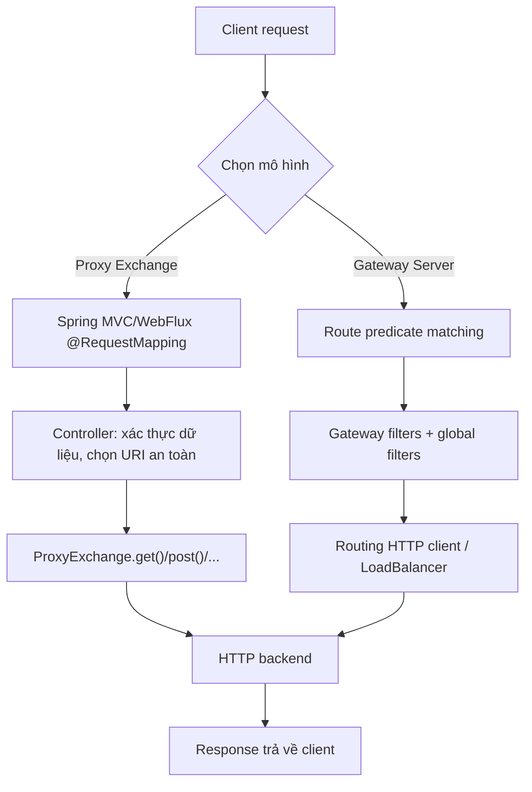
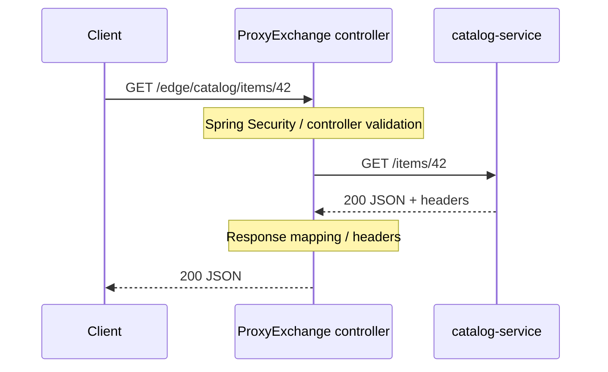
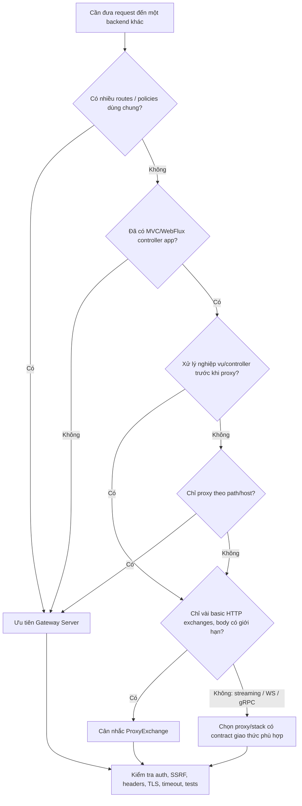

# Khi nào chọn ProxyExchange trong controller thay cho Gateway Server

## 1. Vấn đề thực tế: chỉ cần chuyển tiếp một API hay vận hành cả API Gateway?

Trong kiến trúc microservices, **Spring Cloud Gateway** có thể được dùng để tổ chức điểm vào thống nhất, chọn tuyến theo predicate, biến đổi đường dẫn/header, tích hợp service discovery, xác thực, giới hạn lưu lượng, circuit breaker, retry, TLS và quan sát request. Tuy vậy, không phải ứng dụng nào cần gọi một HTTP service phía sau cũng phải triển khai đầy đủ **Gateway Server**.

Giả sử một ứng dụng Spring Boot có endpoint:

```text
GET /edge/catalog/items/42
```

Ứng dụng cần lấy dữ liệu từ `catalog-service` tại:

```text
GET http://localhost:8081/items/42
```

Có hai cách xây dựng:

1. **Proxy Exchange**: tạo một `@GetMapping` trong controller, nhận đối số `ProxyExchange<byte[]>` và gọi `proxy.uri(...).get()`. Phù hợp khi việc chuyển tiếp là **một phần có kiểm soát của ứng dụng web**.
2. **Gateway Server**: khai báo route, predicate và các `GatewayFilter` để Gateway tự match, xử lý và proxy request. Phù hợp khi ứng dụng đóng vai trò **cổng vào cho nhiều dịch vụ và chính sách xuyên suốt**.

Hai giải pháp cùng có thể nhận HTTP request và trả dữ liệu backend, nhưng **khác mô hình lập trình, khả năng mở rộng cấu hình và trách nhiệm vận hành**. Bài này giải thích **khi nào nên chọn mỗi giải pháp**, không xem ProxyExchange là phiên bản “nhẹ hơn nhưng đầy đủ mọi tính năng” của Gateway Server.

### Sau bài học, bạn có thể

- Phân biệt bốn tổ hợp: **Gateway Server WebFlux**, **Gateway Server Web MVC**, **Proxy Exchange WebFlux** và **Proxy Exchange Web MVC**.
- Lựa chọn kiến trúc dựa trên **số lượng route**, **khối lượng chính sách dùng chung**, **nhu cầu streaming**, **sự phụ thuộc vào controller** và **khả năng quản trị**.
- Viết một controller `ProxyExchange` cơ bản trên MVC và WebFlux.
- So sánh với cấu hình route `Path`/`StripPrefix` của Gateway Server thực hiện cùng chức năng.
- Nhận biết giới hạn của `ProxyExchange` về filter chain, service discovery, bảo mật header và độ bền của các luồng request/response.
- Kiểm thử bằng `curl`, truy vết backend và quyết định khi nào cần chuyển sang Gateway Server.

> **Phạm vi:** Các ví dụ sử dụng API **Spring Cloud Gateway 5.0.x**, tham khảo tài liệu 5.0.5, Spring Boot 4.x và Spring Cloud BOM tương thích. Tài liệu Spring phân biệt rõ **Server** với **Proxy Exchange**; đồng thời hỗ trợ cả Web MVC và WebFlux cho từng nhóm. Những tên artifact của nhánh 4.x/5.x cũ có thể khác, vì vậy không sao chép dependency từ tài liệu đã lỗi thời.

## 2. Hai biến thể lớn của Spring Cloud Gateway

### 2.1. Gateway Server: hệ thống định tuyến dựa trên route

**Gateway Server** là một API Gateway đầy đủ. Bạn mô tả:

- **Route ID** và **destination URI**.
- Các **route predicates** như `Path`, `Method`, `Host`, `Header`, `RemoteAddr`.
- Các **GatewayFilters** như `StripPrefix`, `RewritePath`, `AddRequestHeader`, `Retry`, `CircuitBreaker`, `RequestRateLimiter`, `TokenRelay`.
- Các **GlobalFilters**, thứ tự chạy, response handling, route metadata và chính sách chung.
- Những khả năng vận hành như Actuator route inspection, refresh route definitions, service discovery/load balancing khi được cấu hình phù hợp.

Ví dụ minh họa:

```yaml
spring:
  cloud:
    gateway:
      server:
        webflux:
          routes:
            - id: catalog-items
              uri: http://localhost:8081
              predicates:
                - Path=/edge/catalog/items/**
                - Method=GET
              filters:
                - StripPrefix=2
```

Request `/edge/catalog/items/42` trở thành `/items/42` khi gửi đến backend. Để làm việc đó, **không cần viết controller ứng với từng URL**.

### 2.2. Proxy Exchange: tiện ích proxy trong web handler thông thường

**Proxy Exchange** là một cách tạo **gateway kiểu controller**. Bạn viết `@RestController`, xử lý request bằng Spring MVC hoặc WebFlux, và nhận một tham số đặc biệt:

```java
ProxyExchange<byte[]> proxy
```

Sau đó gọi:

```java
return proxy.uri("http://localhost:8081/items/42").get();
```

Ở MVC, kết quả là `ResponseEntity<?>`; ở WebFlux, kết quả là `Mono<ResponseEntity<?>>`. `ProxyExchange` cung cấp các convenience methods theo HTTP verbs để chuyển tiếp HTTP request tới downstream.

**Điểm mấu chốt:** việc có `ProxyExchange` trên classpath **không có nghĩa** ứng dụng sử dụng Gateway Server `RoutePredicateHandlerMapping`, `RouteLocatorBuilder` hay `GatewayFilterChain`. Spring Cloud Gateway đặt Proxy Exchange vào **một nhóm module riêng**.

### 2.3. Bốn tổ hợp, không được gộp làm hai

| Loại | Runtime | Cách khai báo đường đi | Đặc trưng |
|---|---|---|---|
| **Gateway Server WebFlux** | Spring WebFlux/Reactor Netty | Route definitions, predicates, GatewayFilters | Cổng vào reactive, đa route, chính sách tập trung |
| **Gateway Server Web MVC** | Servlet/WebMvc.fn | Gateway MVC routes và HandlerFilterFunctions | Cổng vào đa route dựa trên Servlet |
| **Proxy Exchange WebFlux** | Annotation-based Spring WebFlux | `@GetMapping` và `ProxyExchange` trong controller | Một số endpoint proxy có logic riêng, trả `Mono` |
| **Proxy Exchange Web MVC** | Annotation-based Spring MVC | `@GetMapping` và `ProxyExchange` trong controller | Một số endpoint proxy trong ứng dụng Servlet, trả `ResponseEntity` |

Không gọi Proxy Exchange MVC là “Gateway Server MVC có controller”: hai artifact và mô hình định tuyến **khác nhau**. Tài liệu Spring Cloud Gateway cũng cảnh báo **phần tài liệu Gateway Server không tự áp dụng cho Proxy Exchange**.

### 2.4. Sơ đồ xử lý đối chiếu



Đây là sơ đồ khái niệm. **Spring Security và các servlet/web filters** có thể chạy trước handler trong cả hai mô hình tùy stack. Điểm khác biệt quan trọng là **Server's Gateway filter chain không tự xuất hiện trong controller ProxyExchange**.

## 3. Quy tắc chọn nhanh: khi nào dùng ProxyExchange?

### 3.1. Chọn ProxyExchange khi những điều kiện này chiếm ưu thế

**Tình huống A — Một ứng dụng web đã có controller, chỉ cần proxy vài endpoint.**

Ví dụ một Backends for Frontends (**BFF**) hiện có `/profile`, `/settings`, `/dashboard`; chỉ có hai API phụ cần lấy dữ liệu của dịch vụ khác để trả về. Tạo controller `/edge/catalog/items/{id}` có thể đơn giản và dễ review hơn việc vận hành một gateway routing engine riêng.

**Tình huống B — Quyết định chuyển tiếp gắn với logic controller.**

Ví dụ handler đọc một `@PathVariable Long id`, kiểm tra input và principal, chọn **một upstream cố định, được cấu hình sẵn**, sau đó chuyển HTTP request. Bạn muốn sử dụng `@RequestParam`, `@RequestHeader`, Bean Validation hoặc method-level authorization quen thuộc của ứng dụng.

**Tình huống C — Luồng HTTP cơ bản, bounded response body.**

Ví dụ gọi một JSON endpoint nhỏ hoặc trả lại ảnh nhỏ theo ID. `ProxyExchange<byte[]>` có thể thuận tiện cho các phản hồi có kích thước giới hạn; ứng dụng không cần một tuyến streaming/proxy tổng quát.

**Tình huống D — Không có yêu cầu route management động.**

Các handler được quản lý qua Git, build và deploy cùng ứng dụng. Thay đổi URL mapping bằng controller là hợp lý khi chỉ có một số ít tuyến, không cần operator sửa route qua Actuator Gateway Server.

### 3.2. Chọn Gateway Server khi yêu cầu hệ thống có tính nền tảng

**Tình huống E — Nhiều microservices và nhiều route.** Có hàng chục/hàng trăm path, host, method, predicates, các nhóm route và bộ lọc dùng chung.

**Tình huống F — Chính sách gateway tập trung.** Cần nhất quán về `RequestRateLimiter`, `CircuitBreaker`, `Retry`, `TokenRelay`, CORS, TLS, headers, cache, observability và route order. Gateway Server cung cấp hệ sinh thái route/filter phù hợp; ProxyExchange **không tự mang toàn bộ các GatewayFilters**.

**Tình huống G — Route được định nghĩa bằng cấu hình/discovery.** Cần định tuyến `lb://service-name`, route metadata, quan sát routes/filters qua Actuator hoặc cơ chế refresh. Gateway Server thường phù hợp hơn việc viết/cập nhật controller cho từng backend.

**Tình huống H — Proxy thuần, không cần tạo controller riêng cho từng đường dẫn.** Ví dụ một gateway edge chuyên dụng chỉ cần áp dụng `Path=/api/orders/**` và `StripPrefix=1` rồi chuyển qua backend, thay vì thêm nhiều mã Java.

**Tình huống I — Streaming/WebSocket/gRPC hoặc body kích thước lớn.** Đây không phải lý do tuyệt đối để *mọi* trường hợp dùng Server; nhưng `ProxyExchange<byte[]>` **không nên được mặc định xem là bộ proxy streaming tổng quát**. Cần đánh giá cơ chế buffering, protocol handling, backpressure, hủy kết nối và chọn thành phần hỗ trợ trực tiếp workload đó.

### 3.3. Bảng chấm điểm kiến trúc

| Tiêu chí | Ưu tiên ProxyExchange | Ưu tiên Gateway Server |
|---|---|---|
| Số route | Vài endpoint cố định | Nhiều endpoint/đích |
| Logic nghiệp vụ gần controller | Có, đơn giản và có chủ đích | Ít; chủ yếu cross-cutting |
| Thay đổi route qua cấu hình | Không cần | Cần |
| Service discovery và load balancing | Có thể tự tích hợp nhưng không phải tự động | Có hệ sinh thái hỗ trợ |
| Route predicate/filter chung | Không cần nhiều | Nhiều và cần tái sử dụng |
| Resilience/retry/rate limiting | Có thể tự code/tích hợp có kiểm soát | Ưu tiên filter/policy được hỗ trợ |
| Phân quyền | Spring Security trên controller | Spring Security + route/policy Gateway |
| Body processing | Response nhỏ, có giới hạn | Proxy nhiều loại traffic, cần filter chuyên biệt |
| WebSocket và stream dài | Không chọn chỉ vì API proxy đơn giản | Chọn stack/proxy hỗ trợ protocol cụ thể |
| Vận hành | Log/metrics/controller như app web | Route/filter observability và Gateway Actuator |
| Deploy thay routing | Có thể cần deploy code | Có các nguồn route config, reload/refresh tùy setup |
| Độ phức tạp ban đầu | Nhỏ nếu ứng dụng web đã tồn tại | Đầu tư một gateway layer có cấu trúc |

**Quyết định thiết kế:** chọn giải pháp ít phức tạp nhất **vẫn đáp ứng yêu cầu phi chức năng**. Đừng viết 100 controller `ProxyExchange` để tái tạo mọi GatewayFilter; cũng đừng thêm Gateway Server cho một API forward cố định nếu mọi chính sách đã được xử lý đủ và không có nhu cầu gateway-centric.

## 4. Dependency và cấu hình cho hai kiểu Proxy Exchange

### 4.1. Proxy Exchange Web MVC

Nếu ứng dụng của bạn dùng Spring MVC trên Servlet stack, hãy thêm đúng artifact **`spring-cloud-gateway-proxyexchange-webmvc`**, bên cạnh starter web MVC của Spring Boot 4.x.

```xml
<!-- pom.xml của ứng dụng proxy-mvc-demo -->
<dependencies>
  <dependency>
    <groupId>org.springframework.boot</groupId>
    <artifactId>spring-boot-starter-webmvc</artifactId>
  </dependency>
  <dependency>
    <groupId>org.springframework.cloud</groupId>
    <artifactId>spring-cloud-gateway-proxyexchange-webmvc</artifactId>
  </dependency>
</dependencies>
```

Đặt versions qua một **Spring Boot BOM** và **Spring Cloud BOM** tương thích (ví dụ family Boot 4 và Cloud tương ứng với Gateway 5.0.x). Với Boot 3.x, starter Servlet phổ biến là `spring-boot-starter-web`. Không tự chọn riêng một version Gateway mới rồi trộn với Spring Framework/Spring Boot cũ.

### 4.2. Proxy Exchange WebFlux

Nếu ứng dụng là annotated Spring WebFlux controller:

```xml
<!-- pom.xml của ứng dụng proxy-webflux-demo, tách khỏi MVC -->
<dependencies>
  <dependency>
    <groupId>org.springframework.boot</groupId>
    <artifactId>spring-boot-starter-webflux</artifactId>
  </dependency>
  <dependency>
    <groupId>org.springframework.cloud</groupId>
    <artifactId>spring-cloud-gateway-proxyexchange-webflux</artifactId>
  </dependency>
</dependencies>
```

Đây là **ứng dụng riêng** nếu bạn muốn làm lab so sánh MVC và WebFlux. Không thêm cả hai starter Web MVC và WebFlux vào cùng project chỉ để thử đổi signature handler: nếu cả hai trên classpath, web application type/auto-configuration có thể không giống kỳ vọng.

### 4.3. Phân biệt artifact bằng tên

| Mục tiêu | Dependency Spring Cloud |
|---|---|
| Proxy trong `@RestController` MVC | `spring-cloud-gateway-proxyexchange-webmvc` |
| Proxy trong `@RestController` WebFlux | `spring-cloud-gateway-proxyexchange-webflux` |
| Gateway Server Web MVC | `spring-cloud-starter-gateway-server-webmvc` |
| Gateway Server WebFlux | `spring-cloud-starter-gateway-server-webflux` |

Những tên cũ như `spring-cloud-gateway-mvc` và `spring-cloud-gateway-webflux` từng được sử dụng cho Proxy Exchange ở các bản trước; trên nhánh hiện tại hãy ưu tiên **tên proxyexchange rõ ràng**. Không dùng `spring-cloud-starter-gateway-server-webflux` thay cho dependency Proxy Exchange rồi mặc định Controller sẽ được inject `ProxyExchange`.

### 4.4. Cấu hình ứng dụng Proxy Exchange không cần route YAML

Ví dụ `application.yml` cho **proxy-mvc-demo**:

```yaml
server:
  port: 8080

spring:
  application:
    name: proxy-mvc-demo

downstream:
  catalog-base-url: http://127.0.0.1:8081
```

**Không khai báo** `spring.cloud.gateway.server.webflux.routes` hay `spring.cloud.gateway.server.webmvc.routes` chỉ để làm controller `ProxyExchange` này. Đường dẫn inbound do `@GetMapping`, còn destination URI được chọn bởi code/config của controller.

**Quy tắc bảo mật:** `downstream.catalog-base-url` là **configuration của server đã được kiểm duyệt**. Không lấy nguyên URL đích từ `?url=...`, `Host`, `X-Forwarded-Host` hoặc header do client tự khai. Cấu hình `http://127.0.0.1:8081` chỉ dành cho lab chạy hai ứng dụng trên cùng host; ở production dùng HTTPS, DNS/service identity đúng và allowlist.

## 5. Lab chung: backend catalog đơn giản

Để đối chiếu kết quả ba cách proxy, ta có một ứng dụng backend độc lập cổng `8081`. Với Spring Boot 4.x, dùng starter `spring-boot-starter-webmvc`.

### 5.1. Controller backend

```java
package com.example.catalog;

import java.util.Map;
import java.util.concurrent.atomic.AtomicLong;
import org.springframework.boot.SpringApplication;
import org.springframework.boot.autoconfigure.SpringBootApplication;
import org.springframework.http.HttpStatus;
import org.springframework.http.ResponseEntity;
import org.springframework.web.bind.annotation.GetMapping;
import org.springframework.web.bind.annotation.PathVariable;
import org.springframework.web.bind.annotation.RequestHeader;
import org.springframework.web.bind.annotation.RequestParam;
import org.springframework.web.bind.annotation.RestController;

@SpringBootApplication
@RestController
public class CatalogApplication {

    private final AtomicLong calls = new AtomicLong();

    public static void main(String[] args) {
        SpringApplication.run(CatalogApplication.class, args);
    }

    @GetMapping("/items/{id}")
    public ResponseEntity<Map<String, Object>> getItem(
            @PathVariable long id,
            @RequestHeader(name = "X-Client-Hint", defaultValue = "none")
            String clientHint,
            @RequestParam(name = "mode", defaultValue = "ok")
            String mode) {

        long callNo = calls.incrementAndGet();
        if ("unavailable".equals(mode)) {
            return ResponseEntity.status(HttpStatus.SERVICE_UNAVAILABLE)
                .body(Map.of(
                    "error", "CATALOG_UNAVAILABLE",
                    "call", callNo));
        }

        if (id != 42L) {
            return ResponseEntity.notFound().build();
        }

        return ResponseEntity.ok()
            .header("X-Catalog-Origin", "backend")
            .body(Map.of(
                "id", id,
                "name", "Tai nghe mẫu",
                "service", "catalog-demo",
                "clientHint", clientHint,
                "backendCall", callNo));
    }
}
```

Cấu hình backend riêng:

```yaml
server:
  port: 8081
spring:
  application:
    name: catalog-demo
```

Chạy backend trước; trong lab này các request có body response nhỏ, giúp sử dụng `ProxyExchange<byte[]>` minh họa an toàn về kích thước.

### 5.2. Kiểm thử trực tiếp backend

```bash
curl --noproxy '*' -i \
  -H 'X-Client-Hint: lab' \
  'http://127.0.0.1:8081/items/42'

curl --noproxy '*' -i \
  'http://127.0.0.1:8081/items/99'

curl --noproxy '*' -i \
  'http://127.0.0.1:8081/items/42?mode=unavailable'
```

Kỳ vọng lần lượt là **200** với JSON sản phẩm, **404** không tìm thấy và **503** giả lập lỗi dịch vụ. Trường `backendCall` tăng theo số lần handler thực sự được gọi. Đây là kết quả **dự kiến để người học tự thực hành**, không phải tuyên bố rằng build/test đã chạy ở bước viết bài.

## 6. Ví dụ 1: ProxyExchange trong Spring MVC controller

### 6.1. Controller với một path variable có kiểu rõ ràng

Trong ứng dụng **proxy-mvc-demo** cổng `8080`, tạo `CatalogProxyMvcController.java`:

```java
package com.example.proxymvc;

import org.springframework.beans.factory.annotation.Value;
import org.springframework.cloud.gateway.mvc.ProxyExchange;
import org.springframework.http.ResponseEntity;
import org.springframework.web.bind.annotation.GetMapping;
import org.springframework.web.bind.annotation.PathVariable;
import org.springframework.web.bind.annotation.RestController;

@RestController
public class CatalogProxyMvcController {

    private final String catalogBaseUrl;

    public CatalogProxyMvcController(
            @Value("${downstream.catalog-base-url}") String catalogBaseUrl) {
        this.catalogBaseUrl = catalogBaseUrl;
    }

    @GetMapping("/edge/catalog/items/{id}")
    public ResponseEntity<?> item(
            @PathVariable long id,
            ProxyExchange<byte[]> proxy) throws Exception {

        // Destination host do SERVER cấu hình, id bị giới hạn là số nguyên.
        String targetUri = catalogBaseUrl + "/items/" + id;
        return proxy.uri(targetUri).get();
    }
}
```

Với main class `@SpringBootApplication` thuộc package `com.example.proxymvc` hoặc package cha, controller sẽ được component-scan:

```java
package com.example.proxymvc;

import org.springframework.boot.SpringApplication;
import org.springframework.boot.autoconfigure.SpringBootApplication;

@SpringBootApplication
public class ProxyMvcApplication {
    public static void main(String[] args) {
        SpringApplication.run(ProxyMvcApplication.class, args);
    }
}
```

**Đọc từng dòng quan trọng:**

1. `@GetMapping` là **route matching ở tầng Spring MVC**, không phải `Path Route Predicate Factory` của Gateway Server.
2. `@PathVariable long id` giới hạn dữ liệu được ghép vào path là **một số**, tránh nhận nguyên URI tùy ý từ client.
3. `ProxyExchange<byte[]>` là **tham số được module Proxy Exchange MVC hỗ trợ**.
4. `proxy.uri(targetUri).get()` gửi HTTP GET downstream và trả `ResponseEntity<?>` từ lời gọi proxy.
5. Không có `RouteLocator`, `GatewayFilterChain` hay `StripPrefix`: controller tự quyết định đích.

### 6.2. Gọi qua controller và quan sát

```bash
curl --noproxy '*' -i \
  -H 'X-Client-Hint: mvc' \
  'http://127.0.0.1:8080/edge/catalog/items/42'
```

Khi backend chạy và module Proxy Exchange được cấu hình đúng, client nhận response tương ứng từ `/items/42`, ví dụ:

```json
{
  "id": 42,
  "name": "Tai nghe mẫu",
  "service": "catalog-demo",
  "clientHint": "mvc",
  "backendCall": 2
}
```

Giá trị `backendCall` thay đổi theo số lần đã gọi; thứ tự các keys JSON không cố định. Không coi request đã thành công chỉ vì endpoint MVC trả 200: cần kiểm tra backend logs/headers/path.

### 6.3. Có thể thêm xử lý controller trước khi proxy

Một lợi thế của ProxyExchange là dùng MVC annotations/logic trước khi gọi downstream:

```java
@GetMapping("/edge/catalog/validated/{id}")
public ResponseEntity<?> validatedItem(
        @PathVariable long id,
        ProxyExchange<byte[]> proxy) throws Exception {

    if (id <= 0 || id > 1_000_000) {
        return ResponseEntity.badRequest().body(
            Map.of("code", "INVALID_ITEM_ID"));
    }

    return proxy.uri(catalogBaseUrl + "/items/" + id).get();
}
```

Đây là **method bổ sung** vào `CatalogProxyMvcController`, cần import `java.util.Map`. Nó xử lý validation đơn giản tại controller, rồi vẫn proxy về một backend cố định. Không biến validation này thành “gateway security”: với API có dữ liệu riêng tư, phải kiểm tra authentication/authorization (Spring Security), tenant và quyền tài nguyên.

### 6.4. Hàm forward() chỉ có trong Proxy Exchange MVC

Tài liệu chính thức nêu **Proxy Exchange MVC** có `forward()` để **chuyển tới một local Spring MVC handler**. Đây là một thao tác **nội bộ ứng dụng** khác với `uri(...).get()` gọi HTTP đến một backend bên ngoài.

**Không mặc định** WebFlux Proxy Exchange cũng có cùng `forward()`; tài liệu 5.0.x nói riêng hỗ trợ này cho **MVC**. Đồng thời, đây **không phải** `fallbackUri: forward:/...` của `CircuitBreaker` trên Gateway Server. Hai thứ có tên gợi nhớ nhưng thuộc **hai kiến trúc khác nhau**.

## 7. Ví dụ 2: ProxyExchange trong WebFlux controller

### 7.1. Khác biệt cốt lõi nằm ở kiểu trả về

Với module WebFlux, handler trả một **publisher**, không chờ đồng bộ:

```java
package com.example.proxyreactive;

import org.springframework.beans.factory.annotation.Value;
import org.springframework.cloud.gateway.webflux.ProxyExchange;
import org.springframework.http.ResponseEntity;
import org.springframework.web.bind.annotation.GetMapping;
import org.springframework.web.bind.annotation.PathVariable;
import org.springframework.web.bind.annotation.RestController;
import reactor.core.publisher.Mono;

@RestController
public class CatalogProxyWebFluxController {

    private final String catalogBaseUrl;

    public CatalogProxyWebFluxController(
            @Value("${downstream.catalog-base-url}") String catalogBaseUrl) {
        this.catalogBaseUrl = catalogBaseUrl;
    }

    @GetMapping("/edge/catalog/items/{id}")
    public Mono<ResponseEntity<?>> item(
            @PathVariable long id,
            ProxyExchange<byte[]> proxy) {

        String targetUri = catalogBaseUrl + "/items/" + id;

        // KHÔNG block(), KHÔNG subscribe(). Trả Mono cho WebFlux.
        return proxy.uri(targetUri).get();
    }
}
```

Main class ở cùng package:

```java
package com.example.proxyreactive;

import org.springframework.boot.SpringApplication;
import org.springframework.boot.autoconfigure.SpringBootApplication;

@SpringBootApplication
public class ProxyWebFluxApplication {
    public static void main(String[] args) {
        SpringApplication.run(ProxyWebFluxApplication.class, args);
    }
}
```

Chọn cổng **8082** cho WebFlux app này để có thể chạy song song với Proxy MVC cổng 8080:

```yaml
server:
  port: 8082

spring:
  application:
    name: proxy-webflux-demo

downstream:
  catalog-base-url: http://127.0.0.1:8081
```

### 7.2. Test với curl

```bash
curl --noproxy '*' -i \
  -H 'X-Client-Hint: reactive' \
  'http://127.0.0.1:8082/edge/catalog/items/42'
```

Backend nhận cùng path `/items/42` như ví dụ MVC, nhưng controller WebFlux **trả `Mono<ResponseEntity<?>>`**. Spring WebFlux đăng ký subscription khi xử lý HTTP response; không cần `.subscribe()` để kích hoạt request và **không gọi `.block()` trên event loop**.

### 7.3. Điều gì là reactive, điều gì chưa chắc?

- **Có:** việc handler trả publisher giúp WebFlux phối hợp lifecycle request, lỗi, cancel và I/O bất đồng bộ của implementation.
- **Không tự suy ra:** toàn bộ ứng dụng đã hoàn toàn non-blocking nếu bạn dùng JDBC đồng bộ, `Thread.sleep`, `Future.get` hoặc custom code blocking trong controller.
- **Không tự suy ra:** `ProxyExchange<byte[]>` tối ưu để forward file vài GB hay SSE vô hạn. Kiểu `byte[]` đặt ra giới hạn về materialization/buffering body, tùy cách implementation và HTTP message converters/codecs xử lý.
- **Không tự suy ra:** toàn bộ hệ thống Gateway Server filters (ví dụ `RequestRateLimiter` hay `TokenRelay` factory) đã được cài đặt.

Với một API JSON nhỏ và giới hạn kích thước rõ, cách viết này gọn. Với streaming liên tục hoặc WebSocket, hãy chọn API/proxy có hợp đồng **streaming và backpressure** được tài liệu hóa và kiểm thử riêng.

### 7.4. MVC và WebFlux dùng cùng ý tưởng nhưng khác thread model

| Khía cạnh | MVC Proxy Exchange | WebFlux Proxy Exchange |
|---|---|---|
| Web stack | Servlet-based | Reactive/WebFlux |
| Tham số controller | `ProxyExchange<byte[]>` | `ProxyExchange<byte[]>` |
| Return type trong ví dụ | `ResponseEntity<?>` | `Mono<ResponseEntity<?>>` |
| Thực thi HTTP client | Theo module/HTTP client phù hợp MVC | Reactive client theo implementation WebFlux |
| Tự gọi `block()`? | Không cần | **Không** trong request handler |
| Tự gọi `subscribe()`? | Không áp dụng cho MVC imperative | **Không**, framework là subscriber |
| `forward()` đến local handler | Được tài liệu nêu hỗ trợ | Không mặc định hỗ trợ giống MVC |
| Cấu hình route/filter Gateway Server | Không có chỉ nhờ ProxyExchange | Không có chỉ nhờ ProxyExchange |

## 8. Ví dụ 3: Gateway Server làm đúng chức năng mà không cần controller proxy

Đặt một ứng dụng **Gateway Server WebFlux** riêng trên cổng **8083** với:

```xml
<dependency>
    <groupId>org.springframework.cloud</groupId>
    <artifactId>spring-cloud-starter-gateway-server-webflux</artifactId>
</dependency>
```

Trong `application.yml`:

```yaml
server:
  port: 8083

spring:
  application:
    name: gateway-server-demo
  cloud:
    gateway:
      server:
        webflux:
          routes:
            - id: catalog-route
              uri: http://127.0.0.1:8081
              predicates:
                - Path=/edge/catalog/items/**
                - Method=GET
              filters:
                - StripPrefix=2
                - AddRequestHeader=X-Proxy-Style,gateway-server
```

**Cấu trúc khác hẳn:**

- `Path=/edge/catalog/items/**` và `Method=GET` là **route predicates** của Gateway Server.
- `StripPrefix=2` biến `/edge/catalog/items/42` thành `/items/42`.
- `AddRequestHeader` là một **GatewayFilterFactory**; bạn có thể thay/gắn filter khác theo nhu cầu.
- `uri` chọn backend, không cần một `@GetMapping` controller.
- `id: catalog-route` cho phép nhận diện route trong log/metrics/Actuator Gateway Server.

Kiểm tra:

```bash
curl --noproxy '*' -i \
  -H 'X-Client-Hint: server' \
  'http://127.0.0.1:8083/edge/catalog/items/42'
```

Backend cũng nhận `/items/42`. **HTTP response nghiệp vụ có thể tương đương** hai ví dụ ProxyExchange, nhưng **khả năng cấu hình và quan sát route không tương đương**.

### 8.1. Cùng một phép chuyển path, hai cách diễn đạt

| Mục đích | ProxyExchange controller | Gateway Server |
|---|---|---|
| Chọn incoming URL | `@GetMapping("/edge/catalog/items/{id}")` | `Path=/edge/catalog/items/**` + `Method=GET` |
| Lấy item ID | `@PathVariable long id` | `Path` predicate match chuỗi đường dẫn |
| Tạo backend path | Ghép `"/items/" + id` vào base URI đã kiểm duyệt | `StripPrefix=2` |
| Lấy backend response | `proxy.uri(targetUri).get()` | Gateway HTTP routing filter |
| Thêm request header | Code/header API tùy ProxyExchange | `AddRequestHeader` factory |
| Chặn rate | Tích hợp với Spring Security/filter/custom logic | `RequestRateLimiter` khi cấu hình |
| Thay đổi routing | Đổi code/config controller | Đổi route definitions và refresh/deploy theo nguồn |
| Thống kê route | Metrics controller/app | Route ID, Gateway metrics/Actuator khi bật |

### 8.2. Gateway Server có phải lúc nào cũng là microservice riêng?

**Không.** Tài liệu Spring mô tả Gateway Server có thể chạy **standalone hoặc embedded** trong ứng dụng Spring Boot. “Chọn Server” nghĩa là chọn **mô hình định tuyến và filter chain của Gateway Server**, không nhất thiết luôn triển khai một cluster độc lập.

Điều không nên làm là **nhét cả hai mô hình vào cùng một app chỉ để có một endpoint demo**, rồi giả định route predicates/filter chain sẽ chạy cho mọi `@RestController`. Nếu cần kết hợp, phải thiết kế rõ mapping priority, security chain, filter scope và test request routing, tránh route/controller chồng lấn.

## 9. Headers, query, path và cách kết quả proxy được xây

### 9.1. Sensitive headers: Cookie và Authorization

Tài liệu Proxy Exchange 5.0.x nêu có cơ chế xử lý **sensitive headers**: mặc định `cookie` và `authorization` **không được chuyển xuống backend**. Nó cũng có cơ chế loại các **skipped headers** mặc định `content-length` và `host` khi copy request.

| Header từ client | Trạng thái mặc định theo Proxy Exchange | Lý do |
|---|---|---|
| `Authorization` | **Sensitive**, mặc định không forward | Tránh gửi bearer token sang upstream khác trust boundary |
| `Cookie` | **Sensitive**, mặc định không forward | Tránh rò session/browser cookies |
| `Host` | **Skipped**, mặc định không copy nguyên | Destination host có thể khác incoming host |
| `Content-Length` | **Skipped**, mặc định không copy nguyên | Body/transfer encoding có thể thay đổi |
| `X-Client-Hint` | Không nằm trong hai danh sách mặc định trên | Có thể được forward; vẫn cần kiểm tra filter/cấu hình thực |
| `X-Forwarded-*` | Có cơ chế xử lý chuyên biệt | Chỉ tin dữ liệu từ proxy đã được xác thực |

**Lưu ý:** mặc định “Authorization không được tự chuyển tiếp” là **tính năng an toàn**, không phải lỗi của ProxyExchange. Nhưng nếu backend cần user access token, việc bỗng **bỏ hạn chế nhạy cảm** và forward credential bừa bãi là rủi ro lớn. Hãy xác định chính sách OAuth2 client, audience, scope và trusted upstream trước.

### 9.2. Vì sao không thể copy nguyên Host và Content-Length?

Giả sử client gửi:

```http
GET /edge/catalog/items/42 HTTP/1.1
Host: frontend.example.test
Authorization: Bearer <token-redacted>
X-Client-Hint: lab
```

ProxyExchange tạo request tới `http://catalog.internal.test/items/42`. Nếu giữ nguyên `Host: frontend.example.test`, upstream có thể chọn sai virtual host/SNI hoặc policy. Nếu body được chuyển đổi mà vẫn giữ `Content-Length` cũ, request/response có thể bị hỏng framing. Vì vậy Proxy Exchange có hai nhóm **sensitive** và **skipped** headers riêng.

Không suy diễn rằng ProxyExchange đã xử lý mọi nguy cơ HTTP request smuggling, hop-by-hop headers, `Forwarded` spoofing hoặc header injection cho tất cả versions. Với ứng dụng public, cần review cấu hình proxy thực tế, kiểm thử có middleboxes và cập nhật bản vá.

### 9.3. Response headers và response mapper

Tài liệu Proxy Exchange cho biết có thể chỉnh response headers hoặc dùng một **mapper function** khi gọi `get()` (và các methods tương ứng) để ánh xạ `ResponseEntity` từ downstream thành response gửi cho client.

**Mô hình khái niệm:**

```text
Downstream:
  ResponseEntity<byte[]> { status, headers, body }
         |
         v
  mapper(backendResponse)
         |
         v
Client:
  ResponseEntity<?> { status, modified headers, same/changed body }
```

Những use cases hợp lệ: thêm header quan sát nội bộ không nhạy cảm, đổi tên một header an toàn hoặc loại những header không được phép công bố. Tránh ghi đè `Set-Cookie`, `Location`, `Content-Type`, `Content-Length` hoặc `ETag` mà không hiểu semantics; khi body thay đổi, `Content-Length`/`ETag` từ backend có thể không còn đúng.

Nếu muốn xử lý/biến đổi response body sâu hoặc streaming body liên tục, hãy cân nhắc sử dụng API/proxy được thiết kế riêng cho trường hợp ấy; đừng kéo toàn bộ response vào `byte[]` chỉ để sửa một trường lớn.

### 9.4. Query parameter và dữ liệu động

Controller có thể nhận `@RequestParam` như mọi Spring MVC/WebFlux handler:

```java
@GetMapping("/edge/catalog/search")
public ResponseEntity<?> search(
        @RequestParam(defaultValue = "vi") String lang,
        ProxyExchange<byte[]> proxy) throws Exception {

    // Đoạn minh họa đặt bên trong MVC controller với catalogBaseUrl.
    if (!java.util.Set.of("vi", "en").contains(lang)) {
        return ResponseEntity.badRequest().build();
    }

    String targetUri = org.springframework.web.util.UriComponentsBuilder
        .fromUriString(catalogBaseUrl)
        .path("/search")
        .queryParam("lang", lang)
        .build()
        .encode()
        .toUriString();
    return proxy.uri(targetUri).get();
}
```

Ví dụ có hai điểm có chủ đích: chỉ chấp nhận **lang được allowlist** và để `UriComponentsBuilder` mã hóa query, thay vì nối raw query do user gửi. Backend lab mục 5 **chưa có endpoint `/search`**; muốn chạy test đoạn này cần thêm một mapping tương ứng.

**Không** sử dụng:

```java
// CỰC KỲ NGUY HIỂM: tạo open proxy/SSRF từ input client.
@GetMapping("/proxy")
public ResponseEntity<?> unsafe(
        @RequestParam String url,
        ProxyExchange<byte[]> proxy) throws Exception {
    return proxy.uri(url).get();
}
```

Một người dùng có thể yêu cầu server truy cập loopback, cloud metadata endpoint, database admin port hoặc internal services. Đích phải được chốt qua cấu hình/allowlist; giới hạn host, scheme, port, redirects, DNS re-resolution và credentials.

## 10. ProxyExchange không tự mang Gateway Server filter chain

### 10.1. Ranh giới quan trọng nhất khi đưa vào production

Tài liệu Spring Cloud Gateway 5.0.x phân biệt các nhóm rõ ràng. Trong một ứng dụng chỉ thêm `spring-cloud-gateway-proxyexchange-webmvc` hoặc `spring-cloud-gateway-proxyexchange-webflux`:

- Không có ý nghĩa khi tự khai báo `spring.cloud.gateway.server.webflux.routes` rồi mặc định nó áp dụng lên ProxyExchange controller.
- Không có `GatewayFilterChain` của Gateway Server được tự động gắn vào mọi lời gọi `proxy.uri(...).get()`.
- Không mặc nhiên nhận `GlobalFilter`, `StripPrefix`, `RewritePath`, `RequestRateLimiter`, `CircuitBreaker`, `Retry`, `TokenRelay` và `LocalResponseCache` **ở dạng Gateway Server factories**.
- Không mặc nhiên nhận các Actuator endpoints `/actuator/gateway/routes` để quản trị `@GetMapping` controller như một route definition.
- Không mặc nhiên có `lb://` service discovery, route metadata/order, grouped route policies hay dynamic route refresh.

**Điều vẫn có:** ứng dụng là Spring MVC/WebFlux bình thường, nên bạn có thể dùng Spring Security, Servlet Filters hoặc WebFlux WebFilters, validation, Micrometer Observation, exception handlers và các thư viện Spring phù hợp. Chúng **không phải** Gateway Server filters chỉ vì tên chức năng tương tự.

### 10.2. Resilience có thể tự tích hợp nhưng phải thiết kế rõ

Ví dụ ứng dụng ProxyExchange cần chờ upstream tối đa 2 giây và trả fallback khi circuit breaker mở. Bạn có thể tích hợp **Resilience4j**, timeout/retry của HTTP client hoặc công cụ riêng phù hợp runtime, nhưng cần xác định:

1. **Điều kiện lỗi:** HTTP 5xx là một response hay exception ở API hiện tại?
2. **Timeout:** thời gian connect, response, tổng request và budget của client khác nhau ra sao?
3. **Retry:** có được retry request GET idempotent không, bao nhiêu lần, backoff thế nào?
4. **Fallback:** liệu controller có thể trả một response khác mà không che lỗi auth/permission?
5. **Circuit breaker scope:** mỗi backend, mỗi route hay mỗi loại nghiệp vụ? Ai quản lý state/metrics?

Trong Gateway Server có sẵn các filter factories tương ứng để cấu hình như một chính sách route. Với ProxyExchange, bạn **tự sở hữu code và test phối hợp** của các concern ấy. Đây là chi phí kiến trúc thực tế.

### 10.3. Rate limiting và auth cũng vậy

Một controller `ProxyExchange` có thể được bảo vệ bằng Spring Security (ví dụ JWT Resource Server hoặc OAuth2 Login). Nhưng phải xét:

- Incoming bearer token được **xác thực** ở đâu, audience/issuer/scope nào?
- Có **được phép** gửi lại token tới backend này không?
- Authz ở cấp resource/user/tenant được kiểm tra trước proxy hay bởi downstream?
- Quota tính theo **client identity**, user, route hay IP?
- Khi limit đã đạt, có trả 429 trước khi tạo downstream connection không?

Mặc định ProxyExchange giữ lại `Authorization`/`Cookie` như sensitive headers, nên **không tự coi nó là TokenRelay**. Nếu cần ủy quyền giữa các service, thiết kế token exchange/client credentials hoặc propagation có giới hạn, và xác minh bằng backend security tests. Không chỉ sửa header default để cho mọi cookie/token đi qua.

### 10.4. Server filters cũng có giới hạn; chọn theo workload

Chọn Gateway Server không làm mọi lỗi disappear. Route filters cần cấu hình đúng order, TLS, retries, circuit breaker, security, URI rewrite, CORS và cache key. Trước khi dùng features như `TokenRelay` hay `RequestRateLimiter` phải cài dependencies/configuration phù hợp. Phép lựa chọn ở đây là giữa **một bộ gateway policy thống nhất** và **logic có chủ đích trong controller**, không phải giữa “an toàn tuyệt đối” và “không an toàn”.

## 11. Body, streaming, WebSocket và giao thức

### 11.1. byte[] thường hợp với payload nhỏ, có giới hạn

Cả hai ví dụ ProxyExchange đều dùng kiểu `ProxyExchange<byte[]>` theo tài liệu Spring. Với JSON response vài KB, kiểu này dễ tích hợp. Với file vài GB, SSE stream vô hạn hoặc upload không biết trước kích thước:

- Việc dùng `byte[]` có thể dẫn tới **materialization/buffering dữ liệu lớn** theo codec/converter của implementation.
- Bộ nhớ có thể tăng theo số requests đồng thời và kích thước response.
- Response có thể mất khả năng flush incremental hoặc gây latency cao nếu bị aggregate.
- Cancellation/backpressure và DataBuffer ownership cần được đánh giá theo đúng stack và module.

**Không khẳng định** mọi ProxyExchange đều buffer body bằng cùng một thuật toán ở mọi versions; **nhưng cũng không tuyên bố “WebFlux + Mono” đồng nghĩa hoàn toàn streaming zero-copy**. Hãy đo memory, latency, TTFB và behavior khi client cancel bằng payload phù hợp thực tế.

### 11.2. SSE và WebSocket cần kiểm tra riêng

| Use case | Ràng buộc giao thức | Lựa chọn cần cân nhắc |
|---|---|---|
| GET JSON nhỏ | HTTP request-response | ProxyExchange hoặc Gateway Server đều có thể phù hợp |
| Download lớn | Incremental body, Range, Content-Length, backpressure | Chọn proxy/route đã được kiểm thử streaming |
| File upload lớn | Bounded memory, multipart, timeout, streaming | Không tự buffer toàn body vào `byte[]` |
| SSE | `text/event-stream`, flush từng event, reconnect, idle timeout | Gateway Server streaming route hoặc giải pháp chuyên dụng có kiểm chứng |
| WebSocket | H1 Upgrade/`ws,wss`, handshake, frame/session lifecycle | Gateway Server WebSocket Routing Filter hoặc dedicated WS proxy |
| gRPC | HTTP/2, trailers, message framing | Proxy/gateway gRPC-aware, test native client/trailers |

**Bài học quan trọng:** `ProxyExchange` hỗ trợ **basic downstream HTTP exchanges**; tài liệu của nó **không hứa** mọi protocol/streaming feature của Gateway Server. Nếu hệ thống dựa vào WebSocket/H2/gRPC hoặc streaming dài, đừng chọn ProxyExchange chỉ vì nó có method `get()`.

### 11.3. HTTP method và body không được suy diễn

ProxyExchange có các convenience methods tương ứng HTTP verbs, nhưng khi muốn proxy POST/PUT/PATCH/DELETE cần làm rõ:

- HTTP method nào thật sự được forwarded?
- Request body có được đọc/giữ nguyên/chuyển đổi không?
- `Content-Type`/`Content-Length`/encoding có còn đúng không?
- Retry có thể nhân đôi thao tác ghi không?
- Body rỗng và multipart có được xử lý đúng bởi MVC/WebFlux codec không?
- Status 201/204/4xx/5xx và `Location`/`Set-Cookie` có được chuyển đúng không?

Không copy đoạn GET lab rồi thay `.get()` thành `.post()` và mặc định đã có một reverse proxy tổng quát. Test riêng từng HTTP verb, body sizes và exception path.

## 12. Bảo mật ProxyExchange khi controller nhận dữ liệu người dùng

### 12.1. SSRF: nguy cơ lớn nhất khi target URI được quyết định bằng code

ProxyExchange giúp controller **chọn URI đích**. Nếu URI này lấy từ user input, ứng dụng có thể trở thành **open proxy** hoặc công cụ **server-side request forgery (SSRF)**. Kẻ tấn công có thể khiến server truy cập:

- `127.0.0.1`, `localhost` và các cổng admin nội bộ.
- IP RFC1918, Kubernetes API, service mesh administration.
- Cloud instance metadata addresses.
- Service có credential mTLS/cookie/identity của chính ứng dụng proxy.
- Host do kẻ tấn công kiểm soát để thu thập headers, dữ liệu hoặc timing.

**Biện pháp:**

1. Giữ **destination base URI** trong config/allowlist của server, không nhận URI tùy ý từ request.
2. Nếu phải chọn nhiều service, dùng **server-side ID → allowlisted base URI mapping**.
3. Chỉ cho phép `https`, host/port cụ thể, xác minh DNS/rebinding/redirect behavior.
4. Không forward `Authorization`, `Cookie` hay headers nội bộ sang host ngoài trust boundary.
5. Tạo network egress policy chặn metadata/internal control plane, không chỉ dựa vào validate string.
6. Thực hiện authorization cho **resource được truy cập**, không chỉ kiểm tra user đã login.

Một validator kiểu `startsWith("https://trusted.example.com")` là **không đủ**: URL `https://trusted.example.com.evil.test`, URL với userinfo, DNS rebinding hoặc redirect có thể vượt qua phép so sánh chuỗi. Parse bằng `URI` và validate hostname/scheme/port theo cấu trúc, cộng với egress network policy.

### 12.2. Header spoofing và forward proxy identity

Ngay cả khi `X-Forwarded-For`, `X-Forwarded-Proto` hay `Forwarded` được hỗ trợ bởi ProxyExchange, **không tin mọi giá trị client gửi**. Chỉ ingress/service mesh đã được ủy quyền được phép tạo/cập nhật forwarded identity; edge nên bỏ các forwarded headers không đáng tin từ Internet rồi ghi đè bằng giá trị xác thực.

Nếu backend quyết định quyền dựa trên `X-User-Id`, `X-Tenant` hoặc `X-Role` do proxy thêm, phải:

- Xác minh principal/scope/tenant bằng Spring Security ở proxy hoặc backend.
- Loại bỏ header cùng tên từ incoming client và chỉ tạo từ **identity được xác thực**.
- Bảo vệ chặng proxy → backend bằng TLS/mTLS và network allowlist.
- Đảm bảo backend không cho phép client Internet gọi trực tiếp với header giả.

### 12.3. CORS, CSRF, cookies và response headers

ProxyExchange là controller MVC/WebFlux nên chịu **CORS**, **CSRF** và **session/security filter** của web stack:

- CORS chỉ điều khiển **quyền browser đọc response**, không phải authentication.
- CSRF có ý nghĩa với **cookie-based sessions** và state-changing methods; không bỏ CSRF vô điều kiện vì “đây là proxy”.
- `Set-Cookie` từ downstream có thể chứa Domain, Path, SameSite và Secure không phù hợp với public host; cần policy rõ trước khi chuyển về browser.
- `Location`/redirect của backend có thể tiết lộ hostname nội bộ; kiểm tra rewrite cần thiết.
- Response chứa dữ liệu user nên có `Cache-Control: private/no-store` theo policy, không để shared proxy/cache trả nhầm.

### 12.4. TLS và service credentials

Trong bài lab dùng `http://127.0.0.1:8081` để giảm bước chuẩn bị. Production nên dùng:

- HTTPS với trusted CA, hostname/SNI validation và rotation.
- mTLS giữa các service khi threat model yêu cầu.
- Secret manager cho credential; không ghi secret trong URL/query/config công khai.
- Per-upstream timeout, connection pool và retry/circuit breaker policy.
- Chứng minh backend đúng audience/scope của access token, nếu có propagation.

**Không bật insecure trust manager hoặc `curl -k` trong production** để xử lý một certificate sai. HTTP 200 không chứng minh kết nối đáng tin hoặc dữ liệu không bị chia sẻ sai.

### 12.5. Fail closed khi xác thực/ủy quyền không rõ

Nếu proxy gọi một policy service để quyết định cho phép, hãy **chờ quyết định trước khi proxy**, dùng timeout và mặc định từ chối/503 nếu policy unavailable theo business policy. Đặc biệt với WebFlux:

```java
// Pseudocode CẤU TRÚC, cần hiện thực policyClient/deny trong ứng dụng:
return policyClient.isAllowed(principal, id)
    .timeout(Duration.ofMillis(300))
    .onErrorReturn(false)
    .flatMap(allowed -> {
        if (!allowed) {
            return Mono.just(ResponseEntity.status(403).build());
        }
        return proxy.uri(approvedBaseUrl + "/items/" + id).get();
    });
```

Ví dụ trên minh họa rằng **một Mono phải được compose và return**, không `subscribe()` riêng khiến downstream gọi trước khi policy quyết định. Trong sản phẩm thực, cần phân biệt **DENY (403)** với **UNAVAILABLE (thường 503)** thay vì `onErrorReturn(false)` gộp hai loại lỗi; error/empty cases phải có test rõ ràng. Spring Security vẫn là nền tảng authn/authz thích hợp.

## 13. Vận hành: khả năng quan sát và chi phí khi chọn ProxyExchange

### 13.1. Log đúng hai chặng

Với một controller ProxyExchange, một HTTP request của client tương ứng với **ít nhất một downstream HTTP call** khi proxy. Nếu có retries, aggregate requests hoặc điều kiện xử lý khác, số lời gọi downstream có thể tăng.



Nên có **request ID/trace ID** để ghép chặng client → proxy với proxy → backend. Quan sát:

| Chỉ số | ProxyExchange controller | Gateway Server |
|---|---|---|
| HTTP server request rate/status | Spring Boot/Micrometer MVC hoặc WebFlux | Spring Boot + Gateway metrics |
| Controller handler | Annotation mapping, method metrics/tracing | Không bắt buộc có controller cho từng route |
| Downstream client metrics | Theo HTTP client của Proxy Exchange, instrumentation riêng | Netty/Gateway HTTP client metrics tùy stack |
| Route ID | Không có `Gateway Route ID` tự sinh cho `@GetMapping` | Có route ID nếu định nghĩa route |
| Filter chain inspection | Spring web filters, controller interceptors | Gateway Actuator routes/filters khi bật |
| Failure class | Downstream call, handler exception/timeout | Route, GatewayFilter, Netty routing/circuit breaker |
| Trạng thái deployment | Theo version/config ứng dụng | Theo route definitions và instance cache |

**Không đặt metrics tags theo `id` hay raw URL tự do** nếu cardinality cao. Dùng route template `/edge/catalog/items/{id}`, status, backend service label cố định và error class không nhạy cảm; không ghi bearer token, cookie hoặc PII.

### 13.2. Timeout, connection pool và load

Một controller đơn giản không có nghĩa tự vận hành tối ưu. Trước production hãy xác định:

- **Connect timeout** và **response/read timeout** của HTTP client ProxyExchange.
- Connection pool và giới hạn concurrent calls đến upstream.
- Số Servlet threads (MVC) hoặc event loop health (WebFlux).
- Kích thước response body và memory budget theo concurrency.
- Behavior khi client cancel, backend cắt kết nối hoặc trả partial response.
- Circuit breaker/retry bulkheads nếu backend không ổn định.

Không lấy `spring.cloud.gateway.server.webflux.httpclient.response-timeout` rồi giả định nó điều khiển **ProxyExchange Web MVC**. Đây là property của HTTP client **Gateway Server WebFlux**, trong khi ProxyExchange dùng module HTTP client/configuration riêng. Chọn đúng properties và kiểm tra theo version.

### 13.3. Quản lý route bằng Actuator khác với quản lý controller

Với Gateway Server, Actuator có thể liệt kê route definitions và filter chain:

```text
GET /actuator/gateway/routes
GET /actuator/gateway/routes/{id}
GET /actuator/gateway/routedefinitions
```

**Không coi** controller `@GetMapping("/edge/catalog/items/{id}")` là một `RouteDefinition` có thể `POST/DELETE` qua Gateway Actuator. Nếu chỉ dùng ProxyExchange, hãy quan sát nó theo Spring MVC/WebFlux handler mapping/metrics; nếu muốn thay đổi đường đi thường xuyên không redeploy, Gateway Server hoặc routing service có config versioning thường phù hợp hơn.

### 13.4. Phân tích chi phí duy trì

| Khi ứng dụng phát triển | ProxyExchange controller có thể gặp | Hướng xử lý |
|---|---|---|
| 2 endpoint proxy → 20 endpoint | Lặp code URI, headers, timeout | Tách shared policy hoặc xét Gateway Server |
| 20 endpoint → 200 endpoint | Nhiều annotations/handlers, review khó | Route definitions + reusable filters |
| Mỗi route cần retry/circuit breaker khác | Resilience logic phân tán trong code | Chuyển policy sang Gateway Server route filters |
| Nhiều teams cùng yêu cầu tuyến mới | Mỗi thay đổi cần deploy/controller ownership | Source of truth route config, IaC và rollout |
| Service discovery/load balancing phức tạp | Code trực tiếp host/ports dễ lệch môi trường | Gateway Server `lb://` và discovery integration phù hợp |
| Thêm streaming/WebSocket/gRPC | Body/transport constraints hiện rõ | Proxy/protocol-specific solution và streaming tests |
| Audit/identity trở nên nhạy cảm | Nhiều điểm forward token/headers | Một security architecture nhất quán, least privilege |

**Chi phí chuyển đổi** cũng đáng tính: đổi từ ProxyExchange sang Gateway Server có thể thay đổi filter order, HTTP client, header handling, timeout, CORS và auth. Cần test hành vi, không chỉ thay dependency.

## 14. Cây quyết định trong một dự án thật



### 14.1. Ví dụ A: BFF thêm hai endpoint đọc dữ liệu

**Yêu cầu:**

- Ứng dụng đã có MVC controllers.
- Chỉ hai API GET lấy JSON từ catalog nội bộ.
- Downstream host cố định, payload nhỏ, không cần rewrite phức tạp.
- Người gọi được Spring Security xác thực, không forward token tùy tiện.
- Thay đổi URL theo release bình thường.

**Khuyến nghị:** dùng **ProxyExchange Web MVC** có controller rõ ràng; giữ dependency/module tối giản, viết integration tests cho auth, 404/503, timeout, headers. Chưa cần Gateway Server chỉ để chuyển hai GET đơn giản.

### 14.2. Ví dụ B: nền tảng có 40 microservices

**Yêu cầu:**

- 80 routes trên nhiều domain và path.
- Nhiều predicates như `Host`, `Header`, `Method`, `RemoteAddr`.
- TokenRelay, rate limiting theo client, circuit breaker/retry, TLS, cache và telemetry.
- Thêm/xóa route theo config release, một số route phát hiện qua service discovery.

**Khuyến nghị:** dùng **Gateway Server WebFlux** hoặc **Gateway Server Web MVC** tùy runtime stack và protocol/operational requirements. Route/filter system được thiết kế cho công việc này; 80 controllers ProxyExchange sẽ tạo gánh nặng đồng bộ policy, testing và review.

### 14.3. Ví dụ C: cần streaming realtime

**Yêu cầu:** API SSE bắn sự kiện dài hàng giờ và một kênh WebSocket hai chiều. Client có thể reconnect, các proxies có idle timeouts.

**Khuyến nghị:** ưu tiên **gateway/proxy hỗ trợ SSE/WebSocket rõ ràng**. Gateway Server WebFlux có WebSocket routing và hạ tầng non-blocking streaming; tuy nhiên vẫn phải xác minh forwarding headers, Origin, auth, timeouts và backpressure. Không dùng `ProxyExchange<byte[]>` làm mặc định cho stream dài.

### 14.4. Ví dụ D: một endpoint cần tổng hợp ba services

**Yêu cầu:** controller gọi identity, catalog và pricing, sau đó tổng hợp một JSON response.

Đây chủ yếu là **business orchestration/BFF composition**, không chỉ proxy **một** HTTP exchange. Một annotated MVC/WebFlux controller sử dụng `WebClient`/`RestClient` hoặc service layer riêng để gọi và aggregate có thể rõ hơn việc ép `ProxyExchange` thành một framework tổng hợp. ProxyExchange chỉ thật sự phù hợp nếu **phần trọng tâm của handler là chuyển tiếp một HTTP request**.

### 14.5. Ví dụ E: route policy của doanh nghiệp cần chuẩn hóa

**Yêu cầu:** nhiều teams muốn thêm custom headers, strip prefix, retry, circuit breaker và enforce TLS theo tiêu chuẩn chung.

**Khuyến nghị:** Gateway Server với **versioned route definitions và reusable filters**, kèm security/code review. Không dùng ProxyExchange cho các logic policy copy/paste giữa nhiều `@GetMapping`.

## 15. Chuyển từ ProxyExchange sang Gateway Server khi nhu cầu lớn dần

### 15.1. Bắt đầu bằng contract, không chỉ bằng code

Trước khi chuyển, ghi lại những điều client đang thấy:

1. URL/path, HTTP methods và query semantics.
2. Request/response headers cho phép, header bảo mật và xử lý cookies.
3. Status codes 200/201/204/301/404/429/500/503.
4. Body content type/encoding, size limit, ETag, Cache-Control.
5. Authentication/authorization, token audience/scope và tenant isolation.
6. Timeout, retry, cancel và upstream error mapping.
7. Rate limits, circuit breaker thresholds, CORS/CSRF.
8. Metrics/traces/route identification, upstream host và service discovery.

**Không mặc định** hai implementations sẽ forward `Authorization`/`Cookie` giống nhau. ProxyExchange có mặc định sensitive headers riêng, còn Gateway Server có các filters/security mechanisms khác; có thể phát sinh thay đổi hành vi lớn nếu chuyển không kiểm thử.

### 15.2. Bảng ánh xạ controller → route/filter

| Controller ProxyExchange | Gateway Server tương ứng | Phải kiểm tra thêm |
|---|---|---|
| `@GetMapping("/edge/catalog/items/{id}")` | `Path=/edge/catalog/items/**` + `Method=GET` | Path vars/regex/trailing slash |
| `catalogBaseUrl + "/items/" + id` | `uri` + `StripPrefix=2` | Encoded slash, query, path normalization |
| `proxy.uri(...).get()` | HTTP routing filter | Error mapping, TLS, body/headers |
| Validation trong controller | Predicate/filter, Spring Security hoặc service validation | Không làm mất kiểm tra business inputs |
| Header custom trong controller | `AddRequestHeader`/`SetRequestHeader` | Chặn header spoofing và copy secrets |
| Chặn request không được phép | SecurityWebFilterChain / SecurityFilterChain | Không che 401/403 bằng fallback |
| Timeout/retry custom | Gateway client timeout + `Retry`/`CircuitBreaker` | Attempt count và tính idempotent |
| Metrics controller method | Gateway route metrics | Tags, trace IDs và cardinality |

### 15.3. Migration theo từng bước

```text
1) Kiểm kê ProxyExchange endpoints/contract
2) Tạo route definitions trên Gateway Server staging
3) Chỉ định lại security, headers và resilience policies
4) Kiểm thử song song 200/404/503, auth, large body và streaming
5) Canary traffic theo route, đo p95/p99, error rate, upstream calls
6) Chuyển traffic dần, theo dõi traces và rollback plan
7) Loại controller/proxy dependencies cũ khi đã ổn định
```

Nếu ProxyExchange hiện xử lý business logic phức tạp, **không nhất thiết chuyển toàn bộ logic vào Gateway filters**. Giữ logic ấy ở BFF/backend service rồi dùng Gateway Server để xử lý chính sách biên (routing, auth propagation, rate limit, resilience).

## 16. Ma trận kiểm thử: chứng minh tính đúng đắn, không chỉ nhìn HTTP 200

Trong lab, bạn có thể chạy:

- Backend `catalog-demo` ở `8081`.
- MVC ProxyExchange ở `8080`.
- WebFlux ProxyExchange ở `8082`.
- Gateway Server WebFlux ở `8083`.

Các ví dụ đều gửi `GET` đến `/items/42` nếu path/URI đúng. So sánh **trạng thái, headers, body và backend access log** để tránh kết luận sai.

| ID | Gọi vào đâu? | Input | Kiểm tra |
|---|---|---|---|
| T1 | Backend trực tiếp `8081` | `GET /items/42` | 200, `service=catalog-demo` |
| T2 | MVC Proxy `8080` | `GET /edge/catalog/items/42` | 200, backend nhận đúng ID/path |
| T3 | WebFlux Proxy `8082` | Cùng path | 200, kết quả tương ứng và không block |
| T4 | Server WebFlux `8083` | Cùng path | 200, `StripPrefix=2` hoạt động |
| T5 | MVC Proxy | `GET /edge/catalog/items/99` | Backend 404 được xử lý theo contract |
| T6 | WebFlux Proxy | `GET /edge/catalog/items/99` | Không tự biến 404 thành 200 |
| T7 | MVC Proxy | `GET /edge/catalog/items/42?mode=unavailable` | Xác định query được forwarded theo implementation/config |
| T8 | Server WebFlux | `GET /edge/catalog/items/42?mode=unavailable` | 503 từ backend nếu không có fallback/retry khác |
| T9 | MVC Proxy | `POST /edge/catalog/items/42` | Không match `@GetMapping` (status tùy mapping) |
| T10 | Server WebFlux | `POST` cùng path | Không match route có `Method=GET` |
| T11 | MVC Proxy | Incoming `Authorization: Bearer <redacted>` | Backend **không nhận** header theo sensitive default |
| T12 | MVC Proxy | Incoming `Cookie: SESSION=<redacted>` | Backend **không nhận** cookie theo sensitive default |
| T13 | MVC Proxy | Incoming `X-Client-Hint: lab` | Theo dõi header bình thường có được forward |
| T14 | MVC Proxy | Incoming `Host` khác target | Target host/framing không bị phá vì copy `Host` |
| T15 | MVC Proxy | Một URL query do client tạo | Không biến target URI thành arbitrary external URL |
| T16 | MVC Proxy | Backend :8081 dừng | Lỗi có kiểm soát; không lộ stack trace |
| T17 | WebFlux Proxy | Backend response chậm | Timeout/cancel được quản lý, không block Netty |
| T18 | MVC Proxy | 100 concurrent GET (mức lab) | Memory/thread pool ổn định, không tạo unbounded buffering |
| T19 | WebFlux Proxy | Một response rất lớn | Đo heap/TTFB/cancel, xác minh `byte[]` phù hợp hay không |
| T20 | Server WebFlux | Route dùng `lb://catalog-service` trong integration setup | Cần LoadBalancer/DiscoveryClient được cài và backend instance sẵn sàng |
| T21 | MVC Proxy | Unauthorized caller | Spring Security chặn **trước** proxy theo policy |
| T22 | Server WebFlux | Unauthorized caller | Security/route filters vẫn xử lý đúng, không relay token tùy tiện |
| T23 | ProxyExchange | Thay base URI sang host không trong allowlist | Startup/config validation hoặc policy chặn |
| T24 | ProxyExchange | Client đóng kết nối khi backend đang trả body | Tài nguyên được cleanup, timeout/cancel không gây leak |

Các expected statuses **ngoài 200/404/503** có thể phụ thuộc Spring Security, exception handlers và cấu hình từng stack. Đừng chỉ assert một số HTTP code nếu controller không có handler cho failure. Với cả ba approaches, log request count của backend giúp xác nhận **request có tới service** và không bị route khác xử lý.

### 16.1. Bộ lệnh so sánh

```bash
# Bước 1: backend trực tiếp.
curl --noproxy '*' -i \
  'http://127.0.0.1:8081/items/42'

# Bước 2: Proxy Exchange MVC.
curl --noproxy '*' -i \
  -H 'X-Client-Hint: mvc' \
  'http://127.0.0.1:8080/edge/catalog/items/42'

# Bước 3: Proxy Exchange WebFlux.
curl --noproxy '*' -i \
  -H 'X-Client-Hint: webflux' \
  'http://127.0.0.1:8082/edge/catalog/items/42'

# Bước 4: Gateway Server WebFlux.
curl --noproxy '*' -i \
  -H 'X-Client-Hint: server' \
  'http://127.0.0.1:8083/edge/catalog/items/42'

# Bước 5: đường lỗi nghiệp vụ (id không có).
curl --noproxy '*' -i \
  'http://127.0.0.1:8080/edge/catalog/items/99'

# Bước 6: mô phỏng lỗi upstream.
curl --noproxy '*' -i \
  'http://127.0.0.1:8083/edge/catalog/items/42?mode=unavailable'
```

**Lưu ý query:** Controller ProxyExchange ở ví dụ mục 6–7 đặt URI đích **tường minh** chỉ có `/items/{id}`, vì vậy **không nên giả định `mode=unavailable` sẽ được giữ** khi gửi qua ProxyExchange. Nếu nghiệp vụ cần query, hãy thêm nó rõ ràng từ `@RequestParam` qua `UriComponentsBuilder` và kiểm thử. Ngược lại, route Gateway Server thường giữ query string khi chỉ dùng `StripPrefix`; hãy xác minh trên backend.

### 16.2. Đo header forwarding an toàn

Backend demo chỉ echo `X-Client-Hint`, không echo Authorization/Cookie. Để test sensitive defaults, dùng một **backend test/stub** ghi nhận sự có mặt dưới dạng **boolean** (ví dụ `authorizationPresent=false`), không ghi raw giá trị token/cookie vào log hay response.

```text
Không nên:
  log.info("Authorization={}", requestHeader)

Nên (trong test có kiểm soát):
  authorizationPresent = requestHeaders.containsKey("Authorization")
  cookiePresent        = requestHeaders.containsKey("Cookie")
```

Đừng dùng bearer token thật trong lab. Sử dụng giá trị giả, backend stub có trust boundary rõ và xóa logs sau kiểm thử nếu chứa secrets không chủ ý.

### 16.3. Kiểm thử integration bằng WebTestClient hoặc MockMvc

Chọn công cụ theo stack:

| Stack | API kiểm thử phù hợp |
|---|---|
| Proxy Exchange MVC | `MockMvc` cho controller behavior và test HTTP thật cho downstream forwarding |
| Proxy Exchange WebFlux | `WebTestClient`/Reactor Test cho controller và downstream HTTP |
| Gateway Server WebFlux | `WebTestClient`/curl với backend stub và route integration |
| Gateway Server Web MVC | `MockMvc` hoặc client integration phù hợp Servlet/route |

**Không dùng unit test gọi trực tiếp controller làm bằng chứng ProxyExchange resolver/HTTP client đã hoạt động**: tham số `ProxyExchange` được framework cung cấp ở runtime. Cần integration test khởi động Spring context thực, một backend stub có thể đếm request, và test cả allowed/denied/error/cancel paths.

## 17. Troubleshooting: các vấn đề khi chuyển đổi giữa ProxyExchange và Server

| Triệu chứng | Nguyên nhân khả dĩ | Cách kiểm tra |
|---|---|---|
| Controller không resolve được `ProxyExchange` | Thiếu đúng artifact proxyexchange MVC/WebFlux, stack khác kỳ vọng | Kiểm tra dependencies, web application type, MVC/WebFlux adapter |
| Compile lỗi import `ProxyExchange` | Import nhầm module MVC vs WebFlux, artifact version khác | Đọc đúng Javadoc của module tương thích và IDE imports |
| `proxy.uri(...).get()` không gọi backend | Controller mapping không match, destination URI sai, client timeout | Kiểm tra controller logs và backend access log |
| ProxyExchange trả khác Gateway Server route | Hai kiểu proxy khác headers/filters/error handlers | Đối chiếu bằng cùng request/path/body |
| Backend không thấy Authorization | **Mặc định sensitive header** | Đánh giá có thật sự cần token propagation và audience/scope |
| Backend không thấy cookie | **Mặc định sensitive header** | Không bỏ lọc chỉ để giữ session khi không có thiết kế |
| Backend thấy Host khác client Host | **Mặc định skipped header** | Đúng khi destination host khác; kiểm tra SNI/virtual host |
| Backend nhận 404 | Destination path sai, encoding, rewrite thủ công thiếu | Log target URI đã giảm dữ liệu, so backend mapping |
| Incoming query không thấy ở upstream | Controller tự dựng target URI mà quên query | Đưa `@RequestParam` được validate vào `UriComponentsBuilder` |
| App ProxyExchange không thấy `/actuator/gateway/routes` | Đó là endpoint cho Gateway Server, không phải controller mapping | Dùng app metrics/handler mapping hoặc chọn Server |
| YAML `spring.cloud.gateway.server.webflux.routes` không áp lên controller | Server route config không phải ProxyExchange config | Tách mô hình; dùng `@GetMapping` ở ProxyExchange |
| `StripPrefix` không có tác dụng | Chưa chạy Gateway Server filter chain | Sửa target URI trong controller hoặc chuyển sang Gateway Server |
| `lb://catalog-service` không làm việc | Không có LoadBalancer/discovery integration tương ứng | Dùng Gateway Server configured correctly hoặc client-side discovery rõ |
| WebFlux ProxyExchange bị lỗi khi `block()` | Blocking trên event loop | Return `Mono<ResponseEntity<?>>`; không subscribe/block |
| Upload/download lớn làm memory tăng | Body aggregation/byte[] với concurrency cao | Giới hạn body/streaming solution, đo heap & TTFB |
| SSE events dồn cục | Buffering trong proxy, ingress hoặc client | Test `curl -N`, xem streaming API hỗ trợ |
| WebSocket handshake fail | ProxyExchange HTTP không thay thế WS routing | Dùng WebSocket-aware proxy/route và kiểm tra Origin/TLS |
| Response timeout rất dài | HTTP client config chưa đúng; property của Server áp nhầm | Cấu hình đúng ProxyExchange client/module, đo timeout từng hop |
| Nhiều controllers có rate limiter không đồng nhất | Policy được copy/paste | Shared infrastructure hoặc Gateway Server filter |
| Client lấy được dữ liệu user khác | Thiếu authz/tenant isolation, header/caching sai | Dừng route nhạy cảm, điều tra, security regression |
| Proxy gọi tới internal metadata host | SSRF qua target URI hoặc redirect | Allowlist host/port/scheme, egress firewall, kiểm tra redirect |
| Request 2xx nhưng audit không ghi | Fire-and-forget/out-of-band side effects | Ghép publisher hoặc dùng outbox/queue phù hợp |
| Route chung/canary chồng lấn với controller | Kết hợp Server và web handlers mà không review mapping precedence | Kiểm tra HandlerMappings/filter chains, tách responsibilities |

### 17.1. Trình tự chẩn đoán không dựa vào đoán mò

1. Xác định **module thực sự trên classpath**: Proxy Exchange MVC, Proxy Exchange WebFlux hay Gateway Server.
2. Kiểm tra **incoming mapping**: `@GetMapping` của controller hay route predicate của Server.
3. Xác định **HTTP client thực tế** và target URI được xây bởi code/config/route.
4. Đối chiếu method, path, query, encoding, status và headers từ backend.
5. Kiểm tra Spring Security và chính sách sensitive headers trước khi suy “backend mất token”.
6. Phân biệt lỗi **connect/TLS/timeout** với lỗi **HTTP status** upstream.
7. Nếu streaming, đo **body arrival time** và memory/backpressure/cancellation.
8. Quan sát request qua đúng Gateway instance/backend instance, đặc biệt khi có load balancer.
9. Rà SSRF, redirect, egress policy, cookies và unauthorized paths.
10. Sau sửa, chạy regression test với cả success/deny/error/empty/multiuser/concurrency.

### 17.2. Cảnh báo khi đọc những bài viết cũ

Các bài hướng dẫn Spring Cloud Gateway đời cũ có thể dùng:

```text
spring-cloud-gateway-mvc
spring-cloud-gateway-webflux
spring-cloud-starter-gateway
spring.cloud.gateway.routes
```

Trên nhánh 5.0.x, những tên này có thể là **deprecated names, khác module hoặc prefix cũ**; dùng reference của chính Spring Cloud Gateway/Boot phiên bản ứng dụng thay vì pha trộn mảnh cấu hình từ nhiều năm. Đặc biệt, “Gateway MVC” trong một bài cũ đôi khi đang nói tới **Proxy Exchange MVC**, trong khi “Gateway Server Web MVC” hiện nay là một biến thể Server riêng.

## 18. Checklist trước khi chọn ProxyExchange cho production

### 18.1. Phạm vi chức năng

- [ ] Chỉ có **một số ít HTTP endpoints** cần chuyển tiếp; không cần nhiều route/filter policies dùng chung.
- [ ] Ứng dụng **đã dùng Spring MVC hoặc annotated WebFlux** và việc proxy là một phần nhỏ trong controller layer.
- [ ] HTTP verbs, body/headers/status/redirect semantics của từng endpoint được định nghĩa rõ.
- [ ] Destination host/port/scheme **do server quản lý**, không thể bị client thay bằng URL tùy ý.
- [ ] Business validation/authorization được thực hiện ở layer phù hợp, không chỉ trong URL matching.
- [ ] **Không** dựa vào các Gateway Server filters tự xuất hiện trong ProxyExchange app.
- [ ] Không cần quản trị route bằng Gateway Actuator dynamic route API.

### 18.2. Security và transport

- [ ] Mặc định `Authorization`, `Cookie` sensitive và `Host`, `Content-Length` skipped đã được kiểm chứng.
- [ ] Nếu cần chuyển token, có cơ chế OAuth2/token exchange phù hợp trust boundary, audience và scopes.
- [ ] Incoming forwarded headers chỉ được tin từ **trusted proxy**, tránh spoofing.
- [ ] TLS/mTLS, DNS resolution, redirect validation và egress policy đã được kiểm thử.
- [ ] Không lộ secrets trong headers response, logs, metrics, URLs hay error messages.
- [ ] Spring Security xác định đúng 401/403; không dùng fallback để biến unauthorized thành 200.
- [ ] CORS/CSRF/cookie policies tương thích với browser và trạng thái session.

### 18.3. Hiệu năng và vận hành

- [ ] Payload `byte[]` có giới hạn kích thước và concurrency đã được load test.
- [ ] Connect/read/response timeout và connection pool được cấu hình **cho đúng HTTP client của ProxyExchange**, không nhầm Server properties.
- [ ] Tránh `block()`/`subscribe()` trong WebFlux controller; cancellation và error propagation được kiểm thử.
- [ ] Nếu cần retry/circuit breaker/rate limiting, có code/policy và metrics nhất quán.
- [ ] SSE/WebSocket/gRPC/large file không được mặc định hỗ trợ đầy đủ chỉ vì tồn tại `ProxyExchange`.
- [ ] Có observability theo handler, backend, status, error class, latency và request ID.
- [ ] Có test backend-down, 404/503, query/path encoding, headers và cross-user authorization.
- [ ] Đã xem xét ngưỡng số route/chính sách khiến kiến trúc nên chuyển sang Gateway Server.

## 19. Bài tập và câu hỏi tự kiểm tra

**Bài 1 — Phân loại yêu cầu.** Một ứng dụng Spring MVC có hai endpoint cần GET dữ liệu JSON từ một upstream cố định. Không có service discovery, không có Gateway filter policies. Nên chọn ProxyExchange MVC hay Gateway Server? Nêu lý do.

**Bài 2 — Bốn biến thể.** Kể tên bốn tổ hợp của Spring Cloud Gateway theo hai trục **Server/Proxy Exchange** và **WebFlux/Web MVC**. Vì sao “Gateway MVC” không đủ rõ khi đọc tài liệu cũ?

**Bài 3 — Dependency.** Tạo một ứng dụng Proxy Exchange WebFlux trên Spring Boot 4.x. Artifact Spring Cloud nào phù hợp? Có cần `spring-cloud-starter-gateway-server-webflux` chỉ để inject `ProxyExchange` không?

**Bài 4 — Signature controller.** Với MVC, kiểu trả về của `proxy.uri(...).get()` trong ví dụ là gì? Với WebFlux, vì sao phải return `Mono<ResponseEntity<?>>` thay vì `block()`?

**Bài 5 — Path.** Client gọi `GET /edge/catalog/items/42`. Hãy chỉ ra backend path được chọn trong (a) MVC controller `catalogBaseUrl + "/items/" + id`, và (b) Gateway Server route `Path=/edge/catalog/items/**` với `StripPrefix=2`.

**Bài 6 — Mismatch query.** Client gọi `GET /edge/catalog/items/42?mode=unavailable` nhưng ProxyExchange controller dùng `proxy.uri(catalogBaseUrl + "/items/" + id).get()`. Có chắc backend thấy `mode=unavailable` không? Cần làm gì?

**Bài 7 — Sensitive headers.** Browser gửi `Authorization: Bearer ...` và `Cookie: SESSION=...` vào ProxyExchange MVC. Tại sao backend có thể không thấy các header này? Có nên mở forward toàn bộ để “fix” không?

**Bài 8 — Gateway filters.** Một kỹ sư chỉ thêm dependency `spring-cloud-gateway-proxyexchange-webmvc` nhưng viết `filters: [StripPrefix=2, TokenRelay=]` trong `application.yml`. Có nên kỳ vọng controller `@GetMapping` được áp dụng filter chain Gateway Server không?

**Bài 9 — SSRF.** Một controller dùng `proxy.uri(request.getParameter("url")).get()`. Liệt kê ít nhất bốn kiểu đích đến hoặc kỹ thuật có thể bị lợi dụng, và các biện pháp bảo vệ.

**Bài 10 — WebSocket/SSE.** Một hệ thống có WebSocket 50.000 sessions và SSE dài hàng giờ. Vì sao `ProxyExchange<byte[]>` không nên là lựa chọn mặc định? Cần kiểm thử những gì?

**Bài 11 — Rate limiting.** Năm controllers `ProxyExchange` đang tự thực hiện quota bằng năm đoạn code khác nhau. Nêu rủi ro và khi nào Gateway Server trở thành lựa chọn tốt hơn.

**Bài 12 — Controller logic.** Một BFF phải gọi ba backend để tổng hợp trang dashboard. ProxyExchange có phải giải pháp duy nhất hay tốt nhất không? Khi nào nên dùng `WebClient`/`RestClient` và service layer?

**Bài 13 — Local forward.** Tính năng `forward()` được tài liệu Proxy Exchange nhắc ở biến thể nào? Nó có giống `fallbackUri: forward:/...` của Gateway Server CircuitBreaker không?

**Bài 14 — Observability.** Vì sao không thể dùng `GET /actuator/gateway/routes` để liệt kê mặc định mọi `@GetMapping` của ProxyExchange-only app? Nên quan sát bằng cách nào?

**Bài 15 — Migration.** Một ứng dụng ban đầu proxy hai GET giờ phải điều phối 60 routes với host predicates, rate limits, retries và service discovery. Hãy lập kế hoạch chuyển sang Gateway Server có đảm bảo contract.

**Bài 16 — CORS/CSRF.** Một SPA gọi ProxyExchange qua cookie session. Vì sao CORS và CSRF là hai vấn đề khác nhau và không được dùng proxying để bỏ qua?

**Bài 17 — TLS.** Backend đổi sang `https://catalog.internal.test` nhưng certificate SAN không hợp lệ. Có nên dùng insecure trust manager cho môi trường production không? Nên sửa gì?

**Bài 18 — Body và memory.** Có 500 concurrent responses mỗi response 15 MB được materialize thành `byte[]`. Nguy cơ gì? Nêu một hướng kiến trúc tốt hơn.

**Bài 19 — Debug lỗi 404.** Cả ProxyExchange và Gateway Server đều trả 404 cho một URL. Liệt kê các bằng chứng cần thu để xác định 404 đến từ route matching, target path hay backend business response.

**Bài 20 — Chọn kiến trúc.** So sánh cách triển khai một endpoint **GET JSON nhỏ** và một API **gRPC bidirectional streaming** trên cùng nền tảng. Vì sao một lựa chọn chung chỉ dựa trên việc “đều là HTTP” dễ sai?

### Gợi ý đáp án

1. Thường **ProxyExchange MVC** phù hợp: ít endpoints, ứng dụng đã có controller, upstream cố định và không cần Gateway Server policies.
2. Server WebFlux, Server Web MVC, Proxy Exchange WebFlux, Proxy Exchange Web MVC. Các tên module cũ có thể gọi “MVC gateway” nhưng thực ra là Proxy Exchange.
3. `spring-cloud-gateway-proxyexchange-webflux` cùng Spring WebFlux starter phù hợp; không cần Server starter chỉ để dùng ProxyExchange.
4. MVC trả `ResponseEntity<?>`, WebFlux trả `Mono<ResponseEntity<?>>` để framework subscribe/điều phối non-blocking lifecycle.
5. Cả hai đưa backend đến `/items/42`, nhưng một bên tạo URI bằng code, bên kia biến path bằng `StripPrefix=2` trong filter chain.
6. Không chắc; URI được controller xây tường minh không chứa query. Dùng `@RequestParam`, validate và tạo target URI bằng `UriComponentsBuilder`.
7. `Authorization` và `Cookie` nằm trong nhóm sensitive headers mặc định. Không forward bừa bãi; chỉ thực hiện credential propagation khi đã thiết kế trust boundary, scope/audience và security tests.
8. **Không.** Proxy Exchange không mặc nhiên khởi tạo Gateway Server route/filter chain. Muốn dùng các filter ấy, chọn Server đúng module và cấu hình.
9. Loopback/internal IP, metadata service, internal admin port, redirect, DNS rebinding, host suffix giả; dùng allowlist URI, DNS/redirect validation, egress firewall và authz.
10. `byte[]` có thể gây buffering/memory; WS cần handshake/session/proxy phù hợp, SSE cần flush/backpressure/cancel. Chọn proxy có streaming support và load test.
11. Lặp policy khiến quota không đồng nhất, có thể bị bypass hoặc đếm sai; Gateway Server hỗ trợ cấu hình filter chung theo route, thích hợp khi số route tăng.
12. Không. Aggregation BFF là business orchestration; Spring WebClient/RestClient + service layer thường phù hợp hơn một utility chuyển một HTTP exchange.
13. `forward()` được tài liệu nêu cho **Proxy Exchange MVC** để forward local; không đồng nghĩa fallbackUri của Gateway Server CircuitBreaker.
14. `@GetMapping` là Spring web handler, không phải Gateway `RouteDefinition`. Dùng MVC/WebFlux handler/HTTP metrics, tracing, logs và integration tests.
15. Ghi contract → route definitions staging → security/filter mapping → test headers/path/body/status, p95/timeout, canary → rollback → retire old handlers.
16. CORS kiểm soát browser cross-origin read; CSRF bảo vệ thao tác thay đổi state dựa trên cookie. Cần xử lý riêng theo Spring Security policy.
17. Không. Sửa certificate SAN/hostname, CA trust và SNI/TLS configuration; không tắt TLS verification.
18. Có nguy cơ giữ nhiều GB RAM cộng overhead và gây OOM/GC pressure. Giới hạn body/concurrency và sử dụng streaming proxy/API thích hợp.
19. Kiểm tra incoming handler/route ID, destination URI, rewritten path/query, backend access log, upstream status, filters và error handlers.
20. GET JSON nhỏ có thể dùng ProxyExchange; gRPC bidirectional streaming đòi HTTP/2/trailers/frame semantics và gateway/proxy gRPC-aware. Không chọn chỉ từ tên HTTP.

## Tài liệu tham khảo chính thức

- [Spring Cloud Gateway 5.0 — Introduction](https://docs.spring.io/spring-cloud-gateway/reference/5.0/intro.html) — hai flavors **Server** và **Proxy Exchange**, mỗi flavor có WebFlux/Web MVC.
- [Spring Cloud Gateway 5.0 — Proxy Exchange Gateway with Spring Web MVC or WebFlux](https://docs.spring.io/spring-cloud-gateway/reference/5.0/spring-cloud-gateway-proxy-exchange.html) — dependency đúng, ví dụ `ProxyExchange<byte[]>`, `get()`, `path()`, MVC `forward()` và các header sensitive/skipped.
- [Spring Cloud Gateway Server WebFlux 5.0 — How It Works](https://docs.spring.io/spring-cloud-gateway/reference/5.0/spring-cloud-gateway-server-webflux/how-it-works.html) — route matching, filter chain pre/post và HTTP routing.
- [Spring Cloud Gateway Server Web MVC 5.0 — How It Works](https://docs.spring.io/spring-cloud-gateway/reference/5.0/spring-cloud-gateway-server-webmvc/how-it-works.html) — WebMvc.fn RouterFunction, Gateway RequestPredicates và HandlerFilterFunctions.
- [Spring Cloud Gateway Server WebFlux 5.0 — Starter](https://docs.spring.io/spring-cloud-gateway/reference/5.0/spring-cloud-gateway-server-webflux/starter.html) — dependency của Gateway **Server**, khác ProxyExchange.
- [Spring Cloud Gateway Server WebFlux 5.0 — Route Predicate Factories](https://docs.spring.io/spring-cloud-gateway/reference/5.0/spring-cloud-gateway-server-webflux/request-predicates-factories.html) — `Path`, `Method`, `Host`, `Header` và các điều kiện chọn route.
- [Spring Cloud Gateway Server WebFlux 5.0 — GatewayFilter Factories](https://docs.spring.io/spring-cloud-gateway/reference/5.0/spring-cloud-gateway-server-webflux/gatewayfilter-factories.html) — chức năng filter khi dùng Server.
- [Spring Cloud Gateway Server WebFlux 5.0 — Actuator API](https://docs.spring.io/spring-cloud-gateway/reference/5.0/spring-cloud-gateway-server-webflux/actuator-api.html) — quan sát/quản trị route definitions trên Gateway Server.
- [Spring Cloud 2025.0 Release Notes — Gateway module and property renaming](https://github.com/spring-cloud/spring-cloud-release/wiki/Spring-Cloud-2025.0-Release-Notes) — đổi tên các module Server/ProxyExchange và configuration property prefixes.
- [Spring Framework — Annotated Controllers (Spring MVC)](https://docs.spring.io/spring-framework/reference/web/webmvc/mvc-controller.html) — handler mappings, method arguments và response handling.
- [Spring Framework — Annotated Controllers (WebFlux)](https://docs.spring.io/spring-framework/reference/web/webflux/controller.html) — handler reactive và `Mono`.
- [Spring Framework — WebClient](https://docs.spring.io/spring-framework/reference/web/webflux-webclient.html) — HTTP client reactive phù hợp khi cần workflow/aggregation phức tạp.
- [Spring Security — Servlet Applications](https://docs.spring.io/spring-security/reference/servlet/) — bảo vệ MVC controllers, OAuth2/JWT và CSRF.
- [Spring Security — Reactive Applications](https://docs.spring.io/spring-security/reference/reactive/) — bảo vệ WebFlux controllers và SecurityWebFilterChain.
