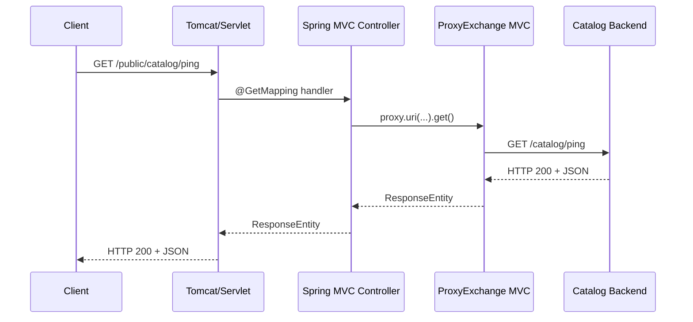

# Dependency Proxy Exchange cho Spring Web MVC hoặc WebFlux

Một ứng dụng Spring Boot đang có vài endpoint `@RestController` cần chuyển tiếp dữ liệu đến microservice bên trong. Ví dụ, `GET /public/catalog/ping` phải gọi `GET http://catalog.internal:9090/catalog/ping` rồi trả HTTP response về client. Nhóm phát triển muốn tận dụng controller, validation và Spring Security hiện có, **không muốn dựng một API Gateway Server đầy đủ chỉ để proxy một số endpoint**. Trong trường hợp này, Spring Cloud Gateway cung cấp một lựa chọn khác: **Proxy Exchange**.

Điểm dễ nhầm là **Spring Cloud Gateway có hai biến thể sản phẩm**: **Server** (cổng vào chuyên dụng với route predicates và Gateway filters) và **Proxy Exchange** (đối tượng `ProxyExchange` được inject vào handler Spring MVC hoặc WebFlux). Nếu thêm nhầm starter Gateway Server MVC/WebFlux thay cho module Proxy Exchange, bạn có thể khởi chạy ứng dụng nhưng không thể dùng đúng controller API, hoặc sao chép nhầm một hệ cấu hình routing hoàn toàn khác.

Bài này thuộc chương **Proxy Exchange** của module **SPRING_CLOUD_GATEWAY**. Nội dung tập trung vào **dependency cho Spring Web MVC hoặc WebFlux**, cách tạo ứng dụng nhỏ có HTTP proxy controller, phân biệt với Gateway Server và những yếu tố phải bổ sung khi cần xác thực, giới hạn lưu lượng, circuit breaker, retry, TLS, service discovery và quan sát request để bảo vệ microservices.

**Sau bài học, bạn có thể:**

1. Chọn đúng artifact và Spring Boot/Spring Cloud release train cho Proxy Exchange.
2. Biết khi nào thêm starter web **MVC** hoặc **WebFlux** và vì sao không nên trộn hai server stacks vô mục đích.
3. Viết được một `@GetMapping` proxy đến backend với `ProxyExchange<byte[]>`.
4. Hiểu sự khác biệt về kiểu trả về, runtime và khả năng `forward()` của MVC.
5. Kiểm thử việc chuyển tiếp status/body/headers và nhận diện các rủi ro SSRF, header trust, proxy loop, timeout và tải lớn.

> **Phạm vi phiên bản:** Cú pháp chính theo tài liệu Spring Cloud Gateway **4.3/5.x** với artifact `spring-cloud-gateway-proxyexchange-webmvc` và `spring-cloud-gateway-proxyexchange-webflux`. Dòng 4.2 trở về trước có các tên module cũ. Ví dụ build dùng một cặp Spring Boot–Spring Cloud **minh họa theo bảng tương thích chính thức**; hãy chọn bản vá phù hợp với dự án, không gắn version riêng cho Gateway ngoài BOM.

## 1. Proxy Exchange là gì?

`ProxyExchange<T>` là **utility object** của Spring Cloud Gateway được Spring đưa vào **tham số phương thức handler** trong một ứng dụng web có annotation-based controller. Nó cung cấp những thao tác chuyển tiếp HTTP cơ bản thông qua các phương thức tương ứng với HTTP verbs, cùng khả năng đặt URI và xử lý response.

Ví dụ ý tưởng:

```text
Client GET /public/catalog/ping
         |
         v
@RestController
  @GetMapping("/public/catalog/ping")
  handler(ProxyExchange<byte[]> proxy)
         |
         | proxy.uri("http://catalog.internal:9090/catalog/ping").get()
         v
Backend GET /catalog/ping
         |
         v
Backend HTTP status + headers + bytes
         |
         v
Controller trả ResponseEntity<?> về client
```

**Không cần khai báo `spring.cloud.gateway.server.webmvc.routes` hay `spring.cloud.gateway.server.webflux.routes` cho ví dụ trên.** Mapping của Spring MVC/WebFlux controller mới là nơi request được chọn.

### 1.1. So sánh Gateway Server và Proxy Exchange

| Đặc điểm | Gateway **Server** | **Proxy Exchange** |
| --- | --- | --- |
| Đơn vị định tuyến | `RouteDefinition` / `RouterFunction` tùy Server WebFlux/MVC | Phương thức `@RequestMapping`, `@GetMapping`… |
| Thành phần lập trình | Route predicates, GatewayFilter factories, filters theo route | `ProxyExchange<T>` trong controller |
| Cách khai báo route | YAML/Java DSL của Gateway Server | Annotation mappings của Spring MVC/WebFlux |
| Độ phức tạp | Phù hợp API Gateway độc lập, nhiều routes/chính sách | Hữu ích khi chỉ proxy một nhóm API trong ứng dụng web hiện có |
| Web MVC | Server Web MVC starter riêng | Module `proxyexchange-webmvc` + ứng dụng Spring MVC |
| WebFlux | Server WebFlux starter riêng | Module `proxyexchange-webflux` + ứng dụng Spring WebFlux |
| Có sẵn Gateway Server filters? | Theo bộ lọc và dependencies của Server flavor | **Không tự kế thừa** Gateway Server predicates/filter factories |
| Xác thực, retry, circuit breaker | Thường cấu hình ở Gateway Server layer | Phải cấu hình các cơ chế phù hợp với MVC/WebFlux/controller/HTTP client |
| Chia sẻ route tập trung | Server có cơ chế route repositories/refresh theo flavor | Không tự tạo repository route vì controller là điểm điều phối |

Tài liệu Spring Cloud Gateway nhấn mạnh Proxy Exchange là **alternative style gateway**, và phần tài liệu **Gateway Server không áp dụng nguyên xi** cho biến thể này. Chẳng hạn, viết `spring.cloud.gateway.server.webflux.routes` trong ứng dụng chỉ có Proxy Exchange **không tự sinh ra những handler proxy từ YAML đó**.

### 1.2. Không phải “chỉ đổi starter là thành Gateway Server”

Một project có thể chứa module Proxy Exchange mà không có Gateway Server starter. Ngược lại, một ứng dụng dùng Server Web MVC/WebFlux không vì thế mà có sẵn tham số `ProxyExchange`, nếu dependency Proxy Exchange không được thêm.

Phân biệt ba mục đích:

- **Làm gateway đa dịch vụ với cấu hình route động, predicates/filters tập trung:** ưu tiên Gateway **Server**.
- **Thêm vài endpoint proxy vào ứng dụng Spring MVC/WebFlux có sẵn:** cân nhắc **Proxy Exchange**.
- **Đơn thuần cần gọi HTTP từ backend theo nghiệp vụ:** có thể dùng `RestClient` hoặc `WebClient`; không phải mọi lệnh gọi HTTP đều nên đóng vai trò reverse proxy.

## 2. Chọn đúng module dependency theo Spring Web stack

Tài liệu hiện hành công bố **hai module**:

| Đối tượng | Maven groupId | artifactId |
| --- | --- | --- |
| **Proxy Exchange với Spring Web MVC** | `org.springframework.cloud` | **`spring-cloud-gateway-proxyexchange-webmvc`** |
| **Proxy Exchange với Spring WebFlux** | `org.springframework.cloud` | **`spring-cloud-gateway-proxyexchange-webflux`** |

Đây là **module dependency**, không phải hai starter `spring-cloud-starter-gateway-server-*`. Ứng dụng còn phải có **Spring Web runtime tương ứng**, được quản lý bởi Spring Boot.

### 2.1. Bảng đổi tên artifact theo phiên bản

| Dòng Gateway/Cloud | Proxy Exchange **MVC** | Proxy Exchange **WebFlux** |
| --- | --- | --- |
| **Gateway 5.x / Spring Cloud 2025.1.x** | `spring-cloud-gateway-proxyexchange-webmvc` | `spring-cloud-gateway-proxyexchange-webflux` |
| **Gateway 4.3.x / Spring Cloud 2025.0.x** | `spring-cloud-gateway-proxyexchange-webmvc` | `spring-cloud-gateway-proxyexchange-webflux` |
| **Gateway 4.2.x / Spring Cloud 2024.0.x** | `spring-cloud-gateway-mvc` | `spring-cloud-gateway-webflux` |
| **Gateway 4.1.x và một số dòng cũ hơn** | `spring-cloud-gateway-mvc` | `spring-cloud-gateway-webflux` |

Spring Cloud 2025.0 giới thiệu tên module mới để làm rõ hai trục: **Server vs Proxy Exchange** và **Web MVC vs WebFlux**. Những tên cũ bị deprecate trong giai đoạn chuyển tiếp; ở Spring Cloud 2025.1/Gateway 5.x, các artifact deprecated đã được loại bỏ theo release notes. **Không trộn tên artifact 4.2 với BOM 5.x**.

> **Cảnh báo tên gần giống:** `spring-cloud-starter-gateway-server-webmvc` **khác** `spring-cloud-gateway-proxyexchange-webmvc`; `spring-cloud-starter-gateway-server-webflux` **khác** `spring-cloud-gateway-proxyexchange-webflux`. Từ “server” và “starter” trong tên là dấu hiệu bạn đang chọn một sản phẩm khác.

### 2.2. Chọn Spring Boot/Spring Cloud trước khi viết dependency

Theo bảng tương thích Spring Cloud được công bố:

| Spring Boot | Spring Cloud release train | Nhóm Gateway tương ứng |
| --- | --- | --- |
| **4.0.x; 4.1.x** (Boot 4.1 được hỗ trợ từ Cloud 2025.1.2) | **2025.1.x — Oakwood** | Gateway **5.x** |
| **3.5.x** | **2025.0.x — Northfields** | Gateway **4.3.x** |
| **3.4.x** | **2024.0.x — Moorgate** | Gateway **4.2.x** |

Cần chọn **service release/patch mới và được hỗ trợ** theo chính sách của môi trường. Bảng chỉ xác định **dòng tương thích**, không nói tất cả patch bất kỳ trong một train hoạt động với mọi patch Boot mà không cần kiểm chứng.

**Không tự thêm một dòng `<version>5.1.0</version>` cho Proxy Exchange module** trong một ứng dụng còn chạy Boot 3.4.x; Spring Cloud BOM phải quản lý các dependencies cùng hệ. Đối với Boot 4.x, dự án dùng Spring Framework 7/Jakarta; với Boot 3.x là Spring Framework 6/Jakarta.

### 2.3. Starter web nào đi cùng Proxy Exchange?

| Web runtime bạn chọn | Spring Boot 4.x | Spring Boot 3.x |
| --- | --- | --- |
| **Spring MVC / Servlet** | `spring-boot-starter-webmvc` | `spring-boot-starter-web` |
| **Spring WebFlux / reactive** | `spring-boot-starter-webflux` | `spring-boot-starter-webflux` |

Trong project đơn giản, MVC thường dùng embedded **Tomcat**; WebFlux thường dùng embedded **Reactor Netty**. Có thể có lựa chọn container/server khác tùy Boot version, nhưng **không đổi runtime một cách tùy tiện chỉ bằng việc thêm cả hai web starters**.

**Nếu chỉ xây MVC Proxy Exchange**, không cần kéo vào `spring-boot-starter-webflux` để sử dụng `ProxyExchange<byte[]>`. **Nếu chỉ xây WebFlux Proxy Exchange**, không cần thêm `spring-boot-starter-webmvc`. Việc có cả hai web frameworks trên classpath có thể khiến Spring Boot ưu tiên Servlet web application và khiến controller reactive hoặc autoconfiguration không hoạt động theo ý định.

## 3. Maven — ứng dụng Proxy Exchange trên Spring MVC

Ví dụ tập trung vào **Boot 4.1.x / Cloud 2025.1.x**, Java 21. Các số version trong `pom.xml` chỉ để minh họa một cặp release train phù hợp; khi làm project thật cần chọn patch được tổ chức hỗ trợ và xác minh trên Spring Initializr/release notes.

### 3.1. pom.xml MVC tối thiểu

```xml
<?xml version="1.0" encoding="UTF-8"?>
<project xmlns="http://maven.apache.org/POM/4.0.0"
         xmlns:xsi="http://www.w3.org/2001/XMLSchema-instance"
         xsi:schemaLocation="http://maven.apache.org/POM/4.0.0
           https://maven.apache.org/xsd/maven-4.0.0.xsd">
    <modelVersion>4.0.0</modelVersion>

    <parent>
        <groupId>org.springframework.boot</groupId>
        <artifactId>spring-boot-starter-parent</artifactId>
        <version>4.1.0</version>
        <relativePath/>
    </parent>

    <groupId>com.example</groupId>
    <artifactId>catalog-proxy-mvc</artifactId>
    <version>0.0.1-SNAPSHOT</version>

    <properties>
        <java.version>21</java.version>
        <spring-cloud.version>2025.1.2</spring-cloud.version>
    </properties>

    <dependencyManagement>
        <dependencies>
            <dependency>
                <groupId>org.springframework.cloud</groupId>
                <artifactId>spring-cloud-dependencies</artifactId>
                <version>${spring-cloud.version}</version>
                <type>pom</type>
                <scope>import</scope>
            </dependency>
        </dependencies>
    </dependencyManagement>

    <dependencies>
        <!-- Spring MVC / Servlet HTTP server -->
        <dependency>
            <groupId>org.springframework.boot</groupId>
            <artifactId>spring-boot-starter-webmvc</artifactId>
        </dependency>

        <!-- Proxy Exchange DÀNH RIÊNG CHO MVC -->
        <dependency>
            <groupId>org.springframework.cloud</groupId>
            <artifactId>spring-cloud-gateway-proxyexchange-webmvc</artifactId>
        </dependency>
    </dependencies>

    <build>
        <plugins>
            <plugin>
                <groupId>org.springframework.boot</groupId>
                <artifactId>spring-boot-maven-plugin</artifactId>
            </plugin>
        </plugins>
    </build>
</project>
```

Điểm cần nhìn:

1. Parent xác định **Spring Boot version** và dependency management của Boot.
2. Import `spring-cloud-dependencies` BOM ở `dependencyManagement` quản lý Spring Cloud versions cùng train.
3. `spring-boot-starter-webmvc` tạo ứng dụng MVC/Servlet (trong nhánh Boot 4), **không phải module Gateway Server MVC**.
4. `spring-cloud-gateway-proxyexchange-webmvc` đưa vào API proxy dành cho annotated MVC controllers.
5. Không thêm `spring-cloud-starter-gateway-server-webmvc`, không có `spring.cloud.gateway.server.webmvc.routes` trong bài lab này.
6. Chưa thêm Spring Security, Actuator, LoadBalancer hay CircuitBreaker vì đây là bài **khởi tạo dependency**. Khi thêm, phải chọn loại đúng stack và đo lại behavior.

### 3.2. Biến thể MVC với Boot 3.5

Với **Boot 3.5.x / Cloud 2025.0.x**, đổi parent và BOM cho đúng cặp, thay starter web Boot 4 bằng:

```xml
<dependency>
    <groupId>org.springframework.boot</groupId>
    <artifactId>spring-boot-starter-web</artifactId>
</dependency>

<dependency>
    <groupId>org.springframework.cloud</groupId>
    <artifactId>spring-cloud-gateway-proxyexchange-webmvc</artifactId>
</dependency>
```

Chỉ dùng snippets này trong một `pom.xml` có **Boot 3.5 parent và Cloud 2025.0 BOM**. Không sao chép nguyên parent Boot 4.1 rồi thay một dependency.

### 3.3. Biến thể MVC legacy Gateway 4.2

Với **Boot 3.4.x / Cloud 2024.0.x / Gateway 4.2.x**:

```xml
<dependency>
    <groupId>org.springframework.boot</groupId>
    <artifactId>spring-boot-starter-web</artifactId>
</dependency>

<dependency>
    <groupId>org.springframework.cloud</groupId>
    <artifactId>spring-cloud-gateway-mvc</artifactId>
</dependency>
```

**Đây là tên artifact Proxy Exchange cũ**, không phải `spring-cloud-starter-gateway-mvc` dành cho Gateway Server MVC 4.2. Sự khác nhau giữa `spring-cloud-gateway-mvc` và `spring-cloud-starter-gateway-mvc` rất quan trọng.

## 4. Maven — ứng dụng Proxy Exchange trên Spring WebFlux

Trên WebFlux, điểm khác chính là **Boot web starter** và **Proxy Exchange module**:

```xml
<!-- Dùng cùng Boot 4.1.x parent và Cloud 2025.1.x BOM. -->
<dependencies>
    <dependency>
        <groupId>org.springframework.boot</groupId>
        <artifactId>spring-boot-starter-webflux</artifactId>
    </dependency>

    <dependency>
        <groupId>org.springframework.cloud</groupId>
        <artifactId>spring-cloud-gateway-proxyexchange-webflux</artifactId>
    </dependency>
</dependencies>
```

Không thêm:

```xml
<!-- KHÔNG dùng các dependencies này cho bài Proxy Exchange WebFlux
     trừ khi đang thiết kế một Gateway Server RIÊNG và hiểu rõ hệ quả. -->
<dependency>
    <groupId>org.springframework.cloud</groupId>
    <artifactId>spring-cloud-starter-gateway-server-webflux</artifactId>
</dependency>
```

Nếu dùng Gateway 4.2, module Proxy Exchange WebFlux legacy là `spring-cloud-gateway-webflux`. Phải thay BOM/Boot tương ứng. **Không tự đổi dependency name mà giữ nguyên version train không phù hợp**.

### 4.1. Hai controller dùng cùng ý tưởng nhưng không cùng kiểu kết quả

| Chi tiết | MVC | WebFlux |
| --- | --- | --- |
| HTTP server stack | Servlet | Reactive |
| Loại handler | `@RestController`/`@GetMapping` MVC | `@RestController`/`@GetMapping` WebFlux |
| Tham số proxy | `ProxyExchange<byte[]>` từ module MVC | `ProxyExchange<byte[]>` từ module WebFlux |
| Kiểu trả về ví dụ GET | `ResponseEntity<?>` | `Mono<ResponseEntity<?>>` |
| Local forwarding | MVC `forward()` có hỗ trợ theo docs | Không mặc định áp dụng MVC `forward()` cho WebFlux |
| Security | `SecurityFilterChain` / `HttpSecurity` | `SecurityWebFilterChain` / `ServerHttpSecurity` |
| HTTP test | `MockMvc` hoặc HTTP integration client | `WebTestClient`/HTTP integration client |

**Không copy cùng một class `ProxyExchange` từ module MVC sang WebFlux bằng cách thay kiểu trả về.** Hai module có API tương tự ở góc sử dụng, nhưng bean resolution, server runtime và reactive semantics khác nhau.

## 5. Gradle — chọn một trong hai biến thể

Ví dụ **Gradle Groovy DSL** chung phần version management:

```groovy
plugins {
    id 'java'
    id 'org.springframework.boot' version '4.1.0'
    id 'io.spring.dependency-management' version '1.1.7'
}

group = 'com.example'
version = '0.0.1-SNAPSHOT'

java {
    toolchain {
        languageVersion = JavaLanguageVersion.of(21)
    }
}

repositories {
    mavenCentral()
}

ext {
    set('springCloudVersion', '2025.1.2')
}

dependencyManagement {
    imports {
        mavenBom "org.springframework.cloud:spring-cloud-dependencies:${springCloudVersion}"
    }
}

dependencies {
    // Chọn DUY NHẤT MỘT cặp dependencies bên dưới.

    // MVC: Servlet application (Boot 4)
    implementation 'org.springframework.boot:spring-boot-starter-webmvc'
    implementation 'org.springframework.cloud:spring-cloud-gateway-proxyexchange-webmvc'

    // Nếu chọn WebFlux, hãy BỎ HAI dòng MVC phía trên và dùng:
    // implementation 'org.springframework.boot:spring-boot-starter-webflux'
    // implementation 'org.springframework.cloud:spring-cloud-gateway-proxyexchange-webflux'
}
```

Đây là Groovy DSL; Gradle Kotlin DSL dùng cú pháp khác. Nếu project dùng Boot 3.5, phải chọn Cloud 2025.0 và starter MVC `spring-boot-starter-web`. BOM phải là **cặp phiên bản được hỗ trợ**, không chỉ là cách để Maven/Gradle “không báo thiếu version”.

### 5.1. Có cần khai báo dependency version trong mỗi dòng?

**Không.** Khi BOM đã import, dependency khai báo:

```groovy
implementation 'org.springframework.cloud:spring-cloud-gateway-proxyexchange-webflux'
```

thay vì:

```groovy
// Anti-pattern: ép version riêng có thể phá compatibility.
implementation 'org.springframework.cloud:spring-cloud-gateway-proxyexchange-webflux:5.1.0'
```

Chỉ override có chủ đích sau khi đã xem dependency graph, release notes và có tests. Một artifact resolve được từ Maven Central **chưa chứng minh nó tương thích** với Boot runtime.

## 6. Viết controller Proxy Exchange cho Spring MVC

Ví dụ tiếp theo xây một ứng dụng nhỏ với:

- Gateway/proxy application chạy trên `localhost:8080`.
- Backend `catalog-service` giả lập tại `http://127.0.0.1:9090`.
- API công khai: `GET /public/catalog/ping`.
- API backend: `GET /catalog/ping`.

**Điểm nhấn:** Chỉ có **một handler annotated**. Không cấu hình Gateway Server `routes`.

### 6.1. application.yml

```yaml
spring:
  application:
    name: catalog-proxy-mvc
  main:
    web-application-type: servlet

server:
  port: 8080

demo:
  catalog-base-url: http://127.0.0.1:9090
```

`spring.main.web-application-type: servlet` chủ yếu giúp ví dụ minh bạch. Khi chỉ có `spring-boot-starter-webmvc`, Boot thường tự chọn Servlet runtime. **Không dùng property này để bù cho một dependency tree có cả MVC và WebFlux bị trộn sai.**

### 6.2. Class khởi động

```java
package com.example.catalogproxy;

import org.springframework.boot.SpringApplication;
import org.springframework.boot.autoconfigure.SpringBootApplication;

@SpringBootApplication
public class CatalogProxyMvcApplication {

    public static void main(String[] args) {
        SpringApplication.run(CatalogProxyMvcApplication.class, args);
    }
}
```

### 6.3. Proxy controller đơn giản và hoàn chỉnh

```java
package com.example.catalogproxy;

import org.springframework.beans.factory.annotation.Value;
import org.springframework.cloud.gateway.mvc.ProxyExchange;
import org.springframework.http.ResponseEntity;
import org.springframework.web.bind.annotation.GetMapping;
import org.springframework.web.bind.annotation.RestController;

@RestController
public class CatalogProxyController {

    private final String catalogBaseUrl;

    public CatalogProxyController(
            @Value("${demo.catalog-base-url}") String catalogBaseUrl) {
        // Cấu hình trong bài lab không có dấu "/" ở cuối.
        this.catalogBaseUrl = catalogBaseUrl;
    }

    @GetMapping("/public/catalog/ping")
    public ResponseEntity<?> ping(ProxyExchange<byte[]> proxy)
            throws Exception {
        return proxy.uri(catalogBaseUrl + "/catalog/ping").get();
    }
}
```

**Phân tích từng thành phần:**

1. `org.springframework.cloud.gateway.mvc.ProxyExchange` thuộc module MVC; **không** lấy package WebFlux.
2. Spring MVC đăng ký `@GetMapping` như một handler bình thường. Chỉ request trúng URL/method mới đến phương thức.
3. `ProxyExchange<byte[]>` được Spring Cloud Gateway Proxy Exchange xử lý làm **handler method argument**. Kiểu `byte[]` ở đây cho phép nhận payload backend ở dạng bytes.
4. `proxy.uri(...)` chỉ đích HTTP; đích được xây từ **cấu hình server-side**.
5. `get()` thực hiện HTTP GET downstream và trả `ResponseEntity<?>` về controller.
6. HTTP status và response data từ backend được chuyển thành response client theo cơ chế Proxy Exchange; luôn kiểm thử các headers thực tế thay vì giả định 100% headers sẽ được giữ.

**Không dùng một biến `targetUrl` do client gửi trực tiếp**. Ví dụ cố tình lấy base URI từ application config để không tạo open proxy/SSRF. Trong production, nên validate cả scheme, host, port và canonical URI ở startup, và dùng network policy egress.

### 6.4. Sơ đồ luồng gọi MVC



Đường gọi này thuộc **Spring MVC/Servlet**. Không có `RoutePredicateHandlerMapping` của Gateway Server WebFlux hoặc `FilteringWebHandler` chạy chỉ vì dependency Proxy Exchange đã được thêm.

## 7. Viết controller Proxy Exchange cho Spring WebFlux

Nếu project là **Spring WebFlux**, ứng dụng tương ứng chạy trên reactive web stack. Ý tưởng business giống MVC nhưng kiểu trả về phản ánh reactive pipeline.

### 7.1. Cấu hình WebFlux

```yaml
spring:
  application:
    name: catalog-proxy-webflux
  main:
    web-application-type: reactive

server:
  port: 8080

demo:
  catalog-base-url: http://127.0.0.1:9090
```

Chỉ dùng với:

```text
spring-boot-starter-webflux
spring-cloud-gateway-proxyexchange-webflux
```

Không thêm `spring-boot-starter-webmvc` và không ép `web-application-type: servlet` cho project này.

### 7.2. Reactive controller

```java
package com.example.catalogproxy;

import org.springframework.beans.factory.annotation.Value;
import org.springframework.cloud.gateway.webflux.ProxyExchange;
import org.springframework.http.ResponseEntity;
import org.springframework.web.bind.annotation.GetMapping;
import org.springframework.web.bind.annotation.RestController;
import reactor.core.publisher.Mono;

@RestController
public class ReactiveCatalogProxyController {

    private final String catalogBaseUrl;

    public ReactiveCatalogProxyController(
            @Value("${demo.catalog-base-url}") String catalogBaseUrl) {
        this.catalogBaseUrl = catalogBaseUrl;
    }

    @GetMapping("/public/catalog/ping")
    public Mono<ResponseEntity<?>> ping(ProxyExchange<byte[]> proxy)
            throws Exception {
        return proxy.uri(catalogBaseUrl + "/catalog/ping").get();
    }
}
```

Ở đây:

- Import `ProxyExchange` từ **`org.springframework.cloud.gateway.webflux`**, không phải `.mvc`.
- Phương thức trả về **`Mono<ResponseEntity<?>>`**, giống ví dụ WebFlux trong tài liệu chính thức.
- Spring WebFlux có thể subscribe vào pipeline tại thời điểm xử lý response.
- Không gọi `.block()` hoặc `.subscribe()` bên trong controller chỉ để lấy `ResponseEntity` sớm. Điều này phá mô hình reactive, có thể gây chặn Netty event loop và tách lỗi/cancellation khỏi HTTP lifecycle.

**Đừng suy diễn rằng WebFlux Proxy Exchange là toàn bộ Gateway Server WebFlux.** WebFlux Proxy Exchange chỉ cung cấp tiện ích proxy cho annotated handler, không tự nạp những route predicates và GatewayFilter factories của Server flavor.

### 7.3. Sự khác nhau của kết quả MVC và WebFlux

```text
MVC:
  ProxyExchange<byte[]> -> proxy.uri(...).get()
  -> ResponseEntity<?>

WebFlux:
  ProxyExchange<byte[]> -> proxy.uri(...).get()
  -> Mono<ResponseEntity<?>>
```

Với MVC, lời gọi theo phương thức đồng bộ của API MVC; với WebFlux, publisher thể hiện công việc có kết quả bất đồng bộ. **Không gắn nhãn “WebFlux lúc nào cũng nhanh hơn”**: hiệu năng còn phụ thuộc downstream latency, pooling, CPU, payload, connection limits và cách xử lý security/serialization.

## 8. Backend stub và thử request thực tế

Để xác minh Proxy Exchange, cần một backend **khác process/port**. Ví dụ tạo một Spring Boot web app độc lập chạy ở `localhost:9090`.

### 8.1. Controller backend giả

```java
package com.example.catalog;

import java.util.Map;
import org.springframework.web.bind.annotation.GetMapping;
import org.springframework.web.bind.annotation.RestController;

@RestController
public class CatalogStubController {

    @GetMapping("/catalog/ping")
    public Map<String, Object> ping() {
        return Map.of(
            "service", "catalog",
            "source", "backend-stub",
            "healthy", true
        );
    }
}
```

Với backend stub, cấu hình:

```yaml
server:
  port: 9090
```

**Lưu ý:** Backend controller là chương trình thực hành riêng. Không đặt nó cùng ứng dụng Proxy Exchange trên port 8080 rồi coi việc GET thành công là bằng chứng HTTP proxy đã gọi mạng tới backend.

### 8.2. Thử bằng curl

Sau khi chạy backend và proxy app:

```bash
# Kiểm tra backend trực tiếp
curl -i http://127.0.0.1:9090/catalog/ping

# Kiểm tra qua MVC hoặc WebFlux Proxy Exchange
curl -i http://127.0.0.1:8080/public/catalog/ping
```

Kỳ vọng về mặt nội dung:

```http
HTTP/1.1 200 OK
Content-Type: application/json

{"service":"catalog","source":"backend-stub","healthy":true}
```

Thứ tự thuộc tính JSON và headers có thể khác tùy codec/runtime. **Đây là kết quả mong đợi, không phải lệnh đã được chạy khi viết bài.** Nếu proxy trả 200, cần kiểm tra thêm backend access log hoặc hit counter để biết request thực sự đi qua stub.

### 8.3. Bài kiểm tra phân tầng

1. Gọi backend trực tiếp. Nếu backend lỗi, đừng sửa ProxyExchange trước.
2. Kiểm tra app proxy đã khởi chạy và đang dùng MVC hay WebFlux.
3. Gọi URL `/public/catalog/ping` với GET.
4. Kiểm tra backend đã nhận đúng `/catalog/ping`.
5. Kiểm tra status, content type và body.
6. Tắt backend stub rồi gọi lại: kết quả phải là **lỗi upstream được xử lý theo policy**, không phải một JSON thành công do Gateway tưởng tượng.
7. Dùng một URL không có `@RequestMapping` để xác nhận 404/handler khác đúng hợp đồng.

Nếu chỉ test GET 200 mà chưa từng tắt backend hoặc quan sát log, có thể bạn đang gọi một local controller khác, response cache hoặc một route trùng path ngoài ý muốn.

## 9. Tham số ProxyExchange và HTTP verbs

Tài liệu chính thức mô tả `ProxyExchange` có các method tương ứng **HTTP verbs thông dụng** và helper để làm việc với URI/path. **Không nhầm hai nhóm phương thức**:

| Nhóm | Ví dụ | Vai trò |
| --- | --- | --- |
| Cấu hình đích | `proxy.uri(target)` | Chọn URL downstream |
| Thực thi HTTP | `proxy.get()`, các thao tác tương ứng với verb | Gửi request downstream |
| Lấy phần path | `proxy.path(prefix)` | Hỗ trợ xác định phần đường dẫn sau prefix |
| Response headers | `proxy.header(...)` | Hỗ trợ bổ sung header theo Proxy Exchange API |
| Biến đổi response | `proxy.get(mapper)` | Áp dụng Function từ response backend sang response client |
| Local forwarding ở MVC | `proxy.forward(...)` | Chuyển tới local MVC handler thay vì gửi HTTP tới backend |

Các overloads cụ thể của `post/put/patch/delete`, header/request body và mapper có thể thay đổi theo version; **đối chiếu JavaDoc hoặc IDE của đúng dependency trước khi thêm các thao tác nâng cao**. Ở bài dependency cơ bản, ví dụ `uri(...).get()` được chọn vì là API chính thức dễ xác minh nhất.

### 9.1. Chuyển tiếp phần path động

Tài liệu Gateway cung cấp mẫu:

```java
@GetMapping("/proxy/path/**")
public ResponseEntity<?> proxyPath(ProxyExchange<byte[]> proxy)
        throws Exception {
    String path = proxy.path("/proxy/path/");
    return proxy.uri(catalogBaseUrl + "/foos/" + path).get();
}
```

Mẫu này minh họa tiện ích `path(prefix)`. Trong hệ thống thật:

- **Không dùng đường dẫn do client kiểm soát để tự chọn scheme/host/port**.
- Tính đến `..`, dấu slash, encoded characters, query delimiter, UTF-8, percent-encoding và double-encoding.
- Nếu một API chỉ hỗ trợ `/catalog/items/{id}`, dùng `@PathVariable` và validate ID theo contract tốt hơn proxy toàn bộ đuôi path tùy ý.
- Giữ base URL trong server config/allowlist; đừng nhận `?url=https://...` rồi gọi thẳng.

### 9.2. Đừng nối URI bằng dữ liệu client thô

Ví dụ **không an toàn**:

```java
// Anti-pattern: client quyết định toàn bộ đích outbound.
@GetMapping("/proxy-anywhere")
public ResponseEntity<?> proxyAnywhere(
        @RequestParam String url,
        ProxyExchange<byte[]> proxy) throws Exception {
    return proxy.uri(url).get();
}
```

Kẻ gọi có thể thử đưa URI tới loopback, private network, cloud metadata endpoint hoặc admin interface nội bộ. Đây là **SSRF/open proxy**, không phải tính năng “route động tiện lợi”.

Thay vì vậy:

1. Chỉ dùng **base URI** từ cấu hình đã kiểm duyệt.
2. Chỉ cho phép scheme `https`/`http` phù hợp với policy và host/port thuộc allowlist.
3. Định nghĩa path cố định hoặc tập path được phép.
4. Encode path/query bằng công cụ URI builder thay vì nối nguyên chuỗi từ input.
5. Chặn outbound tới metadata/loopback/private endpoints ngoài danh sách cần thiết bằng **network egress policy**.
6. Xác minh redirect policy của HTTP client, tránh redirect từ host được phép sang host không được phép.

### 9.3. Query parameters không tự đồng nghĩa được giữ nguyên

Một HTTP proxy phải định nghĩa rõ:

```http
GET /public/catalog/items?sort=price&page=2
```

có được chuyển thành:

```http
GET /catalog/items?sort=price&page=2
```

hay không. Khi tự chỉ định `proxy.uri("http://backend/catalog/items")`, **không mặc định bảo đảm mọi query parameter incoming sẽ tự xuất hiện** trong target URL ở mọi phiên bản. Hãy tạo target URI được encode/validate đúng và test bằng backend stub nhận query thực tế.

Tương tự, fragment `#...` là phần URL phía client, không phải thành phần HTTP request target gửi đến server. Không dùng fragment để điều khiển một route proxy.

### 9.4. Khi gửi request có body

Với POST/PUT/PATCH, phải xác định rõ:

- Body incoming là JSON, bytes hay multipart?
- Controller hoặc filter khác đã tiêu thụ body chưa?
- ProxyExchange version hỗ trợ cách nhận và phát lại body như thế nào?
- Có cần bảo toàn `Content-Type`/charset và cập nhật framing?
- Retry có thể làm backend thực hiện tác dụng phụ hai lần không?
- Payload lớn/streaming có đòi hỏi một công nghệ proxy chuyên dụng hơn không?

**Không suy luận GET demo đủ chứng minh khả năng proxy upload file rất lớn hoặc SSE streaming.** Những workload đó cần test riêng, giới hạn memory, timeout và kiểm soát cancellation.

## 10. Headers: sensitive, skipped và forwarded

Một HTTP proxy **không được sao chép tất cả headers một cách mù quáng**. Proxy Exchange có cơ chế xử lý các nhóm header đặc biệt theo tài liệu:

| Nhóm | Mặc định điển hình | Lý do |
| --- | --- | --- |
| **Sensitive headers** | `cookie`, `authorization` | Không tự truyền bí mật hoặc credential của client tới downstream. |
| **Skipped headers** | `content-length`, `host` | Tránh giữ metadata HTTP có thể không còn đúng sau bước proxy. |
| **Proxy / forwarding headers** | Nhóm `x-forwarded-*` | Mang ngữ cảnh từ các proxy hops; phải có trust boundary rõ. |
| **Application headers** | Các header khác có thể được xử lý/truyền tùy implementation | Phải xác minh whitelist/blacklist và contract, không giả định giữ nguyên. |

Những mặc định này được mô tả ở tài liệu Proxy Exchange cho MVC/WebFlux. **Cần kiểm tra behavior thực tế theo đúng phiên bản** vì upstream/downstream filters, HTTP clients và proxy phía trước có thể thay đổi thêm headers.

### 10.1. Authorization/Cookie không tự được chuyển tiếp

Ví dụ client gọi:

```http
GET /public/catalog/ping HTTP/1.1
Authorization: Bearer <USER_ACCESS_TOKEN>
Cookie: SESSION=<BROWSER_SESSION>
```

**Không kết luận backend sẽ nhận nguyên Authorization và Cookie** sau khi `proxy.uri(...).get()`. Theo mặc định Proxy Exchange coi đây là headers nhạy cảm. Điều này giúp tránh lộ credential tới một backend vốn không có quyền sử dụng chúng.

Nếu backend cần biết danh tính, cần thiết kế rõ:

1. Gateway/ứng dụng front xác thực JWT hoặc session bằng **Spring Security**.
2. Xác minh backend đích nằm trong **trust boundary**.
3. Chọn **Token Relay có kiểm soát** (OAuth2 client phù hợp) hoặc phát credential/service token có audience cụ thể cho backend.
4. Không đơn giản forward cookie trình duyệt hay bearer token sang mọi URI.
5. Kiểm thử backend nhận **đúng credential được cho phép**, không phải token client nguyên bản ngoài ý muốn.

**Không coi việc default bỏ Authorization là lỗi cần sửa bằng cách bỏ mọi sensitive-header protection.** Nhiều dịch vụ không nên nhận token/cookie của người dùng cuối.

### 10.2. Host và Content-Length không thể sao chép nguyên xi

Trong một lần proxy, HTTP client có thể sử dụng một target host khác và có thể thay cách đóng gói body. Ví dụ:

```text
Client Host: public.example.test
Target URI: https://catalog.internal.example.test/catalog/ping
Target Host: catalog.internal.example.test

Client Content-Length: 148
Downstream body bytes: có thể được encode/reframed lại
```

Giữ nguyên `Host: public.example.test` khi gọi backend đích mới có thể làm sai virtual-host routing hoặc TLS SNI expectations. Giữ `Content-Length` cũ khi body đã bị chuyển đổi có thể tạo lỗi framing/body bị cắt.

Theo tài liệu, **`host` và `content-length` thuộc skipped headers mặc định**. Nếu buộc phải preserve host vì một contract đặc thù, phải hiểu HTTP client/TLS/ingress, kiểm thử rõ và không chỉ bật bằng một biến tùy ý.

### 10.3. Forwarded / X-Forwarded-* là dữ liệu có thể bị giả mạo

Headers như:

```http
X-Forwarded-For: 203.0.113.7
X-Forwarded-Proto: https
X-Forwarded-Host: public.example.test
```

có thể giúp backend xây redirect URL, audit client IP hoặc áp dụng chính sách theo ingress. Nhưng client Internet cũng có thể tự gửi các headers này nếu proxy biên không làm sạch/ghi đè.

**Nguyên tắc:** Chỉ tin forwarded headers từ **proxy đã được cấu hình tin cậy**; quyết định cách rewrite/append theo đúng infrastructure. ProxyExchange có hỗ trợ proxy headers, nhưng **không thay thế chính sách trusted proxies và network topology**.

### 10.4. Header do ứng dụng tự thêm

Tài liệu cho biết `ProxyExchange.header(...)` và response mapping functions hỗ trợ thêm/biến đổi response headers. Khi làm thật cần phân biệt:

- Header **request gửi tới backend**;
- Header **response trả client**;
- Header **metadata chỉ dùng nội bộ** trong ứng dụng.

Ví dụ điều bạn muốn test:

```http
HTTP/1.1 200 OK
X-Proxy-Handler: catalog-proxy
Content-Type: application/json
```

Đừng đoán `proxy.header(...)` là thay Authorization gửi **upstream** chỉ từ tên hàm. Theo mô tả Spring, đây là tiện ích bổ sung headers trên **downstream response**. Khi cần điều khiển request headers, xem API cụ thể của `ProxyExchange` và framework phiên bản đang sử dụng, kiểm thử bằng backend stub ghi lại incoming headers.

### 10.5. Header hop-by-hop và protocol semantics

Những headers như `Connection`, `Transfer-Encoding`, `Upgrade`, `TE` và những field được liệt kê bởi `Connection` cần tuân thủ quy tắc HTTP intermediaries. Không copy nguyên chúng giữa các hops hoặc ép HTTP/2 có các headers không hợp lệ.

Đặc biệt thận trọng với:

- `Set-Cookie` và cookie scope/domain/path khi proxy response.
- `Location` redirect chứa backend hostname thay vì public hostname.
- `Cache-Control`, `ETag`, `Vary` nếu response body bị biến đổi.
- `Content-Encoding` nếu backend trả gzip/br.
- `WWW-Authenticate` và lỗi 401/403.

**Proxy Exchange không tự là bộ kiểm tra bảo mật HTTP headers toàn diện.** Nếu có rewrite response hoặc trust headers, phải xác nhận chính sách trên cả ingress, controller và backend.

## 11. Kiểm tra HTTP status, response body và response mapper

Khi backend trả lỗi, client cần nhận một kết quả có ý nghĩa. Ví dụ:

```http
GET /public/catalog/ping HTTP/1.1
```

Backend có thể trả:

```http
HTTP/1.1 503 Service Unavailable
Content-Type: application/problem+json

{"type":"about:blank","title":"Catalog temporarily unavailable"}
```

Cần phân biệt:

- **Backend trả HTTP 503 hợp lệ:** ProxyExchange có một HTTP response từ backend.
- **HTTP client không kết nối được:** Không có response backend; ứng dụng có thể ném exception hoặc tạo error response qua error mapping.
- **Timeout/cancellation:** Cần policy timeout, deadline và xử lý exception.
- **Client disconnect:** Không nên tiếp tục retry/truyền dữ liệu vô ích.

### 11.1. Response mapper làm gì?

Tài liệu Proxy Exchange mô tả các overloads như `get(mapper)`: một **`Function` nhận `ResponseEntity` của backend và tạo `ResponseEntity` cho client**. Nó phù hợp cho các thao tác như thêm header công khai, sửa một số metadata hoặc chuyển response có kiểm soát.

Ví dụ **mã khung minh họa** kiểu phản hồi:

```java
// Mẫu khung: adapter type/overload phải khớp dependency thực tế.
return proxy.uri(target).get(downstream -> {
    return ResponseEntity
        .status(downstream.getStatusCode())
        .headers(downstream.getHeaders())
        .body(downstream.getBody());
});
```

Mẫu chỉ diễn đạt rằng response mapper nhận `ResponseEntity` rồi tạo bản kết quả. Một ứng dụng thực tế phải cân nhắc **lọc header hop-by-hop, content-length, Set-Cookie và PII**, không nhất thiết copy mọi header như skeleton trên. Tránh tạo body mới nhưng giữ ETag/length của body cũ.

### 11.2. Đừng tự biến mọi lỗi thành 200 OK

Anti-pattern:

```java
// Ý tưởng sai nếu backend đang lỗi mà client vẫn nhận thành công giả.
return ResponseEntity.ok("Backend unavailable");
```

Client sẽ khó phát hiện lỗi và các dashboard có thể ghi nhận thành công giả. Nếu có fallback hợp lệ, thiết kế response contract rõ: HTTP status, error code, nguồn dữ liệu, cache policy và observability.

**Không dùng proxy response mapper làm cơ chế tự che mọi HTTP 5xx.** Circuit breaker/retry/fallback là những mối quan tâm cần policy riêng, error budget và idempotency.

## 12. Forward nội bộ: khác với HTTP proxy ra backend

Tài liệu chính thức nêu **MVC Proxy Exchange hỗ trợ `forward()` tới một local handler**. Đây là cơ chế chuyển xử lý **bên trong ứng dụng MVC**, không phải gọi HTTP tới máy khác.

| Lệnh | Hướng đi | Có thêm network hop HTTP? |
| --- | --- | --- |
| `proxy.uri("http://backend/...").get()` | Đến backend HTTP theo URI | **Có**, dùng HTTP client |
| `proxy.forward(...)` trên **MVC** | Đến local MVC handler | Thường **không**, local dispatch |
| HTTP redirect `302 Location: ...` | Yêu cầu **client** gọi URL khác | Client tạo request tiếp theo |

**Không dùng `forward()` làm bằng chứng Spring WebFlux Proxy Exchange cũng có Servlet-style local forwarding**. Tài liệu chỉ đặc biệt đề cập `forward()` với MVC.

### 12.1. Rủi ro forward loop

Ví dụ sai về ý tưởng:

```text
GET /proxy/local
    -> forward tới /proxy/local
        -> lại forward tới /proxy/local
            -> vòng lặp
```

Khi dùng local forward phải bảo đảm handler đích khác rõ ràng, security/role hợp lệ, không tạo vòng lặp và không phơi bày một endpoint nội bộ ra public mà không bảo vệ. **Prefix `/internal/` không tự tạo vùng mạng private**.

### 12.2. Proxy Exchange forward không phải Gateway Server `forward:`

Gateway Server WebFlux có route URI dạng `forward:///internal/path` và cơ chế `ForwardRoutingFilter`. Gateway MVC/Proxy Exchange có các API khác. Đừng sao chép thiết kế `Retry` GatewayFilter Factory hoặc `forward:` URI từ Gateway Server WebFlux rồi cho rằng `ProxyExchange.forward()` có cùng filter order/lifecycle.

**Bài dependency này dùng HTTP GET proxy đơn giản**, chưa yêu cầu local forwarding; chỉ bổ sung kiến thức để phân biệt hai cách chuyển tiếp.

## 13. Service discovery và load balancing

Trong ví dụ đầu tiên, đích là một URI cố định:

```yaml
demo:
  catalog-base-url: http://127.0.0.1:9090
```

Đó là lựa chọn hữu ích để **cô lập kiểm thử dependency và HTTP forwarding**. Khi triển khai nhiều backend replicas, URI cố định không đủ cho mọi nhu cầu production:

- Cần DNS/load balancer bên ngoài hoặc một cơ chế chọn instance.
- Cần health check và xử lý trường hợp không có instance.
- Cần timeout, connection pool và TLS trust thích hợp.
- Cần tránh gửi request tới host độc lập ngoài service allowlist.

**Không mặc định ProxyExchange.uri("lb://catalog-service") sẽ hoạt động chỉ vì Gateway Server có `lb://` filter.** Đó là cơ chế routing/load-balancing của Server flavor và các integration phù hợp. Với Proxy Exchange, xác minh HTTP client/service discovery adapter của chính ứng dụng; có thể dùng một URL nội bộ sau service load balancer thay vì cố tái sử dụng Server route syntax.

Nếu kiến trúc cần rất nhiều routes động, weighted routing, bộ lọc theo route và Redis rate limiter tập trung, **Gateway Server** có thể là lựa chọn phù hợp hơn viết hàng loạt `@GetMapping` proxy thủ công.

## 14. Security: Proxy Exchange có thể thành open proxy nếu dùng sai

Vì controller chủ động chọn target URI, bất cứ lỗ hổng trong logic dựng URI đều có thể khiến Gateway trở thành một HTTP client có quyền truy cập mạng nội bộ mạnh hơn client Internet.

### 14.1. Các đầu vào phải coi là không đáng tin

| Input do client ảnh hưởng | Rủi ro | Cách xử lý |
| --- | --- | --- |
| Full URL qua query/header/body | SSRF tới admin/internal/metadata endpoint | Không cho client tự chọn host/port/scheme |
| Path/query động | Path traversal, URL parsing ambiguity, double encoding | Validate, encode, allowlist path |
| HTTP method | Proxy method nhạy cảm ngoài dự kiến | Giới hạn bằng `@GetMapping`/`@PostMapping` và quyền phù hợp |
| `Authorization`/`Cookie` | Credential leakage tới backend không tin cậy | Dùng defaults sensitive, token relay có kiểm soát |
| `Host`, `Forwarded`, `X-Forwarded-*` | Host header injection, IP spoofing | Chỉ tin trusted reverse proxies |
| Request body lớn | Memory/CPU exhaustion, multipart abuse | Giới hạn kích thước, timeout, streaming policy |
| Redirect từ backend | Redirect tới host ngoài allowlist | Kiểm soát follow-redirect theo HTTP client |
| Header tracing raw user ID | Rò rỉ PII, high-cardinality metrics | Sử dụng correlation ID được chuẩn hóa |

### 14.2. Xác thực ở đúng stack

Nếu ứng dụng là **Spring MVC**, dùng:

```java
// MVC/SERVLET
SecurityFilterChain filterChain(HttpSecurity http)
```

Nếu ứng dụng là **Spring WebFlux**, dùng:

```java
// WEBFLUX/REACTIVE
SecurityWebFilterChain filterChain(ServerHttpSecurity http)
```

Hai cặp API khác nhau. Không sao chép filter chain WebFlux vào app MVC rồi kết luận endpoint đã được bảo vệ.

Trong cả hai trường hợp, cần:

1. AuthN bằng session/OIDC/JWT hoặc cơ chế hợp lệ khác.
2. AuthZ theo scope/role/method/path và quyền đối với tài nguyên.
3. Backend tiếp tục kiểm tra authorization phù hợp, không tin một header role do client tùy ý gửi.
4. CSRF policy đúng mô hình: **Bearer-only stateless API** khác **browser cookie session**.
5. Outbound TLS xác minh chứng chỉ và hostname.

**Không bật `anyRequest().permitAll()` để sửa một bài curl trả 401** trong sản phẩm thật. Nếu thêm Spring Security mà proxy bắt đầu trả 401, đây thường là dấu hiệu security đã áp dụng, không phải dependency ProxyExchange bị lỗi.

### 14.3. Bảo vệ dữ liệu nhạy cảm trong logs/metrics

Không log:

- Full `Authorization` header hoặc raw refresh/access token.
- Cookie hoặc session ID.
- Password, request bodies có PII hoặc payload thanh toán.
- URI/query chứa client credentials.
- Full decoded personal identity từ backend nếu không cần thiết.

Đo thay bằng route/controller ID, HTTP method, response status, latency, backend **nhóm** và correlation ID an toàn. Đối với lỗi 5xx, log exception type đã chuẩn hóa, không ghi credentials trong exception message.

## 15. Resilience và observability trong Proxy Exchange

Một điểm khác biệt rất quan trọng: **thêm module Proxy Exchange không tự thêm Gateway Server filter chain** cho request. Các nhu cầu resilience phải có thiết kế rõ ở controller, Spring Security/HTTP client hoặc hạ tầng:

| Nhu cầu | Khi dùng Gateway Server | Khi dùng Proxy Exchange |
| --- | --- | --- |
| Retry | Gateway Retry filter factory tùy variant | Resilience4j/HTTP-client retry hoặc code có kiểm soát, không tự từ Server factory |
| Circuit breaker | Gateway CircuitBreaker filter | Circuit breaker của ứng dụng/client với fallback contract |
| Rate limiting | Gateway RequestRateLimiter hoặc MVC rate limiter tương ứng | Edge/WAF/Bucket4j/custom service limiter theo auth identity |
| Timeout | Route/client properties theo Server variant | HTTP client/controller deadline và timeout riêng |
| TLS | Gateway outbound HTTP client config | HTTP client của app và Servlet/Netty server TLS config |
| Metrics | Route metrics của Gateway Server | HTTP server + client metrics, custom proxy handler metrics |
| Tracing | Gateway Server filter/tracing | Spring observability/tracing cho inbound controller và outbound calls |

### 15.1. Retry chỉ khi nghiệp vụ cho phép

Với một proxy GET idempotent, retry giới hạn có thể giúp vượt qua lỗi tạm thời. Nhưng đối với:

```http
POST /payments
Content-Type: application/json

{"amount":100000}
```

backend có thể đã trừ tiền rồi mất kết nối **trước khi client nhận response**. Retry vô điều kiện có thể trừ tiền lần hai. Muốn retry cần idempotency key, replay-safe body, retry budget, deadline và cách xử lý trạng thái không chắc chắn.

### 15.2. Latency đầu cuối

Một mô hình để lập ngân sách timeout:

\[
T_{\text{total}} \approx T_{\text{inbound}} +
T_{\text{security}} + T_{\text{proxy-client}} +
T_{\text{backend}} + T_{\text{return}}
\]

Đây là **mô hình gần đúng**; một số giai đoạn chồng lấn và HTTP client cũng tốn thời gian DNS/TCP/TLS/connection acquisition. Nếu backend chậm, tăng timeout vô hạn có thể chiếm Servlet threads hoặc giữ reactive connections lâu hơn, làm p99 xấu.

Nên đặt:

- Connect timeout;
- Response/read timeout;
- Total request deadline;
- Connection pool và max concurrency;
- Giới hạn body/multipart;
- Retry count/backoff/jitter nếu thật sự cần;
- Circuit breaker khi có dependency thường xuyên lỗi.

**Đừng giả định các thuộc tính `spring.cloud.gateway.server.webflux.httpclient.*` điều khiển Proxy Exchange WebFlux**; đó là namespace của Gateway Server. Phải xem cấu hình HTTP client mà module Proxy Exchange và ứng dụng thực sự sử dụng.

### 15.3. Quan sát inbound khác outbound

Một inbound request tới controller có thể tạo:

- Một outbound request nếu không retry;
- Nhiều outbound attempts nếu có retry;
- Không outbound request nếu security/validation chặn sớm;
- Outbound request đã gửi nhưng client disconnect.

Đừng chỉ đếm HTTP status 200 và kết luận hệ thống có một request/attempt. Tách:

1. **Inbound requests** theo mapping/method/status.
2. **Outbound calls/attempts** tới backend.
3. **Backend errors** vs **proxy transport failures**.
4. **Timeout/cancellation**.
5. **Fallbacks** nếu được thiết kế.
6. **Latency p95/p99**, connection pools và resource saturation.

Metrics có thể dùng Spring Boot Actuator/Micrometer với các starters và instruments phù hợp. **Không khẳng định module Proxy Exchange tự xuất toàn bộ các metric route ID của Gateway Server**.

## 16. Kiểm tra runtime và dependency tree

Một project có thể compile thành công mà vẫn khởi chạy **không đúng Spring web flavor**. Trước khi đi sâu vào lỗi proxy, hãy xác minh dependency và runtime:

| Kiểm tra | Ứng dụng MVC | Ứng dụng WebFlux |
| --- | --- | --- |
| Web starter | Boot 4 `spring-boot-starter-webmvc`; Boot 3 `spring-boot-starter-web` | `spring-boot-starter-webflux` |
| Proxy module | `spring-cloud-gateway-proxyexchange-webmvc` | `spring-cloud-gateway-proxyexchange-webflux` |
| Import | `org.springframework.cloud.gateway.mvc.ProxyExchange` | `org.springframework.cloud.gateway.webflux.ProxyExchange` |
| Web application type | `SERVLET` | `REACTIVE` |
| Main stack | Spring MVC + Servlet container | Spring WebFlux + reactive web server |
| Controller return | `ResponseEntity<?>` | `Mono<ResponseEntity<?>>` |
| Test server | Tomcat/Jetty hoặc Servlet test framework | Reactor Netty hoặc WebFlux test |
| Local forward | MVC `forward()` được nêu trong docs | Không áp dụng một cách máy móc API MVC |

### 16.1. Maven dependency tree

Trong project người học:

```bash
./mvnw dependency:tree -Dincludes=org.springframework.cloud
./mvnw dependency:tree -Dincludes=org.springframework.boot
```

Trên Windows có thể dùng `.\mvnw.cmd`. Cần xem:

1. Có đúng Proxy Exchange module không?
2. Có bị kéo vào cả MVC và WebFlux Proxy Exchange modules không?
3. Có Gateway **Server** starter ngoài ý muốn không?
4. Spring Boot/Spring Cloud có được quản lý bởi parent/BOM cùng release train?
5. Servlet Tomcat/Jetty hoặc Netty server có đúng với loại ứng dụng?

**Không xóa ngẫu nhiên mọi artifact chứa chữ `reactor` hoặc `netty`**. Một ứng dụng Servlet có thể dùng reactive library làm HTTP client; điều cần xác định là **server web runtime** và đúng `ProxyExchange` handler resolution.

### 16.2. Gradle dependency insight

```bash
./gradlew dependencies --configuration runtimeClasspath
./gradlew dependencyInsight \
  --dependency spring-cloud-gateway-proxyexchange-webmvc \
  --configuration runtimeClasspath
./gradlew dependencyInsight \
  --dependency spring-cloud-gateway-proxyexchange-webflux \
  --configuration runtimeClasspath
```

Nếu project chọn WebFlux mà `dependencyInsight` vẫn thấy Boot MVC starter ở classpath do một thư viện khác kéo vào, cần xác định tác động Boot web-application-type detection. **Không chỉ thêm `spring.main.web-application-type: reactive` như bản vá lâu dài** mà bỏ qua nguyên nhân dependency không cần thiết.

### 16.3. Xem ứng dụng đang chạy stack nào

Khi khởi động:

- MVC thường có log Servlet web server (Tomcat/Jetty), `DispatcherServlet` và Servlet application context.
- WebFlux thường có reactive web server (Reactor Netty trong setup chuẩn), WebFlux handler mappings.
- Spring Security MVC dùng `SecurityFilterChain`; WebFlux dùng `SecurityWebFilterChain`.

Một dòng log có chữ `Netty` **không đủ** chứng minh WebFlux đã trở thành HTTP server, vì có thể đó chỉ là outbound HTTP client. Tương tự, có `spring-webflux` trên classpath không đủ chứng minh Boot đã chọn `REACTIVE`.

## 17. Kiểm thử tích hợp với backend HTTP stub

Một kiểm thử tốt phải chứng minh rằng **controller được gọi, ProxyExchange gửi outbound request, backend nhận đúng request và client nhận đúng response**. Unit test chỉ gọi một helper xây URI không thể phát hiện lỗi Bean resolver hoặc HTTP serialization.

### 17.1. Setup tối thiểu

```text
                      Client / Test runner
                             |
                             v
                ProxyExchange MVC hoặc WebFlux
                     localhost:8080
                             |
               HTTP GET /catalog/ping
                             |
                             v
                  Backend stub 9090
                  Ghi access log/call count
```

Các biến kiểm soát:

- **Một** Proxy Exchange flavor đang chạy;
- Một backend stub không phụ thuộc database thật;
- Base URI cố định từ cấu hình server-side;
- Endpoint `GET /public/catalog/ping` không có logic retry/fallback trong bài startup test;
- Security được cấu hình rõ là anonymous **trong sandbox** hoặc test token hợp lệ khi đã bật Spring Security;
- Thời gian và kết quả mỗi call được ghi lại.

### 17.2. Kiểm tra đáp ứng về status, body và media type

Ví dụ WebTestClient (dành cho project WebFlux hoặc HTTP integration test có hỗ trợ):

```java
// Đoạn assert trong integration test; giả định WebTestClient đã được
// cấu hình kết nối đến app Proxy Exchange đang chạy.

webTestClient.get()
    .uri("/public/catalog/ping")
    .exchange()
    .expectStatus().isOk()
    .expectHeader()
    .contentTypeCompatibleWith(MediaType.APPLICATION_JSON)
    .expectBody()
    .jsonPath("$.service").isEqualTo("catalog")
    .jsonPath("$.source").isEqualTo("backend-stub")
    .jsonPath("$.healthy").isEqualTo(true);
```

Đây là **đoạn assertion**, không phải class test biên dịch độc lập. Cần starter test, backend stub, controller và imports tương ứng. Với MVC có thể dùng `MockMvc` cho mapping/security hoặc HTTP integration client gọi đến một `@SpringBootTest(webEnvironment=RANDOM_PORT)` và backend giả trên một cổng riêng.

**Vì mục tiêu là HTTP proxy, nên có ít nhất một test đi xuyên qua HTTP server và backend stub thật**, không chỉ mock `ProxyExchange` rồi kết luận mạng/config đã đúng.

### 17.3. Kiểm tra sensitive headers mặc định

Gửi:

```bash
curl -i http://127.0.0.1:8080/public/catalog/ping \
  -H 'Authorization: Bearer test-placeholder' \
  -H 'Cookie: session=fake-test'
```

Trong backend stub, ghi **chỉ thông tin có/không có header**, không log token/cookie nguyên bản. Theo mặc định Proxy Exchange nhắc đến sensitive headers `authorization` và `cookie`; đối chiếu backend **không nhận credential client ngoài ý muốn**.

Khi đã bật security, một bearer token placeholder không hợp lệ có thể khiến request bị chặn **401 trước khi controller chạy**. Để test header forwarding, cần:

- Security được cấu hình hợp lệ cho môi trường thử, hoặc
- Một endpoint sandbox không yêu cầu auth trong mạng cô lập.

**Không tắt toàn bộ auth trên production để làm phép kiểm tra này.**

### 17.4. Kiểm tra URI dựng từ dữ liệu server-side

Gửi request như:

```http
GET /public/catalog/ping?url=http://127.0.0.1:9999/admin HTTP/1.1
```

Trong controller mẫu, `url` không được dùng để chọn target. Backend vẫn chỉ có thể là `demo.catalog-base-url` đã cấu hình. Nếu một phiên bản khác lấy query đó làm target, đó là lỗi cần chặn trước khi triển khai.

### 17.5. Kiểm tra lỗi backend và timeout

Các thử nghiệm nên gồm:

1. Backend trả 200 JSON.
2. Backend trả 404 và 503 với response body phân biệt.
3. Backend đóng kết nối trước response.
4. Backend trả response rất chậm.
5. Backend trả content type không phải JSON.
6. Client ngắt kết nối giữa chừng.
7. Backend trả redirect tới host ngoài allowlist.

Kết quả kỳ vọng phải được ghi theo **response policy cụ thể**: status cuối cùng, body, exception mapping, timeout và liệu HTTP client có tự follow redirect không. Không giả định mọi lỗi kết nối đều là HTTP 503 hoặc Proxy Exchange tự biến chúng thành response thông minh.

### 17.6. Kiểm tra request body, nếu thêm POST

Khi mở rộng sang POST, backend stub cần ghi:

- HTTP method nhận được;
- Content-Type/charset;
- Byte length thực tế;
- JSON structure (không dựa raw whitespace);
- Authorization/Cookie có bị gửi không;
- Idempotency key nếu API dùng;
- Số lần backend bị gọi.

Không dùng một bài test POST đơn lẻ rồi mặc định multipart, streaming upload và retries đều an toàn. Những cơ chế đó cần test memory, framing, buffer lifecycle và cancellation riêng theo MVC/WebFlux.

### 17.7. Ma trận kiểm thử lựa chọn dependency

| ID | Trường hợp | Điều cần xác minh |
| --- | --- | --- |
| P1 | Boot 4.1 + Cloud 2025.1 + module `proxyexchange-webmvc` | MVC controller resolve `ProxyExchange` và proxy GET thành công. |
| P2 | Boot 4.1 + Cloud 2025.1 + module `proxyexchange-webflux` | WebFlux controller trả `Mono<ResponseEntity<?>>` và proxy GET. |
| P3 | Boot 3.5 + Cloud 2025.0 | Dùng tên artifact mới và Boot starter đúng. |
| P4 | Boot 3.4 + Cloud 2024.0 | Dùng legacy `spring-cloud-gateway-mvc` hoặc `spring-cloud-gateway-webflux`. |
| P5 | Chỉ thêm Server starter mà không có Proxy Exchange module | Không giả định handler parameter được resolve. |
| P6 | Copy `ProxyExchange` import MVC vào WebFlux | Bị phát hiện mismatch dependency/API. |
| P7 | Thêm cả MVC và WebFlux Boot starters không có lý do | Kiểm tra Boot application type và autoconfig, sửa classpath. |
| P8 | MVC trả `ResponseEntity<?>`, WebFlux trả `Mono<ResponseEntity<?>>` | Đúng kiểu kết quả theo docs. |
| P9 | GET qua proxy thành công | Backend ghi nhận một HTTP call đúng URI. |
| P10 | Backend trả 404/503 | Status/error policy được giữ đúng, không ép mọi lỗi thành 200. |
| P11 | Backend không phản hồi | Timeout/exception handler hoạt động trong ngân sách thời gian. |
| P12 | Request có Authorization/Cookie | Sensitive headers không bị relay ngoài ý muốn. |
| P13 | Request có Host/Content-Length tùy ý | Không truyền metadata gây sai framing/target host. |
| P14 | Forwarded headers do client giả mạo | Không sử dụng làm danh tính/IP tin cậy. |
| P15 | Query chứa URL tới metadata/internal admin | Không có open proxy/SSRF. |
| P16 | Query path có dấu `..`/encoded slash | Không thoát khỏi path allowlist của backend. |
| P17 | Backend redirect tới host không được phép | Redirect policy/HTTP client không gây SSRF. |
| P18 | MVC `forward()` tới local handler | Không biến thành HTTP redirect hay vòng lặp. |
| P19 | Sao chép Gateway Server YAML routes vào app Proxy Exchange | Không kỳ vọng route được sinh từ YAML không thuộc variant. |
| P20 | Bật security nhưng thiếu token | Request bị security từ chối, controller không gọi backend. |
| P21 | JWT hợp lệ nhưng thiếu quyền | 403/authorization policy chính xác. |
| P22 | Gửi POST có side effect và bật retry | Không tạo trùng dữ liệu; có idempotency. |
| P23 | Tải đồng thời, backend chậm | Đo thread/connection pool, p95/p99, memory. |
| P24 | Response có Set-Cookie/Location/ETag | Không vô tình lộ host/cookie/validator sai. |
| P25 | Streaming/multipart lớn | Không tự giả định có support/replay an toàn từ ví dụ GET. |
| P26 | Dependency graph ép version khác BOM | Build/test phát hiện incompatibility. |

## 18. Chẩn đoán những lỗi khởi tạo thường gặp

### 18.1. “Không tìm thấy artifact spring-cloud-gateway-proxyexchange-webmvc”

Kiểm tra:

- Đã import đúng `spring-cloud-dependencies` BOM chưa?
- Project dùng Cloud 2025.0/2025.1 hay còn 2024.0?
- Maven repositories/Gradle repositories có Maven Central không?
- Artifact bị gõ thành `spring-cloud-starter-gateway-proxyexchange-webmvc` (tên **không đúng với tài liệu**) không?
- Build đang dùng offline cache cũ hoặc mirror chưa đồng bộ không?

Nếu dùng Gateway 4.2/Cloud 2024.0, tên module từ tài liệu 4.2 là `spring-cloud-gateway-mvc` hoặc `spring-cloud-gateway-webflux`. Đừng ép artifact 4.3/5.x vào BOM 4.2 chỉ để resolve.

### 18.2. “Nhầm spring-cloud-starter-gateway-server-webmvc với Proxy Exchange”

Gateway Server Web MVC có route definitions và WebMvc.fn filter functions; Proxy Exchange nhận `ProxyExchange` làm tham số handler. **Chúng là hai sản phẩm khác nhau** dù đều có thể chạy trên Servlet runtime.

Nếu mục tiêu là controller:

```text
Spring Boot MVC web starter
  + spring-cloud-gateway-proxyexchange-webmvc
  + @RestController(method(ProxyExchange<byte[]>))
```

Nếu mục tiêu là Gateway Server MVC:

```text
spring-cloud-starter-gateway-server-webmvc
  + spring.cloud.gateway.server.webmvc.routes
  + WebMvc.fn / Gateway MVC filters
```

Không dùng cấu hình của nhánh thứ hai để kỳ vọng nhánh thứ nhất tự đăng ký handler.

### 18.3. “Controller báo không resolve được ProxyExchange argument”

Các nguyên nhân có thể:

1. Thiếu module Proxy Exchange tương ứng.
2. Import nhầm package MVC/WebFlux.
3. Spring application type khác stack được kỳ vọng.
4. Auto-configuration/handler adapters không được khởi tạo đúng do version mismatch.
5. Controller không nằm trong component scan, hoặc request thực đang đi tới handler khác.

Giải pháp: kiểm tra dependency tree, class imports, context Servlet/Reactive và annotation mappings **trước khi thêm custom argument resolver**. Spring Cloud Gateway Proxy Exchange đã có integration cho kiểu tham số này khi module và web stack đúng.

### 18.4. “App start bằng Tomcat nhưng muốn dùng WebFlux proxy”

Kiểm tra có `spring-boot-starter-webmvc`/Boot3 `spring-boot-starter-web` trên classpath không. Spring Boot thường ưu tiên Servlet khi MVC và WebFlux cùng hiện diện. Chọn một server web stack, loại dependency không cần, xác minh `WebApplicationType.REACTIVE` khi chạy WebFlux.

Không cố giải quyết chỉ bằng việc đổi return type của controller từ `ResponseEntity` sang `Mono`.

### 18.5. “GET qua proxy trả 404”

Xác định 404 phát sinh ở đâu:

- Không có `@GetMapping("/public/catalog/ping")` do controller không được scan;
- Client dùng POST/URL sai;
- Security hoặc handler khác đã chặn/điều hướng;
- Proxy URI tới backend sai path;
- Backend có nhận request nhưng trả 404.

Đối chiếu access logs/correlation IDs của **cả app proxy và backend**. Không thêm bừa Gateway Server `RewritePath` filter trong một app chỉ dùng Proxy Exchange controller.

### 18.6. “Backend nhận request nhưng không thấy Authorization”

Đây có thể là behavior **mặc định có chủ đích** của sensitive headers. Nếu backend thật sự cần credential, thiết kế OAuth2 Token Relay/service authentication có kiểm soát, không đưa raw token/cookie tới mọi destination.

### 18.7. “Content-Length/Host bị thay đổi”

Chúng nằm trong nhóm skipped headers theo tài liệu hiện hành. Đây có thể là cách Proxy Exchange tránh sai framing/target. Kiểm tra byte body và HTTP client behavior; đừng tự chèn lại headers cũ khi chưa hiểu contract.

### 18.8. “proxy.uri() gọi được localhost của Gateway, gây vòng lặp”

Nếu URI đích trỏ nhầm tới **chính ứng dụng proxy** và path match cùng controller, request có thể gọi lặp/nhân tải cho tới khi timeout hoặc cạn tài nguyên. Cần allowlist backend, chặn loopback không được phép và test khi thay cấu hình.

### 18.9. “Cấu hình RequestRateLimiter trong YAML nhưng không có 429”

Kiểm tra bạn có đang dùng **Proxy Exchange** chứ không phải Gateway Server không. Bộ lọc `RequestRateLimiter` của Server flavor không tự bao quanh một controller Proxy Exchange. Cần giới hạn tại ingress, Spring Security/filter phù hợp hoặc một service limiter riêng.

### 18.10. “Tải cao làm Tomcat threads bão hòa”

MVC Proxy Exchange dùng Servlet stack. Khi outbound HTTP client/backend chậm, thread/connection resources có thể bị giữ. Kiểm tra timeout, connection pool, backend health, load patterns và rate limit; không mặc định chỉ cần tăng thread pool là giải quyết được.

### 18.11. “WebFlux controller có Mono nhưng ứng dụng vẫn blocking”

Kiểm tra có gọi `.block()`, blocking database/client calls hoặc giữ synchronized locks trên event loop không. `Mono<ResponseEntity<?>>` là một abstraction reactive, **không bảo đảm toàn bộ luồng tự non-blocking** nếu lập trình viên chủ động chặn.

### 18.12. “Kết quả khác nhau giữa MVC và WebFlux”

Không giả định hai module dùng cùng HTTP client internals, converters, codec limits hoặc concurrency behavior. Kiểm tra:

- Media type và serialization;
- Header forwarding/sensitive filtering;
- Error mapping và timeout;
- Body buffering;
- Redirect handling;
- Security/CSRF/session;
- Load testing với cùng backend.

Điểm chung quan trọng là **cùng khái niệm ProxyExchange trong annotated controller**, không phải toàn bộ transport semantics giống nhau.

## 19. Checklist trước khi dùng Proxy Exchange trong dự án

1. **Xác định đúng sản phẩm:** Gateway Server hay Proxy Exchange? Nếu chỉ vài annotated handlers, Proxy Exchange có thể hợp lý.
2. **Chọn một web stack:** MVC/Servlet **hoặc** WebFlux/reactive; không trộn chỉ để “có thêm chức năng”.
3. **Chọn artifact theo train:** 4.3/5.x dùng `-proxyexchange-webmvc`/`-proxyexchange-webflux`; 4.2 dùng tên legacy.
4. **Import Spring Cloud BOM** đúng với Boot version; không tự ép Gateway version.
5. **Chọn đúng Boot starter:** `spring-boot-starter-webmvc` (Boot 4 MVC), `spring-boot-starter-web` (Boot 3 MVC) hoặc `spring-boot-starter-webflux`.
6. **Xác minh dependency tree và web application type** trước khi debug controller.
7. **Dùng đúng ProxyExchange import và kiểu trả về:** MVC `ResponseEntity<?>`, WebFlux `Mono<ResponseEntity<?>>`.
8. **Không dùng Gateway Server routes/filters cho Proxy Exchange** như thể chúng tự áp dụng.
9. **Giữ target URI từ cấu hình tin cậy**, encode/validate path/query, giới hạn egress và redirect.
10. **Tôn trọng sensitive/skipped headers**, thiết kế token relay có kiểm soát nếu cần.
11. **Cấu hình Spring Security đúng stack**, default deny cho API nhạy cảm, backend vẫn phải authorization.
12. **Đặt timeout/body/connection limits** theo workload và bảo vệ retry idempotency.
13. **Kiểm thử backend stub thật** với status, headers, body, method, URI, cancellation và lỗi backend.
14. **Quan sát inbound/outbound riêng**: attempts, latency, status, connection/threads, tracing.
15. **Lập kế hoạch mở rộng:** nếu nhiều route động và chính sách tập trung xuất hiện, đánh giá chuyển sang Gateway Server.

## 20. Tình huống tự kiểm tra

### Tình huống A — Chọn MVC module

Một ứng dụng dùng Spring Boot 4.1, Spring MVC và Tomcat, muốn proxy `GET /image` qua controller. Nên thêm dependency nào?

**Đáp án:** Giữ `spring-boot-starter-webmvc`, import Spring Cloud 2025.1.x BOM phù hợp và thêm **`spring-cloud-gateway-proxyexchange-webmvc`**. Không thêm Gateway Server MVC starter nếu không cần bộ routing Server.

### Tình huống B — Chọn WebFlux module

Ứng dụng đã dùng WebFlux, Reactor Netty, có controller trả `Mono<ResponseEntity<?>>`.

**Đáp án:** Dùng `spring-boot-starter-webflux` cùng **`spring-cloud-gateway-proxyexchange-webflux`** theo BOM. Import `org.springframework.cloud.gateway.webflux.ProxyExchange`, không dùng class MVC.

### Tình huống C — Dependency cũ trên Gateway 4.2

Dự án Boot 3.4/Cloud 2024.0 muốn dùng Proxy Exchange MVC. Một đồng nghiệp khuyên artifact `spring-cloud-starter-gateway-mvc`.

**Đáp án:** Đó là **Server MVC starter**, không phải Proxy Exchange. Tài liệu Gateway 4.2 dùng **`spring-cloud-gateway-mvc`** cho Proxy Exchange MVC.

### Tình huống D — Truyền Authorization

Client gửi Authorization và Cookie, backend không nhận được. Có phải module bị hỏng?

**Đáp án:** Chưa chắc. Đây là nhóm sensitive headers mặc định không tự chuyển tiếp. Thiết kế auth/token relay giữa các trust zones thay vì forward credentials vô điều kiện.

### Tình huống E — Cấu hình routes YAML

App chỉ có module Proxy Exchange WebFlux, thêm `spring.cloud.gateway.server.webflux.routes` và mong Gateway tạo routes tự động.

**Đáp án:** Sai biến thể. Proxy Exchange đi qua annotated controllers; route properties/filter factories của Gateway Server không tự xuất hiện.

### Tình huống F — Query chứa full URL

Controller nhận `?url=http://169.254.169.254/...` rồi gọi `proxy.uri(url).get()`.

**Đáp án:** SSRF nguy hiểm. Không cho client chọn full destination; chỉ URI từ allowlist/config server-side, kiểm soát redirect và network egress.

### Tình huống G — Forward tới local handler

Ứng dụng MVC muốn chuyển request tới local handler, không gọi backend HTTP. Dùng `get()` tới localhost hay có lựa chọn khác?

**Đáp án:** Tài liệu MVC Proxy Exchange hỗ trợ **`forward()`**. Dùng với chính sách mapping/security rõ và tránh vòng lặp. Không nhầm với HTTP redirect hay route `forward:` của Gateway Server WebFlux.

### Tình huống H — WebFlux blocking

WebFlux controller thực hiện `proxy.uri(...).get().block()` rồi trả `ResponseEntity`.

**Đáp án:** Đây là anti-pattern chặn reactive pipeline. Giữ `Mono<ResponseEntity<?>>`, không gọi `block()` để biến nó thành synchronous handler.

### Tình huống I — Backend không còn sống

App Proxy Exchange khởi động thành công nhưng GET qua controller trả lỗi khi backend tắt.

**Đáp án:** Điều này **không chứng minh dependency sai**. Phân biệt startup/argument resolution với outbound connection, DNS, TLS, timeout và backend health.

### Tình huống J — 1.000 routes và rate limiting tập trung

Đội ngũ muốn điều phối hàng nghìn routes từ YAML, discovery, weighted routing, filters và rate limiter chung.

**Đáp án:** Nên đánh giá **Gateway Server** thay vì thêm hàng nghìn controller Proxy Exchange thủ công. Server có mô hình route/filters phù hợp hơn với nhu cầu quản trị cổng vào.

## 21. Ghi nhớ

1. **Proxy Exchange là biến thể khác Gateway Server**; nó cung cấp `ProxyExchange<T>` cho annotated MVC/WebFlux handlers.
2. **Artifact mới** là `spring-cloud-gateway-proxyexchange-webmvc` hoặc `spring-cloud-gateway-proxyexchange-webflux`; dòng 4.2 dùng tên legacy `spring-cloud-gateway-mvc`/`spring-cloud-gateway-webflux`.
3. **Chọn đúng Boot web starter và Cloud BOM**; không lấy Gateway Server starter thay module Proxy Exchange.
4. **MVC trả `ResponseEntity<?>`**, WebFlux trả **`Mono<ResponseEntity<?>>`** trong ví dụ GET tương đương.
5. **Không cấu hình Gateway Server route predicates/filter factories** rồi kỳ vọng chúng tự áp dụng lên Proxy Exchange controller.
6. **URI phải có nguồn tin cậy**; không tạo open proxy/SSRF bằng cách chấp nhận URL tùy ý của client.
7. **Sensitive headers `Authorization` và `Cookie` mặc định không được chuyển tiếp**, còn `Content-Length`/`Host` thuộc skipped headers; mọi thay đổi phải được kiểm thử.
8. **MVC hỗ trợ local `forward()`** theo tài liệu; không đồng nhất với WebFlux hoặc Server `forward:` routing.
9. **Resilience, auth, rate limiting, TLS và observability phải được thiết kế riêng** trong ứng dụng Proxy Exchange khi cần.
10. **Test HTTP thực sự qua backend stub**, kiểm chứng dependency, URI/path, status, body, headers và lỗi mạng.

**Kết luận thực hành:** Khi chỉ muốn thêm khả năng proxy HTTP vào một ứng dụng Spring MVC hoặc WebFlux hiện có, hãy chọn **đúng module Proxy Exchange** thay vì dùng nhầm Gateway Server. Trước khi tối ưu tốc độ hay thêm tính năng phức tạp, xác minh ba yếu tố: **Boot–Cloud BOM tương thích**, **ProxyExchange handler chạy đúng web stack** và **request/response được chuyển tiếp đúng tới backend đã được cho phép**. Từ nền tảng đó, mới bổ sung xác thực, giới hạn lưu lượng, retry/circuit breaker, TLS, service discovery và monitoring theo chính sách của tổ chức.

### Tài liệu tham khảo

- [Spring Cloud Gateway — Proxy Exchange Gateway with Spring Web MVC or WebFlux](https://docs.spring.io/spring-cloud-gateway/reference/spring-cloud-gateway-proxy-exchange.html): dependencies mới, controller MVC/WebFlux, `forward()`, `path()` và chính sách sensitive/skipped headers.
- [Spring Cloud Gateway 4.3 — Proxy Exchange](https://docs.spring.io/spring-cloud-gateway/reference/4.3/spring-cloud-gateway-proxy-exchange.html): xác nhận tên module `-proxyexchange-webmvc` và `-proxyexchange-webflux` trên dòng Gateway 4.3.
- [Spring Cloud Gateway 4.2 — Proxy Exchange](https://docs.spring.io/spring-cloud-gateway/reference/4.2/spring-cloud-gateway-proxy-exchange.html): tên artifact legacy `spring-cloud-gateway-mvc`/`spring-cloud-gateway-webflux`.
- [Spring Cloud 2025.0 Release Notes](https://spring.io/blog/2025/05/29/spring-cloud-2025-0-0-is-abvailable/): bảng đổi tên module Server vs Proxy Exchange và thay đổi namespace.
- [Spring Cloud 2025.1 Release Notes](https://spring.io/blog/2025/11/25/spring-cloud-2025-1-0-aka-oakwood-has-been-released/): loại bỏ artifact deprecated trong train mới.
- [Spring Cloud — Release Train / Spring Boot Compatibility](https://spring.io/projects/spring-cloud/): chọn cặp Spring Boot và Spring Cloud BOM phù hợp.
- [Spring Framework — Spring Web MVC Annotated Controllers](https://docs.spring.io/spring-framework/reference/web/webmvc/mvc-controller.html): `@RequestMapping`, parameter binding và HTTP response trong MVC.
- [Spring Framework — Spring WebFlux Annotated Controllers](https://docs.spring.io/spring-framework/reference/web/webflux/controller.html): reactive annotated handler và `Mono<ResponseEntity<?>>`.
- [Spring Security — Servlet Authorization](https://docs.spring.io/spring-security/reference/servlet/authorization/authorize-http-requests.html): xác thực và phân quyền trên HTTP request MVC.
- [Spring Security — Reactive Authorization](https://docs.spring.io/spring-security/reference/reactive/authorization/authorize-http-requests.html): ranh giới bảo mật WebFlux.
- [OWASP — Server Side Request Forgery Prevention Cheat Sheet](https://cheatsheetseries.owasp.org/cheatsheets/Server_Side_Request_Forgery_Prevention_Cheat_Sheet.html): hạn chế target URL, redirect và network access cho outbound HTTP clients.
