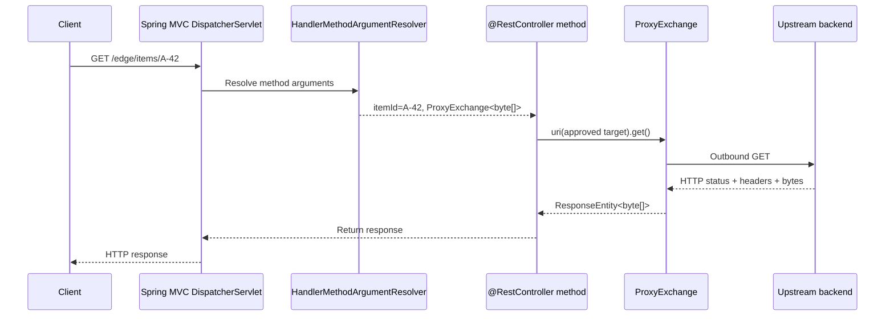

# Đối tượng ProxyExchange làm tham số handler method

## 1. Vì sao ProxyExchange xuất hiện trong một controller?

Trong **SPRING_CLOUD_GATEWAY**, một API Gateway có thể đảm nhiệm **route predicate**, **filter chain**, biến đổi đường dẫn và header, khám phá dịch vụ, xác thực, rate limiting, circuit breaker, retry, TLS và theo dõi request để giữ microservices an toàn. Những nhiệm vụ đó thường gắn với **Spring Cloud Gateway Server WebFlux** hoặc **Server Web MVC**, nơi routes và filters do Gateway Server quản lý.

Nhưng cũng có trường hợp một ứng dụng **Spring MVC hoặc WebFlux có sẵn** chỉ muốn chuyển tiếp vài endpoint được chọn tới backend, với logic ở ngay một **controller method**:

```text
Client
  GET /edge/items/A-42?lang=vi
        |
        v
Spring MVC @RestController
  @GetMapping("/edge/items/{itemId}")
  getItem(ProxyExchange<byte[]> proxy, ...)
        |
        | kiểm tra itemId; chọn URI đích cố định
        | proxy.uri("http://127.0.0.1:9001/items/A-42?lang=vi").get()
        v
Catalog Backend :9001
  GET /items/A-42?lang=vi
        |
        v
ResponseEntity<byte[]> -> HTTP response gửi cho client
```

Đây là mô hình **Spring Cloud Gateway Proxy Exchange** — một *flavor khác* của Spring Cloud Gateway, không phải một cú pháp thu gọn của **Gateway Server**. Thư viện cho phép đưa một đối tượng `ProxyExchange<T>` vào **tham số của handler method** dùng `@GetMapping`, `@PostMapping`, `@RequestMapping`, sau đó gọi một trong các phương thức proxy HTTP để gửi request xuống dịch vụ khác.

**Ví dụ ngắn nhất trên Spring MVC:**

```java
@GetMapping("/edge/hello")
public ResponseEntity<?> hello(ProxyExchange<byte[]> proxy) {
    return proxy.uri("http://127.0.0.1:9001/hello").get();
}
```

Điểm đáng chú ý: không có `RouterFunction`, `RouteLocator` hoặc `GatewayFilterChain` trong method trên. `ProxyExchange` được **Spring MVC argument resolver** tạo/chuẩn bị cho từng request, rồi truyền vào method khi controller được gọi.

### Kết quả cần đạt

Sau bài này bạn sẽ:

1. Nhận biết **Proxy Exchange** là kiểu gateway dành cho **annotation-based MVC/WebFlux handlers**, khác Gateway Server WebFlux/MVC.
2. Chọn đúng Maven artifact `spring-cloud-gateway-proxyexchange-webmvc` hoặc `spring-cloud-gateway-proxyexchange-webflux`.
3. Hiểu `ProxyExchange<byte[]>` được **method argument resolver** cung cấp thế nào, generic `T` biểu diễn gì và kiểu trả về MVC/WebFlux khác nhau ra sao.
4. Sử dụng `proxy.uri(...).get()`, `proxy.body(...).post()`, `path(...)`, `header(...)` và **response mapper** đúng ý nghĩa.
5. Phân biệt URI/path/query inbound với URI outbound, kiểm soát encoding và tránh mở proxy tùy ý.
6. Hiểu mặc định về **sensitive headers**, **skipped headers** và các header `X-Forwarded-*`; không tự chuyển `Authorization`/cookie ngoài chính sách.
7. Dựng lab **Spring MVC + ProxyExchange** có EchoBackend, kiểm tra bằng `curl` và HTTP integration test.
8. Biết khi nào nên dùng Proxy Exchange, khi nào cần Gateway Server với route predicates, filters, discovery, auth, TLS, quota và resiliency đầy đủ.

> **Phạm vi phiên bản của bài:** Spring Cloud Gateway **Proxy Exchange 4.3.x**, Spring Cloud **2025.0.x**, Spring Boot **3.5.x**, JDK 17+. Với release train này, tên artifact đã đổi từ `spring-cloud-gateway-mvc`/`spring-cloud-gateway-webflux` sang `spring-cloud-gateway-proxyexchange-webmvc`/`spring-cloud-gateway-proxyexchange-webflux`. Ví dụ dùng Boot `3.5.0` và Cloud BOM `2025.0.0` để minh họa compatibility; chọn patch vẫn được hỗ trợ khi deploy thực tế.

## 2. Phân biệt Proxy Exchange với hai biến thể Gateway Server

Tài liệu 4.3 nêu rõ: **Proxy Exchange là một kiểu gateway thay thế; các hướng dẫn về Gateway Server không mặc nhiên áp dụng cho nó.**

| Tiêu chí | **Proxy Exchange Web MVC** | **Proxy Exchange WebFlux** | **Gateway Server WebFlux/MVC** |
| --- | --- | --- | --- |
| Tác vụ chính | Proxy từng endpoint trong Spring MVC controller. | Proxy từng endpoint trong Spring WebFlux controller. | Chạy gateway định tuyến nhiều routes bằng predicates/filters. |
| Java entry point | `@GetMapping` với `ProxyExchange<T>`. | `@GetMapping` với `ProxyExchange<T>`. | `RouteLocatorBuilder` hoặc `GatewayRouterFunctions`/YAML. |
| Web runtime | Servlet/MVC (Tomcat/Jetty...). | Reactive/WebFlux (thường Reactor Netty). | WebFlux Server: reactive; MVC Server: Servlet. |
| Handler return | `ResponseEntity<?>`. | `Mono<ResponseEntity<?>>`. | Do Gateway Server pipeline đảm trách. |
| Thư viện 4.3 | `spring-cloud-gateway-proxyexchange-webmvc`. | `spring-cloud-gateway-proxyexchange-webflux`. | `spring-cloud-starter-gateway-server-webflux` hoặc `...-webmvc`. |
| Quy tắc match | Annotation `@GetMapping`, `@RequestMapping`, Spring web stack. | Annotation `@GetMapping`, `@RequestMapping`, Spring WebFlux. | Route predicates `Path`, `Host`, `Method`, `Header`... |
| Biến đổi request | Tự chọn URI, body, headers trong controller/filters của web stack. | Tương tự, qua publisher reactive. | Các `GatewayFilterFactory`, before/after filters, filter chain. |
| Hỗ trợ tiện ích | HTTP methods, response mapper; MVC có `forward()` nội bộ. | HTTP methods/reactive return. | Filters phong phú: rate limiter, circuit breaker, retry, cache, discovery. |
| Cấu hình chính | Controller + dependency Proxy Exchange. | Controller + dependency Proxy Exchange. | Server Gateway routes + filter factories. |

**Ba nhầm lẫn phổ biến:**

- `ProxyExchange` **không phải** `ServerWebExchange`: `ServerWebExchange` là đối tượng HTTP exchange của WebFlux, còn `ProxyExchange<T>` là **helper để gửi yêu cầu sang downstream** từ một handler.
- `ProxyExchange` **không phải** `GatewayRouterFunctions.route(...)`: `GatewayRouterFunctions` là DSL của Gateway **Server Web MVC**, dùng `RouterFunction<ServerResponse>`.
- Không nên đưa các thuộc tính `spring.cloud.gateway.server.webflux.routes` vào một app chỉ dùng Proxy Exchange rồi chờ controller tự có `RequestRateLimiter`/`CircuitBreaker` của Server.

### 2.1. Proxy Exchange phù hợp khi nào?

Có thể cân nhắc nếu:

- Ứng dụng đang dùng annotation-based `@RestController` và chỉ cần **một vài proxy endpoints**.
- Handler cần kiểm tra input/metadata nghiệp vụ trước khi gọi backend cố định.
- Muốn tận dụng Spring MVC/Spring WebFlux argument binding, validation, exception handling, interceptors và security filters sẵn có.
- Không cần biến mỗi endpoint thành một route của full Gateway Server.

Ngược lại, nếu phải quản lý hàng chục/hàng trăm routes từ YAML/Java DSL, load balancing, route predicates, filter chain, retry, circuit breaker, rate limiting, dynamic routes/Actuator và observability chung, **Gateway Server** thường phù hợp hơn. Những tính năng này có thể được xây bằng những thư viện khác quanh Proxy Exchange, nhưng **không tự xuất hiện** chỉ vì có tham số `ProxyExchange`.

## 3. Spring tự truyền `ProxyExchange` vào handler method thế nào?

Xem chữ ký MVC:

```java
@RestController
class ItemController {

    @GetMapping("/edge/items/{itemId}")
    ResponseEntity<?> get(
            @PathVariable String itemId,
            ProxyExchange<byte[]> proxy) {

        return proxy.uri("http://127.0.0.1:9001/items/" + itemId).get();
    }
}
```

Khi Spring MVC chọn method cho request, nó giải quyết các tham số thông thường (`@PathVariable`, `@RequestParam`, `@RequestHeader`...) và nhờ **`ProxyExchangeArgumentResolver`** giải quyết tham số `ProxyExchange<byte[]>`. Module Proxy Exchange thêm resolver này vào **Spring web application** thông qua auto-configuration khi dependency đúng có mặt.



**Không cần tự khởi tạo** `new ProxyExchange(...)` trong controller, không gắn `@RequestBody` hay `@Autowired` lên tham số `ProxyExchange`. Nó là **method argument chuyên dụng**, không phải request JSON được client gửi lên.

### 3.1. `ProxyExchange<T>` và `ResponseEntity<T>`

`T` là kiểu body mà helper dùng cho **response từ backend**. Ví dụ `ProxyExchange<byte[]>` phù hợp khi muốn giữ body bytes (JSON, hình ảnh, văn bản) mà không buộc Gateway parse thành entity nghiệp vụ.

| Chữ ký / kiểu | Đọc thế nào? |
| --- | --- |
| `ProxyExchange<byte[]> proxy` | Proxy request và nhận body outbound dưới dạng bytes. |
| `proxy.uri(url)` | Thiết lập target URI cho yêu cầu outbound, **chưa gửi** request. |
| `proxy.get()` | Thực hiện GET tới URI đã chọn và trả kết quả. |
| `ResponseEntity<?>` (MVC) | Bao gồm status, headers và body được trả từ proxy hoặc đã được handler điều chỉnh. |
| `Mono<ResponseEntity<?>>` (WebFlux) | Publisher reactive của response; phải return publisher, **không tự `block()`**. |

Dù `byte[]` tránh việc chuyển body sang một POJO, nó **không có nghĩa tự động streaming không giới hạn**. Với file lớn/SSE/multipart, cần kiểm tra buffering, content length, memory, codec và khả năng streaming của **phiên bản thư viện thực**. Proxy Exchange dùng để proxy **cơ bản**; không nên mặc định nó thay được một streaming gateway chuyên dụng.

### 3.2. Mẫu Web MVC và WebFlux cạnh nhau

**Spring MVC:**

```java
import org.springframework.cloud.gateway.mvc.ProxyExchange;
import org.springframework.http.ResponseEntity;
import org.springframework.web.bind.annotation.GetMapping;
import org.springframework.web.bind.annotation.RestController;

@RestController
class MvcExample {

    @GetMapping("/edge/ping")
    ResponseEntity<?> ping(ProxyExchange<byte[]> proxy) {
        return proxy.uri("http://127.0.0.1:9001/ping").get();
    }
}
```

**Spring WebFlux:** dùng module `spring-cloud-gateway-proxyexchange-webflux`, `@RestController` của WebFlux và kiểu trả về reactive:

```java
@GetMapping("/edge/ping")
public Mono<ResponseEntity<?>> ping(ProxyExchange<byte[]> proxy) {
    return proxy.uri("http://127.0.0.1:9001/ping").get();
}
```

Đoạn WebFlux trên minh họa **chữ ký**, giả định class đã import `Mono`, `ResponseEntity` và `ProxyExchange` từ module WebFlux phù hợp. Trong MVC, `get()` trả response trực tiếp; trong WebFlux, nó trả một `Mono`. **Không** thay `Mono<ResponseEntity<?>>` bằng `ResponseEntity<?>` một cách tùy tiện khi dùng reactive Proxy Exchange.

## 4. `uri(...)` và các phương thức theo HTTP verb

Phần lớn ví dụ sử dụng chuỗi:

```java
return proxy.uri("http://127.0.0.1:9001/items/A-42").get();
```

Trong đó:

1. Spring mapping xác định handler nào được gọi.
2. Handler chọn **URI đích** đã được phép sử dụng.
3. `uri(...)` gắn URI đích vào helper.
4. `get()` thực hiện request và trả về response ở kiểu của web stack.

`ProxyExchange` hỗ trợ các hành động theo HTTP verb phổ biến:

| Phương thức helper | HTTP outbound | Ví dụ ứng dụng | Lưu ý |
| --- | --- | --- | --- |
| `get()` | GET | Đọc sản phẩm, catalog, thông tin công khai. | Tránh side effect khi GET. |
| `head()` | HEAD | Kiểm tra metadata/resource. | Thường không có body phản hồi. |
| `options()` | OPTIONS | Trao đổi options với backend. | CORS preflight có thể được Spring Security/CORS xử lý **trước controller**. |
| `post()` | POST | Tạo tài nguyên. | Xem body, CSRF/session, idempotency, timeout. |
| `put()` | PUT | Thay thế tài nguyên. | Kiểm soát permissions và body. |
| `patch()` | PATCH | Chỉnh sửa một phần. | Kiểm soát kiểu body và xử lý partial updates. |
| `delete()` | DELETE | Xóa tài nguyên. | Authorization, audit; không retry mù. |

Với methods có body, trên MVC có thể chỉ định:

```java
@PostMapping("/edge/items")
ResponseEntity<?> create(@RequestBody byte[] payload,
                         ProxyExchange<byte[]> proxy) {
    return proxy.uri("http://127.0.0.1:9001/items")
                .body(payload)
                .post();
}
```

Hãy dùng body type/HTTP headers phù hợp (JSON, media type, binary). **Không phát một request body đã bị đọc/tiêu thụ nhiều lần** nếu chưa thiết kế replay. Với POST/PUT/PATCH lớn, multipart hay streaming, cần integration test riêng: generic `T` không tự giải quyết buffering hoặc backpressure.

### 4.1. `forward()` không giống HTTP proxy

Trên **MVC Proxy Exchange**, `forward(String)` có thể forward tới một **local handler** bên trong ứng dụng; đây không phải outbound HTTP request đến backend. Cần phân biệt:

```text
proxy.uri("https://catalog.example.test/items/42").get()
    -> gửi HTTP request tới host khác.

proxy.forward("/internal/fallback")
    -> chuyển request tới local MVC handler.
```

`forward()` được tài liệu nhắc riêng cho **MVC**; không giả định WebFlux Proxy Exchange có cùng API. Khi dùng local forward, cần tránh recursion (forward lại chính endpoint), bảo vệ đường nội bộ và không làm mất kiểm tra quyền.

## 5. `path(prefix)`, `@PathVariable` và query string

Tài liệu chính thức minh họa một helper `proxy.path("/proxy/path/")` để lấy phần đường dẫn **sau một prefix** của request:

```java
@GetMapping("/proxy/path/**")
public ResponseEntity<?> copyPath(ProxyExchange<byte[]> proxy) {
    String suffix = proxy.path("/proxy/path/");
    return proxy.uri("http://127.0.0.1:9001/foos/" + suffix).get();
}
```

Đây là cách hiểu về **lấy phần path còn lại**, không phải cơ chế tự xác thực hoặc sanitize path. Trong production, không nên ghép `suffix` chưa kiểm chứng vào target URI. Các ký tự `..`, `/`, `%2F`, `?`, `#` và UTF-8 encoded segments có thể làm sai đường dẫn hoặc query. **Một prefix đúng không chứng minh suffix an toàn.**

### 5.1. Chọn path cố định và biến đã validate cho endpoint quan trọng

Với API đọc một item, `@PathVariable` giúp định nghĩa rõ hợp đồng:

```java
@GetMapping("/edge/items/{itemId}")
ResponseEntity<?> get(
        @PathVariable String itemId,
        ProxyExchange<byte[]> proxy) {

    if (!itemId.matches("[A-Za-z0-9_-]{1,32}")) {
        return ResponseEntity.badRequest().body("Invalid item ID");
    }

    String target = UriComponentsBuilder
            .fromUriString("http://127.0.0.1:9001")
            .pathSegment("items", itemId)
            .build()
            .encode()
            .toUriString();

    return proxy.uri(target).get();
}
```

Đoạn code giả định import `UriComponentsBuilder` từ `org.springframework.web.util`. Regex tránh slash/encoded control characters; `pathSegment` thể hiện rõ cấu trúc đường dẫn. Trong API thực, bên cạnh format còn phải kiểm tra **authorization đối với item ID**.

### 5.2. Query string không được tự giả định là luôn chuyển theo nguyên trạng

Một controller có thể khai báo:

```java
@RequestParam(name = "lang", required = false)
String language
```

Đây là query parameter mà Spring đã bind. Khi chọn target URI, bạn phải quyết định **đưa query nào sang upstream**, thay vì tự tin tất cả query parameters sẽ được proxy nguyên xi trên mọi phiên bản/implementation.

Ví dụ:

```java
UriComponentsBuilder builder = UriComponentsBuilder
        .fromUriString(approvedBaseUri)
        .pathSegment("items", itemId);

if (language != null) {
    if (!language.matches("[A-Za-z]{2,8}")) {
        return ResponseEntity.badRequest().body("Invalid lang");
    }
    builder.queryParam("lang", language);
}
return proxy.uri(builder.build().encode().toUri()).get();
```

Dùng **allowlist** tên/giá trị query cho API nhạy cảm. Không chuyển `?backend=http://169.254.169.254`, `?tenant=someone-else` hoặc tokens trong query như một cách chọn host/identity.

### 5.3. Phân biệt inbound URL và outbound URL

| Thông tin | Ví dụ | Ai quyết định? |
| --- | --- | --- |
| Inbound mapping | `GET /edge/items/{itemId}` | `@GetMapping` từ controller. |
| Inbound path value | `itemId=A-42` | Client gửi, Spring MVC bind; **chưa đáng tin**. |
| Validated item | `A-42` với regex/authorization | Handler kiểm tra schema và quyền. |
| Target host | `127.0.0.1:9001` trong lab | **Cấu hình trusted**, không lấy trực tiếp từ query/header. |
| Target path | `/items/A-42` | Handler tạo từ cấu trúc cố định + item ID đã kiểm tra. |
| Outbound method | `GET` | Lời gọi `proxy.get()`. |
| HTTP response | `ResponseEntity<byte[]>` | Kết quả upstream, có thể được mapper kiểm soát. |

## 6. Header của request: sensitive, skipped và forwarded

Proxy Exchange hỗ trợ chuyển tiếp request headers nhưng có **quy tắc lọc**. Tài liệu Gateway 4.3 mô tả:

- **Sensitive headers**: mặc định gồm `cookie` và `authorization` — không tự động chuyển xuống downstream.
- **Skipped headers**: mặc định gồm `content-length` và `host` — tránh copy metadata sai khi URI/body/outbound transfer encoding có thể thay đổi.
- **Proxy/forwarded headers**: có hỗ trợ xử lý các header dạng `x-forwarded-*`, nhưng phải tuân thủ trust boundary của reverse proxy/ingress thực tế.

Ví dụ:

```http
GET /edge/items/A-42 HTTP/1.1
Host: edge.example.test
Authorization: Bearer customer-token
Cookie: session=abc123
X-Gateway-Lab: forged
```

**Không mặc định** backend sẽ nhận `Authorization`/cookie như client đã gửi. Đó là một ranh giới có chủ đích. Nếu API thật cần chuyển token, phải thiết kế OAuth2 Token Relay hoặc quyền proxy phù hợp, chỉ chuyển credential tới **đúng audience/host**, cân nhắc scopes và token exchange. Không bỏ bảo vệ mặc định một cách vô điều kiện.

### 6.1. `header(...)` dùng cho yêu cầu downstream

Javadoc `ProxyExchange.header(String,String...)` mô tả hành động **thiết lập một header cho downstream call**:

```java
return proxy.uri("http://127.0.0.1:9001/items/A-42")
            .header("X-Gateway-Lab", "proxyexchange")
            .get();
```

Trong ví dụ, `X-Gateway-Lab` là marker kỹ thuật không nhạy cảm. **Đừng nhầm nó với header trên response gửi tới client**: muốn kiểm soát response, sử dụng mapper từ `get(...)` hoặc response handling tương ứng.

`proxy.headers(HttpHeaders)` hỗ trợ cung cấp thêm/tùy biến nhiều outbound headers; không nên copy toàn bộ `HttpHeaders` của client sang backend rồi vô tình phá bảo vệ sensitive/skipped headers. Khi cần nhận diện user/tenant nội bộ, chỉ tạo thông tin từ principal được xác thực và giới hạn service có thể nhận.

### 6.2. Vì sao `Host` và `Content-Length` không nên copy?

- `Host` phải tương ứng với **target authority** (hostname/port) mà HTTP client thực sự gọi. Copy `Host: edge.example.test` tới `catalog.internal` có thể làm virtual-host routing/TLS sai.
- `Content-Length` phải đúng với số byte thực tế của outbound request. Khi helper thay body hoặc dùng chunked encoding, copy nguyên content length inbound có thể gây lỗi parse, treo request hoặc kết nối không nhất quán.
- Header `Connection`, `Transfer-Encoding` và các hop-by-hop headers khác cũng cần được HTTP client/proxy xử lý theo RFC, không được tùy ý giữ tất cả.

Do đó khi kiểm thử, đừng assert **mọi request header** phải byte-for-byte giống inbound. Hãy assert **những header được phép chuyển tiếp**, và **những header chắc chắn không được chuyển tiếp**.

### 6.3. `X-Forwarded-*` không tự đáng tin

`X-Forwarded-For`, `X-Forwarded-Host`, `X-Forwarded-Proto` có thể được thêm hoặc đi qua nhiều proxy. Nếu client có thể tự gửi chúng, các giá trị có thể bị giả mạo. Ở hệ thống thật:

1. Ingress phải strip/overwrite forwarded headers của untrusted clients.
2. Ứng dụng cấu hình trust rules cho trusted proxies.
3. Không dùng IP tự khai báo trong `X-Forwarded-For` làm key rate limit/authorization.
4. Không xây target URI theo `X-Forwarded-Host` nếu chưa kiểm soát nguồn.
5. Kiểm tra hành vi của đúng release/patch vì cấu hình forwarded headers có thay đổi bảo mật theo phiên bản.

## 7. Điều chỉnh phản hồi bằng response mapper

Proxy Exchange hỗ trợ overload của `get()` (và những HTTP methods khác) nhận một `Function<ResponseEntity<T>, ResponseEntity<S>>` để **biến đổi response sau khi nhận upstream**.

Ví dụ thêm marker an toàn và bỏ một response header nội bộ:

```java
return proxy.uri("http://127.0.0.1:9001/items/A-42")
        .get(upstream -> ResponseEntity
                .status(upstream.getStatusCode())
                .headers(headers -> {
                    headers.putAll(upstream.getHeaders());
                    headers.remove("X-Internal-Debug");
                    headers.set("X-Proxy-Source", "edge");
                })
                .body(upstream.getBody()));
```

Mapper nhận `ResponseEntity<byte[]>` từ backend và tạo response gửi client. Cần **giữ status, body và các headers hợp lệ**, đồng thời không tiết lộ internal metadata. Tùy chính sách, còn phải kiểm tra `Cache-Control`, CORS, cookies, redirect `Location` và các header security.

### 7.1. Không biến lỗi backend thành thành công giả

Giả sử backend trả `503 Service Unavailable`. Mapper không nên luôn trả `ResponseEntity.ok(...)` cho mọi response — điều này làm client, retry policy và metrics tưởng request đã thành công.

Mẫu ở trên dùng `.status(upstream.getStatusCode())` để giữ semantics gốc. Khi muốn thay đổi status có chủ đích, hãy mô tả API contract rõ ràng; một fallback 200 chỉ phù hợp nếu response thật sự có dữ liệu thay thế an toàn và được nghiệp vụ cho phép.

### 7.2. Mapping ẩn một header không thay thế cơ chế che dữ liệu

Bỏ `X-Internal-Debug` không tự che PII/secrets có thể nằm trong **body**. Nếu response chứa thông tin cá nhân, cần xác thực/ủy quyền đúng, không dùng cache toàn cục sai phạm vi và không chuyển nội dung không thuộc quyền của caller. Dịch vụ backend cũng cần kiểm tra quyền trên tài nguyên/tenant.

### 7.3. Body lớn, streaming và compression

Khi proxy trả body `byte[]`, có thể phải giữ nhiều bytes trong memory (theo stack/HTTP client và codec). Một body rất lớn hay stream dài vô hạn không phù hợp với giả định "cứ `.get()` rồi mapper có đủ bytes". Với SSE, multipart, video và streaming downloads, cân nhắc Gateway Server hoặc cơ chế HTTP streaming chuyên biệt, đặt giới hạn body size/timeouts và thử thực tế.

## 8. Hợp đồng HTTP: không phải mọi endpoint đều cần proxy

Proxy Exchange được dùng **trong controller đã match**. Trước khi thực hiện `.get()`/`.post()`, bạn có quyền quyết định:

- `@GetMapping` chỉ cho phép GET; route miss/method mismatch được Spring MVC/WebFlux xử lý.
- `@PathVariable`, `@RequestParam`, `@RequestHeader` có thể ràng buộc request theo schema.
- Validation có thể trả `400 Bad Request` mà **không gọi** upstream.
- Spring Security có thể trả `401/403` **trước** khi controller chạy.
- Mọi lỗi như DNS, TLS handshake, connection refused, timeout phát sinh khi outbound HTTP client gọi backend cần được xử lý theo chính sách.
- `ResponseEntity` do helper trả có thể giữ status `404`/`500` từ backend; không nhầm với 404 của MVC handler mapping.

Một "proxy handler" không mặc định có đầy đủ những tính năng **route predicates/filter chain/circuit breaker/retry/response cache** của Server Gateway. Nếu yêu cầu chúng, phải **tích hợp rõ ràng** hoặc chuyển sang Gateway Server phù hợp.

## 9. Thực hành: một Spring MVC controller nhận `ProxyExchange<byte[]>`

### 9.1. Kiến trúc lab

Ta dựng hai tiến trình chạy cục bộ:

```text
+-------------------------------------------+
| Spring Boot MVC :8080                     |
|                                           |
| @RestController                           |
| GET  /edge/items/{itemId}                 |
| POST /edge/items/{itemId}                 |
|                                           |
| Method argument: ProxyExchange<byte[]>    |
| - validate itemId/lang                     |
| - build trusted backend URI               |
| - set X-Gateway-Lab                         |
| - get() hoặc body(...).post()              |
+---------------------+---------------------+
                      |
                      | HTTP đến 127.0.0.1:9001
                      v
+-------------------------------------------+
| JDK EchoBackend                           |
| - Đếm số request thực nhận                 |
| - In method, path, query                  |
| - Kiểm tra có/không Authorization/Cookie  |
| - Trả 200 hoặc 503 để test status         |
+-------------------------------------------+
```

Dữ liệu là **demo public**, không đòi xác thực. Trong production, không tạo một proxy nhận URL/host arbitrary từ client. Địa chỉ `127.0.0.1:9001` chỉ dành cho hai tiến trình trên **cùng máy**. Nếu Gateway chạy trong Docker/Kubernetes, `127.0.0.1` trỏ về **chính container/pod Gateway**, không mặc định là service khác.

### 9.2. Tạo Maven project

Yêu cầu: JDK **17+**, Maven và `curl`. Khởi tạo một **project lab riêng** với `pom.xml`:

```xml
<?xml version="1.0" encoding="UTF-8"?>
<project xmlns="http://maven.apache.org/POM/4.0.0"
         xmlns:xsi="http://www.w3.org/2001/XMLSchema-instance"
         xsi:schemaLocation="http://maven.apache.org/POM/4.0.0
                             https://maven.apache.org/xsd/maven-4.0.0.xsd">
    <modelVersion>4.0.0</modelVersion>

    <parent>
        <groupId>org.springframework.boot</groupId>
        <artifactId>spring-boot-starter-parent</artifactId>
        <version>3.5.0</version>
        <relativePath/>
    </parent>

    <groupId>com.example</groupId>
    <artifactId>proxyexchange-handler-lab</artifactId>
    <version>0.0.1-SNAPSHOT</version>

    <properties>
        <java.version>17</java.version>
    </properties>

    <dependencyManagement>
        <dependencies>
            <dependency>
                <groupId>org.springframework.cloud</groupId>
                <artifactId>spring-cloud-dependencies</artifactId>
                <version>2025.0.0</version>
                <type>pom</type>
                <scope>import</scope>
            </dependency>
        </dependencies>
    </dependencyManagement>

    <dependencies>
        <!-- MVC / Servlet web application -->
        <dependency>
            <groupId>org.springframework.boot</groupId>
            <artifactId>spring-boot-starter-web</artifactId>
        </dependency>

        <!-- Chính module Proxy Exchange, KHÔNG phải Gateway Server -->
        <dependency>
            <groupId>org.springframework.cloud</groupId>
            <artifactId>spring-cloud-gateway-proxyexchange-webmvc</artifactId>
        </dependency>

        <dependency>
            <groupId>org.springframework.boot</groupId>
            <artifactId>spring-boot-starter-test</artifactId>
            <scope>test</scope>
        </dependency>
    </dependencies>

    <build>
        <plugins>
            <plugin>
                <groupId>org.springframework.boot</groupId>
                <artifactId>spring-boot-maven-plugin</artifactId>
            </plugin>
        </plugins>
    </build>
</project>
```

**Vì sao gồm hai runtime dependencies?**

- `spring-boot-starter-web`: Spring MVC với embedded Servlet container.
- `spring-cloud-gateway-proxyexchange-webmvc`: ProxyExchange type + argument resolver/auto-configuration phù hợp với MVC.

**Không dùng** `spring-cloud-starter-gateway-server-webmvc` chỉ để lấy `ProxyExchange`: đó là một **flavor khác**. Tương tự, artifact cũ `spring-cloud-gateway-mvc` từng được dùng ở các release trước nhưng đã được đổi tên trong 2025.0/4.3; đừng trộn module cũ và mới.

Với **WebFlux**, khởi tạo project riêng bằng `spring-boot-starter-webflux` + `spring-cloud-gateway-proxyexchange-webflux`, không đặt hai web stacks cạnh nhau trong một demo rồi đoán kiểu ứng dụng nào được Boot chọn.

### 9.3. Entry point

Tạo `src/main/java/com/example/proxy/ProxyExchangeApplication.java`:

```java
package com.example.proxy;

import org.springframework.boot.SpringApplication;
import org.springframework.boot.autoconfigure.SpringBootApplication;

@SpringBootApplication
public class ProxyExchangeApplication {
    public static void main(String[] args) {
        SpringApplication.run(ProxyExchangeApplication.class, args);
    }
}
```

### 9.4. `application.yml`

Tạo `src/main/resources/application.yml`:

```yaml
server:
  port: 8080

spring:
  application:
    name: proxyexchange-handler-lab

# Lab trên cùng máy: URI backend là cấu hình, KHÔNG lấy từ request.
lab:
  backend:
    uri: http://127.0.0.1:9001
```

Không cần `spring.cloud.gateway.server.webflux.routes`, `spring.cloud.gateway.server.webmvc.routes` hoặc `GatewayRouterFunctions` trong bài này: controller `@GetMapping`/`@PostMapping` chính là nơi quyết định proxy endpoint.

Ở hệ thống thật, `lab.backend.uri` phải lấy từ cấu hình được quản lý, áp dụng allowlist URI schemes/hosts/ports, bảo vệ secrets và phân quyền thay đổi. Đừng cho client tự gửi một `targetUrl` để override cấu hình này.

### 9.5. Controller hoàn chỉnh

Tạo `src/main/java/com/example/proxy/ItemProxyController.java`:

```java
package com.example.proxy;

import java.net.URI;
import java.util.regex.Pattern;

import org.springframework.beans.factory.annotation.Value;
import org.springframework.cloud.gateway.mvc.ProxyExchange;
import org.springframework.http.ResponseEntity;
import org.springframework.web.bind.annotation.GetMapping;
import org.springframework.web.bind.annotation.PathVariable;
import org.springframework.web.bind.annotation.PostMapping;
import org.springframework.web.bind.annotation.RequestBody;
import org.springframework.web.bind.annotation.RequestMapping;
import org.springframework.web.bind.annotation.RequestParam;
import org.springframework.web.bind.annotation.RestController;
import org.springframework.web.util.UriComponentsBuilder;

@RestController
@RequestMapping("/edge")
public class ItemProxyController {

    private static final Pattern ID_PATTERN =
            Pattern.compile("[A-Za-z0-9_-]{1,32}");

    private static final Pattern LANG_PATTERN =
            Pattern.compile("[A-Za-z]{2,8}");

    private final String backendBase;

    public ItemProxyController(
            @Value("${lab.backend.uri:http://127.0.0.1:9001}")
            String backendBase) {
        // Đây là cấu hình nội bộ. Production cần validate allowlist
        // scheme/host/port trước khi sử dụng.
        this.backendBase = backendBase;
    }

    @GetMapping("/items/{itemId}")
    public ResponseEntity<?> getItem(
            @PathVariable String itemId,
            @RequestParam(name = "lang", required = false)
            String language,
            ProxyExchange<byte[]> proxy) {

        if (!isValidItemId(itemId)) {
            return ResponseEntity.badRequest().body("Invalid item ID");
        }
        if (language != null
                && !LANG_PATTERN.matcher(language).matches()) {
            return ResponseEntity.badRequest().body("Invalid language");
        }

        URI uri = itemUri(itemId, language);

        // header(...) bổ sung header cho DOWNSTREAM request.
        // Không dùng marker này làm định danh xác thực.
        return proxy.uri(uri)
                .header("X-Gateway-Lab", "proxyexchange")
                .get();
    }

    @PostMapping("/items/{itemId}")
    public ResponseEntity<?> updateItem(
            @PathVariable String itemId,
            @RequestBody byte[] payload,
            ProxyExchange<byte[]> proxy) {

        if (!isValidItemId(itemId)) {
            return ResponseEntity.badRequest().body("Invalid item ID");
        }

        // body(...) chỉ định body outbound cho POST.
        URI uri = itemUri(itemId, null);
        return proxy.uri(uri)
                .header("X-Gateway-Lab", "proxyexchange")
                .body(payload)
                .post();
    }

    private boolean isValidItemId(String id) {
        return id != null && ID_PATTERN.matcher(id).matches();
    }

    private URI itemUri(String id, String language) {
        UriComponentsBuilder builder =
                UriComponentsBuilder.fromUriString(backendBase)
                        .pathSegment("items", id);

        if (language != null) {
            builder.queryParam("lang", language);
        }

        return builder.build().encode().toUri();
    }
}
```

**Từng bước của GET handler:**

1. Spring MVC match `GET /edge/items/{itemId}`.
2. Spring bind `itemId` và `lang` từ inbound URL.
3. `ProxyExchangeArgumentResolver` đưa đối tượng `ProxyExchange<byte[]>` vào tham số cuối — **controller không gọi `new ProxyExchange`**.
4. Handler validate item ID và language; với input sai trả 400 **trước outbound**.
5. Handler xây target URL bằng một base URI từ cấu hình và `pathSegment`, không ghép host từ request.
6. `proxy.uri(uri)` chọn đích, `proxy.header(...)` đặt marker outbound, `.get()` proxy.
7. Response được trả dưới dạng `ResponseEntity` cho Spring MVC gửi về client.

**Từng bước của POST handler:**

1. Spring bind raw body vào `byte[] payload` nhờ `@RequestBody`.
2. Handler validate ID, tạo target URI tương ứng.
3. `body(payload).post()` đưa body đi downstream.
4. Backend quyết định nghiệp vụ và HTTP status. Gateway không tự bảo đảm idempotency/authorization cho POST.

**Giới hạn của demo:** không có authentication hay authorization nghiệp vụ; chưa đặt timeout/body-size limits cụ thể; `backendBase` là cấu hình local. Một hệ thống production phải bổ sung những kiểm soát đó trước khi đưa endpoint ra Internet. Nếu dự án có cách kiểm soát `Content-Type`, `Accept`, status/exception khác nhau, kiểm thử body/binary/charset phù hợp.

### 9.6. Backend Echo chạy bằng JDK 17

Tạo `EchoBackend.java` trong **thư mục khác** với project Spring Boot (không đưa vào source `com.example.proxy`):

```java
import com.sun.net.httpserver.HttpServer;
import java.net.InetSocketAddress;
import java.nio.charset.StandardCharsets;
import java.util.concurrent.atomic.AtomicInteger;

public class EchoBackend {

    public static void main(String[] args) throws Exception {
        AtomicInteger counter = new AtomicInteger();

        HttpServer server = HttpServer.create(
                new InetSocketAddress("127.0.0.1", 9001), 0);

        server.createContext("/", exchange -> {
            int number = counter.incrementAndGet();
            String path = exchange.getRequestURI().getRawPath();
            String query = exchange.getRequestURI().getRawQuery();
            String method = exchange.getRequestMethod();

            String gatewayLab = exchange.getRequestHeaders()
                    .getFirst("X-Gateway-Lab");

            boolean authPresent = exchange.getRequestHeaders()
                    .containsKey("Authorization");
            boolean cookiePresent = exchange.getRequestHeaders()
                    .containsKey("Cookie");

            byte[] requestBytes = exchange.getRequestBody()
                    .readAllBytes();
            String requestBody =
                    new String(requestBytes, StandardCharsets.UTF_8);

            int status = path.endsWith("/unavailable") ? 503 : 200;
            String body = "origin-request=" + number + "\n"
                    + "method=" + method + "\n"
                    + "path=" + path + "\n"
                    + "query=" + query + "\n"
                    + "gateway-lab=" + gatewayLab + "\n"
                    + "auth-present=" + authPresent + "\n"
                    + "cookie-present=" + cookiePresent + "\n"
                    + "body=" + requestBody + "\n";

            // Không log giá trị Authorization hoặc Cookie.
            System.out.printf(
                    "ORIGIN #%d %s %s status=%d%n",
                    number, method, path, status);

            byte[] bytes = body.getBytes(StandardCharsets.UTF_8);
            exchange.getResponseHeaders().set(
                    "Content-Type", "text/plain; charset=UTF-8");
            exchange.getResponseHeaders().set(
                    "X-Origin-Request-No", Integer.toString(number));

            exchange.sendResponseHeaders(status, bytes.length);

            try (var output = exchange.getResponseBody()) {
                output.write(bytes);
            }
        });

        server.start();
        System.out.println("EchoBackend at http://127.0.0.1:9001");
    }
}
```

Backend này phục vụ **lab only**. Nó in trạng thái **có/không** của hai header nhạy cảm thay vì in token/cookie nguyên văn. Ở production, không tự động echo thông tin nội bộ trong HTTP response, không đưa debug endpoints ra public và không dùng `readAllBytes()` không giới hạn với request body từ Internet.

### 9.7. Chạy hai process

**Terminal A**, trong thư mục chứa `EchoBackend.java`:

```bash
java EchoBackend.java
```

**Terminal B**, trong thư mục chứa Spring Boot `pom.xml`:

```bash
mvn spring-boot:run
```

Nếu dùng Maven Wrapper: `./mvnw spring-boot:run` trên Linux/macOS hoặc `mvnw.cmd spring-boot:run` trên Windows. Đảm bảo cổng `8080` và `9001` rảnh.

**Các lệnh build/run trong bài chỉ dành cho người học thực hành ở project riêng.** Worker STEP 4 không chạy Maven/Gradle hay content QA của repository nền tảng.

### 9.8. GET: xác minh method, path, query, header

**Terminal C**:

```bash
curl -i \
  -H "X-Gateway-Lab: attacker-value" \
  "http://127.0.0.1:8080/edge/items/A-42?lang=vi"
```

Nếu hệ thống đang ở trạng thái lab sạch, response kỳ vọng về mặt nội dung:

```http
HTTP/1.1 200 OK
Content-Type: text/plain; charset=UTF-8

origin-request=1
method=GET
path=/items/A-42
query=lang=vi
gateway-lab=proxyexchange
auth-present=false
cookie-present=false
body=
```

Số `origin-request` thay đổi nếu đã gửi request trước đó. Những assertion quan trọng:

- **`path=/items/A-42`**: phần `/edge` không được tự "copy" như một route của Gateway Server; controller đã tạo URI đích cụ thể.
- **`query=lang=vi`**: handler đã chọn chuyển tiếp language parameter.
- **`gateway-lab=proxyexchange`**: helper đặt outbound header; không được lấy giá trị `attacker-value` từ client làm nguồn tin cậy.
- **`method=GET`**: chính `.get()` tạo HTTP method downstream.
- **backend counter tăng**: chứng minh HTTP call thực, không chỉ controller trả response local.

Nếu header marker không giống kỳ vọng, kiểm tra quá trình copy/override headers của đúng phiên bản Proxy Exchange và điều chỉnh quy tắc loại header client trước khi gắn metadata nội bộ. Đừng dùng marker lab để cấp quyền cho downstream.

### 9.9. Kiểm tra sensitive headers mặc định

Gửi một request demo có credential giả:

```bash
curl -i \
  -H "Authorization: Bearer lab-only-token" \
  -H "Cookie: session=lab-only-cookie" \
  "http://127.0.0.1:8080/edge/items/A-42"
```

Theo chính sách mặc định của Proxy Exchange 4.3, `Authorization` và `Cookie` nằm trong tập **sensitive headers** không tự động forward; backend demo dự kiến trả:

```text
auth-present=false
cookie-present=false
```

**Đây không phải bằng chứng người dùng đã đăng nhập**. Lab chưa thiết lập Spring Security để xác minh token giả. Trong hệ thống thật, phải xác thực caller trước, sau đó quyết định có token relay tới upstream **được ủy quyền** hay không, thay vì mặc định chuyển mọi bearer token.

### 9.10. POST: forward body có kiểm soát

```bash
curl -i -X POST \
  -H "Content-Type: text/plain" \
  --data-binary "payload-123" \
  "http://127.0.0.1:8080/edge/items/A-42"
```

Body mong đợi từ EchoBackend:

```text
method=POST
path=/items/A-42
body=payload-123
```

Đây chỉ là một **echo**. Nếu endpoint POST thật cập nhật dữ liệu, cần JWT/authorization, body schema validation, media type, quota, idempotency và audit. Không retry tự động một request POST tạo thanh toán/đơn hàng khi chưa có idempotency key.

### 9.11. Validation: từ chối trước backend

ID dài hơn 32 ký tự:

```bash
curl -i \
  "http://127.0.0.1:8080/edge/items/abcdefghijklmnopqrstuvwxyz123456789"
```

Kỳ vọng **400 Bad Request** do handler tự validate; backend counter không tăng. Input language sai:

```bash
curl -i \
  "http://127.0.0.1:8080/edge/items/A-42?lang=vi%2Fsecret"
```

Giá trị `vi/secret` không match regex `[A-Za-z]{2,8}`, do đó trả 400. Đây là **validation trong controller**, không phải cơ chế RoutePredicateFactory của Gateway Server.

### 9.12. Route miss và HTTP method mismatch

Không có `@GetMapping("/unknown")`:

```bash
curl -i "http://127.0.0.1:8080/unknown"
```

Thông thường Spring MVC trả **404** và không gọi backend. Nếu gửi DELETE tới URL chỉ khai báo GET/POST, framework sẽ xử lý method mismatch (thường 405) mà không tự proxy. Status có thể chịu ảnh hưởng security/exception handlers khác của ứng dụng; kiểm tra **backend counter** để phân biệt.

### 9.13. HTTP status từ upstream phải được giữ đúng

Backend demo trả 503 khi path kết thúc `/unavailable`:

```bash
curl -i \
  "http://127.0.0.1:8080/edge/items/unavailable"
```

Nếu `ProxyExchange.get()` nhận response HTTP và chuyển về `ResponseEntity`, client phải quan sát HTTP status theo kết quả downstream — **không coi 503 là 200** chỉ vì controller đã chạy bình thường. Một số HTTP client/exception handler có thể xử lý status hoặc exception theo phiên bản/config khác nhau; integration test cần xác minh behavior thật, thay vì suy ra từ `@GetMapping` alone.

### 9.14. Khi backend không tồn tại

Dừng `EchoBackend`, giữ Spring Boot chạy rồi thử GET. Có thể gặp connection refused/timeout, thường phản ánh bằng response server error hoặc exception handler. **Không khẳng định cứng mã 502/503/504** nếu chưa cấu hình exception mapping. Đọc root cause, timeout TCP/HTTP client, DNS, TLS và chính sách fallback. Không giải quyết bằng cách tắt hostname verification hoặc mở target URI arbitrary.

## 10. Integration test: MVC handler argument resolver và HTTP outbound thực

Unit test một controller mock `ProxyExchange` chỉ kiểm tra logic Java, **không chứng minh** Spring đã đăng ký `ProxyExchangeArgumentResolver`, không chứng minh request thực sự đến backend và không kiểm tra filtering của sensitive headers. Integration test nên khởi động **Spring Boot MVC** và **HTTP EchoBackend** qua socket thật.

Thiết kế:

1. `@SpringBootTest(webEnvironment = RANDOM_PORT)` tạo MVC application trên cổng ngẫu nhiên.
2. `com.sun.net.httpserver.HttpServer` tạo backend trên cổng `0` do hệ điều hành cấp.
3. `@DynamicPropertySource` truyền `lab.backend.uri` vào controller.
4. `TestRestTemplate` gửi HTTP request tới controller.
5. `AtomicInteger` đếm số HTTP calls mà backend nhận, giúp phân biệt **validation 400** với một lỗi sau khi đã outbound.
6. Tests kiểm tra GET/path/query, sensitive header defaults, POST body và route miss.

### 10.1. JUnit integration test

Tạo `src/test/java/com/example/proxy/ProxyExchangeIntegrationTest.java`:

```java
package com.example.proxy;

import java.io.IOException;
import java.io.UncheckedIOException;
import java.net.InetSocketAddress;
import java.nio.charset.StandardCharsets;
import java.util.concurrent.atomic.AtomicInteger;

import com.sun.net.httpserver.HttpServer;

import org.junit.jupiter.api.AfterAll;
import org.junit.jupiter.api.Test;
import org.springframework.beans.factory.annotation.Autowired;
import org.springframework.boot.test.context.SpringBootTest;
import org.springframework.boot.test.web.client.TestRestTemplate;
import org.springframework.http.HttpEntity;
import org.springframework.http.HttpHeaders;
import org.springframework.http.HttpMethod;
import org.springframework.http.HttpStatus;
import org.springframework.http.MediaType;
import org.springframework.http.ResponseEntity;
import org.springframework.test.context.DynamicPropertyRegistry;
import org.springframework.test.context.DynamicPropertySource;

import static org.assertj.core.api.Assertions.assertThat;

@SpringBootTest(
        webEnvironment = SpringBootTest.WebEnvironment.RANDOM_PORT)
class ProxyExchangeIntegrationTest {

    private static final AtomicInteger CALLS = new AtomicInteger();

    private static final HttpServer BACKEND = startBackend();

    private static HttpServer startBackend() {
        try {
            HttpServer server = HttpServer.create(
                    new InetSocketAddress("127.0.0.1", 0), 0);

            server.createContext("/", exchange -> {
                CALLS.incrementAndGet();

                String method = exchange.getRequestMethod();
                String path = exchange.getRequestURI().getRawPath();
                String query = exchange.getRequestURI().getRawQuery();
                String marker = exchange.getRequestHeaders()
                        .getFirst("X-Gateway-Lab");
                boolean auth = exchange.getRequestHeaders()
                        .containsKey("Authorization");
                boolean cookie = exchange.getRequestHeaders()
                        .containsKey("Cookie");

                String inboundBody = new String(
                        exchange.getRequestBody().readAllBytes(),
                        StandardCharsets.UTF_8);

                String responseText = "method=" + method + "\n"
                        + "path=" + path + "\n"
                        + "query=" + query + "\n"
                        + "gateway-lab=" + marker + "\n"
                        + "auth-present=" + auth + "\n"
                        + "cookie-present=" + cookie + "\n"
                        + "body=" + inboundBody + "\n";

                byte[] bytes = responseText
                        .getBytes(StandardCharsets.UTF_8);
                exchange.getResponseHeaders().set(
                        "Content-Type", "text/plain; charset=UTF-8");
                exchange.sendResponseHeaders(200, bytes.length);

                try (var output = exchange.getResponseBody()) {
                    output.write(bytes);
                }
            });

            server.start();
            return server;
        } catch (IOException e) {
            throw new UncheckedIOException(e);
        }
    }

    @DynamicPropertySource
    static void backendUri(DynamicPropertyRegistry registry) {
        registry.add("lab.backend.uri", () ->
                "http://127.0.0.1:" + BACKEND.getAddress().getPort());
    }

    @Autowired
    TestRestTemplate client;

    @AfterAll
    static void closeBackend() {
        BACKEND.stop(0);
    }

    @Test
    void getProxiesMethodPathAndQuery() {
        int before = CALLS.get();

        ResponseEntity<String> result = client.getForEntity(
                "/edge/items/A-42?lang=vi", String.class);

        assertThat(result.getStatusCode()).isEqualTo(HttpStatus.OK);
        assertThat(result.getBody())
                .contains("method=GET")
                .contains("path=/items/A-42")
                .contains("query=lang=vi")
                .contains("gateway-lab=proxyexchange");
        assertThat(CALLS.get()).isEqualTo(before + 1);
    }

    @Test
    void defaultSensitiveHeadersStayOffDownstreamRequest() {
        int before = CALLS.get();

        HttpHeaders headers = new HttpHeaders();
        headers.set(HttpHeaders.AUTHORIZATION, "Bearer lab-token");
        headers.set(HttpHeaders.COOKIE, "sid=lab-session");

        ResponseEntity<String> result = client.exchange(
                "/edge/items/A-42",
                HttpMethod.GET,
                new HttpEntity<Void>(headers),
                String.class);

        assertThat(result.getStatusCode()).isEqualTo(HttpStatus.OK);
        assertThat(result.getBody())
                .contains("auth-present=false")
                .contains("cookie-present=false");
        assertThat(CALLS.get()).isEqualTo(before + 1);
    }

    @Test
    void postPassesBodyToBackend() {
        int before = CALLS.get();

        HttpHeaders headers = new HttpHeaders();
        headers.setContentType(MediaType.TEXT_PLAIN);

        HttpEntity<byte[]> request = new HttpEntity<>(
                "payload-123".getBytes(StandardCharsets.UTF_8),
                headers);

        ResponseEntity<String> result = client.exchange(
                "/edge/items/A-42",
                HttpMethod.POST,
                request,
                String.class);

        assertThat(result.getStatusCode()).isEqualTo(HttpStatus.OK);
        assertThat(result.getBody())
                .contains("method=POST")
                .contains("path=/items/A-42")
                .contains("body=payload-123");
        assertThat(CALLS.get()).isEqualTo(before + 1);
    }

    @Test
    void invalidIdIsRejectedBeforeOutboundHttp() {
        int before = CALLS.get();

        ResponseEntity<String> result = client.getForEntity(
                "/edge/items/abcdefghijklmnopqrstuvwxyz123456789",
                String.class);

        assertThat(result.getStatusCode())
                .isEqualTo(HttpStatus.BAD_REQUEST);
        assertThat(CALLS.get()).isEqualTo(before);
    }

    @Test
    void unrelatedPathDoesNotHitBackend() {
        int before = CALLS.get();

        ResponseEntity<String> result = client.getForEntity(
                "/not-routed", String.class);

        assertThat(result.getStatusCode())
                .isEqualTo(HttpStatus.NOT_FOUND);
        assertThat(CALLS.get()).isEqualTo(before);
    }
}
```

### 10.2. Mỗi assertion chứng minh điều gì?

| Assertion | Hợp đồng được kiểm tra |
| --- | --- |
| Client nhận HTTP 200 và body `method=GET` | Controller + argument resolver + proxy GET tới backend thật. |
| Body `path=/items/A-42` | URI outbound được xây từ item ID đã validate, không dùng toàn bộ inbound path. |
| Body `query=lang=vi` | Controller chủ động truyền query allowlisted. |
| Body `gateway-lab=proxyexchange` | Header được đặt cho downstream call bởi helper. |
| Body `auth-present=false` và `cookie-present=false` | Sensitive headers theo chính sách mặc định không tự bị chuyển tiếp. |
| POST có `body=payload-123` | `@RequestBody` và `body(...).post()` mang bytes qua outbound HTTP. |
| ID sai → 400, CALLS không tăng | Controller short-circuit **trước** HTTP client. |
| Path không match → 404, CALLS không tăng | Spring MVC không chọn proxy handler. |

**Đừng chỉ assert HTTP status.** Một lỗi 404 có thể đến từ Spring MVC hoặc backend; một lỗi 500 có thể xảy ra trước controller hoặc sau khi mở outbound connection. Backend counter và nội dung echo giúp phân biệt.

### 10.3. Tính ổn định của bài test

`CALLS` là static counter chia sẻ giữa các test methods. Các assertion `before + 1` giả định test chạy **tuần tự**, không bật parallel execution trong JUnit. Nếu CI chạy tests song song, nên phân vùng counter theo request ID hoặc tạo HTTP backend độc lập cho từng test.

Port `0` giúp hệ điều hành cấp port ngẫu nhiên; `@DynamicPropertySource` cấp cấu hình trước khi controller bean được khởi tạo. Đây là một integration test có **network HTTP thực**, không chỉ là test `MockMvc` của controller trong application context giả.

Nếu dự án đã có security filters, controller khác, base path khác hoặc custom exception handlers, cần cập nhật expected statuses theo **HTTP contract thực tế** chứ không giả định kết quả lab này áp dụng cho mọi deployment.

### 10.4. Lệnh chạy trong project thực hành

```bash
mvn -Dtest=ProxyExchangeIntegrationTest test
```

Hoặc với Maven Wrapper:

```bash
./mvnw -Dtest=ProxyExchangeIntegrationTest test
```

Đây là lệnh dành cho **người học chạy ở project demo riêng**. Trong STEP 4, worker chỉ viết đúng Markdown và cập nhật YAML status sau readback; không chạy Content QA STEP 6 hoặc build nền tảng.

## 11. Khi dùng WebFlux: chữ ký handler đổi thành publisher

Nếu ứng dụng sử dụng Spring WebFlux, chọn các dependency **khác** với lab MVC:

```xml
<dependency>
    <groupId>org.springframework.boot</groupId>
    <artifactId>spring-boot-starter-webflux</artifactId>
</dependency>
<dependency>
    <groupId>org.springframework.cloud</groupId>
    <artifactId>spring-cloud-gateway-proxyexchange-webflux</artifactId>
</dependency>
```

Handler WebFlux có kiểu trả về `Mono<ResponseEntity<?>>`, như ví dụ rút gọn từ tài liệu chính thức:

```java
@GetMapping("/edge/items/{itemId}")
public Mono<ResponseEntity<?>> getItem(
        @PathVariable String itemId,
        ProxyExchange<byte[]> proxy) {

    if (!itemId.matches("[A-Za-z0-9_-]{1,32}")) {
        return Mono.just(
                ResponseEntity.badRequest().body("Invalid item ID"));
    }

    // ID đã được giới hạn để làm path segment đơn giản.
    return proxy.uri("http://127.0.0.1:9001/items/" + itemId)
                .get();
}
```

Snippet này giả định các import từ đúng module WebFlux và Reactor. Không đem method trên vào project MVC ở mục 9. **Không gọi `block()` hoặc tự `subscribe()`** trong Netty event loop để lấy `ResponseEntity` tức thời; return publisher để WebFlux giữ lifecycle, error và cancellation.

Ở cả hai stacks, `ProxyExchange<T>` là **argument được framework resolve**, không phải `ServerWebExchange`. Logic kiểm tra URI/headers/authorization và giới hạn body size vẫn phải được thiết kế.

## 12. Kết hợp Proxy Exchange với yêu cầu Gateway an toàn

### 12.1. Authentication và authorization

- MVC dùng Spring Security **Servlet `SecurityFilterChain`**; WebFlux dùng **`SecurityWebFilterChain`**.
- Không xem path variable, `X-Correlation-Id`, `X-User-Id` do client gửi hoặc response 200 là bằng chứng danh tính.
- Backend vẫn phải kiểm tra quyền theo resource/tenant, nhất là khi đổi URL bằng `ProxyExchange.uri(...)`.
- `Authorization` và `Cookie` bị loại khi **tự động forward** theo chính sách sensitive headers mặc định. Nếu nghiệp vụ yêu cầu token relay, phải quyết định rõ upstream **audience**, scope, trust boundary và credential lifecycle.
- Nếu app dùng cookie/session cho các hành động ghi, cần CSRF policy và CORS hợp lệ; CORS không thay authentication.

### 12.2. Cảnh báo SSRF: đừng cho client chọn target URI

Đây là một anti-pattern nghiêm trọng:

```java
// KHÔNG AN TOÀN: client tự quyết định nơi Gateway gửi HTTP.
@GetMapping("/proxy")
public ResponseEntity<?> unsafe(
        @RequestParam String target,
        ProxyExchange<byte[]> proxy) {
    return proxy.uri(target).get();
}
```

Client có thể ép Gateway gọi dịch vụ nội bộ, loopback, cloud metadata endpoint hoặc host do họ kiểm soát, gây **SSRF/open proxy**. Phương án đúng:

1. Base URI lấy từ cấu hình server và allowlist scheme, host, port, IP/CIDR.
2. Kiểm soát DNS rebinding, redirect và egress đến địa chỉ ngoài chính sách.
3. Không để query/header/Host từ client thay đổi target host.
4. Validate path và query values, tránh `..`, encoded slash, double encoding, query injection.
5. Dùng network policy/firewall để cấm egress nhạy cảm, không chỉ trông cậy regex Java.
6. Đặt connect/read timeouts và giới hạn redirects/body size/connection pool.

Trong bài lab, `lab.backend.uri` là cấu hình **tin cậy của người vận hành**, không phải một `@RequestParam`.

### 12.3. TLS/mTLS và forwarded headers

Khi outbound URI dùng HTTPS, cần xác minh CA, certificate chain, hostname/SAN/SNI và trust store của HTTP client. Nếu microservices yêu cầu mTLS, cấu hình client certificate/rotation phù hợp. **Không** dùng trust-all hoặc tắt hostname verification để né lỗi handshake.

Các header `X-Forwarded-For`/`X-Forwarded-Host` có thể được thêm qua proxy chain; chỉ tin khi ingress strip/overwrite untrusted values. Không chọn danh tính, IP làm quota key hoặc target host từ forwarded header chưa được xác minh.

### 12.4. Quota, circuit breaker, retry và discovery

Một `ProxyExchange` controller **không tự có** các `GatewayFilterFactory` như `RequestRateLimiter`, `CircuitBreaker`, `Retry` hoặc cơ chế `lb://` của Gateway Server.

Nếu nghiệp vụ cần chúng, phải tích hợp rõ trong đúng web stack hoặc đặt một Gateway Server ở phía trước. Cần kiểm soát:

| Chính sách | Điều phải thiết kế rõ |
| --- | --- |
| Rate limiting | Trusted key, quota per caller, 429 trước outbound HTTP. |
| Circuit breaker | Lỗi/slow-call thresholds, open/half-open, fallback đúng semantics. |
| Retry | Giới hạn attempts, backoff, timeout budget, idempotency POST/PUT/PATCH. |
| Service discovery | Chọn URI HTTP(S) từ `ServiceInstance` đáng tin, kiểm tra TLS/health. |
| Cache | Không cache private/no-store/tenant-specific response ngoài chính sách. |
| Authorization | Không để proxy logic hoặc fallback làm mất quyền truy cập tài nguyên. |

Không giả định `proxy.uri("lb://catalog-service")` được Proxy Exchange tự động giải nghĩa như `lb://` route của Gateway Server. Hãy dùng resolver/LoadBalancer phù hợp, hoặc chọn full-featured Gateway Server nếu routes/discovery/filter policies là trọng tâm.

### 12.5. Observability

Cần đo **cả hai phía** của proxy: inbound controller requests và outbound HTTP attempts. Ghi status, error class, latency, target alias, số lần retry; phân biệt DNS/TCP/TLS timeout với HTTP status 5xx do backend trả. Không log raw `Authorization`, cookie, token, request body nhạy cảm hoặc URI query chứa PII.

Spring Boot Actuator/Micrometer có thể đo web stack/client theo dependency/config, nhưng không mặc định có `/actuator/gateway/routes` hoặc metrics route-filter của **Gateway Server** trong một ứng dụng chỉ dùng Proxy Exchange.

## 13. Xử lý sự cố thường gặp

| Triệu chứng | Nguyên nhân có thể | Hướng kiểm tra |
| --- | --- | --- |
| Không import được `ProxyExchange` | Chọn nhầm artifact Gateway Server hoặc module cũ. | MVC dùng `spring-cloud-gateway-proxyexchange-webmvc`; WebFlux dùng `...-webflux`. |
| Spring không resolve được parameter | Auto-configuration/argument resolver chưa được đăng ký hoặc web stack không đúng. | Kiểm tra dependency tree, app type và controller. |
| Compile lỗi return type | Trộn `ResponseEntity` MVC và `Mono<ResponseEntity>` WebFlux. | Chọn đúng chữ ký theo stack. |
| Controller không được gọi | Sai `@GetMapping`/method/context path, component scan hoặc security. | Xem inbound mapping và backend call counter. |
| GET 404 nhưng backend có log | 404 là response upstream, không phải route miss. | So request counter và target URI. |
| Backend nhận path/query sai | Ghép chuỗi URI, bỏ query hoặc encode sai. | Validate + `UriComponentsBuilder`, kiểm tra outbound path/query. |
| Backend không thấy token/cookie | Sensitive headers bị lọc mặc định. | Xác định yêu cầu token relay theo audience/role, không bật pass-through mù. |
| Backend nhận `Host` khác client | `Host` bị skip, HTTP client dùng target authority. | Đây thường là behavior đúng. |
| POST body mất | `@RequestBody`, `body(payload)`, media type hoặc converter sai. | Test bytes thực tới EchoBackend. |
| 400 nhưng backend counter tăng | Validation diễn ra sau HTTP proxy hoặc filter khác phát sinh call. | Kiểm tra controller flow: reject trước `.get()`/`.post()`. |
| Backend 503 mà client thấy exception | HTTP client error handler/exception mapping xử lý status khác. | Phân biệt exception transport với ResponseEntity nhận được. |
| File/SSE bị buffer | `byte[]` không bảo đảm streaming không giới hạn. | Cân nhắc streaming proxy khác, giới hạn kích thước, đo memory. |
| Retry tạo nhiều backend calls | Retry được thêm bởi client/policy ngoài Proxy Exchange. | Đếm attempts và bảo đảm idempotency. |
| SSL handshake error | CA, SAN, hostname hoặc trust store sai. | Giữ peer verification; sửa TLS config. |
| Không thấy `/actuator/gateway/routes` | Ứng dụng chỉ dùng Proxy Exchange, không có Gateway Server registry. | Dùng web/http-client metrics của app. |
| Dữ liệu sai tenant | Thiếu authorization, cache sai key hoặc header giả mạo. | Kiểm tra principal/tenant tại backend, chặn cache dữ liệu nhạy cảm. |

## 14. Ma trận kiểm thử trước khi triển khai

| Trường hợp | Expected client | Expected backend |
| --- | --- | --- |
| GET `/edge/items/A-42` | Response backend hợp lệ. | Một GET `/items/A-42`. |
| GET `?lang=vi` | Trả dữ liệu đúng language. | Query `lang=vi`. |
| ID quá dài | 400. | Không outbound. |
| Language chứa slash | 400. | Không outbound. |
| Path không match | 404 theo lab. | Không outbound. |
| POST với body | Đúng status/body theo backend. | POST với bytes `payload-123`. |
| Header marker giả | Không thành trusted identity. | Marker do handler chọn theo chính sách. |
| Client gửi Cookie/Authorization | Không tự động relay. | Sensitive headers bị lọc mặc định. |
| Upstream 404/503 | Status/exception theo HTTP client policy. | Backend thực sự nhận call. |
| TLS sai SAN/CA | Không bypass verify. | Không thành công HTTP handshake. |
| URI target do client tự khai báo | Reject/ignore input này. | Chỉ approved backend URI. |
| Thiếu auth/quyền | 401/403 theo security. | Không outbound. |
| Quota hết | 429 theo limiter được tích hợp. | Không outbound. |
| Retry với POST | Chỉ nếu bảo đảm idempotency. | Số attempts đúng policy. |
| Large/streaming body | Giới hạn/streaming phù hợp. | Không memory blow-up. |
| N requests đồng thời | Không trộn headers/body. | State request được cô lập. |

Một test chỉ assert HTTP 200 **không đủ**: cần biết backend nhận **method/path/query/headers/body nào**, có bị gọi quá số lần hay không và request bị chặn đã thật sự không phát outbound HTTP.

## 15. Checklist thực hành

- [ ] Chọn rõ **Proxy Exchange MVC hoặc WebFlux**, không nhầm Gateway Server.
- [ ] Đúng `ProxyExchange<T>` method argument, đúng artifact và return type.
- [ ] `uri(...)` đặt target đáng tin; HTTP verb helper tương ứng với mapping.
- [ ] Validate và encode path/query; không để client tự quyết định URL.
- [ ] Header sensitive, skipped và forwarded được xử lý theo trust policy.
- [ ] Không chuyển token/cookie vào backend chưa được ủy quyền.
- [ ] Response status/body và mapper giữ HTTP semantics; không "200 giả".
- [ ] Xác thực/ủy quyền tài nguyên và tenant được kiểm tra ở Gateway/backend.
- [ ] Timeout, TLS/mTLS, redirect policy, body size và outbound egress đã kiểm soát.
- [ ] Retry/circuit breaker/rate limit/discovery có cấu hình rõ nếu cần.
- [ ] Không `block()` hoặc tự `subscribe()` trong reactive handler.
- [ ] Có integration test HTTP thật với backend counter và negative cases.
- [ ] Logs/metrics không chứa token, cookie, PII hoặc URL nhạy cảm.
- [ ] Chọn release train/patch đang được hỗ trợ; kiểm tra behavior theo artifact.

## 16. Câu hỏi tự kiểm tra

**1. Vì sao Spring MVC truyền được `ProxyExchange<byte[]>` trực tiếp vào `@GetMapping`?**

Vì module Proxy Exchange đăng ký **method argument resolver**, không phải vì client gửi một JSON có tên ProxyExchange.

**2. `ProxyExchange` có giống `ServerWebExchange` hoặc `GatewayFilterChain` không?**

Không. Nó là helper **gọi HTTP outbound** từ controller. Hai API kia thuộc pipeline reactive của Gateway Server WebFlux.

**3. MVC và WebFlux khác nhau ở kiểu trả về nào?**

MVC trả `ResponseEntity<?>`; WebFlux trả `Mono<ResponseEntity<?>>`.

**4. `proxy.uri(target)` có gửi HTTP chưa?**

Chưa. Phải gọi `.get()`, `.post()`, `.put()`... để thực hiện exchange.

**5. Vì sao `proxy.path(prefix)` không thay validation?**

Nó chỉ trích suffix của inbound path, không bảo đảm chống traversal, encoding, sai tenant hoặc target URI độc hại.

**6. `proxy.header(...)` đặt header ở đâu?**

Theo Javadoc, nó thiết lập header cho **downstream request**, không phải client response. Dùng response mapper khi cần điều chỉnh `ResponseEntity`.

**7. Vì sao token/cookie không tự xuất hiện ở backend?**

Chúng thuộc **sensitive headers** bị loại mặc định khi auto-forward. Token relay cần chính sách audience/scope và caller identity đáng tin.

**8. Vì sao `?target=http://127.0.0.1:...` là nguy hiểm?**

Vì biến proxy thành SSRF/open proxy tới host nội bộ hoặc metadata service ngoài quyền client.

**9. Có `ProxyExchange` đồng nghĩa tự có Retry/CircuitBreaker/RequestRateLimiter của Server Gateway không?**

Không. Các chính sách đó phải được tích hợp riêng hoặc triển khai bằng Gateway Server.

**10. Assertion nào mạnh hơn status 400 khi validation từ chối?**

**Backend counter không tăng** — chứng minh không có downstream HTTP call sau validation fail.

## Kết luận

**`ProxyExchange<T>` làm tham số handler method** là một cách xây proxy có chọn lọc ngay trong ứng dụng **Spring MVC/WebFlux annotation-based**. Spring cung cấp đối tượng qua argument resolver; controller chọn target URI, `proxy.get()`/`post()` thực hiện HTTP outbound, `path(...)`/ `body(...)`/`header(...)` hỗ trợ chuyển tiếp có kiểm soát, còn response mapper cho phép chỉnh `ResponseEntity`.

Cần phân biệt **Proxy Exchange** với **Gateway Server**: helper trong controller không tự có route predicates/filter chain, dynamic routing, rate limiting, retry/circuit breaker hay `lb://` như một Server Gateway. Trước khi triển khai, phải kiểm soát target URI để chống SSRF, validate path/query, giữ chính sách sensitive headers, xác thực/ủy quyền, TLS/timeouts, bảo vệ bộ nhớ và giám sát request. Khi nhu cầu routes và policies trở nên phức tạp, cân nhắc Gateway Server WebFlux hoặc Server Web MVC.

### Tài liệu tham khảo chính thức

- [Spring Cloud Gateway 4.3 — Proxy Exchange Gateway with Spring Web MVC or WebFlux](https://docs.spring.io/spring-cloud-gateway/reference/4.3/spring-cloud-gateway-proxy-exchange.html)
- [Spring Cloud Gateway — Proxy Exchange current reference](https://docs.spring.io/spring-cloud-gateway/reference/spring-cloud-gateway-proxy-exchange.html)
- [Spring Cloud Gateway 4.3 — Overview: Server vs Proxy Exchange](https://docs.spring.io/spring-cloud-gateway/reference/4.3/index.html)
- [Proxy Exchange Web MVC 4.3.5 — Javadoc](https://javadoc.io/doc/org.springframework.cloud/spring-cloud-gateway-proxyexchange-webmvc/4.3.5)
- [Proxy Exchange WebFlux 4.3.5 — Javadoc](https://javadoc.io/doc/org.springframework.cloud/spring-cloud-gateway-proxyexchange-webflux/4.3.5)
- [ProxyExchange MVC 4.1.4 — Historical Method Reference](https://javadoc.io/static/org.springframework.cloud/spring-cloud-gateway-mvc/4.1.4/index-all.html)
- [Spring Cloud 2025.0 Release Notes — Gateway module renames](https://github.com/spring-cloud/spring-cloud-release/wiki/Spring-Cloud-2025.0-Release-Notes)
- [Spring Framework — Spring MVC annotated controllers](https://docs.spring.io/spring-framework/reference/web/webmvc/mvc-controller.html)
- [Spring Framework — Spring WebFlux annotated controllers](https://docs.spring.io/spring-framework/reference/web/webflux/controller.html)
- [Spring Boot 3.5 — Testing Spring Boot Applications](https://docs.spring.io/spring-boot/3.5/reference/testing/spring-boot-applications.html)
- [Spring Cloud — Release train compatibility](https://spring.io/projects/spring-cloud/)


