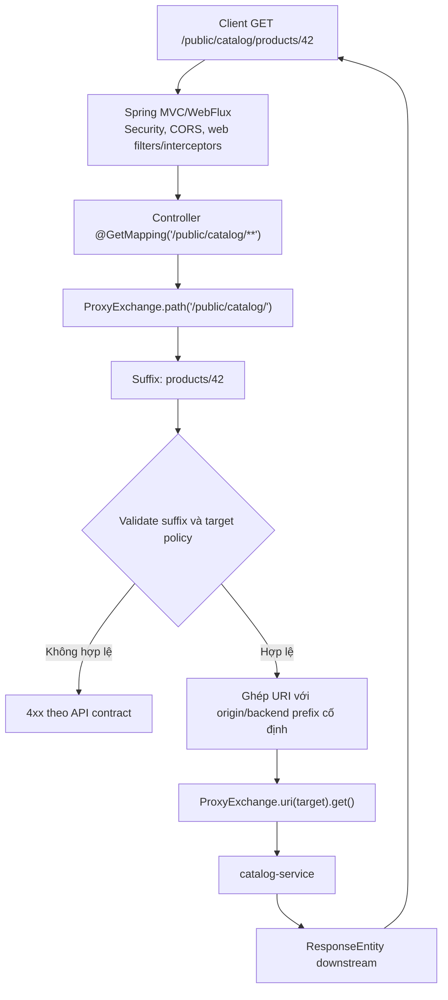
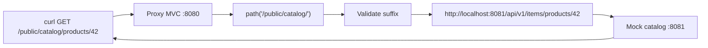
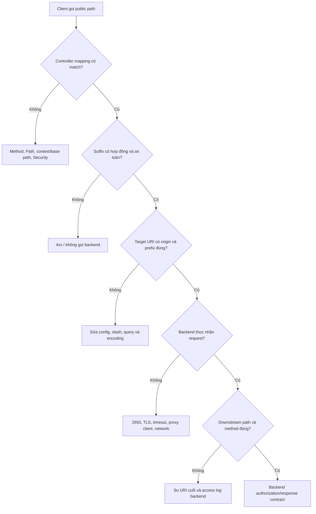

# Tách phần đường dẫn còn lại để tạo URI đích

Khi xây dựng API Gateway cho microservices bằng **Spring Cloud Gateway**, ta thường muốn công bố một URL dễ hiểu cho client nhưng đưa request tới một đường dẫn khác ở backend. Ví dụ, client gọi `GET /public/catalog/products/42`, trong khi `catalog-service` thực sự cung cấp `GET /api/v1/items/products/42`. Cách thực hiện là **giữ một tiền tố public cố định, lấy phần đường dẫn còn lại (*path suffix*), rồi ghép suffix đó với một base URI upstream được kiểm soát**.

Trong chương **Proxy Exchange**, Spring Cloud Gateway cung cấp **`ProxyExchange`** làm tham số cho một **Spring MVC hoặc WebFlux controller handler**. Phương thức tiện ích **`proxy.path(prefix)`** giúp lấy phần đường dẫn nằm phía sau một prefix; handler dùng **`proxy.uri(destination).get()`** hoặc phương thức HTTP tương ứng để thực hiện trao đổi downstream.

Bài học này nằm trong module **SPRING_CLOUD_GATEWAY**: xây dựng API Gateway bằng route predicate, filter chain, biến đổi path/header và service discovery; đồng thời thực hành authentication, rate limiting, circuit breaker, retry, TLS và observability. Điểm quan trọng là **Proxy Exchange là một cách viết gateway trong controller**, **không phải** cùng API với Gateway Server WebFlux filters như `StripPrefix` hay `RewritePath`. Các policy bảo mật và vận hành dùng chung về mục tiêu, nhưng cách wiring và lifecycle khác nhau.

> **Phạm vi:** Ví dụ tập trung vào **Spring Cloud Gateway Proxy Exchange** với hai biến thể **Web MVC** và **WebFlux**. Tên artifact đã được tài liệu Spring Cloud Gateway 4.3/5.0 mô tả là `spring-cloud-gateway-proxyexchange-webmvc` và `spring-cloud-gateway-proxyexchange-webflux`. Các phiên bản cũ có tên module khác. Không áp dụng nguyên cấu hình `spring.cloud.gateway.server.webflux.routes` hoặc `GatewayFilterFactory` cho một ProxyExchange controller.

## 1. Bài toán ánh xạ URL và kết quả mong muốn

Giả sử đường đi public và backend là:

```text
Public route:
  GET /public/catalog/**

Backend cố định:
  http://localhost:8081

Backend base path:
  /api/v1/items/

Request từ client:
  GET /public/catalog/products/42

Lấy suffix sau "/public/catalog/":
  products/42

URI đích mong muốn:
  http://localhost:8081/api/v1/items/products/42
```

Ta có thể mô hình hóa:

```text
publicPath   = publicPrefix + suffix
targetURI    = fixedBackendOrigin + fixedBackendPrefix + suffix

/public/catalog/ + products/42
     ↓ lấy suffix
http://localhost:8081 + /api/v1/items/ + products/42
     ↓
http://localhost:8081/api/v1/items/products/42
```

Trong đó:

- **Public prefix** là phần đường dẫn mà controller muốn ẩn khỏi upstream, ví dụ `/public/catalog/`.
- **Suffix** là phần client cung cấp sau prefix, ví dụ `products/42`.
- **Backend origin** gồm scheme/host/port **cố định từ cấu hình tin cậy**, không được lấy tùy ý từ request.
- **Backend path prefix** là phần đường dẫn nội bộ cần thêm, ví dụ `/api/v1/items/`.
- **Target URI** là kết quả cuối cùng mà ProxyExchange sẽ gọi bằng một HTTP method.

### Bảng ví dụ

| Public request path | Suffix dự kiến | Downstream path dự kiến |
| --- | --- | --- |
| `/public/catalog/products/42` | `products/42` | `/api/v1/items/products/42` |
| `/public/catalog/categories/keyboards` | `categories/keyboards` | `/api/v1/items/categories/keyboards` |
| `/public/catalog/a/b/c` | `a/b/c` | `/api/v1/items/a/b/c` |
| `/public/catalog/item-01` | `item-01` | `/api/v1/items/item-01` |
| `/public/catalog/` | Rỗng hoặc tùy handler mapping/version | Cần chính sách cụ thể: route root, 404 hoặc 400. |

Các hàng là **kết quả mong muốn theo hợp đồng URL**; với dấu slash cuối, encoding hoặc phần rỗng, phải kiểm thử trên đúng stack MVC/WebFlux và path-matching configuration, không coi bảng là đặc tả tất cả trường hợp biên của framework.

## 2. ProxyExchange được dùng ở đâu trong Spring Cloud Gateway?

Spring Cloud Gateway hiện có hai nhóm khả năng cần phân biệt:

| Hướng | Điểm cấu hình | Cách hoạt động |
| --- | --- | --- |
| **Gateway Server WebFlux/Web MVC** | Route definitions, route predicates, filter functions/factories, discovery. | Gateway tự chọn route và chạy chuỗi filters theo cơ chế Gateway Server. |
| **Proxy Exchange Web MVC** | `@RestController`/Spring MVC handler nhận `ProxyExchange<T>`. | Handler quyết định đích và gọi downstream, trả `ResponseEntity<?>`. |
| **Proxy Exchange WebFlux** | `@RestController`/WebFlux handler nhận `ProxyExchange<T>`. | Handler trả `Mono<ResponseEntity<?>>`, thực hiện HTTP exchange theo mô hình reactive. |

Tài liệu **Proxy Exchange Gateway with Spring Web MVC or WebFlux** của Spring có cảnh báo rõ: đây là **một kiểu Gateway thay thế**, các phần tài liệu dành cho Gateway Server không được áp dụng máy móc cho ví dụ này.

### Sơ đồ xử lý



**Điểm cần nhớ:** handler method vừa biết **public URL** vừa tự xây **downstream URI**. Ta không phải thêm `StripPrefix=...` như khi dùng Gateway Server route filter; thay vào đó, chính controller dùng `path(prefix)`.

### Ưu điểm của Proxy Exchange

- Dễ viết một adapter/proxy ngắn trong ứng dụng Spring MVC/WebFlux đang có.
- Tái sử dụng mapping annotations, request parameters, header injection và Spring Security.
- Có thể kết hợp logic hợp đồng API ở handler, chẳng hạn chỉ cho phép một số suffix hợp lệ.
- Chọn target URI từ **cấu hình đáng tin** rồi gọi đúng HTTP verb.

### Giới hạn và trách nhiệm bổ sung

- Không mặc định có toàn bộ route predicates, `GlobalFilter`, `GatewayFilter`, `StripPrefix`, `TokenRelay`, `RedisRateLimiter` hoặc `CircuitBreaker` của Gateway **Server**.
- Cần tự xác định phạm vi URI được proxy, timeout, retries, CORS, request/response headers và quan sát.
- Handler nhận suffix từ client: nếu xây URI thiếu kiểm tra, có thể mở đường đi nội bộ không mong muốn hoặc lỗi path traversal.
- Không mặc định ProxyExchange là reverse proxy tối ưu cho WebSocket, gRPC streaming, uploads/downloads lớn hay tất cả long-lived streams.

## 3. Hàm quan trọng: `proxy.path(prefix)`

Spring Cloud Gateway mô tả một tiện ích để **lấy phần đường dẫn nằm phía sau prefix của URL inbound**. Mẫu tối giản theo tài liệu:

```java
@GetMapping("/proxy/path/**")
public ResponseEntity<?> proxyPath(
        ProxyExchange<byte[]> proxy) throws Exception {

    String path = proxy.path("/proxy/path/");
    return proxy.uri("http://localhost:8081/foos/" + path).get();
}
```

Nếu client gọi:

```http
GET /proxy/path/a/b/c HTTP/1.1
Host: gateway.example
```

thì về ý tưởng:

```text
prefix  = /proxy/path/
suffix  = a/b/c
target  = http://localhost:8081/foos/a/b/c
```

**Đây là trọng tâm bài học:** `path(...)` lấy suffix; `uri(...)` xác định đích; `get()` gửi GET downstream. Không có một phép thay thế mọi path segment bằng chuỗi tùy ý, và không tự thêm query parameters vào đích chỉ vì suffix được lấy.

### Cú pháp phải khớp controller mapping

| Thành phần | Ví dụ | Chức năng |
| --- | --- | --- |
| `@GetMapping` | `"/proxy/path/**"` | Quy định những URL nào vào handler. |
| `proxy.path` | `"/proxy/path/"` | Quy định prefix sẽ được bỏ để lấy suffix. |
| `proxy.uri` | `"http://localhost:8081/foos/" + path` | Chỉ định URI downstream. |
| `proxy.get()` | `get()` | Thực hiện downstream HTTP GET. |

Hãy dùng **cùng một base prefix** theo hợp đồng trong mapping và lời gọi `path(...)`, kể cả dấu slash nếu cần. Nếu một bên là `/proxy/path/`, bên kia là `/proxy/paths/`, suffix có thể không được tính như kỳ vọng. **Không giả định phương thức `path(prefix)` tự xác thực rằng route mapping đang khớp prefix này theo chính sách của bạn.**

## 4. Đối tượng ProxyExchange có những trách nhiệm gì?

Mặc dù bài tập trung vào `path(prefix)`, cần hiểu ProxyExchange không chỉ là chuỗi URL:

| Nhóm API | Ý nghĩa |
| --- | --- |
| `path(String prefix)` | Lấy phần đường dẫn phía sau prefix của request inbound. |
| `uri(String target)` | Đặt destination URI cho downstream HTTP exchange. |
| `get()` / các method HTTP tương ứng | Thực hiện downstream request. |
| `header(...)` / các API headers | Điều chỉnh một phần request/response headers theo capability của phiên bản. |
| Response mapper trên `get(...)` / các HTTP methods | Cho phép chuyển đổi downstream `ResponseEntity` trước khi trả caller. |
| `forward(...)` trong **MVC** | Forward tới handler nội bộ trong cùng ứng dụng khi được hỗ trợ. |

Theo tài liệu Spring, ProxyExchange có sẵn cách xử lý một số nhóm header:

- **Sensitive headers**: mặc định **`cookie` và `authorization` không được chuyển tiếp downstream**.
- **Skipped headers**: mặc định **`content-length` và `host` được loại khỏi chuyển tiếp** để tránh sai header khi request body/transport thay đổi.
- **Proxy headers**: nhóm **`x-forwarded-*`** được xử lý theo cơ chế ProxyExchange/framework.

**Không ghi nhận các mặc định này thành bảo đảm cho mọi request khi code gọi thêm `headers(...)`/`header(...)` hoặc chỉnh config.** Hãy kiểm tra cả HTTP request thực tế mà backend nhận. Không được coi “ProxyExchange giúp proxy” đồng nghĩa nó đã thiết kế xong chính sách credential và trust proxy.

## 5. Dependency và phiên bản: MVC khác WebFlux

Theo tài liệu Spring Cloud Gateway 4.3 và 5.0, Proxy Exchange có **hai artifacts riêng**:

### Spring MVC Proxy Exchange

```xml
<dependency>
    <groupId>org.springframework.cloud</groupId>
    <artifactId>spring-cloud-gateway-proxyexchange-webmvc</artifactId>
</dependency>
```

Thường dùng trong ứng dụng Spring Boot có Web MVC/Servlet stack; handler trả `ResponseEntity<?>`.

### Spring WebFlux Proxy Exchange

```xml
<dependency>
    <groupId>org.springframework.cloud</groupId>
    <artifactId>spring-cloud-gateway-proxyexchange-webflux</artifactId>
</dependency>
```

Thường dùng trong ứng dụng WebFlux; handler trả `Mono<ResponseEntity<?>>`.

### Những sai lầm dependency thường gặp

- **Không** chỉ thêm `spring-cloud-starter-gateway-server-webflux` rồi mặc định controller có ProxyExchange như Server route filter.
- **Không** thêm cả MVC và WebFlux Proxy Exchange modules vào cùng một ứng dụng nếu chưa có lý do và hiểu cách Boot chọn web application type.
- **Không** sao chép artifact names từ tài liệu Gateway 2.x sang 5.x: các dòng cũ từng dùng `spring-cloud-gateway-mvc`/`spring-cloud-gateway-webflux`.
- **Không** pin version của Spring Cloud Gateway độc lập với Spring Boot/Spring Cloud BOM tương thích.
- Với Java imports, dùng loại `ProxyExchange` từ **module đang có trong classpath**: MVC thường là package `org.springframework.cloud.gateway.mvc`, WebFlux là `org.springframework.cloud.gateway.webflux` theo dòng tương ứng.

### Gợi ý cấu hình backend trong application.yml

```yaml
server:
  port: 8080

app:
  proxy:
    catalog-origin: http://localhost:8081
    catalog-path-prefix: /api/v1/items/
```

Đây là **cấu hình ứng dụng tự định nghĩa** (`app.proxy.*`), **không phải** property của Gateway Server route definitions. Trong production, origin nên là hostname/service đã phê duyệt, qua HTTPS và network policy phù hợp. Ví dụ `localhost:8081` chỉ dùng cho lab.

## 6. Ví dụ Spring MVC: lấy suffix và gọi backend

Trong một ứng dụng Spring MVC có dependency `spring-cloud-gateway-proxyexchange-webmvc`, tạo controller:

```java
package com.example.proxy.mvc;

import org.springframework.beans.factory.annotation.Value;
import org.springframework.cloud.gateway.mvc.ProxyExchange;
import org.springframework.http.ResponseEntity;
import org.springframework.web.bind.annotation.GetMapping;
import org.springframework.web.bind.annotation.RestController;

@RestController
public class CatalogProxyController {

    private final String catalogOrigin;

    public CatalogProxyController(
            @Value("${app.proxy.catalog-origin}") String catalogOrigin) {
        this.catalogOrigin = catalogOrigin;
    }

    @GetMapping("/public/catalog/**")
    public ResponseEntity<?> catalog(ProxyExchange<byte[]> proxy)
            throws Exception {

        String remainder = proxy.path("/public/catalog/");
        String target = catalogOrigin
            + "/api/v1/items/"
            + remainder;

        return proxy.uri(target).get();
    }
}
```

Đây là **bản minh họa cơ chế cơ bản theo kiểu tài liệu Spring**, để bạn thấy mối liên hệ giữa mapping, `path()`, `uri()` và `get()`. **Chưa an toàn để public ra Internet**: nó chưa kiểm tra suffix, encoding, quyền truy cập, query hay URI target. Phần tiếp theo sẽ bổ sung policy và trường hợp xấu.

### Dòng dữ liệu đi qua controller

Giả sử:

```yaml
app:
  proxy:
    catalog-origin: http://localhost:8081
```

Request:

```http
GET /public/catalog/products/42 HTTP/1.1
Host: localhost:8080
Accept: application/json
```

Trong controller:

```text
proxy.path("/public/catalog/")
        ↓
"products/42"

target = "http://localhost:8081"
       + "/api/v1/items/"
       + "products/42"
        ↓
"http://localhost:8081/api/v1/items/products/42"
```

Backend cần có endpoint tương ứng, ví dụ `GET /api/v1/items/products/42`. Một response HTTP 200 từ backend **không tự chứng minh** mọi request đã được định tuyến đúng nếu backend có catch-all; tốt nhất mock backend ghi rõ path nhận được.

### Tại sao trả ResponseEntity?

`ProxyExchange.get()` lấy response downstream theo cách mà implementation cung cấp. Handler Spring MVC trả `ResponseEntity<?>`, cho phép trả status, headers và body theo contract HTTP. Nếu cần rewrite response headers/status, hãy dùng mapper/API thích hợp của ProxyExchange đúng version, thay vì copy toàn bộ headers theo cách mất an toàn.

## 7. Ví dụ Spring WebFlux: cùng path, khác kiểu trả về

Trong ứng dụng **Proxy Exchange WebFlux** có dependency `spring-cloud-gateway-proxyexchange-webflux`, ý tưởng giống hệt, nhưng handler trả **`Mono<ResponseEntity<?>>`**:

```java
package com.example.proxy.webflux;

import org.springframework.beans.factory.annotation.Value;
import org.springframework.cloud.gateway.webflux.ProxyExchange;
import org.springframework.http.ResponseEntity;
import org.springframework.web.bind.annotation.GetMapping;
import org.springframework.web.bind.annotation.RestController;
import reactor.core.publisher.Mono;

@RestController
public class ReactiveCatalogProxyController {

    private final String catalogOrigin;

    public ReactiveCatalogProxyController(
            @Value("${app.proxy.catalog-origin}") String catalogOrigin) {
        this.catalogOrigin = catalogOrigin;
    }

    @GetMapping("/public/catalog/**")
    public Mono<ResponseEntity<?>> catalog(ProxyExchange<byte[]> proxy) {

        String remainder = proxy.path("/public/catalog/");
        String target = catalogOrigin
            + "/api/v1/items/"
            + remainder;

        return proxy.uri(target).get();
    }
}
```

**Khác nhau về kiểu trả về, không khác nhau về bài toán URL:** MVC `ResponseEntity<?>` so với WebFlux `Mono<ResponseEntity<?>>`.

### Cảnh báo về blocking

Trong WebFlux, không gọi:

```java
// Anti-pattern: không dùng trong WebFlux controller.
ResponseEntity<?> response = proxy.uri(target).get().block();
```

`block()` trên Reactor Netty event loop có thể gây lỗi hoặc làm nghẽn throughput. Trả nguyên `Mono` cho WebFlux runtime điều phối. Tương tự, không dùng JDBC sync, HTTP sync client hoặc `Thread.sleep` trong luồng reactive chỉ để ghép đường dẫn.

### So sánh MVC và WebFlux trong cùng bài

| Nội dung | MVC ProxyExchange | WebFlux ProxyExchange |
| --- | --- | --- |
| Controller annotation | `@GetMapping`/`@RestController`. | `@GetMapping`/`@RestController`. |
| Phương thức lấy suffix | `proxy.path(prefix)`. | `proxy.path(prefix)`. |
| Tạo đích | `proxy.uri(target)`. | `proxy.uri(target)`. |
| Gửi downstream GET | `proxy.get()`. | `proxy.get()`. |
| Giá trị trả | `ResponseEntity<?>`. | `Mono<ResponseEntity<?>>`. |
| Web runtime | Servlet/Spring MVC. | Reactor/Spring WebFlux. |
| Forward đến local handler | MVC `forward()` theo tài liệu. | Không giả định có cùng API. |
| Nguyên tắc không chặn thread | Timeout/thread pool cho MVC. | **Không blocking event loop** trong WebFlux. |

## 8. Tại sao ghép chuỗi URI phải có điều kiện?

Code ví dụ tối giản:

```java
String target = catalogOrigin + "/api/v1/items/" + remainder;
```

chỉ đúng và an toàn **khi origin/prefix là hằng được tin cậy và suffix nằm trong một bộ quy tắc được phê duyệt**. Nếu nhận mọi suffix, request có thể chứa:

```text
../internal/admin
%2e%2e/secret
%2Fadmin
%252e%252e%252fadmin
//other
item;param=value
item?mode=admin
item#fragment
```

Các chuỗi trên là **test cases cần xử lý/khước từ**, không phải URL được phép. HTTP container, Spring path matcher, reverse proxy, URI builder và backend có thể **decode/normalize URL khác nhau**. Nếu hai tầng bất đồng về đường dẫn, cơ chế chặn tại Gateway có thể không bảo vệ đúng đường dẫn backend cuối cùng.

### Rủi ro không chỉ là SSRF

| Rủi ro | Tình huống |
| --- | --- |
| **Path traversal** | `../` hoặc các biểu diễn encoded khiến backend truy cập path ngoài phạm vi. |
| **Authorization bypass** | Gateway chỉ cho catalog nhưng backend hiểu path là admin sau normalization. |
| **Route shadowing** | Double-slash/matrix variables làm security matcher ở Gateway khác backend. |
| **SSRF** | Handler cho client chọn cả host/scheme hoặc redirect tới internal target không được kiểm soát. |
| **Open redirect** | URI/response `Location` được dựng từ input không tin cậy. |
| **Double encoding** | Ký tự `%2F` bị decode hoặc encode lần nữa thành nghĩa khác. |
| **Query injection** | Ghép `?`/`&` bừa bãi khiến tham số bị ghi đè hoặc mở tính năng nội bộ. |
| **Information disclosure** | Header `Authorization`/`Cookie` hoặc hostname nội bộ bị forward/hiển thị sai. |

**Lưu ý:** `ProxyExchange.path(prefix)` **không phải một bộ kiểm soát an ninh đầu vào**. Nó chủ yếu là convenience method cho path extraction. Chỉ việc tách suffix không xác nhận suffix an toàn để dùng làm URI.

## 9. Một phiên bản controller MVC hạn chế suffix rõ ràng

Để dạy cách hardening, ví dụ sau chỉ chấp nhận **path segments ASCII dạng `[A-Za-z0-9_-]`**, phân tách bằng dấu `/`. Nó **cố ý từ chối** ký tự `%`, dấu chấm, double slash, query/fragment nằm trong suffix, matrix separator, Unicode phức tạp. Đây là một policy **hẹp cho bài lab catalog**, không phải giải pháp chung xử lý mọi URI hợp lệ.

```java
package com.example.proxy.mvc;

import java.util.regex.Pattern;

import jakarta.servlet.http.HttpServletRequest;
import org.springframework.beans.factory.annotation.Value;
import org.springframework.cloud.gateway.mvc.ProxyExchange;
import org.springframework.http.ResponseEntity;
import org.springframework.web.bind.annotation.GetMapping;
import org.springframework.web.bind.annotation.RestController;

@RestController
public class StrictCatalogProxyController {

    private static final String PUBLIC_PREFIX = "/public/catalog/";
    private static final String DOWNSTREAM_PREFIX = "/api/v1/items/";

    private static final Pattern SAFE_SUFFIX = Pattern.compile(
        "[A-Za-z0-9_-]+(?:/[A-Za-z0-9_-]+)*");

    private final String fixedOrigin;

    public StrictCatalogProxyController(
            @Value("${app.proxy.catalog-origin}") String fixedOrigin) {
        // Production: kiểm tra allowlist URI/scheme/host/port khi start app.
        this.fixedOrigin = fixedOrigin;
    }

    @GetMapping("/public/catalog/**")
    public ResponseEntity<?> getCatalog(
            ProxyExchange<byte[]> proxy,
            HttpServletRequest request) throws Exception {

        String suffix = proxy.path(PUBLIC_PREFIX);
        String rawPath = request.getRequestURI();

        if (suffix == null
                || !SAFE_SUFFIX.matcher(suffix).matches()
                || rawPath.indexOf('%') >= 0) {
            return ResponseEntity.badRequest()
                .body("Unsupported catalog path");
        }

        String target = fixedOrigin + DOWNSTREAM_PREFIX + suffix;
        return proxy.uri(target).get();
    }
}
```

### Chính sách và giới hạn của mã ví dụ

1. `SAFE_SUFFIX` bảo vệ logic ghép chuỗi **trong phạm vi ASCII được định nghĩa**: không nhận `..`, `?`, `#`, `;`, `%` hoặc khoảng trắng.
2. Kiểm tra `rawPath` nhằm tránh một phần đường dẫn bị percent-encode và biến đổi nghĩa ở các tầng. Nhưng tên API và thời điểm normalization còn phụ thuộc servlet container/proxy; **cần test raw path từ ingress đến backend**.
3. `fixedOrigin` **không đến từ query/header/path của request**; phải được load từ cấu hình tin cậy và được validate khi start app.
4. Ví dụ **không tự kiểm tra quyền của user**, không bảo đảm upstream endpoint chỉ có catalog data. Spring Security/backend authorization vẫn cần thiết.
5. Với tên sản phẩm Unicode, slug chứa dấu chấm, encoded path segments hoặc cấu trúc URI giàu hơn, cần **một parser/allowlist được thiết kế và thử nghiệm riêng**. Không nới regex bằng `.*` rồi coi việc kiểm tra còn hiệu quả.
6. Nếu route cần query string, thêm query một cách có kiểm soát thay vì cho `?` lọt qua suffix.

### Bản WebFlux với kiểm tra tương đương

```java
import java.util.regex.Pattern;
import org.springframework.cloud.gateway.webflux.ProxyExchange;
import org.springframework.http.ResponseEntity;
import org.springframework.http.server.reactive.ServerHttpRequest;
import org.springframework.web.bind.annotation.GetMapping;
import org.springframework.web.bind.annotation.RestController;
import reactor.core.publisher.Mono;

@RestController
public class StrictCatalogWebFluxController {

    private static final Pattern SAFE = Pattern.compile(
        "[A-Za-z0-9_-]+(?:/[A-Za-z0-9_-]+)*");

    @GetMapping("/public/catalog/**")
    public Mono<ResponseEntity<?>> catalog(
            ProxyExchange<byte[]> proxy,
            ServerHttpRequest request) {

        String suffix = proxy.path("/public/catalog/");
        String rawPath = request.getURI().getRawPath();

        if (suffix == null
                || !SAFE.matcher(suffix).matches()
                || rawPath.indexOf('%') >= 0) {
            return Mono.just(ResponseEntity.badRequest()
                .body("Unsupported catalog path"));
        }

        String target =
            "http://localhost:8081/api/v1/items/" + suffix;

        return proxy.uri(target).get();
    }
}
```

Đoạn WebFlux dùng **fixed origin của lab**. Production nên inject cấu hình đã validate như bản MVC. Trong môi trường 100% reactive, tránh mọi thao tác blocking trong path validation hoặc URI construction.

## 10. Chuẩn hóa dấu slash và ranh giới path segments

Một bug phổ biến là lệch dấu `/` khi kết nối các phần:

```text
Origin:  http://localhost:8081
Prefix:  /api/v1/items/
Suffix:  products/42
Target:  http://localhost:8081/api/v1/items/products/42
```

Nếu origin hoặc prefix không thống nhất:

```text
// Thiếu dấu slash
http://localhost:8081/api/v1/itemsproducts/42

// Hai dấu slash liên tiếp
http://localhost:8081/api/v1/items//products/42
```

### Quy ước đề xuất

- `catalog-origin` là **origin thuần**: scheme + host + optional port; không có trailing slash, query, fragment hoặc userinfo.
- `backend-path-prefix` bắt đầu và kết thúc bằng **một dấu `/`**.
- `suffix` là chuỗi non-empty **không có leading slash**, chỉ chứa segments hợp lệ.
- Tạo target **từ các thành phần đã validate**, không từ URI đầy đủ do client gửi.
- Viết test cho empty suffix, trailing slash, double slash, path có dấu cách và encoded slash.

### Vì sao không dùng `String.replace("/public/catalog", "")`?

Ví dụ sai:

```java
String suffix = incomingPath.replace("/public/catalog", "");
```

`replace` có thể thay nhiều lần ở vị trí không mong muốn hoặc xử lý prefix không đúng ranh giới segment. Hãy dùng **`proxy.path("/public/catalog/")`** như tiện ích được tài liệu hỗ trợ, kết hợp một mapping tương ứng; nếu thiết kế nâng cao cần `PathPattern` hoặc parsed segments, hãy dùng parser của Spring/framework version được kiểm thử.

## 11. Query string không phải path suffix

Hai request có cùng path nhưng query khác nhau:

```http
GET /public/catalog/products/42?lang=vi&page=2 HTTP/1.1
```

```http
GET /public/catalog/products/42?lang=en&page=5 HTTP/1.1
```

Phần đường dẫn phía sau prefix trong cả hai request vẫn là **`products/42`** theo hợp đồng đường dẫn. Query nằm sau `?`, là một thành phần khác của URI.

### Tách ba vùng

```text
https://api.example/public/catalog/products/42?lang=vi&page=2
│      │          └─────────────── path ─────────────┘└── query ──┘
│      └ host / authority
└ scheme

publicPrefix = /public/catalog/
pathSuffix   = products/42
query        = lang=vi&page=2
```

**Không dùng `proxy.path(...)` để lấy query params**. Spring MVC/WebFlux có `@RequestParam` hoặc request query map; hãy xác định **query nào được phép chuyển xuống backend**, thay vì tự nối raw query string do client gửi.

### Ví dụ chỉ cho lang và page

Trong controller MVC **thử nghiệm**, sau khi đã kiểm tra `suffix` như mục 9, ta có thể xây target từ một danh sách query được phép:

```java
import java.util.Set;
import org.springframework.http.ResponseEntity;
import org.springframework.util.MultiValueMap;
import org.springframework.web.bind.annotation.GetMapping;
import org.springframework.web.bind.annotation.RequestParam;
import org.springframework.web.util.UriComponentsBuilder;

// Đoạn này minh họa phần method trong MVC controller đã có
// origin, proxy và validateSuffix(...).
@GetMapping("/public/catalog/**")
public ResponseEntity<?> getCatalogWithQuery(
        ProxyExchange<byte[]> proxy,
        @RequestParam MultiValueMap<String, String> params)
        throws Exception {

    String suffix = proxy.path("/public/catalog/");
    validateSuffix(suffix); // helper phải kiểm tra path/encoding như mục 9

    if (!Set.of("lang", "page").containsAll(params.keySet())) {
        return ResponseEntity.badRequest().body("Unknown query parameter");
    }

    String lang = params.getFirst("lang");
    String page = params.getFirst("page");

    if (params.values().stream().anyMatch(v -> v.size() != 1)) {
        return ResponseEntity.badRequest().body("Repeated query parameter");
    }
    if (lang != null && !Set.of("vi", "en").contains(lang)) {
        return ResponseEntity.badRequest().body("Invalid language");
    }
    if (page != null && !page.matches("[1-9][0-9]{0,2}")) {
        return ResponseEntity.badRequest().body("Invalid page");
    }

    UriComponentsBuilder builder = UriComponentsBuilder
        .fromUriString("http://localhost:8081/api/v1/items/" + suffix);
    if (lang != null) builder.queryParam("lang", lang);
    if (page != null) builder.queryParam("page", page);

    return proxy.uri(builder.build().encode().toUriString()).get();
}
```

Đoạn code này **chỉ minh họa policy và xây query**, không phải một controller copy-paste hoàn chỉnh: `validateSuffix` cần được hiện thực, đồng thời phải kiểm tra raw URI path giống mục 9. **Không đăng ký method này cùng controller `@GetMapping("/public/catalog/**")` của mục 6 hoặc 9**, vì trùng mapping; chọn một phương án.

**Cần kiểm chứng hành vi `ProxyExchange.uri/get` đối với query của request inbound trên phiên bản thực tế.** Nếu implementation có bước tự xử lý/giữ query, thiết kế phải tránh duplicate query hoặc bypass whitelist bằng cách kiểm thử backend nhận query cuối. Khi cần đảm bảo chặt, đặt logic kiểm soát query ở tầng đã kiểm thử request serialization thực, không chỉ tin vào giá trị chuỗi target trước lời gọi.

### Vì sao không nối raw query?

```java
// Không dùng khi client query chưa được kiểm chứng.
String target = fixedBase + suffix + "?" + request.getQueryString();
```

Lỗi thường gặp:

- Query chưa có nhưng vẫn thêm `?`.
- Duplicated keys `page=1&page=999` và hai hệ thống lấy giá trị khác nhau.
- `%26`/`%3D` bị decode không đồng nhất.
- Các query đặc biệt như `redirect_url`, `debug`, `admin` được chuyển nguyên vào backend ngoài contract.
- Thông tin nhạy cảm ở query bị log hoặc rò theo `Referer`.

Với API có hàng trăm query keys hợp lệ, thiết kế schema/validation riêng thay vì cho phép mọi input mặc định.

## 12. Percent encoding, Unicode và path traversal

URI không chỉ là chuỗi hiển thị. Các dạng:

```text
/public/catalog/products/%34%32
/public/catalog/products/42
/public/catalog/%2e%2e/internal
/public/catalog/a%2Fb
/public/catalog/a%252Fb
```

có thể trải qua các bước **decode, normalize và re-encode** khác nhau ở ingress, servlet container, Spring path matcher, ProxyExchange và downstream HTTP client.

### Nguyên tắc an toàn

1. **Định nghĩa hợp đồng suffix**: ví dụ chỉ nhận ASCII slugs như bài lab, hoặc cho phép Unicode theo một parser cụ thể.
2. **Kiểm tra raw path** và đường dẫn mà framework đã parse nếu sự khác biệt có thể ảnh hưởng quyền.
3. **Từ chối traversal và encoded separators nguy hiểm**, bao gồm double encoding nếu chính sách không hỗ trợ.
4. **Không decode nhiều lần** rồi ghép lại bằng tay.
5. **Không tự encode toàn chuỗi URI** như một path segment: scheme, slash, dấu `?` và `#` có semantics riêng.
6. Nếu dùng `UriComponentsBuilder`, phân biệt `path` với `pathSegment`, `build`, `encode` và `build(true)`; kiểm thử output với input raw.
7. Kiểm tra server downstream cuối cùng nhận **path đã normalize** như thế nào, không chỉ quan sát Gateway log.

### Test case bắt buộc

| Input | Mục tiêu kiểm tra |
| --- | --- |
| `products/42` | Có route và target bình thường. |
| `products/item-01` | Gạch nối/underscore hợp lệ nếu contract cho phép. |
| `../admin` | Bị từ chối; không đi đến backend admin. |
| `%2e%2e/` | Không được lọt qua bằng cách decode chậm. |
| `%252e%252e%252f` | Không bị double decode thành traversal. |
| `a%2Fb` | Không bị hiểu khác nhau giữa một segment chứa slash encoded và hai segments. |
| `a//b` | Xử lý double slash theo policy; không normalize thành route khác ngoài ý muốn. |
| `a;b=1` | Không cho matrix parameters ngoài hợp đồng. |
| `a?debug=true` | Query không bị tính vào suffix path. |
| `a#frag` | Fragment không có ý nghĩa HTTP request target như query; không được nối sai vào URI đích. |
| `%00` | Không chấp nhận control characters/encoding nguy hiểm. |

**Không dựa vào `String.startsWith("/api/v1/items/")` trên một đường dẫn chưa normalize để “chứng minh” nó không thể thoát prefix.** Sau nhiều bước decode/normalize, đường dẫn thực backend xử lý có thể khác. Kết hợp validation đầu vào, URI construction chuẩn, network/route policy và backend authorization.

## 13. Context path, WebFlux base path và proxy đứng trước Gateway

Ứng dụng có thể được host ở một context/base path:

```text
External URL:
  https://edge.example/gateway/public/catalog/products/42

Application context/base path:
  /gateway

Controller mapping:
  /public/catalog/**
```

Tùy runtime, Spring MVC `server.servlet.context-path`, WebFlux `spring.webflux.base-path` hoặc reverse proxy rewrite có thể thay đổi **path mà controller và `ProxyExchange.path` thực sự nhìn thấy**. Không nên lấy literal external URL rồi trừ prefix bằng substring khi chưa kiểm tra.

### Các điểm cần thống nhất

| Lớp | Ví dụ | Kiểm tra |
| --- | --- | --- |
| CDN/Ingress public prefix | `/gateway/public/catalog/**` | Nó giữ hay strip `/gateway` trước khi gửi vào app? |
| Servlet context path | `/gateway` | Spring MVC request URI/contextPath khác servletPath ở đâu? |
| WebFlux base path | `/gateway` | Handler mapping và path extraction có cùng cách nhìn? |
| Controller mapping | `/public/catalog/**` | Mapping có thật match request không? |
| `proxy.path(prefix)` | `/public/catalog/` | Prefix đưa vào có đúng phần path mà ProxyExchange dùng không? |
| Downstream base path | `/api/v1/items/` | Chỉ được thêm một lần vào URI cuối. |

### Forwarded headers phải có trust boundary

Ingress có thể thêm:

```text
X-Forwarded-For
X-Forwarded-Proto
X-Forwarded-Host
X-Forwarded-Prefix
Forwarded
```

Đừng để client Internet tự đặt `X-Forwarded-Prefix` rồi dùng nó để ghép target URI. Spring Boot/Framework có cơ chế xử lý forwarded headers, nhưng chỉ nên tin những giá trị được gateway/ingress đáng tin **xóa và ghi lại**.

Một client gửi `Host: attacker.example` không được phép quyết định backend origin. Nếu cần multi-tenant routing theo host, phải có **host allowlist và tenant authorization** riêng, không chỉ đọc raw `Host`.

## 14. Các HTTP methods và request body

ProxyExchange hỗ trợ những phương thức tương ứng HTTP verbs theo tài liệu. Tuy vậy, bài toán **tách path suffix** độc lập với method; đường dẫn backend có thể giống nhau nhưng contract khác nhau:

```text
GET    /public/catalog/products/42
POST   /public/catalog/products
PUT    /public/catalog/products/42
PATCH  /public/catalog/products/42
DELETE /public/catalog/products/42
```

### Vì sao bắt đầu bằng GET?

- GET không cần body request, dễ kiểm tra path mapping.
- Có thể dùng mock backend để ghi nhận target path.
- Retry/caching và idempotency có contract rõ hơn writes.
- Tránh áp thử `post()` vào một route có JSON/body handling, validation và side effects chưa được thiết kế.

### Khi thêm POST/PUT/PATCH

Nếu API thực sự cần proxy request body, hãy xác minh:

- ProxyExchange biến thể được chọn đọc/forward body thế nào (byte[]/generic type).
- `Content-Type` có đúng không; `Content-Length` có được bỏ/tính lại đúng không.
- JSON parser/codec có thay đổi encoding hoặc schema không.
- Multipart/file upload/stream có được hỗ trợ theo size/memory constraints thực tế không.
- Method được chọn ở handler đúng với downstream method; **không phải mọi inbound request đều gọi `proxy.get()`**.
- Backend validation, CSRF/session policy và authorization đúng với write operations.

Với POST tạo đơn hàng hoặc thanh toán, retry thiếu **idempotency key** có thể tạo kết quả nghiệp vụ trùng lặp. Path suffix đúng không giúp bảo vệ phương thức ghi khỏi duplicate side effects.

### Không xem ProxyExchange là streaming reverse proxy mặc định

Handler `ProxyExchange<byte[]>` có thể có đặc tính buffer body/response theo implementation. Nếu đang proxy tệp lớn, SSE, WebSocket hoặc gRPC, hãy dùng giải pháp đã kiểm chứng cho giao thức/streaming thay vì giả định một handler nhận `byte[]` luôn bảo toàn backpressure.

## 15. Headers: phần đường dẫn đúng nhưng credential có thể sai

Một HTTP request vào ProxyExchange có thể mang:

```http
GET /public/catalog/products/42 HTTP/1.1
Host: api.example.com
Authorization: Bearer [redacted]
Cookie: session=[redacted]
X-Request-ID: trace-123
Accept: application/json
```

Theo tài liệu Proxy Exchange, mặc định **`cookie`/`authorization` thuộc nhóm sensitive headers** không được forward downstream; `content-length`/`host` thuộc nhóm skipped headers để tránh các header không phù hợp khi client downstream tạo request mới.

### Vì sao những mặc định này có ý nghĩa?

| Header | Nguy cơ khi forward tùy ý | Hướng xử lý |
| --- | --- | --- |
| **`Authorization`** | Access token dành cho gateway hoặc service A bị gửi sang service B. | Chỉ relay khi chính sách ủy quyền và audience phù hợp; backend vẫn validate token. |
| **`Cookie`** | Session của gateway/browser bị rò sang backend không cùng trust boundary. | Không forward mặc định; thiết kế BFF/session riêng nếu cần. |
| **`Host`** | Virtual hosting hoặc TLS/SNI/backend routing hiểu sai hostname. | Để HTTP client tạo host phù hợp target URI, trừ khi contract đặc biệt. |
| **`Content-Length`** | Body đã bị đọc/transform, length không còn đúng. | HTTP client tính lại/chọn transfer encoding phù hợp. |
| **`X-Forwarded-*`** | Client có thể giả mạo địa chỉ IP/proto/host nếu không kiểm soát proxy chain. | Chỉ tin giá trị được ingress đáng tin xác nhận và ghi lại. |
| **`X-Request-ID` / tracing** | Có thể bị abuse tạo log injection hoặc cardinality cao. | Kiểm tra định dạng/độ dài, sinh ID nếu không tin cậy. |
| **`Connection`/`Transfer-Encoding`** | Hop-by-hop semantics khác khi proxy tạo HTTP connection mới. | Không copy thủ công tất cả hop-by-hop headers. |

**Lưu ý:** Tên method `header(...)` của ProxyExchange theo tài liệu có thể thêm **response header**. Đừng dựa trên trí nhớ từ WebClient hoặc Gateway Server `AddRequestHeader` để giả định một lời gọi `proxy.header(...)` luôn sửa outbound request header. Kiểm tra Javadoc/chữ ký phương thức của đúng version.

### Chính sách forward identity

Nếu backend phải biết user:

1. Spring Security xác minh inbound token/cookie ở gateway.
2. Kiểm tra quyền truy cập endpoint và tài nguyên theo user/tenant.
3. Quyết định **identity contract** của backend: OAuth2 TokenRelay thích hợp, service-to-service token, mTLS service identity hoặc signed internal claims.
4. Chỉ gửi credential/metadata được cấp quyền cho đúng backend và scope.
5. Backend vẫn kiểm tra chữ ký/issuer/audience/scope/authorization của mình.

**Không** tự cho phép chuyển mọi inbound `Authorization` bằng cách tắt “sensitive header” bảo vệ mặc định chỉ để request không còn 401. Sự khác nhau giữa một *client token*, *delegated token* và *service credential* là quan trọng.

### Response headers và Location

Downstream có thể trả:

```http
HTTP/1.1 301 Moved Permanently
Location: http://catalog.internal.example/login
```

Nếu trả nguyên `Location` về client, bạn có thể làm lộ hostname nội bộ hoặc redirect đến một vị trí không nên public. Một response mapper của ProxyExchange có thể giúp rewrite header có kiểm soát, nhưng phải giữ status/body/caching semantics và **chỉ rewrite những location thuộc allowlist**.

Tương tự, `Set-Cookie`, `Cache-Control`, `Content-Encoding`, `ETag` và CORS headers cần policy rõ; không sao chép hoặc xóa bừa bãi khi proxy response.

## 16. Bảo mật URI đích: cố định origin là điều kiện cần

Điểm rủi ro nhất khi “tách path còn lại để tạo URI” là **trộn dữ liệu do client kiểm soát với thành phần quyết định upstream host/scheme**.

### Anti-pattern nghiêm trọng: target do client chọn

```java
// Chỉ dùng để nhận diện cách làm nguy hiểm, không triển khai.
String host = request.getParameter("host");
String suffix = proxy.path("/public/catalog/");
return proxy.uri("http://" + host + "/" + suffix).get();
```

Với thiết kế này, một caller có thể tìm cách biến Gateway thành **HTTP request proxy đến nhiều máy chủ**, kể cả dịch vụ nội bộ mà client không truy cập trực tiếp được. Đó là một mặt tấn công SSRF và có thể dẫn đến rò headers/credentials.

**Cách đúng hướng:** downstream origin đến từ **configuration allowlist** hoặc service registry được kiểm soát; caller chỉ được tác động đến phần suffix đã validate và **không có quyền đổi origin**.

### Ba lớp bảo vệ

| Lớp | Ví dụ chính sách | Mục tiêu |
| --- | --- | --- |
| **Controller validation** | Suffix thuộc pattern/segment allowlist, không có traversal/encoding ngoài contract. | Không cho request thoát backend prefix về mặt semantics. |
| **Destination allowlist** | Scheme HTTPS, hostname/port/service ID đã phê duyệt. | Không cho proxy đến đích không đáng tin. |
| **Network policy & backend auth** | Egress chặn metadata/internal admin, TLS trust/mTLS, backend authorize. | Chống SSRF khi DNS/redirect/proxy normalization thay đổi. |

### Cẩn thận với redirects và DNS

Ngay cả khi URI đầu tiên thuộc allowlist, upstream có thể trả `3xx Location` trỏ sang host khác. Tùy HTTP client/phiên bản, redirects có thể được xử lý theo nhiều cách. **Không mặc định ProxyExchange tự follow mọi redirect hay không follow**; phải xác minh actual client behavior và dùng policy chặn redirect cross-origin nếu backend có thể không tin cậy.

DNS cũng có thể resolve hostname đã allowlist sang địa chỉ mà Gateway không nên truy cập. Đừng xem so sánh chuỗi hostname là lớp bảo vệ duy nhất; kết hợp DNS trust, address ranges, egress firewall và backend identity.

### Authorization theo tài nguyên

Giả sử suffix là `orders/123` và backend thực sự có endpoint `/api/v1/items/orders/123`. Pattern chỉ cho phép chữ/số/dấu slash **không có nghĩa user được xem order 123**. Nếu proxy ứng dụng có API private, cần:

- Authentication ở controller/Security.
- Quyền truy cập resource/tenant theo định danh đã xác thực.
- Không lộ các endpoint nội bộ chỉ vì suffix chứa tên hợp lệ.
- Backend authorization độc lập và kiểm thử cross-account.

**Regex path chỉ xác minh hình dạng chuỗi; không thay thế phân quyền.**

## 17. TLS, discovery và phân biệt ProxyExchange với Gateway Server

### TLS outbound

Trong production, một target kiểu:

```text
https://catalog.service.internal/api/v1/items/products/42
```

cần HTTP client của ProxyExchange tin cậy đúng CA và xác minh hostname. Nếu dùng mTLS, chọn client certificate/identity phù hợp; đừng hardcode trust-all để “cho proxy chạy được”. Timeout TLS handshake/connection phải nằm trong ngân sách request.

### Service discovery

Trong Gateway Server route definitions, ta thường gặp:

```yaml
uri: lb://catalog-service
```

Trong **ProxyExchange controller**, lời gọi `proxy.uri(...)` hướng đến một URI do handler lựa chọn. **Không mặc định** việc truyền `lb://catalog-service` cho `proxy.uri` sẽ chạy qua cùng `ReactiveLoadBalancerClientFilter` của Gateway Server. Nếu muốn chọn service instance động:

- Dùng client load balancing/service discovery integration tương thích MVC hoặc WebFlux.
- Chọn backend service ID từ allowlist, không từ raw URL client.
- Tạo target `http(s)://host:port/path` theo cách được hỗ trợ bởi client stack.
- Test TLS scheme/SNI, metadata, resilience và health của instances.

### Những filters không tự hoạt động trên controller

| Chức năng | Gateway Server thường dùng | Với ProxyExchange controller |
| --- | --- | --- |
| Route selection | `RoutePredicateFactory`, `RouteLocator`. | Spring MVC/WebFlux `@GetMapping` và handler logic. |
| Path rewriting | `StripPrefix`, `RewritePath`, `SetPath`. | `proxy.path(prefix)` + xây target URI trong controller. |
| Header changes | `AddRequestHeader`, `TokenRelay`, các filters. | Web/Security filters và logic headers có kiểm soát, tùy API. |
| Rate limit | `RequestRateLimiter` + `KeyResolver`. | Chọn rate limiter ở Security/interceptor/WebFilter/gateway edge hoặc tích hợp khác. |
| Circuit breaker | `CircuitBreaker` GatewayFilter. | Bao downstream call bằng resilience library phù hợp hoặc đặt policy ở edge. |
| Retry | `Retry` GatewayFilter. | HTTP client/resilience policy riêng, có idempotency budget. |
| Caching | `LocalResponseCache` GatewayFilter. | Spring Cache/CDN/HTTP cache có policy và key riêng. |
| Metrics | Gateway Server route metrics. | Spring MVC/WebFlux/Micrometer + custom downstream span/route label. |

Nói cách khác: **dùng cùng ecosystem Spring không đồng nghĩa cùng filter chain được chạy tự động**. Khi chuyển một route từ Gateway Server sang ProxyExchange controller, cần kiểm tra lại **mọi** cross-cutting concern đang bảo vệ route đó.

## 18. Timeout, retry, circuit breaker và rate limiting

Một controller có thể ghép target URI đúng nhưng vẫn thất bại khi backend chậm hoặc quá tải.

### Timeout

Định nghĩa ngân sách thời gian:

```text
Tổng thời gian request = xử lý inbound + proxy logic
                     + connect/TLS + backend execution
                     + response transfer
```

Phải cấu hình thời gian chờ ở **HTTP client/ProxyExchange implementation**, không chỉ `server.connection-timeout` của inbound server. Với WebFlux, timeout và cancellation cần tích hợp non-blocking. Với MVC, quản lý số thread đồng thời và connection pool.

### Retry

Không retry mù `POST /payments` hay `POST /orders`. Retry có thể làm backend xử lý nghiệp vụ nhiều lần dù caller chỉ gửi một request. Nếu áp dụng retry:

- Chỉ với operation đã xác định idempotent.
- Có maximum attempts và backoff/jitter.
- Dựa trên lỗi phù hợp và ngân sách thời gian còn lại.
- Không lặp lại request body lớn nếu HTTP client không hỗ trợ safely replay.
- Có test backend attempts và idempotency key.

### Circuit breaker

Đặt circuit breaker quanh call downstream khi backend thường xuyên thất bại. Nhưng không cấu hình fallback trả dữ liệu khác tenant hoặc làm mất status/headers security. Với proxy dữ liệu nhạy cảm, **fail closed có thông điệp rõ** thường an toàn hơn một fallback trả dữ liệu không xác minh.

### Rate limiting

Nếu endpoint public catalog cần quota:

- Áp policy theo user/API key đã xác thực hoặc IP đã qua trusted proxy logic.
- Rate limiter có thể nằm ở edge, WebFilter/Servlet filter, interceptor hoặc adapter chuyên dụng.
- Trong môi trường nhiều instances, limiter local trên mỗi pod có thể nhân hạn mức; cần shared state nếu yêu cầu quota toàn cụm.
- Cache hit và proxy miss có thể có đơn vị quota khác nhau; cần hợp đồng cụ thể.
- Kiểm tra phản hồi HTTP `429` có CORS và `Retry-After` phù hợp.

**Không giả định** `RedisRateLimiter` của Gateway Server tự áp dụng cho `@GetMapping` ProxyExchange chỉ vì cả hai cùng nằm trong một ứng dụng Spring Boot.

## 19. Observability: xác minh suffix nào đã đi đến backend nào

Để debug “client gọi `/public/catalog/products/42` nhưng backend nhận `/api/v1/items/foo`”, cần quan sát **hai góc nhìn**:

1. Handler Gateway nhận path và mapping nào?
2. HTTP client downstream thực sự gửi URI/path gì?

### Một trace/structured log có thể có

```text
traceId:          [opaque identifier]
proxyHandler:     public-catalog
inboundTemplate:  /public/catalog/**
suffixPolicy:     catalog-safe-segments-v1
backendService:   catalog-service
backendPath:      /api/v1/items/{resource}/{id}
method:           GET
downstreamStatus:  200
durationMs:       [measured]
```

Đây là **mẫu log do ứng dụng tự instrument**, không phải output mặc định của ProxyExchange. Tránh log raw URI/query nếu có token, email hoặc định danh người dùng.

### Metrics thiết yếu

| Chỉ số | Mục đích |
| --- | --- |
| HTTP status `2xx/4xx/5xx` theo handler template | Phát hiện lỗi routing/validation. |
| Downstream latency p50/p95/p99 | Biết backend hoặc proxy logic bị chậm. |
| Validation rejection count | Theo dõi suffix có format sai/traversal attempts. |
| Upstream timeout/connection/TLS errors | Phân biệt lỗi mạng với lỗi path. |
| Request body/response bytes | Nhận biết payload lớn, memory pressure. |
| Retry attempts và circuit breaker status | Tránh traffic amplification. |
| Auth failures và rate limiting responses | Không nhầm `401/403/429` với `404` path. |
| Gateway replica/release revision | Nhận diện config drift hoặc lỗi chỉ xảy ra ở một pod. |

### Cardinality và bảo mật

Không dùng raw suffix như `products/42`, customer ID, raw query, bearer token, email hay session cookie làm **metric labels**. Thay bằng route template/handler name và nhóm tài nguyên. Có thể ghi suffix đã **redact/hash phù hợp** vào log truy vết có giới hạn truy cập khi thật sự cần điều tra sự cố, nhưng không làm mặc định cho mọi request.

## 20. Bài thực hành A: dựng proxy MVC và mock catalog backend

### 20.1. Mục tiêu

Xác minh từng bước:

1. Spring MVC mapping nhận đúng request `/public/catalog/**`.
2. `ProxyExchange.path("/public/catalog/")` lấy phần sau prefix.
3. URI downstream được ghép với một origin/path prefix cố định.
4. Mock backend nhìn thấy **`/api/v1/items/products/42`**.
5. Request chứa suffix không hợp lệ bị chặn **trước khi gọi backend**.

### 20.2. Topology lab

| Thành phần | Port | Vai trò |
| --- | --- | --- |
| Ứng dụng Spring MVC Proxy Exchange | `8080` | Controller `StrictCatalogProxyController`. |
| Mock catalog-service MVC | `8081` | Trả JSON echo path đã nhận. |
| `curl` | Terminal | Gửi GET và path test cases. |



### 20.3. Cấu hình Proxy Exchange app

Trong ví dụ ứng dụng Gateway Proxy MVC:

```yaml
server:
  port: 8080

app:
  proxy:
    catalog-origin: http://localhost:8081
```

Thêm dependency đúng `spring-cloud-gateway-proxyexchange-webmvc` và Spring Boot MVC stack tương thích, sau đó dùng controller `StrictCatalogProxyController` ở mục 9. **Chỉ tạo một controller có cùng mapping `/public/catalog/**`**, không để ba ví dụ mục 6/9/11 cùng tồn tại trong cùng app.

### 20.4. Mock backend

Một mock controller tối giản trên process khác:

```java
package com.example.catalog;

import java.util.Map;
import jakarta.servlet.http.HttpServletRequest;
import org.springframework.web.bind.annotation.GetMapping;
import org.springframework.web.bind.annotation.RestController;

@RestController
public class CatalogMockController {

    @GetMapping("/api/v1/items/**")
    public Map<String, Object> catalog(HttpServletRequest request) {
        return Map.of(
            "service", "catalog-mock",
            "method", request.getMethod(),
            "upstreamPath", request.getRequestURI());
    }
}
```

Ví dụ backend có `server.port: 8081`, chạy riêng với Spring Boot MVC runtime. Controller trả JSON mô phỏng, không cần database. **Không dùng mock backend này trong production**, đặc biệt nếu nó echo headers/query có secrets.

### 20.5. Gọi request bình thường

```bash
curl -i \
  "http://localhost:8080/public/catalog/products/42"
```

Response mock mong muốn:

```json
{
  "service": "catalog-mock",
  "method": "GET",
  "upstreamPath": "/api/v1/items/products/42"
}
```

Body mẫu là kết quả do mock định nghĩa, **không phải output mặc định của ProxyExchange**. Tùy JSON serializer của Spring Boot, thứ tự các fields trong JSON có thể khác nhau.

### 20.6. Thử nested path

```bash
curl -i \
  "http://localhost:8080/public/catalog/categories/keyboards"
```

Backend mong đợi `upstreamPath=/api/v1/items/categories/keyboards`. Điều này chứng minh **suffix có thể gồm nhiều path segments**, không chỉ segment cuối cùng.

### 20.7. Thử các suffix không hợp lệ

Lệnh thứ nhất dùng raw path có dấu chấm:

```bash
curl --path-as-is -i \
  "http://localhost:8080/public/catalog/../internal"
```

Lệnh thứ hai dùng percent encoding:

```bash
curl --path-as-is -i \
  "http://localhost:8080/public/catalog/%2e%2e/internal"
```

**Kỳ vọng an toàn:** những đường dẫn này **không được proxy đến endpoint admin/nội bộ**. Tùy Spring/container, có thể nhận 400 hoặc 404 trước khi vào controller, hoặc nhận 400 theo regex validation trong controller. Không ghi cứng “luôn 400”: request normalization và mapping có thể chặn sớm.

Ghi mock backend request count để chứng minh request xấu **không đi downstream**. Đừng chỉ nhìn HTTP status do Gateway trả.

### 20.8. Test empty suffix

```bash
curl -i \
  "http://localhost:8080/public/catalog/"
```

Nếu handler match và `suffix` rỗng, policy `SAFE_SUFFIX` trong ví dụ từ chối với 400. Nếu handler không match, bạn có thể nhận 404 hoặc handler khác. Quyết định endpoint root `/public/catalog/` có được hỗ trợ hay không phải là **API contract**, không nên phụ thuộc tình cờ vào path matcher version.

## 21. Bài thực hành B: WebFlux controller và xác minh non-blocking

Chạy ứng dụng Proxy Exchange WebFlux tại port `8080`, backend mock tại `8081`. Dùng `StrictCatalogWebFluxController` từ mục 9 cùng config fixed origin của lab.

### Các phép thử

1. Gửi GET có suffix hợp lệ; so đường dẫn backend nhận.
2. Gửi input `%2e%2e` và double slash; xác minh không đến backend.
3. Chạy một tập requests đồng thời, so p95/p99 latency và memory.
4. Làm backend trả HTTP 503 hoặc delay; xác minh handler không block event loop hoặc giữ resource quá lâu.
5. Ngắt client giữa response (nếu mock cho phép delay); kiểm tra cancellation/connection lifecycle theo implementation.

### Gọi đồng thời trong lab

```bash
for id in 1 2 3 4 5 6 7 8 9 10; do
  curl -s -o /dev/null \
    -w "id=$id status=%{http_code}\n" \
    "http://localhost:8080/public/catalog/products/$id" &
done
wait
```

Đây là bài kiểm tra nhỏ để phát hiện lỗi dễ thấy, **không thay load test**; kết quả không tự chứng minh system throughput/backpressure. Khi chạy load thật cần test tool phù hợp và giới hạn resource của môi trường.

### Vì sao phải giữ nguyên Mono?

Nếu controller WebFlux trả `Mono<ResponseEntity<?>>`, runtime có thể subscribe/điều phối downstream exchange theo lifecycle của reactive stack. Thao tác `block()` trong handler loại bỏ lợi thế đó và có thể gây lỗi Reactor Netty. Một URI được tính đúng chỉ là bước đầu; **HTTP client cancellation, connection pooling và timeouts** vẫn cần quan sát.

## 22. Unit test cho hàm kiểm tra suffix

Để bảo đảm chính sách suffix có thể kiểm thử độc lập, trích một helper Java từ logic mục 9:

```java
package com.example.proxy.policy;

import java.util.regex.Pattern;

public final class CatalogSuffixPolicy {

    private static final Pattern SAFE = Pattern.compile(
        "[A-Za-z0-9_-]+(?:/[A-Za-z0-9_-]+)*");

    private CatalogSuffixPolicy() { }

    public static boolean allowed(String suffix, String rawPath) {
        return suffix != null
            && rawPath != null
            && rawPath.indexOf('%') < 0
            && SAFE.matcher(suffix).matches();
    }
}
```

JUnit 5:

```java
package com.example.proxy.policy;

import static org.junit.jupiter.api.Assertions.assertFalse;
import static org.junit.jupiter.api.Assertions.assertTrue;

import org.junit.jupiter.api.Test;

class CatalogSuffixPolicyTest {

    @Test
    void allowsSimpleAndNestedSegments() {
        assertTrue(CatalogSuffixPolicy.allowed(
            "products/42", "/public/catalog/products/42"));
        assertTrue(CatalogSuffixPolicy.allowed(
            "categories/keyboards",
            "/public/catalog/categories/keyboards"));
    }

    @Test
    void rejectsTraversalAndEncoding() {
        assertFalse(CatalogSuffixPolicy.allowed(
            "../internal", "/public/catalog/../internal"));
        assertFalse(CatalogSuffixPolicy.allowed(
            "products/42", "/public/catalog/products/%34%32"));
        assertFalse(CatalogSuffixPolicy.allowed(
            "a//b", "/public/catalog/a//b"));
    }

    @Test
    void rejectsEmptyOrUnsafeSuffix() {
        assertFalse(CatalogSuffixPolicy.allowed(
            "", "/public/catalog/"));
        assertFalse(CatalogSuffixPolicy.allowed(
            "a;b=1", "/public/catalog/a;b=1"));
        assertFalse(CatalogSuffixPolicy.allowed(
            "item.txt", "/public/catalog/item.txt"));
    }
}
```

**Các unit tests này chỉ xác nhận helper**, chưa chứng minh Spring handler mapping, `ProxyExchange.path` hoặc outbound HTTP client hành xử đúng. Cần integration tests riêng qua một web server thực để kiểm tra normalization, decoding, query và proxy intermediaries.

### Tiêu chí cho integration test

Không chỉ assert status 200. Hãy assert:

- Backend host/port thuộc allowlist.
- Backend path chính xác theo công thức.
- Backend query đúng policy, không bị mất/nhân đôi.
- Request không hợp lệ **không gọi** backend.
- Auth headers không được forward tùy tiện.
- Status/body/headers response từ backend được xử lý theo contract.
- MVC và WebFlux variants tương ứng hoạt động theo release train được chọn.

## 23. Ma trận test URL → suffix → target URI

| Mã | URL inbound (path phần chính) | Suffix dự kiến | Target policy |
| --- | --- | --- | --- |
| T01 | `/public/catalog/products/42` | `products/42` | Chấp nhận → `/api/v1/items/products/42`. |
| T02 | `/public/catalog/categories/keyboards` | `categories/keyboards` | Chấp nhận → nested path. |
| T03 | `/public/catalog/product_01` | `product_01` | Chấp nhận nếu `_` có trong allowlist. |
| T04 | `/public/catalog/product-01` | `product-01` | Chấp nhận nếu `-` có trong allowlist. |
| T05 | `/public/catalog/` | Empty/depends mapping | Từ chối/không match theo policy lab. |
| T06 | `/public/catalog/a//b` | Không hợp lệ | Không gửi downstream. |
| T07 | `/public/catalog/../admin` | Traversal | Không gửi downstream. |
| T08 | `/public/catalog/%2e%2e/admin` | Encoded traversal | Không gửi downstream. |
| T09 | `/public/catalog/%252e%252e%252f` | Double encoding | Không gửi downstream. |
| T10 | `/public/catalog/a%2Fb` | Encoded slash | Không gửi downstream trong policy ASCII. |
| T11 | `/public/catalog/a;b=1` | Matrix separator | Không gửi downstream. |
| T12 | `/public/catalog/item.txt` | Dấu `.` không nằm trong allowlist mẫu | Không gửi downstream; thay policy nếu nghiệp vụ cần extension. |
| T13 | `/public/catalog/café` | Unicode ngoài ASCII allowlist | Không gửi downstream trong ví dụ; không coi Unicode luôn nguy hiểm. |
| T14 | `/public/catalog/products/42?lang=vi` | `products/42` | Query xử lý riêng theo allowlist. |
| T15 | `/public/catalog/products/42?admin=true` | `products/42` | Không forward `admin` ngoài contract. |
| T16 | `/public/catalog/products/42?page=1&page=2` | `products/42` | Reject duplicated query nếu policy quy định. |
| T17 | `/other/catalog/products/42` | Không thuộc mapping | Không gọi catalog proxy. |
| T18 | `/public/catalogue/products/42` | Prefix khác | Không được match nhầm `/public/catalog/**`. |
| T19 | `/public/catalog/products/42/` | Có slash cuối | Chấp nhận/từ chối theo hợp đồng; policy regex mẫu từ chối. |
| T20 | `/gateway/public/catalog/products/42` | Phụ thuộc context/ingress | Test với base path thực tế. |

**Cột suffix là mục tiêu logic hoặc loại input**, không phải lời cam kết `proxy.path` trả chính xác chuỗi đó cho **mọi** malformed URL. Đối với input nguy hiểm, runtime có thể chặn ở ingress/container/mapping trước khi controller xử lý; test phải xác minh **backend không nhận request**.

## 24. Chẩn đoán sự cố thường gặp

| Triệu chứng | Nguyên nhân có thể | Hướng kiểm tra |
| --- | --- | --- |
| Controller không được gọi | `@GetMapping` không khớp path/method, context path hoặc request bị Security chặn. | Xác minh mapping tại runtime, `GET` thực, ingress rewrite, 401/403. |
| Không inject được `ProxyExchange` | Thiếu/sai dependency hoặc argument resolver của MVC/WebFlux variant. | Kiểm tra `spring-cloud-gateway-proxyexchange-webmvc/webflux` theo BOM. |
| Compile lỗi import `ProxyExchange` | Dùng package/variant sai hoặc copy code từ version khác. | Kiểm tra import trong Javadoc/IDE của artifact đang dùng. |
| MVC trả `ResponseEntity` nhưng WebFlux yêu cầu `Mono` | Trộn hai programming models. | Chọn đúng runtime và method signature tương ứng. |
| `proxy.path(prefix)` trả suffix không như dự kiến | Prefix lệch mapping, slash cuối, context path hoặc path normalization. | Ghi nhận test input và so `proxy.path` với URI raw/parsed trong môi trường cô lập. |
| Upstream nhận `/api/v1/itemsproducts/42` | Thiếu dấu `/` khi ghép prefix/suffix. | Quy ước fixed prefix có trailing slash và suffix không có leading slash. |
| Upstream nhận hai dấu slash | Origin/prefix/suffix có slash trùng. | Canonicalize **các thành phần tin cậy**, từ chối suffix format không chuẩn. |
| GET có query nhưng backend không nhận query | Handler chỉ ghép path, chưa có query policy hoặc implementation không giữ query. | Xây query whitelist và đo request backend thực. |
| Query được gửi hai lần | Handler tự thêm query, client/framework lại có cơ chế bổ sung. | Kiểm chứng cách `proxy.uri/get` serialize URI trên version đang chạy. |
| `%2F`/`..` đi đến backend ngoài prefix | Decoding/normalization không đồng nhất. | Từ chối encoded separators/traversal, test ingress→backend, review policy. |
| `404` ở Gateway | Mapping không khớp hoặc bị chặn trước controller. | Kiểm tra controller invocation và routing logs. |
| `404` do backend | Controller đã gọi đúng backend nhưng backend không có endpoint được ghép. | So target URI dự kiến và mock/backend access log. |
| Backend trả `401` mặc dù caller có token | ProxyExchange mặc định không forward sensitive `Authorization`. | Thiết kế delegation/service token có chủ đích, không tắt bảo vệ đại trà. |
| Backend thấy Host sai | Ứng dụng copy `Host` đầu vào hoặc custom HTTP client cấu hình authority sai. | Dùng target host đúng, TLS/SNI và skipped headers policy. |
| Redirect trả hostname nội bộ | `Location` từ backend chưa được rewrite. | Response mapper/domain allowlist, test HTTP 301/302/307/308. |
| Browser báo CORS | OPTIONS preflight không được xử lý hoặc lỗi 4xx/5xx thiếu CORS headers. | Spring Security/CORS config ở đúng tầng, test preflight và actual request. |
| GET chậm hoặc timeout | Downstream connect/TLS/backend chậm, client pool thiếu, blocking trong WebFlux. | HTTP client metrics, trace timings, không `block()` trên event loop. |
| Retry làm backend tạo hai đơn hàng | Retry write operation thiếu idempotency. | Traces downstream attempts, idempotency policy. |
| Quota bị nhân khi tăng replicas | Mỗi app instance có limiter local. | Shared limiter hoặc policy ở edge toàn cụm. |
| Proxy từ container không kết nối `localhost:8081` | `localhost` trỏ vào container Gateway, không phải backend container. | Dùng DNS service/port phù hợp môi trường test. |
| Route dùng `lb://` không hoạt động | ProxyExchange không tự đi qua Gateway Server LoadBalancer filter chain. | Tích hợp HTTP client load balancing thích hợp hoặc resolve service ID theo policy. |
| Memory tăng với response lớn | `ProxyExchange<byte[]>` hoặc client adapter có buffering. | Kiểm soát body size, response size, upload/download streaming constraints. |

### Sơ đồ debug



## 25. Checklist triển khai production

### Định nghĩa hợp đồng đường dẫn

- [ ] Public prefix, backend origin và backend path prefix được định nghĩa rõ bằng ví dụ request/target.
- [ ] `@GetMapping("/public/catalog/**")` và `proxy.path("/public/catalog/")` thống nhất prefix.
- [ ] Suffix cho phép các segment nào, có thể rỗng không, trailing slash xử lý ra sao?
- [ ] Query string được xử lý **riêng** và có allowlist/schema; không tự nối nguyên raw query.
- [ ] Đã thử percent-encoding, double encoding, `..`, `%2F`, double slash, matrix params, fragment, Unicode.
- [ ] Không dùng `replace`/`substring` tùy tiện thay vì path extraction có hợp đồng.
- [ ] Đã thử ingress rewrite, servlet context path/WebFlux base path và `X-Forwarded-Prefix` với trusted proxy setup.

### Dependencies và runtime

- [ ] Chọn đúng **Proxy Exchange MVC** hoặc **Proxy Exchange WebFlux** theo stack ứng dụng.
- [ ] Artifact `spring-cloud-gateway-proxyexchange-webmvc` hoặc `webflux` theo BOM/release train được hỗ trợ.
- [ ] Không nhầm ProxyExchange controller với Gateway Server `GatewayFilterFactory`/route definitions.
- [ ] MVC controller trả `ResponseEntity<?>`; WebFlux trả `Mono<ResponseEntity<?>>` và không block.
- [ ] Không khai báo các handler mappings trùng path/method trong cùng application.
- [ ] Đã test HTTP client connection pool/timeouts, request cancellation và body/response size.

### Security và tin cậy URI

- [ ] Backend origin từ cấu hình tin cậy, được kiểm tra scheme/host/port và allowlist khi khởi động.
- [ ] Không cho client điều khiển host/scheme/port thông qua query/header/path/redirect input.
- [ ] Có egress network policy, DNS trust và backend TLS hostname/certificate validation.
- [ ] Suffix validation không thay authentication/authorization theo user/tenant.
- [ ] Đã kiểm tra default sensitive headers `Authorization/Cookie` và skipped headers `Host/Content-Length`.
- [ ] Có chính sách token delegation/service identity rõ ràng nếu backend cần credential.
- [ ] Forwarded headers chỉ được tin khi do ingress/proxy đáng tin tạo và kiểm soát.
- [ ] Redirect `Location` và response headers được xử lý an toàn; không leak internal host/token.
- [ ] CORS preflight/CSRF/session policy phù hợp cho browser và methods cần bảo vệ.

### Vận hành và resilience

- [ ] Rate limiting, retry, circuit breaker, timeout và tracing được wiring **riêng** cho ProxyExchange controller khi cần.
- [ ] Không giả định `RedisRateLimiter`/`TokenRelay`/`LocalResponseCache` Gateway Server tự chạy trên controller.
- [ ] Retry chỉ hoạt động trên operations idempotent, có tối đa attempts và time budget.
- [ ] Gateway multi-replica cùng cấu hình origin/prefix và cùng validation policy revision.
- [ ] Kiểm thử URI/path thực ở backend, không chỉ nhìn status và response body.
- [ ] Metrics dùng handler template/service ID, không dùng raw customer ID/query/token làm metric labels.
- [ ] Có runbook cho 400/401/403/404/429/502/503/504, TLS, CORS, encoded paths và backend availability.
- [ ] Có khả năng tắt nhanh endpoint proxy hoặc rollback nếu phát hiện route mở rộng ngoài dự kiến.

## 26. Câu hỏi tự kiểm tra

1. `ProxyExchange.path(prefix)` giải quyết bước nào khi xây một URL backend?
2. Phân biệt `publicPrefix`, `suffix`, `fixedBackendOrigin` và `backendPrefix`.
3. Với `GET /proxy/path/a/b/c`, lời gọi `proxy.path("/proxy/path/")` có mục đích trả phần gì?
4. Vì sao `@GetMapping("/proxy/path/**")` và `proxy.path("/proxy/path/")` phải thống nhất tiền tố?
5. `ProxyExchange` khác với `RewritePath`/`StripPrefix` của Gateway Server như thế nào?
6. Dependency nào dành cho Proxy Exchange MVC và dependency nào dành cho WebFlux ở Spring Cloud Gateway 4.3/5.x?
7. Vì sao một controller WebFlux phải trả `Mono<ResponseEntity<?>>` thay vì gọi `block()`?
8. Nếu origin không có trailing slash, prefix không có trailing slash và suffix không có leading slash thì target URI dễ sai theo kiểu gì?
9. Vì sao query `?lang=vi&page=2` không phải nội dung của path suffix?
10. Vì sao không nên nối trực tiếp `request.getQueryString()` vào URI mà không kiểm tra?
11. Sự khác nhau giữa `%2F`, `/` và `%252F` có thể gây lỗi gì qua nhiều tầng proxy?
12. Tại sao một regex chỉ cho `[A-Za-z0-9_-]` không phù hợp nếu API thật cần tên file có dấu `.` hoặc Unicode?
13. Vì sao việc xác minh nguyên chuỗi target bắt đầu bằng `/api/v1/items/` chưa đủ chống path traversal?
14. `server.servlet.context-path`, `spring.webflux.base-path` và ingress rewrite có thể ảnh hưởng `proxy.path` theo cách nào?
15. Những header nào ProxyExchange mặc định đánh dấu sensitive và skipped theo reference hiện hành?
16. Khi backend cần JWT của user, tại sao không nên bật chuyển tiếp tất cả Authorization headers một cách tùy ý?
17. Vì sao `ProxyExchange.uri("lb://catalog-service")` không thể mặc định được coi tương đương route Gateway Server có `lb://`?
18. Nếu backend trả 301 với `Location: http://internal-service/login`, response proxy cần review gì?
19. Khi user A được xác thực và yêu cầu `orders/123`, regex suffix hợp lệ có bảo đảm user A có quyền xem order 123 không?
20. Nếu backend không nhận `GET /api/v1/items/products/42`, nên chẩn đoán controller mapping, suffix, target URI, network và access log theo thứ tự nào?
21. Một route ProxyExchange được viết với `@GetMapping` có tự kế thừa `RequestRateLimiter` Gateway Server không?
22. Khi tăng số replicas của ProxyExchange app, tại sao limiter local có thể bị nhân quota?
23. Cần những ca integration nào để chứng minh encoded traversal **không đến được backend**?
24. Vì sao chỉ nhìn HTTP status 200 chưa đủ chứng minh target URI đúng?
25. Khi nào nên dùng Proxy Exchange controller thay vì cấu hình Gateway Server route/filter để quản lý lượng lớn microservices endpoints?

## 27. Tài liệu tham khảo và đối chiếu phiên bản

Các nguồn dưới đây giúp xác minh API `ProxyExchange.path(prefix)`, dependency, MVC/WebFlux handler signatures và các ranh giới liên quan. Hãy dùng tài liệu trùng **release train** của ứng dụng:

- [Spring Cloud Gateway — Proxy Exchange Gateway with Spring Web MVC or WebFlux](https://docs.spring.io/spring-cloud-gateway/reference/spring-cloud-gateway-proxy-exchange.html) — ví dụ `proxy.path("/proxy/path/")`, `uri()`, `get()`, MVC/WebFlux và header policy.
- [Spring Cloud Gateway 5.0 — Proxy Exchange](https://docs.spring.io/spring-cloud-gateway/reference/5.0/spring-cloud-gateway-proxy-exchange.html) — xác minh artifact IDs và API ở dòng 5.0.
- [Spring Cloud Gateway 4.3 — Proxy Exchange](https://docs.spring.io/spring-cloud-gateway/reference/4.3/spring-cloud-gateway-proxy-exchange.html) — đối chiếu dòng 4.3.
- [Spring Cloud Gateway — Overview](https://docs.spring.io/spring-cloud-gateway/reference/intro.html) — phân biệt Gateway Server và Proxy Exchange.
- [Spring Framework — Spring MVC Request Mapping](https://docs.spring.io/spring-framework/reference/web/webmvc/mvc-controller/ann-requestmapping.html) — path matching, HTTP methods và handler mapping MVC.
- [Spring Framework — WebFlux Annotated Controllers](https://docs.spring.io/spring-framework/reference/web/webflux/controller/ann.html) — annotated handler WebFlux.
- [Spring Framework — URI Links](https://docs.spring.io/spring-framework/reference/web/webmvc/mvc-uri-building.html) — `UriComponentsBuilder` và encoding.
- [Spring Security — Authorization](https://docs.spring.io/spring-security/reference/servlet/authorization/authorize-http-requests.html) — ranh giới xác thực/phân quyền cho MVC.
- [Spring Security — Reactive Authorization](https://docs.spring.io/spring-security/reference/reactive/authorization/authorize-http-requests.html) — ranh giới phân quyền WebFlux.
- [HTTP Semantics — RFC 9110](https://www.rfc-editor.org/rfc/rfc9110) — đường dẫn, URI, methods, status/headers và redirect semantics.
- [URI Generic Syntax — RFC 3986](https://www.rfc-editor.org/rfc/rfc3986) — URI components, normalization và percent encoding.

**Ghi nhớ:** Trong **Spring Cloud Gateway Proxy Exchange**, phương thức **`proxy.path(prefix)`** giúp tách **phần đường dẫn còn lại** của request inbound; handler nối suffix được kiểm tra với **backend origin/path prefix tin cậy**, sau đó gọi `proxy.uri(target).get()` hoặc HTTP method thích hợp. Điều này khác cơ chế `StripPrefix`/`RewritePath` của Gateway Server. Khi xây URI đích, cần kiểm soát **slash boundaries, query, percent encoding, context path, headers, TLS, authentication/authorization, SSRF/egress và cách backend diễn giải path**. Chỉ coi proxy route là an toàn và đúng khi integration test chứng minh request hợp lệ đến đúng URI còn request xấu **không được chuyển đến backend**.


