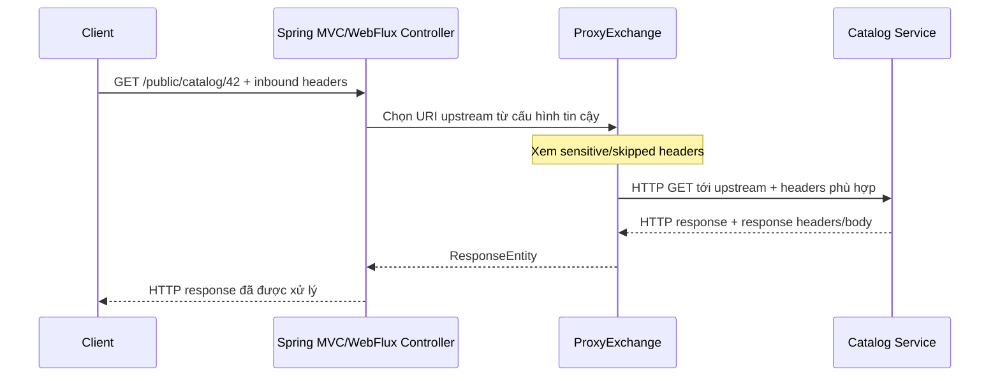
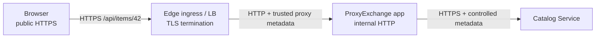
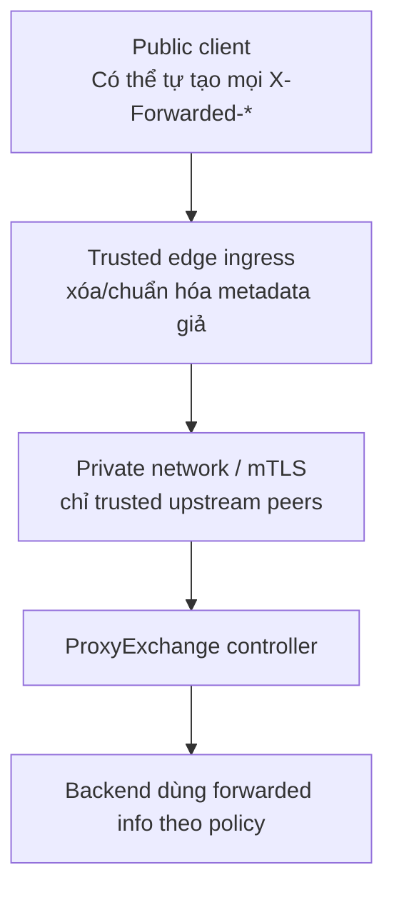

# Sensitive headers, skipped headers và X-Forwarded-*

## Mục tiêu bài học

Trong chương **Proxy Exchange** của module **Spring Cloud Gateway**, bài học này giải thích cách `ProxyExchange` xử lý HTTP headers khi một ứng dụng Spring MVC hoặc Spring WebFlux đứng giữa client và backend. Trọng tâm là **ba nhóm cần phân biệt**:

1. **Sensitive headers** — những header chứa credential hoặc thông tin nhạy cảm, **không được tự động chuyển tiếp** đến upstream nếu chưa có chính sách tin cậy.
2. **Skipped headers** — những header không nên **sao chép nguyên giá trị** vì thuộc về từng kết nối HTTP hoặc phải được tính lại cho request mới.
3. **`X-Forwarded-*` và `Forwarded`** — metadata về chuỗi proxy, địa chỉ client, hostname và giao thức ban đầu; chỉ đáng tin khi được tạo/kiểm soát tại **trust boundary**.

Sau bài học, bạn có thể:

- Giải thích khác nhau giữa `ProxyExchange`, Gateway Server WebFlux/Web MVC và một reverse proxy cấu hình bằng YAML.
- Nêu các giá trị mặc định trong tài liệu ProxyExchange: **sensitive: `cookie`, `authorization`**; **skipped: `content-length`, `host`**.
- Phân biệt **không chuyển tiếp credential** với **không sao chép framing/host metadata**; biết tại sao cả hai nhóm đều có thể bị lược bỏ nhưng vì mục đích khác nhau.
- Phân tích `X-Forwarded-For`, `X-Forwarded-Host`, `X-Forwarded-Proto`, `X-Forwarded-Port`, `X-Forwarded-Prefix` và chuẩn `Forwarded` RFC 7239.
- Tránh spoofing `X-Forwarded-*`, lộ JWT/cookie/API key, SSRF, sai absolute URL, HTTP redirect loop và lỗi `Content-Length`.
- Hiểu sự khác biệt giữa **header inbound**, **header outbound đến upstream**, **response header upstream** và **response header trả client**.
- Xây một controller proxy mẫu bằng Java, biết điểm nào được thư viện tự xử lý và điểm nào cần review/security riêng.
- Kiểm thử với backend HTTP stub, các ca attack headers, proxy TLS termination, nhiều hops, nội dung có Unicode và response redirects.

> **Phạm vi:** `ProxyExchange` là **phong cách gateway thay thế** được Spring Cloud Gateway cung cấp để dùng trong **Spring MVC controller** hoặc **Spring WebFlux controller**. Nó **không phải** một `GatewayFilterFactory` trong route chain của Gateway Server. Tên artifact, thuộc tính và cách xử lý headers có thể thay đổi theo Spring Cloud release train; phải kiểm tra runtime, tài liệu và javadoc của **phiên bản đang chạy**. Bài có các ví dụ an toàn và đoạn mã minh họa, không mặc định mọi ví dụ là cấu hình production đầy đủ.

## 1. Đặt ProxyExchange vào đúng vị trí kiến trúc

Khi người dùng gọi:

```http
GET /public/catalog/42 HTTP/1.1
Host: api.example.com
Authorization: Bearer <browser-access-token>
Cookie: session=<browser-session>
```

ứng dụng có thể cần chuyển request tới một Catalog Service ở:

```text
https://catalog.internal.example/items/42
```

Với **ProxyExchange**, lập trình viên viết một **Spring web handler** nhận `ProxyExchange<byte[]>` làm tham số rồi chỉ định URI upstream và HTTP method tương ứng:



Trong cách tiếp cận này, controller **có quyền quyết định** URL upstream, request method, response mapping và các quy tắc bổ sung. `ProxyExchange` giúp thực hiện HTTP exchange, **không thay** Spring Security, validate destinations hay tự xác thực mọi client.

### 1.1. So sánh các cách làm gateway

| Cách làm | Cách khai báo/điều phối | Phạm vi của bài |
| --- | --- | --- |
| **Gateway Server WebFlux** | Route predicates, `GatewayFilterFactory`, `GlobalFilter`, routing filters | Không phải API trực tiếp của `ProxyExchange` |
| **Gateway Server Web MVC** | RouterFunction/WebMvc.fn và filter functions | Không phải API controller `ProxyExchange` |
| **ProxyExchange WebFlux** | `@RestController`, trả `Mono<ResponseEntity<?>>` | **Có** |
| **ProxyExchange Web MVC** | `@RestController`, trả `ResponseEntity<?>` | **Có** |
| Reverse proxy ngoài JVM | Ingress, NGINX, Envoy, load balancer | Có thể đứng trước/sau ProxyExchange |

Spring Cloud Gateway mô tả ProxyExchange là **alternative style**, nên không tự suy rằng `RemoveHopByHop`/`XForwardedHeadersFilter` hay thuộc tính `trusted-proxies` **của Gateway Server** cũng được áp y hệt lên một `ProxyExchange` controller.

### 1.2. Dependencies

Theo tài liệu hiện hành, chọn **đúng một module ProxyExchange** tùy web stack:

**Spring MVC:**

```xml
<dependency>
    <groupId>org.springframework.cloud</groupId>
    <artifactId>spring-cloud-gateway-proxyexchange-webmvc</artifactId>
</dependency>
```

**Spring WebFlux:**

```xml
<dependency>
    <groupId>org.springframework.cloud</groupId>
    <artifactId>spring-cloud-gateway-proxyexchange-webflux</artifactId>
</dependency>
```

Phải chọn Spring Cloud BOM tương thích với Spring Boot. Không tự trộn `spring-cloud-starter-gateway-server-webflux` và `spring-cloud-gateway-proxyexchange-webmvc` chỉ vì cùng tên Gateway; chúng là **những cơ chế triển khai khác nhau**.

Ở Spring Cloud 2025.0, tài liệu release notes cho biết tiền tố cấu hình ProxyExchange đã chuyển từ nhánh cũ `spring.cloud.gateway.proxy.*` sang các namespace riêng như:

```text
spring.cloud.gateway.proxy-exchange.webflux.*
spring.cloud.gateway.proxy-exchange.webmvc.*
```

Điều đó **không** có nghĩa mọi thuộc tính bên dưới prefix đều tồn tại hoặc có cùng default ở mọi phiên bản. Khi cần thay policy headers, kiểm tra configuration metadata/javadoc của artifact tương ứng; không sao chép property của Gateway Server rồi cho rằng ProxyExchange nhận được.

## 2. Một HTTP exchange đi qua bốn tập headers

Giả sử client gửi `POST /public/orders` và ProxyExchange chuyển sang `POST /orders`.

```text
1. Client → ProxyExchange:    Inbound request headers
2. ProxyExchange → Backend:  Outbound request headers
3. Backend → ProxyExchange:  Upstream response headers
4. ProxyExchange → Client:   Outbound response headers
```

Các nhóm `sensitive` và `skipped` của tài liệu ProxyExchange chủ yếu nói về **việc có sao chép header từ request inbound sang outbound request hay không**. Chúng **không tự mô tả một chính sách lọc response headers**.

Ví dụ:

```http
POST /public/orders HTTP/1.1
Host: api.example.com
Authorization: Bearer <client-jwt>
Cookie: session=<client-cookie>
Content-Length: 52
Content-Type: application/json
X-Request-Id: 8a2f...

{"itemId":"BOOK-42","quantity":1}
```

ProxyExchange gọi backend dưới host `orders.internal.example`, có thể cần:

```http
POST /orders HTTP/1.1
Host: orders.internal.example
Content-Type: application/json
X-Request-Id: 8a2f...
Content-Length: <length-of-outbound-bytes>

{"itemId":"BOOK-42","quantity":1}
```

Trong ví dụ lý tưởng, `Authorization` và `Cookie` của client **không tự được gửi** tới upstream. `Host` được suy ra từ đích mới; `Content-Length` do HTTP stack xác định từ representation thực. Các header khác, kể cả `X-Request-Id`, còn cần chính sách kiểm tra nguồn tin cậy, độ dài và tính hợp lệ.

**Không coi các header trong ví dụ là bản chụp on-wire luôn giống nhau.** HTTP client, version HTTP, proxy, compression, codec và trust policy có thể ảnh hưởng header cuối; chỉ integration test với upstream stub mới xác nhận được.

### 2.1. Một bảng phân loại đúng

| Header | Phân loại theo bài | Tại sao cần xử lý? |
| --- | --- | --- |
| `Authorization` | **Sensitive mặc định** | Bearer token hoặc thông tin xác thực của client |
| `Cookie` | **Sensitive mặc định** | Session identifier và dữ liệu theo domain |
| `Host` | **Skipped mặc định** | Header của **đích HTTP hop** cần phản ánh upstream mới |
| `Content-Length` | **Skipped mặc định** | Chứa **số bytes** của representation, có thể khác sau proxying |
| `X-Forwarded-For` | **Proxy metadata** | Chuỗi địa chỉ client/proxy có thể bị giả mạo |
| `X-Forwarded-Host` | **Proxy metadata** | Host public trước reverse proxy, có thể bị giả |
| `X-Forwarded-Proto` | **Proxy metadata** | Scheme bên ngoài (`https`/`http`) có thể bị giả |
| `X-Forwarded-Port` | **Proxy metadata** | Port public, có thể bị giả |
| `X-Forwarded-Prefix` | **Proxy metadata** | Prefix bị proxy lược bỏ hoặc xử lý |
| `Forwarded` | **Proxy metadata RFC 7239** | `for`, `host`, `proto`, `by` trong chuỗi proxy |
| `X-API-Key` | **Sensitive theo ứng dụng** | Không nằm trong hai default được tài liệu nêu, vẫn là secret |
| `Proxy-Authorization` | **Hop credential đặc biệt** | Không được chuyển tùy ý tới backend |
| `Connection`, `Transfer-Encoding` | **Hop-by-hop/framing** | Không tự sao chép mù quáng qua các HTTP hops |
| `Content-Type` | End-to-end representation metadata | Cần còn khớp bytes body, codec và encoding |

**Đây là bảng phân loại để thiết kế bảo mật**, không tuyên bố thư viện ProxyExchange tự loại mọi header được ghi “nhạy cảm theo ứng dụng”. Hai giá trị sensitive mặc định được tài liệu chính thức nêu là `cookie`, `authorization`; các header khác phải được review và bảo vệ bổ sung.

## 3. Sensitive headers: mặc định không truyền credential của client

**Sensitive header** là một header có thể tiết lộ credential, session hoặc dữ liệu không nên tự vượt sang miền tin cậy khác.

Theo tài liệu ProxyExchange hiện hành:

```text
Sensitive defaults:
  cookie
  authorization
```

Hai tên này được **lược khỏi request downstream theo mặc định**.

Tại sao? Một controller có thể proxy đến một service thuộc nhóm triển khai khác. Nếu tự chuyển bearer token/cookie:

- Backend có thể nhận một token không dành cho audience của nó.
- Backend có thể ghi credential vào access log hoặc error traces.
- Một service bị xâm nhập có thể dùng lại token ở nơi khác nếu token scope cho phép.
- Cookie dành cho public domain không nên tự trở thành cookie của internal domain.
- Route sai đích có thể chuyển credential ra một host không được phê duyệt.

### 3.1. Authentication ở Gateway không có nghĩa forward credential

Ví dụ client:

```http
Authorization: Bearer <frontend-access-token>
```

Spring Security ở ứng dụng proxy có thể xác minh token để tạo `Authentication`/`Principal`. Sau đó ProxyExchange **không nhất thiết** chuyển nguyên header vào backend.

```text
Client token
  ↓
Spring Security xác minh identity/scope/audience
  ↓
Controller quyết định request có được gọi upstream?
  ↓
ProxyExchange thực hiện HTTP exchange
  ↓
Backend xác minh quyền phù hợp với kiến trúc
```

Đừng thấy backend trả 401 rồi vội kết luận “ProxyExchange bị lỗi, phải tắt sensitive headers”. Có thể backend đang cần **service credential**, **OAuth2 token relay/exchange đúng audience** hoặc một security contract khác — không phải token frontend nguyên bản.

### 3.2. Cookie phải theo đúng domain/session boundary

Cookie browser:

```http
Cookie: SESSION=<session-id>; theme=dark
```

có thể chứa cả giá trị session nhạy cảm lẫn preference thông thường. Nếu ProxyExchange chuyển toàn bộ `Cookie`, upstream có thể nhận session credential mà nó không được thiết kế để xử lý.

Trong một số kiến trúc, frontend dùng cookie session còn backend giao tiếp bằng mTLS/service token. Khi đó:

1. Spring Security xác thực cookie ở edge.
2. Không chuyển nguyên cookie browser tới backend.
3. Gửi credential/identity assertion phù hợp và **chỉ từ thành phần được tin**.
4. Backend kiểm tra authorization đối với tài nguyên, không chỉ tin một header không xác thực.

**Không** coi cookie có `HttpOnly` là an toàn để forward mọi nơi. `HttpOnly` chỉ hạn chế JavaScript browser đọc cookie; nó không quyết định service nội bộ nào được phép nhận cookie.

### 3.3. Sensitive defaults không phải toàn bộ secret policy

Ví dụ một API dùng:

```http
X-API-Key: <partner-secret>
X-Client-Secret: <secret>
X-Id-Token: <identity-token>
```

Các tên này **không được liệt kê là sensitive defaults** trong tài liệu chính thức. Nếu ứng dụng không bổ sung chính sách, chúng có thể đi sang upstream tùy hành vi của phiên bản và cấu hình. Cần:

- Xây **allowlist các request headers được phép truyền** khi target khác trust zone.
- Bổ sung các header nhạy cảm theo contract, không chỉ dựa vào hai giá trị mặc định.
- Test bằng các request chứa secret giả để bảo đảm backend **không nhận**.
- Xem thêm response body, query string, tracing và logs vì secret không chỉ tồn tại trong headers.

Tên HTTP header không phân biệt hoa/thường. Các biến thể `authorization`, `Authorization`, `AUTHORIZATION` phải được xem là **cùng một field-name về ngữ nghĩa**; kiểm thử bằng nhiều cách viết khác nhau.

### 3.4. Vì sao không nên xóa `Authorization` khỏi mọi request ở mọi lớp?

Một downstream service có thể thực sự cần credential để xác minh caller. Nếu đó là requirement:

- Hợp đồng phải chỉ rõ **credential nguồn nào** được phép truyền.
- Token **audience/scope** phải phù hợp với backend nhận.
- Chỉ gửi qua TLS và đến service identity đã được phê duyệt.
- Có chính sách tránh token leakage, caching và logging.
- Nếu cần OAuth2 token exchange/relay, dùng Spring Security/OAuth2 integration phù hợp, không tự copy raw headers theo thói quen.

Mục tiêu là **chuyển credential một cách có chủ đích**, không phải “không bao giờ chuyển `Authorization` trong mọi hệ thống”. Giá trị mặc định của ProxyExchange là một lớp bảo vệ, không thay một kiến trúc identity-to-service đầy đủ.

### 3.5. Thay danh sách sensitive có thể làm yếu mặc định

Một số API/cấu hình ProxyExchange cho phép tùy chỉnh tập sensitive headers. Khi thay danh sách, phải biết hành vi **override hay merge** trên đúng phiên bản. Ví dụ rất nguy hiểm về mặt ý tưởng:

```text
Sensitive set mới chỉ còn:
  x-api-key

Nếu thay thế toàn bộ defaults:
  cookie, authorization có thể không còn được lọc.
```

Không tự đoán một property `sensitive: [x-api-key]` sẽ **thêm** vào defaults. Nếu muốn giữ bảo vệ, yêu cầu cuối cùng phải bao gồm **`cookie`, `authorization` và mọi secret headers riêng**. Viết integration test xác minh giá trị hiệu lực.

## 4. Skipped headers: không sao chép những thông tin của hop hiện tại

Khác sensitive headers, **skipped headers** thường bị bỏ vì **tính đúng đắn của HTTP proxy exchange**, không nhất thiết vì chúng chứa secret.

Theo tài liệu ProxyExchange hiện hành:

```text
Skipped defaults:
  content-length
  host
```

Khi ProxyExchange tạo outbound HTTP request, hai header này **không nên được copy nguyên giá trị từ client**.

### 4.1. Vì sao bỏ `Host`?

Client tới:

```http
GET /public/items/42 HTTP/1.1
Host: api.example.com
```

ProxyExchange định tuyến đến:

```text
https://catalog.internal.example/items/42
```

Outbound HTTP request cần dùng thông tin đích phù hợp:

```http
Host: catalog.internal.example
```

Nếu giữ `Host: api.example.com` khi kết nối `catalog.internal.example`, một virtual-host backend hoặc reverse proxy nội bộ có thể:

- Chọn sai virtual host/backend.
- Trả 404/421 hoặc certificate/SNI mismatch.
- Tạo absolute redirect về host không mong muốn.
- Vi phạm chính sách chống host-header injection.

**Điểm tinh tế:** ProxyExchange lược **incoming Host** khi xây outbound request; HTTP client vẫn có thể **tạo Host phù hợp với upstream URI**. “Skipped” không có nghĩa request HTTP/1.1 ra ngoài sẽ thiếu hoàn toàn trường Host.

### 4.2. Vì sao bỏ `Content-Length`?

`Content-Length` là **số bytes** của request representation:

```http
POST /public/notes HTTP/1.1
Content-Type: text/plain; charset=UTF-8
Content-Length: 5

hello
```

Nếu handler hoặc HTTP client chuyển đổi text, encoding hoặc body structure trước khi gửi upstream, byte length có thể khác. Ví dụ:

```text
Inbound body:  "hello"
Outbound body: "xin chào"
```

Java `String.length()` không phải UTF-8 bytes count. Nếu copy `Content-Length: 5` mà outbound body dài hơn, phía nhận có thể đọc thiếu bytes, chờ dữ liệu, hủy request hoặc hiểu sai framing.

HTTP client nên tự sinh framing phù hợp với **outbound bytes**, có thể chọn `Content-Length` mới hoặc **chunked transfer** trên HTTP/1.1.

**Không tự điền lại `Content-Length` bằng `.length()` hoặc giá trị cũ** sau transformation. Cũng không cho gửi kết hợp header framing mâu thuẫn như `Content-Length` và `Transfer-Encoding` không hợp lệ.

### 4.3. Hop-by-hop headers cũng cần được kiểm soát

RFC HTTP phân biệt metadata end-to-end với những header chỉ dùng cho **một kết nối**.

Các ví dụ cần xem xét:

```text
Connection
Keep-Alive
TE
Trailer
Transfer-Encoding
Upgrade
Proxy-Authenticate
Proxy-Authorization
```

Ngoài ra, `Connection` còn có thể liệt kê **những header names khác cũng là hop-by-hop**:

```http
Connection: keep-alive, X-Internal-Hop
X-Internal-Hop: should-not-be-forwarded
```

Một proxy phải tuân thủ HTTP hop-by-hop semantics; **không đủ** chỉ có hai skipped defaults `content-length` và `host` rồi tuyên bố mọi header còn lại đều an toàn. Cách HTTP client/thư viện tự xử lý những trường này cần được kiểm thử qua thực tế.

**Phân biệt:** `skipped` mặc định của `ProxyExchange` trong tài liệu **không phải** danh sách toàn bộ `RemoveHopByHop` của Gateway Server. Không dùng một danh sách mặc định của subsystem này làm sự bảo đảm cho subsystem khác.

### 4.4. HTTP/2 và Host

HTTP/2 sử dụng pseudo-headers như `:authority`, `:scheme`, `:path` cho request semantics. `Host` trong HTTP/1.1 và `:authority` ở HTTP/2 có liên hệ nhưng không đồng nghĩa việc copy raw text qua mọi giao thức.

Nếu client → ingress dùng HTTP/2 còn ingress → ProxyExchange dùng HTTP/1.1, mỗi hop phải tự tạo metadata đúng. Chỉ test curl HTTP/1.1 không đủ cho toàn hệ thống hỗn hợp HTTP/2/TLS.

### 4.5. Response headers cũng có các quy tắc riêng

`Sensitive`/`Skipped` nói trên chủ yếu là outbound **request**. Nhưng response upstream cũng cần xem:

| Response header | Vấn đề |
| --- | --- |
| `Set-Cookie` | Có thể phát cookie cho sai domain/path hoặc làm lộ session |
| `Location` | Có thể redirect tới hostname nội bộ hoặc host không đáng tin |
| `Content-Length` | Phải đúng bytes response sau khi mapping body |
| `Content-Encoding` | Phải phù hợp gzip/br/identity của representation |
| `ETag`, `Digest` | Có thể không còn hợp lệ nếu body đã đổi |
| `Server`, `X-Backend-Debug` | Có thể lộ chi tiết hạ tầng |
| `Access-Control-*` | Có thể bị trùng hoặc tạo chính sách CORS không đúng |

Không suy rằng request `Cookie` được filter thì response `Set-Cookie` **cũng tự được filter**. Đây là hai hướng và hai loại dữ liệu khác nhau. Nếu proxy response qua `ResponseEntity` mapper, cần thiết kế chính sách output riêng.

## 5. X-Forwarded-* là thông tin về lịch sử proxy, không phải identity

Trong một hệ thống có nhiều hops:



Backend có thể muốn biết public URL hoặc địa chỉ client bên ngoài, trong khi kết nối thực từ backend chỉ nhìn thấy proxy. Nhóm `X-Forwarded-*` được dùng để mang **metadata từ các proxies**.

### 5.1. Ý nghĩa từng header

| Header | Thường biểu diễn | Rủi ro nếu tin từ client bất kỳ |
| --- | --- | --- |
| `X-Forwarded-For` | Một danh sách IP theo chuỗi proxies | Giả IP để bypass rate limiter/IP allowlist |
| `X-Forwarded-Host` | Public hostname ban đầu | Host header poisoning, link/redirect giả |
| `X-Forwarded-Proto` | Scheme public ban đầu (`https`, `http`) | Bypass HTTPS checks, tạo redirect loop/link sai |
| `X-Forwarded-Port` | Port public ban đầu | Generate URL sai port |
| `X-Forwarded-Prefix` | Prefix URL public qua reverse proxy | Route/link generation sai hoặc path confusion |

Ví dụ edge terminate TLS:

```http
GET /catalog/42 HTTP/1.1
Host: proxyexchange.internal
X-Forwarded-For: 203.0.113.24
X-Forwarded-Host: api.example.com
X-Forwarded-Proto: https
X-Forwarded-Port: 443
X-Forwarded-Prefix: /public
```

Nếu metadata trên **do trusted edge tạo và đã dọn giá trị client tự gửi**, ứng dụng proxy có thể suy ra public URL là:

```text
https://api.example.com/public/catalog/42
```

Nhưng chính header text **không mang chữ ký xác thực**. Một client có thể tự đặt `X-Forwarded-Proto: https` hoặc `X-Forwarded-For: 127.0.0.1` nếu edge không xóa/ghi đè.

### 5.2. `X-Forwarded-For` thường là danh sách

Giả sử:

```text
Client A: 203.0.113.24
Edge proxy: 10.10.0.12
Internal proxy: 10.20.0.18
```

Một chuỗi có thể có:

```http
X-Forwarded-For: 203.0.113.24, 10.10.0.12
```

Nhưng nếu client tự gửi:

```http
X-Forwarded-For: 127.0.0.1
```

và edge chỉ append:

```http
X-Forwarded-For: 127.0.0.1, 203.0.113.24
```

thì phần tử đầu tiên **không còn đáng tin**. Không được viết:

```java
String clientIp = xForwardedFor.split(",")[0]; // Không an toàn!
```

Để suy ra client IP, cần thuật toán theo **trusted proxy chain**: biết remote peer trực tiếp, những hops nào được tin, nơi nào dọn header và cách duyệt chuỗi từ phía đáng tin. Nếu không có trust model đó, coi địa chỉ nguồn trực tiếp tại socket là căn cứ mạng hoặc bỏ yêu cầu dựa trên forwarded IP.

### 5.3. Có nên append hay replace?

| Policy | Khi phù hợp | Rủi ro |
| --- | --- | --- |
| **Overwrite tại edge tin cậy** | Public edge nhận request trực tiếp từ Internet | Loại spoofed metadata, tạo điểm bắt đầu tin cậy |
| **Append ở proxy đã xác thực** | Chuỗi proxy nội bộ có danh sách hop tin cậy | Cần bảo vệ và xác minh phần prefix trước đó |
| **Forward nguyên header client** | Hầu như không phù hợp cho security decisions | Attacker-controlled origin/IP/scheme |
| **Drop toàn bộ** | Không cần public metadata | Có thể mất thông tin phục vụ URL/tracing |

Không thể chọn append/replace chỉ từ mong muốn “giữ IP thật”. Quyết định phải phù hợp **topology**, network policy, proxy hop verification và khả năng upstream hiểu chuỗi.

### 5.4. `Forwarded` RFC 7239 so với `X-Forwarded-*`

Chuẩn RFC 7239 dùng một header:

```http
Forwarded: for=203.0.113.24;proto=https;host=api.example.com
```

Qua nhiều hops có thể có các phần tử phân tách bằng dấu phẩy:

```http
Forwarded: for=203.0.113.24;proto=https;host=api.example.com,
           for=10.10.0.12;proto=http;by=10.20.0.18
```

`Forwarded` giúp chuẩn hóa cách biểu diễn `for`, `by`, `host` và `proto`, nhưng **không tự đáng tin hơn** `X-Forwarded-*`. Hai header families có thể cùng tồn tại với giá trị mâu thuẫn.

Khi hai families có mâu thuẫn:

- Xác định **một nguồn authority** tại trusted edge.
- Chọn chính sách ưu tiên hoặc xóa/sinh lại rõ ràng.
- Đảm bảo backend và application framework dùng **cùng hợp đồng**.
- Không trộn `Forwarded: host=...` từ client với `X-Forwarded-Proto` đã được proxy xác minh rồi tạo một public URL giả.

### 5.5. `X-Forwarded-Prefix` cần contract đường dẫn

Ví dụ:

```text
Public URL: https://api.example.com/gateway/catalog/42
Ingress bỏ /gateway → ProxyExchange nhận /catalog/42
```

Metadata có thể mang:

```http
X-Forwarded-Prefix: /gateway
```

Nó giúp app tạo links/redirect về public path. Nhưng nếu một client tự đặt:

```http
X-Forwarded-Prefix: /evil
```

và ứng dụng tin trực tiếp, `Location`/absolute links có thể sai. `X-Forwarded-Prefix` cũng không tự thay handler mapping/URI path của ProxyExchange theo mọi runtime; phải test riêng request path nhận được và path chuyển tới backend.

## 6. Trust boundary: nguồn nào được phép tạo forwarded headers?

Quy tắc quan trọng nhất của bài: **ProxyExchange có hỗ trợ proxy headers không có nghĩa tất cả proxy headers inbound đều đáng tin**.



### 6.1. Đường đi an toàn

Một thiết kế thường dùng:

1. Chặn đường kết nối trực tiếp từ Internet tới ProxyExchange app.
2. Tại public ingress, **xóa các incoming forwarded headers do client gửi**, rồi tạo lại các giá trị được phép từ thông tin edge xác minh.
3. Chỉ cho trusted edge/mesh/service được phép kết nối tới application port.
4. Cấu hình Spring framework/proxy integration để xử lý metadata **từ trusted peer**.
5. Nếu ProxyExchange tạo downstream `X-Forwarded-*`, bảo đảm nó dùng **metadata đáng tin** chứ không copy client input.
6. Backend chỉ dùng client IP/proto/host cho security khi đã có hợp đồng nguồn rõ và network policy ngăn bypass.

Thực tế có các trường hợp nhiều edge/cloud proxies không thể xóa toàn bộ lịch sử; khi đó cần danh sách **trusted hop addresses** và thuật toán kiểm tra chain được kiểm chứng. Không dùng regex “IP bắt đầu bằng 10.” như bằng chứng toàn vẹn của một chuỗi header do attacker có thể sửa.

### 6.2. `server.forward-headers-strategy`

Spring Boot có tùy chọn:

```yaml
server:
  forward-headers-strategy: framework
```

Tùy phiên bản và web stack, framework có thể dùng `ForwardedHeaderFilter` (MVC) hoặc cơ chế WebFlux tương ứng để **diễn giải inbound forwarded headers** khi tạo scheme/host/port của request.

**Không hiểu nhầm:** tùy chọn này **không tự phân biệt Internet client với trusted ingress**. Phải bảo đảm forwarded headers đã được sanitization và chỉ trusted proxies mới được phép gửi chúng vào ứng dụng. Nếu không, bật `framework` có thể khiến URL, redirect hoặc security logic tin metadata giả.

Lựa chọn `native`, `framework`, `none` phải phù hợp Servlet container/reactive server, ingress và proxy chain. Không bật cả nhiều cơ chế trùng nhau để tránh double processing.

### 6.3. `trusted-proxies` của Gateway Server khác ProxyExchange

Trong các dòng Gateway Server mới, Spring tài liệu hóa các thuộc tính kiểu:

```properties
spring.cloud.gateway.server.webflux.trusted-proxies=...
spring.cloud.gateway.server.webmvc.trusted-proxies=...
```

để điều khiển `Forwarded`/`XForwarded` headers filters **của Gateway Server**. Những thuộc tính này **không được tự động coi là bộ lọc security có hiệu lực cho ProxyExchange controller**.

ProxyExchange là một alternative module. Nếu dự án sử dụng **`spring-cloud-gateway-proxyexchange-webflux`**, phải kiểm tra configuration metadata, header resolver và HTTP client của **chính module này**; nếu dùng `proxyexchange-webmvc`, kiểm tra phiên bản MVC tương ứng.

Đặc biệt, advisory **CVE-2025-41235** nói về Gateway Server chuyển tiếp headers từ untrusted proxies trong các phiên bản chịu ảnh hưởng. Bài học rút ra là kiểm soát trust chain và cập nhật bản vá, **không suy từ CVE này rằng ProxyExchange có chung đoạn code hoặc chung property với Gateway Server**.

### 6.4. Khi không cần forwarded headers

Nếu backend không cần biết original client IP, public host hoặc scheme, lựa chọn đơn giản là **không chuyển tiếp** metadata đó. Bạn vẫn có thể dùng trace ID, route ID hoặc user identity đã xác minh riêng.

Không buộc mọi backend phải phân tích `X-Forwarded-For`; giá trị này thường khó suy diễn an toàn hơn một contract service-to-service rõ.

## 7. Ví dụ ProxyExchange Web MVC và ranh giới headers

Tài liệu Spring Cloud Gateway dùng ví dụ `ProxyExchange<byte[]>` trong MVC controller. Dưới đây là một handler nhỏ dùng **đích backend cố định do ứng dụng quản lý**, không nhận target URI tùy ý từ client.

```java
package com.example.edge;

import java.net.URI;

import org.springframework.beans.factory.annotation.Value;
import org.springframework.http.ResponseEntity;
import org.springframework.web.bind.annotation.GetMapping;
import org.springframework.web.bind.annotation.PathVariable;
import org.springframework.web.bind.annotation.RestController;
import org.springframework.web.util.UriComponentsBuilder;

// Import ProxyExchange từ module proxyexchange-webmvc tương ứng
// với version Spring Cloud Gateway đang sử dụng.
@RestController
class CatalogProxyController {

    private final URI upstreamBase;

    CatalogProxyController(
            @Value("${app.catalog.base-uri}") URI upstreamBase) {
        this.upstreamBase = upstreamBase;
    }

    @GetMapping("/public/catalog/{id}")
    ResponseEntity<?> item(
            @PathVariable String id,
            ProxyExchange<byte[]> proxy) throws Exception {

        // Contract của ví dụ: item IDs chỉ gồm chữ/số/dấu gạch ngang.
        if (!id.matches("[A-Za-z0-9-]{1,64}")) {
            return ResponseEntity.badRequest().build();
        }

        URI target = UriComponentsBuilder
            .fromUri(upstreamBase)
            .pathSegment("items", id)
            .build()
            .toUri();

        return proxy.uri(target.toString()).get();
    }
}
```

Ví dụ cấu hình:

```yaml
app:
  catalog:
    base-uri: "https://catalog.internal.example"
```

**Lưu ý về mã mẫu:**

- Thêm `ProxyExchange` import đúng artifact/phiên bản (ví dụ các dòng cũ dùng `org.springframework.cloud.gateway.mvc.ProxyExchange`; các dòng mới cần đối chiếu javadoc).
- Cần Spring MVC server, `ProxyExchange` argument resolver và certificate trust phù hợp để chạy.
- ID chỉ có ký tự đã allowlist; với Unicode/encoded slash/dot segments cần thiết kế contract riêng, không nối raw `@PathVariable` vào một target tùy ý.
- `app.catalog.base-uri` phải là **địa chỉ do vận hành phê duyệt**, không nhập từ `?target=` hay header client.
- Mặc định ProxyExchange có sensitive/skipped headers nói trên, nhưng output on-wire vẫn cần test thật.

### 7.1. Đọc request headers không đồng nghĩa gửi chúng

Controller có thể nhận `@RequestHeader` hoặc `HttpServletRequest` để kiểm tra một thông tin request. Nhưng:

```text
Controller đọc Authorization
  ≠ ProxyExchange luôn chuyển Authorization

Controller đọc X-Forwarded-For
  ≠ X-Forwarded-For là client IP đáng tin

Controller đọc Host
  ≠ Outbound Host sẽ giống inbound Host
```

Vì vậy cần phân biệt *data visible in handler* và *data transmitted by proxy*.

### 7.2. Ví dụ client giả header

```bash
curl -i "http://localhost:8080/public/catalog/42" \
  -H "Authorization: Bearer demo-client-token" \
  -H "Cookie: SESSION=demo-session" \
  -H "Host: api.example.com" \
  -H "X-Forwarded-For: 127.0.0.1" \
  -H "X-Forwarded-Proto: https"
```

Chỉ dùng **token giả** trong môi trường test. Backend stub phải ghi lại **tên headers và giá trị được redacted** để xác minh:

- Có `Authorization` hay `Cookie` được gửi ngoài chủ đích không?
- `Host` thực tế phản ánh target URI không?
- `Content-Length` có bị giữ sai không?
- `X-Forwarded-For` có còn chứa `127.0.0.1` do client giả không?
- `X-Forwarded-Proto` có bị coi là HTTPS thật dù client dùng HTTP không?

Không coi `X-Forwarded-Proto: https` trong lệnh curl là bằng chứng TLS đã được sử dụng. Chính kết nối HTTP đang diễn ra mới quyết định TLS ở hop đó, còn header là dữ liệu có thể bị giả.

## 8. Ví dụ ProxyExchange WebFlux

Nếu dùng module ProxyExchange WebFlux, handler thường trả về `Mono<ResponseEntity<?>>`:

```java
package com.example.edge;

import java.net.URI;

import org.springframework.beans.factory.annotation.Value;
import org.springframework.http.ResponseEntity;
import org.springframework.web.bind.annotation.GetMapping;
import org.springframework.web.bind.annotation.RestController;
import reactor.core.publisher.Mono;

// Import ProxyExchange từ proxyexchange-webflux tương ứng.
@RestController
class CatalogReactiveProxyController {

    private final URI upstreamBase;

    CatalogReactiveProxyController(
            @Value("${app.catalog.base-uri}") URI upstreamBase) {
        this.upstreamBase = upstreamBase;
    }

    @GetMapping("/public/health-from-catalog")
    Mono<ResponseEntity<?>> health(ProxyExchange<byte[]> proxy) {
        return proxy.uri(
            upstreamBase.resolve("/health").toString()
        ).get();
    }
}
```

**Điểm khác Web MVC:** `.get()` trên ProxyExchange WebFlux là reactive publisher; không `.block()` hoặc tự `.subscribe()` trong HTTP request path. Spring WebFlux sẽ subscribe vào returned `Mono` và quản lý cancellation/error signals.

Giống Web MVC, controller vẫn cần security, target URI validation và xử lý HTTP headers đúng trust boundary. Không nghĩ việc dùng Reactor sẽ tự chặn header spoofing hoặc làm dữ liệu sensitive biến mất khỏi mọi log.

### 8.1. ProxyExchange không phải một WebFlux `GatewayFilter`

Ví dụ sai về thiết kế:

```text
@RestController + ProxyExchange
  → tự giả định đã chạy GlobalFilter/NettyRoutingFilter
  → tự giả định GatewayFilterFactory Retry/RateLimiter/CircuitBreaker hoạt động
```

`ProxyExchange` là handler-level proxy. Những chính sách dùng route `GatewayFilterFactory` **không tự chạy cho controller ProxyExchange**. Muốn xác thực, rate limiting, circuit breaker, retry và quan sát, phải cấu hình các cơ chế tương ứng tại Spring Security/web layer, HTTP client, application service, ingress hoặc một giải pháp phù hợp.

## 9. Hướng đi và hướng về: request filtering khác response mapping

Một request có thể được proxy đúng nhưng response vẫn lộ metadata nội bộ.

### 9.1. `ResponseEntity` mapper

Tài liệu ProxyExchange mô tả khả năng dùng một mapper trong `get()` (và các HTTP methods khác) để biến đổi `ResponseEntity` từ upstream trước khi gửi lại client.

Ví dụ ý tưởng:

```java
return proxy.uri(target.toString()).get(upstream -> {
    // Chọn những response headers được phép xuất hiện công khai.
    // Không sửa trực tiếp HttpHeaders immutable/read-only.
    // Cần bảo toàn status/body và HTTP framing của response.
    return sanitizeUpstreamResponse(upstream);
});
```

`sanitizeUpstreamResponse` là **hàm ứng dụng bạn phải tự triển khai**, không phải API có sẵn của ProxyExchange. Phần này chỉ thể hiện vị trí của policy.

Một response filtering policy có thể:

- Giữ `Content-Type`, cache headers thích hợp và những public metadata đã phê duyệt.
- Loại `X-Backend-Debug`, `Server` hoặc internal headers.
- Không chuyển `Set-Cookie` của backend internal domain ra public domain trừ khi có contract session rõ.
- Kiểm tra `Location` redirects để không lộ host/path nội bộ.
- Đảm bảo `Content-Length`, `Content-Encoding`, `ETag` khớp **response body thực** nếu có rewrite.

### 9.2. Một redirect không nên làm lộ host nội bộ

Upstream trả:

```http
HTTP/1.1 302 Found
Location: http://catalog.internal.example/login
```

Nếu proxy trả nguyên response này cho browser, client có thể bị chuyển tới một hostname nội bộ không thể truy cập hoặc không nên lộ.

Cần xác định:

- Redirect có thực sự được phép ra public client không?
- Có nên dùng relative URL thay vì absolute URL?
- Public hostname/scheme có lấy từ trusted ingress metadata hay không?
- Backend có đang tạo URL từ untrusted `X-Forwarded-Host` không?

Không tự replace mọi chuỗi `internal.example` trong response body/header bằng `api.example.com` mà chưa phân tích encoding, URI semantics và bảo mật.

### 9.3. CORS là một policy riêng

`Access-Control-Allow-Origin` nằm ở **response**. ProxyExchange request sensitive/skipped headers không tự xây một chính sách CORS.

Khi một browser gọi cross-origin:

```text
https://app.example.com
  → https://api.example.com/public/catalog/42
```

hãy cấu hình CORS ở tầng Spring MVC/WebFlux/Spring Security/ingress phù hợp và chọn một policy owner rõ. `OPTIONS` preflight có thể được xử lý **trước khi handler ProxyExchange gọi upstream**.

Không dùng response header mapper để phản chiếu mọi `Origin` tự động khi response chứa credential; phải allowlist origins và kiểm tra `Access-Control-Allow-Credentials`.

## 10. Header injection, canonicalization và nhiều giá trị

HTTP header names không phân biệt hoa/thường:

```text
Authorization
authorization
AUTHORIZATION
```

đều là cùng loại header về mặt HTTP semantics. Không viết policy lọc chỉ khớp đúng một cách viết.

### 10.1. Một header có thể có nhiều values

Ví dụ một client hoặc proxy có thể tạo:

```http
X-Forwarded-For: 198.51.100.10
X-Forwarded-For: 127.0.0.1
```

hoặc:

```http
X-Forwarded-For: 198.51.100.10, 127.0.0.1
```

Không tự viết parser bằng `getFirst(...)` rồi coi đó là chân lý. HTTP clients, reverse proxies và frameworks có thể gộp, append hoặc xử lý duplicate headers khác nhau.

Các security decisions cần:

1. Chọn một định dạng/nguồn tin cậy.
2. Loại headers do client không có quyền tạo.
3. Parse theo chuẩn và giới hạn độ dài/số hops.
4. Reject hoặc bỏ qua nội dung mâu thuẫn.
5. Kiểm thử duplication/casing/canonicalization qua các tầng.

### 10.2. Không copy tùy ý `@RequestHeader HttpHeaders`

Một đoạn mã thường gặp:

```java
@RequestHeader HttpHeaders incomingHeaders
```

có thể cho controller đọc tất cả headers. Nhưng nếu gọi API sao chép **mọi** headers vào outbound HTTP request, bạn có thể vô tình **bỏ qua bảo vệ sensitive/skipped mặc định** hoặc ghi đè những gì HTTP client dự định tự tạo. Chỉ thêm/copy headers **được allowlist**, đúng thứ tự với filtering của ProxyExchange.

Không tin API có tên `headers(...)` là một “sanitize” operation. Tùy cách dùng, nó có thể ghi đè tập headers đã được filter. Cần xem javadoc và thực tế request mà backend nhận.

### 10.3. Header control characters

Nếu bạn đặt header từ user input:

```text
?tenant=<user-controlled-text> → X-Tenant
```

phải kiểm tra:

- CR, LF và control characters.
- Độ dài.
- Nội dung có nằm trong allowlist hay có ký số/xác thực không.
- Quan hệ với authenticated principal.

Không dùng `X-Tenant: foo` được client tự gửi để phân quyền vào tenant `foo`. Backend cần tenant đã được xác minh hoặc claim từ token hợp lệ.

## 11. Vì sao Forwarded metadata đặc biệt nguy hiểm khi dùng cho bảo mật?

### 11.1. IP allowlist bị giả

Ứng dụng:

```text
Nếu X-Forwarded-For = 127.0.0.1 → cho phép admin endpoint
```

là sai, vì client Internet có thể tự gửi header đó. Thậm chí đọc phần tử đầu của một chain append cũng không giải quyết khi edge chưa loại bỏ spoofed prefix.

**Chính sách đúng:** quản trị phải dùng authentication/authorization thực sự, private network/mTLS và trusted proxy-chain processing. IP chỉ là một tín hiệu phụ nếu môi trường yêu cầu.

### 11.2. Host header poisoning

Ứng dụng xây email reset password URL dựa trên:

```http
X-Forwarded-Host: attacker.example
```

Nếu header được tin mà không kiểm tra:

```text
https://attacker.example/reset?token=...
```

có thể xuất hiện trong email hoặc response. Đây là ví dụ **host-header poisoning**; ProxyExchange chỉ là một hop, nhưng nếu nó truyền host metadata giả, backend có thể bị lừa.

Để phòng:

- Public hostnames phải thuộc allowlist của sản phẩm.
- Token/link generation nên dùng configured canonical public base URL khi phù hợp.
- Trusted ingress phải xóa/ghi đè untrusted forwarded host.
- Không lấy raw Host/Forwarded/X-Forwarded-Host từ client làm security authority.

### 11.3. Proto spoofing và redirect loops

Khi client dùng HTTPS tới ingress rồi ingress dùng HTTP tới application:

```text
Client --HTTPS--> Ingress --HTTP--> ProxyExchange
```

ứng dụng có thể cần biết public scheme là `https` để tạo redirect/link đúng. Nếu thiếu trusted `X-Forwarded-Proto`, application có thể tự redirect tới HTTPS liên tục vì nó thấy request HTTP nội bộ.

Nhưng nếu chỉ thêm:

```http
X-Forwarded-Proto: https
```

từ client Internet, ứng dụng có thể bị đánh lừa để **bỏ qua HTTP-to-HTTPS checks** dù hop thực không an toàn.

Giải pháp là **trusted-proxy-aware processing** và TLS policy xuyên từng hop, không phải tin trực tiếp một chuỗi text.

### 11.4. Rate limiting theo client IP

Nếu Gateway rate limiter hoặc backend tính key theo `X-Forwarded-For` chưa xác minh, attacker có thể thay giá trị mỗi request để vượt quota.

Ưu tiên:

- Key theo authenticated user/tenant cho hạn mức nghiệp vụ.
- Khi cần IP-based fallback, lấy địa chỉ client qua trusted proxy-chain resolver.
- Theo dõi traffic amplification và tránh metrics labels chứa raw IP đầy đủ/không giới hạn.

## 12. Tách bảo vệ request headers khỏi credentials của service-to-service

Một mô hình an toàn thường là:

```text
Browser credential
  ↓
Spring Security ở ProxyExchange app
  ↓
Verify authentication + authorization
  ↓
Outbound service credential riêng (nếu upstream yêu cầu)
  ↓
Upstream xác minh credential và quyền trên tài nguyên
```

Ở đây, **client token** và **service credential** là hai thực thể khác nhau:

| Tiêu chí | Client credential | Service credential |
| --- | --- | --- |
| Chủ thể | User/browser/native client | Ứng dụng/gateway/service |
| Audience | Public API, identity resource | Backend API/service cụ thể |
| Phạm vi | Quyền của user/tenant | Quyền service và delegated scope |
| Vòng đời | Theo session hoặc client app | Theo workload, mTLS/client credentials |
| Cách lưu | Cookie an toàn hoặc token client | Secret manager/workload identity |
| Có nên copy raw bằng ProxyExchange? | **Không mặc định** | Chỉ thêm theo tích hợp auth được phê duyệt |

Nếu backend cần biết user identity, có thể dùng token exchange/on-behalf-of flow hoặc một **identity assertion có tính toàn vẹn**, không chỉ `X-Authenticated-User: alice` do client/Gateway tự tạo mà backend không thể xác minh nguồn.

### 12.1. Downstream authentication 401 không có nghĩa thiếu header relay

Một backend 401 có thể do:

- ProxyExchange mặc định không forward `Authorization`.
- Backend nhận token nhưng **audience** không hợp lệ.
- Token hết hạn hoặc thiếu `scope`.
- mTLS/issuer/JWK cấu hình sai.
- Gateway gọi sai service endpoint.

Khắc phục bằng **hiểu security contract**, không bằng cách tắt hết sensitive filtering hoặc log raw token để debug.

## 13. `Content-Length`, `Transfer-Encoding` và body khi proxying

ProxyExchange xử lý HTTP calls và có thể chuyển đổi dữ liệu giữa dạng inbound/outbound. Bất kỳ thay đổi body nào cũng đòi hỏi framing đúng.

### 13.1. Số ký tự không phải số bytes

```text
Java String: "xin chào"
UTF-8 bytes: có ký tự dùng nhiều bytes
```

Nếu developer tự đặt:

```java
int len = body.length();
```

rồi dùng giá trị làm `Content-Length`, kết quả có thể sai với tiếng Việt hoặc emoji. HTTP client/framework phải tính **bytes thực** của outbound representation.

### 13.2. Request body có thể được gửi bằng chunked

Một HTTP client có thể quyết định:

```http
Transfer-Encoding: chunked
```

thay vì:

```http
Content-Length: <known-length>
```

trên HTTP/1.1 khi length chưa biết trước. Không có nghĩa nội dung nghiệp vụ thay đổi; đó là lựa chọn **HTTP framing**.

Nhưng không được:

- Copy `Content-Length` inbound và đồng thời dùng chunked outbound.
- Copy `Transfer-Encoding: chunked` từ HTTP/1.1 sang HTTP/2.
- Thay payload bytes mà giữ chữ ký/digest của payload cũ.
- Chuyển body nén gzip thành text rồi giữ `Content-Encoding: gzip`.

### 13.3. POST/PUT/PATCH cần replay/idempotency policy

Một ProxyExchange controller có thể gửi:

```http
POST /payments/charge
```

Nếu upstream ghi thanh toán rồi response mất, retry cùng request có thể tạo thanh toán trùng. **Header filtering không giải quyết idempotency**. Cần idempotency key và backend deduplication nguyên tử, timeout và retry policy phù hợp.

Không giả định `ProxyExchange` mặc định cung cấp toàn bộ `Retry`, `CircuitBreaker` và body replay semantics của Gateway Server route filters.

### 13.4. Response body và compression

Một upstream response:

```http
HTTP/1.1 200 OK
Content-Type: application/json
Content-Encoding: gzip
ETag: "representation-v1"
```

có thể cần đi nguyên representation tới client. Nếu ProxyExchange mapper chuyển đổi body:

- Decoder/encoder cần tương thích Content-Encoding.
- `Content-Length` có thể phải xóa/tính lại.
- `ETag`/Digest không còn chắc hợp lệ.
- `Vary` và `Cache-Control` phải còn đúng.
- `204`, `304`, `HEAD`, `206 Partial Content` cần semantics đặc biệt.

Không dùng một response mapper đơn giản để sửa bytes trong mọi trường hợp streaming/multipart/gzip.

## 14. Ví dụ tích hợp: ingress trước ProxyExchange

### 14.1. Topology

```text
Browser                203.0.113.24
  ↓ HTTPS :443
Trusted Ingress         10.10.0.12
  ↓ HTTP :8080
ProxyExchange app       10.20.0.25
  ↓ HTTPS :9443
Catalog Service         catalog.internal.example
```

Chính sách:

- Browser **không** được trực tiếp gọi application port `8080`.
- Edge xóa `Forwarded`/`X-Forwarded-*` do browser tự tạo, tạo metadata đáng tin.
- ProxyExchange nhận `Host`/public scheme đã được framework xử lý theo trusted hop policy.
- Outbound URI được chọn từ cấu hình cố định/allowlist.
- Sensitive client `Cookie`/`Authorization` không tự đi sang Catalog Service.
- Upstream request `Host` phản ánh upstream target.
- Backend không dựa vào raw header client để cấp quyền admin.

### 14.2. Request thật được dự kiến

Browser:

```http
GET /public/catalog/42 HTTP/1.1
Host: api.example.com
Cookie: SESSION=<browser-session>
Authorization: Bearer <client-token>
X-Forwarded-For: 127.0.0.1
```

Ingress tạo request nội bộ **đã được làm sạch**:

```http
GET /public/catalog/42 HTTP/1.1
Host: proxyexchange.internal
X-Forwarded-For: 203.0.113.24
X-Forwarded-Host: api.example.com
X-Forwarded-Proto: https
X-Forwarded-Port: 443
```

ProxyExchange tạo outbound:

```http
GET /items/42 HTTP/1.1
Host: catalog.internal.example
X-Forwarded-For: <controlled-chain-if-enabled>
X-Forwarded-Proto: <trusted-public-scheme-if-enabled>
```

Hai header dòng cuối chỉ biểu diễn **giá trị mong muốn theo policy**; việc thực sự sinh/forward những header nào phụ thuộc module/phiên bản/cấu hình. Không dựa vào mẫu để khẳng định ProxyExchange luôn tự viết `X-Forwarded-*` với đúng chuỗi.

### 14.3. Vì sao nên test cả chế độ không có ingress?

Trong môi trường local, developer có thể chạy thẳng:

```text
curl → localhost:8080 → ProxyExchange
```

Khi bypass ingress, các request headers giả không còn bị trusted edge xóa. Cần kiểm tra:

- App từ chối/không tin forwarded metadata khi remote peer không đáng tin?
- Security tests có trực tiếp gửi `X-Forwarded-For: 127.0.0.1` và `X-Forwarded-Proto: https`?
- Production firewall có ngăn truy cập trực tiếp vào port đó?

Một bài test chỉ đi qua ingress có thể che lấp lỗ hổng khi tồn tại một service/port bypass.

## 15. Kiểm thử sensitive, skipped và forwarded headers

Một test tốt phải xác minh **backend stub thực sự nhận được gì**, không chỉ HTTP status cuối client nhìn thấy.

### 15.1. Dựng backend HTTP echo

Backend stub cần:

- Trả về status/body đơn giản.
- Ghi nhận method/path, URI đích, Host, Content-Length.
- Ghi nhận **tên headers** (không log giá trị secret thật).
- Cho phép test response `Location`, `Set-Cookie`, `X-Backend-Debug`.
- Đếm số calls để tránh nhầm retry hoặc nhiều proxy hops.

Để minh họa, có thể dùng WireMock/MockWebServer/test HTTP server do team chọn. Không cần dựng một service discovery cluster chỉ để test ProxyExchange header policy.

### 15.2. Test A — sensitive defaults

Client gửi:

```http
GET /public/catalog/42
Authorization: Bearer fake-token-for-test
Cookie: SESSION=fake-session-for-test
```

Kỳ vọng ở backend theo mặc định đã được tài liệu hóa:

```text
Authorization = absent
Cookie = absent
```

Test thêm:

```http
AUTHORIZATION: Bearer fake
cookie: SESSION=fake
```

để xác minh case-insensitive semantics. Không dùng JWT hoặc session có hiệu lực thật trong logs của stub.

### 15.3. Test B — header nhạy cảm tùy biến

Client:

```http
X-API-Key: fake-test-partner-secret
```

Nếu policy của tổ chức yêu cầu không forward, test backend **không nhận** giá trị đó. Nếu mặc định vẫn forward, test sẽ phát hiện **một khoảng trống cần khắc phục**; không dùng việc tài liệu liệt kê `cookie`/`authorization` để suy ra `X-API-Key` được bảo vệ.

### 15.4. Test C — Host của upstream

Client:

```http
Host: api.example.com
```

Proxy target:

```text
http://127.0.0.1:9001/items/42
```

Kỳ vọng upstream nhận Host phù hợp với **địa chỉ/virtual host của đích**, không phải nguyên `api.example.com` trừ khi một policy Host override có chủ đích. Đây là vấn đề routing, không phải auth.

### 15.5. Test D — Content-Length

Client POST body:

```text
hello
```

Nếu proxy tạo outbound body Unicode:

```text
xin chào
```

assert backend nhận đúng **bytes** và HTTP framing, không giữ length cũ. Nếu HTTP client chọn chunked, test không được kỳ vọng phải tồn tại `Content-Length` mới; chỉ cần message framing **hợp lệ**.

### 15.6. Test E — forged X-Forwarded-For

Client Internet:

```http
X-Forwarded-For: 127.0.0.1
```

Test **hai đường**:

1. Qua trusted ingress đã sanitize: backend không được hiểu `127.0.0.1` là client IP thật.
2. Gọi trực tiếp application port trong test: ứng dụng không được dùng header giả để cấp quyền hoặc vượt quota; production port phải được giới hạn mạng.

Không chỉ assert một chuỗi cụ thể, vì forwarding chain format có thể khác theo topology.

### 15.7. Test F — fake X-Forwarded-Proto

Client gọi HTTP rõ:

```http
X-Forwarded-Proto: https
```

Nếu không qua trusted ingress, ứng dụng **không được** dùng header đó để tuyên bố kết nối an toàn hoặc bỏ HTTPS enforcement. Kiểm tra redirect behavior và absolute links.

### 15.8. Test G — response header leakage

Upstream:

```http
HTTP/1.1 302 Found
Location: http://catalog.internal.example/private
Set-Cookie: INTERNAL_SESSION=fake
X-Backend-Debug: trace-raw
```

Đo policy sau response mapping:

- `Location` được xử lý theo public route contract.
- `INTERNAL_SESSION` không được tự phát cho browser nếu không có chính sách cookie rõ.
- `X-Backend-Debug` bị ẩn nếu đó là yêu cầu.
- 302 vẫn đúng semantics; không biến thành 200 chỉ vì sanitize headers.

### 15.9. Test H — duplicate/hop-by-hop headers

Client gửi:

```http
X-Forwarded-For: 10.0.0.1
X-Forwarded-For: 127.0.0.1
Connection: keep-alive, X-Internal-Hop
X-Internal-Hop: poison
```

Kiểm tra thư viện/proxy layer xử lý các header liên quan tới hop đúng, không forwarding client-controlled `X-Internal-Hop` một cách nguy hiểm. Test cả HTTP/1.1 và HTTP/2 hops nếu production sử dụng cả hai.

### 15.10. Ma trận kiểm thử

| Ca | Đầu vào | Điều cần chứng minh |
| --- | --- | --- |
| Sensitive Authorization | Bearer token giả | Không tự forward |
| Sensitive Cookie | Session cookie giả | Không tự forward |
| Custom API key | `X-API-Key` | Bị chặn theo policy tổ chức |
| Header casing | `AUTHORIZATION`, `authorization` | Bảo vệ nhất quán |
| Host mismatch | Client host A, upstream B | Outbound Host theo B |
| Body biến đổi | Input ASCII, output Unicode | Framing và bytes hợp lệ |
| Chunked outbound | Body length chưa biết | Không có conflicting Content-Length |
| Hop-by-hop | `Connection`, `TE`, `Upgrade` | Được xử lý theo HTTP semantics |
| Forwarded spoofing | Client `X-Forwarded-For: 127.0.0.1` | Không bypass security |
| Proto spoofing | Client `X-Forwarded-Proto: https` | Không bypass TLS enforcement |
| Multiple proxies | Hai trusted hops | Chain được diễn giải đúng |
| Ingress bypass | Gọi trực tiếp app port | Không tin metadata hoặc bị chặn mạng |
| Host poisoning | `X-Forwarded-Host: attacker.example` | Không tạo redirect/link độc hại |
| Prefix rewrite | `X-Forwarded-Prefix` | Public URLs đúng, không path confusion |
| RFC 7239 conflict | `Forwarded` mâu thuẫn với `X-Forwarded-*` | Theo một authority policy |
| Response `Set-Cookie` | Internal session cookie | Không rò khi không được phép |
| Response `Location` | Internal host redirect | Chỉnh/loại theo contract |
| Compressed response | Gzip | Body/headers tương thích |
| Auth backend | Upstream cần service token | Dùng credential đúng audience |
| Multiple Gateway replicas | Pod A/B | Policies nhất quán |

## 16. Chẩn đoán sự cố thường gặp

### 16.1. Backend trả 401 dù client có Bearer token

**Khả năng:** ProxyExchange lọc `authorization` theo mặc định; backend đòi token khác; user token có audience/scope không phù hợp.

**Khắc phục:** xác định security contract, dùng proper service credential/token exchange khi được phép, không bật forward toàn bộ credentials theo phản xạ.

### 16.2. Backend không nhận session cookie

**Khả năng:** `cookie` là sensitive header mặc định.

**Khắc phục:** thiết kế identity boundary. Nếu backend thực sự cần cookie, xem lại domain, session ownership, encryption/TTL và mục đích ủy quyền; không chỉ bỏ cookie khỏi sensitive list.

### 16.3. Backend thấy Host khác public Host

**Đây có thể là hành vi đúng:** outbound Host phản ánh **upstream target URI**, không phải public URL. Nếu backend cần tạo public links, dùng cấu hình public base URL hoặc trusted forwarded metadata theo contract, không tự ép Host inbound vào mọi upstream request.

### 16.4. Upstream trả 400, connection reset hoặc request treo

**Khả năng:** Content-Length không khớp bytes, conflicting Transfer-Encoding, body conversion hoặc proxy hop-by-hop headers sai.

**Khắc phục:** kiểm tra raw HTTP request tới backend, so sánh bytes, encoding, Content-Length/Transfer-Encoding; tránh copy thủ công framing headers.

### 16.5. Redirect loop HTTP↔HTTPS

**Khả năng:** TLS terminate ở ingress, ứng dụng chỉ thấy HTTP nội bộ, trusted `X-Forwarded-Proto` không được diễn giải, hoặc nhiều lớp cấu hình proto khác nhau.

**Khắc phục:** cấu hình trusted ingress và Spring framework handling đúng một nguồn authority; không cho client spoof proto để làm mất redirect loop.

### 16.6. Rate limiter bị vượt bằng X-Forwarded-For

**Khả năng:** limiter lấy phần tử đầu của header do client tạo.

**Khắc phục:** dùng authenticated principal/tenant key hoặc trusted proxy resolver; sanitize header ở edge, test spoof nhiều values.

### 16.7. Lộ hostname backend trong Location

**Khả năng:** response từ upstream được pass-through, không có response mapping cho redirects.

**Khắc phục:** xác định public URL contract, dùng relative Location hoặc response mapper allowlist, tránh lấy `X-Forwarded-Host` chưa kiểm chứng.

### 16.8. Đã cấu hình Gateway Server `trusted-proxies` nhưng ProxyExchange vẫn xử lý khác

**Khả năng:** ứng dụng dùng **ProxyExchange alternative style**, không chạy Gateway Server header filters bạn định cấu hình.

**Khắc phục:** xác định đúng module artifact/class/HTTP client và property metadata tương ứng; test actual outbound headers. Đừng lẫn `spring.cloud.gateway.server.webflux.*` với `spring.cloud.gateway.proxy-exchange.webflux.*`.

### 16.9. Có `X-API-Key` lọt tới backend dù Cookie/Authorization bị lọc

**Khả năng:** sensitive defaults chỉ liệt kê hai tên, không có policy tùy chỉnh cho API key.

**Khắc phục:** mở rộng sensitive policy/allowlist của application, test cả casing, duplicate names và đường bypass.

### 16.10. Logs vẫn lộ token dù request header không forward

**Khả năng:** sensitive filtering chỉ ảnh hưởng **outbound HTTP forwarding**, không tự chặn:

```text
request logging
HTTP wiretap
exception logging
tracing query attributes
upstream response echo
```

**Khắc phục:** redact/mask ở tất cả layers, không bật raw header/body logging trong production; phân quyền truy cập logs và kiểm tra retention.

## 17. Vận hành và observability

Với ProxyExchange controller, nên đo riêng:

- **Inbound requests** theo endpoint public, method, status.
- **Outbound HTTP calls** theo upstream service và outcome.
- Lỗi `401/403` ở proxy layer so với lỗi `401/403` từ backend.
- `4xx/5xx`, timeout, connect failures, TLS errors.
- Độ trễ tổng và độ trễ riêng của call upstream.
- Số lần reject do invalid destination, invalid forwarded metadata, header policy.
- Redirect loops, CORS failures, content framing errors.
- Header sanitization policy version khi đổi cấu hình.

Một log an toàn:

```text
endpoint=/public/catalog/{id}
upstream=catalog-service
status=200
headerPolicy=standard-v3
forwardedTrusted=true
traceId=<trace-id>
```

Không log nguyên:

```text
Authorization: Bearer ...
Cookie: ...
X-API-Key: ...
?access_token=...
Set-Cookie: ...
```

Không dùng raw `X-Forwarded-For`/user IDs/entire URLs làm metric labels gây cardinality lớn hoặc rò dữ liệu. Nếu cần IP cho điều tra, lưu trong hệ thống bảo mật có retention và phân quyền phù hợp, không mặc định nhúng vào mọi metric.

### 17.1. Các tầng retry, circuit breaker, rate limit

ProxyExchange không tự kế thừa toàn bộ Gateway Server filters. Nếu cần:

```text
Authenticated request
  ↓
Request-level rate/authorization policy
  ↓
ProxyExchange HTTP call
  ↓
Client-side timeout/circuit/retry policy có kiểm chứng
```

thì sử dụng thành phần có tương thích MVC/WebFlux, thiết kế retry budget và idempotency. Nếu upstream timeout sau POST đã thực thi, retry có thể tạo side effects trùng. Không dùng token, spoofed IP hoặc header ngoài trust boundary để xác định quota owner.

### 17.2. Tách TLS inbound và outbound

`X-Forwarded-Proto: https` chỉ mô tả **một scheme được khai báo**. Nó không tự mã hóa đường:

```text
ProxyExchange → Backend
```

Nếu backend URI là HTTP, outbound hop vẫn HTTP. Với yêu cầu bảo mật cao, dùng `https://` upstream, verify certificate/hostname, cấu hình network/egress rules và mTLS nếu cần.

## 18. Checklist production

| Hạng mục | Câu hỏi kiểm tra |
| --- | --- |
| **Đúng module** | Đang dùng `proxyexchange-webmvc` hay `proxyexchange-webflux`, không nhầm Gateway Server? |
| **Phiên bản** | Spring Boot/Cloud BOM tương thích, property prefix đúng release train? |
| **Destination** | Upstream URI đến từ allowlist/config, không lấy raw client URL? |
| **AuthN/AuthZ** | Spring Security bảo vệ public endpoint và backend cũng kiểm tra quyền cần thiết? |
| **Sensitive defaults** | Cookie/Authorization không được forward mặc định? |
| **Custom secrets** | X-API-Key, X-Client-Secret, session assertions đã được lọc/allowlist? |
| **Sensitive overrides** | Khi đổi list, defaults còn hiệu lực hay bị thay thế? |
| **Skipped defaults** | Host/Content-Length không bị copy raw từ inbound request? |
| **Hop-by-hop** | Connection/TE/Transfer-Encoding/Upgrade đúng mỗi hop? |
| **Body** | Content-Type/Length/Encoding và Unicode/streaming đúng representation? |
| **Forwarded trust** | Edge sanitize headers, trusted hop list rõ, không cho direct bypass? |
| **XFF parsing** | Không lấy phần tử đầu làm client IP nếu prefix chưa tin? |
| **Public host/proto** | URL/redirect không dựa trên Host/Proto untrusted? |
| **Forwarded conflict** | Quy tắc ưu tiên RFC 7239 vs X-Forwarded-* rõ? |
| **Response** | Set-Cookie/Location/Server/Debug headers được xử lý riêng? |
| **TLS** | Cả inbound/outbound TLS phù hợp, cert verification không bị tắt? |
| **Rate/Retry** | Không tin spoofed IP hoặc retry non-idempotent operations mù quáng? |
| **Metrics/logging** | Không log tokens, raw cookies, sensitive headers/body? |
| **Testing** | Stub ghi actual outbound headers, spoof/casing/multi-value/ingress bypass? |
| **Vận hành** | Có audit thay đổi policy, alert lỗi header/trust, rollback? |

## 19. Bài luyện tập có đáp án

### Bối cảnh

Client gọi ProxyExchange endpoint:

```http
POST /public/orders HTTP/1.1
Host: api.example.com
Authorization: Bearer fake-client-token
Cookie: SESSION=fake-session
X-API-Key: fake-partner-key
X-Forwarded-For: 127.0.0.1
X-Forwarded-Proto: https
Content-Type: application/json
Content-Length: 30

{"itemId":"A-42","quantity":1}
```

Controller định tuyến tới:

```text
https://orders.internal.example/orders
```

**Câu hỏi:**

1. Theo tài liệu ProxyExchange, hai **sensitive defaults** là gì?
2. Hai **skipped defaults** là gì?
3. Vì sao `Cookie` và `Authorization` bị lược bỏ theo mặc định?
4. Vì sao `Host: api.example.com` không nên copy nguyên khi proxy tới `orders.internal.example`?
5. Vì sao `Content-Length` phải được tính từ outbound bytes, không copy số inbound?
6. `X-API-Key` có tự được bảo vệ chỉ vì tài liệu nhắc `Authorization` không?
7. Có thể tin `X-Forwarded-For: 127.0.0.1` để cho qua admin endpoint không?
8. `X-Forwarded-Proto: https` có chứng minh request đã dùng TLS không?
9. Nếu edge append XFF mà không xóa spoofed prefix, phần tử đầu có đáng tin không?
10. `Forwarded` RFC 7239 có tự đáng tin hơn `X-Forwarded-*` không?
11. `ProxyExchange` có tự chạy `GatewayFilterFactory` của Gateway Server không?
12. `Set-Cookie` từ upstream có tự bị chặn vì `cookie` là sensitive request header không?
13. Nếu upstream yêu cầu token, có nên tự động forward frontend token nguyên bản không?
14. Nếu backend trả `302 Location: http://orders.internal.example/private`, cần kiểm tra điều gì?
15. Có thể thay đổi `Content-Length` bằng Java `String.length()` sau biến đổi Unicode không?
16. Vì sao phải test cả việc gọi trực tiếp application port?

**Gợi ý đáp án:**

1. **`cookie` và `authorization`**.
2. **`content-length` và `host`**.
3. Để không tự chuyển credential/session ra upstream khác trust boundary.
4. Vì outbound Host phải phản ánh HTTP target/virtual host phù hợp, nếu không có chủ đích override.
5. HTTP length là **số bytes của representation thực**; body/transfer framing có thể thay.
6. **Không.** Cần policy riêng cho API key và các secrets khác.
7. **Không.** Header do client tự đặt, không là identity/remote peer đáng tin.
8. **Không.** Header là metadata, có thể bị giả.
9. **Không.** Trusted edge phải sanitize hoặc có chain resolver đúng.
10. **Không.** Nó chuẩn hóa cú pháp nhưng không xác minh nguồn.
11. **Không tự động.** ProxyExchange là alternative handler API.
12. **Không.** `Set-Cookie` là response header, cần policy output riêng.
13. **Không mặc định.** Kiểm tra token audience/scope và cơ chế service credentials/token exchange.
14. Kiểm tra redirect policy, public host/HTTPS scheme, không lộ hostname nội bộ hoặc tin Host giả.
15. **Không.** Java string length không phải UTF-8 byte count.
16. Để phát hiện khả năng bypass ingress sanitization và IP/header spoofing nếu còn cổng vào khác.

## 20. Tài liệu tham khảo chính thức

- [Spring Cloud Gateway — Proxy Exchange Gateway with Spring Web MVC or WebFlux](https://docs.spring.io/spring-cloud-gateway/reference/spring-cloud-gateway-proxy-exchange.html): module dependencies, handler methods, sensitive/skipped/proxy headers.
- [Spring Cloud Gateway Server WebFlux — HttpHeadersFilters](https://docs.spring.io/spring-cloud-gateway/reference/spring-cloud-gateway-server-webflux/httpheadersfilters.html): `Forwarded`, `XForwarded`, `RemoveHopByHop` **cho Gateway Server**, cần phân biệt với ProxyExchange.
- [Spring Cloud Gateway Server Web MVC — HttpHeadersFilters](https://docs.spring.io/spring-cloud-gateway/reference/spring-cloud-gateway-server-webmvc/httpheadersfilters.html): cơ chế header filters của Gateway Server Web MVC, không mặc định là ProxyExchange.
- [Spring Cloud 2025.0 release notes](https://github.com/spring-cloud/spring-cloud-release/wiki/Spring-Cloud-2025.0-Release-Notes): thay đổi tên các property prefixes của những module Gateway.
- [Spring Security Advisory — CVE-2025-41235](https://spring.io/security/cve-2025-41235/): rủi ro Gateway Server tin forwarded headers từ untrusted proxies; kiểm tra phạm vi ảnh hưởng/bản vá đúng phiên bản.
- [RFC 7239 — Forwarded HTTP Extension](https://www.rfc-editor.org/rfc/rfc7239): cú pháp `for`, `by`, `host`, `proto`.
- [RFC 9110 — HTTP Semantics](https://www.rfc-editor.org/rfc/rfc9110) và [RFC 9112 — HTTP/1.1](https://www.rfc-editor.org/rfc/rfc9112): Host, hop-by-hop headers và HTTP message framing.

## Tổng kết

Trong **Spring Cloud Gateway ProxyExchange**, **sensitive headers** và **skipped headers** đều có thể không được chuyển từ client sang request upstream, nhưng **lý do khác nhau**. `Cookie`/`Authorization` mặc định bị lược để tránh chuyển credential ngoài ý muốn; `Host`/`Content-Length` mặc định bị lược để outbound HTTP request được tạo với **đích và framing đúng**. Các nhóm này không tự bảo vệ mọi API key, response cookie, `Location` hoặc log chứa secret.

Với **`X-Forwarded-*` và `Forwarded`**, nguyên tắc là **tin nguồn xác minh chứ không tin văn bản header**. Public ingress phải sanitize metadata giả, ứng dụng phải biết trusted proxy chain và không dùng raw `X-Forwarded-For`, `Host` hay `Proto` làm cơ sở cấp quyền, redirect hoặc xác định HTTPS. Đặc biệt, **ProxyExchange khác Gateway Server**: không được tự áp thuộc tính/filters của một module lên module kia. Hãy xác minh chính xác outbound headers bằng backend HTTP stub, giữ riêng request và response filtering, bảo đảm TLS, authentication, rate limits, retry và observability đúng hợp đồng để Gateway proxy traffic an toàn trong kiến trúc microservices.
