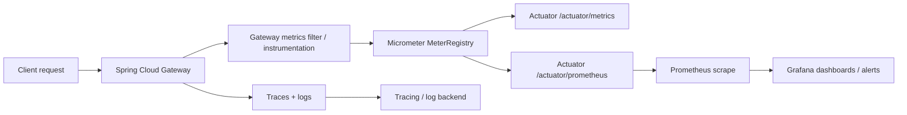
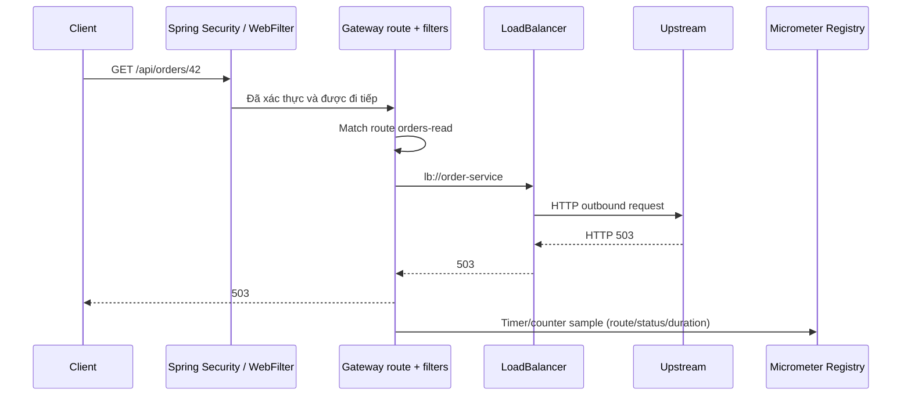
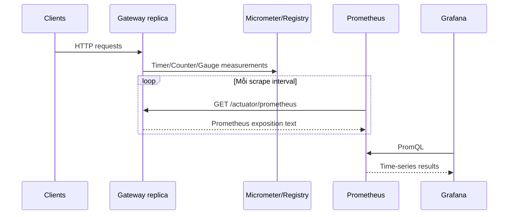

# Gateway metrics, Actuator và Micrometer

Một API Gateway có thể định tuyến request đúng về mặt cấu hình nhưng vẫn khiến người dùng gặp **độ trễ cao**, **HTTP 5xx**, **throttling**, **retry storm** hoặc lỗi chỉ xuất hiện ở một Gateway replica. Muốn vận hành **Spring Cloud Gateway** an toàn, không thể chỉ nhìn `application.yml` hay xác nhận endpoint trả `200`. Cần đo **lưu lượng, tỷ lệ lỗi, độ trễ và mức sử dụng tài nguyên**, gắn chúng với **route ID**, các filter và backend tương ứng.

Trong chương **Quan sát hệ thống**, bài này giới thiệu ba lớp làm việc cùng nhau: **Spring Cloud Gateway metrics** đo luồng xử lý ở Gateway; **Spring Boot Actuator** cung cấp các endpoint quản trị để kiểm tra trạng thái và chỉ số; còn **Micrometer** là lớp đo lường và xuất số liệu tới các backend như **Prometheus**. Bài sử dụng tình huống API Gateway có route predicate, filter chain, rewrite path/header, service discovery `lb://`, xác thực, rate limiting, circuit breaker, retry, TLS và tracing để chỉ ra **metric nào trả lời được câu hỏi nào**.

> **Phạm vi:** Ví dụ chính sử dụng **Spring Cloud Gateway Server WebFlux** cùng Spring Boot Actuator/Micrometer. Gateway Server Web MVC có stack và metric implementation riêng; một số tên thuộc tính, metric names, tags và HTTP endpoint access thay đổi theo phiên bản. Bài sẽ ghi rõ nơi cần xác minh bằng `/actuator/metrics` và `/actuator/prometheus` thay vì coi mọi mẫu JSON/PromQL là bất biến.

## 1. Vì sao một Gateway phải có metrics?

Gateway là điểm vào chung của nhiều microservices. Một sự cố ở đây có thể ảnh hưởng đồng thời nhiều API:

```text
              +---------------------------+
Clients ----> | Spring Cloud Gateway     |
              | route predicates          |
              | rewrite / filters         |
              | authentication            |
              | rate limiting             |
              | retry / circuit breaker   |
              | load balancing            |
              +------------+--------------+
                           |
                 +---------+---------+
                 |         |         |
             orders     catalog   payments
```

Những tình huống thường gặp:

- Route `orders-read` tăng tỷ lệ `503` vì `order-service` hết instance khỏe.
- Route `payments-create` tăng latency dù không thấy nhiều HTTP 5xx, bởi backend trả chậm.
- Spring Security từ chối nhiều request bằng `401` trước khi chúng được chọn vào route.
- Retry giúp client cuối nhận `200` nhưng backend thực tế bị gọi **ba lần**.
- Circuit breaker OPEN trả fallback nhanh, làm giảm latency nhưng tăng số request bị từ chối.
- Một replica có route definition cũ, nên metrics khác các replicas còn lại.
- Backend có certificate/SNI lỗi, dẫn đến TLS handshake failures khi proxy.
- Response cache tăng hit ratio nhưng có nguy cơ phục vụ dữ liệu cũ hoặc nhầm user/tenant nếu policy sai.

**Chỉ xem trạng thái HTTP cuối không đủ.** Bạn cần phân biệt request nào đến Gateway, request nào được chọn vào route, những lần gọi upstream thực tế và lỗi nào xảy ra trước/sau khi route được chọn.

### Bốn câu hỏi vận hành nền tảng

| Câu hỏi | Nhóm tín hiệu | Ví dụ |
| --- | --- | --- |
| **Có bao nhiêu request?** | Traffic/throughput | RPS theo route |
| **Bao nhiêu request thất bại?** | Errors | Tỷ lệ 5xx, 429, 401/403 theo phạm vi |
| **Request chậm đến mức nào?** | Latency | p50/p95/p99, deadline exceed |
| **Hệ thống còn khả năng phục vụ không?** | Saturation/capacity | CPU, event loop, connections, memory, queue |

Đây là cách tiếp cận gần với **bốn golden signals** của giám sát hệ thống. Để phát hiện vấn đề sớm, kết hợp metric Gateway với metric backend, hạ tầng, logs và traces.

## 2. Ba thành phần: Gateway, Actuator, Micrometer

| Thành phần | Chức năng | Không phải chức năng |
| --- | --- | --- |
| **Gateway metrics instrumentation** | Ghi nhận outcome/duration của request theo route, tùy phiên bản | Không phải một hệ thống lưu lịch sử lâu dài |
| **Micrometer** | API/registry/timer/counter/gauge, phân phối measurement | Không phải dashboard hoặc database time-series tự thân |
| **Spring Boot Actuator** | Expose management endpoints như `health`, `metrics`, `prometheus` | Không tự quyết định SLA/SLO hay cảnh báo |
| **Prometheus** | Scrape metrics endpoint và lưu time series | Không tự giải thích nguyên nhân của mọi sự cố |
| **Grafana/dashboard** | Hiển thị và so sánh số liệu | Không thay thế instrumentation đúng |
| **Distributed tracing** | Theo dõi một request qua Gateway và các services | Không phù hợp thay metric để thống kê toàn lưu lượng |
| **Structured logs** | Chi tiết sự kiện/lỗi cho từng request/attempt | Không nên dùng raw logs để làm metric có cardinality vô hạn |



Một số phiên bản có integration dựa trên Micrometer Observation thay vì các filter đo riêng lẻ; nhìn ở góc vận hành, mục tiêu vẫn là tạo **measurement có tên, tags, value** rồi chuyển tới hệ đo lường.

### Metric không phải log

Một log như:

```text
2026-11-24T12:00:00 route=orders-read status=503 latency_ms=824
```

mô tả **một sự kiện**. Metric dạng counter/timer tích lũy dữ liệu từ rất nhiều request; Prometheus có thể dùng nó để tính RPS/error rate/latency distribution. Để biết exception gốc của request 824 ms cụ thể, bạn thường cần trace/log, không chỉ graph p95.

## 3. Vòng đời đo một request ở Gateway



Sơ đồ là **mô hình khái niệm**. Hook đo duration có thể bao quanh những thành phần khác nhau tùy phiên bản; không suy rằng sample được ghi chính xác ở thời điểm gửi response bytes cuối cùng trong mọi trường hợp.

### Những mốc khác nhau tạo số đếm khác nhau

Một request có thể bị chặn trước khi được route:

```text
Client request
  |
  +-- Spring Security -> 401 (không vào route Gateway)
  |
  +-- Route predicates -> không match -> 404
  |
  +-- Route matched -> Gateway filters -> upstream
```

Hệ quả:

- Metrics HTTP server tổng quát có thể đếm **401/404** ở tầng web server.
- Metric **theo Gateway route** có thể chỉ xuất hiện với request đã match route hoặc đi tới phần instrumentation tương ứng.
- Mismatch giữa “HTTP requests” và “Gateway route requests” **không mặc nhiên là mất dữ liệu**.

Cần xác định **điểm instrument** của mỗi metric trước khi tính tỷ lệ lỗi hoặc báo cáo SLO.

## 4. Metric Gateway quan trọng: `spring.cloud.gateway.requests`

Trong nhiều dòng Spring Cloud Gateway Server WebFlux, một metric request timer được đặt tên:

```text
spring.cloud.gateway.requests
```

Khi Actuator/Micrometer instrumentation được bật và route được xử lý, timer có thể ghi lại duration/outcome và gắn các tags mô tả route.

Những tags thường gặp trong các phiên bản Gateway:

| Tag | Ví dụ | Ý nghĩa |
| --- | --- | --- |
| `routeId` | `orders-read` | ID route match |
| `routeUri` | `lb://order-service` | URI logic của route |
| `httpMethod` | `GET` | Method của request |
| `httpStatusCode` | `503` | Mã HTTP cuối theo hook của metric |
| `outcome` | `SUCCESS`, `SERVER_ERROR` | Phân nhóm kết quả |
| `status` | Tùy phiên bản | Trạng thái được Gateway instrumentation phân loại |
| `path` | `/api/orders/42` | Chỉ có nếu phiên bản và cấu hình cho phép; **nguy cơ cardinality** |

**Không mặc định mọi tag tồn tại hay có cùng ý nghĩa ở tất cả phiên bản.** Hãy gọi `/actuator/metrics/spring.cloud.gateway.requests` để xem `availableTags` thực tế. Đặc biệt, tag `status` có thể không biểu diễn cùng giá trị với `httpStatusCode`.

### Timer ghi những giá trị nào?

Micrometer `Timer` thường có:

- **count**: số lần đo đã ghi.
- **totalTime**: tổng duration của các lần đo.
- **max**: giá trị lớn nhất trong cửa sổ đo theo registry implementation.
- **histogram/buckets** nếu đã bật phân phối để phục vụ percentile Prometheus.
- Các tags phân nhóm metric.

Nếu 100 request có tổng thời gian 20 giây, thời gian trung bình là:

\[
\text{mean latency} = \frac{20\,\text{s}}{100} = 0{,}2\,\text{s}
\]

Tuy nhiên **mean không phản ánh tail latency**. Trong thực tế một vài request 5 giây có thể làm người dùng gặp vấn đề nghiêm trọng dù mean vẫn thấp.

### “Gateway request count” không nhất thiết bằng upstream attempt count

Một client request có thể đi qua `Retry`:

```text
Client GET /api/catalog/items/42  (1 logical request)
  -> upstream attempt 1: 503
  -> upstream attempt 2: 503
  -> upstream attempt 3: 200
Client nhận 200
```

Gateway request timer có thể ghi **một kết quả cuối là 200**; backend đã nhận **ba attempts**. Không dùng `spring.cloud.gateway.requests` làm phép đếm số backend attempts nếu instrumentation chỉ quan sát request logic. Muốn thấy retry amplification, kết hợp metrics của HTTP client/upstream hoặc custom attempt instrumentation.

## 5. Metric HTTP server và metric Gateway khác nhau

Spring Boot/Micrometer có thể expose metric HTTP server tổng quát (thường gặp `http.server.requests`), ngoài metric route-specific Gateway.

| Metric/góc nhìn | Điểm đo | Trả lời tốt |
| --- | --- | --- |
| `http.server.requests` | Tầng HTTP server, tùy auto-instrumentation | Tổng request vào Gateway, kể cả nhiều lỗi trước routing |
| `spring.cloud.gateway.requests` | Tầng request đi qua route Gateway | RPS/latency/status theo route |
| HTTP client metrics | Outbound calls của HTTP client/transport khi được instrument | Upstream attempts/latency/connect failures |
| LoadBalancer metrics | Instance selection nếu có instrumentation | Phân phối lựa chọn instance, no-instance |
| Resilience4j metrics | CircuitBreaker/Retry/Bulkhead/TimeLimiter được bind | Breaker state, permitted/rejected calls, retries |
| JVM/process metrics | Runtime và host | CPU, GC, memory, threads, file descriptors |
| Backend service metrics | Bên trong microservice | Handler latency, DB latency, nghiệp vụ |

**Tên metric HTTP server và tags thực tế phụ thuộc Spring Boot/Micrometer registry.** Đừng cộng hai metric request counters để ra tổng traffic: chúng có thể đo **cùng một request ở hai lớp khác nhau**.

### Ví dụ quan sát 401 và 404

- `401 Unauthorized` do Spring Security chặn trước Gateway route mapping có thể xuất hiện ở metric HTTP server, nhưng **không có routeId**.
- `404 Not Found` do không route nào match có thể chỉ được tính ở tầng HTTP server.
- `404` do backend `order-service` trả sau khi match route có thể xuất hiện trong **Gateway requests theo routeId**.

Để điều tra “Gateway 404 tăng”, phải phân biệt **route miss** với **backend business 404**, không chỉ nhìn tổng số 404.

## 6. Cấu hình các dependency cần thiết

Một ứng dụng Gateway WebFlux muốn dùng Actuator + Prometheus thường cần:

```xml
<dependencies>
    <!-- Chọn starter Gateway Server WebFlux đúng phiên bản BOM. -->
    <dependency>
        <groupId>org.springframework.cloud</groupId>
        <artifactId>spring-cloud-starter-gateway</artifactId>
    </dependency>

    <dependency>
        <groupId>org.springframework.boot</groupId>
        <artifactId>spring-boot-starter-actuator</artifactId>
    </dependency>

    <dependency>
        <groupId>io.micrometer</groupId>
        <artifactId>micrometer-registry-prometheus</artifactId>
    </dependency>
</dependencies>
```

Đây là ví dụ **Maven cho một dòng version dùng tên starter `spring-cloud-starter-gateway`**. Với các dòng Spring Cloud Gateway mới, starter cụ thể có thể được đổi tên theo `server-webflux`. Dùng Spring Boot + Spring Cloud BOM tương thích và kiểm tra dependency tree/starter chính thức **trong module của phiên bản đang triển khai**.

Ý nghĩa ba dependency:

1. **Gateway starter:** có các router/filter/runtime cần đo.
2. **Actuator starter:** cung cấp management endpoint và auto-configuration quan sát.
3. **Micrometer Prometheus registry:** cho phép xuất meter dưới định dạng Prometheus khi endpoint được bật.

Nếu thiếu registry Prometheus, `/actuator/metrics` có thể vẫn hoạt động nhưng `/actuator/prometheus` không nhất thiết tồn tại.

### Không trộn MVC và WebFlux starters để “đủ metrics”

Server Web MVC và Server WebFlux có auto-configuration/phân tầng khác nhau. Nếu tài liệu hoặc dependency dẫn đến stack MVC, hãy dùng metric/Actuator của MVC và kiểm tra names/filters tương ứng; không kỳ vọng một reactive Gateway metrics filter chạy trong Servlet pipeline.

## 7. Bật Actuator metrics và Prometheus endpoint

Cấu hình minh họa:

```yaml
server:
  port: 8080

management:
  server:
    port: 9090
  endpoints:
    web:
      exposure:
        include: "health,info,metrics,prometheus,gateway"
  endpoint:
    health:
      show-details: when_authorized
    gateway:
      access: read-only
  metrics:
    tags:
      application: api-gateway
```

Giải thích:

- `server.port=8080`: cổng API Gateway phục vụ clients.
- `management.server.port=9090`: cổng dành cho management endpoints.
- `exposure.include`: chọn các endpoint HTTP muốn expose.
- `health.show-details=when_authorized`: tránh công khai quá nhiều health details.
- `gateway.access=read-only`: **chỉ tương thích với những phiên bản Spring Boot/Gateway có hỗ trợ property và mode này**.
- `management.metrics.tags.application`: common tag có cardinality thấp để phân biệt ứng dụng trong metrics backend.

**Rủi ro bảo mật:** Bật `/actuator/prometheus` hoặc `/actuator/gateway/routes` là công khai thông tin vận hành nếu không có network/Security. Cần firewall, internal service discovery, mTLS/VPN/scrape identity theo policy; không expose toàn bộ Actuator ra public internet.

### Sự khác biệt theo phiên bản

Ở các bản Spring Boot/Spring Cloud Gateway khác:

- `management.endpoint.gateway.access` có thể chưa tồn tại; cần cơ chế enable/access khác.
- Route configuration prefix có thể là `spring.cloud.gateway.routes` hoặc `spring.cloud.gateway.server.webflux.routes`.
- Gateway metrics enablement có thể là `spring.cloud.gateway.metrics.enabled` hoặc property dưới prefix `server.webflux`.
- HTTP metrics may use Observation-based instrumentation với names/tags khác.

Vì vậy **đọc cấu hình của phiên bản** thay vì copy tất cả properties mới/cũ. Đối với bài học này, tính chính xác phải được xác minh qua endpoint **metric thực** và kiểm thử request thật.

## 8. Ba endpoint để bắt đầu quan sát

| Endpoint | Vai trò | Cách dùng |
| --- | --- | --- |
| `GET /actuator/health` | Kiểm tra tình trạng sức khỏe ứng dụng/theo nhóm | Readiness/liveness theo policy |
| `GET /actuator/metrics` | Liệt kê meter names mà Actuator đang thấy | Khám phá tên metric |
| `GET /actuator/metrics/{name}` | Xem measurement và availableTags của meter | Kiểm tra Gateway meter và tag values |
| `GET /actuator/prometheus` | Xuất metrics theo Prometheus exposition format | Cho Prometheus scrape |
| `GET /actuator/gateway/routes` | Xem runtime routes khi có Gateway Actuator | Đối chiếu route ID, URI, filter |
| `GET /actuator/info` | Thông tin build/deploy nếu cấu hình | Correlate version và rollout |

### Kiểm tra bằng curl ở lab

```bash
curl -i http://127.0.0.1:9090/actuator/health

curl -sS http://127.0.0.1:9090/actuator/metrics

curl -sS \
  http://127.0.0.1:9090/actuator/metrics/spring.cloud.gateway.requests

curl -sS http://127.0.0.1:9090/actuator/prometheus
```

Lệnh mẫu giả định management listener ở loopback và không yêu cầu credential trong lab. Trong production, dùng quyền được cấp và kết nối mã hóa/được bảo vệ; đừng tắt Spring Security chỉ để dùng curl.

### Actuator health không đồng nghĩa business readiness

Một ứng dụng Gateway có thể trả `health=UP` nhưng:

- Route `lb://orders` không có service instances.
- TLS outbound tới payment service lỗi.
- CircuitBreaker đã OPEN.
- DNS của một backend sai.
- Một route quan trọng chưa được refresh trên một replica.

Do đó readiness tổng quát **không tự bảo đảm mọi backend của mọi route khỏe**. Nếu cần readiness phản ánh dependency nào, cần thiết kế health indicators/graceful degradation tránh biến sự cố một service thành mất toàn bộ Gateway.

## 9. Đọc `/actuator/metrics/spring.cloud.gateway.requests`

Một response minh họa:

```json
{
  "name": "spring.cloud.gateway.requests",
  "description": "Gateway request timing",
  "baseUnit": "seconds",
  "measurements": [
    {
      "statistic": "COUNT",
      "value": 1250
    },
    {
      "statistic": "TOTAL_TIME",
      "value": 245.5
    },
    {
      "statistic": "MAX",
      "value": 1.25
    }
  ],
  "availableTags": [
    {
      "tag": "routeId",
      "values": ["orders-read", "catalog-public"]
    },
    {
      "tag": "httpMethod",
      "values": ["GET", "POST"]
    },
    {
      "tag": "httpStatusCode",
      "values": ["200", "404", "503"]
    }
  ]
}
```

Đây là **JSON minh họa**, không phải giá trị thật hay schema tags cố định của mọi registry/version. Quan sát riêng:

- `COUNT=1250`: số samples đã ghi trong phạm vi tổng hợp của endpoint, không phải 1250 RPS.
- `TOTAL_TIME=245.5`: tổng thời gian theo đơn vị báo cáo, không phải p95.
- `MAX=1.25`: lớn nhất theo cửa sổ đo/implementation.
- `availableTags`: liệt kê những giá trị tag đã tồn tại trong meter registry.

### Tìm metric theo route

Actuator metrics endpoint có thể nhận query tag filter:

```bash
curl -sS \
  'http://127.0.0.1:9090/actuator/metrics/spring.cloud.gateway.requests?tag=routeId:orders-read'
```

Ý nghĩa: chỉ tổng hợp những meter samples có `routeId=orders-read` khi tag/metric tồn tại. Phải kiểm tra response thật vì một bản Gateway có thể dùng tên tag hoặc meter khác.

### Chưa thấy metric thì có hẳn là lỗi?

Không nhất thiết. Nhiều meters được **register khi có request đầu tiên**. Nếu ứng dụng mới khởi động nhưng chưa có request match route, metric `spring.cloud.gateway.requests` có thể chưa hiện trong `/actuator/metrics`.

Kiểm tra:

1. Gateway metrics instrumentation có bật không?
2. Route có thực sự match request không?
3. Có ít nhất một request kết thúc đủ điều kiện ghi metric chưa?
4. Có endpoint/registry đúng không?
5. Request có bị chặn trước route (Security/route miss) không?
6. Đang gọi đúng Gateway replica không?

Đừng kết luận "Prometheus mất metrics" trước khi kiểm tra meter tồn tại tại Actuator của process.

## 10. Prometheus scrape hoạt động ra sao?

Actuator `/actuator/prometheus` trả về các **time series** theo Prometheus exposition format. Prometheus lấy mẫu theo chu kỳ, ví dụ mỗi 15 hoặc 30 giây, lưu các time series và cho phép query bằng **PromQL**.



Khi ứng dụng có nhiều replicas, **mỗi replica có một MeterRegistry riêng**. Prometheus nên scrape từng instance/pod qua cơ chế discovery đáng tin; không scrape một Service load-balanced chung rồi tưởng đó là số liệu của toàn cluster.

### Vì sao scrape qua load balancer có thể sai?

Giả sử hai Gateway replicas:

```text
gateway-a: route orders-read count=1000
gateway-b: route orders-read count=2000
```

Nếu Prometheus chỉ scrape `gateway-service:9090` qua một load balancer, các lượt scrape có thể tới A/B luân phiên. Counter quan sát được nhảy giữa 1000 và 2000, làm `rate()` sai và không đại diện tổng cluster.

**Cách đúng:** Mỗi pod/instance có target identity (ví dụ `instance`/`pod`), rồi tổng hợp `sum(rate(...))` trong PromQL. Với Kubernetes, có thể dùng ServiceMonitor/PodMonitor của Prometheus Operator nếu hạ tầng hỗ trợ và đã cấu hình.

## 11. Prometheus metric names: từ dấu chấm sang dấu gạch dưới

Micrometer meter:

```text
spring.cloud.gateway.requests
```

Khi xuất ra Prometheus với Timer theo giây, có thể thấy các series dạng:

```text
spring_cloud_gateway_requests_seconds_count
spring_cloud_gateway_requests_seconds_sum
spring_cloud_gateway_requests_seconds_max
spring_cloud_gateway_requests_seconds_bucket
```

**`_bucket` chỉ xuất hiện khi histogram/SLO buckets được cấu hình và registry hỗ trợ**. Tên chính xác cũng có thể thay đổi theo Micrometer version/naming convention. Kiểm tra `/actuator/prometheus` rồi mới viết PromQL/dashboards.

Một exposition mẫu rút gọn:

```text
# HELP spring_cloud_gateway_requests_seconds Gateway request timer
# TYPE spring_cloud_gateway_requests_seconds summary
spring_cloud_gateway_requests_seconds_count{routeId="orders-read",httpMethod="GET",httpStatusCode="200"} 1224
spring_cloud_gateway_requests_seconds_sum{routeId="orders-read",httpMethod="GET",httpStatusCode="200"} 246.8
```

**Đây là số liệu và labels giả lập**. Khi histogram bật, type và các series/buckets có thể khác. Một số phiên bản thay đổi label names hoặc không xuất đồng thời mọi tags, nên không cố ép Prometheus query phải chạy với một schema chưa xác minh.

## 12. RPS theo route

RPS (**requests per second**) thường lấy từ tốc độ tăng của counter.

Nếu có metric count:

```promql
sum(
  rate(spring_cloud_gateway_requests_seconds_count[5m])
)
```

Câu này ước lượng **RPS tổng** của những request được Gateway timer đo, tính trung bình tốc độ tăng trong cửa sổ 5 phút.

RPS theo route:

```promql
sum by (routeId) (
  rate(spring_cloud_gateway_requests_seconds_count[5m])
)
```

RPS cho một route cụ thể:

```promql
sum(
  rate(
    spring_cloud_gateway_requests_seconds_count{
      routeId="orders-read"
    }[5m]
  )
)
```

**Đừng dùng giá trị `COUNT` từ `/actuator/metrics` làm RPS**. Đó là số đếm tích lũy theo meters được đo, còn `rate()` cần **nhiều scrapes theo thời gian** để ước lượng tốc độ.

### Cửa sổ 1 phút và 5 phút khác gì?

- `rate(...[1m])` nhạy hơn với tăng đột biến nhưng nhiễu khi traffic thấp/scrape thưa.
- `rate(...[5m])` ổn định hơn nhưng có thể làm mờ spikes ngắn.
- Cảnh báo thường dùng nhiều cửa sổ tùy SLO, không phải một ngưỡng duy nhất.

Nếu Prometheus mới scrape một lần, `rate()` chưa đủ điểm dữ liệu; đó không phải bằng chứng Gateway không có traffic.

## 13. Tỷ lệ HTTP 5xx

Một PromQL minh họa theo label `httpStatusCode` nếu nó tồn tại:

```promql
sum(
  rate(
    spring_cloud_gateway_requests_seconds_count{
      httpStatusCode=~"5.."
    }[5m]
  )
)
/
clamp_min(
  sum(rate(spring_cloud_gateway_requests_seconds_count[5m])),
  0.001
)
```

Ý nghĩa:

\[
\text{5xx rate} = \frac{\text{tốc độ các request trả 5xx}}{\text{tốc độ tất cả request được đo}}
\]

Ở đây `clamp_min` chỉ giúp tránh chia cho zero số học; với traffic cực thấp, tỷ lệ vẫn có thể không đủ ý nghĩa để alert mà không thêm điều kiện minimum traffic.

**Lưu ý về mẫu số:** Đây là **tỷ lệ 5xx trong tập Gateway route metrics**, không nhất thiết tỷ lệ 5xx của **toàn bộ HTTP requests vào process**. Nếu API Gateway từ chối request sớm trước routing, metric theo route có thể không đếm chúng.

### Tỷ lệ lỗi theo route

```promql
sum by (routeId) (
  rate(
    spring_cloud_gateway_requests_seconds_count{
      httpStatusCode=~"5.."
    }[5m]
  )
)
/
clamp_min(
  sum by (routeId) (
    rate(spring_cloud_gateway_requests_seconds_count[5m])
  ),
  0.001
)
```

Phép toán PromQL ghép từng vector theo labels; cần bảo đảm tags/scope của tử số và mẫu số tương thích. Ở bản sử dụng tag khác, phải sửa selectors trước.

### 4xx có luôn tính là thất bại không?

Không. Ví dụ:

- `400`: client gửi input không hợp lệ.
- `401`: Security từ chối token thiếu/sai, có thể là hành vi đúng.
- `403`: user không có quyền, thường không phải lỗi khả dụng.
- `404`: route miss hoặc resource not found.
- `429`: rate limiter chủ động bảo vệ backend.

Với **SLO khả dụng**, xác định chính sách lỗi theo hợp đồng dịch vụ, không gộp mặc định mọi 4xx vào “Gateway unavailable”. Mặt khác, spike `401/403/429` vẫn rất đáng theo dõi vì có thể báo auth outage, attack hoặc quota issue.

## 14. Latency: mean, p95, p99 và histogram

Độ trễ của một request có thể chịu ảnh hưởng của:

```text
Gateway receive
  -> Spring Security / route matching
  -> filter chain / rewrite
  -> Service discovery / load balancing
  -> DNS/TCP/TLS
  -> upstream processing
  -> Retry/backoff hoặc fallback
  -> response transfer
```

Mỗi metric duration đo **phạm vi thời gian** khác nhau. Gateway timer có thể bao phủ khoảng xử lý route, còn HTTP client timer chỉ đo outbound attempt, backend handler timer chỉ đo nội bộ service. **Không cộng số p95 của các tầng để suy ra p95 end-to-end**; percentile của tổng không bằng tổng percentile.

### Average latency với Prometheus

```promql
sum(
  rate(spring_cloud_gateway_requests_seconds_sum[5m])
)
/
clamp_min(
  sum(rate(spring_cloud_gateway_requests_seconds_count[5m])),
  0.001
)
```

Đơn vị là **giây**, nếu metric Prometheus timer có hậu tố `_seconds`.

### p95 cần histogram buckets

Nếu muốn tính p95 trên toàn cluster:

```promql
histogram_quantile(
  0.95,
  sum by (le) (
    rate(spring_cloud_gateway_requests_seconds_bucket[5m])
  )
)
```

Theo route:

```promql
histogram_quantile(
  0.95,
  sum by (le, routeId) (
    rate(spring_cloud_gateway_requests_seconds_bucket[5m])
  )
)
```

**Câu lệnh chỉ chạy nếu `_bucket` thật sự tồn tại.** Không lấy `_sum`/`_count` để tính p95 trực tiếp; hai giá trị đó chỉ đủ tính mean. Prometheus histogram quantile là **ước lượng dựa vào bucket boundaries**, không phải toàn bộ raw latencies.

### Bật histogram có chủ đích

Trong các bản Spring Boot/Micrometer hỗ trợ configuration property này:

```properties
management.metrics.distribution.percentiles-histogram.spring.cloud.gateway.requests=true
```

Thuộc tính dùng một **metric name prefix** để bật percentile histogram. Kiểm tra format theo version và registry; sau khi bật, gọi `/actuator/prometheus` và xác nhận có series `spring_cloud_gateway_requests_seconds_bucket`. Nếu không thấy, xem meter naming, Boot configuration binding, registry dependency và traffic sample.

**Đánh đổi:** Histogram tăng số time series theo số buckets nhân với số tổ hợp tags; cân nhắc bucket/SLO boundaries và chi phí lưu trữ. Đừng bật histogram cho mọi metric có tags cardinality cao một cách vô điều kiện.

### Ví dụ cảnh báo tail latency

Giả sử route `orders-read` có p95 850 ms trong 10 phút, còn budget SLO là 500 ms. Điều đó cho biết khoảng 5% request có duration trên ngưỡng xấp xỉ p95, **không** chứng minh upstream database là nguyên nhân. Cần so sánh các spans/metrics theo route, HTTP client, backend và resource saturation để khoanh vùng.

## 15. Tag cardinality: rủi ro lớn nhất khi tự mở rộng metrics

**Cardinality** là số lượng tổ hợp time series khác nhau được tạo bởi labels/tags.

Giả sử bạn dùng:

```text
metric = spring.cloud.gateway.requests

tags:
  routeId = 20 giá trị
  httpMethod = 4 giá trị
  httpStatusCode = 10 giá trị
  instance = 6 giá trị
```

Số tổ hợp tiềm năng đã là:

\[
20 \times 4 \times 10 \times 6 = 4\,800
\]

Nếu còn thêm `path` với 100.000 resource IDs, số series có thể tăng khổng lồ, chưa tính buckets của histogram.

### Những tags nên và không nên dùng

| Tag | Thường phù hợp? | Vì sao |
| --- | --- | --- |
| `routeId` từ config cố định | Có, nếu số routes được quản lý | Cardinality có thể kiểm soát |
| `httpMethod` | Có | Tập giá trị nhỏ |
| `httpStatusCode` | Có | Tập giá trị hữu hạn |
| `outcome` | Có | Tập nhóm nhỏ |
| `application`/environment/region | Có, nếu lấy từ hạ tầng đáng tin | Phục vụ tổng hợp theo deployment |
| `serviceId` có allowlist | Cân nhắc | Có thể phát triển nếu dynamic route quá nhiều |
| **Full path** `/api/users/123456` | **Không** | Mỗi user/resource ID tạo series |
| **Full query** | **Không** | Cardinality và PII/secrets |
| **userId/tenantId raw** | **Không** | Vừa lộ danh tính vừa bùng nổ series |
| **traceId/spanId** | **Không** | Mỗi request có ID riêng |
| **Authorization/Cookie/JWT** | **Tuyệt đối không** | Lộ credentials |
| Exception message | **Không** | Có thể chứa URI/PII, cardinality cao |
| Route URI với host ngẫu nhiên | Cân nhắc tránh | Dynamic target có thể tạo vô số values |

Một tag `routeId` cũng có thể high cardinality nếu ứng dụng tạo **một route ID cho mỗi user/tenant/request**. Không kết luận “routeId luôn an toàn” nếu mô hình tuyến động vượt giới hạn hợp lý.

### Đừng bật path tag chỉ để debug

Một số phiên bản Gateway hỗ trợ lựa chọn gắn `path` vào Gateway metric, thường bị tắt mặc định vì cardinality. Nếu cần theo dõi endpoint, dùng **path template chuẩn hóa** hoặc route ID, không ghi raw dynamic path.

Ví dụ:

```text
KHÔNG nên:
  path=/api/users/123456/orders/999

NÊN:
  routeId=users-orders
  operation=read-user-orders  (tập giá trị hữu hạn)
```

Không tạo metric label có email, địa chỉ, số điện thoại, access token, session ID hoặc request body. Đối với multi-tenant monitoring, dùng log/traces có kiểm soát hoặc cohort cardinality thấp, không lộ raw tenant IDs vào Prometheus labels.

## 16. Monitoring 401, 403, 404 và 429 đúng lớp

Không phải status nào cũng đi qua Gateway route instrumentation.

| HTTP status | Nguồn có thể | Nhóm metric cần đối chiếu |
| --- | --- | --- |
| `401` | Spring Security trước route hoặc upstream auth | `http.server.requests` + security logs + route metrics nếu đã match |
| `403` | Authorization policy, CORS/Origin guard, upstream | Security/CORS metrics/logs |
| `404` | Không match route, backend resource not found | Route ID logs + HTTP server/Gateway metrics |
| `429` | RequestRateLimiter tại Gateway hoặc upstream quota | Rate limiter metrics, route metrics, HTTP server metrics |
| `502` | Proxy/Ingress hoặc upstream gateway | Gateway/ingress/HTTP client metrics |
| `503` | No-instance, CircuitBreaker fallback, upstream unavailable | LoadBalancer, breaker, Gateway route metrics |
| `504` | Timeout ở ingress/proxy/backend | Timeout metrics, trace spans, Gateway HTTP client |

Một request bị `401` trước `RoutePredicateHandlerMapping` có thể **không sinh tag routeId**. Nếu dashboard “Authentication failures theo route” chỉ dùng `spring.cloud.gateway.requests`, nó có thể bỏ sót đúng nhóm lỗi bảo mật mà bạn muốn theo dõi.

### Phân biệt “route not found” với “upstream not found”

Nếu `GET /api/orders/42` trả `404`:

1. Xem route definition/runtime route có `orders-read` không.
2. Xem request method/path/host có match predicate không.
3. Nếu route match, xem upstream status/log.
4. Nếu route không match, sửa predicate/order hoặc route source/refresh.
5. Dùng HTTP server metrics đếm 404 tổng và Gateway route metrics đếm 404 sau routing nếu instrument như vậy.

## 17. Metrics của Retry: đếm request logic và attempts

Giả sử 1.000 client requests:

- 900 thành công ngay.
- 80 thành công sau retry một lần.
- 20 thất bại sau tổng ba attempts.

Upstream attempts:

\[
900 \times 1 + 80 \times 2 + 20 \times 3 = 1\,120
\]

Client requests = `1.000`. Gateway metric route có thể ghi 1.000 outcomes (tùy điểm đo), còn backend/HTTP client nhận 1.120 calls.

| Chỉ số | Giá trị ví dụ |
| --- | ---: |
| Client requests | 1.000 |
| Client successes | 980 |
| Client failures | 20 |
| Upstream attempts | 1.120 |
| Attempts/request trung bình | 1,12 |
| Request retry ít nhất một lần | 100 |

**Metric `spring.cloud.gateway.requests` không mặc định có trường “retry attempts”.** Nếu cần tính amplification, dùng metric retry framework chính xác, HTTP client attempts hoặc custom observation ở boundary của mỗi attempt.

### Retry che lỗi upstream như thế nào?

Upstream gửi `503 → 200` nhưng client nhận `200`, nên Gateway 5xx rate có thể thấp trong khi upstream đang bất ổn. Nếu chỉ nhìn client success rate, bạn có thể không phát hiện lượng attempts bổ sung và backend capacity bị tiêu thụ.

Theo dõi:

- Client-visible 5xx ratio.
- Upstream attempt failure ratio.
- Retry attempt count per route/operation.
- Retry exhausted count.
- Backoff time và end-to-end latency.
- Idempotency/duplicate side effects đối với POST có retry.

**Tránh double-count:** Nếu instrumentation HTTP client đo mỗi attempt, không cộng metric client request và upstream attempts để tính tổng requests.

## 18. CircuitBreaker và resilience metrics

Nếu route dùng Spring Cloud CircuitBreaker + Resilience4j, có thể cần thêm Micrometer binder/Actuator integration phù hợp để xuất metrics.

Những nhóm thông tin cần theo dõi:

| Nhóm | Ý nghĩa |
| --- | --- |
| Breaker state | CLOSED/OPEN/HALF_OPEN |
| Permitted/rejected calls | Bao nhiêu calls được phép hoặc bị chặn |
| Failure rate | Phần trăm calls thất bại theo cửa sổ đo |
| Slow-call rate | Phần trăm calls vượt slow threshold |
| Buffered calls | Số calls trong sliding window |
| Fallback activations | Bao nhiêu request đã dùng fallback |
| TimeLimiter timeouts | Calls bị timeout trong protected boundary |
| Retry attempts | Những attempts phát sinh trước/trong protected call |

Tên metric Resilience4j tùy binder/phiên bản; một số meter có dạng `resilience4j.circuitbreaker.calls` hoặc state metrics, nhưng **không mặc định chúng được đăng ký chỉ nhờ có CircuitBreaker filter**. Kiểm tra `/actuator/metrics` sau khi có traffic và khi dependency/metrics integration đã bật.

### Tại sao Gateway 200 không có nghĩa breaker khỏe?

Nếu backend lỗi nhưng fallback trả `200` với dữ liệu giảm chức năng, client-visible success rate có thể cao nhưng tính năng chính đã suy giảm. Dashboard cần phân biệt **normal success** và **degraded/fallback success**.

Không định nghĩa SLO chỉ bằng HTTP status nếu hợp đồng yêu cầu dữ liệu đầy đủ/đúng độ mới. Một cached fallback `200` có thể là đáp ứng chấp nhận được cho public catalog nhưng không phù hợp với báo cáo thanh toán thời gian thực.

### Breaker OPEN khác upstream `503`

- Nếu breaker OPEN và từ chối call trước HTTP client, **không có upstream attempt**.
- Nếu upstream trả `503`, một attempt đã đi tới backend.
- Nếu LoadBalancer không tìm được instance, Gateway có thể trả `503` nhưng backend không nhận request.

Cần ba lớp metric/traces để phân biệt, không chỉ HTTP code.

## 19. LoadBalancer, discovery và TLS trong hệ quan sát

Metric Gateway theo route `uri=lb://order-service` cho biết **logical destination**, không nhất thiết cho biết instance vật lý. Muốn tìm nguyên nhân của `503` hoặc connect timeout, cần thêm thông tin:

- Service ID đã được route chọn.
- Danh sách instances từ DiscoveryClient/ServiceInstanceListSupplier.
- Selected host/port cho từng outbound attempt.
- DNS lookup, TCP connect timeout và TLS handshake errors.
- HTTP client connection pool utilization và thời gian chờ.
- Upstream response code/latency.
- Gateway replica ID, service discovery cache freshness.

### LoadBalancer chọn instance không bảo đảm thành công

Một route có thể:

```text
Route match:
  orders-read

Logical URI:
  lb://order-service

Selected instance:
  10.20.1.15:8443

Connection:
  TLS hostname verification failed
```

Trong trường hợp này, route tồn tại và load balancing đã chọn instance, nhưng HTTP request có thể chưa hoàn tất. Không “sửa” bằng cách tăng Retry hoặc tắt TLS verification; điều tra certificate SAN/SNI, trust chain, secure metadata và hostname.

### DNS và cache instance là các vòng đời độc lập

Refresh route không tự làm mới DNS cache, LoadBalancer instance cache hay HTTP connection pool. Metrics và logs cần phân biệt:

- Route không active.
- Route active nhưng không có instance.
- Instance có nhưng DNS chưa phân giải.
- DNS đúng nhưng TCP/TLS thất bại.
- Kết nối thành công nhưng upstream trả lỗi.

**Một metric 503 duy nhất không đủ phân loại tất cả các tình huống này.**

## 20. Actuator Gateway endpoints và metrics bổ trợ nhau

Khi Gateway Actuator được hỗ trợ và expose an toàn, có thể dùng:

```bash
curl -sS http://127.0.0.1:9090/actuator/gateway/routes

curl -sS http://127.0.0.1:9090/actuator/gateway/routedefinitions

curl -sS \
  http://127.0.0.1:9090/actuator/gateway/routes/orders-read
```

Những endpoint này giúp đọc **route configuration/runtime**, nhưng **không phải metric counters**.

| Công cụ | Trả lời câu hỏi |
| --- | --- |
| `/actuator/gateway/routes` | Runtime có route ID nào? |
| `/actuator/gateway/routedefinitions` | Definition được khai báo ra sao? |
| `/actuator/gateway/routes/{id}` | URI, predicate, filter và order của một route? |
| `/actuator/metrics/spring.cloud.gateway.requests` | Metric request theo route có measurement/tag nào? |
| `/actuator/prometheus` | Time series để Prometheus scrape? |
| Tracing backend | Request cụ thể đi qua route và instance nào? |
| Backend access logs | Upstream nhận chính xác path/status gì? |

**Có route trong Actuator không chứng minh nó đang nhận traffic.** Ngược lại, có Gateway metric `orders-read` trong registry cũng không chứng minh route còn active nếu meter chưa bị remove sau thay đổi; cần kiểm tra timestamp/traffic mới và route runtime.

## 21. An toàn endpoint quản trị và Prometheus scraping

Một Actuator management endpoint có thể lộ:

- Nội bộ service IDs/route URIs.
- HTTP status, traffic volumes và lỗi vận hành.
- Filter arguments hoặc cấu hình liên quan security.
- Tên application/region/instance.
- Trong hệ thống cấu hình sai, bí mật có thể được nhúng vào route URI/header filter.

### Tách mạng và cấp quyền

1. Dùng **management port/internal endpoint** riêng nếu kiến trúc cho phép.
2. Chỉ expose `health`, `metrics`, `prometheus`, `gateway` khi thực sự cần.
3. Áp network policy/firewall để chỉ monitoring agents/operators truy cập.
4. Có authentication/authorization hoặc mTLS cho scrape theo policy.
5. Giới hạn Gateway Actuator **read-only** khi chỉ cần xem.
6. Không expose `POST/DELETE/refresh route` ra public chỉ vì đã bật endpoint đọc.
7. Audit truy cập bất thường vào management APIs.
8. Không đưa access token/Basic auth credentials vào URL hoặc dashboards.

### Vì sao không nên dùng một public URL cho Prometheus?

Nếu để `https://api.example.test/actuator/prometheus` công khai, người ngoài có thể đọc traffic rate, HTTP error ratio, route IDs và thông tin nội bộ. Một số tổ chức cố ý cho scrape public theo chính sách riêng, nhưng mặc định **nên giữ trong management network**.

### ServiceMonitor/PodMonitor

Trong Kubernetes, Prometheus Operator có thể dùng `ServiceMonitor`/`PodMonitor` để tìm đúng từng Gateway pod. Cấu hình cần bảo đảm:

- Mỗi target thực sự truy cập được management port.
- Scrape path đúng `/actuator/prometheus`.
- TLS/authentication và network policy phù hợp.
- Labels về pod/instance/namespace có cardinality được kiểm soát.
- Không scrape qua một Service load-balanced làm mất identity của target.

Tên và API của các CRDs phụ thuộc hạ tầng Prometheus Operator đang dùng; bài không coi chúng là thành phần bắt buộc của Spring Cloud Gateway.

## 22. Thiết kế dashboard đầu tiên

Một dashboard Gateway hữu ích nên có **toàn cụm và từng route**:

| Panel | Metric/query nguồn | Mục đích |
| --- | --- | --- |
| Incoming HTTP RPS | HTTP server request counter | Tổng traffic vào Gateway |
| Gateway route RPS | Gateway timer count | Traffic tới từng route |
| Client-visible 5xx ratio | Gateway/HTTP server status counters | Tính khả dụng |
| p50/p95/p99 latency | Gateway histogram khi có buckets | Tail latency |
| 401/403/429 trends | HTTP server/Security/rate limiter | Authentication, authorization, abuse/quota |
| Retry amplification | Upstream attempts vs client requests | Phát hiện tăng tải do retry |
| CircuitBreaker state/rejections | Resilience4j metrics | Degraded/backend protection |
| No-instance/connection/TLS errors | LB/HTTP client diagnostics | Định vị lỗi kết nối |
| JVM heap/direct memory/GC | JVM/Netty/process metrics | Saturation/pressure |
| Active connections/event loop | Transport metrics nếu instrument | Capacity và bottleneck |
| Gateway pod health/uptime | Process/Actuator health | Rollout và instance availability |
| Top error routes | HTTP status theo routeId | Ưu tiên xử lý sự cố |

### Một dashboard nên trả lời ba câu

1. **Có sự cố không?** Traffic, 5xx, latency hoặc saturation thay đổi?
2. **Sự cố nằm ở route/replica nào?** Route ID và instance labels.
3. **Nên điều tra lớp nào?** Security, matching, LoadBalancer, backend, Retry/CircuitBreaker, TLS, cache?

Đừng xây một dashboard chỉ có 30 biểu đồ mà không biết hành động nào cần thực hiện khi một đường màu tăng.

### Chia theo dimension có kiểm soát

- Route ID, application, deployment version, region, cluster, replica.
- HTTP method/outcome/status.
- Backend service ID khi instrumentation có hỗ trợ và cardinality hữu hạn.
- Không dùng dynamic user path, token, tenant raw IDs.

## 23. Định nghĩa SLI/SLO có ý nghĩa

**SLI** là chỉ số đo chất lượng dịch vụ; **SLO** là mục tiêu đặt trên SLI. Ví dụ:

- Availability SLO: 99,9% request GET `orders-read` đủ điều kiện có kết quả thành công trong 30 ngày.
- Latency SLO: 99% request đọc đơn hàng có độ trễ end-to-end dưới 500 ms.
- Error budget: phần tỷ lệ được phép vi phạm trong cửa sổ SLO.

### Cần định nghĩa “good request” thật rõ

Nếu response `429` do client cố tình vượt quota, có tính là lỗi SLO không? Nếu fallback trả `200` nhưng body giảm chất lượng, có được tính success không? Nếu người dùng gửi token hết hạn và nhận `401`, điều này có phải outage không?

Không có một câu trả lời duy nhất; SLO phải dựa trên **hợp đồng API và tác động người dùng**.

### Ví dụ tính availability đơn giản

Giả sử trong một cửa sổ đo có 100.000 eligible requests:

- 99.920 request thành công theo hợp đồng.
- 80 request thất bại do backend/Gateway.

\[
\text{Availability} =
\frac{99\,920}{100\,000}
= 99{,}92\%
\]

Mục tiêu 99,9% được đạt trong cửa sổ đó. Nhưng muốn tính chính xác, phải loại/trọng số các request không thuộc tập eligible (ví dụ health probes, invalid auth attempts) theo policy đã công bố, không chỉ dùng mọi dòng metric có status 2xx.

### Multi-window burn-rate alert

Một SLO theo tháng có thể dùng fast burn và slow burn alerts để phát hiện khi error budget đang bị tiêu thụ quá nhanh. Cần PromQL phù hợp với actual eligible-request denominator; không dùng một threshold “5xx > 1%” cho mọi service mà không xét traffic, route criticality và target.

## 24. Ví dụ tình huống tổng hợp: route trả chậm nhưng 5xx thấp

Quan sát:

```text
Route: catalog-read
Client RPS: 200
Client 5xx: 0.1%
Gateway p95: 2.8 giây
Backend p95: 350 ms
Retry per client request: tăng mạnh
CircuitBreaker: gần ngưỡng OPEN
```

Lập luận:

1. Backend p95 thấp hơn Gateway p95, nhưng **không tự kết luận Gateway CPU chậm**.
2. Retry có thể khiến một client request trải qua hai attempts, backoff và timeout trước khi thành công.
3. Client cuối vẫn nhận 200 nên 5xx thấp, nhưng latency tăng.
4. Cần xem upstream attempt count, connect/response timeouts, selected instances và breaker events.
5. Nếu nhiều attempts vào một instance vừa rời, kiểm tra discovery cache/connection pool.
6. Nếu TLS handshake lặp thất bại, tăng retry có thể chỉ làm latency tệ hơn.
7. Sau sửa, nhìn lại Gateway p95, retry ratio, instance health và client-visible success.

**Bài học:** Metrics giúp **đặt giả thuyết có thể kiểm chứng**; không tự đưa ra nguyên nhân gốc chỉ từ một biểu đồ.

## 25. Thực hành từng bước: bật metrics cho route orders

Giả sử API Gateway có route:

```yaml
spring:
  cloud:
    gateway:
      routes:
        - id: orders-read
          uri: lb://order-service
          predicates:
            - Path=/api/orders/**
            - Method=GET
          filters:
            - StripPrefix=1
```

Đây là cấu hình WebFlux theo một dòng version truyền thống; nếu bản dùng `spring.cloud.gateway.server.webflux.routes`, điều chỉnh đúng prefix. Cần nguồn instances và LoadBalancer tương ứng.

### Bước 1 — Có Actuator và Prometheus registry

Thêm dependency Actuator và `micrometer-registry-prometheus`, bảo đảm Spring Boot/Spring Cloud BOM tương thích.

### Bước 2 — Expose endpoints cần thiết

Cho phép `health`, `metrics`, `prometheus` và nếu cần `gateway` chỉ ở management network.

### Bước 3 — Phát một request

```bash
curl -i http://localhost:8080/api/orders/42
```

Để có số liệu mô phỏng lỗi, upstream test stub có thể trả `200` và `503` theo kịch bản. Không gây lỗi có chủ đích trên production traffic.

### Bước 4 — Tìm Gateway meter

```bash
curl -sS http://localhost:9090/actuator/metrics

curl -sS \
  http://localhost:9090/actuator/metrics/spring.cloud.gateway.requests
```

Kiểm tra metric name, measurements và `availableTags`. Nếu metric chưa tồn tại, kiểm tra version/config/traffic.

### Bước 5 — Kiểm tra Prometheus exposition

```bash
curl -sS http://localhost:9090/actuator/prometheus |
  grep 'spring_cloud_gateway_requests'
```

Trong Windows hoặc môi trường không có `grep`, dùng công cụ tương đương hoặc tìm trong response. Dạng tên metric phải lấy từ output thật.

### Bước 6 — Bật histogram nếu cần p95

Bật property histogram phù hợp version, xác minh `_bucket` xuất hiện và PromQL `histogram_quantile` có dữ liệu. Không cố dùng `_bucket` khi registry không xuất buckets.

### Bước 7 — Scrape từng replica

Prometheus lưu instance labels và tính `sum by (routeId) (rate(...))` cho toàn cluster. Không scrape một URL Gateway qua load balancer một cách ngẫu nhiên.

### Bước 8 — Đối chiếu backend

Gửi request lỗi có kiểm soát; so sánh:

- Client-visible Gateway status.
- Gateway route metric count/duration.
- HTTP client/upstream attempt count.
- Backend access log request count.
- Resilience4j metrics nếu route dùng breaker/retry.

Khi chúng không bằng nhau, kiểm tra **các điểm đo khác nhau** trước khi cho là bug.

## 26. Micrometer API: Timer, Counter và Gauge khác nhau

Micrometer cung cấp nhiều loại meter:

| Meter | Ý nghĩa | Ví dụ dùng trong Gateway |
| --- | --- | --- |
| `Counter` | Số lần một sự kiện xảy ra, tích lũy tăng | RateLimit rejections, fallback activations |
| `Timer` | Count + duration của các operations | Gateway request duration, outbound HTTP call |
| `DistributionSummary` | Phân phối giá trị không phải duration | Body size, response size nếu đo phù hợp |
| `Gauge` | Giá trị đo tại thời điểm quan sát | Active WebSocket connections, in-flight requests |
| `LongTaskTimer` | Những task kéo dài đang tồn tại | Streaming/long-running operations nếu có use case |

**Không tạo Counter cho mọi thứ có thể suy ra từ Timer count.** Nếu `Timer` đã cung cấp `count`, một Counter song song cho cùng sự kiện chỉ làm tăng chi phí và nguy cơ mismatch.

### Ví dụ custom Counter có cardinality thấp

Nếu application có một chính sách fallback riêng cần đo:

```java
@Component
public class FallbackMetrics {

    private final MeterRegistry registry;

    public FallbackMetrics(MeterRegistry registry) {
        this.registry = registry;
    }

    public void recordFallback(String reason) {
        // reason phải được mapping vào tập giá trị nhỏ đáng tin.
        String normalized = switch (reason) {
            case "timeout" -> "timeout";
            case "breaker_open" -> "breaker_open";
            case "no_instance" -> "no_instance";
            default -> "other";
        };

        registry.counter(
            "gateway.fallback.activations",
            "reason", normalized
        ).increment();
    }
}
```

Đây là đoạn Java minh họa cho một app có Micrometer; production cần version Java hỗ trợ `switch expression`, imports, tests và chỉ gọi `recordFallback` khi fallback **thực sự được kích hoạt**. Không đưa exception message/raw URL/user ID vào `reason`. Tên metric khi xuất sang Prometheus có thể được suffix `_total` hoặc naming convention khác; xem registry output thực tế.

### Metric tag mapping từ request không tin cậy

Không tạo:

```java
// ANTI-PATTERN: tạo một time series cho mỗi user input.
registry.counter(
    "gateway.requests.by.user",
    "userId", request.getHeader("X-User-Id")
).increment();
```

Nó vừa cho phép attacker tạo vô số label values, vừa có thể lộ danh tính. Nếu cần per-user fraud analytics, dùng hệ thống event/log được bảo vệ, không phải metric labels.

## 27. Các lỗi thường gặp khi bật metrics

| Triệu chứng | Nguyên nhân có thể | Cách kiểm tra |
| --- | --- | --- |
| `/actuator/metrics` trả 404 | Thiếu Actuator/exposure/access hoặc sai management port | Dependency, URL, Actuator config |
| `/actuator/prometheus` trả 404 | Thiếu Prometheus registry, endpoint chưa expose | Registry dependency, endpoint mapping |
| `/metrics` có tên khác tài liệu | Version/instrumentation khác | Liệt kê meter names thật |
| Gateway metric không thấy | Chưa có request qua route, metric disabled, dùng MVC thay WebFlux | Gửi test request, kiểm tra stack |
| `http.server.requests` có 401 nhưng Gateway route metric không có | Security chặn trước routing | Xem request lifecycle |
| PromQL `rate` rỗng | Chỉ có một scrape hoặc query metric name/tag sai | Target health, metric exposition, window |
| PromQL `_bucket` không tồn tại | Histogram chưa bật hoặc naming khác | Registry output, distribution config |
| p95 tăng sau retry | Nhiều attempts/backoff/timeout | Upstream attempt metrics |
| Gateway 5xx thấp, backend 5xx cao | Retry/fallback che lỗi | Client outcomes vs upstream attempts |
| Metrics lúc tăng lúc giảm bất thường | Scrape qua load-balanced service nhiều pods | Scrape từng replica/instance |
| Prometheus storage bùng nổ | Tag `path`/userId/query cardinality cao | Metric cardinality audit |
| 429 tăng nhưng backend bình thường | Gateway rate limit chủ động | RateLimiter decisions/metrics |
| 503 tăng nhưng backend không thấy requests | CircuitBreaker OPEN hoặc no-instance | Breaker/LB metrics |
| TLS failures nhưng Gateway route tồn tại | TLS client outbound lỗi | Client SSL/SNI/hostname logs |
| Dashboard không thấy route vừa thêm | Route chưa nhận request, chưa refresh, filter không instrument | Actuator routes + traffic test |
| High CPU/GC khi bật histogram | Quá nhiều buckets x tag combinations | Giảm cardinality/bucket count |
| Alert 4xx quá nhiều | SLO classifier sai | Tách auth/client errors khỏi server availability |

## 28. Ma trận kiểm thử observability cho Gateway

| Test | Tác động thử nghiệm | Điều cần xác minh |
| --- | --- | --- |
| T1 | Gateway khởi động | `health`, `metrics` truy cập được theo policy |
| T2 | Không có Prometheus registry | Endpoint prometheus có thể không tồn tại |
| T3 | GET route thành công | Gateway timer count tăng |
| T4 | GET route trả 503 | Metric route/status phản ánh theo instrumentation |
| T5 | Security từ chối 401 trước route | HTTP server và route metrics không bị giả định cùng count |
| T6 | Request không khớp route | HTTP server 404; route label có thể không tồn tại |
| T7 | Backend trả business 404 | Route matched, upstream nhận request |
| T8 | Retry `503 → 200` | Client success khác upstream attempt count |
| T9 | CircuitBreaker OPEN | Upstream calls giảm, reject/fallback metrics tăng |
| T10 | LoadBalancer không có instance | Phân biệt 503 do no-instance |
| T11 | TLS cert sai | SSL/transport error, không phải path rewrite |
| T12 | RateLimiter trả 429 | Policy decision trước outbound call |
| T13 | Bật histogram | `_bucket` xuất hiện và p95 query chạy |
| T14 | Không có traffic gần đây | Không diễn giải `rate` rỗng thành 0 tuyệt đối |
| T15 | Hai Gateway replicas | Mỗi replica là một scrape target |
| T16 | Dynamic route ID mới | Metric không tạo vô số labels ngoài chủ đích |
| T17 | Public route dùng cache | Client requests khác backend calls; phân biệt cache hit |
| T18 | Request có path chứa user ID | Không đưa raw path vào metric tags |
| T19 | Request có JWT/cookie | Không lộ credentials trong metrics/logs |
| T20 | Upgrade Spring Boot/Gateway | Metric names/tags/schema/dashboards còn tương thích |
| T21 | WebSocket handshake | HTTP 101/handshake metric khác active connection gauge |
| T22 | Streaming response | Định nghĩa timer duration và cancellation rõ ràng |
| T23 | Backend response nhanh, Gateway chậm | Điều tra retry/network/filter, không quy hết backend |
| T24 | Management endpoint không có quyền | Không expose metrics/routes cho anonymous |
| T25 | Prometheus scrape gap | Dashboard/alert phân biệt target down với request rate giảm |
| T26 | Canary deploy khác route config | So sánh per-replica route metrics/labels |
| T27 | SLO threshold vượt mức | Alert có action và runbook rõ |
| T28 | Trace correlated với metric spike | Có thể tìm exemplar/trace tiêu biểu mà không gắn traceId làm metric label |

Không chỉ kiểm tra “metric có tồn tại”. Một hệ đo lường đáng tin phải có **unit, tag schema, measurement lifecycle, security và dashboard query** được kiểm thử.

## 29. Runbook khi “Prometheus không thấy Gateway metrics”

1. **Xác nhận stack và version:** Gateway Server WebFlux hay Server Web MVC? Dependency nào đang dùng?
2. **Kiểm tra Actuator:** `/actuator/health` và `/actuator/metrics` có trả dữ liệu trên management port đúng không?
3. **Kiểm tra Prometheus registry:** Dependency `micrometer-registry-prometheus` và `/actuator/prometheus` đã enable/expose chưa?
4. **Kiểm tra authentication/network:** Prometheus scrape target có nhận `200` không, hay `401/403/404`/timeout?
5. **Kiểm tra traffic:** Có request thật đi qua route sau khi app khởi động không?
6. **Kiểm tra metric name/tag:** Dùng `/actuator/metrics` và raw exposition, không đoán tên.
7. **Kiểm tra enablement:** Gateway metrics instrumentation có bị disable qua property/version không?
8. **Kiểm tra target identity:** Có đang scrape đúng từng replica hay nhầm một load-balanced Service?
9. **Kiểm tra scrape history:** `rate()` cần nhiều data points; query time window có hợp lý không?
10. **Kiểm tra histogram:** Nếu cần p95 mà thiếu `_bucket`, kiểm tra distribution config.
11. **Kiểm tra cardinality:** Có high-cardinality tags khiến registry/Prometheus tải cao không?
12. **Kiểm tra dashboard:** Query có hard-code label `routeId`/`httpStatusCode` khác version thật không?
13. **Sau sửa:** Gửi một request test qua route, xác minh meter tăng ở Actuator, raw Prometheus, rồi PromQL/dashboard.

### Khi metrics có nhưng kết quả “sai”

Một chỉ số sai thường là do **định nghĩa tập được đo** chứ không phải thư viện tính số học sai:

- Gateway 5xx chỉ đếm route-matched requests, còn bạn đang so với HTTP server traffic.
- Retry khiến một client request tạo nhiều outbound attempts.
- Fallback biến upstream failure thành client-visible `200`.
- Một HTTP timer đo đến response completion, metric khác đo upstream handler duration.
- Một label routeId bị thay đổi giữa deployment, làm chuỗi time series mới.
- Prometheus scrape qua load balancer làm counters bị trộn replicas.
- Histogram đã đổi buckets, query p95 không thể so sánh trực tiếp theo cùng phương pháp.

Trước khi sửa hệ thống, hãy ghi rõ **đơn vị, điểm bắt đầu/kết thúc measurement, tags, scope, registry và phiên bản**.

## 30. Bài tập ứng dụng: dashboard bảo vệ orders và payments

Một Gateway có:

- `GET /api/orders/**` → `lb://order-service`, `StripPrefix=1`, retry giới hạn cho GET.
- `POST /api/payments` → `lb://payment-service`, không retry tự động nếu thiếu idempotency.
- CircuitBreaker bảo vệ orders khi upstream liên tục lỗi.
- Spring Security JWT bảo vệ cả hai.
- RateLimiter giới hạn requests theo principal.
- Ba Gateway replicas chạy phía sau Ingress và Prometheus scrape metrics qua management port.

### Nhiệm vụ A — Baseline metrics

Thiết lập Actuator và Prometheus registry. Tạo dashboard tối thiểu gồm:

1. Gateway HTTP requests/second tổng.
2. Requests/second theo `routeId`.
3. Client-visible 5xx ratio.
4. p95 duration theo route (chỉ dùng histogram khi có buckets).
5. 401/403/429 counts theo lớp instrumentation phù hợp.
6. Retry attempts và circuit breaker rejects nếu có meters.
7. JVM memory/GC, process CPU và active connections theo khả năng đo.

### Nhiệm vụ B — Phát hiện retry storm

Giả sử 100 client GET requests vào orders và backend nhận 280 attempts. Cần giải thích:

- Vì sao `spring.cloud.gateway.requests` có thể chỉ ghi 100 outcomes?
- Backend attempts/request trung bình là bao nhiêu?
- Retry đang che lỗi 503 hay timeout nào?
- Backoff/deadline có còn phù hợp SLO không?
- CircuitBreaker có đang bảo vệ backend đúng phạm vi không?

### Nhiệm vụ C — Phân biệt `503`

Thiết kế test lần lượt cho:

- Backend trả `503` thật.
- LoadBalancer không tìm được instance.
- CircuitBreaker đã OPEN.
- Outbound TLS handshake thất bại.

Hãy đo **Gateway outcome**, **upstream calls**, **breaker metric**, **LB state** và **TLS/HTTP client logs**, rồi giải thích vì sao không thể dùng chỉ metric `httpStatusCode=503` để kết luận cùng một nguyên nhân.

### Nhiệm vụ D — Bảo mật hệ quan sát

Kiểm tra:

- `/actuator/prometheus` không truy cập được từ public internet.
- Prometheus có đường scrape được phê duyệt đến từng replica.
- Không có tag `userId`, raw `path` động, `Authorization`, `Cookie` hay query chứa bí mật.
- Operator chỉ có quyền read-only với Gateway Actuator.
- Traces/logs dùng correlation ID nhưng không gắn `traceId` thành time-series metric label.

### Câu hỏi tự kiểm tra

1. Vai trò khác nhau của Gateway metrics instrumentation, Micrometer và Actuator là gì?
2. Vì sao `/actuator/metrics` không thay thế Prometheus time-series storage?
3. Metric `spring.cloud.gateway.requests` thường được dùng để đo gì?
4. `COUNT` trong Actuator có tương đương RPS không?
5. Tại sao phải dùng `rate()` trên counter để tính RPS?
6. Vì sao `http.server.requests` và Gateway route metrics có thể đếm số request khác nhau?
7. `401` do Spring Security chặn sớm có chắc được gắn `routeId` không?
8. Vì sao backend trả `404` khác route miss `404` về khả năng instrumentation?
9. Vì sao `Retry` có thể khiến upstream attempts lớn hơn client request count?
10. Breaker OPEN có bắt buộc backend nhận request không?
11. Vì sao fallback `200` làm client-visible success rate có thể che degraded functionality?
12. `_sum`/`_count` có đủ để tính p95 không?
13. Cần bật gì để Prometheus có `_bucket` và tính `histogram_quantile`?
14. Vì sao p95 của Gateway không nhất thiết bằng p95 của backend?
15. Tag `path=/api/users/123` có nguy cơ gì?
16. Có nên gắn `traceId` hoặc access token vào Micrometer tag không?
17. Vì sao Prometheus không nên scrape một Gateway Service qua load balancer để đại diện toàn cluster?
18. `lb://order-service` cho biết service ID hay instance IP vừa được chọn?
19. Một response `503` có thể bắt nguồn từ bao nhiêu lớp khác nhau?
20. Tại sao `health=UP` chưa chắc nghĩa là mọi upstream route đang phục vụ thành công?
21. Khi thay version Gateway, cần kiểm thử tính tương thích của điều gì trong metric/PromQL?
22. Vì sao management Actuator GET endpoints vẫn cần được bảo vệ?
23. Khi latency cao nhưng 5xx thấp, cần điều tra retry/circuit breaker và network ra sao?
24. Định nghĩa tập “eligible request” ảnh hưởng availability SLO như thế nào?
25. Những dấu hiệu nào giúp phân biệt scrape target down và request rate bằng 0?

**Ghi nhớ:** **Spring Cloud Gateway metrics** đo hành vi request theo tuyến; **Micrometer** tổ chức measurement bằng timer/counter/gauge và registry; **Actuator** expose số liệu và trạng thái quản trị; **Prometheus** lưu time series để tính RPS, lỗi và latency. Luôn phân biệt **HTTP server requests, Gateway route requests và upstream attempts**, đặc biệt khi có Security, Retry, CircuitBreaker, LoadBalancer và fallback. Chỉ dùng những metric names/tags thật sự tồn tại trong phiên bản triển khai, tránh high-cardinality/PII, scrape **từng Gateway replica**, bảo vệ management endpoints và kết hợp metrics với traces/logs để chẩn đoán nguyên nhân chính xác.

