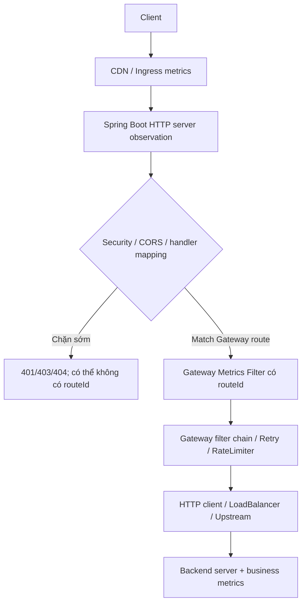
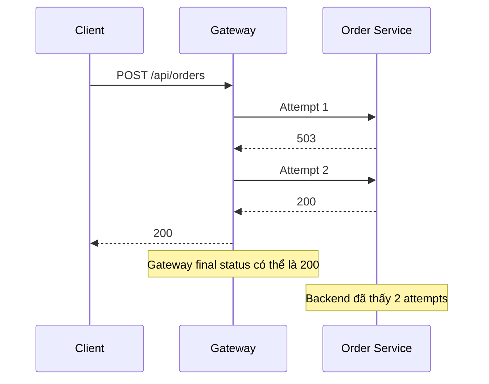
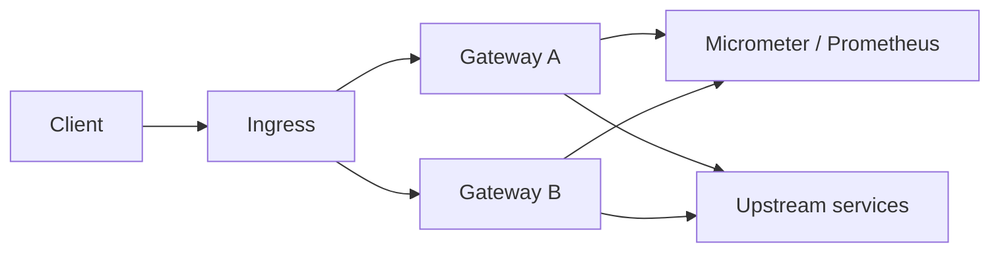

# Số lượng yêu cầu, độ trễ, kết quả và mã HTTP theo route trong Spring Cloud Gateway

Một hệ thống microservices có thể trả về rất nhiều HTTP response `200` nhưng vẫn vận hành không tốt: một API đặt hàng bị chậm, một tuyến thanh toán trả `502` ngắt quãng hoặc một route mới âm thầm chặn toàn bộ traffic bằng `429`. Nếu chỉ nhìn CPU của Gateway và tổng số HTTP requests, người vận hành khó biết **route nào** đang gặp vấn đề, lỗi xuất phát từ Gateway hay downstream, và trải nghiệm người dùng có đang vượt ngưỡng SLO không.

Trong **Spring Cloud Gateway**, quan sát lưu lượng theo **route ID** là cách gắn dữ liệu với quyết định định tuyến. Một dashboard hữu ích cần ít nhất bốn nhóm tín hiệu:

1. **Số lượng yêu cầu**: mỗi route nhận bao nhiêu requests trong một khoảng, tốc độ bao nhiêu request/giây (RPS)?
2. **Độ trễ**: request mất bao lâu; trung bình và các percentile p50/p95/p99 có khác nhau thế nào?
3. **Kết quả**: request thuộc nhóm `SUCCESSFUL`, `CLIENT_ERROR`, `SERVER_ERROR` hoặc outcome khác?
4. **Mã HTTP**: route trả bao nhiêu `200`, `201`, `302`, `401`, `403`, `404`, `429`, `500`, `502`, `503`, `504`?

Bài thuộc chương **Quan sát hệ thống** của module `SPRING_CLOUD_GATEWAY`. Gateway ở đây là cổng vào microservices với route predicates, filter chain, biến đổi path/header, service discovery và load balancing. Các cơ chế xác thực, giới hạn lưu lượng, circuit breaker, retry và TLS đều có thể ảnh hưởng tới metrics; vì vậy cần biết **metrics đo ở lớp nào** trước khi suy luận nguyên nhân.

**Mục tiêu học tập:** bật và kiểm tra Micrometer/Gateway metrics, giải thích các tag route/status/outcome, viết truy vấn PromQL cho lưu lượng và latency, nhận diện khoảng trống quan sát của 401/404/connection error, thiết kế dashboard/alert theo SLO và kiểm thử số liệu end-to-end.

> **Phạm vi phiên bản:** Phần thực hành chính là **Spring Cloud Gateway Server WebFlux**, nơi tài liệu chính thức mô tả `Gateway Metrics Filter` và meter `spring.cloud.gateway.requests`. Các nhánh Spring Cloud Gateway cũ và mới khác tên thuộc tính; Server Web MVC/Servlet có hệ metrics và conventions riêng. Vì tài liệu reference và configuration-metadata có thể mô tả default khác nhau, hãy **bật metrics tường minh và xác minh Actuator/Prometheus trên phiên bản được deploy** trước khi kết luận. Các route, URL, số liệu và mục tiêu SLO trong bài là ví dụ.

## 1. Vì sao metric theo route quan trọng hơn tổng traffic?

Giả sử Gateway có ba tuyến:

```yaml
spring:
  cloud:
    gateway:
      server:
        webflux:
          routes:
            - id: catalog-api
              uri: lb://catalog-service
              predicates:
                - Path=/api/catalog/**
              filters:
                - StripPrefix=1

            - id: orders-api
              uri: lb://order-service
              predicates:
                - Path=/api/orders/**
              filters:
                - StripPrefix=1

            - id: payments-api
              uri: lb://payment-service
              predicates:
                - Path=/api/payments/**
              filters:
                - StripPrefix=1
```

Nếu toàn Gateway nhận 12.000 requests trong 5 phút nhưng 90% là catalog, một đợt lỗi 50% trên route payments có thể **bị che khuất** khi nhìn tỉ lệ 5xx toàn hệ thống.

Ví dụ minh họa:

| Route | Số requests/5 phút | Số 5xx | Tỷ lệ 5xx |
| --- | ---: | ---: | ---: |
| `catalog-api` | 10.800 | 11 | 0,10% |
| `orders-api` | 900 | 9 | 1,00% |
| `payments-api` | 300 | 150 | 50,00% |
| **Toàn Gateway** | **12.000** | **170** | **1,42%** |

Tỷ lệ tổng khoảng 1,42% không nói rằng **một nửa** request thanh toán bị lỗi. Vì thế mọi tín hiệu RED (Rate, Errors, Duration) nên được phân tích **theo route** trước khi aggregate toàn Gateway.

### 1.1. Tên route là hợp đồng quan sát

Một route ID tốt:

- Ổn định theo thời gian, ví dụ `payments-api`.
- Có ý nghĩa nghiệp vụ và phù hợp mã nguồn/config.
- Không chứa request ID, user ID, số đơn hoặc timestamp.
- Không thay đổi mỗi khi service discovery trả một instance mới.
- Có cách phân biệt environment/region qua **labels ổn định** bên ngoài khi cần.

Route IDs sinh động cho mỗi user/path có thể làm tăng cardinality metrics đến mức rất tốn RAM và dung lượng Prometheus.

## 2. Bốn loại dữ liệu: count, latency, outcome, HTTP status

Các trường này liên quan nhưng không tương đương.

| Tín hiệu | Câu hỏi | Ví dụ câu trả lời | Sai lầm cần tránh |
| --- | --- | --- | --- |
| **Count** | Bao nhiêu requests đã được ghi nhận? | 600 trong 1 phút. | Nhầm counter tích lũy với RPS hiện tại. |
| **Rate/RPS** | Trung bình có bao nhiêu request/giây? | 10 RPS trong 1 phút. | Lấy một mẫu counter và coi đó là tốc độ. |
| **Duration** | Request mất bao lâu? | p95 = 280 ms. | Chỉ xem average khi tail latency xấu. |
| **Outcome** | Nhóm HTTP status là gì? | `SUCCESSFUL`, `CLIENT_ERROR`. | Xem mọi 4xx đều là lỗi server. |
| **Status/code** | Mã cuối cùng client nhận? | `200`, `429`, `503`. | Tưởng 200 nghĩa là giao dịch nghiệp vụ thành công. |

Một **Timer** của Micrometer thường ghi ít nhất **count** và **total time**; khi cấu hình distribution/histogram phù hợp, có thể có thêm các bucket dùng tính p95/p99.

### 2.1. Count và Rate khác nhau

Nếu count tăng từ 1.200 lên 1.800 trong 60 giây:

```text
Requests trong 60 giây = 1.800 - 1.200 = 600
RPS trung bình          = 600 / 60 = 10 requests/giây
```

Trong Prometheus, hãy dùng `rate(counter[5m])` hoặc `increase(counter[5m])`; chúng có cơ chế xử lý counter reset khi instance restart.

**Không lấy hiệu hai mẫu counter thô** trên các replicas khác nhau mà quên restart, missing scrapes và cửa sổ thời gian.

### 2.2. Latency trung bình không phải p95

Hai routes có cùng average 100 ms nhưng phân bố khác:

```text
Route A: đa số request 80–120 ms.
Route B: 95% request 5 ms, 5% request gần 2 giây.

Average có thể gần nhau nhưng tail latency khác xa.
```

Để vận hành, nên đo p50/p95/p99, tỷ lệ request dưới latency SLO, và **kèm sample count**. p99 từ 12 requests trong một phút không đủ ổn định để ra quyết định như p99 từ 100.000 requests.

### 2.3. Outcome không phải business outcome

`outcome=SUCCESSFUL` thường được phân loại từ HTTP status `2xx`, không có nghĩa:

- Thanh toán đã settle ở payment provider.
- Đơn hàng chắc chắn đã commit.
- Backend không dùng cached/fallback response.
- Nội dung JSON không chứa lỗi nghiệp vụ.

Cần metric hoặc event của backend về **business success** và tracing để nối lại nguyên nhân. Một fallback trả HTTP `200` có thể được đếm `SUCCESSFUL` dù downstream đang hỏng.

## 3. Gateway Metrics Filter trong Server WebFlux

Tài liệu chính thức Gateway Server WebFlux mô tả **Gateway Metrics Filter** thu thập một Micrometer **Timer** tên:

```text
spring.cloud.gateway.requests
```

Những tag quan trọng:

| Tag của Gateway meter | Ý nghĩa | Ví dụ | Ghi chú |
| --- | --- | --- | --- |
| `routeId` | Route đã được chọn. | `orders-api` | Nhãn chính cho dashboard. |
| `routeUri` | URI được định nghĩa trên route. | `lb://order-service` | Thường không phải URL của instance thực tế. |
| `outcome` | Nhóm kết quả theo HTTP status series. | `SUCCESSFUL` / `SERVER_ERROR` | Tốt để tổng hợp tỉ lệ nhóm. |
| `status` | Trạng thái HTTP trả về theo cách meter gắn tag. | Có thể là tên status. | **Xem giá trị thực trên exporter**. |
| `httpStatusCode` | Mã HTTP của response. | `200` / `429` / `503` | Hữu ích cho lọc 4xx/5xx. |
| `httpMethod` | Method đầu vào. | `GET` / `POST` | Phân tích tải theo loại operation. |
| `path` (tùy chọn) | Đường dẫn request. | `/api/orders/42` | Có thể gây cardinality rất cao. |

Các tag trên là contract được tài liệu Gateway Metrics Filter công bố. Tuy nhiên **Prometheus exporter có thể chuẩn hóa tên metric/tag**; không viết query production dựa trên một ví dụ không kiểm tra. Đặc biệt, `status` và `httpStatusCode` là hai nhãn riêng; nếu muốn lọc mã số, ưu tiên kiểm tra `httpStatusCode` thay vì đoán `status` luôn chứa `"500"`.

### 3.1. Các nhánh Gateway có tên property khác nhau

| Nhánh | Property đáng kiểm tra | Điều cần làm |
| --- | --- | --- |
| Gateway WebFlux cũ | `spring.cloud.gateway.metrics.enabled`. | Bật và kiểm tra filter/meter trên version đó. |
| Gateway Server WebFlux 5.x | `spring.cloud.gateway.server.webflux.metrics.enabled`. | Bật tường minh, kiểm tra cả dependencies/Actuator. |
| WebFlux 5.x path tag | `spring.cloud.gateway.server.webflux.metrics.path-tags.enabled`. | Thường để `false` để tránh raw-path cardinality. |
| WebFlux 5.x deprecated path config | `spring.cloud.gateway.server.webflux.metrics.tags.path.enabled`. | Không ưu tiên; tài liệu ghi có thể bị loại bỏ. |
| Gateway Server Web MVC | Không sao chép các WebFlux filter/metrics properties một cách máy móc. | Kiểm tra meter conventions của MVC/Servlet riêng. |

Tài liệu trang `Global Filters` của WebFlux có đoạn mô tả filter hoạt động khi không đặt `spring.cloud.gateway.metrics.enabled=false`, trong khi metadata cấu hình 5.1.0 liệt kê `spring.cloud.gateway.server.webflux.metrics.enabled` với default `false`. **Không dựa vào mô tả default khi triển khai**: đặt property đúng variant thành `true`, khởi động và xác minh meter thực sự có dữ liệu.

### 3.2. Không gọi mọi HTTP metric là Gateway metric

Một ứng dụng có thể cùng có:

- `spring.cloud.gateway.requests`: timer được gắn bởi **Gateway Metrics Filter**, có `routeId` khi route phù hợp.
- `http.server.requests` hoặc meter HTTP server observation tương đương theo Spring Boot/Micrometer version: đo HTTP tại **server boundary**, có thể thấy request bị từ chối trước Gateway route.
- `http.client.requests`: đo một HTTP client/outbound interaction/observation khi instrumentation hỗ trợ, không mặc định một-một với client requests.
- Reactor Netty connection pool metrics: connections, pending acquires, TLS/connect failures nếu được bật.

Mỗi meter có **scope và lifecycle khác nhau**. Không cộng count của `http.server.requests` và `spring.cloud.gateway.requests` như thể đó là hai nguồn traffic độc lập; có thể chúng mô tả cùng request ở hai tầng.

## 4. Bật Actuator và Micrometer đúng cách

Đối với Spring Cloud Gateway **Server WebFlux**, thêm Actuator:

```xml
<dependency>
    <groupId>org.springframework.boot</groupId>
    <artifactId>spring-boot-starter-actuator</artifactId>
</dependency>
```

Để xuất số liệu cho Prometheus:

```xml
<dependency>
    <groupId>io.micrometer</groupId>
    <artifactId>micrometer-registry-prometheus</artifactId>
</dependency>
```

Spring Boot và Spring Cloud versions cần được quản lý bằng BOM phù hợp. Không thêm một registry/version ngẫu nhiên có thể làm xung đột Micrometer API.

### 4.1. Ví dụ `application.yml` cho WebFlux 5.x

```yaml
spring:
  application:
    name: edge-gateway
  cloud:
    gateway:
      server:
        webflux:
          metrics:
            enabled: true
            path-tags:
              enabled: false

management:
  endpoints:
    web:
      exposure:
        include: health,info,metrics,prometheus
```

**Giải thích:**

- `metrics.enabled: true`: chủ động bật Gateway metrics đúng namespace WebFlux 5.x.
- `path-tags.enabled: false`: không đưa mỗi raw path vào một nhãn time-series.
- `metrics` endpoint cho phép kiểm tra meter trong Actuator.
- `prometheus` endpoint xuất data theo định dạng Prometheus nếu registry có trên classpath.

**Không copy đoạn YAML này sang một Gateway WebFlux nhánh cũ hoặc Server MVC mà không kiểm tra cấu hình thực tế.** Với nhánh cũ, thuộc tính tương ứng có thể nằm tại `spring.cloud.gateway.metrics.enabled`.

### 4.2. Tại sao Actuator exposure chưa đủ bảo mật?

`management.endpoints.web.exposure.include` chỉ điều khiển endpoint nào có thể truy cập qua web; nó **không có nghĩa** endpoint tự được xác thực đúng cho production.

Một cấu hình vận hành nên:

1. Đặt management port/mạng riêng hoặc network policy giới hạn Prometheus targets.
2. Chỉ cho phép collector/observer cần thiết gọi `/actuator/metrics` và `/actuator/prometheus`.
3. Dùng TLS/mTLS, service identity hoặc authorization phù hợp môi trường.
4. Không expose wildcard `*` chỉ để dễ debug.
5. Không bật **Gateway Actuator write/refresh CRUD** ra Internet khi chỉ cần đọc metrics.
6. Bảo vệ route definitions, exporter labels và metadata; chúng có thể tiết lộ service topology.

Khi management chạy ở application context/port riêng, kiểm tra Spring Security matcher tương ứng. `401/403` từ endpoint metrics chưa chắc do request proxy route bị rate-limit.

## 5. Kiểm tra meter qua Actuator

Sau khi Gateway khởi động và có request chạy qua route `catalog-api`, kiểm tra **management endpoint trên môi trường được phép truy cập**:

```bash
curl -sS \
  "http://localhost:8080/actuator/metrics/spring.cloud.gateway.requests"
```

Kết quả có thể hiển thị tên meter, loại measurement và các available tags. Một JSON **minh họa cấu trúc**:

```json
{
  "name": "spring.cloud.gateway.requests",
  "measurements": [
    {"statistic": "COUNT", "value": 42.0},
    {"statistic": "TOTAL_TIME", "value": 3.8},
    {"statistic": "MAX", "value": 0.34}
  ],
  "availableTags": [
    {"tag": "routeId", "values": ["catalog-api", "orders-api"]},
    {"tag": "outcome", "values": ["SUCCESSFUL", "CLIENT_ERROR"]}
  ]
}
```

**JSON trên được dựng để giải thích**, không phải response thật do một Gateway trong dự án trả về. Giá trị, measurement và tag list tùy traffic và phiên bản.

### 5.1. Lọc một route và một mã status

```bash
curl -sS \
  "http://localhost:8080/actuator/metrics/spring.cloud.gateway.requests?tag=routeId:orders-api"

curl -sS \
  "http://localhost:8080/actuator/metrics/spring.cloud.gateway.requests?tag=routeId:orders-api&tag=httpStatusCode:503"
```

Actuator hỗ trợ cú pháp `tag=key:value` để lọc meter; tuy nhiên cách serialize HTTP query, permission và dữ liệu thực phải được kiểm chứng trên version hiện tại.

### 5.2. Nếu metric “không tồn tại”

Đi qua checklist:

- Actuator dependency có trong **Gateway process** chưa?
- Property metrics đúng server variant đã bật chưa?
- App đang chạy là Server WebFlux hay Server MVC?
- Có request **thực sự match route** và hoàn thành đo chưa?
- Request bị Spring Security/handler mapping chặn **trước** Gateway filter không?
- Management endpoint có expose `metrics` và bạn đang gọi đúng port/base path chưa?
- Registry/observation configuration có filter/deny meter tương ứng không?
- Có đang nhìn **instance khác** hoặc environment khác với nơi traffic đi qua không?

Micrometer meter thường **không xuất hiện nếu chưa có observation nào phù hợp**. Hãy gửi test request qua một route, kiểm tra status và upstream rồi đọc lại meter.

## 6. Prometheus exporter và cách tên metric thay đổi

Micrometer dùng tên dotted `spring.cloud.gateway.requests`. Khi xuất Prometheus, tên được chuẩn hóa và Timer thường có series:

```text
spring_cloud_gateway_requests_seconds_count
spring_cloud_gateway_requests_seconds_sum
spring_cloud_gateway_requests_seconds_max
```

Nếu bật histogram, thường có thêm:

```text
spring_cloud_gateway_requests_seconds_bucket
```

Đây là **mẫu tên thường gặp với Prometheus/Micrometer timer**; tên suffix, kiểu histogram, labels và meter prefix có thể khác giữa registry/phiên bản/customization. **Mở `/actuator/prometheus` và xác minh chính xác tên/tags** trước khi chạy PromQL bên dưới.

### 6.1. Xem metrics đã xuất

```bash
curl -sS "http://localhost:8080/actuator/prometheus"
```

Ví dụ **giả định** về exporter data:

```text
# HELP spring_cloud_gateway_requests_seconds ...
# TYPE spring_cloud_gateway_requests_seconds summary
spring_cloud_gateway_requests_seconds_count{routeId="catalog-api",httpMethod="GET",httpStatusCode="200",outcome="SUCCESSFUL"} 600
spring_cloud_gateway_requests_seconds_sum{routeId="catalog-api",httpMethod="GET",httpStatusCode="200",outcome="SUCCESSFUL"} 48.9
```

Số liệu và tập labels ví dụ đã được rút gọn để dễ đọc; exporter thực tế có thể chứa `routeUri`, `status` và nhãn của Micrometer/Prometheus khác. Đừng dán nguyên đoạn giả định vào ứng dụng như cấu hình.

### 6.2. Prometheus scrape config (staging)

Một ví dụ cấu hình Prometheus đơn giản:

```yaml
scrape_configs:
  - job_name: spring-cloud-gateway
    metrics_path: /actuator/prometheus
    scrape_interval: 15s
    static_configs:
      - targets:
          - "gateway-a.monitoring.internal:9091"
          - "gateway-b.monitoring.internal:9091"
```

Cấu hình này chỉ minh họa topology. Production nên dùng service discovery/Operator và bảo vệ transport/identity. Nếu nhiều replicas được scrape, cần **aggregate** theo `routeId` khi muốn tổng toàn cụm, nhưng giữ `instance` để điều tra điểm nóng của một pod.

### 6.3. Đừng cộng các loại meter khác nhau

Dữ liệu `_count` từ Gateway timer không phải một “counter khác” độc lập so với `http.server.requests`. Hai meter có thể được phát cho cùng một client request. Một route còn có nhiều upstream attempts vì `Retry` hoặc một `http.client.requests` cho từng attempt.

**Cần xác định denominator** của mỗi dashboard và SLO:

- Tổng client requests tới Gateway?
- Requests đã match route?
- Attempts Gateway gửi tới upstream?
- Thành công nghiệp vụ của backend?

Không trộn các denominator này trong cùng công thức tỉ lệ lỗi.

## 7. PromQL: tính số yêu cầu và RPS theo route

Giả sử `/actuator/prometheus` thực tế chứa counter:

```text
spring_cloud_gateway_requests_seconds_count
```

với label `routeId` như ví dụ.

### 7.1. RPS theo route, cộng tất cả Gateway replicas

```promql
sum by (routeId) (
  rate(spring_cloud_gateway_requests_seconds_count[5m])
)
```

**Giải thích:** `rate(...[5m])` ước lượng tốc độ tăng count **trên mỗi giây** trong 5 phút gần nhất, xử lý counter reset; `sum by (routeId)` cộng các series có cùng route ID qua instances, methods, statuses và outcomes.

Đây là **requests/giây**, không phải requests/5 phút.

### 7.2. Số lượng requests trong 5 phút

```promql
sum by (routeId) (
  increase(spring_cloud_gateway_requests_seconds_count[5m])
)
```

`increase` có nội suy/extrapolation trên khoảng lấy mẫu; kết quả có thể là số thập phân, không nhất thiết bằng một số nguyên đếm thủ công tuyệt đối.

### 7.3. RPS theo route và HTTP method

```promql
sum by (routeId, httpMethod) (
  rate(spring_cloud_gateway_requests_seconds_count[5m])
)
```

Cách này giúp phân biệt `GET /api/orders/**` dùng để đọc trạng thái với `POST /api/orders/**` tạo đơn có tác dụng phụ, dù cùng route ID (nếu predicate/method được tổ chức như thế).

### 7.4. Đừng suy “route không có series” là “route không tồn tại”

Prometheus query có thể không thấy một route vì:
- Chưa có request qua route đó.
- Metric không được bật/không được scrape.
- Route ID đã đổi/route chưa match.
- Target bị down hoặc exporter lỗi.
- Range quá ngắn để `rate` có đủ samples.

Kiểm tra route inventory, scrape `up`, Actuator, ingress access log và test request trước khi đưa ra kết luận.

## 8. PromQL: tỷ lệ 4xx, 5xx và mã HTTP theo route

### 8.1. RPS lỗi 5xx theo route

Nếu exporter có label `httpStatusCode` là chuỗi số:

```promql
sum by (routeId) (
  rate(
    spring_cloud_gateway_requests_seconds_count{
      httpStatusCode=~"5.."
    }[5m]
  )
)
```

Expression này đếm rate của những responses có mã `500–599` theo route. Nó không tự chỉ ra là lỗi backend, Gateway routing, load balancer, TLS hay circuit breaker.

### 8.2. Tỷ lệ lỗi 5xx (%)

```promql
100 *
sum by (routeId) (
  rate(spring_cloud_gateway_requests_seconds_count{
    httpStatusCode=~"5.."
  }[5m])
)
/
clamp_min(
  sum by (routeId) (
    rate(spring_cloud_gateway_requests_seconds_count[5m])
  ),
  0.001
)
```

Mẫu query dùng `clamp_min` để tránh mẫu số gần bằng 0; **không nên** tạo alarm chỉ vì kết quả của route rất ít traffic. Cần thêm điều kiện **minimum request volume** và xử lý dữ liệu thiếu theo policy.

Nếu version exporter dùng tên khác hoặc không có `httpStatusCode`, hãy kiểm tra nhãn thực tế. Không đổi regex sang `status=~"5.."` khi `status` chứa tên symbolic thay vì số.

### 8.3. 4xx không nên được gộp thành “server error”

```promql
sum by (routeId, httpStatusCode) (
  rate(spring_cloud_gateway_requests_seconds_count{
    httpStatusCode=~"4.."
  }[5m])
)
```

Trong 4xx:

- `400` có thể do request sai schema.
- `401` là thiếu/xác thực thất bại.
- `403` là không đủ quyền hoặc policy khác.
- `404` có thể do backend, hoặc route không match và không được Gateway meter theo route ghi nhận.
- `409` có thể là conflict/idempotency theo hợp đồng.
- `429` là quota/rate limiting; một tỉ lệ 429 cao có thể là kết quả phòng vệ đúng hoặc cấu hình quota sai.

Vì thế SLO của API business không nên **tự động** coi mọi 4xx là lỗi availability của Gateway.

### 8.4. Mã 429 theo route

```promql
sum by (routeId) (
  rate(spring_cloud_gateway_requests_seconds_count{
    httpStatusCode="429"
  }[5m])
)
```

Mã 429 có thể được phát bởi `RequestRateLimiter` Gateway, CDN/WAF hoặc backend. Nếu xảy ra **trước khi match route**, nó có thể không xuất hiện trong Gateway route metrics. Để tìm nguyên nhân cần kết hợp logs/traces của các lớp.

### 8.5. Phân bố outcome theo route

```promql
sum by (routeId, outcome) (
  rate(spring_cloud_gateway_requests_seconds_count[5m])
)
```

Tùy Micrometer/HttpStatus series, nhãn có thể như `SUCCESSFUL`, `REDIRECTION`, `CLIENT_ERROR`, `SERVER_ERROR`. Outcome giúp có bức tranh nhóm nhanh; còn HTTP code giúp điều tra nguyên nhân cụ thể.

### 8.6. Chỉ xem “status cuối client nhận”

Nếu một Gateway filter `SetStatus` đổi response 5xx thành 200, hoặc một circuit breaker fallback trả 200, metrics theo HTTP status cuối cùng có thể tính thành successful. **Không được dùng response status làm phép đo duy nhất cho downstream health hoặc business result.**

## 9. PromQL: độ trễ trung bình theo route

Nếu Timer có `_seconds_sum` và `_seconds_count`:

```promql
sum by (routeId) (
  rate(spring_cloud_gateway_requests_seconds_sum[5m])
)
/
sum by (routeId) (
  rate(spring_cloud_gateway_requests_seconds_count[5m])
)
```

Kết quả có đơn vị **giây/request**. Nếu muốn mili giây, nhân 1.000:

```promql
1000 *
sum by (routeId) (
  rate(spring_cloud_gateway_requests_seconds_sum[5m])
)
/
sum by (routeId) (
  rate(spring_cloud_gateway_requests_seconds_count[5m])
)
```

### 9.1. Ví dụ tính tay

Route `catalog-api` trong 5 phút có tổng duration 48 giây trên 600 requests:

```text
Mean duration = 48 / 600 = 0,08 giây = 80 ms
```

Nếu 590 requests mất 20 ms và 10 requests mất 3 giây, average có thể che khuất tail latency. Phải bổ sung p95/p99 hoặc threshold compliance.

### 9.2. Timer Gateway đo quãng thời gian nào?

Một meter trong Gateway filter chain không nhất thiết bao trùm:

- DNS/TCP/TLS handshake **trước khi request vào Gateway pipeline**.
- Request bị chặn trước khi match một Gateway route.
- Client-side network latency từ thiết bị đến ingress.
- Full lifecycle của WebSocket sau HTTP 101.
- Thời gian business job bất đồng bộ sau khi API đã trả `202 Accepted`.

Với HTTP proxy bình thường, timer giúp thấy duration của request qua Gateway filter chain theo điểm đo của implementation. **Không mặc định đồng nhất nó với “end-to-end user latency”**; cần synthetic probes/tracing để thấy toàn đường.

## 10. p95/p99: histogram và cách bật theo Micrometer

Để tính percentile có thể aggregate qua nhiều Gateway replicas/routes, **histogram** thường phù hợp hơn client-side percentile.

Micrometer phân biệt:

- **Percentile histogram**: xuất buckets để Prometheus tính `histogram_quantile` sau khi aggregate.
- **Client-side percentiles**: ước lượng ở mỗi instance/series; thường **không thể cộng/average p95** thành p95 toàn cụm.
- **SLO buckets**: buckets cho những ngưỡng thời gian đã chọn, dùng đo phần requests dưới threshold.

### 10.1. Ví dụ bật histogram qua Spring Boot properties

```properties
# Chỉ minh họa một cấu hình Micrometer/Spring Boot phổ biến.
management.metrics.distribution.percentiles-histogram.spring.cloud.gateway.requests=true

# Buckets/threshold phù hợp mục tiêu minh họa.
management.metrics.distribution.slo.spring.cloud.gateway.requests=100ms,300ms,1s
```

Các property này phụ thuộc version Spring Boot/Micrometer và có thể tạo nhiều time series cho từng tổ hợp tags. **Chỉ bật cho những meter/route cần thiết**, kiểm tra `/actuator/prometheus` thật có `_bucket` rồi mới dùng truy vấn bên dưới.

Nếu `spring_cloud_gateway_requests_seconds_bucket` không tồn tại, gọi `histogram_quantile` với nó sẽ không có kết quả; tăng scrape interval hoặc copy query Grafana không tự sinh buckets.

### 10.2. p95 theo route với classic histogram

```promql
histogram_quantile(
  0.95,
  sum by (le, routeId) (
    rate(spring_cloud_gateway_requests_seconds_bucket[5m])
  )
)
```

**Giải thích:**

- `_bucket` là các bucket tích lũy của classic histogram.
- `le` là upper bound của bucket, **phải được giữ** khi tính quantile.
- `sum by (le, routeId)` gộp histogram across instances nhưng giữ route.
- Kết quả trả về đơn vị **giây** với Timer time series này.
- `0.95` tương đương p95, nghĩa là ước lượng khoảng 95% observations không vượt ngưỡng đó.

### 10.3. p99 theo route

```promql
histogram_quantile(
  0.99,
  sum by (le, routeId) (
    rate(spring_cloud_gateway_requests_seconds_bucket[5m])
  )
)
```

Không lấy:

```text
(p95 của Gateway A + p95 của Gateway B) / 2
```

để tính p95 toàn cụm. Trung bình percentile không bảo toàn phân bố, nhất là khi traffic A/B khác nhau.

### 10.4. Đừng bật histogram cho mọi tag vô hạn

Mỗi tổ hợp `routeId`, `routeUri`, `status`, `httpStatusCode`, `httpMethod`, `outcome` nhân với số bucket có thể tạo nhiều time series.

Ví dụ 200 routes × 8 status codes × 5 methods × 20 buckets có thể tạo 160.000 series **trước khi tính thêm replicas và những labels khác**. Đây chỉ là phép tính minh họa mức nhân cardinality; số series thực tế tùy traffic/filter/exporter.

Lựa chọn:

1. Không bật raw `path` tag.
2. Giữ route IDs ổn định và số lượng bounded.
3. Chỉ bật histogram cho meter/route có nhu cầu p95/SLO.
4. Giảm các status combinations không cần thiết bằng quy tắc/recording rules có kiểm soát, không xóa nhầm labels phục vụ alert.
5. Theo dõi cardinality/prometheus storage và memory consumption.

## 11. SLO độ trễ: phần request dưới ngưỡng quan trọng hơn average

Giả sử SLO của `catalog-api` là **99% requests hoàn tất dưới 300 ms** trong 30 ngày. Nếu đã có bucket `le="0.3"` (đơn vị giây):

```promql
sum by (routeId) (
  rate(spring_cloud_gateway_requests_seconds_bucket{
    le="0.3"
  }[5m])
)
/
sum by (routeId) (
  rate(spring_cloud_gateway_requests_seconds_count[5m])
)
```

**Điều kiện:** Bucket `0.3` phải tồn tại thật sau khi bật histogram/SLO; label `le` phải đúng giá trị exporter sử dụng. Với native histogram, cấu trúc truy vấn có thể khác. Không mặc định có ngưỡng chính xác 300 ms nếu chưa cấu hình.

### 11.1. Latency SLI và availability SLI là hai phép đo riêng

- **Latency SLI:** phần request hoàn tất trong thời gian chấp nhận được.
- **Availability SLI:** phần request thành công theo hợp đồng (ví dụ không bị 5xx), sau khi quyết định cách xử lý 4xx.
- **Business correctness:** xử lý nghiệp vụ đúng, không charge trùng, không trả dữ liệu sai.

Một service có availability 99,99% nhưng p95 4 giây có thể vẫn thất bại SLO latency.

### 11.2. Đừng so sánh latency chỉ giữa những 2xx

Nếu Gateway timeout và trả 504 sau 30 giây, nhưng dashboard latency chỉ lọc 2xx, p95 có thể giảm đúng lúc hệ thống đang hỏng. Nên xem **all-status latency** và **success-only latency** như hai góc nhìn bổ sung.

## 12. Những request không có route ID: khoảng trống quan sát

**Route-tagged Gateway metrics không phải toàn bộ ingress HTTP traffic.** Một số request không đi qua Gateway Metrics Filter hoặc không có matched route:

- URL không khớp bất kỳ predicate nào, trả 404 ở handler mapping.
- Spring Security trả 401/403 trước khi route được chọn.
- CORS preflight được xử lý ở lớp khác.
- HTTP parser từ chối bad request rất sớm.
- TCP/TLS handshake lỗi, client kết nối rồi disconnect trước HTTP.
- Ingress/CDN/WAF đã trả response mà Gateway không hề thấy.
- Management endpoints như `/actuator/health` có đường pipeline riêng.

Một 404 “route not found” có thể **không xuất hiện trong `spring.cloud.gateway.requests{routeId=...}`** vì không có route ID để gắn.

### 12.1. Giải pháp: quan sát nhiều tầng



Khi chênh lệch giữa ingress request count và Gateway route count lớn lên, kiểm tra:

1. Những request không match route (404).
2. Những request bị Security/CORS chặn sớm.
3. Metrics chưa bật, scrape thiếu hoặc histogram/time series biến mất.
4. Khác scope đo giữa các meters.
5. Client disconnects và incomplete requests.
6. Requests đi vào instance không được Prometheus scrape.

### 12.2. Không lấy hiệu hai counter tùy tiện để gọi “unmatched requests”

`http.server.requests` có thể tính actuator endpoints, health checks hoặc requests ở scope khác; Gateway route timer có thể tính theo filter lifecycle khác. Vì thế:

```text
HTTP server request count - Gateway request count
```

**không tự động bằng số requests “không match route”**. Chỉ dùng chênh lệch như tín hiệu chẩn đoán sau khi đã chuẩn hóa phạm vi, methods, target instances và time windows.

## 13. Phân biệt mã HTTP và nguồn tạo response

Mã cuối Gateway trả cho client không phải lúc nào cũng giống mã backend ban đầu.

| Status client nhận | Nguồn có thể | Cần kiểm chứng |
| --- | --- | --- |
| `200/201` | Backend thành công hoặc Gateway fallback/transform. | Backend business result, trace và response origin. |
| `202` | Request được chấp nhận xử lý async. | Job/transaction có hoàn thành sau đó không? |
| `301/302/307/308` | Redirect filter hoặc backend. | Location/redirect policy, tránh open redirect. |
| `400` | Validate header/body ở Gateway hoặc backend. | Security/validation logs. |
| `401` | Spring Security hoặc backend auth. | Authentication source, JWT/issuer/expiry. |
| `403` | Authorization, CORS, deny empty quota key. | Phân biệt layer và policy. |
| `404` | Không match route hoặc backend resource not found. | Route ID/predicate và backend path. |
| `409` | Business conflict hoặc idempotency policy. | Có phải kết quả hợp lệ theo API contract? |
| `429` | WAF/CDN, RequestRateLimiter hoặc backend. | Rate limit key, quota và nơi chặn. |
| `500` | Gateway code/filter lỗi hoặc backend lỗi. | Stack trace/trace span và upstream status. |
| `502` | Gateway/proxy không nhận response hợp lệ từ upstream. | DNS/TLS/connect/protocol. |
| `503` | LoadBalancer không có service instances; circuit breaker hoặc backend unavailable. | Discovery/readiness/circuit state. |
| `504` | Một lớp gateway/proxy timeout. | Deadline, backend latency, client retry. |

### 13.1. Đừng coi mọi 4xx là lỗi vận hành

Một route authentication có tỷ lệ `401` cao khi Internet liên tục thử token sai. Điều này có thể là tín hiệu **security abuse**, không nhất thiết là backend outage.

Ngược lại, sau deploy, `403` tăng từ 1% lên 90% trên route hợp lệ có thể là regressions của authorization/CORS. Cần kết hợp traffic baseline và deployment event.

### 13.2. HTTP code và outcome là hai chiều phân tích

`outcome=SERVER_ERROR` gom một nhóm 5xx; `httpStatusCode="503"` chỉ một loại lỗi cụ thể. Dashboard nên có cả **stacked outcome proportions** và **top status codes** để tránh mất thông tin khi khoanh vùng nguyên nhân.

## 14. Tương tác với Retry, CircuitBreaker và fallback

Một client gửi một request có thể dẫn đến **nhiều upstream attempts** nếu route có `Retry`.



Kết quả:

- **Gateway request timer** có thể ghi một request với status cuối **200**, tùy filter lifecycle.
- **Upstream HTTP client** có thể có nhiều attempts với 503 và 200 nếu được instrument.
- **Backend server metrics** sẽ thấy hai attempts.
- **Retry metric** riêng mới giải thích số attempts và retry exhaustion.

Vì thế cần thêm các chỉ số:

| Chỉ số bổ sung | Vì sao cần |
| --- | --- |
| Upstream attempts/client request | Phát hiện retry amplification. |
| Retry attempts/exhausted | Phân biệt số lần thử bị ẩn sau final 200. |
| Circuit breaker open/half-open/rejected | Biết request không được gửi upstream vì policy. |
| Fallback responses | Biết response 200 do fallback chứ không phải backend bình thường. |
| Client request count | Là denominator của Gateway SLI. |
| Business completion/idempotency results | Tránh hiểu 200/202 là nghiệp vụ đã hoàn tất. |

Không dùng Gateway route metric để khẳng định backend chỉ bị gọi một lần.

### 14.1. RateLimiter và 429

`RequestRateLimiter` có thể từ chối trước routing bằng 429. Tùy filter ordering và metrics instrumentation, một response bị short-circuit có thể được ghi trong route timer hoặc không; cần kiểm tra **trên version thực tế**.

Hãy có các metrics riêng cho `rate_limiter.allowed`/`denied`, quota store latency/failure và 429 response. Một tỉ lệ 429 tăng có thể là dấu hiệu tấn công, một tier quota sai hoặc một đợt traffic hợp lệ.

### 14.2. CircuitBreaker fallback che lỗi phía sau

Khi fallback trả 200 nhưng backend liên tục timeout, dashboard Gateway final-status có thể “xanh”. Để không bị đánh lừa:

- Theo dõi circuit breaker trạng thái open/fallback count.
- Quan sát upstream `http.client.requests` (nếu instrumentation hỗ trợ).
- Kiểm tra backend HTTP server metrics và health.
- Dùng traces để nối một request/fallback với lỗi gốc.

### 14.3. Status mapping/filter biến đổi kết quả

Gateway `SetStatus` hoặc response transformation có thể đổi mã cuối. Hãy nhớ `httpStatusCode` ở Gateway metric thường phản ánh **response client nhận**, không nhất thiết original backend status.

## 15. LoadBalancer và lỗi không có service instance

Route với `uri: lb://payment-service` được LoadBalancer chọn instance khi routing. Nếu service discovery không tìm thấy instance, Gateway WebFlux có thể trả **503** (có cấu hình dùng 404 ở một số phiên bản). Lỗi này khác với payment-service thực sự trả HTTP 503.

Điều cần quan sát:

- Route ID `payments-api` và final status.
- Service ID đang được route trỏ tới.
- Số service instances được discovery công bố.
- LoadBalancer choose/no-instance metrics hoặc logs.
- DNS/connect timeout/TLS handshake errors.
- Backend server request count: có nhận được request hay không?

`routeUri=lb://payment-service` là **định nghĩa service đích**, không nhất thiết hiển thị IP/port instance được chọn. Đừng tạo một series cho mỗi ephemeral instance IP bằng cách đưa IP/raw URL vào route ID.

## 16. Quan sát nhiều Gateway replicas và route động

Một hệ thống thường có nhiều Gateway pods phía sau ingress:



### 16.1. Aggregate qua replicas

```promql
sum by (routeId) (
  rate(spring_cloud_gateway_requests_seconds_count{
    job="spring-cloud-gateway"
  }[5m])
)
```

Đây là RPS toàn cụm **nếu job label và các target đúng như cấu hình scraper**. Với các labels khác, thay selector theo tên thực tế.

Để so sánh pods:

```promql
sum by (instance, routeId) (
  rate(spring_cloud_gateway_requests_seconds_count[5m])
)
```

Nếu instance A có 90% traffic còn B chỉ 10%, kiểm tra ingress distribution, readiness, deployment và weight. Tuy nhiên routing sticky/HTTP keepalive có thể gây phân bố lệch có chủ đích.

### 16.2. Dynamic route refresh có thể làm series biến mất

Khi route `orders-api` được đổi thành `orders-v2`, Prometheus coi đây là **label khác**. Dashboard RPS có thể xuất hiện một series mới trong khi series cũ dừng, dù lưu lượng nghiệp vụ không đổi.

Nên có:

- Stable route ID nếu contract không thay.
- Deployment/config revision được quản lý ở annotation/event, không nhất thiết là label sinh liên tục.
- Route inventory/gauge số route.
- Tracing hoặc logs để xác nhận route effective revision.
- Alert cho route kỳ vọng bị mất traffic, nhưng chỉ sau khi loại trừ downtime/marketing quiet hours.

### 16.3. Monitoring target down khác với route không có traffic

`up{job="spring-cloud-gateway"} == 0` là **Prometheus scrape failure**. Nó không đồng nghĩa Gateway app hoàn toàn down nhưng cần điều tra. Nếu một route không có data trong `_count`, có thể do chưa có request hoặc meter bị thiếu.

Dashboard nên có health panel cho scraper targets, JVM/CPU/GC, Netty connections và route metrics bên cạnh nhau.

## 17. Label cardinality: cạm bẫy của `path`, user và URI

Vì mỗi tổ hợp metric name + labels tạo time series, một đường dẫn chứa ID riêng:

```text
/api/orders/100001
/api/orders/100002
/api/orders/100003
...
```

có thể tạo rất nhiều series nếu đưa raw path vào tag `path`.

### 17.1. Chính sách labels được khuyến nghị

| Trường | Là metric label tốt? | Lý do |
| --- | --- | --- |
| `routeId` ổn định | **Có** | Số lượng route thường bounded và phù hợp dashboard. |
| `httpMethod` | **Có** | Vài giá trị cố định. |
| `outcome` | **Có** | Tập hữu hạn. |
| `httpStatusCode` | **Có, có kiểm soát** | Tập giá trị hữu hạn, hữu ích debug. |
| `region`/`environment` | **Có, nếu số lượng nhỏ** | So sánh vùng và môi trường. |
| Raw `path`/query string | **Không** | ID, search query, cursor tạo cardinality cao. |
| User ID/tenant ID trực tiếp | **Không** cho request metrics chung | Có thể hàng triệu values, rủi ro privacy. |
| JWT/cookie/token | **Tuyệt đối không** | Secret và cardinality. |
| Trace ID/request ID | **Không** | Gần như unique mỗi request; nên nằm trong tracing/logs. |
| Instance IP ephemeral trong `routeId` | **Không** | Route identity biến động khi autoscaling. |
| Dynamic routeURI từ user input | **Không** | Đa dạng và có thể chứa thông tin nhạy cảm. |

### 17.2. Khi thật sự cần chi tiết URL

Thay vì bật raw path tag rộng rãi:

- Dùng route ID phân chia theo nghiệp vụ.
- Dùng templated path/operation ID **đã chuẩn hóa** nếu instrumentation hỗ trợ.
- Debug với logs/traces có sampling và retention.
- Dùng custom high-cardinality tracing attributes khi được bảo vệ, không đẩy thẳng thành Prometheus labels.
- Giới hạn quyền truy cập vào dữ liệu nhạy cảm.

Tài liệu Gateway WebFlux 5.1.0 ghi `spring.cloud.gateway.server.webflux.metrics.path-tags.enabled` mặc định `false`; nên giữ false trừ khi đã định lượng cardinality.

## 18. Thiết kế Grafana dashboard theo RED

Một dashboard “Gateway theo route” tối thiểu có thể gồm:

| Panel | Query / thông tin | Quyết định hỗ trợ |
| --- | --- | --- |
| **Total RPS** | `sum(rate(..._count[5m]))`. | Lưu lượng tổng tăng/giảm. |
| **RPS theo route** | `sum by(routeId)(rate(..._count[5m]))`. | Route nào đang chịu tải. |
| **5xx error rate %** | 5xx divided by all route requests. | Route nào vi phạm availability SLO. |
| **4xx breakdown** | `sum by(routeId,httpStatusCode)`. | Phân biệt 401,403,404,409,429. |
| **p50/p95/p99 latency** | `histogram_quantile` nếu có buckets. | Tail latency vượt ngưỡng. |
| **Mean latency** | `rate(_sum)/rate(_count)`. | Xu hướng dài hạn, không thay p95. |
| **Request volume by method** | Theo `httpMethod`. | POST/GET tăng bất thường. |
| **Retry/CircuitBreaker signals** | Metrics của filter/backend. | Final status che lỗi upstream hay không. |
| **Target health** | `up`, instance count, CPU/GC. | Thiếu dữ liệu do scrape/down hay traffic không có. |
| **Deployment annotations** | Thời điểm rollout/config refresh. | Tương quan regression với thay đổi. |

### 18.1. Thêm chế độ drill-down

Từ panel 5xx theo route, một trình tự điều tra hữu ích:

```text
Route "orders-api" 5xx tăng
  → Tách 500 / 502 / 503 / 504
  → So sánh p95 latency
  → Kiểm tra retry và circuit breaker
  → Xem upstream instances / HTTP client observation
  → Tìm trace đại diện theo route/time window
  → Đối chiếu backend logs / deployment
```

Đừng để dashboard chỉ có một biểu đồ “HTTP error total” không biết service hay route nào tạo ra tín hiệu.

### 18.2. Không hiển thị quá nhiều series trong một panel

Với hàng trăm routes, đồ thị mỗi status x mỗi route sẽ khó đọc. Ưu tiên:

- Top N routes theo RPS hoặc 5xx.
- Lọc `routeId` bằng dropdown.
- Panel overview theo outcome.
- Drill-down chi tiết một route trong khoảng time window.
- Recording rules cho các phép tính SLI dùng thường xuyên.

## 19. Alerting theo route và tránh cảnh báo nhiễu

Một alert tốt không chỉ cần threshold mà còn cần **volume, duration và impact**.

Ví dụ chính sách giả định:

- Route `payments-api` có 5xx ratio vượt **2%** liên tục **10 phút**.
- Có ít nhất **100 requests trong 10 phút** để giảm false positive với route ít traffic.
- Scrape targets của Gateway còn đủ khỏe và data không bị mất.
- Tự động gửi thông tin route ID, region, dashboard và runbook.

Một đoạn rule **minh họa** cho Prometheus (dùng meter/tags như các query trước):

```yaml
groups:
  - name: gateway-route-alerts
    rules:
      - alert: GatewayRouteHigh5xxRatio
        expr: |
          (
            sum by (routeId) (
              increase(spring_cloud_gateway_requests_seconds_count{
                httpStatusCode=~"5.."
              }[10m])
            )
            /
            clamp_min(
              sum by (routeId) (
                increase(spring_cloud_gateway_requests_seconds_count[10m])
              ),
              1
            )
          ) > 0.02
          and on (routeId)
          sum by (routeId) (
            increase(spring_cloud_gateway_requests_seconds_count[10m])
          ) >= 100
        for: 10m
        labels:
          severity: warning
        annotations:
          summary: "Route có tỷ lệ 5xx cao"
          description: "Kiểm tra Dashboard RED và upstream health."
```

**Lưu ý:** Query/rule cần kiểm tra syntax với `promtool`, xác nhận actual metric names, labels, traffic volume và Prometheus evaluation interval. Điều kiện `for: 10m` khiến alert chỉ fire khi expression còn đúng trong 10 phút liên tiếp; cùng với cửa sổ `[10m]`, đây không đơn giản là “5xx trong đúng 10 phút là báo ngay”. Chọn window/for phù hợp alert urgency.

### 19.1. Alert với route không có traffic

Nếu `payments-api` thường xuyên nhận 50 RPS nhưng đột nhiên bằng 0, có thể là route bị xóa, ingress không gửi request, hoặc thị trường ít traffic. Để báo thiếu traffic, cần baseline/time-of-day, route inventory và target `up`. Không dùng `absent()` đơn giản rồi coi route đã chết.

### 19.2. Burn-rate alerts tốt hơn một ngưỡng tĩnh

Với một SLO 99,9% availability, error budget 0,1%. Alert burn rate giúp phát hiện tốc độ tiêu hao error budget. Có thể dùng hai cửa sổ dài/ngắn để phát hiện vấn đề vừa nhanh vừa giảm nhiễu.

Không bắt buộc áp một ngưỡng 1% 5xx cho mọi route. Các route thanh toán, đăng nhập và thông tin public có traffic/risk khác nhau; SLO nên do nhóm sở hữu service đồng ý.

## 20. Đo lỗi từ Gateway khác lỗi backend

Tín hiệu `httpStatusCode="503"` có thể phát sinh từ:

- LoadBalancer không tìm thấy service instance.
- Gateway circuit breaker đang mở.
- Backend trả 503 thật.
- Connection pool hết tài nguyên và handler map thành 5xx.
- Upstream proxy trả 503 vì rollout/restart.

Một cách khoanh vùng:

| Bằng chứng | Khả năng gợi ý |
| --- | --- |
| Gateway 503, backend không thấy request | Routing/discovery/connection/circuit breaker trước backend. |
| Gateway 503, backend `http.server.requests` cũng 503 | Có thể backend thật sự trả 503. |
| Gateway final 200, upstream attempts có 503 | Retry/fallback có thể che lỗi. |
| Ingress 429, Gateway route counter không tăng | WAF/CDN/ingress chặn trước Gateway. |
| Gateway 401, không có routeId | Security có thể chặn trước route matching. |
| Gateway 404, không có routeId | Không match route; cũng có thể nguồn khác nếu status khác. |

Cần trace/log cụ thể để xác nhận, không suy nguyên nhân chỉ từ correlation. Một backend có thể không ghi metric vì sampling hoặc exporter down.

### 20.1. Quan sát `http.client.requests`

Spring Cloud Gateway có thể tạo **HTTP client observation**; metadata của dự án mô tả meter `http.client.requests`, có low-cardinality keys như HTTP method, status, route ID/URI và high-cardinality HTTP URI cho tracing trong những nhánh tương ứng.

Đó là tín hiệu bổ sung cho **outbound calls**, nhưng số lần gọi và semantics phụ thuộc instrumentation/version. Đừng mặc định mọi request client sinh một `http.client.requests` và một `spring.cloud.gateway.requests` theo tỉ lệ 1:1 khi có Retry.

### 20.2. TLS/network errors trước HTTP status

Nếu TLS handshake thất bại trước HTTP response, không có HTTP status “502” từ backend. Một lớp proxy có thể map thành 502/503, hoặc client chỉ thấy network error. Để quan sát, cần network/Netty/ingress/TLS metrics và logs; final-route status không thể kể hết câu chuyện.

## 21. WebSocket, SSE và long-running requests

Không phải mọi route có cùng định nghĩa “duration”.

### 21.1. WebSocket

Một WebSocket handshake có thể nhận `101 Switching Protocols` rồi giữ phiên một giờ. Meter HTTP route không tự mô tả số WebSocket frames, reconnects, close codes hay business latency.

Cần metrics riêng:

- Active WebSocket connections.
- Handshake successes/failures.
- Session durations và close codes.
- Messages/bytes per second.
- Heartbeat RTT/misses và reconnect counts.
- Outbound queue/backpressure.

### 21.2. SSE / streaming HTTP

Với `text/event-stream`, response có thể mở rất lâu. Một duration metric đo tới khi stream hoàn tất có thể trông “rất chậm” dù trải nghiệm realtime hoàn toàn đúng. Nên tách time-to-first-byte, event delivery lag, stream lifetime và disconnect rates.

Đừng dùng một SLO `p95 < 300ms` của HTTP JSON cho cả SSE/WebSocket long-lived routes.

### 21.3. HTTP 202 async job

`POST /api/reports` trả 202 sau 30 ms không có nghĩa report hoàn thành trong 30 ms. Cần đo queue wait, job processing duration, job failure và user-visible completion time ở worker/backend.

## 22. Kiểm thử end-to-end metrics theo route

Giả sử staging có:

```text
Gateway Server WebFlux: localhost:8080
Mock catalog upstream: /products/*
Route ID: catalog-api
Actuator: /actuator/metrics và /actuator/prometheus
Prometheus: scrape theo job="spring-cloud-gateway"
```

**Chỉ dùng mock backend/staging**, không tạo traffic tải lớn lên production.

### 22.1. Kịch bản trả 200

Gửi 10 requests GET tới `/api/catalog/products/42` và cho mock upstream trả 200:

```bash
for i in 1 2 3 4 5 6 7 8 9 10; do
  curl -sS -o /dev/null -w "%{http_code}\n" \
    "http://localhost:8080/api/catalog/products/42"
done
```

Kỳ vọng:

- Route `catalog-api` được match.
- Mock backend nhận requests.
- Actuator meter có dữ liệu theo `routeId=catalog-api` và HTTP method/status.
- Counter tăng tương ứng với các requests được ghi nhận, sau khi hoàn tất và exporter cập nhật.
- Prometheus scrape có thể trễ tới lần scrape sau; không phải lập tức hiển thị mỗi thay đổi.

### 22.2. Kịch bản backend trả 503

Đổi mock upstream trả 503 trong 5 requests. Kiểm tra:

- Gateway client response status (trừ khi filter thay đổi).
- Gateway status label `httpStatusCode` có phản ánh final status.
- Outcome nhóm `SERVER_ERROR`.
- PromQL 5xx rate theo route.
- Tracing/backend logs để xác nhận backend thật trả 503 hay Gateway tạo.

### 22.3. Kịch bản 429 từ RateLimiter

Cấu hình một route test có quota thấp, gửi burst:

- Có thể thấy `429` ở Gateway nếu quota chặn sau route match.
- Backend request counter **không tăng** cho những requests bị chặn.
- Metrics limiter denied riêng nên tăng.
- Gateway route timer có/không ghi một số short-circuited requests tùy filter implementation/order; **kiểm tra thật, không tự mặc định**.

### 22.4. Kịch bản request không match route

Gửi một path không thuộc route nào:

```bash
curl -i "http://localhost:8080/unknown-path"
```

Kiểm tra HTTP status và Spring Boot/ingress HTTP server metrics. Đừng mặc định Gateway Metrics Filter ghi `routeId=unknown`, vì route không được chọn.

### 22.5. Kịch bản authentication failure

Gửi request tới route cần JWT nhưng thiếu token. Nếu Spring Security chặn sớm:

- HTTP response có thể là 401.
- Gateway route timer có thể không ghi route ID.
- HTTP server observation và Security/ingress logs có thể ghi tín hiệu.
- Dashboard security failures phải có nguồn riêng, không chỉ route metric.

### 22.6. Kịch bản Retry

Mock upstream trả 503 ở attempt đầu và 200 ở attempt thứ hai. Kiểm tra:

- Số client requests: 1.
- Số upstream attempts: 2.
- Final HTTP response: 200 nếu Retry thành công.
- Gateway timer/outcome: theo final response và filter semantics.
- Backend metrics: đã nhận cả hai attempts.
- Không thực hiện test này với POST có side effect nếu chưa có idempotency.

## 23. Ma trận test và tiêu chí chấp nhận

| Kịch bản | Điều cần xác minh |
| --- | --- |
| Không có Actuator | Meter có thể không được cung cấp như kỳ vọng. |
| Bật metrics đúng variant | Meter `spring.cloud.gateway.requests` xuất hiện sau traffic phù hợp. |
| Bật nhầm namespace | Meter có thể không hoạt động; cần xem config metadata. |
| Một route, 10 requests | Count/increase/RPS đúng scope, có độ trễ scrape. |
| Hai routes độc lập | Tags `routeId` phân biệt rõ. |
| Hai replicas | `sum by(routeId)` cộng đúng series. |
| One pod restart | `rate` xử lý counter reset, dashboard không tạo spike sai. |
| Route chưa có traffic | Series có thể chưa xuất hiện. |
| Route ID đổi sau deploy | Series cũ/nghiệp vụ mới phải được mapping rõ. |
| HTTP status 200 | Outcome phản ánh 2xx; kiểm tra business result riêng. |
| HTTP status 429 | Phân biệt limiter/ingress/backend và route tag. |
| HTTP status 503 | Tách lỗi discovery, Gateway, backend. |
| Auth 401 trước Gateway | Không ép số liệu phải có routeId. |
| Unmatched 404 | HTTP server/ingress metrics có thể ghi, route metric có thể thiếu. |
| Filter short-circuit | Kiểm tra actual metric count theo filter order/version. |
| Fallback 200 | Downstream failure vẫn quan sát qua circuit metrics/traces. |
| Retry 503→200 | Gateway final status và upstream attempts được đo riêng. |
| Histogram enabled | Có `_bucket` và query p95/p99 chạy đúng. |
| Histogram disabled | PromQL histogram không tự có dữ liệu; xem `_count`/`_sum`. |
| Raw path tag enabled | Cardinality tăng, cần đánh giá và revert nếu quá lớn. |
| Prometheus scrape down | `up=0`, không gán cho route outage. |
| SSE/WebSocket stream | Không dùng cùng latency semantics như JSON request ngắn. |
| Response 202 async | Không coi latency HTTP bằng completion của business job. |
| Management endpoint public | Bị chặn theo security/network policy. |

## 24. Chẩn đoán những lỗi metrics thường gặp

| Triệu chứng | Nguyên nhân có thể | Cách xử lý |
| --- | --- | --- |
| `/actuator/metrics` trả 404. | Chưa expose endpoint, sai management port/base path hoặc thiếu Actuator. | Kiểm tra dependency và management config. |
| Không có `spring.cloud.gateway.requests`. | Metrics chưa bật, chưa có matched traffic, sai server variant hoặc meter bị lọc. | Xác nhận WebFlux/namespace, test route, đọc Actuator. |
| `/actuator/prometheus` không tồn tại. | Thiếu `micrometer-registry-prometheus` hoặc không expose. | Thêm registry, expose có kiểm soát. |
| Actuator có meter nhưng PromQL không có data. | Exporter tên khác, Prometheus chưa scrape, target down. | Mở raw Prometheus output, kiểm tra `up` và labels. |
| PromQL filter `status=~"5.."` trả rỗng. | `status` có thể chứa tên thay vì mã. | Kiểm tra `httpStatusCode` label và actual values. |
| p95 query không có kết quả. | Không có histogram buckets. | Bật histogram/SLO buckets đúng meter và test lại. |
| RPS bị nhân đôi. | Cộng cả Gateway và HTTP server metrics hoặc scrape targets trùng. | Chọn một denominator, kiểm tra Prometheus targets. |
| RPS tăng đột biến sau restart. | Dùng raw counter, không dùng `rate`. | Dùng `rate` hoặc `increase` để xử lý reset. |
| Latency average tốt nhưng user than chậm. | Tail latency, CDN, TLS, network hoặc async job không nằm trong meter. | p95/p99, synthetic probes và traces. |
| Tỷ lệ 5xx toàn Gateway thấp, payments lỗi nhiều. | Aggregate che route ít traffic. | Tách `routeId`, so sánh per-route SLO. |
| Gateway trả 503 nhưng backend không có 503. | LoadBalancer hoặc Gateway tạo lỗi trước upstream. | Discovery/connection/circuit observations. |
| Gateway 200 trong khi backend lỗi. | Retry hoặc fallback che upstream status. | Upstream attempts, circuit metrics và traces. |
| Unmatched 404 không có routeId. | Không có route được chọn. | Dùng HTTP server/ingress metrics và logs. |
| JWT 401 không có routeId. | Security chặn trước Gateway filter chain. | Quan sát Servlet/WebFlux security/HTTP server layer. |
| 429 tăng nhưng backend tải giảm. | RateLimiter đang bảo vệ backend, có thể đúng policy. | Phân tích quota, traffic source và tier. |
| Prometheus RAM/disk tăng mạnh. | Raw path/user ID/tag cardinality cao, histogram nhiều buckets. | Disable path tag, bounded labels, monitor cardinality. |
| Route metrics mất khi refresh. | Route ID/labels đổi hoặc metrics config thay. | Giữ stable ID, kiểm tra route inventory/version. |
| Target `up=0` nhưng Gateway HTTP vẫn chạy. | Management endpoint/TLS/auth/network scrape lỗi. | Điều tra collector vs app health. |
| HTTP status 101 thành công nhưng WebSocket client rớt. | Handshake metric không đo toàn bộ connection lifetime. | Dùng WebSocket session/close/heartbeat metrics. |
| Client đã nhận 202 nhưng job lỗi. | HTTP metric chỉ đo acceptance. | Đo backend queue/job completion riêng. |

## 25. Bài tập thực hành có đáp án

### Bài 1 — Tính RPS

Một route có counter tăng từ 1.200 lên 1.800 trong 60 giây. RPS trung bình bao nhiêu?

**Đáp án:** (1.800 − 1.200)/60 = **10 requests/giây**.

### Bài 2 — 5xx ratio theo route

Route payments có 300 requests và 150 responses 5xx. Tỷ lệ lỗi?

**Đáp án:** 150/300 × 100% = **50%**. Dù tỷ lệ lỗi toàn Gateway có thể nhỏ, route này đang gặp sự cố lớn.

### Bài 3 — Khi metric không xuất hiện

Request `/some-unknown-path` trả 404 nhưng không tìm được `routeId`. Gateway Metrics Filter có chắc lỗi?

**Đáp án:** Không. Request không match route có thể bị từ chối **trước** khi đi vào Gateway filter chain. Cần nhìn HTTP server/ingress metrics.

### Bài 4 — Tags của Gateway timer

Tag nào thường dùng để phân biệt route trong `spring.cloud.gateway.requests`?

**Đáp án:** **`routeId`**, ví dụ `orders-api`; `routeUri` là URI được khai báo như `lb://order-service`.

### Bài 5 — Outcome và HTTP code

`outcome=CLIENT_ERROR` có nói chính xác response là 401 hay 429 không?

**Đáp án:** Không. Outcome chỉ là nhóm 4xx. Cần xem label `httpStatusCode` hoặc response logs.

### Bài 6 — PromQL route RPS

Viết query tính RPS theo route toàn cụm từ `spring_cloud_gateway_requests_seconds_count`.

**Đáp án:**

```promql
sum by (routeId) (
  rate(spring_cloud_gateway_requests_seconds_count[5m])
)
```

### Bài 7 — Mean latency

Tổng duration = 48 giây cho 600 requests. Mean bằng bao nhiêu?

**Đáp án:** 48/600 = **0,08 giây = 80 ms**.

### Bài 8 — Percentile tổng hợp

Có hai replicas với p95 lần lượt 80 ms và 300 ms. Có được tính p95 toàn cụm bằng 190 ms không?

**Đáp án:** Không. Percentile không thể được average đúng như vậy. Dùng **histogram buckets** aggregate qua `le` và `routeId` để tính p95 tổng.

### Bài 9 — Histogram bucket chưa tồn tại

PromQL `histogram_quantile(...)` trả empty nhưng `_count` và `_sum` có data. Có thể do gì?

**Đáp án:** Chưa bật histogram/SLO buckets đúng meter hoặc exporter tên khác. Kiểm tra `/actuator/prometheus`.

### Bài 10 — Thay đổi status qua fallback

Circuit breaker fallback trả 200 khi backend 503. Gateway outcome có thể trông thế nào?

**Đáp án:** Có thể `SUCCESSFUL` nếu đo status cuối client nhận. Cần circuit breaker/upstream metrics để không che lỗi.

### Bài 11 — Retry khuếch đại request

Một client request tới orders làm Retry gọi backend hai lần (503 rồi 200). Số lần gọi backend và số lần request client có bằng nhau không?

**Đáp án:** Không. Client có một request; backend có **hai attempts**. Phải đo riêng client RPS và upstream attempts.

### Bài 12 — Prometheus reset sau restart

Counter giảm đột ngột về 0 khi Gateway pod restart. Query RPS có nên lấy hiệu trực tiếp hai mẫu không?

**Đáp án:** Không. Dùng `rate`/`increase` vì có xử lý counter reset và khoảng scrape.

### Bài 13 — Raw path tag

Bật `path` label và có 100.000 request tới 100.000 order IDs khác nhau. Rủi ro gì?

**Đáp án:** **High cardinality**, tăng số time series, RAM và storage. Giữ tag path tắt hoặc chuẩn hóa route template/operation name.

### Bài 14 — Mã 429

Một route có 429 tăng sau khi bật `RequestRateLimiter`. Có chắc hệ thống đang lỗi không?

**Đáp án:** Không. Có thể limiter đang chặn đúng abuse hoặc quota quá chặt. Cần xem traffic, tier, backend load và limiter decisions.

### Bài 15 — Quy tắc alert

Route chỉ có hai requests và một response 503 trong 10 phút. Error ratio 50%. Có nên lập tức gọi incident nghiêm trọng?

**Đáp án:** Không thể quyết chỉ bằng ratio; cần **volume threshold**, duration, business importance và tín hiệu phụ.

### Bài 16 — 202 Accepted

Report API trả 202 trong 10 ms, nhưng job hoàn thành sau 10 phút. Gateway latency SLO 10 ms có chứng minh trải nghiệm người dùng tốt không?

**Đáp án:** Không. Cần job completion/queue latency và SLO nghiệp vụ riêng.

### Bài 17 — WebSocket 101

Gateway thống kê nhiều handshake 101, nhưng session bị ngắt sau 60 giây. Metric HTTP đã đủ chưa?

**Đáp án:** Chưa. Cần active connections, close codes, heartbeat và session durations.

### Bài 18 — Số lượng route và source

Actuator hiển thị route `catalog-api`, nhưng Prometheus không có series `routeId=catalog-api`. Có mâu thuẫn không?

**Đáp án:** Không. Route có thể tồn tại nhưng chưa có request matching/completed meter, hoặc scrape/metrics có lỗi.

### Bài 19 — Phân biệt Gateway 503 và backend 503

Gateway trả 503, nhưng backend server counter không tăng. Nên điều tra gì?

**Đáp án:** LoadBalancer không có instance, connect/TLS error, circuit breaker hoặc Gateway filter short-circuit; dùng tracing/metrics của gateway và discovery.

### Bài 20 — Dashboard “đẹp” nhưng business lỗi

Gateway có 99,99% 2xx, nhưng thanh toán bị duplicate charge trong các lần Retry. Thiếu tín hiệu nào?

**Đáp án:** **Business correctness metrics**, idempotency conflict/commit status, upstream attempts và reconciliation với provider. HTTP outcome không thay thế tính đúng đắn nghiệp vụ.

## 26. Checklist trước production

- [ ] Đã xác nhận đúng **Spring Cloud Gateway Server WebFlux** hay **Server Web MVC**, không sao chép metrics config giữa hai biến thể.
- [ ] Dùng Actuator + Micrometer registry tương thích dependency/BOM.
- [ ] Gateway metrics được bật **tường minh** bằng property đúng phiên bản.
- [ ] `/actuator/metrics/spring.cloud.gateway.requests` hiện meter sau test traffic match route.
- [ ] `/actuator/prometheus` có metric/tags thực tế trước khi tạo dashboard PromQL.
- [ ] Management endpoints nằm trên mạng riêng/được auth; không mở write Gateway Actuator ngoài ý muốn.
- [ ] Route IDs ổn định, duy nhất và không chứa user ID, request ID hoặc dữ liệu nhạy cảm.
- [ ] Dashboard có **count/RPS, latency, outcome và HTTP status code** theo route.
- [ ] PromQL dùng `rate`/`increase` trước khi aggregate counter qua replicas.
- [ ] Biết khi nào dùng `httpStatusCode` và không đoán giá trị symbolic của `status`.
- [ ] Histogram/SLO buckets được bật nếu cần p95/p99; đã kiểm tra `_bucket` tồn tại thật.
- [ ] Không lấy trung bình p95 giữa pods; dùng `histogram_quantile` với aggregated buckets.
- [ ] Không nhầm average latency với tail latency; có panel p95/p99 và slow-request threshold.
- [ ] Không bật raw `path` tag hoặc custom user/request ID labels gây high cardinality.
- [ ] Số route/labels/buckets/replicas nằm trong budget Prometheus storage và memory.
- [ ] Dashboard kết hợp Gateway metrics với HTTP server/ingress metrics cho unmatched 404 và security 401/403.
- [ ] Lỗi HTTP trước route matching, TLS failures và client disconnect được quan sát ở lớp phù hợp.
- [ ] Phân biệt final HTTP response với backend status, business outcome và retry attempts.
- [ ] Có metrics cho `RequestRateLimiter`, `Retry`, `CircuitBreaker`, discovery/LoadBalancer và backend.
- [ ] 429, 401, 403, 404, 409 được hiểu theo contract; không tự gộp mọi 4xx thành server outage.
- [ ] 503 được khoanh vùng giữa service discovery, Gateway routing và backend.
- [ ] Alert có volume threshold, duration, SLO và target health; tránh alarm với route ít traffic.
- [ ] Kiểm tra route dynamic refresh/deploy có làm đổi `routeId` và series labels không.
- [ ] Multi-replica queries aggregate toàn cụm và vẫn drill-down theo `instance` khi cần.
- [ ] SSE, WebSocket và async 202 có metrics/lifecycle SLO riêng.
- [ ] Test 200, 429, 503, unmatched 404, auth 401, retry và fallback trong staging.
- [ ] Có recording rules/runbook/dashboard link và giới hạn quyền xem metrics/metadata nhạy cảm.

## 27. Tài liệu tham khảo chính thức

Các nguồn nên đối chiếu với **version của ứng dụng**:

1. **Spring Cloud Gateway Server WebFlux — Global Filters / Gateway Metrics Filter** (meter, tags, điều kiện bật, path tag):  
   https://docs.spring.io/spring-cloud-gateway/reference/spring-cloud-gateway-server-webflux/global-filters.html
2. **Spring Cloud Gateway — Configuration Properties** (đối chiếu prefix `spring.cloud.gateway.server.webflux.metrics.*`):  
   https://docs.spring.io/spring-cloud-gateway/reference/configprops.html
3. **Spring Cloud Gateway — Observability / Common application properties** (HTTP client observations):  
   https://docs.spring.io/spring-cloud-gateway/reference/appendix.html
4. **Spring Boot Actuator — Endpoints và metrics** (management exposure/access và registries):  
   https://docs.spring.io/spring-boot/reference/actuator/metrics.html
5. **Micrometer — Histograms and Percentiles**:  
   https://docs.micrometer.io/micrometer/reference/concepts/histogram-quantiles.html
6. **Prometheus — Query functions `rate`, `increase`, `histogram_quantile`**:  
   https://prometheus.io/docs/prometheus/latest/querying/functions/
7. **Prometheus — Histogram/Summary practices**:  
   https://prometheus.io/docs/practices/histograms/

Đặc biệt, tên metric và property qua các version có thể khác: **đọc `/actuator/metrics`, `/actuator/prometheus` và metadata của đúng bản deploy**, không dựa hoàn toàn vào một ảnh dashboard hay code snippet trong tài liệu.

## 28. Tổng kết

Đối với **SPRING_CLOUD_GATEWAY**, bốn phép đo **số lượng yêu cầu, độ trễ, kết quả và mã HTTP theo route** là nền tảng để phát hiện sự cố thực sự ảnh hưởng client. Gateway Server WebFlux có **Gateway Metrics Filter** với Timer `spring.cloud.gateway.requests` và các tag như `routeId`, `routeUri`, `outcome`, `httpStatusCode`, `httpMethod`. Qua Micrometer/Actuator/Prometheus, có thể tính RPS từ `rate(_count)`, trung bình từ `rate(_sum)/rate(_count)` và p95/p99 từ histogram buckets bằng `histogram_quantile`.

Nhưng **số liệu theo route không bao trùm mọi request ở edge**: 404 không match route, 401 bị Security chặn trước, network/TLS errors và WebSocket/SSE long-lived sessions cần tín hiệu khác. Hơn nữa, một request client có thể tạo nhiều upstream attempts vì retry, và fallback có thể che lỗi thành HTTP 200. Vì vậy một dashboard đáng tin phải **định nghĩa đúng phạm vi đếm**, giới hạn cardinality, kết hợp Gateway–ingress–backend metrics và tracing, thiết kế alert theo route/SLO/volume và kiểm tra số liệu thật qua test, không chỉ nhìn tổng số HTTP 2xx.

Khi đo đúng những khác biệt đó, đội vận hành Gateway có thể xác định **route nào bị lỗi, chậm đến mức nào, mã HTTP nào đang tăng và sự cố xuất phát từ lớp nào**, từ đó bảo vệ microservices có cơ sở thay vì chẩn đoán theo cảm tính.
