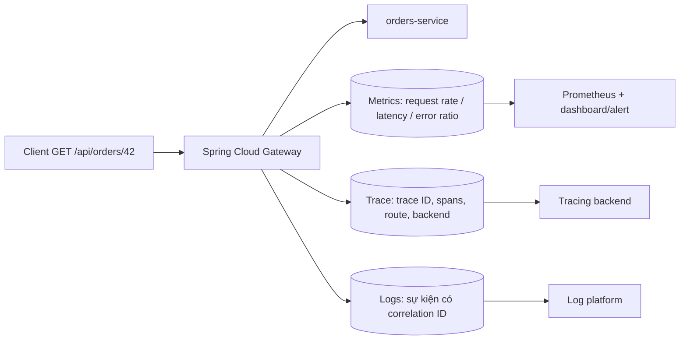
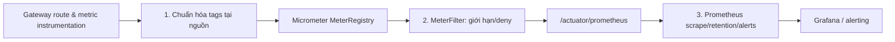

# Kiểm soát nhãn route, path và cardinality của số liệu trong Spring Cloud Gateway

## 1. Vấn đề: thêm một nhãn cũng có thể làm hệ thống quan sát quá tải

Trong kiến trúc microservices, **Spring Cloud Gateway** là điểm vào của nhiều API: chọn tuyến bằng route predicate, chạy filter chain, sửa path/header, gọi backend qua service discovery, xác thực, rate limiting, circuit breaker, retry, TLS và theo dõi request. Việc đo số request, độ trễ và tỷ lệ lỗi theo **route** rất hữu ích. Nhưng nếu gắn **URL thật của từng request**, **user ID** hoặc **trace ID** làm nhãn (label/tag) của metric, mỗi giá trị mới có thể sinh thêm hàng loạt time series.

Ví dụ:

```text
GET /api/orders/10001 -> routeId=orders-read
GET /api/orders/10002 -> routeId=orders-read
GET /api/orders/10003 -> routeId=orders-read

An toàn hơn: routeId="orders-read" (giống nhau cho cả ba)
Nguy hiểm:  path="/api/orders/10001", "/api/orders/10002", ...
```

**Cardinality** ở đây là số lượng giá trị khác nhau và đặc biệt là **số tổ hợp nhãn duy nhất** của một metric. Một metric `spring.cloud.gateway.requests` với hàng triệu tổ hợp tags có thể làm tăng bộ nhớ JVM, thời gian scrape, chi phí lưu trữ/chỉ mục của Prometheus và khiến dashboard hoặc cảnh báo chậm/không đầy đủ.

Mục tiêu bài học:

1. Đọc đúng các nhãn `routeId`, `routeUri`, `httpMethod`, `status`, `httpStatusCode`, `outcome` và nhãn tùy chọn `path`.
2. Hiểu vì sao **route ID ổn định** và **path đã chuẩn hóa theo mẫu** phù hợp với metrics hơn full path.
3. Ước lượng cardinality bằng số tổ hợp nhãn, kể cả sự tăng thêm của histogram buckets và Gateway replicas.
4. Cấu hình Gateway/Micrometer để **không bật raw path tags** mặc định; kiểm tra property theo phiên bản.
5. Sử dụng Actuator, Prometheus và PromQL để xem tốc độ request, tỷ lệ lỗi và số series.
6. Phòng ngừa **label poisoning**, rò rỉ PII, route ID biến động và metric explosion; thiết kế guardrails/monitoring.
7. Kiểm chứng bằng lab có thể tái hiện, đồng thời phân biệt **metrics**, **traces** và **logs**.

> **Phạm vi:** ví dụ chính áp dụng **Spring Cloud Gateway Server WebFlux 4.3+/5.x** và Spring Boot Actuator/Micrometer. Với bản WebFlux cũ, namespace thường là `spring.cloud.gateway.*`; Server **Web MVC** dùng stack Servlet và có instrumentation khác. Hãy so sánh cấu hình và tên nhãn trên đúng release đang chạy, không sao chép WebFlux config cho MVC rồi coi là có hiệu lực.

## 2. Nhìn ba loại tín hiệu quan sát cạnh nhau



| Loại tín hiệu | Câu hỏi phù hợp | Có nên gắn raw user ID/path/trace ID làm metric label? |
|---|---|---|
| **Metrics** | “Route Orders đang có bao nhiêu RPS? Tỷ lệ 5xx là bao nhiêu?” | **Không.** Ưu tiên dimensions hữu hạn và ổn định |
| **Distributed tracing** | “Request này đi qua Gateway, CircuitBreaker và backend nào?” | Trace ID dùng để **tìm một trace**; high-cardinality attributes vẫn chịu quy tắc bảo mật/sampling |
| **Structured logs** | “Một lỗi cụ thể xuất hiện khi nào và ở đâu?” | Có thể dùng correlation ID để điều tra nhưng phải redaction, retention và access control |

Một trace ID có thể **rất hữu ích trong trace** nhưng **rất nguy hiểm khi chuyển thành tag của timer**. Cũng đừng nghĩ chỉ cần **hash** user ID là đã thành low-cardinality: nếu có một triệu người dùng, một triệu hash vẫn tạo một triệu giá trị nhãn và có thể vẫn là dữ liệu nhận diện.

## 3. Gateway Metrics Filter đo những gì?

Với Gateway **Server WebFlux**, tài liệu mô tả một timer có tên Micrometer:

```text
spring.cloud.gateway.requests
```

Timer này đo vòng đời xử lý request Gateway và có thể được xuất qua `/actuator/metrics/spring.cloud.gateway.requests` hoặc chuyển thành các mẫu Prometheus qua `/actuator/prometheus`.

### 3.1. Những nhãn được tài liệu Gateway mô tả

| Tag | Ví dụ minh họa | Cardinality thường gặp | Điều cần cảnh giác |
|---|---|---|---|
| `routeId` | `orders-read` | Thấp nếu quản trị route IDs ổn định | **Cao** nếu route ID ghép UUID/user/tenant/revision |
| `routeUri` | `lb://orders-service` | Thấp khi dùng logical service name ổn định | Có thể cao nếu route tự sinh URI theo hostname/tenant/request |
| `outcome` | `SUCCESSFUL`, `CLIENT_ERROR`, `SERVER_ERROR` | Thấp, nhóm status | Nhóm kết quả, **khác** mã 500/502 cụ thể |
| `status` | Tên/mã HTTP status tùy convention/version | Hữu hạn | Đừng giả định luôn là số khi viết truy vấn |
| `httpStatusCode` | `200`, `404`, `503` | Hữu hạn | Thường dùng để lọc nhóm 5xx bằng regex |
| `httpMethod` | `GET`, `POST` | Thấp, methods hữu hạn | Custom HTTP methods có thể nhiều hơn mong đợi |
| `path` **tùy chọn** | `/api/orders/42` | **Rất cao** nếu raw path chứa ID | Mặc định tắt; bật cần đánh giá tính riêng tư và số series |

**Không nhầm `routeId` với `path`:** cả nghìn URL `/api/orders/{id}` có thể **cùng một route ID**. Route ID nói lên tuyến được chọn; path nói lên **địa chỉ request thực**. Chỉ thêm path raw có thể phá lợi thế của nhãn route ID cố định.

Đây là danh sách tags của **Gateway Metrics Filter**, không nhất thiết giống tags trên metrics chung của Spring WebFlux `http.server.requests`, Reactor Netty, Redis client hoặc backend. Đừng gộp số liệu có scope đo khác nhau rồi gọi đó là “số request Gateway” duy nhất.

### 3.2. Các request không vào Gateway route chain

Metrics của Gateway được tạo trong **Gateway filtering chain**. Một request có thể bị Spring Security WebFilter từ chối `401` trước khi match Gateway route, bị ingress/WAF chặn, hoặc không match route nào. Những tình huống này **không được bảo đảm** xuất hiện trong `spring.cloud.gateway.requests` với một `routeId` cụ thể.

Vì vậy:

- Đo “tổng requests vào cổng” bằng **server/ingress HTTP metrics** phù hợp.
- Đo “requests đã được Gateway định tuyến” bằng Gateway route metrics.
- Đo “requests thực tới backend” bằng outbound/backend telemetry.

Các con số có thể khác nhau **một cách hợp lý** khi có cache HIT, rate-limit, circuit breaker OPEN, security reject hoặc client disconnect. Kiểm tra định nghĩa và placement của instrumentation trước khi đối chiếu.

## 4. Cardinality: phép nhân của các dimension

### 4.1. Tính gần đúng số tổ hợp labels

Với một metric:

\[
\text{Số tổ hợp tối đa} \;\leq\; \prod_{i=1}^{n} \text{số giá trị khả dĩ của nhãn}_i
\]

Đây là **giới hạn lý thuyết nếu mọi tổ hợp xuất hiện**; trong thực tế route và path có liên hệ, nhiều tổ hợp không tồn tại. Dù vậy, phép nhân giúp nhận ra một nhãn “không giới hạn” có thể khiến ngân sách time series tăng rất nhanh.

Ví dụ một route `orders-read` được gọi bằng **10.000 order IDs khác nhau**, qua **3 Gateway pods**, với **2 HTTP methods** và **3 HTTP statuses** từng xảy ra:

| Nhãn | Số giá trị giả định |
|---|---:|
| `routeId` | 1 |
| `path` raw | 10.000 |
| `httpMethod` | 2 |
| `httpStatusCode` | 3 |
| `instance` (do Prometheus gắn khi scrape) | 3 |
| **Số tổ hợp có thể đạt** | **180.000** |

Không bật `path` thì trong cùng bài toán, số tổ hợp từ các dimensions trên chỉ là **18**. Con số thực còn có `routeUri`, `outcome` và labels chung như `job`/`application`; nhiều giá trị có quan hệ phụ thuộc. Với một timer, Prometheus còn biểu diễn **`_count`/`_sum`** và, khi bật histogram, **nhiều `_bucket`** theo ngưỡng `le`.

**Điểm mấu chốt:** một nhãn raw path có thể làm tăng số tổ hợp gấp hàng nghìn lần. Khi dữ liệu là upload, UUID, timestamp, signed token hoặc search query được nhét vào URL, cardinality gần như không bị chặn bởi thiết kế route.

### 4.2. Tại sao số series quan trọng hơn số request?

Hai hệ thống cùng **1.000 RPS** có thể có chi phí metrics hoàn toàn khác:

- Hệ A: 1.000 RPS cùng `routeId=orders-read` và các nhãn ít giá trị → số series thấp, chỉ counter/timer tăng.
- Hệ B: 1.000 RPS mà mỗi request có `path` duy nhất → khoảng **1.000 giá trị path mới mỗi giây** trong giai đoạn đó, gây tạo meters mới và series mới.

RPS tăng thông thường làm **giá trị đo tăng**; label cardinality tăng có thể làm **số đối tượng đo phải tạo và lưu tăng**. Đây là hai trục chi phí khác nhau.

### 4.3. Histogram có thể nhân thêm series

Với Prometheus:

```text
# Timer không bật histogram buckets (ví dụ dạng tên xuất phổ biến)
spring_cloud_gateway_requests_seconds_count{routeId="orders-read",...}
spring_cloud_gateway_requests_seconds_sum{routeId="orders-read",...}

# Khi bật histogram, có thêm nhiều mẫu:
spring_cloud_gateway_requests_seconds_bucket{routeId="orders-read",le="0.1",...}
spring_cloud_gateway_requests_seconds_bucket{routeId="orders-read",le="0.5",...}
...
```

Tên đơn vị `_seconds` và các buckets phụ thuộc registry/định nghĩa timer và cấu hình; **hãy nhìn output thật** trước khi viết dashboard. Nếu có 20 buckets cho **mỗi tập labels**, việc bật histogram trên một metric đã nổ cardinality có thể gây thêm hàng triệu series. Ngược lại, histogram theo một số route IDs ổn định có thể rất hữu ích cho p95/p99.

## 5. Phân biệt route, route template và raw path

Giả sử Gateway có:

```yaml
spring:
  cloud:
    gateway:
      server:
        webflux:
          routes:
            - id: orders-read
              uri: lb://orders-service
              predicates:
                - Path=/api/orders/**
                - Method=GET
              filters:
                - StripPrefix=1
```

Ba request:

```text
GET /api/orders/3ddfc5c5-8f2a-4d54-b47a-a6c2c0105b94
GET /api/orders/42
GET /api/orders/2026-11-24T10:00:00
```

đều có thể map vào `routeId=orders-read`. Giá trị của `path` là các URL **khác nhau**, và có thể chứa dữ liệu nhạy cảm hoặc định danh nghiệp vụ. Một label được chuẩn hóa như `routePattern="/api/orders/{orderId}"` sẽ có số giá trị thấp **nếu chính ứng dụng tạo nó từ tập template hữu hạn**, nhưng **Gateway không tự suy ra template nghiệp vụ từ một wildcard `/**`**.

### 5.1. Những label phù hợp và không phù hợp

| Đề xuất nhãn | Nên dùng làm metrics label? | Lý do |
|---|---|---|
| `routeId=orders-read` | **Có**, nếu cố định theo hợp đồng route | Bounded, có ý nghĩa điều hành |
| `httpMethod=GET` | **Có** | Tập nhỏ |
| `outcome=SERVER_ERROR` | **Có** | Tập nhỏ |
| `region=ap-southeast-1` | Có, nếu danh sách region hữu hạn | Cần quản trị tập giá trị |
| `serviceTier=free/pro/enterprise` | Có thể, nếu được chuẩn hóa và có lý do đo | Không đưa tenant/user IDs vào tier |
| `routePattern=/api/orders/{orderId}` | Có thể nếu template từ allowlist cố định | Phải thiết kế và test việc chuẩn hóa |
| `path=/api/orders/123456789` | **Không** | Biến thiên theo request |
| `userId=89431` | **Không** | High cardinality + PII |
| `tenantId=customer-uuid` | Thường **không** | Số tenants có thể lớn và thay đổi |
| `traceId=...` | **Không** | Hầu như mỗi request là một ID mới |
| `requestId=...` | **Không** | Như trace ID |
| `clientIp=...` | **Không** | High cardinality, privacy/security |
| `query=search-text` | **Không** | User input vô hạn, có thể chứa secrets |
| `routeId=tenant-<uuid>` | **Không** | Route ID biến thành dimension không giới hạn |

### 5.2. Đừng đưa raw user input vào route ID

Một anti-pattern khi tạo dynamic routes:

```java
// PSEUDOCODE — chống chỉ định vì route ID chứa ID động:
String routeId = "tenant-" + requestTenantId + "-orders";
```

Nếu hệ thống tự dựng một route cho mỗi người dùng hay mỗi lần deploy với ID chứa UUID/timestamp, chính nhãn `routeId` trở thành high-cardinality, **ngay cả khi `path` đã tắt**.

Thiết kế nên ưu tiên:

- `routeId` ổn định gắn với **hợp đồng tuyến/nhóm API**, như `catalog-read`, `orders-write`, `notifications-sse`.
- Version theo **API contract** khi thật sự cần phân biệt, ví dụ `orders-v2-read`; tránh gắn build SHA/epoch vào **route ID** mỗi lần rollout.
- Nếu có nhiều service IDs từ discovery, dùng chính sách **allowlist + naming convention** và giới hạn số routes phát sinh.
- Không nối raw `Host`, `Header`, tenant, client ID hoặc URI path vào route ID.
- Giữ deployment revision, pod, namespace, zone ở **resource/target labels có trần rõ ràng**, thay vì thêm chúng vào route ID.

Việc giữ ổn định `routeId` còn giúp dashboard lịch sử liên tục qua triển khai, giảm nhu cầu sửa alert rules mỗi khi backend instance hoặc build revision thay đổi.

## 6. Bật Gateway metrics nhưng giữ `path` tag tắt

### 6.1. Dependencies Maven và Gradle

Với **Spring Cloud Gateway Server WebFlux**, cần Actuator để xuất metrics và Prometheus registry nếu muốn scrape bằng Prometheus:

```xml
<!-- pom.xml: version do Spring Boot parent và Spring Cloud BOM quản lý -->
<dependency>
    <groupId>org.springframework.cloud</groupId>
    <artifactId>spring-cloud-starter-gateway-server-webflux</artifactId>
</dependency>
<dependency>
    <groupId>org.springframework.boot</groupId>
    <artifactId>spring-boot-starter-actuator</artifactId>
</dependency>
<dependency>
    <groupId>io.micrometer</groupId>
    <artifactId>micrometer-registry-prometheus</artifactId>
</dependency>
```

```groovy
dependencies {
    implementation 'org.springframework.cloud:spring-cloud-starter-gateway-server-webflux'
    implementation 'org.springframework.boot:spring-boot-starter-actuator'
    runtimeOnly 'io.micrometer:micrometer-registry-prometheus'
}
```

Không cần Loki/Tempo/Zipkin, Redis hoặc Eureka **chỉ để xuất metric Gateway**. Các dependency này phục vụ nghiệp vụ hoặc thành phần quan sát khác, không bắt buộc cho timer `spring.cloud.gateway.requests`.

### 6.2. Cấu hình an toàn cho WebFlux 4.3+/5.x

```yaml
# application.yml — ví dụ Gateway Server WebFlux, môi trường local/test.
server:
  port: 8080

spring:
  cloud:
    gateway:
      server:
        webflux:
          metrics:
            enabled: true
            path-tags:
              enabled: false
          routes:
            - id: orders-read
              uri: http://localhost:8081
              predicates:
                - Path=/api/orders/**
                - Method=GET
              filters:
                - StripPrefix=1
            - id: catalog-read
              uri: http://localhost:8082
              predicates:
                - Path=/api/catalog/**
                - Method=GET
              filters:
                - StripPrefix=1

management:
  server:
    port: 9090
    address: 127.0.0.1
  endpoint:
    metrics:
      access: read-only
    prometheus:
      access: read-only
  endpoints:
    web:
      exposure:
        include: health,info,metrics,prometheus
  metrics:
    tags:
      application: api-edge-gateway
```

Ở **Spring Cloud Gateway 5.1 configprops**, `spring.cloud.gateway.server.webflux.metrics.enabled` và `path-tags.enabled` được liệt kê với default `false`. Tài liệu Gateway Metrics Filter có diễn giải hành vi tự bật theo điều kiện Actuator ở một số dòng, vì thế **khai báo enabled tường minh** và **kiểm tra endpoint thật** là cách rõ ràng hơn việc suy theo default của một version khác. Cấu hình `path-tags.enabled: false` thể hiện quyết định **không gắn raw path**.

Những lưu ý triển khai:

- `management.metrics.tags.application` là **một nhãn hữu hạn**, miễn là application name đến từ danh sách deploy cố định; không thay nó bằng tên pod ngẫu nhiên/user ID.
- `management.server.port` tách listener quản trị khỏi cổng API; bind `127.0.0.1` chỉ là **demo local**. Trong container, loopback nằm trong network namespace của container; muốn scrape phải có đường mạng quản trị phù hợp.
- Actuator `read-only` và exposure không tự thay authentication/network policy. Không công khai `/actuator/prometheus` hoặc `/actuator/metrics` lên Internet.
- Backend ở `localhost:8081`/`8082` chỉ là demo. Trong Kubernetes, dùng service DNS/load balancer và TLS phù hợp; `localhost` thường không trỏ tới backend container khác.
- Khi dùng `spring.cloud.gateway.server.webflux.observability.enabled`, đó là một điều khiển **khác** để bật Micrometer Observability support. Không suy rằng nó tự thay mọi setting của Gateway Metrics Filter hoặc làm raw path tag trở nên an toàn.

### 6.3. Property `path-tags.enabled` mới và property cũ dễ gây hiểu nhầm

Tài liệu Gateway 4.3/5.1 mô tả:

```yaml
spring:
  cloud:
    gateway:
      server:
        webflux:
          metrics:
            path-tags:
              enabled: false  # Khuyến nghị: giữ nguyên khi chạy production.
```

Và có property kế thừa:

```text
spring.cloud.gateway.server.webflux.metrics.tags.path.enabled
```

Tên **`metrics.tags.path.enabled` đã bị deprecated**: tài liệu cảnh báo rằng việc bật nó có thể có **side effect** khiến một giá trị cấu hình đi vào bản đồ `metrics.tags` như một tag. Ở một số phiên bản người dùng từng gặp nhãn `path="enabled"` thay vì path thật. **Không bật cả hai alias** để “chắc ăn”. Dùng tên `metrics.path-tags.enabled` theo tài liệu release đang sử dụng và xác minh mẫu xuất thực tế.

Với các dòng Gateway WebFlux cũ hơn, bạn còn gặp:

```text
spring.cloud.gateway.metrics.tags.path.enabled
spring.cloud.gateway.metrics.enabled
```

Những property này **không phải hướng dẫn copy cho 5.x**. Khi nâng cấp, kiểm tra configuration metadata và release notes của bản đã triển khai; cấu hình sai prefix có thể bị bỏ qua mà ứng dụng vẫn khởi động bình thường.

### 6.4. Vì sao không bật path tag để debug một lỗi production?

`path` có thể chứa order ID, account ID, email đã URL-encode, mã mời hoặc signed URL. Kích hoạt trên production sẽ khiến các giá trị đó tồn tại trong:

- Micrometer meter IDs trong JVM.
- Prometheus time series và remote-write backend.
- Dashboard/cache/index của hệ quan sát.
- Backups và retention lâu hơn API request logs.

Việc tắt lại flag **không tự xóa dữ liệu lịch sử đã gửi**. Hãy dùng trace/log được bảo vệ để điều tra request cụ thể hoặc thử bật path tag **chỉ trong sandbox** với URL mẫu và thời gian ngắn, không trên lưu lượng thật của người dùng.

## 7. Quan sát bằng Actuator và Prometheus

### 7.1. Xem tên metric và available tags

Sau khi Gateway và backend demo chạy:

```bash
# Gửi traffic qua đúng route.
curl -i http://localhost:8080/api/orders/42
curl -i http://localhost:8080/api/orders/43
curl -i http://localhost:8080/api/catalog/products/1

# Chỉ từ listener/quyền quản trị được phép.
curl -sS http://127.0.0.1:9090/actuator/metrics
curl -sS http://127.0.0.1:9090/actuator/metrics/spring.cloud.gateway.requests
```

Một **ví dụ minh họa** cho phần `availableTags` sau khi có traffic:

```json
{
  "name": "spring.cloud.gateway.requests",
  "baseUnit": "seconds",
  "measurements": [
    {"statistic": "COUNT", "value": 3.0},
    {"statistic": "TOTAL_TIME", "value": 0.136},
    {"statistic": "MAX", "value": 0.081}
  ],
  "availableTags": [
    {"tag": "routeId", "values": ["orders-read", "catalog-read"]},
    {"tag": "httpMethod", "values": ["GET"]},
    {"tag": "outcome", "values": ["SUCCESSFUL"]},
    {"tag": "httpStatusCode", "values": ["200"]}
  ]
}
```

**Đây không phải schema đầy đủ bắt buộc**: response thực còn có `status`, `routeUri`, nhãn ứng dụng hoặc giá trị khác, và kết quả phụ thuộc traffic đã xảy ra. Nếu backend trả lỗi 404/503, `outcome` và `httpStatusCode` cũng có thể thay đổi. Trong cấu hình khuyến nghị, hãy kiểm tra **không xuất hiện tag `path` chứa order IDs**.

Để xem một route:

```bash
curl -sS \
  'http://127.0.0.1:9090/actuator/metrics/spring.cloud.gateway.requests?tag=routeId:orders-read'
```

Actuator metrics selector hỗ trợ lọc theo `tag=key:value`; dấu `:` trong tag value cần được URL-encode đúng khi áp dụng. Không đưa credential quản trị vào command line được lưu công khai hoặc CI logs.

### 7.2. Xem Prometheus exposition

```bash
curl -sS http://127.0.0.1:9090/actuator/prometheus

# Chỉ trích dòng liên quan trong output test.
curl -sS http://127.0.0.1:9090/actuator/prometheus \
  | grep 'spring_cloud_gateway_requests'
```

Ví dụ một dòng Prometheus **giả lập**:

```text
spring_cloud_gateway_requests_seconds_count{application="api-edge-gateway",routeId="orders-read",routeUri="http://localhost:8081",httpMethod="GET",httpStatusCode="200",outcome="SUCCESSFUL",status="OK"} 2.0
```

Tên mẫu `_seconds_count`/`_seconds_sum` là cách xuất thường thấy của timer Prometheus. Giá trị `status` có thể được thể hiện khác tùy version; không viết alert dựa trên giả định `status="OK"` nếu chưa xem output thật. Tag names và label casing có thể được chuẩn hóa/đổi tên ở exporter/collector, nên dùng **tên thực sau scrape**.

### 7.3. Đếm số series của timer ngay từ Prometheus

Các truy vấn PromQL ví dụ (chạy trong Prometheus/Grafana có quyền):

```promql
# Tổng số series của nhánh _count trên các target được scrape.
count(spring_cloud_gateway_requests_seconds_count{job="gateway"})

# Một route có bao nhiêu tổ hợp labels?
count by (routeId) (
  spring_cloud_gateway_requests_seconds_count{job="gateway"}
)

# Nếu ai đó bật path tag, theo dõi lượng series có path không rỗng.
count(
  spring_cloud_gateway_requests_seconds_count{
    job="gateway", path!=""
  }
)
```

Giá trị `job="gateway"` là **ví dụ**; tên job thực phụ thuộc cấu hình Prometheus. Truy vấn thứ hai **đếm series**, không đếm số requests. Kể cả khi tắt `path`, số series vẫn có thể khác 1 cho một route vì còn labels method/status/instance/routeUri.

### 7.4. Nhìn đúng nơi nếu metric không xuất hiện

Nếu `spring.cloud.gateway.requests` không có:

1. Kiểm tra app có starter **Server WebFlux** và Actuator/registry không.
2. Xác minh `spring.cloud.gateway.server.webflux.metrics.enabled: true` có được bind.
3. Gửi request **match route**, không chỉ gọi `/actuator/health`.
4. Kiểm tra endpoint `metrics/prometheus` đã được expose và cấp quyền.
5. Kiểm tra source metric name có bị đổi bởi `metrics.prefix` hoặc MeterFilter.
6. Xem `/actuator/gateway/routes` trên đúng replica **nếu Gateway Actuator read-only đã được bật**.
7. Đừng suy từ HTTP 401 do Spring Security trước route rằng Gateway timer nhất thiết phải tồn tại.

**Không mặc định chỉ thêm dependency Prometheus registry là đã có mọi request timer**. Tên, scope và sự có mặt của meters phụ thuộc pipeline instrumentation thực tế.

## 8. Truy vấn PromQL ưu tiên route thay vì path

### 8.1. Request rate theo route

```promql
sum by (routeId) (
  rate(spring_cloud_gateway_requests_seconds_count{job="gateway"}[5m])
)
```

Đây là **số request/giây đã được ghi vào Gateway timer**, theo `routeId`. Không phải tổng inbound connections, không nhất thiết tính request bị Security chặn trước route và không thay thế metric riêng cho active SSE connections.

### 8.2. Lỗi 5xx theo route

```promql
sum by (routeId) (
  rate(spring_cloud_gateway_requests_seconds_count{
    job="gateway", outcome="SERVER_ERROR"
  }[5m])
)
```

`outcome` theo series HTTP 5xx là cách lọc dễ đọc. Nếu muốn phân biệt 500/502/503/504, dùng `httpStatusCode` sau khi xác nhận giá trị trong dữ liệu thật:

```promql
sum by (routeId, httpStatusCode) (
  rate(spring_cloud_gateway_requests_seconds_count{
    job="gateway", httpStatusCode=~"5.."
  }[5m])
)
```

### 8.3. Tỷ lệ 5xx

```promql
sum by (routeId) (
  rate(spring_cloud_gateway_requests_seconds_count{
    job="gateway", outcome="SERVER_ERROR"
  }[5m])
)
/
clamp_min(
  sum by (routeId) (
    rate(spring_cloud_gateway_requests_seconds_count{job="gateway"}[5m])
  ),
  1e-9
)
```

Vì Prometheus có thể **không trả series cho tử số khi không xảy ra 5xx**, dashboard/alert cần xử lý missing series/no-data theo quy ước của hệ thống. Không coi `absent` tự động bằng tỷ lệ 0 và cũng không cảnh báo toàn bộ production dựa trên mẫu quá ít requests. Thực tế thường cần **minimum traffic threshold** hoặc thời gian quan sát đủ dài.

### 8.4. p95 độ trễ chỉ khi đã có histogram

Khi đã chủ động bật histogram cho timer (và xác minh `_bucket` tồn tại):

```promql
histogram_quantile(
  0.95,
  sum by (routeId, le) (
    rate(spring_cloud_gateway_requests_seconds_bucket{job="gateway"}[5m])
  )
)
```

Nếu không có buckets, truy vấn này **không hoạt động**; `_sum`/`_count` chỉ giúp tính trung bình, không thể dựng đúng p95 từ trung bình. Khi quyết định bật histogram, tính **ngân sách số buckets × số tổ hợp tags × replicas** trước, đặc biệt không được bật raw path tags.

Ví dụ Spring Boot/Micrometer distribution configuration (cần kiểm tra version và tên meter thật):

```yaml
management:
  metrics:
    distribution:
      percentiles-histogram:
        spring.cloud.gateway.requests: true
```

Histogram tăng độ chính xác đo latency distribution nhưng cũng tăng chi phí series. Không bật đồng loạt histogram cho mọi timer có nhãn high-cardinality chỉ để có dashboard p95.

### 8.5. Đừng dùng Prometheus label `path` làm dimension mặc định

Anti-pattern:

```promql
# Tránh dashboard mặc định theo raw path:
sum by (path) (
  rate(spring_cloud_gateway_requests_seconds_count[5m])
)
```

Nếu có 100.000 order IDs, biểu đồ có thể tạo 100.000 đường và Prometheus phải xử lý cardinality lớn. Để hiểu **những URL cụ thể** gây lỗi, dùng tracing/log có sampling, có quyền truy cập và redaction; metrics chỉ giữ nhóm route/status/region hữu hạn.

## 9. Ba lớp phòng vệ trước label cardinality explosion

Không có một nút “tắt hết vấn đề cardinality”. Nên kết hợp **nguồn tạo nhãn**, **registry trong JVM** và **hệ thu thập/lưu trữ**.



### 9.1. Lớp 1 — Không tạo label vô hạn từ đầu

Đây là lớp bảo vệ **quan trọng nhất**:

- Tắt `path-tags.enabled` trên lưu lượng production.
- Đặt route IDs cố định thay vì ghép UUID/tenant/query/release timestamp.
- Không thêm `userId`, `clientIp`, `traceId`, `sessionId`, `Authorization` hoặc raw path vào custom metrics.
- Nếu muốn phân nhóm nghiệp vụ, chọn **tập giá trị hữu hạn** như `operation=read/write`, `backendClass=core/legacy` hoặc `serviceTier=free/pro/enterprise`.
- Dùng logical `lb://orders-service` thay vì tạo route URI mới cho từng client/tenant khi không thật sự cần.
- Tách khả năng tìm một request cụ thể sang **traces/logs có sampling và redaction**.

Đừng quên **tags được Gateway sinh ra** và **tags của chính ứng dụng thêm vào**: một cấu hình Gateway ổn định vẫn có thể nổ cardinality nếu developer thêm `registry.counter(..., "customer", customerId)` trong một custom filter.

### 9.2. Lớp 2 — `MeterFilter` giới hạn số giá trị `routeId`

Micrometer cho phép dùng `MeterFilter.maximumAllowableTags(...)` để chặn việc đăng ký meters mới khi một tag có quá nhiều giá trị.

Ví dụ Java:

```java
package com.example.gateway.observation;

import io.micrometer.core.instrument.config.MeterFilter;
import org.springframework.context.annotation.Bean;
import org.springframework.context.annotation.Configuration;

@Configuration(proxyBeanMethods = false)
public class GatewayMetricGuardrails {

    @Bean
    MeterFilter capGatewayRouteIds() {
        // Ngưỡng minh họa cho 1 MeterRegistry trong 1 Gateway instance.
        return MeterFilter.maximumAllowableTags(
            "spring.cloud.gateway.requests",
            "routeId",
            100,
            MeterFilter.deny()
        );
    }
}
```

**Cách hiểu đúng:**

1. Filter này áp dụng cho meter names bắt đầu bằng `spring.cloud.gateway.requests` và tag `routeId`.
2. Sau khi số **giá trị routeId khác nhau** chạm ngưỡng trong registry, meter mới có routeId chưa được chấp nhận có thể bị `DENY`.
3. `DENY` khiến việc ghi vào meter bị từ chối/NOOP; **traffic HTTP không tự bị chặn**.
4. Đây **không** phải cơ chế chuẩn hóa route IDs hay giảm cardinality của các nhãn khác.
5. Ngưỡng được áp dụng **theo process/MeterRegistry**, không phải hạn mức series phân tán trên cả Prometheus cluster.
6. Cần cảnh báo khi gần chạm/ngưỡng bị chặn, vì deny có thể khiến metrics của một route mới quan trọng **biến mất**.

**Đừng xem `maximumAllowableTags` là “đã an toàn” rồi bật raw path.** Giới hạn 100 route IDs nhưng vẫn cho mỗi route có 100.000 giá trị `path` thì vấn đề còn nguyên. Cách xử lý gốc là **tắt/chuẩn hóa path tại nguồn**.

### 9.3. Lớp 2 bổ sung — Phát hiện tăng meters trong JVM

Một cách thủ công để xem số **Micrometer meter objects** của timer hiện tại:

```java
package com.example.gateway.observation;

import io.micrometer.core.instrument.MeterRegistry;

public final class MeterCountDiagnostic {
    private MeterCountDiagnostic() {}

    // Chỉ minh họa logic cho công cụ quản trị nội bộ.
    public static long gatewayTimerMeterCount(MeterRegistry registry) {
        return registry.getMeters().stream()
            .filter(m -> m.getId().getName()
                .equals("spring.cloud.gateway.requests"))
            .count();
    }
}
```

Số **meters** không đồng nhất với **số time series xuất sang Prometheus**: một Timer có thể sinh `_count`/`_sum`, max hoặc nhiều histogram buckets. Cũng không nên expose một endpoint custom public để lặp qua mọi meters trên từng request; chẩn đoán có thể được tính **định kỳ** ở hệ quản trị hoặc dựa trên backend quan sát.

Micrometer các phiên bản mới có **`HighCardinalityTagsDetector`**; tài liệu Micrometer 1.18 mô tả việc theo dõi số meters cùng tên và cảnh báo khi vượt ngưỡng. Đây là công cụ phát hiện, **không tự sửa lỗi nhãn vô hạn**. API có thể khác giữa Micrometer versions; chỉ dùng mẫu cấu hình đúng với dependency thực tế.

### 9.4. Lớp 3 — Prometheus/remote-write bảo vệ hệ lưu trữ

Về phía collector/TSDB có thể:

- Theo dõi **active series, series creation rate, target scrape duration và samples/scrape**.
- Đặt **limits** theo job/tenant/service nơi hệ thu thập hỗ trợ.
- Kiểm soát scrape interval, retention, histogram buckets và remote-write queues.
- Dùng metrics relabeling để loại **metric không cần thiết** hoặc một số labels đã được kiểm duyệt.
- Alert nếu số series của riêng `spring_cloud_gateway_requests_seconds_count` tăng bất thường sau rollout.

**Cảnh báo:** dùng `labeldrop: path` **chỉ sau khi scrape** không nhất thiết cứu được JVM Gateway; tại nguồn, các meter/tag combinations đã được tạo. Nếu bỏ một label có nhiều giá trị trong các samples cùng một metric, còn có nguy cơ tạo **các labelsets trùng nhau** trong một scrape, dẫn đến lỗi ingestion. Sửa **tại instrumentation trước**, sau đó mới dùng relabeling như lớp phòng vệ bổ sung.

Một giới hạn samples/scrape trong Prometheus thường là **guardrail**: khi vượt ngưỡng, cả lần scrape có thể bị xem là thất bại. Nó không làm ứng dụng Gateway tự tiêu thụ ít memory hơn. Vì vậy nên alert **trước** khi chạm giới hạn, không chỉ chờ Prometheus reject samples.

## 10. Đặt ngân sách cardinality trước khi bật nhãn mới

### 10.1. Budget mẫu theo route và environment

Đội vận hành có thể lập bảng **budget nội bộ** trước khi thêm một nhãn:

| Dimension | Tập giá trị dự kiến | Chính sách |
|---|---:|---|
| `routeId` | 40 routes production | Danh mục cố định, review khi thêm route |
| `httpMethod` | Tối đa 5–8 thông dụng | Không lấy raw method động từ client custom |
| `outcome` | Các nhóm HTTP ít giá trị | Dùng để dashboard lỗi tổng quát |
| `httpStatusCode` | Số mã HTTP thực xuất hiện, hữu hạn | Có thể nhiều hơn outcome nhưng vẫn bounded |
| `routeUri` | Khoảng 40 logical destinations hoặc ít hơn | Không đưa user data/UUID vào URI |
| `instance` | 3–10 replicas theo autoscaling | Đếm thêm khi dự báo chi phí |
| `path` | **0** trong metrics chính | Không bật raw path |
| `tenantId`, `userId`, `traceId` | **0** trong metrics chính | Chỉ dùng ở nơi quan sát có chính sách tương ứng |

Ví dụ ước lượng với 40 routes × 3 methods × 8 statuses × 3 pods:

\[
40 \times 3 \times 8 \times 3 = 2.880
\]

Đây là **giới hạn các tổ hợp giả định**, không phải số series đo được. Một route chỉ dùng GET nên nhiều tổ hợp không tồn tại; `routeUri` có thể cố định theo route, `outcome` phụ thuộc status; nếu bật histogram còn có buckets. Dù vậy, nó giúp so sánh với trường hợp thêm 10.000 raw paths **trên mỗi route** và thấy nguy cơ tăng nhiều bậc độ lớn.

Các ngưỡng như “100 routes”, “2.880 tổ hợp” ở đây **chỉ dùng để dạy cách tính**, không phải chuẩn SLA/cost cho mọi hệ Prometheus. SLO và budget thực tế phụ thuộc số replicas, scrape interval, histogram, retention và hạ tầng lưu trữ.

### 10.2. Quy trình review một label mới

Trước khi chấp nhận tag `x`, hãy trả lời:

1. Giá trị của tag có **tập hữu hạn** không? Ai kiểm soát tập này?
2. User/client có thể tự tạo **giá trị mới** bằng path/query/header không?
3. Có thể thay tag bằng **tên nhóm/enum** không?
4. Mức tăng số tổ hợp với tags hiện có và với histogram là bao nhiêu?
5. Tag có chứa/tiết lộ PII, token, hostname nội bộ hoặc thông tin bảo mật không?
6. Có dashboard/alert **thực sự sử dụng** tag này không?
7. Có budget/guardrail/kiểm thử và phương án rollback không?
8. Khi tắt tag, ai xử lý **dữ liệu đã lưu** trong Prometheus/remote-write?

Một nhãn không có người sở hữu hoặc không phục vụ câu hỏi vận hành rõ ràng thì **đừng đưa vào metric** chỉ vì việc thêm tag rất dễ.

### 10.3. Route labels trong lúc rolling deployment

Giả sử Gateway chạy 3 pods, mỗi lần deploy route ID được sinh thành:

```text
orders-read-sha-a1f2
orders-read-sha-b4e9
orders-read-sha-c7d0
```

Khi rolling deployment, series mới xuất hiện cùng labels `routeId` mới, trong khi series cũ còn được giữ theo retention. Sau nhiều deploy, cardinality tiếp tục **churn** dù số routes đang hoạt động gần như không đổi.

Tốt hơn:

```text
routeId="orders-read"              (ổn định)
application="api-edge-gateway"     (ổn định)
environment="prod"                (tập nhỏ)
pod="gateway-abc123"              (target/resource label do hệ thu thập quản lý)
```

Build revision vẫn có thể được báo qua deployment metadata/trace/log hay `info` endpoint có quyền, **không nhất thiết thêm vào mọi Gateway timer**. Label `pod` cũng thay đổi khi rollout, nhưng số pods/retention phải được tính trong budget; không thêm cả `buildSha`, `commitId` và random release ID vào mọi metric nếu không cần.

## 11. Khi nào một tag custom thật sự hữu ích?

### 11.1. Nhóm nghiệp vụ cố định thay vì tên khách hàng

Giả sử cần phân biệt lỗi khi Gateway áp dụng chính sách với các nhóm API:

```text
operation="catalog-read"
operation="orders-write"
operation="notifications-stream"
operation="other"
```

Hàm chuyển đổi phải dùng **allowlist**, không lấy raw path làm tag:

```java
package com.example.gateway.observation;

public final class OperationLabel {
    private OperationLabel() {}

    public static String fromRouteId(String routeId) {
        if (routeId == null) return "other";
        return switch (routeId) {
            case "catalog-read", "catalog-v2-read" -> "catalog-read";
            case "orders-write", "orders-v2-write" -> "orders-write";
            case "notifications-sse" -> "notifications-stream";
            default -> "other";
        };
    }
}
```

Với switch trên, số giá trị `operation` là **4**, kể cả khi route name lạ hoặc user gửi URL bất kỳ. Nhưng **hàm này không tự thay tag `routeId` của Gateway Metrics Filter**; đó chỉ là một helper để ứng dụng có thể dùng **khi tạo metric custom** qua extension point phù hợp.

Ví dụ metric custom ghi nhận kết quả policy:

```java
package com.example.gateway.observation;

import io.micrometer.core.instrument.MeterRegistry;
import org.springframework.stereotype.Component;

@Component
public class PolicyDecisionMetrics {
    private final MeterRegistry registry;

    public PolicyDecisionMetrics(MeterRegistry registry) {
        this.registry = registry;
    }

    public void record(String trustedRouteId, boolean allowed) {
        String operation = OperationLabel.fromRouteId(trustedRouteId);
        registry.counter(
            "gateway.policy.decisions",
            "operation", operation,
            "result", allowed ? "allow" : "deny"
        ).increment();
    }
}
```

Đoạn code trên **chỉ minh họa cách đặt low-cardinality tags**. Để dùng trong ứng dụng thật, gọi `record(...)` ở nơi policy decision được xác định (ví dụ security/filter service), **truyền route ID từ server-side route context**, không lấy từ `X-Route-Id` do client tự khai. Xác định rõ policy decision nào được đếm, tránh double-count khi Retry hoặc nhiều filters chạy.

### 11.2. Đừng nhầm nhãn business với raw HTTP route

`routeId` là nhãn của **routing**, `operation` là nhãn do bạn thiết kế cho **nghiệp vụ**. Nếu dùng chung một metric cho cả routing và authorization mà không định nghĩa thời điểm đo, dashboard có thể đếm một request hai lần hoặc bỏ sót request bị chặn trước khi route match.

Tốt hơn hãy duy trì:

- **Gateway request timer** để đo các request đi qua route chain.
- **Ingress/HTTP server metrics** để đo tổng request vào edge.
- **Policy decision counter** để đo quyết định allow/deny có định nghĩa rõ.
- **Traces/logs** để gắn các tín hiệu khi điều tra một request cụ thể.

### 11.3. Custom tag APIs thay đổi giữa Gateway versions

Tùy release, bạn có thể thấy `GatewayTagsProvider` hoặc extension point của Micrometer Observation/Convention. Không nên paste một class `GatewayTagsProvider` cũ từ blog 3.x vào Gateway 5.x rồi mặc định bean sẽ được gọi. Tài liệu từng có thay đổi tên property path tag và các vấn đề liên quan tag provider qua phiên bản.

**Nguyên tắc bất biến:** normalization phải xảy ra **trước khi đăng ký meter** và cho kết quả từ một **tập nhỏ được kiểm soát**. Sau khi thay provider/convention, luôn kiểm tra `/actuator/metrics` và `/actuator/prometheus` để chứng minh tags mới đúng dự kiến.

## 12. Bảo mật metrics endpoint và nhãn chứa dữ liệu nhạy cảm

### 12.1. Metrics có thể tiết lộ topology

Ngay cả khi tắt `path`, tags như `routeId`/`routeUri` vẫn có thể cho biết:

- Tên backend dịch vụ nội bộ.
- Cách phân nhóm endpoints (orders, billing, admin).
- Các URI/host private hoặc URI của hệ thử nghiệm.
- Lượng request, trạng thái lỗi và các thời điểm backend không ổn định.

Do đó, **Actuator metrics/Prometheus là dữ liệu vận hành**, không phải API public cho mọi client. Dùng management port private, TLS/mTLS, RBAC/SSO/service identity, NetworkPolicy/firewall và audit access. Đừng mở `management.endpoints.web.exposure.include: "*"` công khai chỉ để scrape.

### 12.2. Label injection/poisoning và PII

Khi app tạo tag từ `path`, `Host`, `X-Tenant-Id`, `User-Agent` hoặc query:

1. Client có thể gửi hàng nghìn giá trị **không lặp lại** để tăng meters.
2. Giá trị có thể chứa email, ID đơn hàng, token hoặc thông tin nhạy cảm.
3. Một số labels có thể chứa chuỗi rất dài, làm tăng bộ nhớ/index cost.
4. Các label values dù được exporter **escape đúng cú pháp** vẫn có thể gây **DoS về cardinality**.

Giới hạn số labels trong một metric **không đủ** nếu một label có giá trị vô hạn. Cần **allowlist values**, size/charset limits ở API và không đưa raw user input vào metric IDs.

### 12.3. Vì sao không hash hoặc truncate raw URL rồi gọi là đã ổn?

- `hash(userId)` vẫn thường có số giá trị bằng số users.
- `truncate(path, 20)` có thể tạo collisions và vẫn còn hàng nghìn prefix động.
- `replaceAll("\\d+", "{id}")` có thể không nhận UUID, email, slug, Base64 IDs, percent-encoding hoặc mixed paths; cũng có thể che sự khác biệt giữa endpoints cần phân tích.

Với metric labels, **mapping từ route catalog / explicit API templates** an toàn hơn việc tự đoán định danh bằng regex trên raw URI. Nếu dùng normalization phức tạp, phải test cả encoded slashes, unicode, unknown routes và không để fallback trả raw path.

### 12.4. Không đưa ngữ cảnh private vào exemplars sai mục đích

Micrometer/Prometheus có thể hỗ trợ **exemplars liên kết metric với trace ID**. Exemplar khác với việc biến `traceId` thành **label của tất cả series**: nó cung cấp liên kết mẫu phục vụ điều tra theo cơ chế backend quan sát.

Dù vậy, tracing/exemplars vẫn cần sampling, retention, quyền truy cập và chính sách bảo mật; không gắn raw JWT hoặc PII làm span attributes chỉ vì hệ tracing chịu high cardinality tốt hơn hệ metrics.

## 13. Thực hành end-to-end: 20 URL khác nhau nhưng vẫn cùng một route tag

### 13.1. Chuẩn bị hai ứng dụng

Trong môi trường **sandbox không chứa dữ liệu thật**:

1. **Gateway Server WebFlux** trên `localhost:8080` với route `orders-read` và metric configuration của mục 6.
2. **Orders backend WebFlux** trên `localhost:8081` nhận `GET /orders/{id}`.
3. Actuator của Gateway có `metrics/prometheus` trên management listener `127.0.0.1:9090` đã được bảo vệ.
4. Nếu dùng Prometheus, cấu hình scrape các instances qua **mạng quản trị hợp lệ**. Không scrape public API port khi không cần.

Controller demo trong ứng dụng **backend**, không đặt trong Gateway:

```java
package com.example.orders.demo;

import java.util.Map;
import org.springframework.http.HttpStatus;
import org.springframework.http.ResponseEntity;
import org.springframework.web.bind.annotation.GetMapping;
import org.springframework.web.bind.annotation.PathVariable;
import org.springframework.web.bind.annotation.RestController;

@RestController
public class OrderDemoController {

    @GetMapping("/orders/{id}")
    public ResponseEntity<Map<String, String>> get(@PathVariable String id) {
        if ("missing".equals(id)) {
            return ResponseEntity.status(HttpStatus.NOT_FOUND)
                .body(Map.of("error", "order not found"));
        }
        if ("unavailable".equals(id)) {
            return ResponseEntity.status(HttpStatus.SERVICE_UNAVAILABLE)
                .body(Map.of("error", "backend unavailable"));
        }
        return ResponseEntity.ok(Map.of("id", id, "status", "PAID"));
    }
}
```

Ứng dụng backend cần `spring-boot-starter-webflux`, `@SpringBootApplication` và `server.port: 8081`. Controller cố ý để `id` xuất hiện trong **HTTP response body**, nhưng **không thêm nó vào custom metric labels**. Với môi trường thật, backend phải xác thực và kiểm tra resource ownership; demo này chỉ dùng ID thử nghiệm không có PII.

### 13.2. Kiểm tra route trước

```bash
curl -i http://localhost:8081/orders/1
curl -i http://localhost:8080/api/orders/1
curl -i http://localhost:8080/api/orders/missing
curl -i http://localhost:8080/api/orders/unavailable
```

Kỳ vọng trong demo:

| URL qua Gateway | HTTP status từ backend | Tag routeId của Gateway |
|---|---:|---|
| `/api/orders/1` | 200 | `orders-read` |
| `/api/orders/missing` | 404 | `orders-read` |
| `/api/orders/unavailable` | 503 | `orders-read` |

Route `orders-read` có predicate `Path=/api/orders/**` và filter `StripPrefix=1` nên backend nhận `/orders/{id}`. Nếu các status khác dự kiến, kiểm tra route selection, Spring Security và backend handler trước khi suy lỗi của Micrometer.

### 13.3. Tạo 20 URL khác nhau, không tăng số route IDs

```bash
# Chỉ dùng sandbox. 20 request tuần tự, không gây tải lớn.
for i in $(seq 1 20); do
  curl -sS -o /dev/null \
    -w "id=$i status=%{http_code}\n" \
    "http://localhost:8080/api/orders/$i"
done

# Lọc metric theo route trong endpoint Actuator.
curl -sS \
  'http://127.0.0.1:9090/actuator/metrics/spring.cloud.gateway.requests?tag=routeId:orders-read'
```

**Cần quan sát:**

- Timer COUNT của route tăng theo số requests được đo.
- `routeId` vẫn là `orders-read` dù URL thực thay đổi từ `/1` đến `/20`.
- Với `path-tags.enabled: false`, không xuất hiện hàng chục giá trị tag `path` cho cùng route.
- Có thể có nhiều timer meter instances nếu bạn đã gọi cả response 200/404/503 do `status`/`outcome` khác nhau. Điều này là bình thường và **khác** việc tạo một giá trị path cho mỗi order ID.

### 13.4. Nhìn trực tiếp các time series

```bash
curl -sS http://127.0.0.1:9090/actuator/prometheus \
  | grep '^spring_cloud_gateway_requests_seconds_count'
```

Nếu không thấy mẫu, kiểm tra `metrics.enabled`, registry/prometheus dependency, đường quản trị và traffic đã vào đúng route. Nếu có nhiều replicas và load balancer trước Gateway, request/metrics có thể tới **khác pod**; trong sandbox, dùng direct target hoặc quản lý từng instance.

Đối với Prometheus đang scrape, chạy:

```promql
count(spring_cloud_gateway_requests_seconds_count{routeId="orders-read"})
```

Giá trị trả về là **số series của nhánh count** sau khi áp các selectors, **không phải 20 requests**. Nếu nhiều statuses/instances, số này có thể lớn hơn 1, nhưng khi tắt raw path thường **không tăng tuyến tính theo số order IDs**.

### 13.5. Thử bật `path` chỉ trong sandbox để thấy sự khác biệt

Trong **profile test tách biệt**, sau khi xác nhận **không có dữ liệu cá nhân hoặc traffic thật**:

```yaml
spring:
  cloud:
    gateway:
      server:
        webflux:
          metrics:
            enabled: true
            path-tags:
              enabled: true    # CHỈ để minh họa, KHÔNG triển khai production.
```

Khởi động Gateway test sạch, gọi 20 URL demo và xem:

```bash
curl -sS http://127.0.0.1:9090/actuator/prometheus \
  | grep '^spring_cloud_gateway_requests_seconds_count' \
  | grep 'path='
```

Kỳ vọng thấy các values như `path="/api/orders/1"`, `path="/api/orders/2"`... nếu flag có hiệu lực với đúng Gateway version. **Đếm số series trước/sau** chứ không chỉ nhìn số lượng requests. Nếu output thay vì path thật lại có `path="enabled"`, kiểm tra đã vô tình dùng alias deprecated `metrics.tags.path.enabled` hoặc đang gặp behavior khác của version.

Sau khi học xong: **tắt lại flag, khởi động lại test app**. Không cần tiếp tục tạo nhiều requests để chứng minh một điều đã rõ; không chuyển bài thử này sang hệ production.

### 13.6. Test route ID biến động bằng thiết kế, không cần tạo hàng nghìn routes

Đối chiếu hai quy tắc định danh:

```text
Thiết kế A:
  id: orders-read
  uri: lb://orders-service
  path: /api/orders/**

Thiết kế B (KHÔNG NÊN):
  id: orders-read-customer-a1b2c3
  id: orders-read-customer-9f8e7d
  id: orders-read-customer-4c5d6e
  ... một route mới cho mỗi khách hàng
```

Thiết kế B biến `routeId` thành nhãn gần như không giới hạn. Không cần sinh động hàng chục nghìn routes trong sandbox để chứng minh; hãy đánh giá naming/route discovery source và dựng bài test nhỏ, sau đó đặt policy review/guardrail trước rollout.

### 13.7. Kiểm chứng rule bảo vệ `MeterFilter`

Với `GatewayMetricGuardrails` của mục 9.2, tạo **một bộ vài route IDs test** (không dùng production) và đặt ngưỡng thấp có chủ đích, ví dụ 2:

```java
// Chỉ thay tham số ngưỡng trong profile demo; không dùng làm production config.
MeterFilter.maximumAllowableTags(
    "spring.cloud.gateway.requests", "routeId", 2,
    MeterFilter.deny()
);
```

Gửi request qua ba routes khác nhau. Mục đích là thấy **một route có thể vẫn proxy được** nhưng **meter mới** cho route vượt ngưỡng không được đăng ký. Nếu không xuất metric của route thứ ba, hãy xác minh `DENY` thay vì suy request đã bị 404/429. Trong production, đây là **tình huống cần cảnh báo**, không phải mục tiêu tối ưu.

### 13.8. Lab thêm: kiểm thử label poisoning trên custom metric

So sánh hai đoạn code:

```java
// SAI: mỗi requestPath mới có thể sinh một Counter/meter mới.
registry.counter("gateway.policy.decisions", "path", rawRequestPath)
    .increment();
```

và:

```java
// ĐÚNG HƯỚNG: nhãn cố định từ helper allowlist.
registry.counter(
    "gateway.policy.decisions",
    "operation", OperationLabel.fromRouteId(trustedRouteId),
    "result", "allow"
).increment();
```

Hai đoạn chỉ là **minh họa trong context có sẵn `MeterRegistry registry`, `rawRequestPath` và `trustedRouteId`**; không copy đoạn đầu vào ứng dụng thật. Đo số meters của `gateway.policy.decisions` khi gọi 20 URL khác nhau: biến thể thứ hai nên chỉ tạo số kết hợp nhãn hữu hạn.

## 14. Runbook khi cardinality tăng đột biến sau deploy

Giả sử sau một deployment, Prometheus báo active series tăng mạnh, dashboard Gateway tải chậm và JVM heap của Gateway tăng.

### 14.1. Điều tra theo trình tự

1. **Ghi nhận thời điểm thay đổi**: release/build của Gateway, configmap/feature flag, thêm filters, custom instrumentation, đổi routes/discovery.
2. **Xác định metric nào tăng**: `spring_cloud_gateway_requests_seconds_*` hay `http_server_requests_seconds_*`, `jvm_*` hoặc một metric custom? Không đổ lỗi cho Gateway route tags nếu thực tế là custom metric của backend.
3. **Đếm labels/series**: `count(spring_cloud_gateway_requests_seconds_count)` và `count by (routeId)(...)`; xem có label `path`, `userId`, `tenantId`, `traceId` mới.
4. **Kiểm tra source config**: `path-tags.enabled`, alias deprecated `tags.path.enabled`, `metrics.tags` map, `MeterFilter`, custom tag providers/conventions.
5. **Kiểm tra dynamic routes**: route IDs có chứa UUID, timestamp, pod, customer hoặc build revision không?
6. **Ước lượng memory impact**: số Micrometer meters × tags và histogram buckets; xem JVM heap, allocation/GC và Prometheus sample ingestion.
7. **Khắc phục tại nguồn**: tắt raw path/custom high-card labels, trả route IDs về tên ổn định; rollback feature/revision có lỗi.
8. **Bật cảnh báo/fix dài hạn**: PR review rule, budget, staging test, MeterFilter guardrail và alert ingestion.
9. **Xử lý dữ liệu đã lưu**: thống nhất retention/purge theo chính sách Prometheus/remote-write/PII. **Tắt source không tự xóa lịch sử đã ingest.**

### 14.2. Kịch bản “đã tắt path mà vẫn thấy label path”

Các nguyên nhân khả dĩ:

- Có **custom metric** khác tạo tag `path`, không phải Gateway Metrics Filter.
- Vẫn bật property legacy `metrics.tags.path.enabled`, hoặc cấu hình nhiều profiles ghi đè nhau.
- Prometheus đang đọc **pod cũ** chưa rollout, hoặc có nhiều targets.
- Một **exporter/relabeling** ở downstream thêm/đổi label.
- Dashboard vẫn hiển thị **series lịch sử** do retention; cần xem timestamp của samples mới.
- Bạn đang xem `http.server.requests` của Spring WebFlux/Servlet, không phải `spring.cloud.gateway.requests`.

**Không sửa bằng cách xóa dữ liệu Prometheus trước** khi biết nguồn tạo nhãn nào đang tiếp tục phát. Luôn giải quyết tại instrumentation/config source rồi đánh giá retention.

### 14.3. Kịch bản “mất metrics sau khi thêm MeterFilter”

Nếu `maximumAllowableTags` đã `DENY` meter registrations:

- HTTP routing có thể vẫn hoàn toàn bình thường.
- Dashboard có thể không thấy route mới hoặc thấy tỷ lệ lỗi thấp giả tạo do thiếu samples.
- Không tự coi “không có metric 5xx” là “không còn lỗi”.
- Kiểm tra logs/diagnostics của Micrometer, route inventory và limit đã đặt.
- Khắc phục route IDs không ổn định hoặc nhãn khác, chỉ tăng limit khi đã có **capacity plan**; không mặc định mở limit vô hạn.

## 15. Những hiểu lầm và lỗi cấu hình thường gặp

| Triệu chứng hoặc nhận định | Nguyên nhân thường gặp | Cách xử lý |
|---|---|---|
| “`routeId` là UUID của request” | Nhầm route ID với request ID | Route ID phải ổn định theo tuyến, request ID đặt trong trace/log |
| “Tắt `path` thì không phân biệt được lỗi từng URL” | Dùng metrics cho câu hỏi của logs/traces | Giữ route-level metric, drill down sang trace/log theo correlation ID |
| `path` tag tự nhiên có 50.000 giá trị | Bật raw path tags hoặc custom metric đọc raw URI | Tắt nguồn tạo tag, dùng allowlist/template hữu hạn |
| `path="enabled"` thay vì URL | Sử dụng alias deprecated `metrics.tags.path.enabled` có side effect | Đổi sang `metrics.path-tags.enabled` đúng version, đọc output thực |
| Không có `spring.cloud.gateway.requests` | Chưa enable filter/Actuator hoặc chưa có traffic match route | Kiểm tra `metrics.enabled`, dependencies, route matching, endpoints |
| `/actuator/prometheus` trả 404 | Thiếu registry hoặc chưa expose endpoint | Thêm `micrometer-registry-prometheus` và exposure có bảo mật |
| `/actuator/prometheus` trả 401/403 | Quản trị có authentication/authorization | Dùng service account/monitoring identity hợp lệ, không tắt Security |
| Prometheus có nhiều series hơn số routes | Còn có status/method/outcome/routeUri/instance và histogram buckets | Tính số combinations, không so 1 route = 1 series |
| Một metric có nhiều routes dù Gateway config rất ít | Discovery locator sinh routes hoặc route IDs thay đổi theo rollout | Kiểm tra route inventory/dynamic route source và ID naming |
| `count(...)` bị hiểu là tổng request | PromQL `count` đếm elements/series | Dùng `rate(..._count[5m])` hoặc `increase(..._count[5m])` cho số requests |
| `_bucket` không tồn tại | Timer không bật histogram hoặc exporter/metric name khác | Đọc exposition, cấu hình histogram sau khi tính budget |
| p95 xấu vì query thiếu `le` | Aggregate buckets sai | Dùng `sum by(routeId,le)` trước `histogram_quantile` |
| Không thấy 401 trong Gateway request timer | Spring Security chặn trước route | Dùng HTTP server/ingress/security metrics, phân biệt scope |
| `routeUri` tăng dù route ID không đổi | Backend URI bị tạo động hoặc route replacement theo instance | Dùng logical service destinations/ổn định route source |
| Series tăng sau deploy dù path tag vẫn tắt | New route IDs/build SHA, custom tags hoặc histogram vừa bật | So sánh tags, routes, metric types và release diff |
| Cấu hình `management.metrics.tags.userId` | Common tag đã bị gắn dữ liệu nhận diện | Không thêm global user/customer ID tags; chỉ static bounded labels |
| MeterFilter chặn metrics nhưng HTTP vẫn thành công | `DENY` chỉ cấm tạo meter | Alert coverage loss và sửa tags tại nguồn |
| Đã tắt path nhưng TSDB vẫn hiển thị series cũ | Retention/stale samples hoặc pods chưa update | Xem timestamps/targets; xử lý retention theo chính sách |
| Raw path chứa encoded email/token | URL path không phải dữ liệu “vô hại” | Không thu thập path raw; data minimization/redaction |
| Thêm `traceId` vào Counter để tìm từng request | Metric bị nổ một series gần như mỗi request | Dùng traces/exemplars/logs, không nhãn timer |

### 15.1. Triệu chứng khác nhau, cách đo khác nhau

Nếu **heap Gateway** tăng liên tục và số meters tăng: ưu tiên kiểm tra **tag cardinality tại nguồn**.

Nếu heap ổn nhưng **Prometheus head series/remote-write** tăng: ưu tiên kiểm tra **số replicas, buckets, target relabeling, retention và custom metrics**.

Nếu dashboards chỉ thấy **ít route 5xx** trong khi khách hàng báo lỗi: kiểm tra request có vào Gateway route chain không, `MeterFilter` có deny route mới không, và số liệu có đúng target/time window không.

Nếu p95 tăng nhưng request rate thấp, đừng tự bật `path` để “biết endpoint nào chậm”. Có thể tách route IDs hợp lý theo **API contract** như `orders-read`/`orders-write`; trước khi thay route definitions, kiểm tra predicates overlap, behavior backend và tác động tới authorization.

## 16. Checklist triển khai kiểm soát metrics labels

1. **Gắn owner cho metric:** ai chịu trách nhiệm `spring.cloud.gateway.requests`, nhãn route và dashboard?
2. **Bật có chủ đích:** dùng Actuator + registry và xác minh `metrics.enabled` theo Gateway version thật.
3. **Tắt raw path tag:** `spring.cloud.gateway.server.webflux.metrics.path-tags.enabled: false`.
4. **Không dùng alias deprecated:** rà `metrics.tags.path.enabled` và các property cũ sau nâng cấp.
5. **Định nghĩa route IDs ổn định:** không ghép tenant, user, request, UUID, timestamp hoặc build SHA.
6. **Kiểm soát `routeUri`:** logical destinations và route catalog ổn định; không có token/userinfo trong URI.
7. **Chỉ chấp nhận nhãn hữu hạn:** method/status/outcome/operation class, environment, service tier dạng allowlist.
8. **Không đưa PII vào tags:** email, IP, user ID, tenant ID và toàn bộ raw URI/query phải được đánh giá bảo mật nghiêm ngặt.
9. **Tính budget combinations:** routes × methods × statuses × instances và các dimensions còn lại.
10. **Tính histogram riêng:** số buckets làm tăng series; chỉ bật phân phối nơi có nhu cầu p95/p99 rõ ràng.
11. **Đặt MeterFilter guardrails:** giới hạn số route IDs bất thường, alert khi reject meters; không dùng thay normalization.
12. **Theo dõi cả JVM và TSDB:** meter count, heap/GC, samples/scrape, active series, ingest rate, remote-write queue.
13. **Giữ Actuator private:** management network, TLS/identity, role chỉ đọc, không public Prometheus endpoint.
14. **Phân biệt nguồn metrics:** ingress/server HTTP, Gateway route timer, outbound client và backend counters không cùng phạm vi.
15. **Dùng trace/log để drill down:** route-level metric → trace exemplar/correlation ID → log đã redacted.
16. **Kiểm thử staging:** 20 URL khác nhau có một route ID; kiểm tra không xuất raw path và số meters không tăng tuyến tính.
17. **Kiểm thử rollout multi-replica:** so route IDs/config giữa các pods, không thay routeId theo release revision.
18. **Có rollback/runbook:** tắt high-card label, xác minh metric coverage, xử lý retention dữ liệu nhạy cảm đã ingest.

## 17. Câu hỏi luyện tập kèm đáp án

**Bài 1 — Hai loại cardinality.** Một Gateway xử lý 10.000 request/giây cho `routeId=orders-read`. Có chắc nó tạo 10.000 series/giây?

**Đáp án:** không. Nếu nhãn vẫn hữu hạn, requests chỉ làm tăng các mẫu đếm/độ trễ trên những series đã tồn tại. Chỉ khi có nhãn biến đổi theo request (như raw path/user ID) mới có nguy cơ tạo liên tục meters/series.

**Bài 2 — Raw path.** Hai requests `/api/orders/42` và `/api/orders/43` cùng route `orders-read`. Nên chọn nhãn nào cho dashboard RPS?

**Đáp án:** `routeId="orders-read"`. Không cần gắn `path` chứa order ID để đo thông lượng/tỷ lệ lỗi route.

**Bài 3 — Nhãn option.** Property nào ưu tiên ở Gateway Server WebFlux 4.3+/5.1 để **tắt nhãn path**?

**Đáp án:** `spring.cloud.gateway.server.webflux.metrics.path-tags.enabled: false`. Không dùng alias `metrics.tags.path.enabled` đã deprecated và có thể gây side effect.

**Bài 4 — Route ID.** `routeId` được sinh như `orders-read-user-<uuid>` mỗi lần có người dùng mới. Tắt `path` đã đủ bảo vệ cardinality?

**Đáp án:** chưa. `routeId` đã trở thành nhãn gần như vô hạn. Cần dùng route ID cố định theo API/nhóm route và policy allowlist.

**Bài 5 — Phép nhân.** Có 1 route, 10.000 raw paths, 3 statuses, 2 HTTP methods và 3 Gateway instances. Số tổ hợp nhãn tối đa theo các dimension giả định là bao nhiêu?

**Đáp án:** `1 × 10.000 × 3 × 2 × 3 = 180.000` trước khi tính các metric samples/buckets. Đây là upper bound nếu các tổ hợp thực sự xảy ra, không phải số series chắc chắn đã sinh.

**Bài 6 — PromQL `count`.** `count(spring_cloud_gateway_requests_seconds_count)` trả 1.200. Có nghĩa 1.200 HTTP requests?

**Đáp án:** không. `count(...)` đếm số **series** đang match selector. Muốn RPS dùng `rate(..._count[5m])`; muốn lượng request trong khoảng dùng `increase(..._count[5m])` khi phù hợp.

**Bài 7 — Outcome.** Vì sao nhãn `outcome` có cardinality nhỏ hơn `httpStatusCode`?

**Đáp án:** `outcome` chỉ phân loại các nhóm HTTP như `SUCCESSFUL`/`CLIENT_ERROR`/`SERVER_ERROR`; nhiều mã 200/201/204 cùng thuộc nhóm thành công.

**Bài 8 — P95.** Một timer chỉ có `_sum` và `_count`. Có thể tính p95 chính xác từ trung bình `sum/count` không?

**Đáp án:** không. Muốn tính p95 theo Prometheus histogram cần buckets có `le`, hoặc cơ chế phân phối khác được instrument đúng. Bật buckets sẽ tăng số series nên phải cân đối ngân sách.

**Bài 9 — MeterFilter.** `maximumAllowableTags(..., "routeId", 100, DENY)` có tự chặn HTTP request thứ 101 không?

**Đáp án:** không. Nó tác động việc đăng ký meter/tag mới, không phải HTTP routing/rate limiting. Nếu deny, metric của route mới có thể mất và cần cảnh báo.

**Bài 10 — Nguồn bảo vệ.** Dùng Prometheus metric relabeling xóa `path` có làm JVM Gateway không tạo từng meter raw path không?

**Đáp án:** không. Khi relabeling diễn ra ở bước scrape, ứng dụng có thể đã tạo meters rồi; còn có rủi ro labelset trùng sau xóa. Sửa tại source trước.

**Bài 11 — Security.** JWT thiếu quyền bị Spring Security chặn 403 trước khi route match. `spring.cloud.gateway.requests` không tăng có phải lỗi không?

**Đáp án:** không nhất thiết. Gateway route timer có thể không được tạo khi request chưa vào route chain. Hãy dùng ingress/server/security metrics để đo tổng 4xx trước routing.

**Bài 12 — Hash ID.** Một triệu user IDs được hash SHA-256 trước khi đặt làm tag. Cardinality đã thấp chưa?

**Đáp án:** chưa. Vẫn có thể là gần một triệu giá trị khác nhau và có rủi ro bảo mật dữ liệu. Không đưa IDs đó vào metrics.

**Bài 13 — Discovery.** Khi discovery sinh một route cho mỗi service ID, điều gì phải được kiểm soát?

**Đáp án:** tập service IDs, allowlist, route ID naming, việc thêm/xóa service và biến động qua deployments. Không ghép ID động theo request/tenant vào route.

**Bài 14 — Metrics missing.** Dashboard không có lỗi 5xx. Có thể kết luận 5xx không xảy ra?

**Đáp án:** chưa. Kiểm tra missing series, disabled metric, filter DENY, Security/WAF rejects, time window, target lỗi scrape và traffic có match route không.

**Bài 15 — Labels trong Prometheus.** Một deployment thêm `pod`, `zone` và bật histogram nhưng không bật path. Có thể tăng series không?

**Đáp án:** có. Mỗi dimension và bucket bổ sung có thể làm tăng tổ hợp, dù path không có. Cần dự báo theo số replicas và bucket cardinality.

**Bài 16 — Troubleshooting path.** Đã tắt `path-tags.enabled` nhưng vẫn thấy tag `path` trong một metric. Bước đầu tiên?

**Đáp án:** xác định **tên metric, target/instance và sample timestamp**. Có thể đó là custom metric, legacy alias, pod cũ hoặc series lịch sử. Không xóa Prometheus trước khi tìm đúng nguồn.

**Bài 17 — Route naming.** Vì sao không gắn build SHA vào `routeId` sau mỗi lần phát hành?

**Đáp án:** vì mỗi rollout lại tạo giá trị nhãn mới, gây churn và phá tính liên tục của dashboard theo route. Build SHA nên ở deployment metadata/log/trace hoặc labels được quản lý riêng nếu cần.

**Bài 18 — Hệ quan sát.** Khi cần tìm đúng request của khách hàng A có lỗi 503, nên thêm `customerId=A` vào timer hay dùng traces/logs?

**Đáp án:** dùng **trace/log với correlation ID và quyền kiểm soát dữ liệu**, không đưa customer ID vào timer labels.

## 18. Tài liệu tham khảo chính thức

- [Spring Cloud Gateway Server WebFlux – Global Filters / Gateway Metrics Filter](https://docs.spring.io/spring-cloud-gateway/reference/spring-cloud-gateway-server-webflux/global-filters.html): metric `spring.cloud.gateway.requests`, `routeId`, `routeUri`, `outcome`, `status`, `httpStatusCode`, `httpMethod` và path option.
- [Spring Cloud Gateway – Configuration Properties](https://docs.spring.io/spring-cloud-gateway/reference/configprops.html): `spring.cloud.gateway.server.webflux.metrics.enabled`, `metrics.path-tags.enabled`, `metrics.tags` và `observability.enabled`.
- [Spring Cloud Gateway – Configuration / RouteDefinition Metrics](https://docs.spring.io/spring-cloud-gateway/reference/spring-cloud-gateway-server-webflux/configuration.html): nguồn route, route definitions và metrics khác với request timers.
- [Spring Cloud Gateway – Actuator API](https://docs.spring.io/spring-cloud-gateway/reference/spring-cloud-gateway-server-webflux/actuator-api.html): xem route ID/URI, predicates, filters trên đúng Gateway instance.
- [Spring Boot – Actuator Metrics](https://docs.spring.io/spring-boot/reference/actuator/metrics.html): Micrometer registries, `/actuator/metrics`, Prometheus endpoint, histogram và exemplars.
- [Spring Boot – Actuator Endpoints](https://docs.spring.io/spring-boot/reference/actuator/endpoints.html): exposure, access levels, management endpoints security.
- [Micrometer – Meter Filters](https://docs.micrometer.io/micrometer/reference/concepts/meter-filters.html): `maximumAllowableTags`, `DENY`, tag transforms và limitations.
- [Micrometer – High Cardinality Tags Detector](https://docs.micrometer.io/micrometer/reference/concepts/high-cardinality-tags-detector.html): vì sao user/trace/path tags gây tăng series, detection và guardrails.
- [Micrometer – Tag Naming](https://docs.micrometer.io/micrometer/reference/concepts/naming.html): conventions đặt tên metrics/tags phù hợp với nhiều monitoring systems.
- [Prometheus – Metric and Label Naming](https://prometheus.io/docs/practices/naming/): nhãn có số giá trị giới hạn, tránh high-cardinality labels.
- [Prometheus – Query Functions](https://prometheus.io/docs/prometheus/latest/querying/functions/): `rate`, `increase`, `histogram_quantile`, `clamp_min`.
- [Prometheus – Configuration](https://prometheus.io/docs/prometheus/latest/configuration/configuration/): scrape, relabeling và resource limits.

**Ghi nhớ:** metrics hữu ích khi mỗi nhãn trả lời được một câu hỏi vận hành **và có số giá trị được kiểm soát**. Trong Spring Cloud Gateway, giữ `routeId`/`routeUri` ổn định, dùng `httpMethod`/`outcome`/`httpStatusCode` để quan sát, **tắt raw `path`** cho môi trường thật và không đưa user/tenant/request/trace IDs vào meter tags. Tính budget tổ hợp labels cùng histogram/replicas, dùng `MeterFilter` làm chốt an toàn, và điều tra từng URL cụ thể qua **traces/logs có redaction** thay vì tạo một time series cho từng request.
