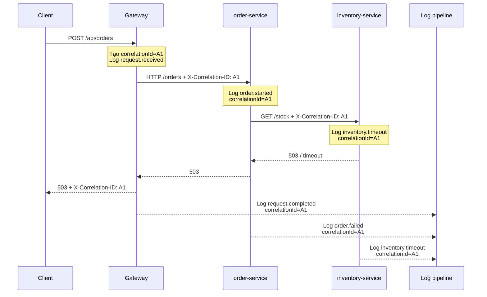
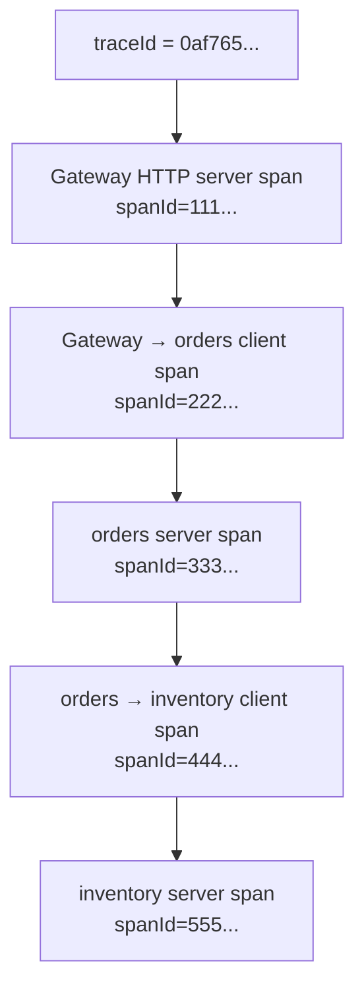
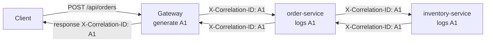
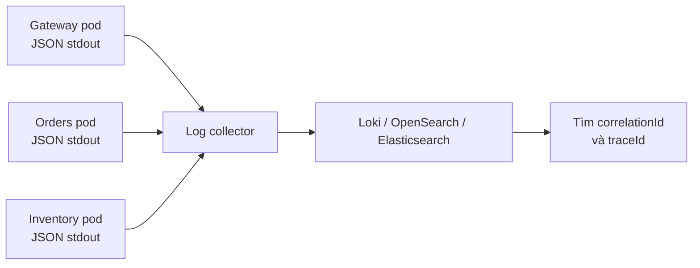

# Correlation ID và log có cấu trúc xuyên chuỗi gọi

Trong hệ thống microservices, một request từ client có thể đi qua **API Gateway → dịch vụ đơn hàng → dịch vụ tồn kho → dịch vụ thanh toán** trước khi trả kết quả. Khi client báo “một lần tạo đơn hàng bị lỗi 503”, log của từng ứng dụng thường nằm ở các pod, máy chủ hoặc hệ thống lưu trữ khác nhau. Không có khóa liên kết, kỹ sư phải dò thời gian, đường dẫn và nhiều bản ghi trùng nhau để đoán các sự kiện nào thuộc cùng request.

**Correlation ID** giải quyết vấn đề tìm kiếm đó: một mã nhận diện được gắn cho request ở ranh giới hệ thống và **được truyền qua các HTTP hops** để các log liên quan có thể được nối lại. Kết hợp với **log có cấu trúc** (thường là JSON), chúng ta có thể truy vấn log theo một trường xác định thay vì tìm một chuỗi bất kỳ trong thông điệp tự do.

Bài học nằm trong chương **Quan sát hệ thống** của module **SPRING_CLOUD_GATEWAY**. Kiến thức kết nối việc định tuyến bằng route predicate, filter chain, rewrite path/header, service discovery với xác thực, rate limiting, circuit breaker, retry, TLS và quan sát request khi vận hành Gateway trước các microservice.

**Mục tiêu học tập**

1. Phân biệt **`correlationId`, `requestId`, `traceId`, `spanId`** và W3C `traceparent`.
2. Xác định điểm tạo, kiểm tra, chuyển tiếp và phản hồi correlation ID tại Gateway.
3. Thiết kế **schema log JSON** có trường ổn định, tránh rò rỉ dữ liệu và cardinality không kiểm soát.
4. Hiểu **MDC trong Servlet** khác **Reactor Context trong WebFlux**; không dựa vào `ThreadLocal` cho cả reactive pipeline.
5. Tạo log và truyền context qua nhiều services, kể cả các trường hợp 401/403/404, 5xx, timeout, retry và async work.
6. Viết các bài kiểm thử/câu truy vấn để truy vết một request thật từ đầu tới cuối.

> **Phạm vi phiên bản:** Ví dụ Gateway chính sử dụng **Spring Cloud Gateway Server WebFlux** và Spring Boot có hỗ trợ structured logging tích hợp từ **3.4+** (bao gồm các dòng Boot 4.x). Một số thuộc tính và starter Micrometer/OpenTelemetry thay đổi theo Boot/Cloud train. Các đoạn mã Java là ví dụ thực hành độc lập, không phải kết quả đã được build/test trong bài này. Phần riêng giải thích Server Web MVC/Servlet và không áp dụng nhầm WebFlux filters cho MVC.

## 1. Bài toán: Một request, nhiều log ở nhiều máy

Giả sử:

```http
POST /api/orders HTTP/1.1
Host: api.example.test
Content-Type: application/json

{"sku":"BOOK-1","quantity":1}
```

Gateway định tuyến tới `lb://order-service`. Dịch vụ đơn hàng gọi tồn kho, rồi backend xảy ra timeout.

Không có correlation ID, log có thể là:

```text
12:00:01 gateway    INFO POST /api/orders
12:00:01 orders     INFO calling inventory
12:00:02 inventory  WARN dependency timeout
12:00:02 gateway    WARN upstream 504

12:00:01 gateway    INFO POST /api/orders
12:00:01 orders     INFO calling inventory
```

Hai người dùng cùng gọi API gần như đồng thời. Dựa vào timestamp, chúng ta **không biết chắc** bản ghi nào thuộc request nào.

Khi mỗi hop ghi cùng correlation ID:

```text
gateway    correlationId=7e4d...  request.received
orders     correlationId=7e4d...  inventory.call.started
inventory  correlationId=7e4d...  inventory.timeout
orders     correlationId=7e4d...  order.failed
gateway    correlationId=7e4d...  request.completed status=504
```

Ta có thể tra toàn bộ chuỗi gọi bằng một điều kiện truy vấn. Điều này giúp giảm thời gian xác định nơi lỗi phát sinh, nhưng **correlation ID không tự cung cấp cây span hoặc thời gian phân rã**. Muốn biết parent-child spans và duration từng hop, cần distributed tracing đúng nghĩa.

### 1.1. Sơ đồ luồng



Ký hiệu **A1** trong sơ đồ chỉ để dễ đọc; correlation ID thực tế phải đủ ngẫu nhiên, khó trùng và đáp ứng chính sách định dạng của hệ thống.

## 2. Bốn loại ID không được đánh đồng

| Trường | Định nghĩa | Phạm vi/lifecycle | Ví dụ |
| --- | --- | --- | --- |
| **`correlationId`** | Mã ứng dụng dùng để nối các log của một chuỗi nghiệp vụ/request. | Theo hợp đồng của tổ chức; có thể giữ qua nhiều hop. | UUID `c8f46d3b-...` |
| **`requestId`** | Mã một HTTP request hoặc một lần xử lý tại hop cụ thể. | Thường **mỗi hop** hoặc **mỗi attempt** là một ID mới. | `req-92d8` |
| **`traceId`** | Mã của **distributed trace** gồm nhiều spans. | Giữ cùng trace qua services khi context propagation hoạt động. | 32 ký tự hex theo W3C |
| **`spanId`** | Mã của một operation/span trong trace. | Thay theo từng span, thường khác nhau tại Gateway/backend. | 16 ký tự hex |
| **`parentSpanId`** | Span cha để dựng cây trace. | Tạo quan hệ cha-con. | 16 ký tự hex |

Một correlation ID **có thể** bằng traceId nếu tổ chức chọn thống nhất, nhưng chúng **không đương nhiên tương đương**. Ví dụ một quy trình bất đồng bộ có thể khởi tạo trace mới nhưng vẫn giữ một correlation ID nghiệp vụ qua hàng đợi; ngược lại một batch job có thể xử lý nhiều request IDs trong cùng trace.

**Quy tắc tốt:** Chọn rõ hợp đồng. Nếu đã có Micrometer Tracing/OpenTelemetry, ưu tiên dùng **traceId làm khóa truy vết kỹ thuật** cho các hops đã instrument, và chỉ thêm **X-Correlation-ID** khi có yêu cầu hỗ trợ, vận hành hoặc nghiệp vụ riêng. Tránh tạo bốn mã khác nhau rồi không ghi được quan hệ giữa chúng.

### 2.1. W3C traceparent không phải X-Correlation-ID

Chuẩn **W3C Trace Context** có header:

```http
traceparent: 00-0af7651916cd43dd8448eb211c80319c-b7ad6b7169203331-01
```

Cấu trúc phiên bản 00:

```text
00 - 0af7651916cd43dd8448eb211c80319c - b7ad6b7169203331 - 01
|  |                                   |                  |
|  trace-id: 16 bytes / 32 hex        |                  trace-flags
version                                parent-id: 8 bytes / 16 hex
```

- **`trace-id`** liên kết các spans trong cùng trace.
- **`parent-id`** cho biết span của caller mà receiver sẽ nối vào.
- **`trace-flags`** có thể mang sampled flag; đây không phải một lệnh cho phép client ép hệ thống ghi toàn bộ traces.
- **`tracestate`** là header phụ theo chuẩn dành cho dữ liệu nhà cung cấp tracing; không dùng làm nơi lưu token, PII hoặc ID ứng dụng tùy tiện.

**Không tự viết lại chuỗi `traceparent` theo cách `traceparent=correlationId`.** Để Micrometer/OpenTelemetry SDK quản lý header W3C, parent-child relationship và sampling. Với một header `X-Correlation-ID` độc lập, Gateway có thể set lại theo hợp đồng riêng mà không sửa cấu trúc W3C tracing.

### 2.2. Một chuỗi gọi có thể gồm nhiều spans



Tất cả spans có thể cùng **traceId**, nhưng **khác spanId**. Các log có cùng correlation ID vẫn tìm được toàn bộ chuỗi, còn tracing cho biết parent-child và thời gian. **Không yêu cầu spanId tại mỗi service phải giống nhau**; đó sẽ là hiểu sai mô hình.

## 3. Đặt hợp đồng Correlation ID ngay tại Gateway

Trước khi code, cần trả lời rõ:

1. Tên header chuẩn là gì? Ví dụ **`X-Correlation-ID`** hoặc **`X-Request-ID`**; dùng nhất quán một tên.
2. Gateway **luôn sinh mới** tại public boundary hay chấp nhận ID của ingress/client?
3. Khi inbound header rỗng, quá dài, nhiều giá trị, chứa ký tự điều khiển, sai charset thì xử lý ra sao?
4. Header đó có được truyền qua toàn bộ **HTTP client requests**, messaging và background tasks không?
5. Có trả ID lại cho client qua **response header** để hỗ trợ support ticket không?
6. ID tồn tại bao lâu, được log ở đâu, có phải thông tin nhạy cảm không?
7. Correlation ID có gắn với traceId hay chỉ là khóa phụ?

Một hợp đồng ví dụ:

| Khía cạnh | Quy tắc đề xuất |
| --- | --- |
| Ingress Internet | **Gateway tự sinh UUID v4**, không tin ID caller tùy ý gửi. |
| Trusted ingress/mTLS proxy | Có thể chấp nhận một ID đã được ingress xác thực, sau khi validate và ràng buộc trust zone. |
| Tên header nội bộ | `X-Correlation-ID`. |
| Định dạng | UUID v4, hoặc chuỗi an toàn 8–64 ký tự theo regex rõ ràng. |
| Header nhập sai | **Bỏ giá trị nhập**, sinh ID mới; không log raw header. |
| Multiple header values | Không lấy một giá trị ngẫu nhiên từ tập trùng/lẫn dấu phẩy. |
| HTTP outbound | Ghi đè header bằng ID đã tin cậy trong pipeline. |
| HTTP response | Echo một mã an toàn cho client, kể cả lỗi nếu còn ghi header được. |
| Local logs | Ghi trường `correlationId` có cấu trúc tại các sự kiện đáng chú ý. |
| Trace | Để tracing SDK quản lý `traceparent`/`tracestate`. |
| Security | **Không** sử dụng ID làm bằng chứng người dùng đã xác thực hoặc được phân quyền. |

### 3.1. Vì sao cần xác minh đầu vào?

Anti-pattern:

```java
String correlationId = request.getHeaders()
    .getFirst("X-Correlation-ID");
log.info("Correlation ID: {}", correlationId);
```

Khi nhận từ client ngoài Internet, giá trị có thể:

- Dài hàng chục kilobytes, làm phình log và index.
- Chứa dấu xuống dòng/ký tự không hợp lệ nhằm đánh lừa log parser.
- Là chuỗi cố tình trùng của request khác để làm nhiễu truy vấn.
- Là email, số thẻ hoặc một mã định danh cá nhân không nên lưu.
- Có nhiều giá trị header hoặc danh sách phân cách dấu phẩy.

Ngay cả khi logger JSON escape được chuỗi, **log pollution và cardinality cao vẫn là rủi ro**. Một Gateway ở ranh giới public nên tự tạo ID ngẫu nhiên và cho client nhận lại qua response; nếu cần bảo tồn ID do trusted ingress phát, đặt quy tắc xác thực chính ranh giới ingress đó.

### 3.2. UUID v4 và tính duy nhất

```java
String correlationId = java.util.UUID.randomUUID().toString();
```

UUID v4 thường đủ tốt cho correlation HTTP logs: có thể sinh độc lập trên nhiều nodes, không cần gọi Redis/DB để cấp số tăng. **Không dùng** timestamp theo giây, username, IP, session ID hoặc số thứ tự local node làm correlation ID: chúng dễ trùng, tiết lộ thông tin hoặc khó dùng giữa replicas.

**Lưu ý:** Correlation ID là **mã định danh quan sát**, không phải API key. Không cho phép một request truy cập đơn hàng của người khác chỉ vì biết correlation ID của họ.

## 4. Luồng truyền ID qua Gateway và các microservices

Tại Gateway, cần tạo ID **trước khi gửi outbound HTTP**, sau đó:

1. Ghi ID trong **exchange attribute** hoặc một request-scoped store.
2. **Mutate incoming request** để routing component phía sau thấy header mới.
3. Ghi ID trong **response header** trước khi response commit.
4. Ghi một log sự kiện có cấu trúc khi nhận, khi kết thúc hoặc khi lỗi.
5. Đảm bảo backend HTTP client hoặc service tiếp nhận/forward đúng ID.
6. Trên downstream service, thêm ID vào log context của chính request và chuyển tiếp tiếp tới service kế.



**Một header không thể tự “nhảy” qua hệ thống hàng đợi**. Nếu `order-service` publish Kafka/RabbitMQ event rồi `billing-service` xử lý sau, phải đưa ID vào **message headers/envelope** theo chính sách riêng và trích ra khi consumer log. Không gắn bừa HTTP-only header vào payload nghiệp vụ nếu schema/event contract không quy định.

### 4.1. Mỗi hop cần làm gì?

| Vị trí | Xử lý correlation ID |
| --- | --- |
| **Ingress / WAF / API Gateway** | Sinh hoặc chấp nhận từ vùng tin cậy, validate, đưa vào request/response. |
| **Spring Cloud Gateway routing** | Giữ header cho outbound tới `lb://...` hoặc URI phù hợp; không remove/overwrite sau khi set. |
| **HTTP backend server** | Đọc header an toàn, gắn vào log context, trả liên kết cần thiết. |
| **Backend HTTP client** | Truyền ID đang xử lý sang service tiếp; không tự sinh ID mới cho mỗi call nếu contract là một chuỗi. |
| **Message producer** | Đưa ID vào metadata message; không dùng Reactor Context như thứ có thể đi qua network. |
| **Message consumer** | Đọc header, khởi tạo scope riêng, giải phóng context sau xử lý. |
| **Log pipeline** | Parse JSON, index trường ID và giữ service/environment/timestamp để truy vấn. |
| **Support team** | Tra ID từ response header hoặc thông báo lỗi, xem timeline theo quyền truy cập. |

Để tracing hoạt động xuyên các hops, **tracing instrumentation** phải truyền W3C trace context qua HTTP client hoặc message producer. Việc thêm `X-Correlation-ID` riêng **không tự tạo distributed trace spans**.

## 5. Spring Cloud Gateway Server WebFlux: WebFilter tạo và truyền ID

Trong Gateway Server WebFlux, **`GlobalFilter`** chỉ nằm trong **Gateway filter chain** sau khi đã match route. Nếu muốn response 401/403 do Spring Security từ chối **trước Gateway routing**, hoặc 404 khi không có route, cũng nhận correlation header, cân nhắc đặt logic ở **Spring WebFlux `WebFilter`** với thứ tự phù hợp.

Ví dụ này là **WebFilter trước Gateway routing**, sinh ID mới tại public boundary, mutate request header và đăng ký response header trước commit. Không dùng MDC `ThreadLocal` một cách vô điều kiện.

### 5.1. Mã Java WebFlux

```java
package com.example.gateway.observability;

import java.util.UUID;

import org.slf4j.Logger;
import org.slf4j.LoggerFactory;
import org.springframework.core.Ordered;
import org.springframework.core.annotation.Order;
import org.springframework.http.server.reactive.ServerHttpRequest;
import org.springframework.stereotype.Component;
import org.springframework.web.server.ServerWebExchange;
import org.springframework.web.server.WebFilter;
import org.springframework.web.server.WebFilterChain;
import reactor.core.publisher.Mono;

@Component
@Order(Ordered.HIGHEST_PRECEDENCE)
public final class CorrelationIdWebFilter implements WebFilter {

    private static final Logger log =
        LoggerFactory.getLogger(CorrelationIdWebFilter.class);

    public static final String HEADER = "X-Correlation-ID";
    public static final String CONTEXT_KEY = "correlationId";

    @Override
    public Mono<Void> filter(
            ServerWebExchange exchange,
            WebFilterChain chain) {

        // Public boundary: không tin ID do client tự gửi.
        String correlationId = UUID.randomUUID().toString();

        ServerHttpRequest request = exchange.getRequest()
            .mutate()
            .headers(headers -> headers.set(HEADER, correlationId))
            .build();

        ServerWebExchange decorated =
            exchange.mutate().request(request).build();

        // Metadata nội bộ; không tự được truyền qua network.
        decorated.getAttributes().put(CONTEXT_KEY, correlationId);

        // Đăng ký trước khi routing/security có thể commit response.
        decorated.getResponse().beforeCommit(() -> {
            decorated.getResponse().getHeaders()
                .set(HEADER, correlationId);
            return Mono.empty();
        });

        log.atInfo()
            .addKeyValue("correlationId", correlationId)
            .addKeyValue("method", request.getMethod().name())
            .addKeyValue("event", "gateway.request.received")
            .log("Gateway accepted an HTTP request");

        return chain.filter(decorated)
            .doOnError(error -> log.atWarn()
                .addKeyValue("correlationId", correlationId)
                .addKeyValue("errorType",
                    error.getClass().getSimpleName())
                .addKeyValue("event", "gateway.request.error")
                .log("Request failed in Gateway pipeline"))
            .contextWrite(context ->
                context.put(CONTEXT_KEY, correlationId));
    }
}
```

Giải thích:

- **`@Component`** đăng ký một WebFlux `WebFilter`.
- **`@Order(Ordered.HIGHEST_PRECEDENCE)`** đặt filter ở đầu thứ tự; trong ứng dụng thật cần test tương tác với Spring Security, CORS và các WebFilters khác, tránh dựa vào một giả định không xác minh về filter ordering.
- **`UUID.randomUUID()`** tạo ID khi request đi vào ranh giới public. Request header client trùng tên bị **ghi đè**, không để giữ hai giá trị.
- **`request.mutate()`** tạo request có header mới, rồi **`exchange.mutate().request(...)`** để downstream Gateway nhìn thấy.
- **`exchange.getAttributes()`** phục vụ phối hợp trong cùng một exchange.
- **`beforeCommit(...)`** đặt header response khi còn có thể sửa metadata, kể cả khi status do downstream/exception handler quyết định; nếu lỗi hạ tầng ngắt socket trước khi ghi response thì tất nhiên client không nhận được header.
- **`SLF4J addKeyValue(...)`** gắn ID và event type dưới dạng structured logging fields thay vì nối vào một chuỗi tự do.
- **`contextWrite(...)`** đưa ID vào **Reactor Context** cho các operators phía trong subscription; nó **không phải** MDC và cũng **không tự biến thành HTTP header của request mới do business client tạo**.

**Không log raw URL/query/body, token, cookie hoặc giá trị của headers chưa kiểm soát**. Ví dụ chỉ log method, event và UUID do Gateway sinh.

### 5.2. Vì sao không chỉ viết GlobalFilter?

Một `GlobalFilter` của Gateway có thể làm tương tự khi request đã match route:

```java
@Component
class RoutedRequestAuditFilter implements GlobalFilter, Ordered {

    @Override
    public int getOrder() {
        return 100;
    }

    @Override
    public Mono<Void> filter(
            ServerWebExchange exchange,
            GatewayFilterChain chain) {
        return chain.filter(exchange);
    }
}
```

Đây chỉ là **khung GlobalFilter**, không phải một bộ lọc tương quan đầy đủ. Nó không có cùng phạm vi với WebFilter: nếu `RoutePredicateHandlerMapping` không match route hoặc Spring Security chặn request trước khi vào Gateway filter chain, `GlobalFilter` có thể **không được gọi**.

| Nơi đặt logic | Phạm vi | Phù hợp |
| --- | --- | --- |
| **`WebFilter`** | HTTP pipeline của WebFlux, thường trước Gateway route handling | Tạo correlation ID cho request sớm, kể cả nhiều lỗi pre-route. |
| **`GlobalFilter`** | Gateway requests đã chọn route | Log route ID, route metadata, filters và hành vi routing. |
| **`GatewayFilter` per-route** | Một route cụ thể | Log sự kiện nghiệp vụ/route-specific, không làm nguồn duy nhất cho mọi request. |
| **Netty wiretap/access log** | Tầng transport | Chẩn đoán giao thức khi cần; không thay business-level structured logs. |

Một thiết kế thực tế có thể kết hợp **WebFilter tạo ID** và **GlobalFilter đọc ID/route ID** để tránh phát sinh ID thứ hai. **Không đặt hai filters đều tự sinh ID mới**, nếu không request tới backend và response trả client có thể mang hai mã khác nhau.

### 5.3. Log route ID ở giai đoạn đã chọn route

Trong Gateway filter chain, có thể đọc thuộc tính route:

```java
Route route = exchange.getAttribute(
    ServerWebExchangeUtils.GATEWAY_ROUTE_ATTR);

String routeId = route == null ? "unmatched" : route.getId();
String correlationId = exchange.getAttribute("correlationId");
```

Imports dự kiến:

```java
import org.springframework.cloud.gateway.route.Route;
import org.springframework.cloud.gateway.support.ServerWebExchangeUtils;
```

Đoạn này phù hợp với **Gateway Server WebFlux**. Không dùng trên Gateway Server Web MVC hoặc Proxy Exchange controllers. Khi định tuyến lỗi trước khi có route, **routeId có thể vắng**, nên schema log phải cho phép `null` hoặc giá trị định nghĩa rõ, không giả định mọi request đã có route.

### 5.4. Những việc phải kiểm chứng khi triển khai

- Gateway có thực sự chuyển `X-Correlation-ID` xuống backend không? **Xác nhận bằng backend stub**, không chỉ nhìn request header sau mutate.
- Có filter nào như `RemoveRequestHeader`, `SetRequestHeader` hoặc GlobalFilter khác ghi đè ID sau đó không?
- Response 401/403, 404, 429, 502/503/504 có header trong phạm vi có thể ghi response không?
- Header có xuất hiện **một** lần không, kể cả khi client tự gửi hai giá trị?
- Retry filter có giữ cùng ID cho các attempts liên quan không?
- Log có lọt raw tokens, full path chứa PII hoặc query chứa credential không?

**Nếu cần chấp nhận ID của một ingress đáng tin**, thêm logic validate/trust boundary ở nơi tạo ID. Không đơn giản thay dòng UUID bằng `getFirst(HEADER)` mà thiếu kiểm soát.

## 6. Backend Spring MVC: đưa correlation ID vào MDC có scope rõ ràng

Một service ở phía sau Gateway có thể là Spring MVC trên Tomcat/Jetty. Trong **Servlet request processing đồng bộ**, cách thông dụng để gắn ID vào log là **SLF4J MDC** (*Mapped Diagnostic Context*), vốn gắn với thread hiện hành.

Backend chỉ nên chấp nhận `X-Correlation-ID` đến từ **một Gateway/ingress được tin cậy** (bảo vệ bằng network policy, mTLS hoặc trust model tương ứng). Nếu backend nhận kết nối trực tiếp từ Internet, giá trị header vẫn là dữ liệu không đáng tin và phải theo policy riêng. Đoạn ví dụ sau **chỉ validate định dạng**, còn trust boundary phải được triển khai bằng hạ tầng/authorization.

### 6.1. Servlet filter cho một dịch vụ nội bộ

```java
package com.example.orders.observability;

import java.io.IOException;
import java.util.Enumeration;
import java.util.UUID;
import java.util.regex.Pattern;

import jakarta.servlet.FilterChain;
import jakarta.servlet.ServletException;
import jakarta.servlet.http.HttpServletRequest;
import jakarta.servlet.http.HttpServletResponse;

import org.slf4j.MDC;
import org.springframework.core.Ordered;
import org.springframework.core.annotation.Order;
import org.springframework.stereotype.Component;
import org.springframework.web.filter.OncePerRequestFilter;

@Component
@Order(Ordered.HIGHEST_PRECEDENCE)
public class CorrelationIdServletFilter
        extends OncePerRequestFilter {

    private static final String HEADER = "X-Correlation-ID";
    private static final Pattern SAFE_ID = Pattern.compile(
        "[A-Za-z0-9][A-Za-z0-9._-]{7,63}");

    @Override
    protected void doFilterInternal(
            HttpServletRequest request,
            HttpServletResponse response,
            FilterChain chain)
            throws ServletException, IOException {

        String correlationId = trustedIncomingOrNew(request);

        request.setAttribute("correlationId", correlationId);
        response.setHeader(HEADER, correlationId);

        // Đóng scope sau chain để không rò MDC sang request khác
        // khi Servlet thread được tái sử dụng.
        try (MDC.MDCCloseable ignored =
                 MDC.putCloseable("correlationId", correlationId)) {
            chain.doFilter(request, response);
        }
    }

    private static String trustedIncomingOrNew(
            HttpServletRequest request) {
        Enumeration<String> values = request.getHeaders(HEADER);
        if (values != null && values.hasMoreElements()) {
            String incoming = values.nextElement();
            if (!values.hasMoreElements()
                    && SAFE_ID.matcher(incoming).matches()) {
                return incoming;
            }
        }
        return UUID.randomUUID().toString();
    }
}
```

Mục đích của ví dụ:

1. **Không giữ mọi giá trị header**: từ chối header trùng, rỗng hoặc sai định dạng.
2. **Giữ ID của Gateway** nếu service chỉ nhận traffic qua một ranh giới tin cậy và header hợp lệ.
3. Nếu thiếu ID, sinh mã mới để các logs của service vẫn có thể ghép với nhau.
4. **`request.setAttribute`** đặt ID vào dữ liệu request local.
5. **`MDC.putCloseable(...)`** đưa correlationId vào log của thread xử lý hiện tại.
6. **try-with-resources** khôi phục/loại MDC khi request kết thúc trong scope, tránh “lẫn ID” từ request trước sang request sau khi container tái sử dụng thread.

**Giới hạn quan trọng:** Với Servlet async dispatch, `@Async`, `CompletableFuture` hoặc một thread pool riêng, **MDC ThreadLocal không tự đi theo công việc**. `OncePerRequestFilter` cũng có semantics riêng cho async/error dispatch. Cần kiểm thử vòng đời request, thứ tự Spring Security/logging và dùng context-propagation/task decorator khi chuyển thread; không coi ví dụ đồng bộ này đủ cho mọi async flow.

### 6.2. Viết log structured trong controller/service

Với MDC đã thiết lập trong Servlet filter:

```java
package com.example.orders;

import org.slf4j.Logger;
import org.slf4j.LoggerFactory;
import org.springframework.http.ResponseEntity;
import org.springframework.web.bind.annotation.GetMapping;
import org.springframework.web.bind.annotation.RestController;

@RestController
public class OrderStatusController {

    private static final Logger log =
        LoggerFactory.getLogger(OrderStatusController.class);

    @GetMapping("/internal/orders/status")
    public ResponseEntity<String> status() {
        log.atInfo()
            .addKeyValue("event", "order.status.read")
            .addKeyValue("component", "orders")
            .log("Order status request processed");
        return ResponseEntity.ok("ready");
    }
}
```

Nếu logger được cấu hình JSON và MDC được đưa vào output, bản ghi có thể mang:

```json
{
  "@timestamp": "2026-11-24T05:10:03.120Z",
  "service.name": "order-service",
  "log.level": "INFO",
  "message": "Order status request processed",
  "correlationId": "2f34a091-8301-4d64-9360-9f10c46ea232",
  "event": "order.status.read",
  "component": "orders"
}
```

Đây là **minh họa trường logic của log**, không phải cam kết toàn bộ key/shape JSON byte-for-byte của một encoder ECS nhất định. Các field bắt buộc/thứ tự tên có thể khác giữa ECS, Logstash, GELF và cấu hình logger.

### 6.3. Gửi cùng ID khi backend gọi backend khác

MDC tồn tại trong **bộ nhớ của process hiện tại**; service tồn kho ở process khác **không tự nhìn thấy MDC của order-service**. Phải gửi header qua HTTP client.

Ví dụ ở Spring MVC với `RestClient.Builder` được Spring Boot quản lý:

```java
package com.example.orders;

import org.springframework.beans.factory.annotation.Value;
import org.springframework.http.ResponseEntity;
import org.springframework.web.bind.annotation.GetMapping;
import org.springframework.web.bind.annotation.RequestAttribute;
import org.springframework.web.bind.annotation.RestController;
import org.springframework.web.client.RestClient;

@RestController
public class InventoryCheckController {

    private final RestClient inventoryClient;

    public InventoryCheckController(
            RestClient.Builder builder,
            @Value("${demo.inventory-base-url}") String baseUrl) {
        this.inventoryClient = builder.baseUrl(baseUrl).build();
    }

    @GetMapping("/internal/orders/check-stock")
    public ResponseEntity<String> checkStock(
            @RequestAttribute("correlationId") String correlationId) {

        String result = inventoryClient.get()
            .uri("/internal/inventory/health")
            .header("X-Correlation-ID", correlationId)
            .retrieve()
            .body(String.class);

        return ResponseEntity.ok(result);
    }
}
```

Với cấu hình lab:

```yaml
demo:
  inventory-base-url: http://localhost:9092
```

Backend `inventory-service` phải có chính sách đọc/validate header và ghi nó vào log context. **RestClient không mặc định biết mọi custom MDC field của ứng dụng**; vì vậy ví dụ truyền header tường minh. Đối với **W3C trace context**, nếu đã cài tracing, Spring Boot khuyến nghị dùng **auto-configured `RestClient.Builder` hoặc `WebClient.Builder`** để instrumentation truyền tracing headers đúng cách. (xem tài liệu Spring Boot Tracing tại mục tham khảo).

> **Không thay một header business bằng W3C `traceparent` tự chế**. Đoạn trên đưa `X-Correlation-ID` riêng. Tracing SDK có thể đồng thời thêm traceparent/tracestate với `traceId` và `spanId` đúng quan hệ.

### 6.4. Một request có thể có nhiều outbound calls

Nếu order-service gọi inventory và payment song song:

```text
Gateway (correlationId=A1)
  |
  +--> order-service (A1)
           |
           +--> inventory-service (A1)
           |
           +--> payment-service   (A1)
```

Các outbound calls **cùng correlation ID** vì thuộc một chuỗi request, nhưng nên có **spanId/request attempt ID khác nhau** để xem chi tiết từng nhánh. Nếu payment cần retry, retry attempts cũng có thể giữ A1 trong khi ghi thêm `attempt=1/2/3`.

## 7. Backend Spring WebFlux: Reactor Context thay cho MDC tùy tiện

Trong WebFlux/Reactor, một request có thể được xử lý qua nhiều threads vì `publishOn`, `subscribeOn`, non-blocking I/O hoặc operator boundaries. **MDC là ThreadLocal**, nên cách đặt một giá trị trên thread lúc nhận request rồi hy vọng nó xuất hiện ở toàn bộ log sau đó là sai.

### 7.1. Phân biệt ba nơi lưu context

| Cơ chế | Phạm vi | Qua thread switch? | Qua HTTP hop? |
| --- | --- | --- | --- |
| **Java `ThreadLocal` / SLF4J MDC** | Thread hiện tại | **Không tự động** | Không |
| **`ServerWebExchange.getAttributes()`** | Một HTTP exchange trong process | Object được truyền cùng exchange, nhưng phải truy cập qua exchange | Không |
| **Reactor `Context`** | Theo subscriber trong reactive chain | **Có theo thiết kế của Reactor**, nếu publisher/context được giữ đúng | Không |
| **HTTP `X-Correlation-ID`** | Metadata của HTTP request | Không phụ thuộc thread Java | **Có**, khi được gửi thực sự |
| **W3C `traceparent`** | Distributed tracing propagation | Qua instrumentation/context propagation | **Có**, khi client/server đã instrument |

**Reactor Context là dữ liệu local của một subscription**, không phải một biến global và không tự được gửi sang microservice qua network.

### 7.2. WebFilter đọc ID của trusted Gateway

Trong backend WebFlux chỉ nhận traffic từ Gateway được tin cậy:

```java
package com.example.inventory;

import java.util.List;
import java.util.UUID;
import java.util.regex.Pattern;

import org.springframework.http.HttpHeaders;
import org.springframework.stereotype.Component;
import org.springframework.web.server.ServerWebExchange;
import org.springframework.web.server.WebFilter;
import org.springframework.web.server.WebFilterChain;
import reactor.core.publisher.Mono;

@Component
public class InternalCorrelationWebFilter implements WebFilter {

    private static final Pattern SAFE = Pattern.compile(
        "[A-Za-z0-9][A-Za-z0-9._-]{7,63}");

    @Override
    public Mono<Void> filter(
            ServerWebExchange exchange,
            WebFilterChain chain) {
        List<String> values = exchange.getRequest()
            .getHeaders().get("X-Correlation-ID");

        String id = (values != null && values.size() == 1
                && SAFE.matcher(values.get(0)).matches())
            ? values.get(0)
            : UUID.randomUUID().toString();

        exchange.getAttributes().put("correlationId", id);

        return chain.filter(exchange)
            .contextWrite(context ->
                context.put("correlationId", id));
    }
}
```

Đoạn trên minh họa **propagate vào Reactor Context**. **Nó không tự kiểm tra nguồn network là trusted Gateway**: trong production phải dùng policy riêng để chỉ nhận request từ nguồn đáng tin và không lạm dụng ID do client public đặt.

### 7.3. Đọc Context đúng nơi trong chuỗi reactive

Ví dụ controller:

```java
package com.example.inventory;

import java.util.Map;

import org.slf4j.Logger;
import org.slf4j.LoggerFactory;
import org.springframework.http.ResponseEntity;
import org.springframework.web.bind.annotation.GetMapping;
import org.springframework.web.bind.annotation.RestController;
import reactor.core.publisher.Mono;

@RestController
public class InventoryController {

    private static final Logger log =
        LoggerFactory.getLogger(InventoryController.class);

    @GetMapping("/internal/inventory/health")
    public Mono<ResponseEntity<Map<String, Object>>> health() {
        return Mono.deferContextual(context -> {
            String id = context.getOrDefault(
                "correlationId", "missing");

            log.atInfo()
                .addKeyValue("correlationId", id)
                .addKeyValue("event", "inventory.health.read")
                .log("Inventory checked");

            return Mono.just(ResponseEntity.ok(
                Map.of("healthy", true)));
        });
    }
}
```

**`Mono.deferContextual(...)`** truy cập context tại thời điểm subscription, khi dữ liệu được áp dụng. Đây là cách rõ ràng để **đưa correlationId vào log event** mà không cần giả định MDC luôn nằm trên thread đang chạy.

### 7.4. Vì sao không dùng MDC.put() ngoài reactive chain?

Anti-pattern:

```java
// SAI nếu muốn giá trị này tự đi theo mọi Reactor operator.
MDC.put("correlationId", incomingId);
return reactiveService.handle()
    .doOnNext(value -> log.info("handled"))
    .then();
```

Những rủi ro:

- `doOnNext` chạy trên thread khác nên MDC rỗng.
- MDC trên thread cũ không được cleanup sẽ **nhiễm ID sang request khác**.
- Lỗi/cancellation khiến code cleanup không chạy như dự định.
- Nếu dùng `subscribe()` tách rời, Reactor Context không theo subscription đúng như kỳ vọng.

**Giải pháp:** Dùng `Reactor Context` cho trường ứng dụng và logging có field tường minh; dùng Micrometer Context Propagation/Tracing cho observations và MDC trace/span đã được instrument. Khi cần bridge MDC thủ công, phải quản lý scope chính xác ở từng callback; không tạo một hook tùy tiện mà không kiểm tra memory/performance/cleanup.

### 7.5. Spring Boot hỗ trợ tự động khôi phục context cho Reactor

Spring Boot có thuộc tính:

```yaml
spring:
  reactor:
    context-propagation: auto
```

Tài liệu Boot Observability cho biết chế độ **`auto`** hỗ trợ khôi phục các `ThreadLocal` đã được đăng ký qua **Micrometer Context Propagation** khi chuyển qua reactive operators. Mặc định có thể ở chế độ giới hạn (*limited*) tùy phiên bản.

**Quan trọng:**

1. Chế độ auto **không tự biến mọi ThreadLocal tự định nghĩa thành context key có thể truyền**. Custom ThreadLocal cần `ThreadLocalAccessor`/registration tương ứng.
2. Auto giúp context propagation, **không thay HTTP header propagation** sang process khác.
3. Khi dùng Micrometer Tracing, trace/span MDC được quản lý theo instrumentation, nhưng phải kiểm tra scope của asynchronous callbacks và client instrumentation.
4. Không tự gọi `Hooks.enableAutomaticContextPropagation()` vô điều kiện trong nhiều beans khi đã để Boot quản lý; chọn một cơ chế rõ ràng theo version và kiểm thử.
5. Reactor Context vẫn là lựa chọn tốt để lưu **correlation ID ứng dụng**, kể cả khi chỉ log với SLF4J fluent key/value.

### 7.6. @Async và thread pools trong MVC

Khi order-service dùng:

```java
@Async
public void notifyCustomer() {
    log.info("notification sent");
}
```

MDC từ Servlet thread **không tự đi qua executor**. Spring Boot Observability đề cập `ContextPropagatingTaskDecorator` cho `AsyncTaskExecutor` ở các phiên bản liên quan; hãy dùng một executor có context propagation được cấu hình đúng. Với công việc chạy sau request lifecycle, cân nhắc đưa ID vào **tham số/message metadata rõ ràng** thay vì phụ thuộc vào một thread context có thể đã hết hạn.

Đặc biệt, nếu notification là async business event, có thể cần **business operation ID** tồn tại lâu hơn một request HTTP; đừng giữ một trace/span context vô thời hạn chỉ để log email sau vài giờ.

## 8. Log có cấu trúc: một schema dùng được trên nhiều services

**Structured logging** có nghĩa mỗi bản ghi là một tập trường có kiểu và ý nghĩa ổn định, thường ở dạng **một JSON object trên một dòng** (*JSON Lines*). Nhờ vậy, ELK/OpenSearch/Loki/Splunk có thể lập chỉ mục/truy vấn theo field thay vì phải parse từ câu log tự do.

Một schema gợi ý:

| Trường | Kiểu | Ý nghĩa | Lưu ý bảo mật/chi phí |
| --- | --- | --- | --- |
| `timestamp` / `@timestamp` | ISO-8601 UTC | Thời điểm xảy ra sự kiện. | Đồng bộ NTP, giữ precision đủ. |
| `service.name` | String | Gateway, orders, inventory… | Dùng tên ổn định. |
| `service.version` | String | Artifact/release đang chạy. | Hữu ích khi rollout song song. |
| `environment` | String | staging/prod… | Không ghi secrets. |
| `instance.id` / pod | String | Nơi xảy ra sự kiện. | Giữ cardinality quản lý được. |
| `log.level` | INFO/WARN/ERROR | Mức độ. | Không ghi ERROR cho hành vi user hợp lệ thường gặp. |
| `event` | String | Mã sự kiện ổn định. | Ví dụ `gateway.request.completed`. |
| `correlationId` | String | Khóa tìm log xuyên các hop. | Không dùng trực tiếp làm metric label. |
| `traceId` | String | Truy sang distributed traces. | Có thể chưa có nếu tracing chưa bật. |
| `spanId` | String | Span tạo log. | Có thể khác qua hops. |
| `routeId` | String | Gateway route đã chọn. | Không phải full path chứa PII. |
| `http.method` | String | GET/POST/PUT… | Định dạng nhất quán. |
| `http.status_code` | Integer | Trạng thái trả client. | Phân biệt lỗi backend và gateway. |
| `duration_ms` | Number | Độ trễ tương ứng. | Dùng số, tránh `"12ms"` string. |
| `error.type` | String | Loại lỗi có kiểm soát. | Tránh log raw request/body. |
| `attempt` | Integer | Số lần retry theo policy. | Một ID có thể chứa nhiều attempts. |
| `message` | String | Giải thích ngắn gọn cho con người. | Không nhét toàn bộ JSON payload. |

### 8.1. Một JSON log mẫu xuyên ba services

Các bản ghi sau **do bài học minh họa**, không phải output được copy từ một môi trường thật:

```json
{"@timestamp":"2026-11-24T05:10:01.000Z","service.name":"edge-gateway","log.level":"INFO","event":"gateway.request.received","correlationId":"2f34a091-8301-4d64-9360-9f10c46ea232","traceId":"0af7651916cd43dd8448eb211c80319c","spanId":"b7ad6b7169203331","http.method":"POST","message":"Gateway accepted request"}
{"@timestamp":"2026-11-24T05:10:01.070Z","service.name":"order-service","log.level":"INFO","event":"order.inventory.call.started","correlationId":"2f34a091-8301-4d64-9360-9f10c46ea232","traceId":"0af7651916cd43dd8448eb211c80319c","spanId":"c1cd7bb2a65f93c2","message":"Checking stock"}
{"@timestamp":"2026-11-24T05:10:02.200Z","service.name":"inventory-service","log.level":"WARN","event":"inventory.timeout","correlationId":"2f34a091-8301-4d64-9360-9f10c46ea232","traceId":"0af7651916cd43dd8448eb211c80319c","spanId":"70ed49cf9ef64918","error.type":"ReadTimeoutException","message":"Inventory dependency timeout"}
{"@timestamp":"2026-11-24T05:10:02.230Z","service.name":"edge-gateway","log.level":"WARN","event":"gateway.request.completed","correlationId":"2f34a091-8301-4d64-9360-9f10c46ea232","traceId":"0af7651916cd43dd8448eb211c80319c","http.status_code":504,"duration_ms":1230.0,"message":"Upstream timed out"}
```

Ưu điểm: Có thể lọc tất cả dòng với một `correlationId` rồi sắp xếp theo timestamp. Khi điều tra độ trễ, chuyển tiếp sang trace view theo `traceId`. Khi tính error rate, **dùng metrics có tag cardinality thấp**, không phải đặt correlationId vào Prometheus label.

### 8.2. Định dạng JSON không đồng nghĩa dữ liệu đã an toàn

Một hệ thống có thể log JSON hoàn hảo nhưng vẫn vô tình chứa:

```json
{
  "event": "gateway.auth.failed",
  "Authorization": "Bearer <sensitive-token>",
  "requestBody": {"password": "<secret>"}
}
```

**Đây là anti-pattern**. Structured logging chỉ là **định dạng**, không tự bảo đảm redaction. Phải áp dụng allowlist fields, masking trước khi emit và hạn chế quyền truy cập log store.

## 9. Cấu hình structured logging với Spring Boot

Spring Boot **3.4+** hỗ trợ sẵn các format JSON **ECS**, **GELF** và **Logstash**. Với Boot mới, không nhất thiết phải tự thêm Logstash encoder chỉ để có JSON trên console.

### 9.1. application.yml — JSON trên console

```yaml
spring:
  application:
    name: edge-gateway

logging:
  structured:
    format:
      console: ecs
    ecs:
      service:
        environment: staging
```

Khi dùng ECS, `spring.application.name` thường được dùng cho service name nếu không override. Tài liệu Spring Boot xác nhận **MDC keys** và **SLF4J fluent key/value pairs** được đưa vào structured JSON, với shape tùy encoder/version. Không trộn thêm một JSON encoder khác mà chưa xác định logging system cuối cùng.

Các format tương tự:

```properties
logging.structured.format.console=ecs
# Hoặc: logging.structured.format.console=logstash
# Hoặc: logging.structured.format.console=gelf
```

**Chọn một chuẩn thống nhất cho log pipeline.** Nếu aggregator yêu cầu ECS, sử dụng ECS. Nếu đã dùng Logstash JSON, quyết định chuyển đổi ở collector hoặc tại app; không để cùng một service phát JSON lẫn plain text không có nhãn phân biệt.

### 9.2. Gắn trường trong log bằng SLF4J fluent API

```java
log.atInfo()
    .addKeyValue("event", "gateway.route.selected")
    .addKeyValue("correlationId", correlationId)
    .addKeyValue("routeId", routeId)
    .addKeyValue("httpMethod", method)
    .log("Route selected");
```

So với:

```java
log.info("route={} correlationId={} method={}",
    routeId, correlationId, method);
```

đoạn fluent đặt thông tin vào **fields có cấu trúc** khi encoder hỗ trợ. Log formatter dạng text thông thường có thể render key/value theo cách khác, nên phải **test output JSON thực tế**. Trong một số hệ thống logging cũ, muốn đảm bảo field được index cần custom converter/encoder hoặc MDC, không chỉ xem logger message.

### 9.3. Đặt schema version để tiến hóa an toàn

Nếu tổ chức tự định nghĩa schema thay vì dùng ECS hoàn toàn, thêm field:

```json
{"schemaVersion":"gateway-logs-v1","event":"gateway.request.completed","correlationId":"2f34a091-8301-4d64-9360-9f10c46ea232","durationMs":42.5}
```

Khi đổi `durationMs` thành `duration_ms`, hãy:

1. Công bố schema version mới.
2. Cập nhật log parsers, dashboards, alerts.
3. Chạy song song/dual-read nếu cần.
4. Có kế hoạch retention cho dữ liệu theo schema cũ.

Đừng thay kiểu trường `http.status_code` từ integer sang string mà không cập nhật Elasticsearch mapping/query, vì dễ tạo lỗi index hoặc báo cáo sai.

### 9.4. Cấu hình Logback tùy biến có thể bỏ qua property Boot

Nếu đã có `logback-spring.xml` hoặc `log4j2-spring.xml` tự định nghĩa appenders, `logging.structured.format.console=ecs` **không phải lúc nào cũng tự tác động lên custom appender đó**.

Tài liệu Boot yêu cầu custom logging config sử dụng đúng `StructuredLogEncoder`/`StructuredLogLayout` và các system properties liên quan khi muốn giữ cơ chế cấu hình Boot. Trước khi kết luận structured logging không hoạt động, xem **effective logging config**, tránh lắp hai encoders làm log double-JSON.

### 9.5. Một dòng JSON trên stdout

Trong container/Kubernetes, thông thường nên gửi **một sự kiện JSON trên một dòng stdout/stderr**. Collector (Fluent Bit, Vector, OpenTelemetry Collector hoặc agent tương đương) thu thập và chuyển đến log backend.



Hệ thống cần:

- Đồng bộ thời gian giữa nodes.
- Enrichment các trường `service.name`, environment, instance/pod.
- Redaction ở nguồn trước khi data ra stdout (collector là lớp phòng thủ bổ sung).
- Retention, truy cập theo vai trò, encryption, hạn chế export log chứa PII.
- Cơ chế không làm rơi/mất hàng loạt log khi collector chậm, và kế hoạch ứng phó khi log backend unavailable.

**Đừng ghi log đồng bộ qua mạng trên Netty event-loop** ở mỗi request; logger/appender blocking hoặc collector quá tải có thể làm tăng latency của Gateway. Với throughput cao, cân nhắc async appenders/queue có giới hạn và chính sách drop rõ ràng cho logs ít quan trọng.

## 10. Kết hợp correlation ID với Micrometer Tracing/OpenTelemetry

**Correlation ID và distributed tracing bổ sung cho nhau**, nhưng không thay thế nhau:

- **Correlation ID**: người vận hành có thể hỏi “cho tôi mọi log liên quan đến mã A1”.
- **Trace ID**: người vận hành có thể mở trace với cây spans, latency và quan hệ giữa các HTTP client/server calls.
- **Span ID**: liên kết một log với operation cụ thể bên trong trace.
- **Metrics**: trả lời “tỉ lệ lỗi, throughput, p99 của route nào đang tăng?” mà không cần biết từng request.

Spring Boot Actuator sử dụng **Micrometer Observation/Tracing** và có thể tích hợp **OpenTelemetry** hoặc **Brave/Zipkin**, tùy dependencies và version.

### 10.1. Dependencies Boot 4.x với OpenTelemetry

Trong một ứng dụng **Spring Boot 4.x** tương thích Cloud Gateway 5.x, tài liệu tracing hiện hành đưa ra starter:

```xml
<!-- Phần observability; Gateway Server WebFlux starter đã
     được thêm riêng theo module/phiên bản tương thích. -->
<dependency>
    <groupId>org.springframework.boot</groupId>
    <artifactId>spring-boot-starter-actuator</artifactId>
</dependency>

<dependency>
    <groupId>org.springframework.boot</groupId>
    <artifactId>spring-boot-starter-opentelemetry</artifactId>
</dependency>
```

Chọn exporter/OTLP endpoint và authentication theo tài liệu Boot 4 cùng hệ. Các thuộc tính liên quan thuộc nhánh **`management.opentelemetry.tracing.export.otlp.*`** theo docs hiện hành. **Không copy nguyên cấu hình `management.otlp.tracing.endpoint` của Boot 3.x mà chưa kiểm tra migration guide**, vì cơ chế starter/properties có thể thay đổi.

Một cấu hình cơ sở:

```yaml
spring:
  application:
    name: edge-gateway
  reactor:
    context-propagation: auto

logging:
  structured:
    format:
      console: ecs

management:
  tracing:
    sampling:
      probability: 0.10
```

`sampling.probability: 0.10` nghĩa là mục tiêu sampling khoảng 10% theo cấu hình sampler/parent context, không bảo đảm chính xác cứ 10 request bất kỳ là 1 trace. Với OpenTelemetry có các lựa chọn parent-based/sampler riêng; cần thống nhất policy giữa Gateway và downstream.

**Log vẫn có thể được ghi khi trace span không được xuất ra backend**. Vì thế, một `traceId` trong log **không bảo đảm** bạn sẽ tìm thấy span tương ứng trong Jaeger/Tempo/Zipkin nếu sampling/export/ingestion đã loại trace.

### 10.2. Dependencies Boot 3.4/3.5

Trong nhiều ứng dụng **Spring Boot 3.x**, tài liệu Micrometer Tracing hướng dẫn kết hợp:

```xml
<dependency>
    <groupId>org.springframework.boot</groupId>
    <artifactId>spring-boot-starter-actuator</artifactId>
</dependency>

<dependency>
    <groupId>io.micrometer</groupId>
    <artifactId>micrometer-tracing-bridge-otel</artifactId>
</dependency>

<dependency>
    <groupId>io.opentelemetry</groupId>
    <artifactId>opentelemetry-exporter-otlp</artifactId>
</dependency>
```

Đây là **hướng dẫn theo nhánh Boot 3.x**, không phải yêu cầu dùng đồng thời với starter OpenTelemetry mới của Boot 4. Spring Boot/Cloud BOM quản lý versions phù hợp; trước khi deploy phải kiểm tra exporter protocol, endpoint, quyền truy cập và khả năng ingest của tracing backend.

### 10.3. Boot tự thêm trace/span vào log như thế nào?

Tài liệu Spring Boot ghi rằng khi dùng **Micrometer Tracing**, Spring Boot đưa **`traceId` và `spanId`** vào MDC và hiển thị correlation ở log pattern mặc định. Ví dụ text log:

```text
2026-11-24 12:10:01 INFO [0af7651916cd43dd8448eb211c80319c-b7ad6b7169203331] Gateway accepted request
```

Khi bật **structured logging JSON**, các MDC values cũng có thể trở thành trường JSON. **Không tự thêm một GlobalFilter đọc `traceparent` rồi ép nó thành MDC `traceId`**: hãy để instrumentation hợp lệ tạo/đọc span context.

Nếu muốn có **correlationId ứng dụng độc lập**, có thể giữ field riêng như các ví dụ trước. Đừng tạo một custom span chỉ để làm công việc của header correlation nếu nó không có operation đo thời gian thực sự.

### 10.4. Auto-configured HTTP clients rất quan trọng

Spring Boot khuyến nghị xây `RestClient` hoặc `WebClient` bằng **auto-configured `RestClient.Builder` / `WebClient.Builder`** để tự động truyền tracing headers:

```java
@Bean
WebClient catalogClient(
        WebClient.Builder builder) {
    return builder
        .baseUrl("https://catalog.internal.example.test")
        .build();
}
```

Đoạn trên cần import `org.springframework.web.reactive.function.client.WebClient` và phải được đăng ký trong một app có WebClient dependency. Nếu thay bằng `WebClient.builder()`/`RestClient.create()` tự tạo ở nơi khác, bạn **có thể bỏ qua các customizers/observations** do Boot cấu hình và làm mất propagation.

Đối với **Spring Cloud Gateway Server WebFlux**, routing HTTP chính được thực hiện qua filter/client của Gateway (thường là Reactor Netty), **không phải WebClient do từng controller tự tạo**. Vì vậy cần kiểm thử instrumentation và W3C `traceparent` trên Gateway route thực tế; **không suy luận có đủ spans chỉ vì app có WebClient.Builder bean**.

### 10.5. Trace không được dùng làm identity

Một client có thể gửi:

```http
traceparent: 00-0af7651916cd43dd8448eb211c80319c-b7ad6b7169203331-01
```

Tracer tuân thủ W3C sẽ parse/validate theo chuẩn, có thể nối trace hoặc tạo trace mới theo policy. **Không dùng traceId/tracestate/correlationId để xác định user ID, tenant, scope hoặc quota key có tính bảo mật**, vì đó là metadata quan sát và có thể đến từ caller không tin cậy.

Mặc dù trace context không phải credential, nó vẫn có thể tiết lộ thông tin về hệ thống/truy vết. Khi qua trust boundary, cần chính sách W3C trace context, sampler và bảo vệ dữ liệu theo chuẩn/đội ngũ observability, không copy mọi vendor-specific `tracestate` tùy tiện.

## 11. Xuyên chuỗi gọi: đồng bộ, retry, circuit breaker và messaging

Một request thực tế hiếm khi chỉ có một GET đơn giản. Những đặc điểm của Gateway khiến correlation dễ bị mất hoặc nhân đôi:

| Tình huống | Mong muốn | Lỗi thường gặp |
| --- | --- | --- |
| **Service discovery `lb://`** | Header giữ ID khi chuyển sang instance bất kỳ | Một filter sau đó remove/overwrite ID |
| **RewritePath / StripPrefix** | Correlation không phụ thuộc path | Tính ID từ URL nên đổi path đổi ID |
| **Retry** | Các attempts của một request giữ correlation ID | Sinh ID mới ở mỗi attempt |
| **Circuit breaker fallback** | Fallback log cùng ID, đánh dấu fallback | Mất ID khi forward nội bộ |
| **Rate limiter 429** | Response 429 có ID để hỗ trợ | Chỉ tạo ID sau Gateway route chain |
| **Authentication 401/403** | Log security event có ID | GlobalFilter không chạy trước SecurityWebFilterChain |
| **Timeout 504 / backend lỗi** | Ghi một event lỗi có ID và error type | Ghi log mỗi filter, gây spam và thiếu liên kết |
| **WebSocket/SSE/stream** | ID có phạm vi kết nối/stream rõ | Mỗi chunk sinh ID mới hoặc log mỗi byte |
| **Kafka/RabbitMQ async** | Gửi ID trong message header/envelope | Hy vọng MDC/ThreadLocal tự qua process |
| **Batch/fan-out** | Correlation parent rõ, per-call span/attempt ID khác nhau | Dùng chung một requestId cho mọi attempt và mất khả năng phân biệt |

### 11.1. Retry nên giữ một correlation ID nhưng ghi thêm attempt

Giả sử lần gọi đầu tới inventory timeout, Gateway Retry filter hoặc ứng dụng order-service retry một lần nữa:

```text
correlationId=A1 traceId=T1 attempt=1 event=inventory.call.failed status=503
correlationId=A1 traceId=T1 attempt=2 event=inventory.call.succeeded status=200
```

**Một correlation ID cho chuỗi request, nhiều attempts**. Có thể tạo mỗi attempt một span riêng để đo latency và nối quan hệ. Với Retry filter của Gateway Server WebFlux, cần kiểm tra thứ tự filter thực tế: các filters sau Retry có thể chạy lại. **Không đặt logic sinh correlation ID mới ở vị trí bị Retry gọi lại** nếu muốn mã ổn định.

Quan trọng: Có thể replay request body ≠ được phép retry nghiệp vụ. Với POST thanh toán/tạo đơn hàng, phải có idempotency hoặc chính sách không retry ghi dữ liệu.

### 11.2. Circuit breaker và fallback

Khi backend thất bại và Gateway chạy fallback:

```text
event=gateway.circuit.open correlationId=A1 routeId=orders
event=gateway.fallback.selected correlationId=A1 routeId=orders
event=gateway.request.completed correlationId=A1 status=503
```

Không tạo correlation ID thứ hai cho fallback nếu nó là **cùng inbound request**. Nếu fallback được thực hiện qua một service khác, phải truyền header và trace context phù hợp tới service đó.

**Không log toàn bộ fallback body chứa thông tin nhạy cảm**. Log mã fallback/route ID và status đã chuẩn hóa là đủ cho phần lớn trường hợp vận hành.

### 11.3. HTTP status không phải luôn được xác định khi filter kết thúc

Một custom filter có thể thấy `exchange.getResponse().getStatusCode() == null` tại thời điểm ghi log, do adapter sẽ dùng default 200 khi commit. Trong pipeline lỗi, exception handler ở ngoài còn có thể quyết định status sau khi inner chain đã kết thúc lỗi.

Nếu cần log status **cuối cùng chính xác**, hãy đo tại một tầng lifecycle thích hợp (response commit/server observation/access log) và kiểm thử từng nhánh 401/404/5xx. **Không ghi mặc định `status=200` vào log chỉ vì status object đang null**.

### 11.4. Không tạo hai “request.completed” cạnh tranh

Nếu mỗi WebFilter, GlobalFilter, Netty access log và backend đều ghi một bản ghi “HTTP completed” mà không có `event` và `component` riêng, log pipeline sẽ khó phân biệt:

- **Gateway inbound request**;
- **Gateway outbound attempt**;
- **Backend inbound request**;
- **Một span/call nội bộ**.

Đặt event names có ngữ nghĩa, ví dụ:

```text
gateway.inbound.completed
gateway.upstream.attempt.completed
orders.inbound.completed
orders.inventory.client.completed
inventory.inbound.completed
```

Như vậy **cùng correlationId nhưng nhiều event types**, giảm nhầm tưởng rằng có năm requests từ client chỉ vì có năm bản ghi “completed”.

### 11.5. Correlation cho message queue

HTTP:

```http
POST /api/orders HTTP/1.1
X-Correlation-ID: A1
```

Khi publish một event:

```text
topic: order-created
message.headers:
    correlationId: A1
    eventId: evt-772
    producedAt: 2026-11-24T05:10:03Z
```

Consumer:

1. Đọc và validate metadata ID.
2. Tạo log scope riêng; không tái sử dụng MDC từ message trước.
3. Ghi `correlationId=A1`, `eventId=evt-772` và mã xử lý phù hợp.
4. Khi gọi HTTP hoặc publish message khác, truyền ID theo contract.
5. Cleanup trong success/error/retry/cancellation paths.

**Correlation ID và message ID khác nhau.** Một message có thể được deliver nhiều lần, event ID xác định cùng message, còn correlation ID ghép về workflow/request nguồn. Tracing qua messaging cần instrumentation/linkage riêng, không mặc định giữ nguyên span tree sau hàng giờ.

## 12. Không để observability trở thành rủi ro bảo mật

Trước khi phát log vào một kho tập trung, phải xác định rõ dữ liệu nào được phép lưu.

### 12.1. Những trường nên tránh

| Trường / nội dung | Rủi ro | Thay thế |
| --- | --- | --- |
| `Authorization`, `Cookie`, `Set-Cookie` | Lộ token/session | Chỉ ghi có/không có auth nếu thật sự cần, không ghi giá trị |
| Raw request/response JSON | PII, password, payment data, kích thước lớn | Log event code, schema version, byte count, error type |
| Full URL có query | Token/email/card có thể nằm trong query | Route ID hoặc path template đã chuẩn hóa |
| Username/email/IP đầy đủ | PII và cardinality | Tokenized/hashed ID theo chính sách và retention |
| Stacktrace chứa request object | Có thể lộ credential/body | Error category, stacktrace đã kiểm soát |
| Raw client-supplied correlation ID | Log forging/pollution | ID do Gateway cấp hoặc validator + trust boundary |
| Tracestate/baggage tùy ý | Vendor metadata có thể chứa thông tin nhạy cảm | Chỉ propagate keys được phép, kiểm soát kích thước |
| User ID/Correlation ID làm metric label | Chi phí rất cao, cardinality nổ | Metrics theo route/status/environment |

### 12.2. Correlation ID không được trở thành access token

Một API hỗ trợ khách hàng đôi khi nhận:

```http
GET /support/request/2f34a091-8301-4d64-9360-9f10c46ea232
```

Nếu endpoint trả lại toàn bộ lịch sử request, payload, user info chỉ dựa vào ID, đó là lỗi phân quyền. Correlation ID có thể được công bố cho client để hỗ trợ, nhưng **đọc log/trace chi tiết phải yêu cầu authz riêng**, audit truy cập và redaction dữ liệu nhạy cảm.

### 12.3. Nguy cơ log injection

Trong log dạng text, dữ liệu client chứa newline có thể giả lập một dòng `ERROR` mới. Structured JSON escape giúp giảm nhầm lẫn hình thức nhưng không loại bỏ mọi vấn đề downstream parser/index.

Quy tắc:

- Không log raw header ID untrusted.
- Nếu chấp nhận ID, dùng regex/length validation và giới hạn số header values.
- Tránh log input trực tiếp vào field `event` hoặc `logger`: chúng nên đến từ code, có tập giá trị xác định.
- Hạn chế log message/stacktrace kích thước lớn.
- Dùng transport TLS và kiểm soát quyền trên collectors/indexes.

### 12.4. Baggage và privacy

Tracing baggage cho phép truyền một số metadata qua process boundaries, nhưng không phải kho chứa mọi business attribute. **Không đưa JWT, email, full tenant object, quyền truy cập hoặc payload vào baggage**. Baggage có thể được gửi sang những dịch vụ khác, làm tăng header size và rủi ro lộ thông tin.

Nếu muốn correlation ID xuất hiện trong logs, một field explicit/logging scope là đủ. Chỉ dùng baggage nếu đội ngũ tracing đã định nghĩa keys, trust boundaries và kích thước được phép.

## 13. Truy vấn log theo Correlation ID

Một hệ thống log tập trung chỉ hữu ích nếu kỹ sư **thực sự có thể tìm một request từ client tới backend**.

### 13.1. Ví dụ tìm trong Elasticsearch/OpenSearch

Nếu index mapping có trường `correlationId` dạng `keyword`:

```text
correlationId:"2f34a091-8301-4d64-9360-9f10c46ea232"
```

Đây là biểu thức tìm kiếm theo cú pháp kiểu **KQL** trong giao diện hỗ trợ KQL. Trường thực tế có thể là `labels.correlationId`, `fields.correlationId` hoặc tên khác tùy JSON/collector mapping. Khi cấu hình index, correlationId nên là **exact-match field**, không phải chuỗi bị phân tích thành nhiều tokens.

Kết hợp thời gian và môi trường:

```text
environment:"production"
AND correlationId:"2f34a091-8301-4d64-9360-9f10c46ea232"
```

Sắp xếp theo `@timestamp` tăng dần, nhóm theo `service.name` và đọc `event`/`status`. Nếu service backend không có log, kiểm tra ID có được truyền và collector có ingest dữ liệu tương ứng không.

### 13.2. Ví dụ tìm trong Loki/LogQL

Giả định collector tạo label `service_name` cho ứng dụng (tên label phải dựa theo deployment thực tế):

```logql
{service_name=~"edge-gateway|order-service|inventory-service"}
  | json
  | correlationId="2f34a091-8301-4d64-9360-9f10c46ea232"
```

Vì JSON field có dấu chấm có thể được LogQL parser chuẩn hóa tên khác nhau, cần kiểm tra **extracted fields** thực tế của hệ thống log. Có thể lấy correlation ID làm trường lọc sau `| json` thay vì biến nó thành một label index riêng; đây là đánh đổi chi phí/query performance.

**Không thêm `correlationId` vào Loki stream labels** chỉ để query “nhanh hơn”: mỗi request tạo một giá trị khác nhau, gây bùng nổ số streams/index cardinality.

### 13.3. Từ log sang trace

Quy trình sự cố:

1. Client cung cấp `X-Correlation-ID` trong response.
2. Truy vấn tất cả logs bằng ID và time range.
3. Xác định lỗi `inventory.timeout` ở backend nào.
4. Lấy **`traceId`** từ log đó (nếu tracing có hoạt động).
5. Mở Tempo/Jaeger/Zipkin để xem spans và phần trăm latency theo hop.
6. Đối chiếu metrics route ID, 5xx, p99 để xác định đây là sự cố đơn lẻ hay diện rộng.
7. Mở dashboard/traces/logs theo cùng environment, không ghép nhầm hai cụm.

Nếu trace bị sampling drop hoặc exporter lỗi, **logs có correlation ID vẫn hữu ích**. Nếu log mất một hop, tracing có thể cho biết thiếu span/propagation. Cả hai là công cụ bổ sung, không phải bản sao.

### 13.4. Đừng tìm bằng timestamp là chính

Timestamp là thông tin bắt buộc để tạo timeline, nhưng có thể có:

- Clock skew giữa nodes;
- Collector buffering làm lệch ingest timestamp;
- Async job xảy ra sau nhiều phút;
- Retry attempts sát nhau;
- Hàng nghìn requests cùng một path trong một giây.

**Kết hợp correlation ID, traceId, service, routeId, event và timestamp** tốt hơn tìm theo một điều kiện đơn lẻ.

### 13.5. Truy vấn lỗi theo route khác truy vấn request đơn

Để xem route `orders-api` đang có tỷ lệ 5xx tăng, nên dùng **Gateway/Micrometer metrics** theo routeId/status. Để phân tích một request đã gặp lỗi, dùng **correlation ID** trong log. Để xem cụ thể nó chậm ở HTTP client hay backend DB, dùng **trace spans**.

**Đừng nhồi correlationId vào metrics tags**: Prometheus/Micrometer time series sẽ nổ cardinality, chi phí lưu trữ tăng và dashboard có thể không hoạt động.

## 14. Kết hợp với Gateway metrics và HTTP observability

Spring Cloud Gateway Server WebFlux có **Gateway Metrics Filter** khi tích hợp Actuator/Micrometer. Tài liệu phiên bản mới mô tả metric như `spring.cloud.gateway.requests` với tags `routeId`, `routeUri`, `status`, `httpMethod` và các nhãn khác theo version. Cần kiểm tra tên metric và cấu hình có đang bật trên release train của ứng dụng.

Ví dụ:

```yaml
management:
  endpoints:
    web:
      exposure:
        include: health,info,metrics

spring:
  cloud:
    gateway:
      server:
        webflux:
          metrics:
            path-tags:
              enabled: false
```

Ở bản Gateway được đối chiếu, **path tags** mặc định không được bật để tránh cardinality cao khi URL chứa IDs động. Khi cần Prometheus endpoint, thêm registry thích hợp và chỉ expose qua management network được bảo vệ; không đặt Actuator metrics, environment, route diagnostics nhạy cảm trên public API chỉ vì muốn scrape.

### 14.1. Bảng sử dụng ba trụ cột

| Câu hỏi | Công cụ phù hợp | Khóa chính |
| --- | --- | --- |
| Có bao nhiêu request 5xx ở orders-api? | **Metrics** | routeId, status, environment |
| Một request của khách lỗi ở đâu? | **Logs có cấu trúc** | correlationId, timestamp, event |
| Gateway hay inventory chiếm 80% latency? | **Distributed tracing** | traceId, spanId |
| Sự cố chỉ xảy ra trên Gateway replica nào? | Logs + metrics | service.instance/pod |
| Retry làm backend chịu bao nhiêu attempts? | Metrics + logs/traces | routeId, attempt, operation |
| Bị 401 vì token hết hạn hay thiếu quyền? | Security logs đã redacted | correlationId, reason code |
| Có request lỗi nhưng thiếu trace không? | Logs, sampler/exporter metrics | traceId, sampled flag |

**Một log correlationId không thay thế SLO monitoring.** Không nên đợi khách hàng gửi ID mới phát hiện p99 hoặc 5xx đã tăng mạnh.

## 15. Kiểm thử end-to-end: cùng một ID trên nhiều hops

Một bộ test chỉ gọi `UUID.randomUUID()` hoặc so regex ID chưa chứng minh Gateway **đã thực sự forward header**, backend **đã ghi JSON log** hoặc ID **được giữ qua retries**.

### 15.1. Môi trường thực hành

```text
WebTestClient / curl
    |
    v
Gateway Server WebFlux :8080
    |  WebFilter tạo correlationId
    |  JSON logs ECS
    v
order-service :9091
    |  Servlet Filter + MDC
    v
inventory-service :9092
       WebFlux WebFilter + Reactor Context
```

Khi test, nên:

1. Chạy từng service hoặc HTTP stub trên **cổng độc lập**.
2. Dùng route `/api/orders/**` → `http://localhost:9091` hoặc service discovery test có instance đã xác định.
3. Cho order-service gọi inventory-service với cùng `X-Correlation-ID`.
4. Thu log JSON từ ba services/containers, không chỉ một console.
5. Kiểm tra trường ID, span/trace (nếu bật) và sự kiện của mỗi hop.
6. Chỉ dùng dữ liệu giả, không gửi token hay thông tin cá nhân thật.

### 15.2. Route Gateway WebFlux mẫu

```yaml
spring:
  application:
    name: edge-gateway
  cloud:
    gateway:
      server:
        webflux:
          routes:
            - id: orders-api
              uri: http://localhost:9091
              predicates:
                - Path=/api/orders/**
              filters:
                - StripPrefix=1

server:
  port: 8080

logging:
  structured:
    format:
      console: ecs
```

Giả định backend order-service xử lý `/orders/**`. `StripPrefix=1` loại đoạn `api` khỏi `/api/orders/42`, nên backend nhận `/orders/42`. Phải đảm bảo backend stub có handler tương ứng.

**Namespace phiên bản:** Với các dòng Gateway 4.x trước đó, `spring.cloud.gateway.routes` được dùng rộng rãi; không copy cả hai prefixes vào một app rồi giả định hai nhóm route đều hoạt động. Tài liệu ví dụ này hướng đến **Server WebFlux** mới, không phải MVC.

### 15.3. Kiểm tra qua curl

```bash
# Request đầu tiên; Gateway sẽ tạo và trả correlation ID.
curl -si http://localhost:8080/api/orders/42

# Client cố gắng đặt ID của chính họ:
curl -si http://localhost:8080/api/orders/42 \
  -H 'X-Correlation-ID: forged-client-value'

# Truyền hai giá trị khác nhau:
curl -si http://localhost:8080/api/orders/42 \
  -H 'X-Correlation-ID: first' \
  -H 'X-Correlation-ID: second'
```

Với WebFilter **public boundary** ở mục 5, kết quả kỳ vọng:

- Response có **một** `X-Correlation-ID` dạng UUID do Gateway sinh.
- Backend nhận **giá trị đã được Gateway cấp**, không phải `forged-client-value`.
- Log sự kiện tại Gateway, order-service và inventory-service có **cùng correlationId**, nếu mọi hop đã thực hiện propagation.
- Request thứ hai có ID khác request đầu tiên, trừ xác suất trùng UUID cực nhỏ.
- Tracing W3C có thể tạo/duy trì traceId khác với UUID business correlation.

**Đây là tiêu chí kiểm thử, không phải kết quả đã chạy.** Nếu response không có header trên một lỗi mạng/connection reset, cần phân biệt HTTP response đã commit hay chưa, chứ không đánh dấu toàn bộ policy thất bại chỉ vì socket đã đóng.

### 15.4. WebTestClient kiểm tra response header

Trong integration test đã cấu hình WebTestClient để gọi Gateway HTTP thực tế:

```java
webTestClient.get()
    .uri("/api/orders/42")
    .header("X-Correlation-ID", "client-supplied-id")
    .exchange()
    .expectHeader()
    .valueMatches(
        "X-Correlation-ID",
        "[0-9a-fA-F-]{36}")
    .expectStatus()
    .isOk();
```

Đây là **một đoạn assert**, cần các imports, test infrastructure và backend stub trả 200. Regex trên chỉ kiểm tra định dạng cơ bản, **chưa validate tất cả bit/version của UUID**. Bài test mạnh hơn cần:

1. Đọc giá trị `X-Correlation-ID` thực tế từ response.
2. Kiểm tra **backend stub đã nhận cùng giá trị** ở request header.
3. Kiểm tra JSON logs của các services có cùng `correlationId`.
4. Kiểm tra ID không bằng giá trị client gửi.
5. Kiểm tra ID được sinh mới cho một inbound request độc lập.

**Không chỉ test header response**, bởi một filter có thể gắn response header đúng nhưng quên mutate request outbound.

### 15.5. Kiểm thử log JSON hợp lệ

Một collector parse JSON nên chấp nhận từng dòng log như một JSON object. Đối với một bản ghi `gateway.request.received`, kiểm tra:

```json
{
  "event": "gateway.request.received",
  "correlationId": "2f34a091-8301-4d64-9360-9f10c46ea232",
  "message": "Gateway accepted an HTTP request"
}
```

Các khẳng định:

- `correlationId` tồn tại, không rỗng, đúng format.
- `event` thuộc tập tên sự kiện đã quy định.
- Timestamp có parse được và chứa timezone/UTC.
- Log backend có tên service tương ứng.
- Không có raw `Authorization`, `Cookie`, `password` hoặc full request body.
- Schema không bị đổi kiểu giữa các service: ví dụ `duration_ms` luôn là number.
- Nếu có traceId/spanId, chúng có định dạng tracing hợp lệ và không được gán bằng UUID có dấu gạch nối từ correlationId.

### 15.6. Kiểm thử tracing

Nếu đã cấu hình Micrometer/OpenTelemetry:

1. Gửi request với W3C `traceparent` hợp lệ trong sandbox.
2. Kiểm tra spans được tạo tại Gateway/backend trong trace collector nếu sampling cho phép.
3. Kiểm tra traceId nhất quán xuyên hops, **spanId được tạo mới theo operation**.
4. Kiểm tra backend HTTP client thực sự propagate `traceparent` (qua auto-configured builders/instrumented client).
5. Thử **tracing exporter bị tắt**: request HTTP không nên thất bại chỉ vì hệ thống tracing tạm ngắt.
6. Thử cấu hình sampling thấp: logs vẫn tìm theo correlation ID dù không có đầy đủ spans đã xuất.

Tránh gửi trace context giả vào production trong khi đang điều tra một sự cố thật nếu chưa có quyền và cơ chế staging; nó có thể ảnh hưởng tracing/sampling hoặc làm nhiễu logs.

### 15.7. Ma trận kiểm thử toàn diện

| ID | Tình huống | Kết quả cần xác minh |
| --- | --- | --- |
| C1 | Client không gửi correlation ID | Gateway tự tạo ID, response và backend nhận cùng ID. |
| C2 | Client gửi ID tùy ý | Public Gateway ghi đè theo policy. |
| C3 | Client gửi header quá dài | Không ghi raw header vào log, tạo mã an toàn. |
| C4 | Hai header trùng tên | Không giữ hai IDs hoặc lấy ngẫu nhiên. |
| C5 | Request GET và POST khác nhau | Mỗi inbound request có ID độc lập. |
| C6 | `StripPrefix`/`RewritePath` | ID không mất khi path bị thay. |
| C7 | `lb://` chọn các instance khác nhau | Cùng chính sách propagation ở mọi instance. |
| C8 | Gateway chặn 401 | Có correlation ID nếu filter đủ sớm và response còn ghi được. |
| C9 | Security trả 403 | ID nằm trong log security event và response theo policy. |
| C10 | Không match route/404 | WebFilter có cơ hội gắn ID, GlobalFilter có thể không chạy. |
| C11 | Rate limiter trả 429 | Có ID để support tra cứu, không lộ quota key. |
| C12 | Backend trả 503 | Log có ID, backend event và route/status đúng. |
| C13 | Backend timeout | Log error type có ID, không log credentials. |
| C14 | Response commit rồi socket reset | Không cố sửa status/header sau commit. |
| C15 | Retry hai attempts | Correlation ID giữ nguyên, attempt identifiers phân biệt được. |
| C16 | Circuit breaker fallback | Fallback log cùng ID và event type riêng. |
| C17 | MVC backend dùng thread pool | MDC được cleanup, không lẫn giữa hai requests. |
| C18 | MVC `@Async` | Context được truyền có chủ đích hoặc ID là tham số rõ ràng. |
| C19 | WebFlux chuyển thread bằng `publishOn` | Reactor Context vẫn đọc được tại downstream operator. |
| C20 | WebFlux có MDC thủ công | Không lộ ID request trước sang request sau. |
| C21 | WebClient/RestClient outbound | HTTP header ID đi đúng; W3C traceparent do instrumentation quản lý. |
| C22 | Messaging/consumer xử lý trễ | Correlation ID nằm trong event metadata, scope được cleanup. |
| C23 | Tracing sampling 10% | Không yêu cầu mỗi log có một span được export. |
| C24 | Logging JSON ECS | Collector parse được và fields có kiểu nhất quán. |
| C25 | Trùng ID giữa hai request test | Kiểm tra nguồn generate/trust, không dùng timestamp làm ID. |
| C26 | Query Elasticsearch/Loki | Truy được log của cả Gateway và backend theo ID. |
| C27 | Correlation ID bị đặt làm metric label | Phát hiện và sửa trước production vì cardinality cao. |
| C28 | Client gửi raw JWT/cookie | Không xuất token/cookie vào log hay response header. |
| C29 | Tracing backend offline | HTTP path vẫn có behavior đúng, telemetry export lỗi được giám sát. |
| C30 | Nhiều replicas và rolling deploy | Một ID vẫn theo request bất kể node/pod/phiên bản. |
| C31 | Async logging queue đầy | Có policy drop/backpressure và không làm event loop treo. |
| C32 | Backend trả redirect tới host khác | Propagation tuân thủ trust boundary, không làm rò ID/baggage tùy ý. |

## 16. Những lỗi vận hành thường gặp và cách phân tích

### 16.1. Gateway có correlation ID nhưng backend không có

Kiểm tra:

1. WebFilter thực sự mutate **request đưa vào `chain.filter(...)`**, không chỉ gọi builder rồi bỏ kết quả.
2. Một filter sau đó có xóa/thay `X-Correlation-ID` không?
3. Backend stub nhận request nào, qua route ID nào, có đúng port/instance không?
4. Service backend có Servlet/WebFlux filter đọc header không, có được Spring scan/đăng ký không?
5. Outbound call thứ hai có truyền ID tường minh không?
6. Header có bị ingress/service mesh/proxy trung gian strip không?

Không vội tăng log level lên TRACE cho toàn bộ HTTP body/header: có nguy cơ lộ token/cookie và gây tải lớn.

### 16.2. WebFlux log lúc có lúc mất correlationId

Khả năng cao code sử dụng **MDC ThreadLocal** ngoài reactive operators hoặc có một subscription/async boundary không giữ context. Dùng `Mono.deferContextual`, `contextWrite` theo đúng scope và kiểm tra `spring.reactor.context-propagation: auto` nếu cần Micrometer observability ThreadLocal bridge.

Không chữa bằng cách đặt `MDC.put(...)` vào một `GlobalFilter` rồi quên cleanup; việc này có thể khiến **ID của người dùng khác xuất hiện trong log** khi Netty event loop phục vụ request tiếp theo.

### 16.3. Log có traceId nhưng không tìm được trace

Có thể:

- Sampling đã drop trace.
- Exporter không cấu hình hoặc OTLP endpoint unreachable.
- Collector không ingest spans, hoặc trace retention đã hết.
- Query nhầm môi trường/tenant.
- Trace ID đã bị tạo lại do một HTTP client không propagate W3C context.

Đối chiếu `management.tracing.sampling.probability`, export metrics/errors, tracer backend và actual HTTP headers ở môi trường test. Không hứa cứ có traceId trong logs sẽ luôn có trace hiển thị.

### 16.4. Log bị lẫn giữa hai requests

Nghi ngờ:

- Servlet MDC không được clear trong `finally`/scope đóng.
- Thread pool/async callback tái sử dụng ThreadLocal.
- Correlation ID được lưu trong static field/global mutable singleton.
- Reactive `subscribe()` tách rời context.

**Không lưu correlationId trong biến instance của singleton filter/controller.** Nhiều requests đồng thời có thể ghi đè nhau. Dùng request/exchange context, Reactor Context hoặc scope MDC có cleanup.

### 16.5. JSON logs hiện ra nhưng không có trường correlationId

Kiểm tra:

1. Trường có được thêm bằng `log.atInfo().addKeyValue(...)` hay vào MDC tại thời điểm log không?
2. Có dùng encoder JSON ECS/Logstash tích hợp Boot đúng version không?
3. Có `logback-spring.xml` tự định nghĩa appender mà bỏ qua structured logging property không?
4. Collector có đổi tên/drop field không?
5. Nếu ở WebFlux, MDC có bị mất qua thread switch không?
6. Log sự kiện có diễn ra **ngoài request scope**, chẳng hạn startup log (không có correlation ID là bình thường) không?

Không yêu cầu mọi startup/background log phải có một HTTP correlation ID giả. Một log không gắn request có thể có `jobId`, `messageId` hoặc không có trường này.

### 16.6. Correlation ID xuất hiện trên client nhưng bị 500 vẫn không tra được

Xem log ingestion delay/retention/index mapping; controller/filter có thể lỗi trước khi log event được emit; async appender có thể drop; request có thể bị xử lý tại upstream ingress trước khi tới Gateway. Với traffic lớn, cần log **request received/finished có chọn lọc**, error events và cơ chế pipeline health. Một client request chưa tới ứng dụng không nhất thiết có log Gateway; ingress có thể là nơi duy nhất nhìn thấy nó.

### 16.7. Structured logging làm log volume tăng mạnh

Nguyên nhân có thể là:

- Mỗi filter log 2 lần pre/post rồi bị Retry chạy lại.
- Inbound và outbound clients đều bật DEBUG/TRACE với full headers/body.
- Stacktrace được xuất mỗi request 4xx hợp lệ.
- Log every WebSocket/SSE chunk.
- Sampling logs không phân loại theo sự kiện.

Giải pháp: đặt chiến lược log theo **event severity** và SLO, giảm duplicated events, giới hạn stacktraces, không log body mặc định, dùng **metrics/traces** cho câu hỏi về tổng lưu lượng và độ trễ.

### 16.8. Hai services có traceId khác nhau dù correlationId giống

Điều này có thể xảy ra khi W3C trace context bị mất ở HTTP client, một service không có tracer instrumentation, hoặc có trust-boundary policy cố ý tạo trace mới. Kiểm tra:

- Gateway có tạo outbound traceparent hợp lệ?
- Backend có server observation/tracer?
- Service gọi tiếp dùng HTTP client được auto-configured/instrumented?
- Có filter tự xóa `traceparent`/`tracestate`?
- Có broker/async boundary nào tạo trace khác và chỉ link qua correlation ID?

**Cùng correlation ID không chứng minh tracing đã nối đúng spans.** Đây là hai tầng quan sát khác nhau.

### 16.9. Một request có nhiều correlation IDs

Nguyên nhân thường là mỗi hop đều generate lại dù inbound ID hợp lệ, một retry filter tự tạo mới, hoặc nhiều WebFilters cùng ghi header. Kiểm tra **ai là owner ID tại public boundary**, backend có preserve theo trust policy không, và có overwrite downstream sau routing không.

### 16.10. Log query chỉ thấy Gateway

Nếu backend không có logs:

- Backend chưa instrument ID/header.
- Collector không thu logs của namespace/pod đó.
- Field mapping tên khác: `correlation_id` vs `correlationId`.
- Time range quá hẹp/clock skew.
- Backend không được gọi vì auth/rate limit đã chặn từ Gateway.
- Backend async work ghi log sau request lâu hơn window đang tra.

Tra bằng backend hit counter/tracing spans và kiểm tra raw JSON trong môi trường được phép; không khẳng định “backend im lặng” chỉ từ một query thiếu dữ liệu.

## 17. Thiết kế logging hiệu năng và chi phí phù hợp

### 17.1. Sự kiện nào đáng ghi?

Đề xuất:

| Loại sự kiện | Mức log gợi ý | Ghi gì? |
| --- | --- | --- |
| Request được nhận | INFO hoặc sampling tùy lưu lượng | correlationId, method, route if known |
| Request hoàn tất bình thường | INFO có kiểm soát | correlationId, routeId, status, duration |
| 4xx do client hợp lệ | INFO/WARN tùy policy | reason code, không log raw token |
| 401/403 nhạy cảm | INFO/WARN và security audit tùy mức | correlationId, rule/reason code đã redacted |
| Timeout/502/503/504 | WARN/ERROR tùy tầng và severity | correlationId, dependency, error type |
| Retry attempt | DEBUG hoặc metric/tracing span | correlationId, attempt, retry reason |
| Circuit breaker mở | WARN (state transition) | routeId, breaker name, correlationId nếu có |
| Payload lớn quá limit | WARN có rate limiting | routeId, size bucket, không log body |
| Collector/exporter lỗi | WARN/ERROR internal | exporter endpoint logical name, không log secret |

Không có một mức log cố định đúng cho mọi hệ thống. Ví dụ 404 hợp lệ khi scan đường dẫn có thể rất nhiều; nếu log ERROR kèm stacktrace cho mỗi 404, kho log nhanh chóng bị đầy. Tốt nhất tách **metrics của status** khỏi **sự kiện debug cần điều tra**.

### 17.2. Cost model đơn giản

Nếu mỗi inbound request sinh trung bình 5 JSON log lines với kích thước 0,8 KiB, 10.000 requests/s tương đương xấp xỉ:

\[
5 \times 0.8\,\text{KiB} \times 10{,}000
\approx 39\,\text{MiB/s}
\]

Đây là **ước lượng để nhận thức chi phí**, chưa tính index overhead, replicas, retries, compression hoặc log từ backend. Với lưu lượng lớn, logs có thể tăng rất nhanh. Giải pháp bao gồm giới hạn sự kiện, sampling có chủ đích, log level theo route và retention policy phù hợp.

**Không sampling/drop toàn bộ error/security audit events một cách ngẫu nhiên** nếu chúng là bằng chứng cần thiết cho điều tra và tuân thủ. Thiết kế loại dữ liệu nào được lấy mẫu, loại nào phải lưu đủ.

### 17.3. Cardinality: logs và metrics có quy tắc khác nhau

- **Trong logs:** correlationId/traceId là trường high-cardinality nhưng có ích để exact-match search và nên được giữ theo retention/chi phí phù hợp.
- **Trong metrics:** correlationId/traceId làm label/tag là anti-pattern vì tạo một time series cho từng request.
- **Trong traces:** traceId/spanId là chìa khóa định danh traces, không phải low-cardinality aggregation dimension.

Đừng chuyển một field từ log schema sang Micrometer tag chỉ vì nó giúp debug một lần. Việc này có thể làm Prometheus/metrics store quá tải.

### 17.4. Tránh logging blocking trên event loop

Trong Gateway Server WebFlux, logging đồng bộ có thể làm chậm Netty event-loop nếu appender khóa hoặc I/O disk/network bị chặn. Cần:

1. Không gọi HTTP đến log service từ custom Gateway filter.
2. Cân nhắc async log appenders có queue capacity rõ.
3. Có chính sách drop/pressure khi queue đầy.
4. Giới hạn message size và stacktrace depth.
5. Đo CPU, memory, GC, pending logs và p99 khi bật structured logging.
6. Tắt wiretap/header/body DEBUG trên production trừ khi xử lý incident đã được phê duyệt.

**Correlation ID không phải lý do để log toàn bộ request/response**. Nó được tạo ra để **liên kết những sự kiện đã chọn**, không phải để nhân bản dữ liệu HTTP vào log.

## 18. Runbook truy tìm một lỗi xuyên chuỗi gọi

Giả sử support nhận:

```text
Thời điểm: 2026-11-24T05:10:02Z
API: POST /api/orders
HTTP status: 504
X-Correlation-ID: 2f34a091-8301-4d64-9360-9f10c46ea232
```

Quy trình:

1. **Xác minh môi trường** production/staging, thời gian UTC và request ID được hỗ trợ; không dùng ID làm credential.
2. **Tìm tất cả logs theo correlationId** với time range vừa đủ, sắp xếp theo timestamp.
3. **Đọc gateway event đầu tiên**, xác định routeId, target service, method, status cuối.
4. **Đọc order-service**, xác định đã gọi inventory chưa, response/error type.
5. **Đọc inventory-service**, xác định lỗi tại HTTP client, DB, Redis hay timeout.
6. Nếu có traceId, **mở trace waterfall**; phân biệt chậm ở Gateway, kết nối upstream, service logic hay một dependency xa hơn.
7. **Đối chiếu Gateway metrics**: số request 504 của route có tăng hàng loạt không? Retry/circuit breaker/rate limiting có ảnh hưởng không?
8. **Xác định phạm vi ảnh hưởng**, so deployment version và instance/pod.
9. **Thực hiện mitigation được phép**: giảm retry, phục hồi backend, rollback config đã kiểm chứng, hoặc circuit breaker/fallback an toàn.
10. **Ghi kết luận bằng dữ liệu có kiểm chứng**, link tới log/trace/metric dashboard với quyền truy cập phù hợp, không đính kèm raw tokens/PII vào ticket.

### 18.1. Bảng phân tích tình huống

| Quan sát | Giả thuyết có căn cứ | Bước kiểm chứng |
| --- | --- | --- |
| Có Gateway log, không có order log | Routing/connection fail trước backend hoặc backend logging thiếu | Backend access log, route URI và TCP/TLS metrics |
| Có orders, không có inventory | Orders chặn sớm hoặc outbound request chưa gửi | Log event trước HTTP client và trace span |
| Có inventory timeout | Downstream dependency/DB chậm | Backend latency, pool, database metrics |
| Cùng correlationId, nhiều attempts | Retry đã chạy | Xem attempt sequence, idempotency, retry policy |
| TraceId bị đổi từ orders sang inventory | W3C propagation bị mất hoặc cố ý tạo trace mới | Kiểm tra instrumented HTTP client và traceparent |
| 401 trước route matching | Spring Security từ chối | Security reason log, WebFilter order |
| Logs có nhưng support không tra được | Index/retention/permissions/schema mismatch | Collector health, index mapping, RBAC |

**Một correlation ID đúng không tự xác định nguyên nhân**, nhưng nó rút ngắn bước thu thập dữ liệu để phân tích có hệ thống.

## 19. Câu hỏi tự kiểm tra

### Tình huống A — Một traceId nhưng nhiều spanId

Gateway, order-service và inventory-service có cùng traceId, nhưng mỗi nơi ghi spanId khác.

**Đáp án:** Đúng. TraceId liên kết trace, spanId xác định từng operation. Không ép spanId giống nhau.

### Tình huống B — Client tự đặt X-Correlation-ID

Public client gửi giá trị `admin-session-123` rồi yêu cầu mọi service log theo giá trị đó.

**Đáp án:** Không tin vô điều kiện. Gateway ở public boundary nên sinh ID mới hoặc chấp nhận từ trusted ingress sau validation. Không xem header này là danh tính.

### Tình huống C — Retry tạo ID mới cho từng attempt

Một request qua Gateway có ba retry attempts, backend có ba correlation IDs khác nhau.

**Đáp án:** Thiết kế này gây mất khả năng nhóm các attempts của một inbound request. Giữ cùng correlationId và thêm attempt/span IDs riêng.

### Tình huống D — WebFlux MDC lúc có lúc không

Một GlobalFilter đặt MDC ở thread lúc nhận request, sau đó `publishOn` chuyển thread.

**Đáp án:** MDC là ThreadLocal; cần Reactor Context/automatic context propagation có kiểm soát, hoặc log structured fields tường minh. Không dựa vào thread name.

### Tình huống E — Response 401 không có ID

SecurityWebFilterChain trả 401 trước Gateway GlobalFilter.

**Đáp án:** Tạo correlation ID ở tầng WebFilter phù hợp với thứ tự security, không chỉ trong Gateway GlobalFilter chạy sau route matching. Kiểm thử cả response chưa commit.

### Tình huống F — Structured JSON có Authorization

Log trông có cấu trúc và parse được, nhưng chứa bearer token nguyên vẹn.

**Đáp án:** Không an toàn. Structured logging không tự redaction. Phải bỏ/mask secrets trước khi emit, giới hạn truy cập và xử lý dữ liệu đã lỡ ghi.

### Tình huống G — CorrelationId thành Prometheus label

Một developer thêm `correlationId` vào mọi Micrometer timer tag.

**Đáp án:** Sai vì cardinality cực cao. Giữ correlation ID trong logs/traces, dùng routeId/status/environment cho metrics.

### Tình huống H — TraceId có trong log nhưng Jaeger không thấy

Ứng dụng có Micrometer Tracing và sampling 10%.

**Đáp án:** Có thể trace không được sample/export hoặc collector lỗi. Không mặc định log phải có trace được lưu. Kiểm tra sampler và exporter.

### Tình huống I — Dùng Redis để cấp ID tăng

Một nhóm muốn gọi Redis `INCR` cho mọi HTTP request để correlation ID có tính tuần tự.

**Đáp án:** Không cần thiết với mục tiêu correlation. UUID v4 tránh thêm dependency/latency ở hot path và không tiết lộ số lượng request theo sequence.

### Tình huống J — Async event sau một giờ

Consumer xử lý Kafka event sau một giờ, không có Reactor Context của request HTTP ban đầu.

**Đáp án:** Đúng vì Context chỉ local/lifecycle. Truyền correlation ID qua message metadata và tạo logging scope mới tại consumer; không giữ HTTP thread context vô hạn.

### Tình huống K — Nhiều logs nhưng không có request completed

Ứng dụng log gateway.request.received ở đầu WebFilter nhưng không log cuối do HTTP connection reset.

**Đáp án:** Cần phân biệt cancel/error/commit lifecycle và dùng server observations/access logs/tracing khi hợp lý; không giả định mọi request đều có response status cuối.

### Tình huống L — Dùng X-Correlation-ID làm khóa quyền

Backend trả dữ liệu đơn hàng nếu user biết correlation ID của yêu cầu trước.

**Đáp án:** Lỗi authorization nghiêm trọng. Correlation ID không phải secret/access token; luôn dùng principal, tenant, ownership và scope hợp lệ.

## 20. Checklist triển khai

1. **Định nghĩa rõ ID policy:** ai tạo, ai có quyền truyền, format/length/duplicate handling và khi nào tạo mới.
2. **Chuẩn hóa header duy nhất:** ví dụ `X-Correlation-ID`, không để nhiều filters sinh các ID cạnh tranh.
3. **Giữ ID qua Gateway routing:** kiểm tra mutate request được truyền vào chain và không bị filter khác xóa.
4. **Echo ID trên response hợp lệ:** đặt trước commit, test 200/4xx/5xx và thừa nhận network reset có thể không trả header.
5. **Truyền ID qua mọi HTTP hop:** RestClient/WebClient/backend HTTP client và service discovery.
6. **Truyền qua async messaging:** message headers/envelope; consumer tạo logging scope riêng.
7. **Dùng MDC đúng với MVC:** scope có cleanup; async thread phải có propagation rõ.
8. **Dùng Reactor Context đúng với WebFlux:** không dựa vào ThreadLocal xuyên `publishOn`/`subscribeOn`.
9. **Micrometer Tracing/W3C độc lập:** SDK quản lý traceparent, traceId/spanId, không tự chế tracing headers.
10. **Logging schema có version:** service, event, correlationId, traceId, routeId, status, duration và error type khi có.
11. **Boot JSON logging đúng phiên bản:** ECS/Logstash/GELF từ 3.4+; kiểm tra encoder custom và actual output.
12. **Không log secrets/PII:** tránh raw headers/body/URL query và tracing baggage tùy tiện.
13. **Metrics tag cardinality thấp:** không gắn correlationId/traceId vào time series.
14. **Observability backend vận hành được:** logs ingest, trace exporter, metrics, retention, RBAC, latency/queue alerts.
15. **Kiểm thử lỗi và concurrency:** 401/403/404/429/502/503/504, retries, async, Reactor thread switch, disconnect.
16. **Có runbook support:** client gửi ID, kỹ sư tra timeline, chuyển trace, xác định downstream lỗi và mitigation.
17. **Giám sát chi phí logging:** số dòng/request, queue capacity, ingestion lag, index cardinality và retention.
18. **Kiểm tra đa môi trường/replicas:** cùng schema và policy ở mọi Gateway, tránh mismatch khi rolling upgrade.

## 21. Ghi nhớ

1. **Correlation ID liên kết logs xuyên các hop**, nhưng tự nó không tạo parent-child spans hay đo latency.
2. **TraceId xác định distributed trace**, **spanId xác định từng operation**; chúng có quy tắc khác với một custom `X-Correlation-ID`.
3. **Gateway ở public boundary nên tạo hoặc xác minh ID** và truyền đúng một giá trị đã được cho phép tới backend.
4. **Structured logs cần schema ổn định**, không chỉ là chuyển câu log tự do thành một JSON string.
5. **Servlet MDC cần scope/cleanup**, còn **WebFlux ưu tiên Reactor Context và context propagation** thay vì ThreadLocal thủ công.
6. **W3C traceparent/tracestate do tracing SDK quản lý**; custom correlation ID không thay thế trace context.
7. **Không đưa correlationId vào metrics labels**, không log Authorization/Cookie/PII, không xem ID là credential.
8. **Kiểm thử end-to-end trên cả ba tầng**: response header/client, request header/backend và JSON logs/collector.
9. **Metrics để biết sự cố rộng đến đâu; logs để tìm một request; traces để thấy chuỗi spans và điểm nghẽn**.

**Kết luận thực hành:** Muốn truy vết một request xuyên Spring Cloud Gateway và các microservice, hãy thống nhất **một hợp đồng correlation ID**, sinh/kiểm soát nó ở biên, truyền qua HTTP headers hoặc message metadata và ghi vào **log JSON có cấu trúc** ở từng service. Đối với Spring Cloud Gateway Server WebFlux, đặt logic vào **WebFilter** khi cần bao phủ cả lỗi trước routing; dùng **Reactor Context** cho dữ liệu request-scoped và Micrometer/OpenTelemetry cho trace propagation. Khi triển khai kèm bảo mật log, giới hạn cardinality, kiểm thử retry/async và hệ thống log tập trung, correlation ID trở thành chìa khóa thực tế để điều tra 401/403/429/5xx, timeout, circuit breaker và lỗi xuyên nhiều service.

### Tài liệu tham khảo

- [Spring Boot — Logging / Structured Logging](https://docs.spring.io/spring-boot/reference/features/logging.html): `logging.structured.format.console`, ECS/GELF/Logstash, MDC và SLF4J key/value.
- [Spring Boot — Tracing](https://docs.spring.io/spring-boot/reference/actuator/tracing.html): Micrometer Tracing, traceId/spanId trong logs, auto-configured HTTP clients, sampling và OpenTelemetry.
- [Spring Boot — Observability / Context Propagation](https://docs.spring.io/spring-boot/reference/actuator/observability.html): `spring.reactor.context-propagation=auto`, ThreadLocal và reactive context.
- [Spring Cloud Gateway Server WebFlux — Global Filters](https://docs.spring.io/spring-cloud-gateway/reference/spring-cloud-gateway-server-webflux/global-filters.html): GlobalFilter ordering, Gateway metrics filter, route ID/tags và HTTP routing filters.
- [Spring Cloud Gateway Server WebFlux — Developer Guide](https://docs.spring.io/spring-cloud-gateway/reference/spring-cloud-gateway-server-webflux/developer-guide.html): custom filters và mutate `ServerWebExchange`.
- [Reactor — Context Propagation Support](https://projectreactor.io/docs/core/release/reference/advanced-contextPropagation.html): Reactor Context, Micrometer context propagation SPI và automatic mode.
- [W3C — Trace Context](https://www.w3.org/TR/trace-context/): định dạng `traceparent`/`tracestate` và nguyên tắc propagation.
- [OpenTelemetry — Context Propagation Concepts](https://opentelemetry.io/docs/concepts/context-propagation/): span context xuyên process và carrier.
- [Spring Security — Reactive Authorization](https://docs.spring.io/spring-security/reference/reactive/authorization/authorize-http-requests.html): phân quyền trước Gateway routing.
- [Spring Security — Servlet Authorization](https://docs.spring.io/spring-security/reference/servlet/authorization/authorize-http-requests.html): security chain của backend Spring MVC.
