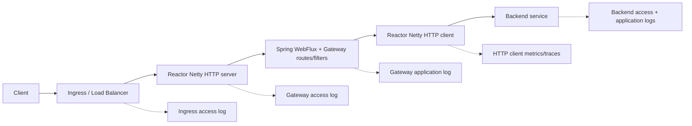
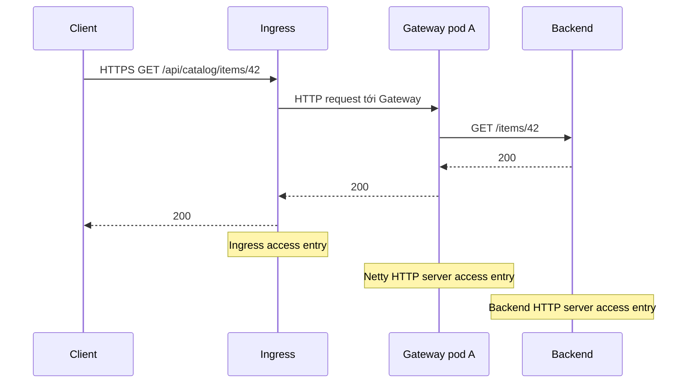

# Reactor Netty access log và phân biệt với application log

## 1. Vấn đề: Gateway trả 503 nhưng log nào giải thích được vì sao?

Một **Spring Cloud Gateway** đặt trước các microservices thường làm nhiều việc trong cùng một request: route predicate chọn đích, filter chain biến đổi đường dẫn/header, service discovery và load balancing chọn instance, Spring Security kiểm tra quyền, rate limiter từ chối lưu lượng, circuit breaker/retry xử lý lỗi, TLS bảo vệ kết nối. Để vận hành, ta cần thấy **request đã vào cổng chưa, route nào được chọn, backend có được gọi không, kết quả là gì và lỗi xảy ra ở tầng nào**.

Vì thế đội ngũ thường có ít nhất hai loại log:

1. **Reactor Netty access log** — ghi lại một giao dịch HTTP mà **HTTP server của Gateway** đã quan sát ở tầng transport, ví dụ method, request URI, HTTP version, status và lượng dữ liệu trả về. Nó không phải mô tả đầy đủ quá trình chọn route.
2. **Application log** — những thông điệp do mã Spring Boot, Spring Security, Gateway components, custom `GlobalFilter`/`GatewayFilterFactory` hoặc controller phát ra qua SLF4J/Logback; cung cấp **ngữ cảnh nghiệp vụ, route ID, loại lỗi và quyết định xử lý** nếu được instrumentation đúng.

Ví dụ client gọi:

```http
GET /api/catalog/items/42 HTTP/1.1
Host: gateway.example.test
```

Gateway có thể trả **503 Service Unavailable**, nhưng access log đơn thuần thường chỉ cho thấy *status 503*. Nguyên nhân có thể là service discovery không có instance, kết nối backend từ chối, circuit breaker fallback, rate limiter/custom filter hoặc một response 503 do chính backend phát ra. **Application log và trace** giúp xác định nhánh nào đã xảy ra.

### Mục tiêu học tập

Sau bài học thuộc chương **Quan sát hệ thống**, bạn có thể:

- Bật **Reactor Netty HTTP server access log** bằng đúng **JVM system property** và đọc Common Log Format.
- Phân biệt **access log**, **application log**, **wiretap/debug log**, **metrics** và **distributed tracing**.
- Cấu hình Logback để tách access log khỏi log ứng dụng, kiểm soát log rotation và chi phí I/O.
- Tạo một lab Gateway Server WebFlux + backend, dùng `curl` kiểm tra 200, 404, 503 và request không match route.
- Giải thích vì sao một access log không nhất thiết có **Gateway route ID**, client IP thực, JWT principal hay trace ID.
- Kết hợp application log với request ID/tracing để điều tra timeout, retry, fallback, TLS và upstream lỗi.
- Bảo vệ thông tin nhạy cảm trong URL, header, cookie, IP và log, đặc biệt trong môi trường có reverse proxy.

> **Phạm vi:** Ví dụ chính áp dụng **Spring Cloud Gateway Server WebFlux 5.0.x**, Reactor Netty và Spring Boot 4.x với Spring Cloud BOM tương thích. Namespace route là `spring.cloud.gateway.server.webflux`. **Gateway Server Web MVC** chạy Servlet/container khác, nên không tự áp dụng JVM property của Reactor Netty HTTP server cho Tomcat/Jetty. Những đường dẫn log và số liệu trong bài là ví dụ thực hành, chưa phải kết quả đã chạy trên dự án này.

## 2. Mô hình quan sát: log nào được phát ở đâu?

### 2.1. HTTP transport, Gateway filter chain và backend là ba tầng khác nhau



Chặng **Ingress → Gateway** là một HTTP connection khác với **Gateway → backend**. Bật `reactor.netty.http.server.accessLogEnabled` trên JVM Gateway chỉ bật access log của **HTTP server nhận request ở Gateway**, **không tự bật**:

- Access log của ingress, service mesh hoặc CDN.
- Access log của HTTP server tại backend.
- Log chi tiết của **outbound Reactor Netty HttpClient**.
- Gateway route metrics hoặc OpenTelemetry spans.
- Application logging trong một controller/backend.

Trong hệ thống không có ingress, client kết nối trực tiếp tới Gateway; nếu có nhiều proxies, mỗi proxy tạo thêm một lớp log và trust boundary.

### 2.2. So sánh sáu loại tín hiệu quan sát

| Tín hiệu | Nơi sinh ra | Trả lời tốt câu hỏi | Không tự trả lời được |
|---|---|---|---|
| **Gateway Reactor Netty access log** | Inbound Netty HTTP server | Request đã tới listener nào, HTTP method/URI, status, một số metadata transport | Gateway chọn route nào, backend nào thực hiện, vì sao breaker mở |
| **Gateway application log** | Spring Boot/Gateway filters/security/custom code | Quyết định route, business check, loại exception, thao tác filter | Không đảm bảo mỗi inbound request đều có dòng log nếu code không log |
| **Ingress access log** | Proxy/CDN/LB trước Gateway | Request tới edge, client connection, upstream status, latency tại proxy | Gateway internal exception, service logic |
| **Backend logs** | Service phía sau | Backend có xử lý request không, lỗi nghiệp vụ và trạng thái backend | Client có bị Gateway chặn trước backend không |
| **Metrics** | Micrometer/Actuator/Reactor Netty | Tỷ lệ lỗi, latency p95/p99, số request, pool saturation | Chi tiết nguyên nhân của từng request riêng lẻ |
| **Distributed tracing** | Observation/OTel spans | Đường đi một request qua nhiều services, tương quan thời gian | Toàn bộ nội dung HTTP payload (và không nên ghi payload nhạy cảm) |

**Không chọn một loại làm nguồn chân lý tuyệt đối.** Access log thích hợp để xác nhận **lưu lượng tại HTTP listener**; application log giải thích **ngữ nghĩa xử lý**; metrics cho biết **xu hướng**; trace liên kết **một request qua các hop**.

### 2.3. Application log không có nghĩa là “log của backend”

Hai ứng dụng đều có thể dùng SLF4J:

```text
Gateway app log:  route=catalog-public, policy=allow, upstreamError=ConnectException
Backend app log: itemId=42, inventoryQuery=completed
```

Đây là **hai process**, mỗi process có logger/context/version khác nhau. “Application log” là log do mã/hạ tầng ứng dụng phát ra ở **process tương ứng**, không phải log trên đường dây tự động được Gateway gom lại.

## 3. Cách bật Reactor Netty access log: chính xác một system property

### 3.1. Property đúng theo tài liệu chính thức

Spring Cloud Gateway Server WebFlux và Reactor Netty đều hướng dẫn bật bằng:

```text
-Dreactor.netty.http.server.accessLogEnabled=true
```

**Đây bắt buộc là JVM system property**, không phải một property của Spring Boot `application.yml`. Mặc định Reactor Netty HTTP server access log **bị tắt**.

Ví dụ chạy một JAR đã build (tên JAR chỉ là minh họa):

```bash
java -Dreactor.netty.http.server.accessLogEnabled=true \
  -jar target/gateway-observability-demo.jar
```

Lưu ý vị trí `-D...`: phải đặt **trước `-jar`** để được JVM nhận như system property. Đặt phía sau đường dẫn JAR có thể chỉ thành argument của ứng dụng và **không bật access log**.

### 3.2. Những cấu hình trông giống nhưng chưa đủ

```yaml
# SAI MỤC ĐÍCH: Spring Boot không đọc khóa này để bật Netty access log.
reactor:
  netty:
    http:
      server:
        accessLogEnabled: true

# Chỉ thay log level, KHÔNG tự kích hoạt cơ chế access log.
logging:
  level:
    reactor.netty.http.server.AccessLog: INFO
```

Nếu dùng `logging.level.reactor.netty.http.server.AccessLog=INFO` và JVM system property vẫn thiếu, logger được phép ghi nhưng **Reactor Netty chưa tạo access events**. Ngược lại, nếu JVM property đúng mà logger bị đặt `OFF` hoặc appender không nhận events, bạn vẫn không thấy dòng access log ở đích xuất.

### 3.3. Các cách truyền JVM flag khi triển khai

**Chạy JAR trực tiếp:**

```bash
java -Dreactor.netty.http.server.accessLogEnabled=true \
  -jar gateway-observability-demo.jar
```

**Truyền qua biến môi trường `JAVA_TOOL_OPTIONS`** khi runtime/container cho phép:

```bash
export JAVA_TOOL_OPTIONS='-Dreactor.netty.http.server.accessLogEnabled=true'
java -jar gateway-observability-demo.jar
```

**Container image (trích đoạn Dockerfile mô tả lệnh start):**

```dockerfile
ENTRYPOINT ["java", "-Dreactor.netty.http.server.accessLogEnabled=true", "-jar", "/app/gateway.jar"]
```

**Kubernetes container (trích đoạn env, không phải manifest hoàn chỉnh):**

```yaml
env:
  - name: JAVA_TOOL_OPTIONS
    value: "-Dreactor.netty.http.server.accessLogEnabled=true"
```

Ở production cần kiểm tra **JVM thực sự nhận flag**, startup script không ghi đè, config đã rollout tới tất cả pods và logging backend được cấu hình. `JAVA_TOOL_OPTIONS` ảnh hưởng **mọi Java process được khởi động trong môi trường kế thừa biến ấy**, nên chỉ thiết lập đúng container/process Gateway. Không phải restart mọi microservice để bật access log của Gateway.

### 3.4. Khi nào flag được đọc?

Reactor Netty dùng system property khi cấu hình server/khởi tạo các thành phần cần thiết. Hãy truyền flag **ngay lúc JVM khởi động**; đừng dùng `System.setProperty(...)` trong một filter khi requests đã đến rồi kỳ vọng listener đang chạy đổi chế độ logging. Nếu phải bật/tắt động ở tầng code, cần cấu hình server lifecycle tương ứng và test runtime, không chỉnh JVM property bừa bãi trong request.

### 3.5. Đây là log *server*, không phải *client*

Tên property chứa `http.server` vì target là HTTP server. Gateway cũng dùng Netty HTTP **client** khi proxy tới upstream, nhưng outbound connection là một hợp đồng logging/metrics khác. Không suy ra:

```text
GET /api/catalog/items/42 access log tại Gateway
  ⇒  GET /items/42 đã được backend nhận
```

Request có thể bị 401/403/429/404 **trước khi router gửi downstream**, vẫn có access log ở inbound Gateway. Backend cần access log riêng hoặc metrics/tracing để xác nhận kết nối thực.

## 4. Một dòng Reactor Netty access log có ý nghĩa gì?

### 4.1. Dạng mặc định gần Common Log Format

Reactor Netty HTTP server sử dụng **Common Log Format (CLF)** làm format mặc định. Một dòng minh họa:

```text
127.0.0.1 - - [24/Nov/2026:05:30:01 +0000] "GET /api/catalog/items/42 HTTP/1.1" 200 93
```

Ví dụ trên chỉ minh họa các **thành phần thường thấy**, không phải bản ghi đã được kiểm thử. Cách hiển thị địa chỉ/timestamp/bytes có thể thay đổi theo version Reactor Netty, proxy và custom access format.

| Thành phần | Ý nghĩa | Không nên suy diễn |
|---|---|---|
| `127.0.0.1` | Địa chỉ peer/remote nhìn từ Netty HTTP server | Chưa chắc là IP người dùng cuối nếu có ingress |
| `- -` | Các trường identity không có thông tin | Không tự tạo user ID từ JWT |
| `[24/Nov/2026:05:30:01 +0000]` | Thời gian ghi theo định dạng log | Không nhất thiết trùng timezone log ứng dụng |
| `"GET /api/catalog/items/42 HTTP/1.1"` | Request line logic inbound | Không chứa route ID hoặc backend path đã rewrite |
| `200` | HTTP status của phản hồi phía Gateway | Không chứng minh backend cũng trả 200 hoặc bị gọi |
| `93` | Kích thước response theo format/access provider | Không phải kích thước body request; framing/compression có thể ảnh hưởng |

### 4.2. URI của access log là đường client gọi, không nhất thiết backend nhận

Nếu Gateway có:

```yaml
filters:
  - StripPrefix=2
```

Client gọi `/api/catalog/items/42`, trong khi backend nhận `/items/42`. **Access log inbound** thường mô tả **URI mà Gateway nhận**, không hiển thị đường dẫn cuối sau `StripPrefix`. Để xác định path gửi đến backend, cần log từ custom filter đúng thời điểm, backend access log, tracing hoặc integration test.

### 4.3. Có log status 404 dù không route nào match?

Nếu HTTP request đi tới **Reactor Netty listener** và Gateway phản hồi 404 vì không có route, access logger ở tầng server vẫn có khả năng ghi request đó. Ngược lại, một `GlobalFilter` của Gateway có thể **không chạy** khi request không match route, vì Gateway filter chain chỉ được tạo khi có route. Đây là tình huống điển hình **có access log nhưng thiếu application log từ custom Gateway filter**.

Không cam kết mọi kết nối hỏng hoặc client abort đều tạo đúng một dòng CLF: khi TLS handshake chưa thành công, request HTTP chưa parse được, kết nối bị hủy hoặc response chưa hoàn tất, hành vi logging phụ thuộc Reactor Netty/version. Quan sát thêm connection/error logs và ingress logs.

### 4.4. Vì sao status code và bytes cần cẩn trọng?

Reactor Netty access log phản ánh điều HTTP server phát ra. Nhưng filter `CircuitBreaker` có thể đổi backend error thành fallback 200, `Retry` có thể gọi backend nhiều lần để tạo một response 200, và `SetStatus` có thể thay status. Vì vậy:

- **Một access line** không đồng nghĩa **một backend attempt**.
- HTTP 200 từ Gateway không tự chứng minh backend không lỗi.
- HTTP 503 từ Gateway không phân biệt “backend trả 503” và “Gateway không kết nối được backend”.
- Header/body rewrite, nén, streaming và client cancellation có thể khiến số bytes/latency của mỗi layer khác nhau.

## 5. Tách access log và application log bằng Logback

### 5.1. Logger chuyên dụng của Netty access log

Tài liệu Spring Cloud Gateway 5.0.x dùng **logger name chính xác**:

```text
reactor.netty.http.server.AccessLog
```

Đây là **tên category logger**. Không nhầm với tên lớp API tùy biến `reactor.netty.http.server.logging.AccessLog` dùng để xây một access log entry. Dùng `logging.level.root=DEBUG` không phải cách đúng để bật access logging và còn làm ngập log hệ thống.

Muốn **file access log riêng**, có thể cấu hình Logback logger này với `additivity="false"` để access entries **không trôi lên root appender**. Nếu muốn đưa access log vào stdout của container, cũng có thể gắn **một appender dành riêng** với format phù hợp.

### 5.2. Ví dụ logback-spring.xml cho môi trường lab

Đây là **nội dung tệp cấu hình mẫu** `src/main/resources/logback-spring.xml` của ứng dụng Gateway; trong bước soạn học liệu chỉ có Markdown được tạo/sửa:

```xml
<?xml version="1.0" encoding="UTF-8"?>
<configuration>
    <!-- Application log: timestamp, level, logger, message. -->
    <appender name="APP_CONSOLE"
              class="ch.qos.logback.core.ConsoleAppender">
        <encoder>
            <pattern>%d{yyyy-MM-dd'T'HH:mm:ss.SSSXXX} %-5level [%thread] %logger{36} - %msg%n</pattern>
        </encoder>
    </appender>

    <!-- Reactor Netty access log: CLF line, không thêm tiền tố app. -->
    <appender name="ACCESS_FILE"
              class="ch.qos.logback.core.rolling.RollingFileAppender">
        <file>./logs/gateway-access.log</file>
        <rollingPolicy
            class="ch.qos.logback.core.rolling.SizeAndTimeBasedRollingPolicy">
            <fileNamePattern>./logs/gateway-access.%d{yyyy-MM-dd}.%i.log.gz</fileNamePattern>
            <maxFileSize>10MB</maxFileSize>
            <maxHistory>7</maxHistory>
            <totalSizeCap>1GB</totalSizeCap>
        </rollingPolicy>
        <encoder>
            <pattern>%msg%n</pattern>
        </encoder>
    </appender>

    <appender name="ACCESS_ASYNC"
              class="ch.qos.logback.classic.AsyncAppender">
        <queueSize>8192</queueSize>
        <discardingThreshold>0</discardingThreshold>
        <neverBlock>true</neverBlock>
        <appender-ref ref="ACCESS_FILE" />
    </appender>

    <!-- Tách access log khỏi root application log. -->
    <logger name="reactor.netty.http.server.AccessLog"
            level="INFO" additivity="false">
        <appender-ref ref="ACCESS_ASYNC" />
    </logger>

    <root level="INFO">
        <appender-ref ref="APP_CONSOLE" />
    </root>
</configuration>
```

**Hai loại output khác nhau:**

- `./logs/gateway-access.log`: các dòng Netty access log **nếu JVM property đã bật**, file có rotation.
- Console/stderr theo cấu hình Logback: application logs từ `com.example.gateway`, Spring và các thành phần có logger được bật.

**Giới hạn của AsyncAppender:** `neverBlock=true` giúp thread gọi không bị chặn khi queue đầy nhưng có thể **đánh rơi events** trong lúc quá tải; `discardingThreshold=0` không biến hàng đợi thành nơi lưu bền vững. Vì thế đây là lựa chọn ưu tiên **bảo vệ throughput** trong lab, **không cam kết log đầy đủ cho audit bắt buộc**. Nếu phải bảo đảm đầy đủ từng request cho mục đích pháp lý, cần kiến trúc log collector/queue bền vững và kế hoạch backpressure rõ ràng — không giải quyết bằng `.subscribe()` fire-and-forget hay file appender mặc định.

### 5.3. Vì sao dùng logback-spring.xml?

Spring Boot hỗ trợ cả `logback.xml` và `logback-spring.xml`; bản `-spring` được Boot khuyến nghị nếu cần tích hợp Spring Boot Logback extensions/profiles. Dù chọn tên nào, **phần tử logger của Netty không thay được JVM flag**.

`logging.file.name` trong `application.yml` chỉ bật **cấu hình file logging mặc định của Spring Boot**, không tự bảo đảm access log được tách riêng. Khi dùng `logback-spring.xml` tự định nghĩa root/appenders, hãy review toàn bộ output để không vô tình mất structured logging, trace context hay console logs do Boot trước đó cấu hình.

### 5.4. Khi chạy trong Kubernetes nên ghi ra đâu?

Trong môi trường container, nhiều hệ thống ưu tiên **stdout/stderr → collector → log store** thay vì ghi file trong filesystem ephemeral. Ví dụ appender access stdout tách format:

```xml
<appender name="ACCESS_CONSOLE"
          class="ch.qos.logback.core.ConsoleAppender">
    <encoder>
        <pattern>ACCESS %msg%n</pattern>
    </encoder>
</appender>
<logger name="reactor.netty.http.server.AccessLog"
        level="INFO" additivity="false">
    <appender-ref ref="ACCESS_CONSOLE" />
</logger>
```

Đây là **trích đoạn** thay cho `ACCESS_FILE/ACCESS_ASYNC` của ví dụ trước, không phải thêm cả hai rồi tạo duplicate. Prefix `ACCESS` giúp pipeline collector nhận diện loại log, nhưng format lúc này **không còn là CLF thuần**; parser log phải nhận biết điều đó. Nếu muốn JSON schema thống nhất, thiết kế một pipeline structured logging riêng có fields được chuẩn hóa; đừng chỉ thay `%msg%n` thành `%json%n` mà mặc định log message CLF trở thành các fields JSON có cấu trúc.

### 5.5. Rotation, retention và I/O pressure

Một Gateway xử lý nhiều nghìn request/s có thể sinh lượng access logs rất lớn. Khi bật logging cần tính:

| Chủ đề | Câu hỏi vận hành | Thực hành nên làm |
|---|---|---|
| Volume | Có bao nhiêu HTTP transactions mỗi giây? | Ước lượng bytes/line × requests/second × retention |
| Rotation | Một file có tăng vô hạn không? | Dùng rolling policy hoặc stdout collector |
| Retention | Cần giữ bao lâu, ở đâu? | Phù hợp chính sách dữ liệu, chi phí và pháp lý |
| Burst | Async queue có đầy không? | Monitor queue/drop và đặt giới hạn; không hứa zero-loss |
| Disk | File access có lấp đầy PVC/container không? | Cảnh báo dung lượng, quota, cleanup |
| Collector | Collector có lag không? | Theo dõi ingest latency, parse errors và sampling rules |
| Security | Log có URI chứa token/PII không? | Redaction/avoid raw query; hạn chế quyền xem logs |

Nếu cần hiển thị real-time trên console của IDE, tạm gắn access logger vào console trong dev. Production phải chọn format/volume/retention dựa trên **mục tiêu quan sát và yêu cầu bảo mật**, không bật vô điều kiện cho mọi chặng với log level DEBUG.

## 6. Application log của Gateway: ví dụ GlobalFilter ghi route và thời gian

### 6.1. Vì sao cần GlobalFilter riêng?

Access log biết Netty listener nhận `GET /api/catalog/items/42` và trả 200, nhưng thường **không biết route ID**. Trong Gateway Server WebFlux, sau khi `RoutePredicateHandlerMapping` chọn được route, ta có thể truy cập route runtime qua exchange attribute:

```java
Route route = exchange.getAttribute(
    ServerWebExchangeUtils.GATEWAY_ROUTE_ATTR
);
```

Một `GlobalFilter` tùy biến có thể ghi **route ID, HTTP method, loại exception, Reactor termination signal và thời gian xử lý** mà không ghi URL query/credentials. GlobalFilter thuộc **Gateway filter chain**, không phải Netty access logger, và chỉ xử lý các requests đi qua chain ấy.

### 6.2. Ví dụ GlobalFilter không block và không subscribe

Tạo class `RouteOutcomeLogFilter.java` trong ứng dụng Gateway:

```java
package com.example.gateway;

import org.slf4j.Logger;
import org.slf4j.LoggerFactory;
import org.springframework.cloud.gateway.filter.GatewayFilterChain;
import org.springframework.cloud.gateway.filter.GlobalFilter;
import org.springframework.cloud.gateway.route.Route;
import org.springframework.cloud.gateway.support.ServerWebExchangeUtils;
import org.springframework.core.Ordered;
import org.springframework.stereotype.Component;
import org.springframework.web.server.ServerWebExchange;
import reactor.core.publisher.Mono;

@Component
public class RouteOutcomeLogFilter implements GlobalFilter, Ordered {

    private static final Logger log =
        LoggerFactory.getLogger(RouteOutcomeLogFilter.class);

    @Override
    public int getOrder() {
        return -1;
    }

    @Override
    public Mono<Void> filter(
            ServerWebExchange exchange,
            GatewayFilterChain chain) {

        Route route = exchange.getAttribute(
            ServerWebExchangeUtils.GATEWAY_ROUTE_ATTR);
        String routeId = route == null ? "unresolved" : route.getId();
        String method = exchange.getRequest().getMethod().name();

        // Thời gian bắt đầu tại lúc framework subscribe.
        return Mono.defer(() -> {
            long startNanos = System.nanoTime();

            return chain.filter(exchange)
                .doOnError(error ->
                    log.warn("gateway route={} method={} errorType={}",
                        routeId, method,
                        error.getClass().getSimpleName()))
                .doFinally(signal -> {
                    long elapsedMs =
                        (System.nanoTime() - startNanos) / 1_000_000;
                    var status = exchange.getResponse().getStatusCode();

                    log.info(
                        "gateway route={} method={} responseStatus={} "
                            + "signal={} durationMs={}",
                        routeId, method,
                        status == null ? "unset" : status.value(),
                        signal.name(), elapsedMs);
                });
        });
    }
}
```

Mã này cố ý **không**:

- Gọi `subscribe()` hoặc `block()`; framework sở hữu subscription request.
- Ghi raw `Authorization`, `Cookie`, body hay query string.
- Cố sửa HTTP response headers sau khi response đã commit.
- Tạo một HTTP request đến hệ thống logging trong `doFinally`.
- Dùng `ThreadLocal` để giả định Reactor callback luôn chạy cùng thread.

`doFinally` quan sát `ON_COMPLETE`, `ON_ERROR` và `CANCEL`; nhưng **`ON_COMPLETE` không đồng nghĩa HTTP 200**: một response 404/503 đã được xử lý bình thường cũng có thể hoàn tất với `ON_COMPLETE`. `getStatusCode()` có thể `null` nếu chưa có status explicit; **không dùng riêng giá trị này để chứng minh status cuối cùng đã được phát trên wire**.

### 6.3. Một application log minh họa

```text
2026-11-24T12:00:00.123+07:00 INFO  [reactor-http-nio-3] c.e.gateway.RouteOutcomeLogFilter - gateway route=catalog-public method=GET responseStatus=200 signal=ON_COMPLETE durationMs=41
```

Đây là log **do mã ứng dụng viết qua SLF4J**, không phải CLF của Netty. Hai log có thể khác timezone, thread name, timestamp và **thứ tự xuất hiện**; không thiết kế parser dựa trên giả định access log và application log phải xuất hiện liền nhau.

### 6.4. Khi nào application filter không chạy?

| Tình huống | Gateway GlobalFilter có thể chạy? | Netty HTTP server access log có thể ghi? |
|---|---|---|
| Route `catalog-public` match | **Có** | **Có** nếu bật và HTTP request được xử lý |
| Không route nào match → 404 | **Không nhất thiết** (thường không có Gateway chain) | **Có thể có** ở listener |
| Spring Security WebFilter từ chối 401 sớm | **Không nhất thiết** | **Có thể có** |
| CORS preflight được xử lý trước route | **Không nhất thiết** | **Có thể có** |
| Ingress từ chối trước Gateway | **Không** | **Không** vì request không tới Gateway |
| TCP/TLS handshake thất bại trước HTTP | **Không** | Thường **không có HTTP access entry hoàn chỉnh** |
| HTTP request qua Gateway và bị client cancel | Có thể đã chạy một phần | Log/counter tùy thời điểm cancel và runtime |

**Không kết luận “Gateway không hề nhận request” chỉ vì thiếu `RouteOutcomeLogFilter` log**. Trước tiên tìm access log inbound, ingress logs, security logs và Netty connection errors.

### 6.5. Vì sao không ghi request body trong filter?

Ở WebFlux, `getRequest().getBody()` là `Flux<DataBuffer>`. Nếu gọi `subscribe()` riêng chỉ để log, bạn có thể **tiêu thụ body trước routing**, phá backpressure, làm mất dữ liệu gửi backend, tăng memory và rò PII. Nếu thực sự có nhu cầu debug body, dùng filtering/redaction có giới hạn, sampling, chính sách retention và API transform được hỗ trợ; không mặc định log body của login/payment/token endpoints.

## 7. Chẩn đoán khác biệt qua ma trận 200, 404, 503, 401 và 429

### 7.1. Ba tình huống cùng status không cùng nguyên nhân

| HTTP response nhìn từ client | Access log ở Gateway | Application log cần tìm | Backend có thể nhận request? |
|---|---|---|---|
| 200 thành công | HTTP 200 | Route match, business/filters complete | Có hoặc được cache/fallback |
| 404 không match route | HTTP 404 | Có thể **không có** route GlobalFilter entry | Không |
| 404 do backend trả | HTTP 404 | Route ID đã match và downstream response | Có |
| 503 do backend trả | HTTP 503 | Route ID, upstream status/latency | Có |
| 503 do connect timeout | HTTP 5xx có thể là 503/504 tùy handler | Connect/timeout exception category | Không xử lý request thành công |
| 503 do circuit breaker fallback | HTTP 503 (hoặc status fallback khác) | Breaker state/fallback route | Backend có thể đã bị bỏ qua |
| 401 Spring Security trước route | HTTP 401 | SecurityWebFilterChain/authentication | Có thể không |
| 429 rate limiter | HTTP 429 | Rate limiter/key resolver/quota | Thường không gọi backend nếu bị chặn trước routing |

**Lưu ý:** status của timeout/từ chối có thể thay theo exception handler, fallback và version. Bảng minh họa lớp bằng chứng, **không cam kết mọi connect timeout tự trả 503** hay mọi route đều dùng cùng filter order.

### 7.2. Access log cho biết điều gì về circuit breaker?

Một circuit breaker có thể:

1. Gọi backend; backend trả lỗi, breaker ghi nhận failure.
2. Khi OPEN, trả fallback ngay mà không gọi backend.
3. Fallback trả 200 với body đã giảm chức năng hoặc 503 tùy policy.

Cả ba trường hợp có thể sinh một **Gateway access entry cho mỗi inbound HTTP request**, nhưng số backend attempts khác nhau. Muốn chứng minh circuit breaker mở, phải xem **application logs/metrics của breaker** cùng backend logs; không suy từ status 200/503 của access log.

### 7.3. Retry có thể tạo nhiều attempts sau một access entry

Giả sử:

```text
Client → Gateway GET /api/catalog/items/42
Gateway → backend attempt #1: 503
Gateway → backend attempt #2: 503
Gateway → backend attempt #3: 200
Gateway → Client: 200
```

Gateway inbound access log thường ghi **một** response 200 ở HTTP server, trong khi backend access logs có **ba** requests. Application log từ Retry filter/observability có thể phản ánh attempts. Đây **không nhất thiết là double logging**; hai log đang đo hai tập sự kiện khác nhau.

### 7.4. Trường hợp upstream chưa từng được gọi

Một 403 do Spring Security, 404 do route miss, 429 do rate limiter hoặc 503 do breaker OPEN đều có thể hoàn tất ở Gateway. Khi đó **không có backend access log** phù hợp vì backend chưa thấy request. Access log Gateway trả lời **“client đã giao tiếp với listener Gateway”**, còn backend log trả lời **“service có nhận request của hop đó không”**.

## 8. Lab: hai ứng dụng Spring Boot và bốn lời gọi HTTP

### 8.1. Kiến trúc lab

```text
curl / Browser
   |
   v
Gateway Server WebFlux :8080
   |         |
   |         +--> Reactor Netty AccessLog  --> ./logs/gateway-access.log
   |         +--> RouteOutcomeLogFilter    --> console application log
   |
   +--> catalog-backend :8081
           |
           +--> Spring MVC application log
```

Để tránh nhầm việc logging trên hai process, ta đặt Gateway và backend ở **hai ứng dụng Spring Boot riêng**, sử dụng cùng host loopback trong lab. Thử các kết quả:

| Case | URL qua Gateway | Nguồn kết quả |
|---|---|---|
| A | `GET /api/catalog/items/42` | Backend trả **200** |
| B | `GET /api/catalog/items/0` | Backend trả **404** |
| C | `GET /api/catalog/fail` | Backend trả **503** |
| D | `GET /not-a-route` | **Gateway** không match route, thường trả **404** |

Ca B và D có cùng HTTP status 404 nhưng **lý do khác hẳn**. Đây là bài tập quan trọng nhất để phân biệt access log và application log.

### 8.2. Gateway dependencies và cấu hình

Thêm dependencies (versions do BOM quản lý) vào dự án **gateway-observability-demo**:

```xml
<dependencies>
    <dependency>
        <groupId>org.springframework.cloud</groupId>
        <artifactId>spring-cloud-starter-gateway-server-webflux</artifactId>
    </dependency>
    <dependency>
        <groupId>org.springframework.boot</groupId>
        <artifactId>spring-boot-starter-actuator</artifactId>
    </dependency>
</dependencies>
```

File `application.yml` của Gateway:

```yaml
server:
  port: 8080

spring:
  application:
    name: gateway-observability-demo
  cloud:
    gateway:
      server:
        webflux:
          routes:
            - id: catalog-public
              uri: http://127.0.0.1:8081
              predicates:
                - Path=/api/catalog/**
                - Method=GET
              filters:
                - StripPrefix=2
                - AddRequestHeader=X-Gateway-Lab,true

management:
  endpoints:
    web:
      exposure:
        include: health,metrics
```

Ở `application.yml` trên **không có** khóa `reactor.netty.http.server.accessLogEnabled`. Access log vẫn phải được bật bằng **JVM flag** khi chạy. Nếu dùng Logback tách file, áp dụng `logback-spring.xml` ở mục 5 và đặt `RouteOutcomeLogFilter` ở mục 6 trong cùng package ứng dụng được Spring scan.

Định tuyến:

```text
GET http://127.0.0.1:8080/api/catalog/items/42
   ↓ Path và Method predicate match
   ↓ StripPrefix=2
GET http://127.0.0.1:8081/items/42
```

Tương tự, `/api/catalog/fail` thành `/fail`. Cấu hình này **không tự bật** retry, circuit breaker hoặc rate limiter, nên 503 backend thường được proxy như status upstream, trừ khi app có filters/security khác.

### 8.3. Backend MVC trả status có chủ đích

Tạo **ứng dụng backend riêng** với Spring Boot 4.x `spring-boot-starter-webmvc`. File `CatalogBackendApplication.java`:

```java
package com.example.backend;

import java.util.Map;
import java.util.concurrent.atomic.AtomicLong;
import org.slf4j.Logger;
import org.slf4j.LoggerFactory;
import org.springframework.boot.SpringApplication;
import org.springframework.boot.autoconfigure.SpringBootApplication;
import org.springframework.http.HttpStatus;
import org.springframework.http.ResponseEntity;
import org.springframework.web.bind.annotation.GetMapping;
import org.springframework.web.bind.annotation.PathVariable;
import org.springframework.web.bind.annotation.RestController;

@SpringBootApplication
@RestController
public class CatalogBackendApplication {

    private static final Logger log =
        LoggerFactory.getLogger(CatalogBackendApplication.class);
    private final AtomicLong calls = new AtomicLong();

    public static void main(String[] args) {
        SpringApplication.run(CatalogBackendApplication.class, args);
    }

    @GetMapping("/items/{id}")
    public ResponseEntity<Map<String, Object>> item(
            @PathVariable long id) {

        long count = calls.incrementAndGet();
        log.info("backend action=item id={} invocation={}", id, count);

        if (id == 0L) {
            return ResponseEntity.status(HttpStatus.NOT_FOUND)
                .body(Map.of("error", "NOT_FOUND", "call", count));
        }

        return ResponseEntity.ok(Map.of(
            "id", id, "service", "catalog-backend", "call", count));
    }

    @GetMapping("/fail")
    public ResponseEntity<Map<String, Object>> failure() {
        long count = calls.incrementAndGet();
        log.warn("backend action=simulated-failure invocation={}", count);
        return ResponseEntity.status(HttpStatus.SERVICE_UNAVAILABLE)
            .body(Map.of("error", "DEMO_UNAVAILABLE", "call", count));
    }
}
```

Backend `application.yml`:

```yaml
server:
  port: 8081
spring:
  application:
    name: catalog-backend
```

**Điểm quan trọng:** controller log `backend action=item` thuộc process backend, **không phải Reactor Netty access log của Gateway**. Nếu backend này chạy Servlet/Tomcat, bật Gateway Netty access flag không tạo ra access log Tomcat ở backend.

### 8.4. Khởi động, giữ riêng hai terminal

1. Terminal backend: chạy ứng dụng `catalog-backend` ở `8081` theo phương thức build/run của dự án.
2. Terminal Gateway: khởi động JAR Gateway **với `-Dreactor.netty.http.server.accessLogEnabled=true`** và Logback config của mục 5.
3. Từ terminal thứ ba, thực hiện `curl`.

```bash
# Lệnh MINH HỌA tên JAR sau khi đã build; không dùng cho backend.
java -Dreactor.netty.http.server.accessLogEnabled=true \
  -jar target/gateway-observability-demo.jar
```

Trong Docker, địa chỉ `127.0.0.1:8081` bên trong Gateway **trỏ về chính container Gateway**, không trỏ về host hoặc container backend khác. Khi chạy trong container/Kubernetes phải đổi route URI thành DNS/service có thể truy cập từ Gateway.

### 8.5. Gửi bốn request

```bash
# A: backend 200.
curl --noproxy '*' -i \
  'http://127.0.0.1:8080/api/catalog/items/42'

# B: backend 404 nhưng route vẫn match.
curl --noproxy '*' -i \
  'http://127.0.0.1:8080/api/catalog/items/0'

# C: backend 503 qua route hợp lệ.
curl --noproxy '*' -i \
  'http://127.0.0.1:8080/api/catalog/fail'

# D: Gateway không có route nào match.
curl --noproxy '*' -i \
  'http://127.0.0.1:8080/not-a-route'
```

Với bản lab và không có filters khác, kết quả kỳ vọng là **200, 404, 503, 404**. Kết quả cụ thể vẫn phụ thuộc runtime, Spring Security và custom exception handlers của project.

### 8.6. Quan sát tệp access và console application log

Với cấu hình `logback-spring.xml`, quan sát access log:

```bash
# Từ working directory nơi JVM Gateway chạy.
tail -n 20 ./logs/gateway-access.log
```

Một tập kết quả **minh họa**:

```text
127.0.0.1 - - [24/Nov/2026:05:41:11 +0000] "GET /api/catalog/items/42 HTTP/1.1" 200 49
127.0.0.1 - - [24/Nov/2026:05:41:12 +0000] "GET /api/catalog/items/0 HTTP/1.1" 404 30
127.0.0.1 - - [24/Nov/2026:05:41:13 +0000] "GET /api/catalog/fail HTTP/1.1" 503 43
127.0.0.1 - - [24/Nov/2026:05:41:14 +0000] "GET /not-a-route HTTP/1.1" 404 0
```

Trong **Gateway application console** có thể thấy:

```text
INFO c.e.gateway.RouteOutcomeLogFilter - gateway route=catalog-public method=GET responseStatus=200 signal=ON_COMPLETE durationMs=23
INFO c.e.gateway.RouteOutcomeLogFilter - gateway route=catalog-public method=GET responseStatus=404 signal=ON_COMPLETE durationMs=8
INFO c.e.gateway.RouteOutcomeLogFilter - gateway route=catalog-public method=GET responseStatus=503 signal=ON_COMPLETE durationMs=9
```

Trong **backend console** có thể thấy:

```text
INFO c.e.backend.CatalogBackendApplication - backend action=item id=42 invocation=1
INFO c.e.backend.CatalogBackendApplication - backend action=item id=0 invocation=2
WARN c.e.backend.CatalogBackendApplication - backend action=simulated-failure invocation=3
```

**Đọc khác biệt:**

- Ca **B** có access 404 **và** Gateway app log route=catalog-public **và** backend app log. Đây là **404 từ backend**.
- Ca **D** có access 404 nhưng **không có** route log từ GlobalFilter, cũng **không có** backend log. Đây là dấu hiệu route **không được match**.
- Ca **C** có access 503 và backend app log simulated failure. Nếu gateway tự tạo 503 vì connect timeout, backend app log này sẽ không xuất hiện.

Đừng dùng timestamp/order/byte count ở các khối minh họa như golden snapshot: chúng phụ thuộc thời điểm, timezone, async appender và phiên bản.

### 8.7. Bài test nâng cao: filter có chạy trên route miss không?

Tạm thay đổi path request:

```bash
curl --noproxy '*' -i \
  'http://127.0.0.1:8080/api/unknown/items/42'
```

Không match `Path=/api/catalog/**`, nên **route-specific filters** như `StripPrefix` và `GlobalFilter` trong Gateway chain thường không được chạy. Nhưng HTTP listener vẫn nhận request và có thể tạo access line. Đây là minh chứng trực tiếp cho khác biệt **transport logging** và **Gateway route processing**.

## 9. Phân biệt access log với wiretap và DEBUG/TRACE

### 9.1. Wiretap là chế độ debug protocol, không phải access log

Spring Cloud Gateway Server WebFlux có các cờ cho Reactor Netty wiretap:

```yaml
spring:
  cloud:
    gateway:
      server:
        webflux:
          httpserver:
            wiretap: true
          httpclient:
            wiretap: true
```

Đây là **cấu hình chỉ để gỡ lỗi trong môi trường cô lập**, khác với `-Dreactor.netty.http.server.accessLogEnabled=true`. Wiretap có thể tạo log chi tiết về bytes/headers/data của HTTP server/client ở các logger Netty tương ứng, tùy log level và byte buffer logging format.

**Không bật wiretap rộng trên production** chỉ để biết “mỗi request status gì”: chi phí I/O/memory cao, nguy cơ lộ Authorization, cookies, token, body và dữ liệu cá nhân. Access log với trường giới hạn, application log có redaction và metrics/tracing thường thích hợp hơn.

### 9.2. So sánh nhanh

| Cơ chế | Bật bằng gì? | Nội dung thường thấy | Rủi ro |
|---|---|---|---|
| Reactor Netty access log | JVM `-Dreactor.netty.http.server.accessLogEnabled=true` | Một dòng HTTP transaction, method/URI/status/bytes | URI/query và client IP có thể nhạy cảm |
| Logback app log INFO | SLF4J `log.info` và logging config | Route ID, status, errors do code chủ động ghi | Lộ PII nếu format sai, log thiếu nhánh chưa instrument |
| Spring framework DEBUG | `logging.level.org.springframework...=DEBUG` | Handler/filter behavior, exceptions theo logger | Nhiều dòng, không tương đương CLF |
| Reactor Netty wiretap | `httpserver.wiretap` / `httpclient.wiretap` và logger levels | Protocol/connection/buffer events | Có thể lộ payload và làm tăng tải |
| Actuator metrics | Starter Actuator + metrics config | Counter/timer theo route/status | Không mô tả chi tiết một request |
| Distributed tracing | Observation/tracing bridge/exporter | Spans và correlations theo request | Cần context propagation và sampling |

### 9.3. Khi nào nên tắt wiretap ngay?

Khi đã có đủ thông tin để xác định lỗi handshake/frames/headers trong staging, tắt wiretap để giảm chi phí và dữ liệu nhạy cảm. Không lấy full headers/body rồi “sanitize sau” như chiến lược chính: thông tin nhạy cảm có thể đã đi vào stdout/collector trước khi pipeline xử lý. Dùng sampling/capture có giới hạn theo quyền, TTL và delete policy.

## 10. Metrics và tracing bổ sung gì cho access log?

### 10.1. Gateway metrics: xu hướng, không phải bản ghi request

Spring Cloud Gateway Server WebFlux có metric route-level `spring.cloud.gateway.requests` khi Gateway metrics instrumentation được bật. Những tags thường gặp gồm `routeId`, `routeUri`, `status`, `httpStatusCode`, `outcome` và `httpMethod` (tùy version/config).

Với nhánh Gateway 5.0.x, để **tránh phụ thuộc default theo version**, khai báo rõ:

```yaml
spring:
  cloud:
    gateway:
      server:
        webflux:
          metrics:
            enabled: true
            path-tags:
              enabled: false
          observability:
            enabled: true

management:
  endpoints:
    web:
      exposure:
        include: health,metrics
```

Đây là **đoạn cấu hình thay/bổ sung** cho `application.yml` của Gateway lab, không tạo thêm một root `spring`/`management` trùng lặp trong cùng file. Nếu cần Prometheus, thêm dependency `micrometer-registry-prometheus` cùng endpoint exposure `prometheus` và bảo vệ access.

Kiểm tra sau khi đã gửi requests:

```bash
curl --noproxy '*' -sS \
  'http://127.0.0.1:8080/actuator/metrics'

curl --noproxy '*' -sS \
  'http://127.0.0.1:8080/actuator/metrics/spring.cloud.gateway.requests'
```

Với Actuator, danh sách metric có thể chưa hiện nếu chưa có request/registry/filter tương ứng. Meter name cũng có thể được **normalized** khác khi xuất qua Prometheus; không tìm một snake_case Prometheus name tại `/actuator/metrics/...` rồi kết luận metrics vắng mặt. Hãy kiểm tra **configuration properties chính xác cho BOM đang chạy**, nhất là những tên thuộc namespace `server.webflux` của 5.0.x.

### 10.2. Vì sao metrics không thay access log?

Metrics aggregation phù hợp cảnh báo:

- Tỷ lệ `5xx` theo `routeId` tăng bất thường.
- p95/p99 latency của một route tăng.
- Backend/connection pool saturated.
- Circuit breaker transitions/rate limiter rejects tăng.

Nhưng một counter `spring.cloud.gateway.requests{routeId="catalog-public", status="503"}` không có sẵn path, backend attempt, exception stack hay client request ID cụ thể. Khi cảnh báo nổ, dùng **logs và traces** để đi từ xu hướng xuống nguyên nhân.

### 10.3. Phân biệt HTTP server metric và Gateway route metric

Spring Boot WebFlux có thể xuất `http.server.requests` cho inbound server observations, còn Gateway có thêm route-level `spring.cloud.gateway.requests`. Hai metric đo ở **phạm vi instrumentation khác nhau**:

| Metric | Phạm vi khái niệm | Điều cần lưu ý |
|---|---|---|
| `http.server.requests` | HTTP server observations | Có thể gồm request không match Gateway route, phụ thuộc Boot/WebFlux |
| `spring.cloud.gateway.requests` | Gateway route/filter requests | Có `routeId`, thường không đo route miss như một route bình thường |
| Reactor Netty connection/pool metrics | Transport/connection acquisition | Không nhất thiết 1:1 với số HTTP requests |
| Backend `http.server.requests` | Backend nhận HTTP request | Retry làm số backend requests khác client requests |

Đừng chia bừa `backend requests / gateway requests` rồi gọi đó là “cache hit ratio”: retry, auth rejects, fallback, health probes và ingress routing đều làm lệch phép tính.

### 10.4. Tracing: một request đi qua nhiều services

Khi đã cấu hình **Micrometer Observation + tracing bridge (OpenTelemetry/Brave) và exporter** phù hợp với Spring Boot/Cloud, request có thể mang một trace context như `traceparent` theo chuẩn W3C. Cách trực quan:

```text
traceId=4c3a...  [client → ingress]
traceId=4c3a...  [Gateway server span]
traceId=4c3a...  [Gateway HTTP client span, outbound]
traceId=4c3a...  [catalog-service server span]
```

Đây là sơ đồ **kỳ vọng khi context propagation được cấu hình đúng**, không mặc định cứ thêm `spring-boot-starter-actuator` là xuất spans end-to-end. Tracing cần bridge/exporter, propagation policy, sampling và storage/collector. Nếu downstream không instrument hoặc proxy không forward context, trace sẽ bị đứt.

### 10.5. Access log mặc định không bảo đảm có traceId

Common Log Format của Reactor Netty **không có trường Gateway `routeId` hoặc `traceId` mặc định**. Trong app log có thể có `traceId`/`spanId` qua MDC nếu Micrometer Tracing/Logback integration được bật và context propagation đúng. **Không** cho rằng mọi MDC key sẽ sẵn trên thread Netty access logger hoặc cùng time/window với app log.

Để liên kết:

1. Chọn một cơ chế **correlation ID** tin cậy (ví dụ tracing W3C hoặc request ID được ingress/Gateway sinh).
2. Propagate có kiểm soát qua chặng Gateway → backend.
3. Ghi ID vào application logs **sau khi đã cấu hình context propagation** và giới hạn cardinality.
4. Nếu cần thêm vào Netty access log, dùng **custom AccessLogFactory** (mục 11) và chỉ đọc header **được tin cậy**, không lấy raw client-supplied ID làm identity.
5. Nếu cấu hình chưa chắc, liên kết tạm theo time window/route/status/peer IP nhưng không tuyên bố đó là phép ghép chính xác.

### 10.6. Path tag có thể gây cardinality explosion

Nếu một metric dùng raw request path:

```text
/api/catalog/items/1
/api/catalog/items/2
/api/catalog/items/3
...
```

thì mỗi path khác nhau có thể tạo thêm time series, làm tăng chi phí Prometheus/Grafana/collector. Với Gateway 5.0.x, mặc định `spring.cloud.gateway.server.webflux.metrics.path-tags.enabled` là `false`; chỉ bật sau khi thiết kế chuẩn hóa path/tag cardinality. **Ưu tiên `routeId`** đã được kiểm soát thay vì URL/query chứa user ID, token hoặc mã giao dịch.

## 11. Tùy biến access log nâng cao: format và lọc request

### 11.1. Khi format CLF không phù hợp

Common Log Format tiện cho access parsing truyền thống, nhưng thường không có:

- `routeId` đã được Gateway chọn.
- Tên backend/service instance đã được LoadBalancer chọn.
- `traceId` mà hệ thống tracing đã phát.
- Outcome theo circuit breaker hoặc retry attempt count.
- Field đã loại bỏ query params nhạy cảm theo policy ứng dụng.

Nếu cần các thông tin ấy, **không chỉ đổi Logback pattern**. Trong Logback, `%msg` của access logger đã là một message Netty tạo sẵn; `%d %level %msg%n` chỉ thêm tiền tố, **không tự sinh routeId**.

### 11.2. Reactor Netty cho phép accessLog(boolean, AccessLogFactory)

Reactor Netty HTTP server có API tùy biến:

```java
HttpServer.accessLog(
    boolean enable,
    AccessLogFactory accessLogFactory
)
```

`AccessLogFactory` nhận một `AccessLogArgProvider`, từ đó có thể lấy `method()`, `uri()`, `protocol()`, `status()`, `duration()`, `contentLength()`, `requestHeader(...)` và thông tin connection. Đối tượng được cấp ở **HTTP server/transport layer**, không phải trực tiếp `ServerWebExchange` của Gateway.

**Ví dụ Reactor Netty HTTP server độc lập** (giải thích API, không phải bean Gateway Boot hoàn chỉnh):

```java
import reactor.netty.DisposableServer;
import reactor.netty.http.server.HttpServer;
import reactor.netty.http.server.logging.AccessLog;

public class StandaloneAccessLogExample {

    public static void main(String[] args) {
        DisposableServer server = HttpServer.create()
            .port(9099)
            .accessLog(true, args -> AccessLog.create(
                "method={} protocol={} status={} durationMs={}",
                args.method(),
                args.protocol(),
                args.status(),
                args.duration()))
            .bindNow();

        server.onDispose().block();
    }
}
```

Đoạn này **tạo một HTTP server Reactor Netty mới trên cổng 9099**, không thay thế Gateway listener của ứng dụng Spring Boot. `block()` ở đây là **ranh giới vòng đời main của chương trình độc lập**, không phải blocking trong GatewayFilter. Nếu muốn tùy biến Netty HttpServer của **Gateway Boot**, cần dùng một hook server customizer tương thích với đúng Spring Boot/Gateway version (ví dụ Netty reactive web server customizer); không khởi tạo `HttpServer.create().bindNow()` riêng rồi tưởng Gateway :8080 đã áp dụng format mới.

### 11.3. Không ghi raw URI nếu URL có thể mang dữ liệu nhạy cảm

Một format tùy biến đơn giản có thể **chỉ ghi những field cần thiết**:

```java
// Hàm AccessLogFactory minh họa được truyền cho HttpServer.accessLog(...).
args -> AccessLog.create(
    "method={} protocol={} status={} durationMs={}",
    args.method(), args.protocol(), args.status(), args.duration())
```

Nó **không** ghi URL hoặc headers, giảm nguy cơ lộ query tokens. Nhưng đổi lại sẽ khó xác định endpoint nào bị lỗi. Cách cân bằng là đưa route ID/URI template đã chuẩn hóa vào **application log/metrics** của Gateway, đồng thời lưu chỉ những access fields đã được phê duyệt. Nếu cần path trong custom access log, phải có chính sách sanitize đã test, không ghi `args.uri()` một cách mù quáng trên route nhạy cảm.

### 11.4. Lọc health-check access logs

Tài liệu Reactor Netty có `AccessLogFactory.createFilter(...)`. Ví dụ **được diễn đạt dưới dạng fragment** cho một HttpServer mà bạn thực sự sở hữu:

```java
import reactor.netty.http.server.logging.AccessLog;
import reactor.netty.http.server.logging.AccessLogFactory;

// Đặt trong HttpServer.accessLog(true, <factory>).
AccessLogFactory factory = AccessLogFactory.createFilter(
    args -> !String.valueOf(args.uri()).startsWith("/actuator/health"),
    args -> AccessLog.create(
        "method={} status={} durationMs={}",
        args.method(), args.status(), args.duration())
);
```

Filter này **bỏ qua việc ghi** những URI bắt đầu bằng `/actuator/health`. Nó **không chặn HTTP request**, không bỏ health khỏi metrics và không tác động Gateway routes.

**Cân nhắc trước khi lọc:** health probes nhiều có thể làm log nhiễu, nhưng nếu yêu cầu audit bắt buộc ghi mọi HTTP access, không được âm thầm loại endpoint. Đồng thời, path không đủ để xác thực probe thật; client bất kỳ có thể gọi URL bắt đầu bằng `/actuator/health` nếu endpoint exposed. Khi vừa sampling vừa thống kê QPS, ghi rõ rằng access log **không còn đại diện đủ toàn bộ request count**.

### 11.5. Custom access log có thể lấy client IP thật không?

`AccessLogArgProvider` cho phép truy cập connection information, nhưng với reverse proxy, **remote TCP peer** tại Gateway thường là IP của ingress/sidecar, không phải browser. Khi server được cấu hình forwarded mode, một số APIs có thể trả forwarded remote address. Tuy nhiên **bật chế độ tin Forwarded/X-Forwarded-For mà không kiểm soát trusted proxies có thể làm IP bị giả mạo**.

Trình tự đúng là:

1. Ingress xóa **untrusted forwarded headers** do client gửi trước đó.
2. Ingress thiết lập thông tin client IP/scheme/host theo trust chain.
3. Gateway được cấu hình chỉ tin forwarded headers từ network/proxy đã xác thực.
4. Nếu log client IP, ghi **nguồn của địa chỉ** và rõ nó là connection peer hay client IP đã được proxy xác minh.

Không dùng một trường IP trong access log làm bằng chứng pháp lý duy nhất hoặc làm input ủy quyền mạng nếu proxy trust chưa được xác lập.

## 12. Khi có Ingress, nhiều Gateway pods hoặc HTTP/2

### 12.1. Một request có thể tạo nhiều access logs ở nhiều nơi



Cùng một end-user request, có thể có **ba access log entries ở ba listeners**, không phải “Gateway log bị nhân ba”. Với retry, Backend có thể có nhiều entries hơn Gateway; với auth rejects, Backend có thể có **0** entries.

### 12.2. So sánh status ở từng hop

Giả sử backend trả 503, Gateway CircuitBreaker chuyển thành fallback 200, ingress ghi 200. Kết quả:

| Tầng | Status có thể quan sát | Vì sao |
|---|---|---|
| Backend HTTP server access log | **503** | Backend trả lỗi cho attempt |
| Gateway HTTP server access log | **200** | Gateway đã đổi response thành fallback |
| Ingress access log | **200** | Ingress nhận 200 từ Gateway và trả client |
| Gateway application log/tracing | Lỗi upstream + fallback decision | Nếu đã instrument policy/filters đúng |

**Tất cả đều có thể đúng.** Khi điều tra, luôn hỏi **status của chặng nào?**. Không xóa hoặc sửa access log 200 để “khớp” với lỗi backend 503: sẽ mất bằng chứng có fallback.

### 12.3. HTTP/2 làm thay đổi connection nhưng không đổi ý nghĩa loại log

Ở HTTP/2, nhiều request streams có thể chạy trên **một TCP/TLS connection**. Netty HTTP server access logging nhằm ghi **HTTP requests/exchanges**, không chỉ một dòng cho mỗi socket. Một connection có thể liên quan nhiều access entries, trong khi connection-level logs/TLS handshake logs có tần suất khác.

Hơn nữa:

- Client → ingress có thể dùng HTTP/2, ingress → Gateway dùng HTTP/1.1.
- Gateway → backend có thể dùng HTTP/1.1 dù inbound Gateway là HTTP/2.
- Access log Netty Gateway phản ánh `protocol()` của **hop inbound tới Gateway**, không chứng minh giao thức outbound.
- H2 streams có thể bị reset riêng; access/response completion và status log phụ thuộc lifecycle.

**Không suy ra mọi hop H2 chỉ vì browser DevTools hiển thị `h2`.** Cần ingress upstream logs, Gateway listener logs và backend listener logs riêng.

### 12.4. SSE và WebSocket không phải request ngắn

| Tình huống | Access log thường đo gì? | Cần theo dõi thêm |
|---|---|---|
| GET JSON | HTTP request/response hoàn tất | Route/exception/backend response |
| SSE kéo dài nhiều phút | Một HTTP exchange có thể chưa hoàn tất trong khi sự kiện đang được đẩy | Event rate, first-byte latency, disconnect/cancel, idle timeouts |
| WebSocket H1 Upgrade | Handshake HTTP/101 nếu được thực hiện thành công, không phải từng message frame | Sessions active, close code, ping/pong, message rate, connection lifetime |
| WebSocket qua H2 RFC 8441 | Extended CONNECT handshake/stream nếu stack hỗ trợ | H2 SETTINGS/CONNECT support, stream resets, session lifecycle |
| File download lớn | Kết quả HTTP khi hoàn tất/cancel | Bytes sent, partial content, downstream backpressure |

Với SSE chưa đóng, **đừng đợi access log xuất hiện ngay sau khi sự kiện đầu tiên được gửi** rồi kết luận hệ thống không ghi log. Application metrics theo event/connection và tracing phù hợp mới là công cụ quan sát luồng lâu dài.

### 12.5. Một backend log trên pod B không đủ chứng minh route chọn đúng instance

Service discovery/load balancing có thể chọn nhiều instances. Muốn phân tích:

- Ghi **route ID** ở Gateway application log (không log raw `lb://` endpoints do user chọn).
- Ghi **service instance/pod identity** ở backend log/metrics.
- Nếu cần biết Gateway đã chọn instance nào, instrument ở lớp load balancer/outbound transport phù hợp.
- Đồng bộ thời gian NTP và timezone, dùng tracing ID để ghép.
- Nhớ rằng một request có thể retry qua **nhiều** backend pods.

Không tự gắn `routeId` vào access log Netty khi code custom chưa tạo field đó. Tách “đã route match” khỏi “đã chọn backend instance” và “backend đã xử lý”.

## 13. Bảo mật và quyền riêng tư của access/application logs

### 13.1. URL query có thể chứa secrets dù access log không ghi header

Ví dụ **không nên sử dụng trong ứng dụng thật**:

```text
GET /reset-password?token=VERY_SECRET_VALUE
GET /api/payment?cardNumber=...
GET /auth/callback?code=...
```

Access log mặc định có thể ghi **request URI**, bao gồm cả query string, nên **không thể nói “access log an toàn vì nó không chứa body”**. Một số hệ thống còn có URL path chứa email, số tài khoản, mã đơn hàng hoặc session ID.

**Chiến lược ưu tiên:**

1. Thiết kế API không đặt bearer tokens, passwords, payment data hay PII trong URL/query.
2. Dùng route-template hoặc path đã chuẩn hóa cho metrics.
3. Trên log pipeline, redact những fields đã được phê duyệt **trước khi lưu/xuất**.
4. Nếu yêu cầu cao, custom access log không chứa raw URI, hoặc bỏ query với parser an toàn đã kiểm thử.
5. Áp dụng retention, encryption at rest, RBAC và audit người truy cập logs.

### 13.2. Logger DEBUG/TRACE có thể lộ nhiều hơn access log

Với `logging.level.reactor.netty=DEBUG`, Spring Security DEBUG hay Netty wiretap, logger có thể xuất nhiều internal metadata/header/body tùy code và format. Trước khi bật:

- Xác định **environment**: local/staging có dữ liệu giả hoặc production có phê duyệt.
- Chọn **thời lượng bật và thời điểm tắt**.
- Giới hạn logger categories thay vì `root=TRACE`.
- Đặt policy redaction và không thu thập secrets.
- Kiểm tra collector không tự sao chép log debug vào nơi retention dài.

Nếu hệ thống có dữ liệu y tế/thanh toán, nguyên tắc **data minimization** phải được xét trước khi log, không chỉ xóa log về sau.

### 13.3. Request ID từ client không phải identity đã được xác thực

Header `X-Request-ID` hoặc `X-Correlation-ID` từ Internet có thể do client tự chọn. Nếu cho phép giá trị tùy ý vào log:

- Giá trị có thể chứa ký tự điều khiển/newline gây **log injection**.
- Giá trị quá dài làm tăng log volume hoặc phá parser.
- Nhiều request có thể dùng cùng ID, gây nhầm correlation.

Nếu cần correlation ID, hãy:

1. Dùng ingress/Gateway **tạo hoặc chuẩn hóa** ID theo format/length policy.
2. Không xem ID là authentication/authorization proof.
3. Propagate qua header được kiểm soát khi gọi upstream.
4. Log dưới dạng structured field an toàn, escape/encode các ký tự không hợp lệ.
5. Nếu đã có trace context chuẩn W3C, ưu tiên tích hợp tracing thay vì sáng tạo một chuẩn ID không tương thích.

### 13.4. IP address cũng là dữ liệu cần quản lý

Client IP có thể là personal data theo quy định áp dụng; không giữ vô hạn chỉ vì nó nằm trong CLF. Với multi-proxy, IP còn có thể đại diện cho NAT, ingress hoặc sidecar. Nếu dùng để phân tích sự cố, ghi nguồn và độ tin cậy; lưu retention phù hợp. Không suy danh tính người dùng từ một IP duy nhất.

### 13.5. Log integrity khác log availability

Access log có thể hữu ích cho **điều tra sau sự cố**, nhưng:

- Async appender có thể mất logs khi overload/kill process.
- Container filesystem có thể bị xóa khi pod restart.
- Collector có thể lag, sampling hoặc drop events.
- Clock skew làm thời điểm giữa các services không khớp.
- Log format parser có thể silently bỏ bản ghi malformed.

Nếu tổ chức cần **audit giao dịch không được mất** (ví dụ một lệnh chuyển tiền), đừng dùng Reactor Netty access log như **hệ thống duy nhất ghi nhận nghiệp vụ**. Cần audit events đáng tin trong application/database/outbox, có transaction boundaries, kiểm soát truy cập và retention policy. Access log là một nguồn **vận hành/HTTP evidence**, không thay sự kiện nghiệp vụ có xác nhận.

## 14. Troubleshooting: vì sao tôi không thấy đúng access/application log?

### 14.1. Bảng lỗi thường gặp

| Triệu chứng | Nguyên nhân khả dĩ | Kiểm tra hoặc sửa |
|---|---|---|
| Không có access log dù Gateway nhận 200 | Chưa truyền JVM `-D...`, đặt cờ sau `-jar`, logger level OFF, sai appender | Xác minh start command, logger `reactor.netty.http.server.AccessLog`, đường dẫn output |
| `application.yml` có `reactor.netty.http.server.accessLogEnabled: true` nhưng không log | Đây **không phải** Spring Boot config property để bật Netty access logger | Dùng `-Dreactor.netty.http.server.accessLogEnabled=true` lúc JVM start |
| Đặt `logging.level.reactor.netty.http.server.AccessLog=INFO` nhưng không thấy log | Chỉ cấp quyền ghi category logger, chưa tạo access events | Bật JVM property hoặc cấu hình HttpServer programmatically |
| Có access log trong console dù đã cấu hình file | Logback root/additivity, appender khác, Logback config không được load | Kiểm tra `additivity=false`, active `logback-spring.xml`, duplicate logger |
| Access log vừa ở console vừa ở file | Logger propagation lên root hoặc hai appenders cùng nhận | Chỉ gắn appender mong muốn, kiểm tra additivity |
| File access log không có trong `./logs` | Working directory khác, filesystem read-only, permissions, wrong config | Xác minh cwd/volume mount, Logback startup errors, rolling policy |
| File access log biến mất sau restart pod | File trong container ephemeral | Gửi stdout tới collector hoặc dùng storage policy phù hợp |
| Access log có 404 nhưng không có GlobalFilter log | Route không match, Security/CORS đã trả trước Gateway chain | Kiểm tra inbound path/method, HandlerMapping, security filters |
| Access log có 403 nhưng backend không có request | Gateway/Spring Security chặn trước routing | Kiểm tra Spring Security authz, RateLimiter hoặc custom filters |
| Access log có 503 nhưng backend không báo 503 | Connect error, circuit breaker/fallback, timeout hoặc proxy layer | Ghép route log, exception, backend requests và traces |
| Backend có ba 503 requests nhưng Gateway chỉ một access line | Retry đã gọi backend nhiều attempts | Kiểm tra Retry filter và attempt metrics |
| Gateway access IP toàn là ingress IP | Netty thấy direct TCP peer là reverse proxy | Xác minh trusted forwarded headers; đừng tin `X-Forwarded-For` từ client |
| Access URI khác backend path | `StripPrefix`/`RewritePath` hoặc path rewrite ở Ingress | So sánh access log inbound, route filters và backend log |
| Không có log cho request do CDN trả từ cache | Request không tới Gateway | Xem CDN/Ingress access log |
| Log chưa xuất hiện ngay sau SSE event đầu | HTTP response chưa hoàn tất, stream giữ mở | Dùng stream metrics/event logs và quan sát disconnect |
| Không có HTTP access line khi TLS handshake fail | Chưa có HTTP exchange hợp lệ | Xem TLS/connection error logs và ingress |
| Event loop chậm khi bật file logging | I/O sync, queue saturation, volume cao | Dùng async collector, cân nhắc sampling và đo CPU/disk; tránh logger blocking |
| AsyncAppender bỏ mất log | Queue đầy, `neverBlock=true`, kill process | Theo dõi drop, capacity/collector; không dùng như audit duy nhất |
| Log có raw token trong query | API đưa credentials vào URI; CLF ghi URI | Sửa API, sanitize trước ingest, access format tối giản |
| App log không có traceId | Chưa cấu hình tracing bridge/MDC propagation, context chưa tồn tại | Kiểm tra Micrometer Tracing + propagators + Logback integration |
| Netty access không có routeId | CLF mặc định không lấy Gateway route attribute | Dùng application logs/metrics hoặc instrumentation có chủ đích |
| `/actuator/metrics/spring.cloud.gateway.requests` rỗng | Chưa bật metrics, thiếu Actuator, endpoint không exposed hoặc chưa có route requests | Bật config đúng 5.0.x, gửi request rồi xem danh sách metric |
| Wiretap log quá nhiều và có headers nhạy cảm | Debug logging không giới hạn | Tắt wiretap, hạn chế quyền và thời gian giữ log |
| Reactor Netty JVM flag không ảnh hưởng Server Web MVC | MVC dùng Servlet server/container khác | Cấu hình Tomcat/Jetty access logging riêng |

### 14.2. Quy trình gỡ lỗi “không có dòng access log”

**Bước 1 — Xác nhận request thật sự tới Gateway.** Gọi trực tiếp đúng listener/pod bằng `curl` có kết quả HTTP và kiểm tra ingress route; nếu CDN đã HIT thì JVM Gateway không thể log request chưa tới nó.

**Bước 2 — Xác nhận JVM flag.** Đọc startup command/Java process configuration. Dạng đúng:

```bash
java -Dreactor.netty.http.server.accessLogEnabled=true \
  -jar target/gateway-observability-demo.jar
```

**Bước 3 — Xác nhận logging destination.** Nếu không có custom Logback file, access entry có thể đi vào console theo default logging setup. Nếu có `logback-spring.xml`, tìm đúng file/console appender và Logback initialization errors.

**Bước 4 — Xác nhận logger name/level.** Phải là `reactor.netty.http.server.AccessLog`, `level=INFO` hoặc phù hợp và `additivity` đúng. Một cấu hình filter logger `org.springframework.cloud.gateway=DEBUG` không tự bật Netty access logging.

**Bước 5 — Xác nhận stack.** Bài này áp dụng **Server WebFlux sử dụng Reactor Netty**. Nếu chạy Gateway Server Web MVC/Tomcat, Java flag dành cho Reactor Netty HTTP server sẽ không sinh access log của Tomcat.

**Bước 6 — Xác nhận dạng request.** Test GET JSON ngắn đã hoàn tất. SSE/WS lâu dài, client abort hay TLS handshake lỗi có thể không tạo entry vào thời điểm bạn kỳ vọng.

**Bước 7 — Xác nhận volume/collector.** Async queue, log rotation, log agent, storage permissions và log sampling có thể làm dòng log không đến được đích dù Netty đã phát event.

### 14.3. Quy trình gỡ lỗi “có access 500 nhưng không biết nguyên nhân”

1. Lấy **timestamp**, HTTP method, host/path đã an toàn để đọc, status ở access log.
2. Xác nhận request đi qua **ingress → Gateway pod** nào; đồng bộ timezone.
3. Tìm Gateway application log theo **route ID và trace/request ID** nếu có, không chỉ theo IP.
4. Phân biệt Gateway **route miss**, Security reject, RateLimiter reject, Retry/CircuitBreaker, backend HTTP error và transport timeout.
5. Tìm backend access/application logs trên **đúng service instance**. Nếu không có backend request, kiểm tra Gateway error path trước khi kết luận backend bug.
6. Xem distributed trace spans/exception category và connection pool metrics nếu đã bật.
7. Kiểm tra response status sau header/body filters, fallback và application error handlers.
8. Nếu là stream/WS, kiểm tra handshake, client disconnect và connection lifecycle riêng.
9. Ghi lại giả thuyết, bằng chứng từ từng hop và kết quả tái hiện trong staging.
10. Sau sửa, thêm regression test để phân biệt tình huống tương tự.

### 14.4. Không kiểm thử bằng cách bật toàn bộ DEBUG/TRACE trước

Với một lỗi duy nhất, cách ít xâm lấn thường là:

```text
access log HTTP  +  route-specific application log
                +  targeted metrics/traces
                +  backend access/app log
```

Chỉ tăng debug level hoặc wiretap sau khi biết **chặng/route nào** đáng nghi, có thời hạn và kế hoạch bảo vệ dữ liệu. Việc bật mọi log trong peak traffic có thể tự tạo thêm lỗi disk/I/O/CPU.

## 15. Gateway Server Web MVC: cùng bài toán, không cùng nút bật

### 15.1. Tại sao cần phân biệt?

**Gateway Server WebFlux** trong bài dùng Reactor Netty HTTP server. **Gateway Server Web MVC** dựa trên Servlet/WebMvc.fn, thường chạy Tomcat hoặc Jetty. Nút bật `-Dreactor.netty.http.server.accessLogEnabled=true` **không điều khiển** access logging của một Tomcat Servlet container.

| Thành phần | WebFlux (Reactor Netty) | Web MVC (Tomcat ví dụ) |
|---|---|---|
| HTTP listener | Netty `HttpServer` | Tomcat Servlet connector |
| Access log enable | JVM `-Dreactor.netty.http.server.accessLogEnabled=true` | `server.tomcat.accesslog.enabled=true` |
| Access logger | `reactor.netty.http.server.AccessLog` | AccessLogValve/Tomcat integration |
| Log destination | Logback appender (theo ví dụ) | Tomcat access log configuration |
| Gateway route app log | Reactive `GlobalFilter`/route metrics | Servlet/WebMvc.fn filter/observation tương ứng |
| HTTP client outbound | Netty HttpClient | Runtime/client được Gateway MVC cấu hình |

### 15.2. Cấu hình Tomcat access logging tham khảo

Spring Boot mô tả:

```yaml
server:
  tomcat:
    basedir: my-tomcat
    accesslog:
      enabled: true
      pattern: "%t %a %r %s (%D microseconds)"
```

Đây là **ví dụ cho ứng dụng chạy Tomcat**, không đặt chung với Gateway Server WebFlux Netty lab. Tomcat access logs mặc định ở thư mục `logs` dưới Tomcat base directory theo cấu hình server. Nếu ứng dụng dùng Jetty, cần cấu hình `server.jetty.accesslog.*` riêng; nếu dùng một container Servlet khác, kiểm tra tài liệu của container ấy.

### 15.3. Server và Proxy Exchange cũng khác

Một ứng dụng dùng **Proxy Exchange WebFlux** có thể chạy trên Reactor Netty HTTP server và do đó áp dụng cơ chế access log Netty của listener đó. Nhưng nó **không tự có Gateway Server route ID/filter chain**. Ngược lại, Proxy Exchange Web MVC trên Servlet dùng access log của Servlet container.

**Quy tắc:** quyết định access log theo **HTTP server thực sự nhận connection**, còn application log theo **web stack/mã xử lý nghiệp vụ**. Không suy từ tên “Gateway” rằng mọi biến thể dùng cùng logging property.

## 16. Checklist trước khi bật access logging trên production

### 16.1. Cấu hình và phạm vi

- [ ] Xác nhận ứng dụng là **Gateway Server WebFlux dùng Reactor Netty**, không nhầm với Web MVC/Tomcat.
- [ ] Truyền `-Dreactor.netty.http.server.accessLogEnabled=true` **vào JVM trước `-jar`**.
- [ ] Không cố bật access logging bằng một khóa `reactor.netty.*` trong `application.yml`.
- [ ] Logger name là `reactor.netty.http.server.AccessLog`; cấp INFO và chọn appender đúng.
- [ ] Nếu cần file riêng, `additivity=false` đã được kiểm chứng để tránh duplicate.
- [ ] Chọn stdout collector hay rolling file theo platform; không dùng container local file như storage bền vững mặc định.
- [ ] Kiểm tra working directory, file permissions, disk/pod storage quota, rotation và retention.
- [ ] Test request 200, 404 do backend, 404 do route miss, 5xx do lỗi ở Gateway.
- [ ] Không kỳ vọng flag server tự bật outbound HTTP client access logs.

### 16.2. Ngữ nghĩa observability

- [ ] Biết **inbound Gateway log** khác **ingress log** và **backend log**.
- [ ] Có application logs/metrics theo **routeId** ở những request thực sự match route.
- [ ] Không coi access status 200 là bằng chứng backend 200; xét retry/fallback/cache.
- [ ] Không coi thiếu application log là bằng chứng request chưa từng tới Gateway.
- [ ] HTTP/2, SSE, WebSocket và cancellation có test theo lifecycle thích hợp.
- [ ] Nếu cần trace correlation, đã cấu hình Micrometer Tracing/propagation đúng, không tự suy MDC từ Netty access logger.
- [ ] Route metrics `spring.cloud.gateway.requests` và HTTP server metrics được diễn giải khác phạm vi.
- [ ] Metrics tags có cardinality được kiểm soát; không thêm raw URI/query hoặc user ID.
- [ ] Khi có nhiều pods, log chứa instance/pod ID và collector tập hợp có provenance rõ.
- [ ] Clock/timestamps/timezones được thống nhất để điều tra cross-service.

### 16.3. Bảo mật và chi phí

- [ ] Không đặt tokens/passwords/payment information trong URL/query.
- [ ] Không log raw `Authorization`/`Cookie`/JWT/body hoặc forwarded headers chưa tin cậy.
- [ ] Query/path có PII được xử lý theo policy sanitize/anonymize phù hợp.
- [ ] Client IP được phân loại là TCP peer hay forwarded client IP, có trust boundary rõ.
- [ ] Quyền xem logs, retention, deletion, encryption và collector access được kiểm soát.
- [ ] Đã test log injection từ request ID/path/header tùy biến nếu có.
- [ ] AsyncAppender drop/backpressure behavior được đo, không dùng như audit exactly-once.
- [ ] Disk I/O, queue saturation và CPU/GC overhead được load test.
- [ ] Wiretap/DEBUG/TRACE chỉ bật khi có mục tiêu điều tra, phạm vi và thời gian giới hạn.
- [ ] Bất kỳ business audit quan trọng nào đã có storage/transaction boundary riêng.

## 17. Ma trận kiểm thử end-to-end

Lab ở mục 8 và những kiểm thử tùy chọn dưới đây giúp xác nhận **log được sinh ở đúng nguồn**; không nhất thiết chạy tất cả trước khi học lý thuyết.

| Test | Hành động | Access log kỳ vọng | Application/Backend log kỳ vọng |
|---|---|---|---|
| T01 | Bật JVM flag, GET route 200 | Có status 200 ở inbound Gateway | Route log + backend log |
| T02 | Chỉ thêm YAML `reactor.netty...`, không có JVM flag | Không kỳ vọng Netty access logging được bật | App logs có thể vẫn có |
| T03 | Bật JVM flag nhưng đặt access logger OFF | Không nhìn thấy ở output | App logs vẫn hoạt động |
| T04 | GET backend trả 404 | Có status 404 | Route log + backend item=0 |
| T05 | GET không match route | Có thể có status 404 | Không nhất thiết có Gateway GlobalFilter log |
| T06 | GET backend trả 503 | Có status 503 | Backend simulated failure |
| T07 | Backend dừng hoàn toàn | HTTP error ở Gateway tùy handler | Gateway exception, backend không nhận request |
| T08 | Request bị Spring Security từ chối | HTTP 401/403 tại Gateway nếu listener nhận | Có thể không có route GlobalFilter log |
| T09 | RateLimiter trả 429 | HTTP 429 | Rate limiter log/metric; thường không backend |
| T10 | Retry ba attempts, attempt cuối 200 | Thường một access 200 inbound | Nhiều backend attempts |
| T11 | CircuitBreaker OPEN, fallback | Một access response ở Gateway | Breaker/fallback metrics, có thể không backend |
| T12 | Tắt `additivity=false` | Có thể bị duplicate log ở root | Không phải duplicate HTTP requests |
| T13 | Gắn access logger vào file appender | Dòng CLF ở file đúng | App log vẫn console |
| T14 | Container restart | File ephemeral có thể mất | Collector/retention phải kiểm chứng |
| T15 | Client truy cập URL có query `?lang=vi` | Xem field URI theo config | Đảm bảo không có PII/token |
| T16 | Ingress chuyển H2 → Gateway H1 | Gateway access phản ánh hop H1 | Ingress access phản ánh client H2 |
| T17 | Nhiều Gateway pods | Chỉ pod nhận request có access entry tương ứng | Có instance identity |
| T18 | SSE giữ mở trong nhiều giây | Có thể không có entry hoàn tất ngay | Theo dõi stream/event/cancel riêng |
| T19 | WebSocket echo vài frames | Không kỳ vọng một access entry mỗi frame | Theo dõi handshake/session metrics |
| T20 | Client ngắt giữa request | Access completion tùy runtime | `doFinally(CANCEL)` khi pipeline bị cancel |
| T21 | Bật Netty wiretap | Protocol details có thể tăng mạnh | Kiểm soát header/payload secrets |
| T22 | Gọi `/actuator/metrics` khi chưa có request | Có thể thấy danh sách chưa đầy đủ | Sau request, Gateway meter xuất nếu đã bật |
| T23 | Gửi header `X-Request-ID` rất dài và có ký tự lạ | CLF mặc định không hứa ghi header này | Custom app log phải validate/sanitize |
| T24 | Thử Proxy Exchange MVC/Tomcat | JVM flag Reactor Netty không bật Tomcat access log | Dùng cấu hình `server.tomcat.accesslog.*` |

### 17.1. Cách ghi kết quả kiểm thử cho rõ ràng

Với mỗi test, ghi:

```text
timestamp (UTC):          ...
environment / pod:        gateway-...
request method / route:   GET /api/catalog/items/42
client-visible status:    200
ingress access status:    200 / not applicable
gateway Netty access:     present / absent / delayed
gateway application log:  routeId=catalog-public, signal=ON_COMPLETE
backend access:           present / absent; status=200
backend application log:  item=42 / errorType=...
trace ID:                 ... (nếu đã bật tracing)
conclusion:               nguyên nhân & bằng chứng
```

**Không ghi raw tokens, cookies, PII hay body vào phiếu kiểm thử**. Dùng các account, payload và route lab giả lập.

### 17.2. Test hồi quy sau khi đổi Logback hoặc triển khai version mới

1. Gửi một HTTP request 200 nhỏ và xác nhận **có access line** khi JVM flag bật.
2. Gửi một 404 route miss và xác nhận phân biệt **transport access** với **route application log**.
3. Xác nhận `additivity=false` tránh access line xuất ở cả console và file ngoài ý muốn.
4. Xác nhận collector parser nhận định dạng log thực sự, kể cả prefix `ACCESS` nếu cấu hình.
5. Test rotation/retention với traffic giả lập; không để file tăng vô hạn.
6. Test overload AsyncAppender: xác định drop behavior và chính sách alert.
7. Kiểm tra không lộ Authorization/cookie/query secrets trong logs.
8. Nếu có tracing/metrics, xác nhận routeId/status/trace correlation không bị mất sau upgrade.
9. Nếu đổi proxy chain, xác nhận IP fields không bị spoof.
10. Khi deploy pods mới, so sánh startup flags, logging config hash/version và health mọi instance.

## 18. Bài tập thực hành và câu hỏi tự kiểm tra

**Bài 1 — Bật log đúng chỗ.** Vì sao chỉ thêm `reactor.netty.http.server.accessLogEnabled: true` vào `application.yml` của Gateway không đủ? Viết lệnh JVM đúng.

**Bài 2 — Tách hai loại log.** Một dòng ghi `GET /api/catalog/items/42 HTTP/1.1 200`; dòng khác ghi `route=catalog-public durationMs=17`. Dòng nào là access log, dòng nào là application log? Vì sao?

**Bài 3 — Trạng thái 404 kép.** Request A vào `/not-a-route` và request B vào `/api/catalog/items/0` đều 404. Dùng access/application/backend logs chứng minh chúng khác nhau thế nào.

**Bài 4 — Header/URI.** Vì sao log Netty inbound thường hiện `/api/catalog/items/42` trong khi backend nhận `/items/42`?

**Bài 5 — JVM arguments.** Trong hai lệnh `java -Dreactor.netty.http.server.accessLogEnabled=true -jar app.jar` và `java -jar app.jar -Dreactor.netty.http.server.accessLogEnabled=true`, lệnh nào đúng với mục tiêu bật flag JVM?

**Bài 6 — Logger riêng.** Trong `logback-spring.xml`, vì sao cần `<logger name="reactor.netty.http.server.AccessLog" ... additivity="false">`? Điều gì xảy ra nếu cùng một access event đi đến root ConsoleAppender?

**Bài 7 — Async queue.** `AsyncAppender` có `neverBlock=true`. Tại sao lựa chọn này giúp throughput nhưng không đáp ứng yêu cầu audit every-request exactly-once?

**Bài 8 — Backend fail.** Client nhận Gateway 503 nhưng backend không có log nào. Nêu bốn nguyên nhân có thể ở Gateway hoặc giữa các hop.

**Bài 9 — Retry.** Gateway access log có một dòng 200, backend access log có ba entries 503, 503, 200. Giải thích vì sao số lượng khác nhau.

**Bài 10 — Security.** Spring Security WebFilter trả 401 trước khi chọn route. Tại sao `RouteOutcomeLogFilter` có thể không log dù Reactor Netty access logger vẫn có dòng 401?

**Bài 11 — IP thật.** Gateway access log thấy `10.10.1.8` (IP Ingress) cho 1.000 users. Bạn có được coi đó là IP thực của tất cả users? Thiết kế trust chain cho forwarded headers.

**Bài 12 — PII.** Một API dùng `GET /login?token=abc123`. Vì sao access log mặc định có nguy cơ rò token ngay cả khi không ghi request body? Bạn sẽ sửa API và logging như thế nào?

**Bài 13 — Log injection.** Client cung cấp `X-Correlation-ID` chứa newline hoặc 10.000 ký tự. Nếu app log nguyên giá trị, nguy cơ gì và biện pháp nào?

**Bài 14 — Metrics.** Khi nào nên dùng `spring.cloud.gateway.requests` thay vì đọc từng dòng access log để cảnh báo? Vì sao không nên bật tag `path` raw với các ID động?

**Bài 15 — Trace correlation.** Có thể giả định `traceId` trong Logback MDC của ứng dụng sẽ tự xuất hiện trong Netty CLF không? Nếu không, thiết kế cách liên kết an toàn.

**Bài 16 — HTTP/2.** Browser hiển thị H2 nhưng Gateway access log hiển thị HTTP/1.1. Đây có nhất thiết là lỗi không?

**Bài 17 — SSE.** Backend phát một SSE event mỗi giây trong 20 phút. Vì sao access log có thể không xuất hiện ngay khi client nhận event đầu? Bạn cần metric/log bổ sung nào?

**Bài 18 — MVC.** Dự án chuyển sang Gateway Server Web MVC chạy Tomcat. Flag Reactor Netty còn bật access logging Tomcat không? Hãy đưa ra cấu hình đúng.

**Bài 19 — Tùy chỉnh.** Bạn muốn access log chỉ có method/status/duration, không có raw URI. API Reactor Netty nào giúp làm điều đó? Vì sao một `%msg%n` Logback pattern đơn lẻ không xóa được URI khỏi CLF đã sinh?

**Bài 20 — Audit.** Một công ty yêu cầu không mất bất kỳ sự kiện thanh toán nào. Có nên xem HTTP access log + AsyncAppender là nguồn audit nghiệp vụ duy nhất không? Đề xuất kiến trúc tin cậy hơn.

### Gợi ý đáp án

1. Reactor Netty đọc **JVM system property**; chạy `java -Dreactor.netty.http.server.accessLogEnabled=true -jar app.jar`. YAML này không bật cơ chế log.
2. Dòng request/status theo CLF là **access log của HTTP listener**; dòng `route=...` là **application log do filter gửi qua SLF4J**, có thêm ngữ cảnh Gateway.
3. A có access 404 nhưng không route GlobalFilter log/backend request; B có access 404 **cùng** route=catalog-public và backend xử lý `id=0`.
4. `StripPrefix=2` rewrite path outbound sau khi Gateway nhận URI; Netty access log ghi **inbound request** chứ không phải URI đã rewrite.
5. Lệnh đặt `-D...` **trước `-jar`**. Đặt sau JAR không bảo đảm JVM nhận đó là system property.
6. Logger riêng có thể gắn file/stdout appender; `additivity=false` chặn log chảy lên root và bị ghi thêm lần thứ hai. Duplicate dòng log không nhất thiết duplicate request.
7. Queue đầy có thể **drop entries** để tránh chặn event loop; crash/flush/collector failures cũng gây mất. Audit nghiệp vụ cần event/outbox/persistence có tính bền vững.
8. Route không match, Security/RateLimiter chặn trước routing, service discovery không có instance, connect/DNS/TLS/timeout lỗi, CircuitBreaker OPEN hoặc fallback.
9. **Retry** làm nhiều backend attempts cho một inbound request. Gateway access log phản ánh response cuối cùng tới client, backend ghi từng attempt.
10. `GlobalFilter` thuộc Gateway route chain, có thể chưa chạy nếu Spring Security từ chối ở WebFilter; Netty HTTP listener vẫn nhận và trả HTTP 401.
11. `10.10.1.8` thường là TCP peer của Gateway; muốn client IP cần ingress xác thực/ghi đè forwarded headers và Gateway chỉ tin proxy được ủy quyền. Không tin raw `X-Forwarded-For` từ Internet.
12. CLF có request URI nên query token có thể bị ghi. Chuyển credential sang cơ chế chuẩn an toàn, không đặt token trong URL, dùng format access tối giản/sanitize và retention.
13. Log forging/poisoning, parser breakage và tăng log volume; generate/validate length/charset, structured encoding, không dùng request ID như bằng chứng auth.
14. Metrics hỗ trợ rate, error ratio, p95/p99 latency theo route/status; raw path có ID động tạo cardinality lớn và có thể lộ PII.
15. **Không**. Netty access logger là transport-level, MDC propagation có lifecycle/thread khác. Dùng tracing bridge + trusted correlation ID, app logs/trace spans; thêm access fields qua API customize có kiểm soát nếu cần.
16. **Không nhất thiết**: ingress có thể kết thúc H2 rồi mở HTTP/1.1 tới Gateway. Phải đo protocol từng hop.
17. HTTP stream chưa kết thúc, access entry thường gắn HTTP exchange lifecycle; dùng event count/arrival interval, active-connection metrics, heartbeat/cancel logs và client-side timing.
18. **Không.** Với Tomcat dùng `server.tomcat.accesslog.enabled=true`, chọn pattern/base dir phù hợp.
19. `HttpServer.accessLog(true, AccessLogFactory)` cho phép chọn fields qua `AccessLogArgProvider`. Pattern `%msg` chỉ xuất một Netty message đã được xây, không thay cách message được tạo.
20. **Không.** Access log có thể bị drop/rotate/mất khi crash; dùng transactional database audit/outbox/queue bền vững, idempotency và kiểm toán độc lập, access log chỉ hỗ trợ điều tra HTTP.

## Tài liệu tham khảo chính thức

- [Spring Cloud Gateway Server WebFlux 5.0 — Reactor Netty Access Logs](https://docs.spring.io/spring-cloud-gateway/reference/5.0/spring-cloud-gateway-server-webflux/reactor-netty-access-logs.html) — JVM property bắt buộc và Logback logger/appender mẫu.
- [Reactor Netty — HTTP Server, HTTP Access Log](https://projectreactor.io/docs/netty/release/reference/http-server.html) — mặc định tắt, Common Log Format, `HttpServer.accessLog(...)` và `AccessLogFactory.createFilter(...)`.
- [Reactor Netty — HttpServer API](https://projectreactor.io/docs/netty/release/api/reactor/netty/http/server/HttpServer.html) — accessLog overloads và precedence khi cấu hình programmatically.
- [Reactor Netty — AccessLogArgProvider API](https://projectreactor.io/docs/netty/release/api/reactor/netty/http/server/logging/AccessLogArgProvider.html) — method, URI, protocol, status, duration, content length, connection information.
- [Spring Boot 4.0 — Logging](https://docs.spring.io/spring-boot/4.0/reference/features/logging.html) — `logback-spring.xml`, logging levels, patterns và logging system lifecycle.
- [Spring Boot 4.0 — Embedded Web Servers / Access Logging](https://docs.spring.io/spring-boot/4.0/how-to/webserver.html) — Tomcat/Jetty access log, forwarded proxy considerations.
- [Spring Cloud Gateway Server WebFlux 5.0 — Global Filters](https://docs.spring.io/spring-cloud-gateway/reference/5.0/spring-cloud-gateway-server-webflux/global-filters.html) — `GlobalFilter`, Gateway route metrics và filter chain.
- [Spring Cloud Gateway Server WebFlux 5.0 — How It Works](https://docs.spring.io/spring-cloud-gateway/reference/5.0/spring-cloud-gateway-server-webflux/how-it-works.html) — route selection và pre/post filter processing.
- [Spring Cloud Gateway 5.0 — Configuration Properties](https://docs.spring.io/spring-cloud-gateway/reference/5.0/configprops.html) — `httpserver.wiretap`, `httpclient.wiretap`, `metrics.enabled` và observability properties.
- [Spring Boot 4.0 — Metrics](https://docs.spring.io/spring-boot/4.0/reference/actuator/metrics.html) — `http.server.requests`, Actuator metrics endpoint và Micrometer instrumentation.
- [Spring Boot 4.0 — Tracing](https://docs.spring.io/spring-boot/4.0/reference/actuator/tracing.html) — Micrometer Tracing, context propagation và exporters.
- [Project Reactor — Reactor Context](https://projectreactor.io/docs/core/release/reference/advancedFeatures/context.html) — context gắn subscription thay vì giả định thread-local.
- [RFC 9113 — HTTP/2](https://www.rfc-editor.org/rfc/rfc9113.html) — multiplexing, streams và connection lifecycle.
