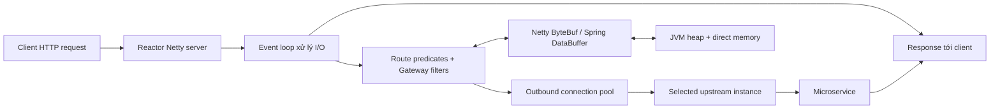
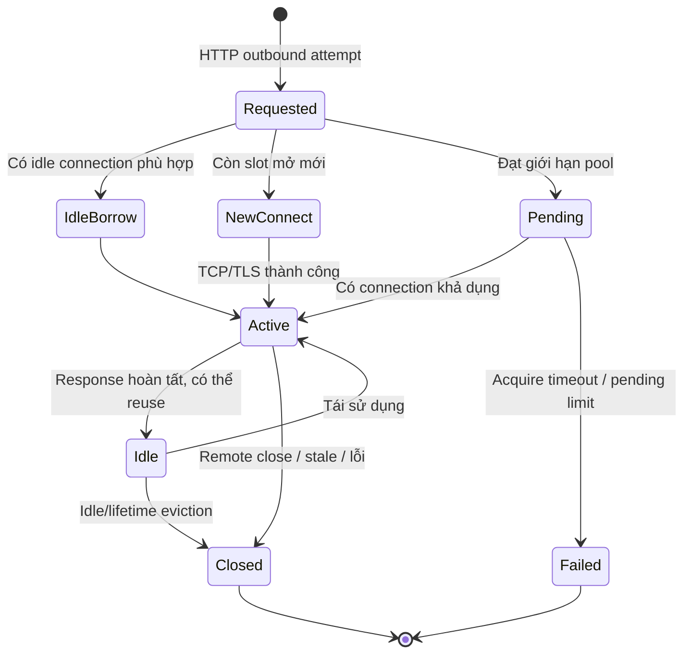
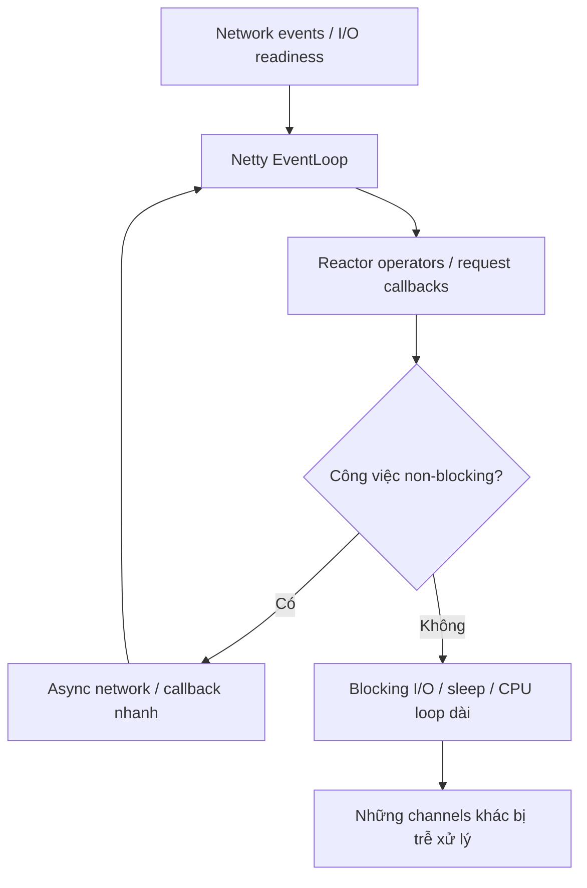
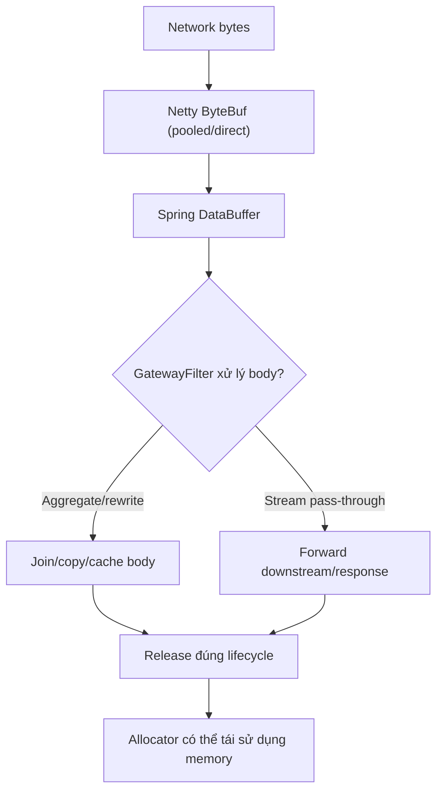
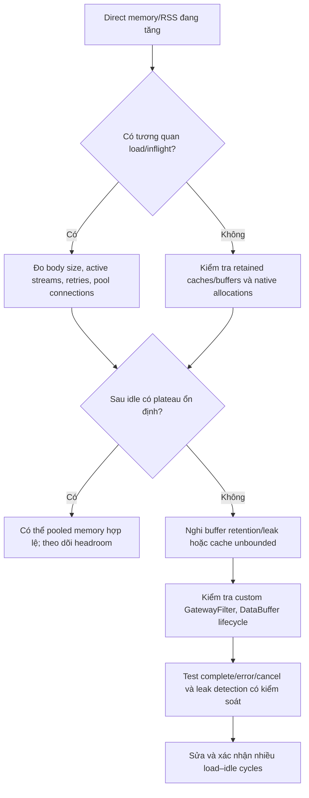

# Theo dõi connection pool, event loop, bộ nhớ và bộ đệm

Trong **Spring Cloud Gateway**, nhiều sự cố hiệu năng không biểu hiện bằng một exception rõ ràng. API vẫn trả HTTP `200`, nhưng p95 latency tăng mạnh, một số request đột nhiên `503/504`, Gateway bị khởi động lại do thiếu bộ nhớ, hoặc chỉ một replica xử lý chậm. Nguyên nhân có thể nằm ở **connection pool**, **Netty event loop**, **heap/direct memory** hoặc **DataBuffer** giữ lại quá lâu.

Bài thuộc chương **Quan sát hệ thống**, hướng dẫn đo, diễn giải và chẩn đoán bốn nhóm tài nguyên trên khi dùng **Spring Cloud Gateway Server WebFlux**. Chúng gắn chặt với mô hình xây dựng API Gateway cho microservices: route predicate, filter chain, rewrite path/header, `lb://` service discovery, xác thực, rate limiting, retry, circuit breaker, TLS và theo dõi request end-to-end.

> **Phạm vi và phiên bản:** Trọng tâm là Spring Cloud Gateway **Server WebFlux** sử dụng Reactor Netty làm HTTP server/client. Gateway Server Web MVC dùng Servlet container và client transport có thể khác nên không áp nguyên xi metric Reactor Netty. Tên property, meter và label của Reactor Netty/Micrometer/Spring Boot thay đổi theo phiên bản; luôn đọc `/actuator/metrics` và `/actuator/prometheus` trên ứng dụng thực trước khi chốt dashboard hoặc lệnh PromQL. Số ngưỡng trong ví dụ chỉ là minh họa để bắt đầu thử nghiệm tải, không phải thông số production áp dụng cho mọi hệ thống.

## 1. Bốn tài nguyên cần quan sát cùng nhau

Một request đi qua Gateway có thể sử dụng đồng thời nhiều tài nguyên:



| Nhóm | Vai trò chính | Dấu hiệu cần đo | Khi bất thường |
| --- | --- | --- | --- |
| **Connection pool** | Tái sử dụng kết nối HTTP client đi từ Gateway tới upstream | Active, idle, pending, capacity, acquire time | Pending tăng, timeout chờ kết nối, latency |
| **Event loop** | Chạy các tác vụ I/O non-blocking và callbacks của Reactor Netty | Pending tasks, CPU, blocked thread stack, scheduling delay | Nhiều route cùng chậm, timeout dây chuyền |
| **Bộ nhớ** | Chứa object Java, HTTP buffers, native/direct allocations | Heap used, GC, RSS/container memory, direct memory | GC tăng, OOM, pod OOMKilled |
| **Bộ đệm** | Giữ byte của HTTP request/response trong quá trình streaming hoặc biến đổi body | Used/active pooled buffers, request size, buffer retention, leak warnings | Direct memory tăng, body buffering chiếm RAM, leak |

**Không được quy tất cả về một biểu đồ memory.** Một số vấn đề pool làm request đợi nhưng RAM vẫn ổn; một event loop bị block có thể gây timeout dù số active connections thấp; một DataBuffer leak có thể làm RSS tăng trong khi JVM heap gần như không tăng.

## 2. Hai hướng kết nối: inbound khác outbound

Spring Cloud Gateway đứng giữa hai mạng kết nối:

```text
                       Spring Cloud Gateway
                         +-------------+
Clients -- inbound --->  | Netty HTTP  |  -- outbound ---> microservices
connections             | server      |    HttpClient / connection pool
                         +-------------+
```

**Inbound:** Kết nối từ client/Ingress tới Reactor Netty **HTTP server** của Gateway. Chúng phụ thuộc số client đang mở, HTTP keep-alive, TLS, HTTP/2, WebSocket/streaming và giới hạn server/Ingress.

**Outbound:** Kết nối do Reactor Netty **HttpClient** của Gateway mở tới các backend. Một **ConnectionProvider/connection pool** thường tái sử dụng các TCP/TLS connections khi gọi cùng nhóm remote addresses.

Điểm quan trọng:

- 1.000 kết nối inbound không có nghĩa có chính xác 1.000 outbound connections.
- Một request có thể bị Security/RateLimiter chặn **trước khi** sử dụng outbound pool.
- Retry có thể tạo **nhiều outbound attempts** cho một client request.
- HTTP/2 hỗ trợ multiplexing nên số requests đồng thời không tương đương số connections.
- WebSocket tạo connection sống dài; không thể coi như REST GET ngắn.
- Một connection outbound có thể được giữ **idle** để tái sử dụng, vẫn tốn file descriptor và một phần bộ nhớ.

Khi quan sát, nên tách metric inbound server, outbound provider và upstream client, thay vì cộng số connections của cả hai chiều rồi gọi là “connection pool Gateway”.

## 3. Connection pool của Reactor Netty hoạt động ra sao?

Một connection pool cho backend có vòng đời khái quát:



Sơ đồ chỉ mô tả các trạng thái logic. Trong implementation, tên bộ đếm, lifecycle keep-alive, pool per remote và HTTP/2 có thể khác.

### Các thuật ngữ cốt lõi

- **Active connections:** connections đã được cấp cho hoạt động hoặc đang được sử dụng theo semantics của provider.
- **Idle connections:** connections nhàn rỗi, còn giữ trong pool để tái sử dụng.
- **Total connections:** số connections đang thuộc pool theo meter; thường liên quan active và idle nhưng phải kiểm tra cách đếm thực tế.
- **Max connections:** giới hạn kết nối cho một pool hoặc remote pool scope, không phải luôn một ngưỡng toàn JVM.
- **Pending acquire:** request/attempt đang chờ lấy kết nối vì chưa có slot thích hợp.
- **Pending acquire timeout:** thời gian chờ tối đa trước khi báo lỗi xin kết nối.
- **Max pending acquire:** giới hạn số yêu cầu xếp hàng chờ connection.
- **Max idle/life time:** các giới hạn vòng đời để loại connection cũ.

Các giới hạn phải gắn với **scope**: tên provider, remote address, scheme/protocol và cấu hình thực tế. Không nhân các gauge một cách máy móc rồi khẳng định con số connections toàn cluster.

### Ví dụ về connection starvation

Giả sử Gateway có giới hạn **100 outbound connections** cho một nhóm đích HTTP/1.1 và backend giữ mỗi request trong 2 giây. Khi một burst 500 requests đến:

```text
100 requests có connection để gọi backend
400 requests còn lại:
  -> có thể chờ pending acquire
  -> có thể timeout hoặc bị từ chối vì pending queue
```

Nếu retry được kích hoạt ngay trong khi pool đang bận, số attempts có thể còn tăng. Tăng `max-connections` lên 500 **không nhất thiết giải quyết**: backend có thể chỉ chịu được 100 concurrent operations và sẽ chậm hơn hoặc ngừng phục vụ.

## 4. Little's Law để ước lượng in-flight concurrency

Trong hệ thống ổn định, Little's Law cho giá trị xấp xỉ:

\[
L = \lambda W
\]

với:

- \(L\): số requests/operations trung bình đang trong hệ thống.
- \(\lambda\): throughput trung bình (requests/s).
- \(W\): thời gian lưu lại trung bình (s).

Ví dụ tuyến `orders-read` có 600 RPS và upstream response time trung bình 0,25 giây:

\[
L = 600 \times 0{,}25 = 150\text{ operations}
\]

Khoảng 150 upstream operations có thể đồng thời tồn tại **ở mức trung bình**, nhưng không đồng nghĩa luôn cần 150 TCP connections: HTTP/2 multiplexing, retries, connection reuse và phạm vi timeout có thể làm khác. Ngược lại, tail latency 3 giây hoặc burst đột ngột làm concurrency cao hơn mức trung bình.

**Cách dùng đúng:** Lấy công thức để đặt giả thuyết capacity, sau đó đo p95/p99, active/pending pool, backend concurrency và tải thực tế. Không suy ra `maxConnections = RPS × timeout` như một công thức cấu hình cố định.

## 5. Các metric connection pool thường gặp

Reactor Netty cung cấp những meter có tên quen thuộc ở các dòng phiên bản được instrument:

| Micrometer meter (ví dụ) | Loại thường gặp | Ý nghĩa |
| --- | --- | --- |
| `reactor.netty.connection.provider.total.connections` | Gauge | Connections hiện thuộc provider/remote pool |
| `reactor.netty.connection.provider.active.connections` | Gauge | Connections đang active |
| `reactor.netty.connection.provider.idle.connections` | Gauge | Connections idle |
| `reactor.netty.connection.provider.pending.connections` | Gauge | Số acquire requests đang chờ |
| `reactor.netty.connection.provider.max.connections` | Gauge | Capacity được phép |
| `reactor.netty.connection.provider.max.pending.connections` | Gauge | Giới hạn hàng chờ acquire |
| `reactor.netty.connection.provider.pending.connections.time` | Timer | Thời gian chờ acquire theo instrumentation |

**Tên meter, loại meter, unit và tags phụ thuộc Reactor Netty version.** Một vài meter có thể vắng mặt khi metrics chưa bật hoặc không có traffic; một tên có thể dùng convention khác khi xuất ra Prometheus. Không viết dashboard dựa trên bảng này mà không kiểm tra registry thật.

### Tên label nào hữu ích?

Thường các metric có tag phân biệt **ConnectionProvider name/id**, **remote address** và có thể các thuộc tính network khác tùy phiên bản. Khi cùng một logical service `lb://order-service` được chọn vào nhiều backend instances, metric pool có thể hiển thị theo **remote address**, không nhất thiết theo **routeId**.

Đó là lý do:

- Metric Gateway request theo `routeId` tốt để biết tuyến nào chậm.
- Metric pool theo provider/remote tốt để biết kết nối nào tắc.
- Trace/backend telemetry cần để ánh xạ request của route tới host/port thực.

Không dùng IP:port label để tạo giả thuyết “mỗi IP tương ứng một route”: nhiều routes có thể chia sẻ một backend pool, và một route `lb://` có thể gọi nhiều addresses.

## 6. Bật metrics cho outbound HttpClient

Một cấu hình minh họa cho những phiên bản Spring Cloud Gateway WebFlux hỗ trợ các thuộc tính sau:

```yaml
spring:
  cloud:
    gateway:
      httpclient:
        pool:
          type: FIXED
          max-connections: 200
          acquire-timeout: 3000
          metrics: true

management:
  server:
    port: 9090
  endpoints:
    web:
      exposure:
        include: "health,metrics,prometheus"
```

Ý định:

- Hạn chế số kết nối outbound thay vì để tăng không kiểm soát.
- Có timeout khi chờ connection.
- Bật đo metrics cho pool nếu thuộc tính `metrics` được phiên bản hỗ trợ.
- Expose Actuator metrics/Prometheus qua management port.

**Cảnh báo về version/cú pháp:** Trong một số bản, property prefix cho Gateway Server WebFlux chuyển từ `spring.cloud.gateway.httpclient` sang namespace `spring.cloud.gateway.server.webflux.httpclient`; giá trị `type` và unit của `acquire-timeout` cũng phải kiểm tra configuration metadata thực tế. Đây **không phải cấu hình sản xuất được khuyến nghị với giá trị 200/3000**. Chỉ dùng như một lab sau khi xác minh properties và dependency tương thích.

### Tùy chọn Reactor Netty độc lập để hiểu semantics

Nếu viết một `HttpClient` Reactor Netty riêng (không mặc định thay thế HttpClient của Gateway), có thể cấu hình provider:

```java
ConnectionProvider provider =
    ConnectionProvider.builder("gateway-outbound-demo")
        .maxConnections(200)
        .pendingAcquireMaxCount(400)
        .pendingAcquireTimeout(Duration.ofSeconds(3))
        .maxIdleTime(Duration.ofSeconds(30))
        .maxLifeTime(Duration.ofMinutes(5))
        .evictInBackground(Duration.ofSeconds(60))
        .metrics(true)
        .build();

HttpClient client = HttpClient.create(provider)
    .metrics(true, uri -> "/upstream-template");
```

Đây là **code Reactor Netty minh họa**, cần imports/dependencies và cách kết nối vào Gateway khác nhau theo version. Không chỉ tạo bean `ConnectionProvider` rồi mặc định mọi Gateway routes đã dùng nó. `HttpClient.metrics(true, mapper)` nên chuẩn hóa URI metrics thành **path template cardinality thấp**; không xuất raw user IDs, query/tokens.

### Khi nào nên điều chỉnh pool?

Chỉ sau khi xem được:

- Active và idle theo từng pool.
- Pending acquire và thời gian chờ.
- Connection errors/timeouts.
- Backend capacity, response time và concurrency.
- Memory/file descriptors/ephemeral ports.
- Số Gateway replicas và pattern traffic.

Tăng pool max có thể giảm pending nhưng **tăng socket/file descriptor, TLS overhead và tải vào backend**. Giảm pool quá thấp có thể tạo hàng chờ dù backend còn khỏe.

## 7. Đọc trạng thái pool qua Actuator

Trong môi trường lab đã bật Actuator:

```bash
curl -sS http://127.0.0.1:9090/actuator/metrics

curl -sS \
  http://127.0.0.1:9090/actuator/metrics/reactor.netty.connection.provider.active.connections

curl -sS \
  http://127.0.0.1:9090/actuator/metrics/reactor.netty.connection.provider.pending.connections
```

Nếu tên meter không tồn tại:

1. Kiểm tra dependency Reactor Netty và Micrometer/Actuator.
2. Xác định Gateway đang dùng WebFlux/Reactor Netty, không phải MVC.
3. Xem `httpclient.pool.metrics` hay cấu hình metrics tương ứng đã bật đúng version chưa.
4. Tạo request thật đi qua route đến backend (đừng chỉ GET `/actuator/health`).
5. Đọc danh sách meter names thực để tìm naming version mới.
6. Kiểm tra rằng gọi **đúng Gateway replica**.
7. Nếu Prometheus thiếu, kiểm tra `micrometer-registry-prometheus` và exposure của endpoint.

**Một metric xuất hiện sau request đầu là hành vi bình thường** với nhiều instrumentations. “Chưa thấy sau startup” không tự chứng minh instrumentation lỗi.

### Actuator JSON minh họa

```json
{
  "name": "reactor.netty.connection.provider.active.connections",
  "baseUnit": null,
  "measurements": [
    {"statistic": "VALUE", "value": 74}
  ],
  "availableTags": [
    {"tag": "name", "values": ["gateway-outbound"]},
    {"tag": "remote.address", "values": ["orders.internal:8443"]}
  ]
}
```

Các giá trị, tên tag và cấu trúc đều **giả lập**. Không hard-code `remote.address` nếu version thật dùng label khác. Trong Prometheus, dấu chấm trong tên thường được chuẩn hóa thành dấu gạch dưới nhưng cách chuyển đổi label names cũng phụ thuộc registry.

## 8. PromQL cho pool utilization

Khi `/actuator/prometheus` có các series tương ứng, có thể xem active connections theo target:

```promql
reactor_netty_connection_provider_active_connections
```

Pending acquisitions:

```promql
reactor_netty_connection_provider_pending_connections
```

Giới hạn capacity:

```promql
reactor_netty_connection_provider_max_connections
```

Một tỷ lệ sử dụng, chỉ khi các gauge có labels/aggregation tương thích:

```promql
100 *
reactor_netty_connection_provider_active_connections
/
clamp_min(
  reactor_netty_connection_provider_max_connections,
  1
)
```

**Cẩn thận về vector matching:** Các label sets có thể không giống hệt và gây kết quả rỗng. Hãy kiểm tra raw series, nhóm theo provider/remote/pod phù hợp, sau đó mới dùng `on(...)`/`ignoring(...)` khi hiểu schema. Không gộp tất cả pools có limits khác nhau thành một tỷ lệ mà không bảo toàn scope.

### Pending acquire time

Nếu timer `pending.connections.time` được expose dưới dạng counter/sum (tên ví dụ `..._seconds_sum/count`), thời gian chờ trung bình theo cửa sổ 5 phút:

```promql
sum(
  rate(
    reactor_netty_connection_provider_pending_connections_time_seconds_sum[5m]
  )
)
/
clamp_min(
  sum(
    rate(
      reactor_netty_connection_provider_pending_connections_time_seconds_count[5m]
    )
  ),
  0.001
)
```

**Không coi hai suffix trên chắc chắn tồn tại.** Hãy xác minh tên metric, type Timer và unit trong `/actuator/prometheus`. Một Gauge `pending.connections` đo **số đang chờ**, không trực tiếp đo **chờ bao lâu**. Vì vậy nên kết hợp số pending với timer acquire time và timeout errors.

## 9. Khi nào connection pool đã quá tải?

Một chuỗi triệu chứng điển hình:

```text
Backend response time tăng
  -> outbound active connections giữ lâu hơn
  -> idle connections giảm
  -> active tiệm cận max
  -> pending acquire bắt đầu tăng
  -> acquire wait time tăng
  -> client p95/p99 tăng
  -> request timeout/503/504
  -> retry có thể khuếch đại tình hình
```

**Không cần đợi active = max mới báo động.** Nếu pending tăng đều trong 5 phút hoặc acquire latency tăng bất thường, đó có thể là tín hiệu sớm trước khi các HTTP errors bùng phát.

| Dấu hiệu | Giả thuyết | Cần xác minh thêm |
| --- | --- | --- |
| Active gần max, pending tăng | Pool capacity thiếu hoặc backend chậm | Upstream latency, RPS, concurrency |
| Active thấp, pending cao | Có thể metric scope/label khác, pool starvation bất thường | Per-provider series, logs, instrumentation |
| Idle rất cao, direct memory lớn | Pool giữ nhiều idle channels/buffers | Idle timeout, number of remote pools |
| Connect/TLS errors tăng | Backend network/TLS failure | DNS/SNI/certificate, chosen instance |
| Pending thấp, client p95 cao | Chậm không nằm ở pool acquire | Event loop, backend, retry, response transfer |
| 503 nhưng backend không nhận request | No-instance, breaker OPEN, pending/connect failure | Trace, LB/breaker metrics |
| Sau deploy pool churn cao | Max-life/idle eviction, backend closing policy | TCP/TLS handshakes, connection reuse |
| Chỉ một remote address có pending | Instance cụ thể có vấn đề | Per-remote metrics, backend readiness |

Một metric pool có thể hiển thị aggregate cho nhiều routes; đừng suy rằng thay route filter đơn lẻ là nguyên nhân khi chưa có trace.

## 10. Connection pool tuning: capacity không phải unlimited

Các tham số chính cần hiểu:

| Tham số | Điều chỉnh cái gì? | Trade-off |
| --- | --- | --- |
| Max connections | Số sockets có thể active/managed theo pool scope | Tăng throughput tiềm năng nhưng tăng backend load, FD, RAM |
| Pending max count | Số acquire requests xếp hàng | Hàng dài giảm lỗi tức thời nhưng tăng latency và memory |
| Pending acquire timeout | Thời gian tối đa chờ slot | Ngắn gây fail fast, dài gây tail latency |
| Max idle time | Bao lâu socket idle trước eviction | Thấp tăng TCP/TLS churn, cao giữ sockets |
| Max life time | Tuổi thọ connection | Quá ngắn làm giảm reuse, quá dài gặp stale endpoints |
| Eviction interval | Tần suất kiểm tra background eviction | Tăng hoạt động quản lý, thay đổi tốc độ dọn |
| HTTP/2 settings | Streams/concurrent requests trên connection | Multiplexing thay đổi quan hệ requests/connections |
| Response/connect timeout | Bao lâu một attempt có thể chiếm tài nguyên | Too long gây pool pressure; too short gây false timeouts |

**Không đặt pending queue rất lớn để che nghẽn.** Hàng đợi có thể làm người dùng chờ tới deadline, giữ memory của request/buffers và gây retry storm khi đồng loạt timeout. Ưu tiên đồng bộ với timeout budget, rate limit/bulkhead và backend capacity.

### Ngân sách thời gian cần nhất quán

Giả sử client deadline 2 giây, nhưng:

```text
Pending acquire timeout = 3 s
Connect timeout         = 2 s
Response timeout        = 5 s
Retry                   = 2 retries + backoff
```

Cấu hình này cho phép xử lý lâu hơn deadline của client nhiều lần. Client đã bỏ cuộc, Gateway có thể vẫn tiêu thụ tài nguyên nếu cancellation không truyền đúng hoặc upstream operation tiếp tục. Thiết kế tổng deadline và xử lý cancellation quan trọng hơn tăng riêng từng timeout.

## 11. Event loop là gì trong Reactor Netty?

**Event loop** là những threads phục vụ I/O readiness, xử lý callbacks và tiến triển non-blocking network operations. Mỗi thread có thể quản lý nhiều connections; mục tiêu là **không bị chặn** bởi công việc kéo dài.



Event loop không phải “một thread cho mỗi request”. Bởi vậy một handler chứa `Thread.sleep(1000)` hoặc JDBC blocking trên event loop có thể làm **nhiều request/connection** cùng chịu trễ, ngay cả khi backend khỏe và connection pool còn slot.

### Những kiểu công việc nguy hiểm

- `.block()`/`.blockOptional()` trên thread non-blocking.
- `Thread.sleep(...)`.
- JDBC/synchronous HTTP client/filesystem call trong reactive callback.
- CPU nặng, regex backtracking hoặc JSON processing kéo dài trong event loop.
- Logging đồng bộ tốn thời gian hoặc format/truncate payload rất lớn.
- Custom `GatewayFilter` đọc toàn bộ request/response body rồi xử lý blocking.
- Thực hiện crypto nặng không được kiểm soát.
- Lock contention hoặc monitor blocking.

**Không phải mọi thao tác CPU đều bị cấm**; callback xử lý nhỏ, bounded là bình thường. Vấn đề là không để một callback giữ event loop quá lâu so với latency budget.

## 12. Metric event loop pending tasks

Reactor Netty có thể xuất gauge tương tự:

```text
reactor.netty.eventloop.pending.tasks
```

Ý nghĩa: số task đang chờ được thực thi trong event loop, theo phạm vi của meter mà implementation expose.

Prometheus thường chuẩn hóa tên:

```promql
reactor_netty_eventloop_pending_tasks
```

**Xác minh scope và labels thật.** Một số bản instrument theo event loop/thread, một số aggregate hoặc expose labels khác. Nếu meter không xuất hiện, cần kiểm tra metrics enablement, event loop instrumentation version và sample traffic.

### Đọc metric đúng cách

- **Pending tasks > 0 tại một thời điểm** không tự đồng nghĩa event loop nghẽn; burst ngắn có thể bình thường.
- **Pending tasks tăng liên tục** cùng p95 và socket read/write latency tăng là dấu hiệu đáng điều tra.
- **Pending tasks = 0** không bảo đảm callback không blocking: một thread có thể đang bị block bên trong task đang chạy, queue chưa kịp tăng hoặc measurement chưa bắt đúng.
- **CPU cao + pending tasks tăng** có thể gợi ý event loop bị saturated.
- **CPU thấp + request chậm** có thể do network/backend/pool, nhưng cũng có thể có thread chờ lock/I/O blocking.

### PromQL xem xu hướng pending tasks

```promql
max_over_time(
  reactor_netty_eventloop_pending_tasks[5m]
)
```

Để xem mức lớn nhất theo pod (chỉ nếu label `pod` có sẵn):

```promql
max by (pod) (
  max_over_time(
    reactor_netty_eventloop_pending_tasks[5m]
  )
)
```

Đây là **gauge**, vì thế không dùng `rate()` như counter để suy ra “tasks/second”. Nếu cần queue growth rate hoặc task processing time, phải có instrumentation thích hợp khác.

## 13. Tìm event loop blocking bằng bằng chứng

Khi nghi event loop bị block, làm theo thứ tự:

1. Xem **Gateway p95/p99** có tăng trên nhiều routes hay một route?
2. Xem **event loop pending tasks**, process CPU, JVM GC pauses và thread count.
3. So sánh **outbound pool pending**: nếu pool rỗng mà latency tăng, nghẽn có thể ở nơi khác.
4. Tạo **thread dump** hoặc Java Flight Recorder trong môi trường được cấp phép, chú ý Netty event loop threads.
5. Tìm `Thread.sleep`, JDBC, synchronous HTTP, file I/O, lock acquisition, `block()` trong stack.
6. Correlate thay đổi với custom GatewayFilter/GlobalFilter, library hoặc deploy revision.
7. Kiểm thử có kiểm soát bằng load test/BlockHound.
8. Sửa nguyên nhân rồi đo lại p95, pending tasks, CPU và memory.

Không bật toàn bộ stack trace logging trên production traffic lâu dài: chi phí log I/O có thể làm vấn đề nặng thêm.

### Ví dụ anti-pattern

```java
// KHÔNG LÀM trong reactive GatewayFilter.
public Mono<Void> filter(ServerWebExchange exchange,
                         GatewayFilterChain chain) {
    String customer = blockingCustomerService.lookup(
        exchange.getRequest().getHeaders().getFirst("X-Customer"));
    return chain.filter(exchange);
}
```

Synchronous lookup chạy trước khi trả Mono có thể block thread gọi filter, thường là event loop. Ngoài ra, header `X-Customer` từ client không phải bằng chứng được quyền vào customer/tenant đó.

Một cách tách blocking work **khi chưa thể thay dependency**:

```java
public Mono<Void> filter(ServerWebExchange exchange,
                         GatewayFilterChain chain) {
    return Mono.fromCallable(() ->
            blockingCustomerService.lookupValidatedCustomer(
                exchange))
        .subscribeOn(Schedulers.boundedElastic())
        .flatMap(customerContext ->
            chain.filter(exchange));
}
```

Đây là **skeleton minh họa**, cần imports, validation, error handling và timeout policy. `boundedElastic` chỉ chuyển blocking work sang scheduler có giới hạn; **không biến JDBC/blocking I/O thành non-blocking**, không giải quyết backend capacity và có thể tạo hàng đợi khác. Ưu tiên reactive/non-blocking client khi có thể.

### BlockHound và testing

Trong một test suite phù hợp, BlockHound có thể phát hiện một số blocking operations trên non-blocking threads. Cần kiểm soát compatibility với Reactor/JDK/test libraries và allowlist có chủ đích. Đừng chỉ thấy test xanh rồi kết luận không còn blocking: một số native calls/locks hoặc custom code có thể không được detect.

## 14. CPU, GC và event loop: phân biệt nguyên nhân

| Quan sát | Giả thuyết | Phép kiểm tra |
| --- | --- | --- |
| Event loop pending cao, CPU cao | CPU-bound callback hoặc quá nhiều events | JFR CPU profile, stack traces |
| Pending cao, CPU không cao | Blocking I/O/lock, scheduling delay | Thread dump, blocked states |
| JVM GC pause tăng, tất cả routes chậm | Heap pressure/GC | `jvm.gc.pause`, heap occupancy, allocations |
| CPU cao nhưng pending thấp | CPU ở worker/GC/thread khác | Per-thread CPU, process profile |
| RPS tăng, p95 ổn, pending dao động ngắn | Có thể vận hành bình thường | Baseline, saturation thresholds |
| Route A chậm, B nhanh | Backend/pool/filter route-specific | Per-route metrics, upstream spans |
| Tất cả routes chậm sau custom logging filter | Blocking/global work | Filter metrics, logging latency |

Một gauge là tín hiệu, không phải root cause. Dùng nhiều nguồn để tránh đổi pool size trong khi vấn đề thật là CPU blocking hoặc GC.

## 15. JVM heap, non-heap, direct memory và RSS

Bốn khái niệm này **không giống nhau**:

| Loại bộ nhớ | Chứa gì chủ yếu | Công cụ/metric |
| --- | --- | --- |
| JVM **heap** | Java objects, collections, cached request bodies dưới dạng objects/arrays | `jvm.memory.used{area="heap"}`, GC, heap dump |
| JVM **non-heap** | Metaspace, code cache, một phần runtime structures | `jvm.memory.used{area="nonheap"}` |
| **Direct/native buffers** | Netty ByteBuf direct memory, NIO/direct allocations | Netty allocator metrics, JVM direct BufferPoolMXBean (không hoàn toàn trùng nhau) |
| **Process RSS/container memory** | Heap committed, native allocators, thread stacks, code, direct buffers, mmap, page accounting... | OS/container metrics như working set/RSS |

**Lưu ý:** `jvm.memory.used` không phải tổng memory của container. Một Gateway có heap tương đối thấp vẫn có thể bị OOMKilled vì direct memory, thread stacks, native allocations hoặc các phần khác của process.

### Direct memory là gì?

Netty có thể dùng **off-heap/direct `ByteBuf`** để giảm copy và hỗ trợ network I/O hiệu quả. Các byte này không nhất thiết xuất hiện trong JVM heap histogram. Một `DataBuffer` của Spring WebFlux có thể bọc Netty `ByteBuf` direct pooled.

Do đó, biểu đồ `heap used` ổn định **không** bác bỏ giả thuyết buffer retention/direct memory leak.

### Pooled allocator giữ memory để reuse

Netty pooled allocator có thể giữ chunks/arenas đã cấp phát ngay cả khi nhiều buffers không còn active, nhằm tái sử dụng hiệu quả. **Used/reserved memory không nhất thiết giảm về gần zero sau mỗi request.**

Cần phân biệt:

- Bộ nhớ đang được allocator **giữ/reserve**.
- Bộ nhớ mà các buffer active đang **tham chiếu/sử dụng**.
- Native RSS mà container thực tế tính.
- Giới hạn direct memory/heap/container.

Một đường biểu đồ direct memory đạt plateau ổn định dưới tải thường khác với đường **tăng không ngừng sau nhiều chu kỳ load–idle**.

## 16. Các meter JVM và Netty allocator nên quan sát

Những tên thường gặp trong Micrometer/Actuator:

| Meter | Hệ đo | Điều nên đọc |
| --- | --- | --- |
| `jvm.memory.used` | JVM | Heap/nonheap use theo area/id |
| `jvm.memory.max` | JVM | Max khi được JVM cung cấp |
| `jvm.gc.pause` | JVM | Số lần/thời gian GC pauses |
| `jvm.buffer.memory.used` | JVM NIO | Bộ nhớ buffer pools theo id, nếu có |
| `jvm.buffer.count` | JVM NIO | Số buffers trong pool được quan sát |
| `process.cpu.usage` | Process | Tải CPU tương đối |
| `process.files.open` | OS/process khi khả dụng | File descriptors mở |
| `reactor.netty.bytebuf.allocator.used.heap.memory` | Netty | Allocator memory dùng/giữ ở heap |
| `reactor.netty.bytebuf.allocator.used.direct.memory` | Netty | Allocator direct memory được report |
| `reactor.netty.bytebuf.allocator.active.direct.memory` | Netty, tùy version | Active direct allocations theo semantics của allocator |
| `reactor.netty.bytebuf.allocator.direct.arenas` | Netty, tùy version | Số direct arenas |
| `reactor.netty.bytebuf.allocator.threadlocal.caches` | Netty, tùy version | Caches theo thread |
| `reactor.netty.eventloop.pending.tasks` | Netty | Pending tasks của event loop |

**Không coi tất cả các meter trên luôn có sẵn.** Phiên bản Netty/Reactor Netty và cách bật metrics quyết định chính xác tên/labels/availability. Một số metric `active.direct.memory` có thể không được instrument; nếu không có, không thể suy ra active buffer bytes từ used alone.

### PromQL heap used theo JVM memory area

Prometheus exposition thường dùng tên đã chuẩn hóa:

```promql
sum by (area) (
  jvm_memory_used_bytes
)
```

Nếu muốn xem tỷ lệ heap occupancy, phải đối chiếu `jvm_memory_max_bytes` và labels `area/id`; không chia tùy tiện những vector khác tập memory pools.

### PromQL Netty direct bytes

```promql
sum by (instance) (
  reactor_netty_bytebuf_allocator_used_direct_memory
)
```

Query này chỉ đúng nếu metric exporter dùng tên như vậy và có label `instance`. Một số registry thêm hậu tố `_bytes`, đổi naming hoặc expose allocator metrics qua một meter khác. **Đọc raw `/actuator/prometheus` để xác nhận** trước khi chạy query production.

Đặc biệt không mặc định `jvm_buffer_memory_used_bytes` và `reactor_netty_bytebuf_allocator_used_direct_memory` có thể cộng lại để được total direct memory: hai series có thể đo các tập **chồng lấn hoặc khác scope**.

## 17. Giới hạn bộ nhớ thực tế là một chuỗi giới hạn

Một Gateway container có nhiều mức giới hạn:

```text
Container memory limit
  ├─ JVM heap max (-Xmx hoặc container-aware sizing)
  ├─ Direct memory / Netty allocator
  ├─ Metaspace / code cache
  ├─ Thread stacks
  ├─ Native allocator/runtime overhead
  ├─ TLS/network buffers
  └─ Các thành phần memory khác
```

Nếu container limit 2 GiB nhưng `-Xmx=1.8g`, bạn để lại không nhiều chỗ cho direct buffers và native overhead, đặc biệt dưới tải HTTP. Điều này **có thể** gây OOMKilled dù `jvm.memory.used{area="heap"}` chưa đạt max.

Một số thông số JVM/Netty liên quan:

- JVM `-Xms`/`-Xmx` giới hạn heap.
- `-XX:MaxDirectMemorySize` có thể ảnh hưởng NIO direct memory limits.
- Netty direct-memory accounting có những chi tiết riêng tùy JVM/Netty flags.
- Container `memory.limit`/cgroup và native allocations.
- `-XX:NativeMemoryTracking=summary` phục vụ một số chẩn đoán JVM native memory nếu bật từ startup.

**Không giả định `-XX:MaxDirectMemorySize` là chính xác toàn bộ giới hạn native memory hoặc container memory.** NMT cũng không nhất thiết giải thích trọn vẹn mọi cấp phát của thư viện native. Phải so sánh với RSS/container metrics và allocator metrics.

### Ví dụ budget minh họa

Một Gateway pod có memory limit 2 GiB. Một kế hoạch sơ bộ có thể đặt:

```text
Heap max                 : 900 MiB
Direct/native buffers    : cần load test đo
Metaspace/code cache     : cần JVM metrics
Thread stacks + TLS      : cần đo
File/socket/page overhead: cần đo
Headroom cho bursts/GC   : phải có
```

Không rút ra được cấu hình final chỉ từ bảng này. Dùng load test (including large bodies, streaming, retries, TLS), đo p95 memory/peak RSS và chừa headroom cho rolling deployments/capacity spikes.

## 18. ByteBuf và DataBuffer trong WebFlux

Trong Spring WebFlux, HTTP request/response body được biểu diễn như luồng các `DataBuffer`. Khi Reactor Netty đứng dưới, DataBuffer có thể được tạo từ **pooled reference-counted Netty ByteBuf**.



**Buffer lifecycle là tài nguyên cần quản lý**, nhất là khi tự viết `GatewayFilter`, `GlobalFilter`, response decorator hoặc body logging. Nếu một buffer có reference count mà không được release khi không còn dùng, pooled allocator có thể không tái sử dụng được bộ nhớ.

### Reference counting

Một pooled `ByteBuf` có thể có `refCnt()`:

- Khi được retain, số tham chiếu tăng.
- Khi được release, số tham chiếu giảm.
- Khi về 0, buffer có thể được hoàn trả để allocator tái sử dụng theo cơ chế của nó.
- Release thiếu có thể gây memory retention/leak.
- Release thừa hoặc dùng buffer sau release có thể gây lỗi dữ liệu/`IllegalReferenceCountException`.

**Quyền sở hữu rất quan trọng:** Không tự `release` mọi DataBuffer mà bạn nhìn thấy. Framework có thể đang sở hữu buffer và sẽ release theo contract. Chỉ retain/release khi custom code thực sự lấy thêm ownership hoặc phải hủy/dừng một buffer mà contract yêu cầu mình dọn.

## 19. Những chỗ dễ giữ buffer lâu bất thường

| Tình huống | Rủi ro |
| --- | --- |
| Custom GatewayFilter đọc request body để log | Giữ toàn bộ body trong memory hoặc quên release |
| `ModifyRequestBody`/`ModifyResponseBody` | Decode/aggregate dữ liệu lớn, tăng heap/direct memory |
| Retry request có body | Cần cache/replay request body; tăng memory theo concurrency |
| Response cache | Giữ response payload theo TTL, có thể lưu dữ liệu cá nhân nếu policy sai |
| WebSocket streaming | Connection dài, inbound/outbound queues, slow consumers |
| SSE/streaming | Responses tồn tại lâu và buffers có thể bị queue khi client chậm |
| Upload file lớn | Copy/aggregation không giới hạn |
| Error/cancellation giữa chừng | Code cleanup có thể không chạy nếu không dùng reactive lifecycle đúng |
| Codec `join` hoặc `collectList` | Tích lũy nhiều buffers trước khi xử lý |
| Buffer copy/retain không cân bằng | Reference-counted memory leak |
| Ghi log payload nhạy cảm | Rủi ro PII/token, ngoài cả vấn đề memory |

**Không gộp tất cả vào “Netty memory leak”.** Có thể là **bộ nhớ được cache có chủ đích**, aggregation không có giới hạn hoặc backpressure không được xử lý, dù reference counts hoàn toàn đúng.

### Body size và concurrency

Nếu Gateway aggregate tối đa 8 MiB response cho 200 requests đồng thời:

\[
8\,\text{MiB} \times 200 = 1\,600\,\text{MiB}
\]

Đó là **ước lượng một lớp dữ liệu đang nằm trong RAM**, chưa tính copy trung gian, JSON objects, TLS buffers và pool allocations. Chính sách “mỗi body chỉ vài MiB” vẫn có thể gây OOM ở concurrency cao.

## 20. Vì sao Streaming/Backpressure giúp nhưng không phải phép màu?

**Streaming** cho phép chuyển các chunks của response khi chúng đến, tránh bắt buộc giữ toàn bộ body trong memory. **Backpressure** giúp upstream không đẩy dữ liệu nhanh hơn mức downstream có thể xử lý trong các đoạn pipeline tuân theo Reactive Streams.

Tuy nhiên:

- Một filter `collectList()` có thể cố tình gom toàn bộ luồng và phá mục tiêu streaming.
- Buffering trong HTTP client, TLS, compression và kernel sockets vẫn tồn tại.
- Slow consumer có thể làm queue tăng nếu custom code không áp giới hạn.
- Một publisher sai contract hoặc logging queue không giới hạn có thể làm mất backpressure.
- Retry body replay và caching có thể đòi hỏi giữ dữ liệu, không thể coi là “zero-copy”.

**Thiết kế tốt:** Tối đa hóa streaming end-to-end khi có thể, giới hạn kích thước từng request/body, thực thi cancellation cleanup, và đo số in-flight streams/connections cùng memory.

## 21. Ví dụ anti-pattern: giữ mọi DataBuffer trong danh sách

```java
// ANTI-PATTERN: KHÔNG dùng trong Gateway production.
List<DataBuffer> saved = new CopyOnWriteArrayList<>();

Flux<DataBuffer> inspect(Flux<DataBuffer> body) {
    return body.doOnNext(saved::add);
}
```

Mã này giữ references tới mọi buffer đã đi qua, không giới hạn số lượng, không làm rõ ownership và không cleanup khi cancellation/error. Nó có thể làm memory tăng mãi hoặc giữ buffer đã được framework release.

**Một cách kiểm tra nội dung an toàn hơn thường là không log body.** Nếu cần audit payload:

1. Ưu tiên metadata: route ID, status, request size, content-type, correlation ID.
2. Chỉ inspect một allowlist nhỏ, có size limit và data classification.
3. Không lưu raw Authorization, cookies, secrets hay PII.
4. Dùng APIs/framework filters có contract quản lý body rõ ràng.
5. Thiết kế cleanup trên complete/error/cancel.
6. Đo memory và kiểm thử với nhiều requests đồng thời.

### `DataBufferUtils.release`

Khi custom code thực sự **sở hữu** một `DataBuffer` cần dọn, Spring cung cấp `DataBufferUtils.release(buffer)`. Với buffered data hoặc cancellation, một pipeline có thể cần `doOnDiscard(DataBuffer.class, DataBufferUtils::release)` theo contract operator.

```java
// Mẫu khái niệm: chỉ dùng khi đoạn code này sở hữu các buffers bị discard.
Flux<DataBuffer> body = source
    .doOnDiscard(DataBuffer.class, DataBufferUtils::release);
```

**Đừng copy một dòng `doOnDiscard` vào bất kỳ stream nào rồi xem là hết leak.** Cần hiểu buffer đã được operator nào sở hữu, bị retain ở đâu, đã chuyển giao cho response writer chưa, và lifecycle discard/error/cancel cụ thể. Double-release cũng là bug.

## 22. `DataBufferUtils.join`, giới hạn body và codec

Một số API dùng `DataBufferUtils.join` để ghép các buffers thành một data buffer/sequence aggregate. Với payload lớn hoặc người dùng không tin cậy, cần đặt **max byte count** khi API phiên bản hỗ trợ:

```java
Mono<DataBuffer> joined =
    DataBufferUtils.join(sourceBody, 1024 * 1024);
```

Đây là ví dụ **giới hạn 1 MiB** cho thao tác aggregation theo API phù hợp Spring version. Nếu vượt giới hạn, luồng có thể báo `DataBufferLimitException` (tùy cách sử dụng và phiên bản).

Điểm quan trọng:

- `join` không tự biến mọi payload thành streaming.
- Buffer kết quả có lifecycle; consumer phải dùng/release đúng contract.
- Giới hạn `spring.codec.max-in-memory-size` áp vào **những codecs/operations mà framework dùng**, không phải một “giới hạn toàn cục cho mọi byte đi qua Gateway”.
- `RequestSize` GatewayFilter (khi có trong variant/version) kiểm soát request size theo policy riêng; không thay thế memory budgeting ở các custom filters.
- Với body rewrite, thường có copy/deserialize/serialize, nên peak memory có thể cao hơn raw body size.

**Không tăng giới hạn vô hạn để sửa `DataBufferLimitException`.** Xem API contract, kích thước body hợp lý, số requests đồng thời và phương án streaming/upload trực tiếp.

## 23. Retry + body buffering có thể khuếch đại memory

Giả sử client gửi 10 MiB POST và Gateway có filter retry:

```text
Client POST body 10 MiB
  -> Gateway cần body để upstream attempt 1
  -> Attempt 1 gặp timeout
  -> Muốn attempt 2, có thể phải replay request body
  -> Body có thể được giữ/cached trong Gateway
```

Nếu 100 requests đồng thời ở tình huống này, raw payload retained tiềm năng có thể đạt ~1 GiB, chưa kể copies và metadata. **Retry cũng có nguy cơ ghi nghiệp vụ hai lần nếu request có side effect**.

Các biện pháp:

- Tránh retry POST/PATCH/DELETE không idempotent.
- Sử dụng idempotency key khi nghiệp vụ bắt buộc.
- Giới hạn request body size và concurrency.
- Đặt retry count/backoff/deadline hợp lý.
- Đo direct memory, heap, in-flight, pool pending, upstream attempts.
- Kiểm tra cancellation/error cleanup của cached body.

**Không suy rằng metric Gateway request count = số body buffers được tạo**. Một request có thể đi qua nhiều attempts và allocations.

## 24. Memory leak hay pool cache giữ bộ nhớ hợp lệ?

Đây là khác biệt thường gây điều chỉnh sai.

### Tình huống A: plateau hợp lý

```text
Startup     : Direct memory 100 MiB
Load test   : Tăng lên 500 MiB
Idle 10 min : Giữ ở 480 MiB
Load lại    : Vẫn quanh 500 MiB
```

Pooled allocator có thể giữ memory cho reuse. Nếu active buffers, throughput, GC, RSS ổn định và load lại **không tăng tiếp**, đây có thể chỉ là pooling hợp lệ.

### Tình huống B: retained buffers bất thường

```text
Startup     : Direct memory 100 MiB
Load round1 : 500 MiB
Idle        : 495 MiB
Load round2 : 850 MiB
Idle        : 845 MiB
Load round3 : 1.2 GiB
Idle        : 1.19 GiB
```

Khi used/active memory hoặc RSS tăng theo mỗi round dù cùng tải và đã idle, cần nghi:

- DataBuffer/ByteBuf không release.
- Cache có TTL/size limit sai.
- Slow consumers/backpressure queue.
- In-flight requests không kết thúc.
- Connection churn/pools theo remote address không được dọn.
- Native memory fragmentation hoặc allocation behavior.

**Không kết luận leak từ một đường `used.direct.memory`**. So sánh active allocations, pool connections, request counts, heap, RSS, GC, error/cancel rates và thời gian ổn định.

## 25. Netty leak detection: công cụ chẩn đoán có chi phí

Netty có cơ chế leak detection cho reference-counted buffers. Có thể bật theo mức độ, ví dụ trong **môi trường kiểm thử/chẩn đoán có kiểm soát**:

```text
-Dio.netty.leakDetection.level=advanced
```

Các mức thường gặp gồm `simple`, `advanced`, `paranoid` và `disabled`, tùy Netty version. Mức cao thu thập nhiều thông tin tracking hơn và có chi phí CPU/memory đáng kể.

**Không bật paranoid trên toàn bộ production traffic vô thời hạn** chỉ để “an tâm”. Sử dụng có mục đích, thời lượng giới hạn, đánh giá overhead và bảo vệ logs vì stack traces có thể chứa thông tin nội bộ.

Khi thấy leak warnings:

1. Xác định stack trace liên quan.
2. Tìm custom filters/response decorators/body logging/retry body caching.
3. Kiểm tra code paths complete/error/cancel.
4. Viết test với cancellation và tải lặp lại.
5. Chỉnh lifecycle theo ownership contract.
6. Xác minh memory plateau và cảnh báo leak biến mất.

Không dùng `System.gc()` làm cách sửa reference-counted buffer leak.

## 26. Khi container OOMKilled nhưng JVM heap không đầy

Ví dụ:

```text
Container memory limit  : 1536 MiB
JVM heap used           : 520 MiB
JVM heap max            : 768 MiB
Netty direct memory     : tăng nhanh
Process RSS             : gần 1536 MiB
Kubernetes pod          : OOMKilled
```

Khả năng:

- Direct buffers/native allocations vượt headroom.
- Open connections quá nhiều, TLS/network buffers tăng.
- Body aggregation/retry/cache giữ payload.
- Thread stacks hoặc off-heap allocations tăng.
- Heap committed khác heap used, cùng overhead native.
- Container memory accounting bao gồm những thành phần khác.

Checklist:

1. Đọc `kubectl describe pod`/container status được phép: `OOMKilled` hay Java `OutOfMemoryError`?
2. Xem RSS/working set/limits theo thời gian.
3. So sánh JVM heap used/committed/max với GC.
4. Xem Netty direct/heap allocator metrics và pool/connection counts.
5. Xem body sizes, active streams, retries và response caching.
6. Xem thread count, file descriptors, TLS sessions/connection churn.
7. Nếu cần, dùng JFR/NMT/allocator profiling phù hợp môi trường.
8. Điều chỉnh root cause; tăng container limit chỉ khi có capacity plan và load test chứng minh.

**Java `OutOfMemoryError: Direct buffer memory` và container `OOMKilled` không phải cùng một tín hiệu.** OOMKilled do OS/cgroup; Java OOME có thể phát sinh trước giới hạn container do JVM/Netty memory limit. Cần phân biệt nguồn lỗi.

## 27. Các chỉ số HTTP client và transport bổ trợ

Một số meter Reactor Netty HTTP client có thể phản ánh:

- Connection time.
- TLS handshake time.
- Response time.
- Data received/sent.
- HTTP client errors.
- Connection errors.
- Address resolution timings tùy instrumentation.

Tên thường có dạng `reactor.netty.http.client.*`, nhưng không nên hard-code nếu chưa kiểm tra version, transport và enablement.

| Dấu hiệu | Lớp nghi vấn |
| --- | --- |
| Pending acquire tăng, connect time thấp | Pool starvation hơn là TCP |
| Connect time tăng | Network/backend accept backlog, proxy |
| TLS handshake time/error tăng | Certificate, truststore, SNI, TLS capacity |
| Response time tăng nhưng connect bình thường | Backend processing/slow response |
| Data sent/received rất cao | Payload lớn/streaming, buffer pressure |
| Event loop pending tăng đồng thời HTTP client latency | Local scheduling delay có thể khuếch đại |
| Backend metrics khỏe nhưng Gateway latency cao | Retry, queued acquire, TLS, filters, slow client |

**Hãy xác định scope của response time:** HTTP client response time có thể tính đến khi nhận headers hoặc body completion tùy meter/version. Trước khi so p95 Gateway/HTTP client/backend, đọc instrumentation semantics hoặc xác minh bằng test.

## 28. PromQL: bộ dashboard vận hành tối thiểu

Các truy vấn dưới đây **chỉ là mẫu** nếu metrics/labels giống những tên quen thuộc. Xác minh Prometheus exposition trước khi dùng.

### A. Số outbound active connections

```promql
sum by (instance) (
  reactor_netty_connection_provider_active_connections
)
```

### B. Pending connections

```promql
sum by (instance) (
  reactor_netty_connection_provider_pending_connections
)
```

### C. Pool saturation theo label sets tương thích

```promql
100 *
sum by (instance) (
  reactor_netty_connection_provider_active_connections
)
/
clamp_min(
  sum by (instance) (
    reactor_netty_connection_provider_max_connections
  ),
  1
)
```

**Chỉ có ý nghĩa nếu total max cùng scope các active gauge được cộng.** Nếu một instance có nhiều pools/remote targets, tốt hơn giữ nhãn `name/remote_address` để tránh việc pool A quá tải bị pool B còn idle che khuất.

### D. Event loop pending tasks

```promql
max by (instance) (
  reactor_netty_eventloop_pending_tasks
)
```

### E. JVM heap used

```promql
sum by (instance) (
  jvm_memory_used_bytes{area="heap"}
)
```

### F. JVM GC pause rate/time

Nếu `jvm_gc_pause_seconds_sum` tồn tại:

```promql
sum by (instance) (
  rate(jvm_gc_pause_seconds_sum[5m])
)
```

Đây là tổng **giây GC pause mỗi giây** trong cửa sổ, không phải số lần pause. Để tính số lần pause/s, dùng `jvm_gc_pause_seconds_count` nếu có.

### G. Direct memory

```promql
sum by (instance) (
  reactor_netty_bytebuf_allocator_used_direct_memory
)
```

Kiểm tra xem meter thật có hậu tố `_bytes` hay không trước khi đưa vào dashboard.

### H. Gateway p95 latency

Nếu Gateway Timer có histogram:

```promql
histogram_quantile(
  0.95,
  sum by (le, routeId) (
    rate(spring_cloud_gateway_requests_seconds_bucket[5m])
  )
)
```

Cần bật histogram cho metric Gateway phù hợp và xác minh `_bucket` tồn tại. **Không dùng `rate` trên gauge** `active.connections` hoặc `used.direct.memory` để đo “connections/s” hay “bytes/s”; `rate` dành cho counter-like series.

## 29. Alerting: kết hợp nhiều tín hiệu thay vì một ngưỡng đơn lẻ

Một bộ alert thực dụng:

| Cảnh báo | Điều kiện kết hợp minh họa | Hành động |
| --- | --- | --- |
| Pool saturation | Active/max cao **và** pending/acquire latency tăng kéo dài | Kiểm tra backend latency, concurrency, pool scope |
| Pending acquire timeout | Error count tăng, client p95 tăng | Điều tra connection budget và timeout |
| Event loop starvation | Pending tasks/lag tăng **và** p95 tăng | Thread dump/JFR, kiểm tra blocking filter |
| Direct memory pressure | Direct/RSS tăng bất thường, gần container budget | Buffer retention, active streams, pooling |
| GC pressure | GC pause time tăng và heap occupancy cao | Allocation/heap, body aggregation |
| Connection churn | TCP/TLS handshake rate tăng, idle reuse thấp | Eviction/keep-alive/proxy idle timeout |
| FD exhaustion | Open FDs tiệm cận limit hoặc connect errors | Pool/connection leak, OS limits |
| Memory leak suspicion | Direct/RSS tăng qua nhiều load–idle cycles | Leak detection/test cancellation |
| Streaming backlog | Active streams/queues tăng, throughput không tăng | Slow consumers, backpressure, limits |
| Backend saturation | Upstream p95 tăng cùng pool pending | Backend scaling/latency, rate limits |

**Không đặt sẵn ngưỡng 80% cho mọi pool rồi tin đó là SLO.** Một pool HTTP/2 có semantics concurrency khác HTTP/1.1, và một pool luôn có 80% active có thể ổn định. Alert phải gắn với **tác động người dùng**, ví dụ client p95/5xx hoặc timeout, rồi mới dùng resource gauge để tìm nguyên nhân.

### Ví dụ ngưỡng lab, không phải chuẩn production

```text
Trong 10 phút:
  active / max > 85%
  AND pending_connections > 0
  AND p95 latency vượt baseline
=> Investigate pool saturation.

Trong 15 phút:
  eventloop_pending_tasks tăng liên tục
  AND Gateway p99 tăng
=> Investigate blocking event loop.

Qua 3 vòng load-idle tương đương:
  direct_memory hoặc RSS tiếp tục tăng,
  không trở về plateau ổn định
=> Investigate buffer retention/leak.
```

Nên có cả threshold absolute, minimum traffic, thời gian duy trì và alert severity phù hợp; chưa có đủ bằng chứng thì chỉ cảnh báo **nghi vấn** chứ không khẳng định nguyên nhân.

## 30. Một sự cố đồng thời: pool pending, event loop chậm và direct memory tăng

Giả sử route `GET /api/reports/**` có filter custom đọc body để tính hash nhưng lại dùng thư viện blocking.

```text
09:00  Throughput 500 RPS, p95=180ms, direct=300MiB.
09:15  Triển khai GlobalFilter mới ghi log body.
09:20  p95=950ms, eventloop pending tăng.
09:25  Outbound active tiệm cận max, pending tăng.
09:30  Direct memory lên 900MiB, container RSS tăng.
09:35  Một số request 503/504, replicas bắt đầu restart.
```

Đừng kết luận ngay “pool quá nhỏ”. Có thể có chuỗi nhân quả:

1. Filter blocking làm event loop phản hồi I/O chậm.
2. Connections active lâu hơn vì response completion trễ.
3. Pending acquire tăng vì slots ít được giải phóng.
4. Body logging giữ DataBuffers lâu và tạo allocations.
5. Memory pressure/GC làm scheduling delay nặng thêm.
6. Retry tăng số outbound attempts và giữ thêm body buffers.
7. Một số requests vượt deadline, upstream vẫn có thể đang xử lý.

**Hướng sửa ưu tiên:** Rollback/disable filter gây lỗi nếu evidence xác nhận, tránh bật logging raw body; thay blocking code bằng async/non-blocking, giới hạn body size, sửa buffer lifecycle, giới hạn retry. Chỉ sau khi ổn định mới cân nhắc tuning pool nếu capacity vẫn thiếu.

## 31. Một trường hợp khác: pool đầy nhưng event loop khỏe

Giả sử:

```text
Gateway CPU          : thấp
Event loop pending   : gần baseline
Direct memory        : ổn định
Pool active/max      : 100/100
Pool pending         : tăng liên tục
Backend response p95 : 4 giây
```

Ở đây khả năng cao backend xử lý chậm hoặc pool quá nhỏ so với lưu lượng, **không phải event loop blocking**.

Các bước:

1. Kiểm tra backend p95, DB/IO và thread pool.
2. Dùng Little's Law ước tính concurrency.
3. Xem maxConnections theo remote/pool thực.
4. Kiểm tra response timeout và acquire timeout có phù hợp deadline.
5. Giảm upstream load bằng rate limit/bulkhead/circuit breaker nếu cần.
6. Tăng pool có kiểm soát chỉ khi backend còn capacity và FD/memory budget cho phép.
7. Load test lại end-to-end p95/p99, error rate và upstream resource metrics.

Không giải quyết bằng cách tăng `max-connections` vô hạn.

## 32. Nhiều Gateway replicas: metric phải gắn với process/target

Giả sử ba replicas:

```text
Gateway-A: active=80/100, pending=0, direct=400MiB
Gateway-B: active=100/100, pending=300, direct=1.1GiB
Gateway-C: active=70/100, pending=0, direct=420MiB
```

Nếu chỉ tổng hợp cluster:

```text
Active=250/300 (83%)
Pending=300
```

bạn dễ bỏ qua **B đang quá tải cục bộ**.

**Quan sát từng pod trước**, sau đó mới tổng hợp để có góc nhìn cluster:

- Pod/instance labels.
- Route ID và traffic distribution.
- ConnectionProvider name/remote address.
- Event loop pending tasks.
- Heap/direct memory và RSS.
- Deployment version/route config revision.
- Selected upstream instances.
- Prometheus scrape target health.

Prometheus cần **scrape từng Gateway replica**; không scrape một Service load-balanced duy nhất khiến các counters/gauges từ replicas bị trộn. Khi aggregate, chú ý labels không bị làm mất scope pool.

## 33. WebSocket/SSE khác HTTP ngắn ở chỗ nào?

WebSocket và Server-Sent Events (SSE) có kết nối/response lâu dài:

- Một socket có thể sống hàng giờ.
- HTTP request timer có thể không hoàn tất đến khi stream đóng, tùy instrumentation.
- Active connections cao không nhất thiết là pool leak.
- Slow consumers có thể tạo outbound buffer queues.
- Idle timeout/keep-alive/ping-pong ảnh hưởng connection lifetime.
- Long-lived connection có thể bị cắt khi Gateway/backend rolling deploy.
- Resource authorization và session revocation phải được thiết kế xuyên connection lifetime.

Với WebSocket, đừng dùng RPS đơn thuần để tính capacity. Theo dõi thêm **active sessions, connection duration, frame rates, close codes, queue size và reconnect rate**.

Một SSE client chậm có thể khiến outbound transfer/backpressure giữ buffers, nhưng đó không tự là ByteBuf leak. Cần đo queue/sustained growth và xác minh đúng cancellation cleanup.

## 34. HTTP/2 và connection pool: tránh suy luận từ HTTP/1.1

HTTP/1.1 keep-alive thường cho phép một số lượng requests đang xử lý mỗi connection theo mô hình transport nhất định. HTTP/2 multiplexes streams trên một TCP/TLS connection, vì vậy:

- Một connection có thể gánh nhiều requests đồng thời.
- Pool active connections có thể thấp dù RPS rất cao.
- Stream concurrency limits trở thành giới hạn bổ sung.
- Flow control và per-stream buffering quan trọng.
- Tail latency có thể bị ảnh hưởng bởi connection-level packet loss/flow control.
- Metrics pool không đủ để khẳng định số inflight HTTP/2 requests.

**Không dùng công thức “one HTTP request = one connection”** để tune pool cho cả H1 và H2. Hãy đo protocol thực tế giữa Gateway và upstream và kiểm tra khả năng H2 của Gateway/HTTP client/version.

## 35. Memory khi response caching hoặc body rewrite

Một route có thể bật `LocalResponseCache` (nếu bản hỗ trợ) để giảm upstream calls, hoặc `ModifyResponseBody` để thay JSON. Hai việc này có chi phí riêng:

- Cache giữ response bodies có chủ đích theo TTL/size policy.
- Body modification có thể decode/encode và aggregate payload.
- Retry hoặc middleware có thể nhân đôi/copy buffers.
- Compression/decompression tạo thêm intermediate allocations.
- Cache key không đúng có rủi ro cross-user/tenant leak ngoài memory usage.

**Không cache shared responses chứa dữ liệu cá nhân/tenant** chỉ vì muốn giảm pool load. Performance tuning không được vượt qua authentication/authorization hoặc data isolation.

Cần đo:

| Chỉ số | Câu hỏi |
| --- | --- |
| Cache hit/miss/evictions | Response caching có hiệu quả không? |
| Cache entry bytes/TTL | Memory giữ bao lâu? |
| Request/response body size distribution | Payload lớn tới mức nào? |
| Direct vs heap memory | Buffers nằm chủ yếu ở đâu? |
| Active streams/inflight | Bao nhiêu payload được giữ đồng thời? |
| GC pauses | Aggregation tạo nhiều Java objects không? |
| Buffer leak warnings | Có lỗi reference-counting không? |

## 36. Testing: kiểm chứng không leak khi error/cancel/retry

Một test pass happy path chưa đủ. Custom filter có thể release buffer đúng khi response thành công nhưng quên cleanup ở:

- HTTP client timeout.
- Client disconnect/cancel.
- Upstream trả 5xx và Retry.
- CircuitBreaker fallback.
- Request body vượt size limit.
- JSON decode lỗi.
- Gateway shutdown/rolling restart.
- Backpressure slow consumer.

### Test ma trận buffer lifecycle

| Test | Kịch bản | Yêu cầu kiểm chứng |
| --- | --- | --- |
| B1 | Body nhỏ bình thường | Memory ổn định, response đúng |
| B2 | Body gần size limit | Không aggregate vượt budget |
| B3 | Body vượt limit | Reject đúng status, không giữ buffer |
| B4 | Client cancel giữa upload | Cleanup/close, không leak |
| B5 | Backend timeout giữa response | Release body buffers |
| B6 | Retry 503 rồi success | Replay đúng body, memory ổn định |
| B7 | Retry exhausted | Cleanup khi tất cả attempts fail |
| B8 | CircuitBreaker fallback | Không giữ request/response buffer |
| B9 | JSON parse error | Không giữ partially aggregated body |
| B10 | 1.000 requests đồng thời | Memory peak dưới budget, không leak |
| B11 | 3 vòng load–idle | Direct memory đạt plateau |
| B12 | Slow client SSE | Queue/backpressure/close policy có giới hạn |
| B13 | WebSocket disconnect | Active sessions/queues giảm đúng |
| B14 | Gateway pod shutdown | Connections drain và dọn resources |
| B15 | Production-like TLS | Direct memory và handshake buffers được đo |

**Định nghĩa kết quả không leak dựa vào xu hướng và ownership tests**, không chỉ assert heap used giảm về một con số cụ thể ngay sau GC.

## 37. Testing: kiểm chứng event loop không bị block

| Test | Kịch bản | Kỳ vọng |
| --- | --- | --- |
| E1 | 1 route đơn giản load thấp | Event loop pending gần baseline |
| E2 | GlobalFilter dùng `Thread.sleep` trong test cố ý | P95/pending tăng; test phát hiện |
| E3 | Thay bằng async client | P95/pending giảm theo baseline |
| E4 | Có Redis/JDBC blocking code | Scheduler được chọn và bounded |
| E5 | CPU-heavy JSON/filter | Profiling xác định bottleneck |
| E6 | Burst 10x RPS | Không mất ổn định hoặc vượt deadline budget |
| E7 | Backend chậm nhưng event loop khỏe | Pool pending có thể tăng, không nhầm với local blocking |
| E8 | GC pause lớn | Correlate GC với latency spikes |
| E9 | Custom logging rất nhiều | Không block event loop hoặc lộ body |
| E10 | Cancellation under load | Không giữ tasks/buffers vô hạn |

Trong integration test, có thể dùng Reactor `StepVerifier` và BlockHound khi phù hợp, nhưng để chứng minh capacity cần **load test với HTTP thật** qua gateway tới upstream stub; unit test của một operator không thay thế điều đó.

## 38. Kiểm thử connection pool dưới tải

Một kịch bản lab:

- Gateway `orders-read` route tới backend stub.
- Backend trả sau 500 ms.
- Pool max giới hạn có chủ đích thấp, ví dụ 20 connections cho lab H1.
- 100 concurrent GETs được bắn vào Gateway.
- Acquire timeout/pending queue được cấu hình có giới hạn.

Mong đợi:

1. Active connections tăng gần capacity theo scope đã đo.
2. Pending acquisitions có thể tăng nếu request đồng thời vượt capacity.
3. Latency ngoài Gateway tăng theo thời gian chờ connection.
4. Một số attempts có thể timeout acquire nếu deadline quá ngắn.
5. Upstream request concurrency không vượt mức kết nối/HTTP semantics dự kiến.
6. Khi load ngừng, active/pending trở về baseline, idle có thể giữ tới eviction.
7. Không thấy direct memory tăng không giới hạn qua các lần lặp.

**Không chạy stress test cố ý làm cạn tài nguyên trên production**. Dùng staging với quotas, resource limits và mô hình backend có kiểm soát.

## 39. Ma trận quan sát 4 tài nguyên

| Tình huống | Pool | Event loop | Memory/buffers | Hướng điều tra |
| --- | --- | --- | --- | --- |
| Backend chậm | Active/pending tăng | Có thể bình thường | Có thể tăng theo inflight | Backend p95/timeouts |
| Pool max quá thấp | Pending tăng | Thường bình thường | Queue có thể tăng | Capacity and acquire time |
| Event loop bị block | Active có thể tăng gián tiếp | Pending/lag tăng | Có thể ổn hoặc tăng | Blocking callbacks |
| DataBuffer leak | Có thể bình thường | Có thể bình thường ban đầu | Direct/active tăng qua cycles | Retain/release ownership |
| Response cache lớn | Upstream calls giảm | Bình thường | Heap/direct cache tăng | Cache TTL/size/eligibility |
| Retry storm | Attempts tăng, pending có thể tăng | Bận hơn | Body buffering tăng | Retry policy/deadline |
| TLS handshake lỗi | Churn/errors | Có thể tăng tasks | TLS buffers tạm thời | Trust/SNI/hostname |
| Discovery stale | Connect errors | Bình thường | Có thể nhiều stale channels | Instance supplier/cache |
| WebSocket nhiều clients | Long-lived connections | Event activity thường xuyên | Per-session buffers tăng | Session count/idle/queues |
| SSE slow consumer | Response duration cao | Có thể bình thường | Outbound queues tăng | Backpressure/cancel |
| Container OOMKilled | Có thể rất nhiều sockets | Không bắt buộc tăng | RSS vượt limit | Heap/direct/native budget |
| JVM GC pressure | Không nhất thiết đầy | Scheduling bị pause | Heap/allocations cao | Heap/GC/body aggregation |

Bảng chỉ đưa **giả thuyết**, không phải mapping một–một. Chẩn đoán tốt đòi hỏi đo metrics cùng timestamp và đối chiếu traces/logs.

## 40. Runbook khi Gateway p95 tăng đột biến

1. **Khoanh vùng:** Tất cả routes hay chỉ một route? Mọi Gateway replicas hay chỉ một pod?
2. **Đo mức tác động:** RPS, 5xx, 429, p95/p99, deadlines, client disconnect rate.
3. **Kiểm tra pooling:** Active/idle/pending/max theo provider/remote và pending acquire duration.
4. **Kiểm tra event loop:** Pending tasks, CPU, thread dump/JFR, GC pause.
5. **Kiểm tra memory:** JVM heap used/committed/max, direct allocator, RSS/container working set, GC.
6. **Kiểm tra buffers:** Kích thước body, response rewriting, retry body cache, response cache, streaming queues.
7. **Kiểm tra upstream:** Backend handler latency, instance health, DNS/connect/TLS, service discovery freshness.
8. **Kiểm tra filter mới:** GlobalFilter/GatewayFilter, logging/body inspection hoặc blocking SDK.
9. **Kiểm tra resilience:** Retry attempts, CircuitBreaker OPEN/fallback, rate limiting.
10. **Giảm thiểu có kiểm soát:** Rollback filter gây lỗi, giới hạn concurrency/size, giảm retry amplification, tune pool dựa trên evidence.
11. **Xác minh:** Load test/traffic canary, p95, pending, RSS plateau và backend errors giảm.
12. **Tổng kết:** Thêm alert/dashboard/test cho failure mode thực tế.

### Không thực hiện ngay các thay đổi này

- **Không tăng maxConnections vô hạn** nếu backend đang nghẽn.
- **Không tăng `-Xmx` hết container budget** khi direct memory cao.
- **Không bật Netty `paranoid` leak detection lâu dài** mà không đo overhead.
- **Không tắt TLS validation** vì outbound connect errors.
- **Không bật Retry mạnh hơn** khi pending acquire đang tăng.
- **Không log raw request/response bodies** để debug memory.
- **Không cho phép metrics endpoint public** chỉ vì cần dashboard nhanh.

## 41. Runbook riêng cho direct memory tăng liên tục



Chú ý: Bản thân allocator có thể giữ memory, do đó cần thêm active allocation/RSS/response throughput để phân biệt leak khỏi retained pool. Đừng dùng một lần `System.gc()` rồi quan sát để kết luận.

## 42. Bảo vệ telemetry và quản lý cardinality

Mọi metric/trace/log có thể chứa thông tin nhạy cảm nếu instrument sai.

**Nên gắn:**

- `routeId` có số lượng được quản lý.
- `httpMethod`, nhóm status/outcome.
- Gateway instance/pod, environment, region.
- ConnectionProvider name/remote pool khi số series được kiểm soát.
- Error category có allowlist như `acquire_timeout`, `tls_failure`, `no_instance`.

**Không nên gắn:**

- Raw access token, `Authorization`, `Cookie`, session ID.
- Raw `userId`/`tenantId`, email, số đơn hàng.
- Full request path/query có dynamic identifiers hoặc secrets.
- Trace/span IDs làm metric labels.
- Exception message hoặc unbounded remote URLs do client điều khiển.
- Body content và response payload.

Đối với những routes động tạo một ID trên mỗi tenant/user, ngay cả `routeId` cũng có thể gây **high cardinality**; cần grouping/normalization theo loại route.

### Actuator và Prometheus phải có ranh giới quản trị

- Expose `metrics`/`prometheus` qua management listener được bảo vệ.
- Dùng TLS/mTLS/authentication/network policy theo môi trường.
- Scrape từng Gateway pod, không qua load balancer ngẫu nhiên.
- Giới hạn quyền Actuator Gateway write/refresh riêng.
- Không để client từ internet tự đọc memory/pool usage hoặc internal backend addresses nếu không được phép.
- Audit việc bật debug/leak detection.

## 43. Bài tập tổng hợp: Gateway ba replicas và report API lớn

Hệ thống có:

- Ba Gateway Server WebFlux replicas.
- `GET /api/reports/**` → `lb://report-service`.
- `POST /api/reports/export` → backend tạo báo cáo, body có thể lớn.
- Một filter custom thay JSON response cho một số client.
- Retry GET tối đa hai retries khi upstream trả 503.
- RateLimiter để bảo vệ upstream.
- Prometheus scrape `/actuator/prometheus` từng replica.

Sau một deployment, có triệu chứng:

```text
Gateway-A: p95=180ms; direct=350MiB; pending=0
Gateway-B: p95=2.5s; direct=1.1GiB; pending=100
Gateway-C: p95=200ms; direct=380MiB; pending=0
```

### Nhiệm vụ 1 — Xác định phạm vi

Đọc metric per-replica và so route IDs/route revisions. Không tổng hợp hết ba replicas thành một đường rồi bỏ mất bất thường trên B.

### Nhiệm vụ 2 — So pool và event loop

Trên Gateway-B, kiểm tra:

- Active/max/pending theo remote pool.
- Pending acquire latency.
- Event loop pending tasks.
- CPU, GC pauses.
- HTTP client response/connect/TLS time.
- Backend selected instances và p95.

Nếu event loop pending cao, điều tra custom filter có blocking work. Nếu event loop bình thường nhưng pool đầy và backend p95 tăng, điều tra upstream capacity.

### Nhiệm vụ 3 — So bộ nhớ

So heap, direct allocator, RSS và request body sizes. Chạy load–idle cycles trong staging; nếu direct memory tăng không giới hạn sau cancellation/timeout, kiểm tra DataBuffer ownership của filter response rewriting và retry body caching.

### Nhiệm vụ 4 — Đề xuất biện pháp

- Giới hạn body aggregation và response transforms.
- Sửa filter dùng blocking I/O.
- Giới hạn retry/backoff/deadline.
- Tune pool nếu upstream còn capacity và có memory/FD headroom.
- Cân nhắc route-specific concurrency limits.
- Rollback revision nếu leak/latency được xác nhận do deploy.
- Test security: không thêm raw request/response bodies vào logs.

### Nhiệm vụ 5 — Chứng minh đã khắc phục

Một bản sửa được coi là tốt khi:

1. Client-visible latency/5xx trở lại baseline.
2. Pool pending không tăng kéo dài.
3. Event loop pending tasks ổn định.
4. Memory/direct RSS đạt plateau qua nhiều vòng tải.
5. Backend không bị retry amplification quá mức.
6. Không có dữ liệu nhạy cảm trong telemetry.
7. Cả ba Gateway replicas có policy và metric behavior nhất quán.

## 44. Câu hỏi tự kiểm tra

1. Connection inbound từ client khác outbound HttpClient pool ở Gateway ở điểm nào?
2. Vì sao số request concurrent không luôn bằng số TCP connections, đặc biệt với HTTP/2?
3. Active, idle và pending connections phản ánh các trạng thái nào?
4. Pending acquire tăng có nhất thiết nghĩa là backend hết instance không?
5. Vì sao tăng `maxConnections` có thể làm backend quá tải?
6. Little's Law giúp đặt giả thuyết gì về in-flight concurrency?
7. Vì sao phải đọc provider/remote scope trước khi tính active/max utilization?
8. `pending.connections` gauge có phải thời gian chờ acquire không?
9. Vì sao `rate()` trên active-connections gauge không cho RPS?
10. Event loop của Reactor Netty khác mô hình một-thread-mỗi-request như thế nào?
11. Tại sao gọi `.block()` trên event loop có thể ảnh hưởng nhiều routes?
12. `boundedElastic()` có tự biến SDK blocking thành non-blocking không?
13. Event loop pending tasks bằng 0 có đủ chứng minh không có blocking không?
14. Khi event loop pending cao và GC pause tăng, cần so những metrics nào?
15. JVM heap used có bằng process RSS/container working set không?
16. Vì sao Netty direct memory có thể tăng khi heap ổn định?
17. Pooled allocator giữ memory sau idle có luôn là leak không?
18. `DataBuffer` và Netty `ByteBuf` có liên quan gì tới reference counting?
19. Khi nào custom filter có trách nhiệm retain/release buffer?
20. Vì sao release thừa nguy hiểm không kém release thiếu?
21. Vì sao body aggregation 8 MiB/request có thể gây OOM khi concurrency cao?
22. `DataBufferUtils.join` cần được giới hạn như thế nào?
23. `spring.codec.max-in-memory-size` có giới hạn mọi byte streaming qua Gateway không?
24. Retry POST có thể vừa tăng buffer usage vừa gây duplicate side effects ra sao?
25. Vì sao `System.gc()` không sửa được Netty reference-counting leak?
26. Có nên bật `io.netty.leakDetection.level=paranoid` lâu dài trên production không?
27. Một pod bị OOMKilled khi heap dưới max cần kiểm tra các loại memory nào?
28. Đâu là bằng chứng phân biệt pool starvation và event loop blocking?
29. Lỗi TLS handshake outbound làm pool metrics thay đổi ra sao?
30. Vì sao scrape Prometheus qua một Gateway load-balanced Service có thể làm sai counters/gauges?
31. Khi chỉ Gateway-B chậm, vì sao phải xem per-pod metrics trước khi aggregate?
32. HTTP/2 multiplexing làm thay đổi cách hiểu connection counts ra sao?
33. WebSocket/SSE lâu dài nên theo dõi thêm các chỉ số nào?
34. Vì sao không được đưa user IDs hoặc access tokens vào Micrometer tags?
35. Khi direct memory tăng qua nhiều vòng load–idle, quy trình chẩn đoán nên bắt đầu ở đâu?
36. Khi client p95 tăng nhưng pool pending thấp, những lớp nào cần điều tra tiếp?
37. Vì sao một backend `404` do RewritePath sai không thể sửa bằng tuning pool?
38. Nếu CircuitBreaker OPEN, request có bắt buộc sử dụng outbound connection không?
39. Alert pool saturation nên kết hợp những tín hiệu nào để tránh false positives?
40. Một test integration cần quan sát gì ngoài HTTP status cuối để chứng minh filter/body/resource lifecycle đúng?

**Ghi nhớ:** Trong Spring Cloud Gateway Server WebFlux, **connection pool** kiểm soát tái sử dụng outbound connections, **event loop** quyết định tiến độ non-blocking I/O, **heap/direct/native memory** quyết định budget process, còn **DataBuffer/ByteBuf** quyết định vòng đời bytes đi qua filter chain. Hãy đo **active/idle/pending/acquire time**, **event loop pending tasks/CPU**, **heap/GC/RSS/direct allocator memory** và **body buffering/cancellation** trên từng Gateway replica; kết hợp với route metrics, upstream attempts, TLS, retry và circuit breaker trước khi điều chỉnh cấu hình. Không dùng “tăng maxConnections/Xmx/retry” làm phản xạ mặc định: **định vị đúng tài nguyên nghẽn, hiểu ownership, kiểm thử dưới tải và bảo vệ telemetry** mới giúp Gateway ổn định.

