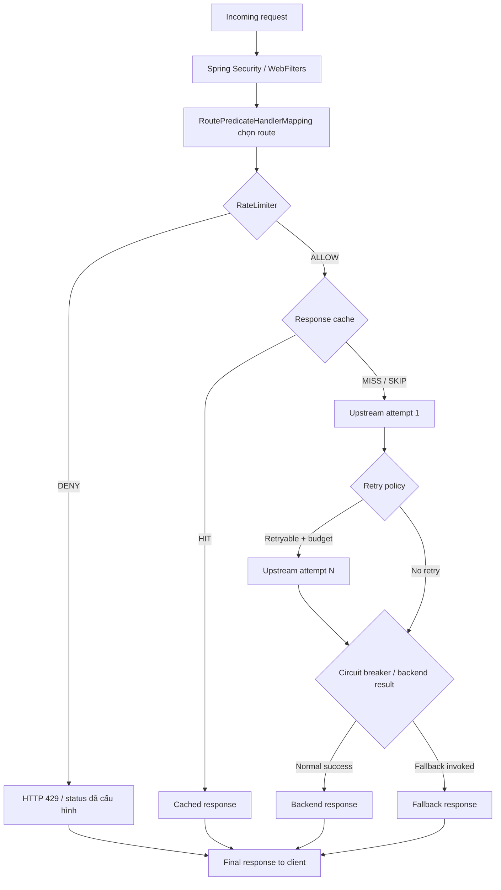
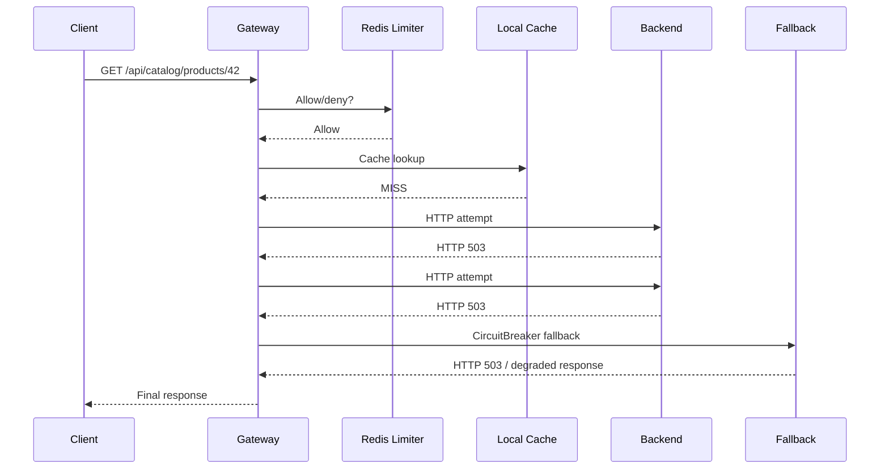
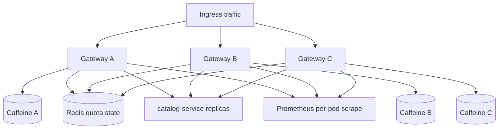
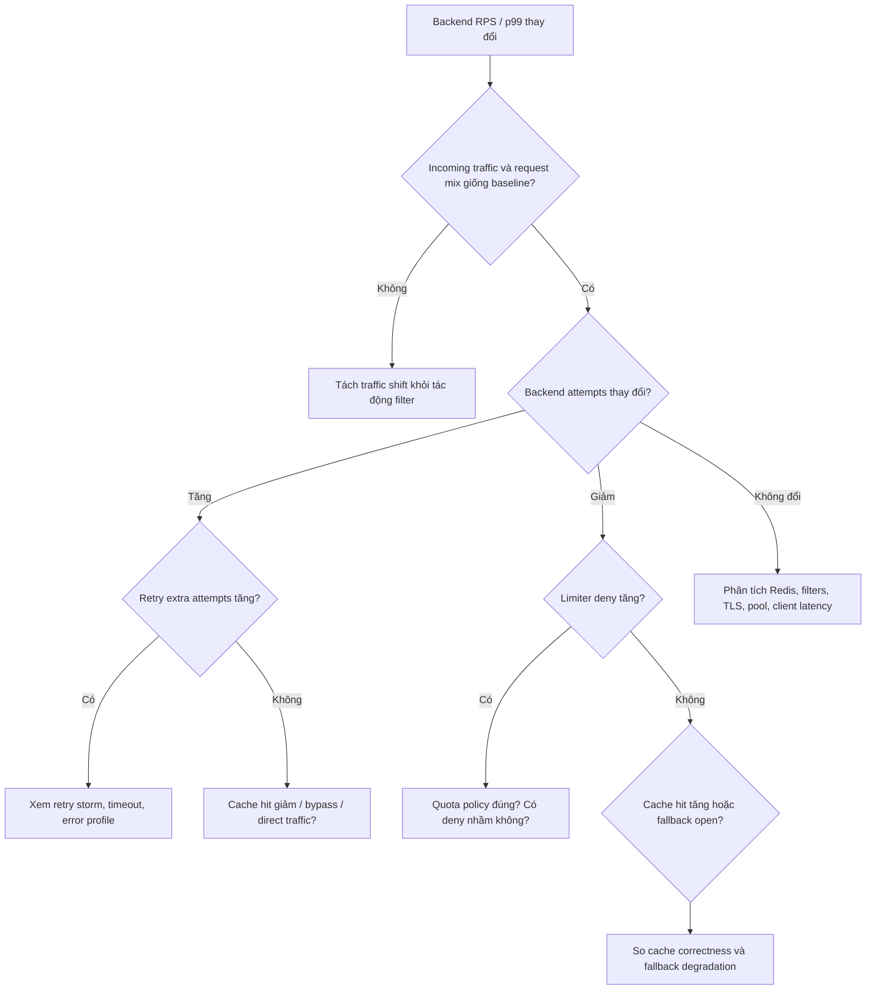

# Đo tác động của rate limiting, retry, fallback và cache

**Spring Cloud Gateway** là cổng vào của các microservices: định tuyến dựa trên predicate, chạy chuỗi `GlobalFilter`/`GatewayFilter`, đổi đường dẫn và header, tìm backend bằng `lb://`, chuyển tiếp token, kiểm soát lưu lượng, retry, circuit breaker, TLS và quan sát request. Khi bật **rate limiting**, **retry**, **fallback** hay **response cache**, một request có thể bị từ chối **trước backend**, tạo **nhiều upstream attempts**, nhận **response thay thế** hoặc **không cần gọi backend**. Do đó, chỉ theo dõi số lượng HTTP 200 hay độ trễ ở Gateway sẽ không trả lời được: *cơ chế nào đang giúp, cơ chế nào gây tải, và người dùng thực sự trải nghiệm ra sao?*

Bài thuộc chương **Quan sát hệ thống** trong module **SPRING_CLOUD_GATEWAY**. Mục tiêu là thiết kế hệ thống đo tác động **có thể đối chiếu và kiểm chứng**, thay vì chỉ tạo một dashboard nhiều biểu đồ. Ta sẽ dùng **Micrometer/Actuator**, Prometheus, tracing, metrics ở Gateway và backend, cùng các bài thử đối chứng cho `RequestRateLimiter`/`RedisRateLimiter`, `Retry`, `CircuitBreaker` fallback và `LocalResponseCache`.

> **Phạm vi:** Các ví dụ chủ yếu dành cho **Spring Cloud Gateway Server WebFlux**. Gateway Server Web MVC và Proxy Exchange có filter/runtime/property khác; không sao chép nguyên YAML, metric names hoặc API instrumentation nếu chưa đối chiếu phiên bản. Những tên metric tự tạo trong bài được ghi rõ là **custom**, không phải lời cam kết Gateway tự phát hành chúng.

## 1. Quan sát để ra quyết định, không chỉ để biết HTTP status

Giả sử trong 60 giây có **1.000 request** đến route `catalog-public`. Bốn cơ chế có thể tạo các hiệu ứng sau:

| Cơ chế | Câu hỏi phải đo | Điều dễ hiểu sai nếu chỉ nhìn HTTP status |
| --- | --- | --- |
| **Rate limiting** | Bao nhiêu request được cho qua/từ chối? Từ chối đúng đối tượng chưa? Backend giảm tải bao nhiêu? | `429` có thể là một **quyết định bảo vệ có chủ đích**, không tự đồng nghĩa backend bị lỗi. |
| **Retry** | Bao nhiêu upstream attempts phát sinh từ một request? Retry có cứu được lỗi thoáng qua không? Tải backend và p99 tăng bao nhiêu? | Một HTTP `200` sau retry có thể đã tốn **ba lần gọi backend**. |
| **Circuit breaker fallback** | Bao nhiêu request đi đến fallback? Fallback trả dữ liệu gì, có đáp ứng SLO không, có che giấu lỗi thật không? | HTTP `200` do fallback tạo **không tự là thành công nghiệp vụ bình thường**. |
| **LocalResponseCache** | Cache hit/miss/eviction, backend calls được tiết kiệm, độ mới dữ liệu và bộ nhớ ra sao? | Response giống nhau không chứng minh cache hit; browser/CDN có thể cache trước Gateway. |

Một hệ thống đo tốt phải phân biệt:

1. **Incoming request** tại ranh giới Gateway.
2. **Routing decision**: route nào đã khớp, trước/sau auth hay CORS?
3. **Rate-limit decision**: allow/deny theo quota key và route.
4. **Cache decision**: hit/miss/skip/not-eligible.
5. **Upstream attempt**: từng lần gửi request qua HTTP client đến backend.
6. **Circuit-breaker decision**: cho gọi, từ chối vì circuit open, fallback invoked.
7. **Final client response**: HTTP status, latency và ý nghĩa nghiệp vụ.

### Cùng một status, nhiều câu chuyện

```text
Client nhận HTTP 200
    ├─ backend được gọi đúng 1 lần và trả 200
    ├─ lần đầu 503, retry lần hai 200
    ├─ LocalResponseCache HIT, backend không nhận request
    └─ fallback trả dữ liệu suy giảm nhưng HTTP 200
```

Nếu mọi trường hợp đều ghi `success=1`, dashboard có thể “xanh” trong khi backend đang chập chờn, bộ nhớ cache tăng hoặc tỷ lệ dùng fallback cao.

## 2. Mô hình sự kiện của một request qua Gateway



**Sơ đồ là mô hình đo lường, không phải thứ tự chạy cố định của mọi filter.** Thứ tự thực tế của `RequestRateLimiter`, `Retry`, `CircuitBreaker`, `LocalResponseCache` và các `GlobalFilter` phụ thuộc `Ordered`, bản Gateway và cấu hình route. Đặc biệt, trong WebFlux có **pre-phase và post-phase**; một filter có ưu tiên cao đi đầu pre-phase nhưng về cuối post-phase.

Vì vậy, instrumentation phải ghi rõ **điểm đo**. Nếu limiter được đặt **sau** một cache filter có thể short-circuit, cache hit có thể không đi qua limiter. Nếu retry đặt trước một filter downstream, **filter nằm phía sau có thể bị chạy nhiều lần**. Cần test filter order với request thật, không suy diễn chỉ từ vị trí YAML.

### Các thành phần không đồng nhất

| Thành phần | Kiểu dữ liệu hữu ích | Có thể xảy ra nhiều lần/request? |
| --- | --- | --- |
| HTTP inbound server | Request ID, method, path template, end status, latency. | Thông thường một inbound exchange. |
| Route matching | `routeId`/`routeUri`/metadata. | Có thể xét nhiều predicates, cuối cùng chọn một route. |
| RedisRateLimiter | Decision allow/deny, quota config, Redis error. | Tùy vị trí filter/retries; không tự mặc định đúng một. |
| Netty outbound client | Attempt, backend host/service, connect/TLS, response status, duration. | **Có thể nhiều attempts** vì retry. |
| Resilience4j circuit breaker | State/permission/call outcomes. | Tùy vị trí và số attempts. |
| Fallback handler | Số lần thực sự thực thi, status và lý do giới hạn. | Có thể một lần hoặc khác tùy flow; cần đo. |
| Caffeine LocalResponseCache | Hit/miss/eviction theo pod/cache nếu có instrumentation. | Cache lookup theo eligible request/filter execution. |

## 3. Bốn lớp metric nên giữ tách biệt

| Lớp | Nguồn đo | Mục đích |
| --- | --- | --- |
| **Client-facing** | `http.server.requests` và Gateway timer. | Người gọi thấy status/latency gì? |
| **Gateway policy decisions** | RateLimiter, cache, fallback và circuit breaker counters. | Gateway đã quyết định gì? |
| **Network/upstream** | Reactor Netty HTTP client / backend access counter / traces. | Backend nhận bao nhiêu attempts? Kết nối có lỗi không? |
| **Business correctness** | Backend application metrics, synthetic checks, dữ liệu xác minh. | Response có đúng tenant, đúng freshness, đúng kết quả không? |

### Vì sao không dùng một counter chung?

Đặt tên tùy ý như `requests_saved_total` cho mọi thứ sẽ gây nhầm:

- RateLimiter **ngăn request**: có thể giảm tải backend nhưng cũng có thể từ chối nhầm khách hàng hợp lệ.
- Cache **tái sử dụng response**: có thể giảm tải, nhưng stale data là rủi ro.
- Retry **tăng attempts** để cải thiện khả năng thành công cuối: có thể cứu request hoặc khuếch đại lỗi backend.
- Fallback **thay response**: có thể giữ trải nghiệm tối thiểu hoặc che giấu sự cố.

Nên có **định nghĩa metric, điểm phát sinh và đơn vị** cho mỗi counter. Không so các phép đếm khác đơn vị như thể chúng có cùng mẫu số.

## 4. Micrometer, Actuator và Prometheus: nền tảng cần thiết

### Dependencies Maven tham khảo

Với một ứng dụng Gateway **Server WebFlux** dùng Spring Boot và Spring Cloud BOM tương thích:

```xml
<dependencies>
    <dependency>
        <groupId>org.springframework.cloud</groupId>
        <artifactId>spring-cloud-starter-gateway-server-webflux</artifactId>
    </dependency>
    <dependency>
        <groupId>org.springframework.boot</groupId>
        <artifactId>spring-boot-starter-actuator</artifactId>
    </dependency>
    <dependency>
        <groupId>io.micrometer</groupId>
        <artifactId>micrometer-registry-prometheus</artifactId>
    </dependency>
</dependencies>
```

Đây là **dependency excerpt**, không phải POM hoàn chỉnh. Ở các dòng Gateway cũ, starter có thể mang tên `spring-cloud-starter-gateway`. Chọn version qua BOM, kiểm tra Spring Boot/Cloud release train và **không trộn Gateway Server WebFlux với Web MVC hoặc Proxy Exchange** chỉ để lấy metrics.

### Cấu hình WebFlux trên dòng Gateway có prefix mới

```yaml
spring:
  cloud:
    gateway:
      server:
        webflux:
          metrics:
            enabled: true
            path-tags:
              enabled: false
          observability:
            enabled: true

management:
  endpoints:
    web:
      exposure:
        include: health,info,metrics,prometheus
  metrics:
    distribution:
      percentiles-histogram:
        spring.cloud.gateway.requests: true
```

**Lưu ý phiên bản quan trọng:** Bảng Configuration Properties của Gateway 5.0.5/5.1.0 liệt kê `spring.cloud.gateway.server.webflux.metrics.enabled`; phần diễn giải Gateway Metrics Filter ở một số trang còn nhắc `spring.cloud.gateway.metrics.enabled` (tên từ dòng cũ). **Ưu tiên kiểm tra metadata binding, release train, Actuator meter có xuất hiện hay không** thay vì khai báo cả hai prefix và đoán. Với dòng cũ, property thích hợp có thể là `spring.cloud.gateway.metrics.enabled` và `spring.cloud.gateway.metrics.tags.path.enabled`.

`path-tags.enabled: false` là chủ đích: gắn **raw request path** như `/customers/123/orders/456` vào metric làm tăng cardinality và có thể rò thông tin. Dùng `routeId` hoặc **normalized route template** làm nhãn ổn định.

`percentiles-histogram.spring.cloud.gateway.requests: true` yêu cầu histogram cho timer này nếu cấu hình được áp dụng. Prometheus bucket series và cardinality sẽ tăng; **chỉ bật các histogram cần thiết**, kiểm tra memory và số series trong môi trường thật.

### Metrics endpoint và scrape endpoint

Actuator dùng meter name gốc:

```http
GET /actuator/metrics/spring.cloud.gateway.requests
```

Prometheus nhận tên được chuyển đổi:

```http
GET /actuator/prometheus
```

Ví dụ một timer `spring.cloud.gateway.requests` thường được Prometheus thể hiện qua những series như `spring_cloud_gateway_requests_seconds_count`, `spring_cloud_gateway_requests_seconds_sum` và `_bucket` **nếu histogram được bật**. Chính xác tên/labels phải xác minh trực tiếp từ `/actuator/prometheus` vì thay đổi registry/version/config có thể ảnh hưởng định dạng.

### Bảo vệ Actuator

- Không expose `/actuator/prometheus` hoặc `/actuator/metrics` công khai không có kiểm soát.
- Có thể đặt management port/interface riêng, network policy và auth cho Prometheus scraper.
- Không xuất credentials, full URI cá nhân hoặc route metadata nhạy cảm trong meter tags.
- `/actuator/health` và readiness/liveness có ý nghĩa khác metrics; không coi endpoint scrape mở là yêu cầu phải mở actuator management ra Internet.

## 5. Những metric có sẵn và những metric phải tự tạo

Theo tài liệu Gateway WebFlux, Gateway Metrics Filter có timer **`spring.cloud.gateway.requests`** cùng các tag:

| Tag | Ý nghĩa | Lưu ý |
| --- | --- | --- |
| `routeId` | Route ID của request. | Cần ổn định giữa deployments; route dynamic gây cardinality nếu ID tạo tùy ý. |
| `routeUri` | Upstream URI được định tuyến. | Có thể rò tên host/service; không dùng cho public dashboard nếu không cần. |
| `outcome` | Nhóm HTTP status. | Không phân biệt cache hit/fallback/retry. |
| `status` | HTTP status trả client. | `200` có thể là cached/fallback response. |
| `httpStatusCode` | Mã HTTP status cuối. | Có thể trùng thông tin với `status`; xem actual tags của release. |
| `httpMethod` | HTTP method inbound. | Không phải số attempts outbound. |
| `path` khi opt-in | Request path. | **Không bật tùy tiện** vì cardinality/PII. |

Trong Gateway mới, `spring.cloud.gateway.server.webflux.observability.enabled` kiểm soát hỗ trợ Micrometer Observability theo config metadata; **Observations/tracing không tự tương đương với đầy đủ metric decisions**. Hãy kiểm tra những meters/spans được tạo bởi stack cụ thể.

### Bảng trách nhiệm đo

| Câu hỏi | Gateway timer có đủ? | Nên bổ sung |
| --- | --- | --- |
| Tổng request/latency route | Thường có, nếu bật và filter thực thi. | HTTP server metrics cho traffic bị Security chặn trước route matching. |
| Bao nhiêu request bị rate limiter deny? | Có thể suy phần nào từ `429`, **không chính xác tuyệt đối**. | Decision counter tại limiter hoặc instrumentation tin cậy. |
| Bao nhiêu retries đã diễn ra? | **Không**. | Downstream attempt counters/traces; retry instrument. |
| Bao nhiêu request thực sự dùng fallback? | **Không**. | Fallback invocation counter/Resilience4j metrics. |
| Bao nhiêu cache hits? | **Không** từ timer tổng. | Caffeine cache statistics hoặc instrumented cache hit/miss, backend counters. |
| Backend RPS giảm bao nhiêu? | **Không**. | Backend access metrics + outbound HTTP attempt metrics. |
| TLS/Redis/connection pool có khỏe? | **Không đủ**. | Client pool, Redis connection, TLS handshake, JVM metrics. |

**Không tự đặt header `X-Cache: HIT` hoặc meter `gateway.cache.hit` rồi gọi đó là tính năng có sẵn**: chỉ hiển thị nếu chính filter/instrumentation thực sự tạo dữ liệu đáng tin.

## 6. Định nghĩa một đơn vị đếm rõ ràng

Đặt ký hiệu trong cùng **một khoảng thời gian, cùng route, cùng nhóm client và cùng số Gateway replicas**:

| Ký hiệu | Định nghĩa |
| --- | --- |
| `N` | Số incoming requests hợp lệ để xét route/policy. |
| `A` | Số rate limiter decisions **allow**. |
| `D` | Số rate limiter decisions **deny**. |
| `H` | Số cache **hits** thực sự trả từ Gateway local cache. |
| `M` | Số cache misses/skip **được định nghĩa rõ**. |
| `I` | Số initial upstream attempts cho accepted requests. |
| `R` | Số **extra** upstream attempts tạo bởi retry. |
| `U` | Tổng upstream attempts, bằng `I + R` khi tất cả attempts được đo. |
| `F` | Số lần fallback handler thực sự được thực thi. |
| `C2xx` | Số client-facing final responses 2xx. |
| `C429` | Số final responses 429 (có thể có nguyên nhân khác limiter). |
| `C5xx` | Số final responses 5xx. |

Nếu mọi request đi qua **chính xác một limiter decision**, thì:

\[
N = A + D
\]

Nếu *cache hit/miss* phân hoạch **toàn bộ accepted requests và không có bypass khác**, ta có:

\[
A = H + M
\]

Nếu mỗi miss gây **một initial backend call**, không có short-circuit khác:

\[
I = M, \qquad U = I + R
\]

**Những đẳng thức là giả thiết của một POC được kiểm soát, không phải định luật của Gateway.** Trong production, một request có thể không khớp route, bị Security chặn trước limiter, được circuit breaker từ chối trước upstream, bỏ qua cache vì method/headers không hợp lệ, hoặc bị hủy. Khi đó cần thêm counters theo các nhánh như `security_denied`, `cache_skip`, `circuit_rejected` và `cancelled`.

### Một ví dụ số liệu hoàn toàn giả định

Trong một cửa sổ thử nghiệm: `N=1.000`, `D=100`, `A=900`; trong requests được cho qua có `H=540` cache hits và `M=360` misses. Backend nhận `I=360` initial attempts, retry tạo thêm `R=45` attempts, nên `U=405`. Fallback được gọi `F=20` lần, trả 503. Client nhận 880 response 200, 100 response 429 và 20 response 503.

| Chỉ số | Giá trị minh họa | Cách diễn giải |
| --- | ---: | --- |
| Incoming requests `N` | 1.000 | Mẫu số traffic ở ranh giới POC. |
| Limiter deny `D` | 100 | 10% requests bị từ chối có chủ đích. |
| Limiter allow `A` | 900 | 90% được xét tiếp. |
| Local cache hits `H` | 540 | Hit ratio **60% trên accepted requests**, nếu tất cả đều cache-eligible. |
| Cache misses `M` | 360 | Cần downstream nếu không có short-circuit khác. |
| Initial attempts `I` | 360 | Số requests đến backend lần đầu. |
| Extra retry attempts `R` | 45 | Thêm 12,5% so với initial attempts. |
| Total backend attempts `U` | 405 | Backend thực chịu 405 calls. |
| Fallback invocations `F` | 20 | 20 requests suy giảm/không đáp ứng được hợp đồng bình thường. |
| Final HTTP 200 | 880 | Có cả cached và backend successes, chưa phân biệt. |
| Final HTTP 429 | 100 | Nếu tất cả từ limiter, bằng `D`. |
| Final HTTP 503 | 20 | Fallback được thiết kế trả 503 trong POC. |

**Không kết luận** “Gateway cứu 595 backend calls” chỉ từ `1.000 - 405`: 100 requests bị từ chối bởi limiter, 540 được phục vụ từ cache và 45 extra attempts do retry, ngoài ra còn hiệu ứng thay đổi traffic mix/behavior khác. Cần phân tách nguyên nhân trước khi đánh giá **giảm tải hữu ích** hay **đánh đổi trải nghiệm**.

## 7. Đo tác động của RequestRateLimiter và RedisRateLimiter

`RequestRateLimiter` dùng một `RateLimiter` để quyết định request có được đi tiếp hay không. Nếu bị deny, Gateway thường trả HTTP **429 Too Many Requests** theo cấu hình mặc định; status có thể được thay đổi. Redis implementation dùng **token bucket** với:

- `replenishRate`: tốc độ bổ sung token.
- `burstCapacity`: dung lượng tối đa bucket.
- `requestedTokens`: giá token tiêu tốn mỗi request.
- `KeyResolver`: xác định quota identity/domain (ví dụ principal đã xác thực).

### Bốn chỉ số không thể thiếu

| Chỉ số | Đơn vị | Cách dùng |
| --- | --- | --- |
| **Allowed decisions** | Decisions | Có bao nhiêu requests được limiter cho qua. |
| **Denied decisions** | Decisions | Có bao nhiêu requests bị limiter chặn. |
| **Denied ratio** | Denied/total decisions | Đánh giá độ chặt của quota và phân bố theo route/tier. |
| **Backend RPS sau limiter** | Upstream calls/giây | Đo liệu limiter thật sự giảm tải, thay vì chỉ tăng 429. |

Với các requests **được quyết định đúng một lần**:

\[
\text{deniedRatio} = \frac{D}{A + D}
\]

**Không dùng `HTTP 429` làm ground truth duy nhất** vì:

- Backend cũng có thể trả 429.
- Gateway có thể thay denied status khỏi 429.
- Một exception do Redis/KeyResolver có thể tạo status khác.
- Security/CORS/route matching có thể chặn request trước limiter.
- Một custom filter hoặc replay do `Retry` có thể khiến decision counts khác incoming requests nếu ordering sai.

### Phân biệt “đang bảo vệ” với “đang gây lỗi”

Giả sử API có SLO cho khách hàng trả phí. Sau khi bật rate limit:

- Backend CPU giảm 40%.
- Gateway 429 tăng từ 0% lên 15%.
- 429 tập trung ở nhóm khách hàng **đúng vượt quota**, không phải người dùng bình thường.

Đây có thể là policy hoạt động đúng; nhưng nếu 429 tăng 15% **ở khách hàng còn quota** do KeyResolver/Redis lỗi, đó là hồi quy. Do đó cần thêm:

1. **Decision reason** hữu hạn: `quota_exceeded`, `key_missing`, `limiter_error`, `policy_denied`… do application instrumentation chuẩn hóa.
2. **Quota policy/tier** theo các nhóm đã công bố: `basic`, `pro`; không gắn customer ID vào labels.
3. **Redis health/latency/errors** và số kết nối.
4. **Allowed request success/latency** để không nhầm 429 với backend 5xx.
5. **Per-replica traffic** và khả năng chia sẻ quota toàn cluster.

### Chú ý response headers

Tài liệu RedisRateLimiter có các header tùy cấu hình như `X-RateLimit-Remaining`, `X-RateLimit-Replenish-Rate`, `X-RateLimit-Burst-Capacity` và `X-RateLimit-Requested-Tokens`. Chúng có thể hỗ trợ debug, nhưng:

- **Không coi chúng là metric backend workload hoặc bằng chứng quota toàn cluster chính xác**.
- Không log header kèm bearer token/customer PII.
- Header có thể không tồn tại nếu limiter không chạy, request bị chặn ở Security, hoặc version/config không bật.
- Cần kiểm tra client behavior với `429` và `Retry-After` nếu API contract yêu cầu.

### Redis outage: fail-open hay fail-closed?

Redis không sẵn sàng có thể làm quota fail; behavior phụ thuộc implementation/customization/version và exception handling. **Không tự khẳng định RedisRateLimiter luôn fail-open hay fail-closed**. Hãy thử trên đúng artifact và ghi:

| Trạng thái | Kết quả cần đo |
| --- | --- |
| Redis khỏe | Deny/allow theo giới hạn dự kiến. |
| Redis latency cao | Gateway latency p95/p99, timeouts, Redis connection pool. |
| Redis unavailable | Final HTTP status, số requests được phép, backend load, exception/circuit policy. |
| Redis hồi phục | Quota phân phối giữa replicas, khả năng burst bất thường. |

Nếu một business quyết định fail-open để giữ availability, cần có **giới hạn bảo vệ khác** ở edge/backend. Nếu fail-closed để bảo vệ hệ thống, đo **impact lên khách hàng hợp lệ** và công bố policy.

## 8. Đo tác động của Retry: cứu request nhưng khuếch đại upstream attempts

`Retry` có thể thử lại theo `statuses`, `series`, `methods`, `exceptions` và cấu hình `backoff`, `jitter`, `timeout`. Theo reference Gateway WebFlux, những giá trị như `retries` là **số lần thử thêm**, không phải số requests inbound. Với `retries: 2`, một request có thể có **đến ba attempts** nếu điều kiện và budget cho phép.

### Chỉ số cốt lõi

| Chỉ số | Đơn vị | Ý nghĩa |
| --- | --- | --- |
| **Initial backend attempts** | Calls | Số requests thật sự thử backend lần đầu. |
| **Extra retry attempts** | Calls | Số lần gửi thêm do retry. |
| **Attempt amplification** | Attempts/initial call | Retry tăng tải upstream bao nhiêu. |
| **Recovered-after-retry** | Inbound requests | Request thất bại ban đầu nhưng cuối cùng đạt contract nhờ retry. |
| **Exhausted retries** | Inbound requests | Requests vẫn thất bại sau khi hết retry budget. |
| **Time spent retrying** | Duration | Backoff + thời gian attempts làm tăng client latency. |
| **Retry by reason** | Attempts | HTTP 502/503, IOException, TimeoutException… theo nhóm hữu hạn. |

Định nghĩa:

\[
\text{attemptAmplification} = \frac{I+R}{I}
\]

Với `I=360` và `R=45`, amplification ≈ **1,125**: mỗi request đến backend lần đầu tương đương trung bình 1,125 attempts. Đó là **12,5% extra backend calls** so với không retry ở cùng tập misses.

**Không dùng “Gateway route requests” làm mẫu số upstream attempts** khi một phần request bị rate limit hoặc cache hit. Điều đó có thể che mất amplification ở nhóm request thật sự đi backend.

### Điều đặc biệt về thứ tự filter

Theo tài liệu Retry WebFlux, filter Retry có thể **chạy lại những filters nằm sau nó**. Nếu một filter tùy chỉnh tăng counter, kiểm tra quota, mutate headers hoặc gây side effect nằm sau Retry, nó có thể được gọi nhiều lần. Một metric `counter.increment()` đặt sai vị trí sẽ đếm **attempt** nhưng bị đặt tên nhầm là `request`.

**Quy tắc đặt điểm đo:**

- Đếm **inbound requests** ở server/outer exchange boundary.
- Đếm **outbound attempts** càng gần HTTP client transport/backend access càng tốt.
- Đếm **retries** bằng phần attempts bổ sung hoặc instrumentation trực tiếp từ Retry, không chỉ bằng số response cuối.
- Ghi **correlation/trace ID** có kiểm soát để liên kết các attempts với một request inbound.

### Retry thành công không miễn phí

Ví dụ một request gặp:

```text
T0:  Upstream attempt #1 → 503 sau 120ms
T1:  Backoff 100ms
T2:  Upstream attempt #2 → 200 sau 90ms
T3:  Client nhận HTTP 200
```

Nếu không tính overhead, latency ≈ 310ms thay vì ~90ms của một request backend khỏe, dù status cuối cùng thành công. Việc retry làm **availability tốt hơn có điều kiện**, nhưng có thể tăng p95/p99 và làm quá tải backend đang yếu.

### Memory và method có body

Reference Gateway cảnh báo retry method có request body có thể **cache body trong memory** để replay. Với POST/PUT/PATCH hoặc upload lớn, phải đo:

- Heap/direct memory, buffer allocation, GC và concurrency.
- Số attempts thực, timeout và cancellation.
- Idempotency key/back-end deduplication.
- Response cuối và nghiệp vụ đã thực hiện (ví dụ đơn hàng tạo một lần hay nhiều lần).

**Không bật retry cho write methods chỉ để cải thiện HTTP 200 tỷ lệ**, nếu không có idempotency contract.

## 9. Đo tác động của CircuitBreaker và fallback

`CircuitBreaker` có thể bao một route; khi lời gọi bị lỗi hoặc circuit mở, `fallbackUri` chuyển request tới một handler khác. Với Gateway Server WebFlux, tài liệu mô tả `fallbackUri` có thể dùng **`forward:`**. Một handler fallback có thể trả:

- HTTP 503 cùng response an toàn để client biết dịch vụ tạm không sẵn sàng.
- Một response HTTP 200 **degraded** được phê duyệt (ví dụ danh mục đọc-only có dữ liệu không quá cũ).
- Một response lỗi tuân thủ API contract và CORS/security headers.

### Đo ba chiều độc lập

| Chiều | Chỉ số | Vì sao cần |
| --- | --- | --- |
| **Circuit state** | `CLOSED`, `OPEN`, `HALF_OPEN`; not-permitted calls. | Biết backend đang được bảo vệ hay traffic bị chặn sớm. |
| **Fallback invocations** | Đếm lần vào handler và kết quả response. | Không để fallback thành công che mất sự cố backend. |
| **Business degradation** | Tỷ lệ response suy giảm, độ cũ dữ liệu, chức năng thiếu. | HTTP 200 chưa chắc là đáp ứng đầy đủ SLA. |

### SLO khi fallback 200

Giả sử backend catalog trả lỗi, fallback trả:

```json
{"products":[],"degraded":true,"source":"fallback"}
```

với status HTTP 200 để frontend hoạt động. Nếu dashboard chỉ nhìn `2xx / total`, sự cố có thể bị **che khuất**. Hãy phát metric riêng `gateway.fallback.invocations` và, nếu hợp đồng cho phép, phân loại user-facing `full_success` so với `degraded_success`. Không đưa thông tin nhạy cảm về exception/internal backend vào JSON chỉ để phục vụ metric.

### CircuitBreaker metrics có chắc xuất hiện?

Nếu dùng **Resilience4j**, có thể có meters trạng thái circuit, calls, buffered calls hoặc not-permitted calls tùy dependencies, auto-configuration và tagging. Nhưng **tên metric/labels và sự xuất hiện khác nhau giữa Resilience4j/Micrometer/release train**; không gán cứng một query rồi coi luôn tồn tại.

Hãy xác minh `/actuator/metrics` và `/actuator/prometheus`; metric do fallback handler tự ghi vẫn cần thiết vì **circuit open count không đồng nghĩa số fallback responses đến client**.

### Fallback có thể bị gọi trực tiếp

Nếu fallback handler được expose như endpoint HTTP thông thường, client có thể gọi trực tiếp làm counter tăng giả hoặc nhận dữ liệu suy giảm ngoài policy. Nên dùng **internal-only path** và điều kiện xác minh rằng Gateway đã forward vì circuit breaker, ví dụ exchange attribute `ServerWebExchangeUtils.CIRCUITBREAKER_EXECUTION_EXCEPTION_ATTR` khi implementation cung cấp; bảo vệ bằng Security/routing policy.

**Không dùng `X-Fallback: true` do client tự gửi** làm chứng cứ rằng có circuit breaker failure.

## 10. Đo LocalResponseCache: hit ratio phải đi kèm freshness và memory

`LocalResponseCache` dùng **Caffeine** để giữ response body/headers **trong một Gateway instance**, chỉ cache responses đủ điều kiện. Theo reference Gateway WebFlux:

- Request phải là **GET không có body**.
- Response status thuộc **200, 206 hoặc 301**.
- Request không có `Cache-Control: no-store`.
- Response không có `Cache-Control: no-store` hoặc `private`.
- TTL và kích thước cache có thể cấu hình theo route.

### Phân biệt bốn trạng thái

| Trạng thái | Ý nghĩa | Có tạo backend attempt? |
| --- | --- | --- |
| **HIT** | Có entry đủ điều kiện và còn hợp lệ, trả từ local cache. | Thường không cần gọi backend; xác minh bằng backend counter. |
| **MISS** | Request đủ điều kiện nhưng chưa có entry/hết hạn. | Có thể cần gọi backend, trừ khi bị chặn bởi cơ chế khác. |
| **SKIP / INELIGIBLE** | POST, response private/no-store, status không cacheable… | Có thể đi backend nhưng **không tạo cache entry**. |
| **EVICTION / EXPIRED** | Entry bị loại do size/TTL. | Lần request tiếp theo có thể MISS. |

**Không đo cache hit bằng “response 200 giống trước”**: backend có thể trả cùng dữ liệu và browser/CDN có thể trả response trước khi request đến Gateway.

### Các metric nên có

1. **Hit/miss** trên *eligible cache lookups*, không phải mọi GET.
2. **Backend request delta**: số downstream calls cùng bộ URL và traffic.
3. **Response latency hit vs miss**; nếu không có hit label, dùng POC có backend counter.
4. **Eviction count/cache size** và heap/direct memory từng pod.
5. **Freshness**: response age/`max-age`, số response stale ngoài SLA.
6. **Cache key safety**: ngôn ngữ, query, tenant, Origin và `Vary` nếu response thay đổi.

\[
\text{hitRatio}=\frac{H}{H+M}
\]

Chỉ dùng công thức khi `H` và `M` thực sự được định nghĩa là **hai nhóm của eligible lookups**; không cộng các `SKIP` vào mẫu số rồi đặt tên hit ratio.

### Nhiều Gateway replicas

Ba Gateway pods có **ba caches độc lập**. Một URL có thể HIT ở pod A nhưng MISS ở pod B. Sau rolling deployment, cold cache làm backend load tăng tạm thời. Theo dõi:

- Cache statistics **theo pod** trước, tổng cluster sau.
- Backend RPS trong warm-up và steady state.
- Kích thước/TTL theo **mỗi pod**, không nhân nhầm thành một shared cache.
- Thời gian/tỷ lệ stale sau backend update.

**Không coi `RedisRateLimiter` sử dụng Redis là bằng chứng LocalResponseCache cũng được chia sẻ qua Redis**: đó là hai cơ chế khác nhau.

### Không đánh đổi an toàn dữ liệu lấy hit ratio

Không cache chung endpoint như `GET /api/me`, giỏ hàng, đơn hàng riêng, token/session hoặc dữ liệu đa tenant có yêu cầu phân tách. Một response `Cache-Control: private`/`no-store` phải được loại theo policy. **Một hit ratio cao mà rò dữ liệu user là thất bại nghiêm trọng**.

## 11. Chỉ số tổng hợp: tác động lên backend và người dùng

| Chỉ số tổng hợp | Công thức/nguồn | Cần diễn giải |
| --- | --- | --- |
| **Incoming RPS** | Rate gateway server counter. | Tổng traffic tại ranh giới đo, kể cả unmatched nếu server metrics bao phủ. |
| **Allowed RPS** | Rate limiter allow decisions. | Requests qua policy, không phải backend calls. |
| **Backend RPS/attempts** | HTTP client/backend access counter. | Bị ảnh hưởng **giảm** bởi limiter/cache và **tăng** bởi retry. |
| **Retry amplification** | `U/I`. | Chỉ có ý nghĩa nếu phân biệt initial/extra attempts. |
| **Fallback rate** | `F` / eligible requests hoặc `F` / requests vào CB, theo hợp đồng. | Phải nêu mẫu số. |
| **Cache hit ratio** | `H/(H+M)`. | Chỉ eligible lookups, tách theo pod. |
| **User-facing success** | Status + business contract. | 429/fallback 200 cần phân loại chủ đích. |
| **Gateway p95/p99** | Histogram/timer. | Có thể giảm nhờ cache, tăng do retry/backoff hoặc Redis latency. |
| **Backend p95/p99** | Backend/HTTP client metrics. | So cùng request mix; không dùng backend latency để suy client latency. |
| **CPU/memory/network** | JVM/OS/Netty/Redis/Caffeine. | Cache và retry tiêu tốn tài nguyên khác nhau. |

### Định nghĩa availability tránh tự làm đẹp SLO

Ví dụ tổ chức quyết định:

- `HTTP 5xx` = lỗi availability.
- `HTTP 429` từ quota hợp lệ được báo cáo như **policy-denied** (không trộn với 5xx), nhưng **không biến mất khỏi client outcome dashboard**.
- HTTP 200 do fallback trả **degraded** phải được báo cáo riêng; có thể không đạt SLO *full service*.
- Error do user input 4xx cần phân loại để tránh che các 4xx do Gateway config sai.

**SLO là hợp đồng sản phẩm, không phải mặc định của Micrometer.** Nếu loại 429 và fallback khỏi mẫu số mà không có lý do được phê duyệt, dashboard sẽ tạo một tỷ lệ “thành công” sai lệch.

## 12. Từ correlation ID đến traces: liên kết một request với nhiều attempts

Một request có thể đi qua:



Traces có ích khi một inbound span có nhiều **outbound client spans**. Mỗi attempt nên được liên kết với cùng context, nhưng:

- Tracing sampling có thể bỏ sót một phần requests.
- Một số filter có thể tạo spans khác theo version.
- Trace count trong một mẫu **không thay thế counters tổng**.
- Không đưa raw Authorization, cookie, PII hoặc full request body vào span attributes.

### Phân loại events trong trace

Một trace có thể ghi tags/events **được chuẩn hóa**:

```text
gateway.route.id       = catalog-retry
gateway.policy.variant = retry-2
http.method            = GET
http.status_code       = 503
gateway.retry.attempts = 2      # custom, khi được instrument
gateway.fallback.used  = true   # custom, khi được instrument
upstream.service       = catalog-service
```

Đây là **ví dụ semantic metadata do nhóm triển khai định nghĩa**, không phải toàn bộ tên tags sẵn có mặc định. Những nhãn có liên quan **dynamic IDs** cần cardinality budget và kiểm soát dữ liệu.

### Không suy attempts bằng log dòng chữ “retry”

Một số retry xảy ra do exception/transport ở HTTP client; một số logs không xuất hiện ở INFO. Tracing với spans, HTTP client metrics hoặc backend access log **được nối bằng correlation ID đáng tin** sẽ cho bằng chứng tốt hơn. Nếu request chết trước khi backend nhận byte, một outbound attempt có thể được tính ở Gateway nhưng không xuất hiện trong backend access log; cần phân biệt **attempt initiated** và **backend request received**.

## 13. Dashboard Prometheus/Grafana cho Gateway route

Những PromQL dưới đây là **mẫu phân tích**. Chúng giả định Gateway timer `spring.cloud.gateway.requests` được export thành `spring_cloud_gateway_requests_seconds_*` và có tag `routeId`. **Trước khi dùng, kiểm tra tên series/labels thực** bằng `/actuator/prometheus`, vì exporter/version/relabeling có thể ảnh hưởng định dạng.

### 13.1. RPS theo route

```promql
sum by (routeId) (
  rate(spring_cloud_gateway_requests_seconds_count[5m])
)
```

Đây là số requests **được Gateway timer ghi nhận**, không nhất thiết bao gồm traffic bị Security chặn **trước route matching**. Muốn biết tổng inbound ở HTTP server boundary, đối chiếu `http.server.requests`.

### 13.2. Tỷ lệ HTTP 5xx từ final response

```promql
sum by (routeId) (
  rate(spring_cloud_gateway_requests_seconds_count{
    status=~"5.."
  }[5m])
)
/
clamp_min(
  sum by (routeId) (
    rate(spring_cloud_gateway_requests_seconds_count[5m])
  ),
  0.000001
)
```

**Giới hạn:** Nếu fallback trả 200, 5xx tỷ lệ có thể không phản ánh backend outage. Nếu `status` tag không phải chuỗi mã ba chữ số trên release đang dùng, chỉnh theo labels thực.

### 13.3. RPS HTTP 429 theo route

```promql
sum by (routeId) (
  rate(spring_cloud_gateway_requests_seconds_count{
    status="429"
  }[5m])
)
```

Chỉ số này đếm **HTTP 429 final**, không bảo đảm tất cả do `RequestRateLimiter`. Để phân tích policy, đối chiếu custom limiter decision metric với 429 backend và traffic khác.

### 13.4. Latency p95 với histogram

```promql
histogram_quantile(
  0.95,
  sum by (le, routeId) (
    rate(spring_cloud_gateway_requests_seconds_bucket[5m])
  )
)
```

Chỉ hoạt động nếu `_bucket` đã được export, chẳng hạn đã bật histogram. **Không cộng hay trung bình p95 từ các pods**; phải tổng hợp buckets theo `le, routeId` trước khi chạy `histogram_quantile`.

### 13.5. Average final HTTP latency

```promql
sum by (routeId) (
  rate(spring_cloud_gateway_requests_seconds_sum[5m])
)
/
clamp_min(
  sum by (routeId) (
    rate(spring_cloud_gateway_requests_seconds_count[5m])
  ),
  0.000001
)
```

Đây là trung bình **client-facing Gateway timer**; không tự đo riêng Redis latency, cache lookup, từng retry backoff hoặc backend execution time.

### 13.6. Những biểu đồ nên xem cùng lúc

- Incoming Gateway/server RPS.
- Upstream/backend attempts RPS.
- Limiter deny RPS.
- Cache hit RPS.
- Retry extra-attempt RPS.
- Fallback invocation RPS.

Nếu dashboard chỉ có client status và HTTP latency, bạn không thể phân tích nguyên nhân thay đổi backend workload sau bật nhiều filters.

## 14. PromQL cho custom policy metrics: không nhầm là built-in

Để đo event thật, giả sử nhóm platform **đã tự thêm** các counters sau bằng Micrometer và đã kiểm chứng trên `/actuator/prometheus`:

| Micrometer custom name | Prometheus name giả định | Label hữu hạn |
| --- | --- | --- |
| `gateway.policy.decisions` | `gateway_policy_decisions_total` | `route`, `policy`, `decision`. |
| `gateway.upstream.attempts` | `gateway_upstream_attempts_total` | `route`, `kind=initial/retry`, `result`. |
| `gateway.fallback.invocations` | `gateway_fallback_invocations_total` | `route`, `result`. |
| `gateway.cache.lookups` | `gateway_cache_lookups_total` | `route`, `result=hit/miss`. |

**Bảng không mô tả metrics mặc định của Gateway.** Chỉ dùng PromQL sau khi code thật sự phát đúng events; đặc biệt, `LocalResponseCache` không cam kết cung cấp sẵn các metric hit/miss với tên này.

### Deny ratio theo route

```promql
sum by (route) (
  rate(gateway_policy_decisions_total{
    policy="rate-limiter",decision="deny"
  }[5m])
)
/
clamp_min(
  sum by (route) (
    rate(gateway_policy_decisions_total{
      policy="rate-limiter",decision=~"allow|deny"
    }[5m])
  ),
  0.000001
)
```

### Retry amplification

```promql
sum by (route) (
  rate(gateway_upstream_attempts_total{
    kind=~"initial|retry"
  }[5m])
)
/
clamp_min(
  sum by (route) (
    rate(gateway_upstream_attempts_total{
      kind="initial"
    }[5m])
  ),
  0.000001
)
```

Một giá trị `1.25` nghĩa là **25% nhiều upstream attempts hơn initial calls**, không đồng nghĩa 25% inbound requests đã được retry.

### Cache hit ratio trên eligible lookups

```promql
sum by (route) (
  rate(gateway_cache_lookups_total{result="hit"}[5m])
)
/
clamp_min(
  sum by (route) (
    rate(gateway_cache_lookups_total{
      result=~"hit|miss"
    }[5m])
  ),
  0.000001
)
```

Chỉ đúng khi counter được tăng ngay tại **cache lookup decision**; không thể tạo hit/miss đáng tin bằng cách chỉ nhìn response 200 ở post-filter.

### Fallback invocation rate

```promql
sum by (route) (
  rate(gateway_fallback_invocations_total[5m])
)
```

Đây là **số lần fallback handler thực sự thực thi trên giây** nếu instrument đúng. Muốn tỷ lệ fallback trên các requests được breaker bảo vệ, mẫu số phải là **breaker-protected calls**, không phải tất cả Gateway requests nếu có rate limit/cache short-circuit.

### Kiểm tra tính đúng PromQL

- `rate(...[1m])` phản ứng nhanh nhưng nhiễu ở traffic thấp.
- `rate(...[5m])` ổn định hơn nhưng có thể che spike ngắn.
- `increase(...[1h])` tiện lấy tổng counters cho một experiment.
- Counter reset sau restart được `rate` diễn giải, nhưng vẫn cần scrape coverage.
- Nếu Prometheus mất một pod hoặc scrape bị chặn, số liệu tổng sẽ sai; giám sát target `up` và scrape errors.
- Kết quả chia cho `clamp_min` tránh chia zero khi hiển thị, **không biến traffic bằng zero thành một tỷ lệ có ý nghĩa**; nên ẩn/ghi N/A khi mẫu quá nhỏ.

## 15. Mã Java: đếm fallback tại chính handler

Với `fallbackUri: forward:/__internal/fallback/catalog`, Spring Cloud Gateway CircuitBreaker có thể gắn exception vào exchange qua `ServerWebExchangeUtils.CIRCUITBREAKER_EXECUTION_EXCEPTION_ATTR`. Ta dùng attribute server-side này để **không đếm một HTTP request trực tiếp tới fallback URL là fallback thật**.

```java
package com.example.gateway.observability;

import java.util.Map;

import io.micrometer.core.instrument.Counter;
import io.micrometer.core.instrument.MeterRegistry;
import org.springframework.cloud.gateway.support.ServerWebExchangeUtils;
import org.springframework.http.HttpStatus;
import org.springframework.http.ResponseEntity;
import org.springframework.web.bind.annotation.GetMapping;
import org.springframework.web.bind.annotation.RestController;
import org.springframework.web.server.ServerWebExchange;
import reactor.core.publisher.Mono;

@RestController
public class CatalogFallbackController {

    private final Counter fallback503;

    public CatalogFallbackController(MeterRegistry registry) {
        this.fallback503 = Counter.builder(
                "gateway.fallback.invocations")
            .description("Verified catalog fallback calls")
            .tag("route", "catalog-fallback")
            .tag("result", "unavailable")
            .register(registry);
    }

    @GetMapping("/__internal/fallback/catalog")
    public Mono<ResponseEntity<Map<String, Object>>> catalog(
            ServerWebExchange exchange) {

        Object failure = exchange.getAttribute(
            ServerWebExchangeUtils.CIRCUITBREAKER_EXECUTION_EXCEPTION_ATTR);

        if (failure == null) {
            return Mono.just(ResponseEntity.status(HttpStatus.NOT_FOUND)
                .body(Map.of("error", "Not found")));
        }

        fallback503.increment();
        return Mono.just(ResponseEntity
            .status(HttpStatus.SERVICE_UNAVAILABLE)
            .body(Map.of(
                "error", "Catalog temporarily unavailable",
                "degraded", true)));
    }
}
```

**Giới hạn của code:**

- Ví dụ WebFlux trong Gateway Server, không phải GatewayFilterFactory.
- Đếm **event fallback có chứng cứ từ exchange attribute**, không tin raw client header.
- Với một số đường đi fallback theo status code hoặc version đặc biệt, có thể không có exception attr như kỳ vọng; cần kiểm tra source/test trước khi xem meter là 100% coverage.
- Handler phải được bảo vệ bằng **internal routing/security policy**, không chỉ bằng câu trả 404 khi attribute thiếu.
- Trả HTTP 503 trong POC để không che outage; nếu fallback 200 được phê duyệt, cần phân loại `degraded_success` riêng.
- Không đưa `Throwable.getMessage()`/stack trace vào client response/metric tags.

### Những test nên có

1. Request trực tiếp tới fallback URL không có attribute → không tăng meter.
2. Request do CircuitBreaker forward kèm attribute → counter tăng một, response 503.
3. N lần fallback verified → total tăng N.
4. Request có header `X-Fallback: true` nhưng không có attribute → không tăng.
5. Request bị Spring Security chặn trước route → không tăng fallback counter.

**Counter chỉ đại diện event handler đã thấy**, không thay thế circuit state/not-permitted metrics từ Resilience4j.

## 16. Instrument limiter decisions tại đúng điểm thay vì nhìn status

Một lớp instrumentation có thể tạo counters **sau khi `RateLimiter.isAllowed(routeId, key)` hoàn tất**. Quan trọng là tăng meter theo **kết quả từ limiter**, không suy từ HTTP status cuối.

### Helper Micrometer đơn giản

```java
package com.example.gateway.observability;

import io.micrometer.core.instrument.Counter;
import io.micrometer.core.instrument.MeterRegistry;
import org.springframework.stereotype.Component;

@Component
public class RateLimitDecisionMeters {

    private final Counter allowed;
    private final Counter denied;
    private final Counter errors;

    public RateLimitDecisionMeters(MeterRegistry registry) {
        allowed = Counter.builder("gateway.policy.decisions")
            .tag("route", "catalog-rate-limited")
            .tag("policy", "rate-limiter")
            .tag("decision", "allow")
            .register(registry);

        denied = Counter.builder("gateway.policy.decisions")
            .tag("route", "catalog-rate-limited")
            .tag("policy", "rate-limiter")
            .tag("decision", "deny")
            .register(registry);

        errors = Counter.builder("gateway.policy.errors")
            .tag("route", "catalog-rate-limited")
            .tag("policy", "rate-limiter")
            .register(registry);
    }

    public void recordDecision(boolean isAllowed) {
        if (isAllowed) {
            allowed.increment();
        } else {
            denied.increment();
        }
    }

    public void recordError() {
        errors.increment();
    }
}
```

**Đây là helper ghi metric, không tự động gắn vào RedisRateLimiter.** Muốn có dữ liệu thật, tích hợp với một **wrapper/decorator `RateLimiter` được chọn tường minh** hoặc component đang thật sự xử lý decision:

```java
// Pseudocode đặt vào callback của rate limiter đang được dùng.
return delegate.isAllowed(routeId, quotaKey)
    .doOnNext(response ->
        meters.recordDecision(response.isAllowed()))
    .doOnError(error -> meters.recordError());
```

Đoạn pseudocode không phải một `@Bean` tự đăng ký: phải kiểm tra dependency injection/`@Qualifier`, filter args và RateLimiter interface trên Gateway version đang chạy. Không giữ raw `quotaKey`, principal/email hoặc JWT làm tag.

### Tránh nhân đôi decision counts

Nếu cùng decision được đếm trong wrapper và lại đếm response 429 ở GlobalFilter, đây là **hai metric khác định nghĩa**. Chúng có thể bằng nhau trong một thử nghiệm nhưng **không được cộng lại**. Nếu một Retry filter làm wrapper chạy nhiều lần, cần nêu rõ meter đếm **decisions** hay **unique inbound requests bị deny**.

### KeyResolver thất bại trước decision

Một `KeyResolver` có thể trả empty/Mono.error khi không có principal hoặc Redis connection thất bại. Nếu chưa nhận được `RateLimiter.Response`, không tăng giả counter `deny`; ghi error/`key_missing` event theo policy, đồng thời đo final HTTP status. Chỉ khi hệ thống cố ý coi missing key là deny mới nên phân loại theo quyết định đã được thực thi, không theo giả định.

## 17. Đo outbound attempts: phân biệt Netty request, retry và backend receive

Không có cách chính xác để suy **số lần gọi backend** chỉ từ Gateway timer và final HTTP status. Nên chọn **một hoặc nhiều điểm đo độc lập**:

| Điểm đo | Phân biệt được | Giới hạn |
| --- | --- | --- |
| **Reactor Netty HTTP client metrics** | Requests/latency/connection pool ở tầng transport nếu bật metrics. | Meter names/tags phụ thuộc Reactor Netty/Gateway version; không mặc định có retry attempt ordinal. |
| **Backend access/request counter** | Backend thực sự nhận bao nhiêu requests. | Attempt chết ở connect/TLS trước backend có thể không hiện diện. |
| **Instrumented downstream client decorator** | Attempt bắt đầu/kết thúc, latency, result. | Cần đặt đúng trong Gateway routing chain, tránh double count. |
| **Distributed tracing** | Nhiều client spans cho một incoming span, nếu sampling/instrumentation cho phép. | Không phải nguồn thống kê tuyệt đối khi sampling. |
| **Test mock backend** | Counter chính xác trong POC, có thể trả 503→200 theo attempt. | Không tương đương production performance/proxy topology. |

### Một hợp đồng metric cho từng attempt

Mỗi attempt nên được đánh dấu:

```text
route           = catalog-retry
kind            = initial | retry
backend_service = catalog-service
result          = success | status_5xx | connect_error | timeout
```

**Không lấy raw backend host từ untrusted route config làm metric label không giới hạn**; dùng service ID đã được phê duyệt. `result` có cardinality hữu hạn, `kind` cũng vậy.

Khi cần biết attempt ordinal, giữ `1,2,3` trong **trace/span event** hoặc metric có nhãn giới hạn trong phạm vi 1–maxRetries, không gắn request ID vào metrics. Một outbound attempt có thể không tới backend do connect timeout; đừng biến backend counter thành tổng số attempts **đã thử** trong trường hợp đó.

### Bật Reactor Netty pool metrics có điều kiện

Trong bảng Configuration Properties WebFlux mới có setting như:

```yaml
spring:
  cloud:
    gateway:
      server:
        webflux:
          httpclient:
            pool:
              metrics: true
```

Đây là **pool metrics**, không phải lời bảo đảm xuất từng HTTP attempt hoặc Retry counter. Muốn thấy những HTTP client meters khác, kiểm tra Reactor Netty metrics/Observation integration và cấu hình HTTP client cụ thể. Quan sát `active connections`, `pending acquire`, TLS/connect latency cùng backend attempts để phân biệt **backend quá tải** với **pool nghẽn**.

## 18. Một bộ routes độc lập để học cách đo từng cơ chế

Để không nhầm nguyên nhân, tạo **bốn routes lab** gửi đến cùng mock backend tại `localhost:8081`. Mỗi route cô lập một cơ chế; **đừng bật cả bốn filters trên một route ngay từ đầu**.

### Dependencies tùy chọn cho lab

Ngoài Gateway/Actuator/Prometheus ở mục 4:

```xml
<dependencies>
    <!-- RedisRateLimiter -->
    <dependency>
        <groupId>org.springframework.boot</groupId>
        <artifactId>spring-boot-starter-data-redis-reactive</artifactId>
    </dependency>
    <!-- Spring Cloud CircuitBreaker / Resilience4j -->
    <dependency>
        <groupId>org.springframework.cloud</groupId>
        <artifactId>spring-cloud-starter-circuitbreaker-reactor-resilience4j</artifactId>
    </dependency>
    <!-- LocalResponseCache -->
    <dependency>
        <groupId>org.springframework.boot</groupId>
        <artifactId>spring-boot-starter-cache</artifactId>
    </dependency>
    <dependency>
        <groupId>com.github.ben-manes.caffeine</groupId>
        <artifactId>caffeine</artifactId>
    </dependency>
</dependencies>
```

Chọn các versions qua BOM tương thích, đặc biệt Spring Cloud CircuitBreaker/Resilience4j với Gateway đang sử dụng. Không coi cấu hình fallback/retry/caching có hiệu lực nếu thiếu dependency hoặc filter factory tương ứng.

### Cấu hình YAML WebFlux minh họa

```yaml
spring:
  data:
    redis:
      host: localhost
      port: 6379
  cloud:
    gateway:
      server:
        webflux:
          metrics:
            enabled: true
          global-filter:
            local-response-cache:
              enabled: false
          filter:
            local-response-cache:
              enabled: true
          routes:
            - id: catalog-rate-limited
              uri: http://localhost:8081
              predicates:
                - Path=/lab/limited/**
                - Method=GET
              filters:
                - StripPrefix=2
                - name: RequestRateLimiter
                  args:
                    key-resolver: "#{@labKeyResolver}"
                    redis-rate-limiter.replenishRate: 5
                    redis-rate-limiter.burstCapacity: 10
                    redis-rate-limiter.requestedTokens: 1

            - id: catalog-retry
              uri: http://localhost:8081
              predicates:
                - Path=/lab/retry/**
                - Method=GET
              filters:
                - StripPrefix=2
                - name: Retry
                  args:
                    retries: 2
                    statuses: SERVICE_UNAVAILABLE
                    methods: GET
                    backoff:
                      firstBackoff: 100ms
                      maxBackoff: 300ms
                      factor: 2

            - id: catalog-fallback
              uri: http://localhost:8081
              predicates:
                - Path=/lab/fallback/**
                - Method=GET
              filters:
                - StripPrefix=2
                - name: CircuitBreaker
                  args:
                    name: catalogCB
                    fallbackUri: forward:/__internal/fallback/catalog
                    statusCodes:
                      - 503

            - id: catalog-cache
              uri: http://localhost:8081
              predicates:
                - Path=/lab/cache/**
                - Method=GET
              filters:
                - StripPrefix=2
                - LocalResponseCache=30s,16MB
```

Với `StripPrefix=2`, URL `/lab/retry/products/42` chuyển thành `/products/42` trên backend mock. Bốn routes được tách nên dễ quan sát khác nhau. **Đây là cấu hình lab**, không phải production policy.

**Cảnh báo về version:** Mô tả LocalResponseCache của một số trang vẫn nhắc namespace `spring.cloud.gateway.filter.local-response-cache.enabled` cũ; bảng Config Props WebFlux mới sử dụng `spring.cloud.gateway.server.webflux.filter.local-response-cache.enabled`. Kiểm tra chính xác binding và hành vi startup trên artifact thực.

### KeyResolver chỉ dành cho lab

```java
package com.example.gateway.lab;

import org.springframework.cloud.gateway.filter.ratelimit.KeyResolver;
import org.springframework.context.annotation.Bean;
import org.springframework.context.annotation.Configuration;
import reactor.core.publisher.Mono;

@Configuration
public class LabLimiterConfiguration {

    @Bean
    KeyResolver labKeyResolver() {
        return exchange -> Mono.just("shared-lab-key");
    }
}
```

Mọi request dùng cùng quota bucket, thuận tiện để tạo `429` trong POC; **không dùng KeyResolver này trong production**. Production nên dựa trên principal/JWT claim đã xác thực, phân tách khách hàng/route/tier theo hợp đồng, xử lý thiếu key và **không để client tự chọn raw quota key**.

### Backend mock cần có khả năng nào?

| Endpoint sau StripPrefix | Hành vi test | Phục vụ đo |
| --- | --- | --- |
| `GET /products/42` | Trả 200 JSON, `Cache-Control: public, max-age=60`. | Limiter và cache; bộ đếm backend. |
| `GET /flaky` | Theo scenario, 503 cho N requests đầu, sau đó 200. | Đếm retry attempts, recovery. |
| `GET /always-503` | Luôn trả 503. | Fallback/CB, final HTTP 503. |
| `GET /private` | Trả `Cache-Control: private, no-store`. | Kiểm tra response không được cache. |

Những endpoints phải do **mock server tự lập trình** và có counters/reset an toàn; Gateway không tự tạo `/flaky` hay `/always-503`. Chọn trường `X-Test-Scenario` hoặc test control API để định nghĩa behavior, **chỉ trong môi trường cô lập**; không dùng test headers để ép backend production trả lỗi.

## 19. Thực hành A: rate limiting — giảm tải đúng hay chặn nhầm?

### 19.1. Chuẩn bị

- Gateway tại `localhost:8080`, Redis tại `localhost:6379`, mock backend tại `localhost:8081`.
- KeyResolver lab trả `shared-lab-key` cho mọi request.
- Route `catalog-rate-limited` với `replenishRate=5`, `burstCapacity=10`, `requestedTokens=1`.
- Mock backend đếm GET `/products/42`; response HTTP 200.

### 19.2. Đo baseline trước limiter

Tạo route đối chứng **không có RequestRateLimiter** hoặc bật/tắt feature bằng một cơ chế rollout test được xác định rõ. Gửi một tập request đã kiểm soát và ghi:

```text
incoming_count
gateway_http_status_distribution
backend_request_count
backend_latency_p95
gateway_latency_p95
```

Nếu dùng đối chứng trên **route khác**, kiểm tra rằng backend path, request mix, auth, HTTP client, Network và method giống nhau. Không so một route GET cacheable với một route POST có body rồi gọi đó là tác động của limiter.

### 19.3. Gửi burst qua route được giới hạn

```bash
for n in $(seq 1 20); do
  curl -s -o /dev/null \
    -w "request=$n status=%{http_code}\n" \
    "http://localhost:8080/lab/limited/products/42" &
done
wait
```

**Chỉ là lệnh thử trong lab.** Vì Redis token bucket refill theo thời gian và 20 requests được phân phối qua OS/network, không khẳng định chính xác “10 lần 200 và 10 lần 429”. Kết quả còn phụ thuộc trạng thái Redis bucket trước test, concurrency, filter ordering và version.

### 19.4. Những cặp số liệu cần đối chiếu

| Đo tại Gateway | Đo tại backend | Kết luận có thể kiểm chứng |
| --- | --- | --- |
| `allow decisions` | Accepted upstream request count | Requests được cho phép có thật sự vào backend? |
| `deny decisions` | Backend receive count không tăng tương ứng | Limiter có chặn trước khi gọi backend không? |
| HTTP 429 RPS | Backend 429 RPS | 429 do Gateway hay downstream? |
| Gateway p95 | Redis decision latency | Limiter có làm tăng độ trễ cho requests được cho qua? |
| Redis error count | Gateway 5xx/429 | Redis outage dẫn đến behavior nào? |

### 19.5. Thử hai Gateway replicas

Đặt Gateway A ở `8080`, Gateway B ở `8083`, cả hai sử dụng **cùng Redis** và **cùng quota key/route policy**. Gửi một burst qua cả hai Gateway:

```bash
curl -i "http://localhost:8080/lab/limited/products/42"
curl -i "http://localhost:8083/lab/limited/products/42"
```

Kiểm tra tổng số allowed/denied và backend traffic. Nếu mỗi replica lại dùng Redis khác hoặc key khác, quota tổng có thể lớn hơn ý định. Đồng thời đừng tính `replenishRate` là một giới hạn cố định **trên một giây** ở mọi hoàn cảnh; token bucket cho phép burst theo capacity và thời điểm refill.

### 19.6. Gây lỗi Redis có kiểm soát

Trong POC, **chỉ** dừng/mock Redis của môi trường test, không đụng đến Redis đang cấp quota production. Ghi Redis connection failures, gateway final statuses, accepted requests, backend CPU/RPS và thời gian phục hồi.

**Tiêu chí đánh giá:** deny đúng nhóm traffic vượt quota, không deny nhầm khách hàng hợp lệ; backend được bảo vệ; bản thân Redis không trở thành điểm nghẽn gây outage lớn hơn.

## 20. Thực hành B: Retry — đo từng attempt và cost của recovery

### 20.1. Kịch bản backend flaky

Mock `GET /flaky`:

```text
request #1 -> HTTP 503
request #2 -> HTTP 503
request #3 -> HTTP 200
```

Cho phép reset counter giữa các lần test. Gateway route `catalog-retry` đang cấu hình `retries: 2`, `statuses: SERVICE_UNAVAILABLE`, `methods: GET`.

### 20.2. Gửi một inbound request

```bash
curl -i \
  "http://localhost:8080/lab/retry/flaky"
```

Nếu mock thực sự trả 503/503/200 theo cùng kịch bản và không có filter/timeout cản trở, request đầu vào có thể kết thúc HTTP 200 sau **ba upstream attempts**.

### Bằng chứng cần thu thập

| Vị trí | Kỳ vọng trong kịch bản lý tưởng |
| --- | --- |
| Gateway incoming counter | 1 request. |
| Gateway final HTTP 200 counter | 1 response. |
| Mock backend counter | 3 received requests. |
| Custom upstream-attempt counter | 1 initial + 2 retry. |
| Latency Gateway | Lớn hơn một backend success đơn vì 2 lỗi và backoff. |
| Trace | Một inbound span, có thể nhiều outbound spans nếu instrument. |

### 20.3. So với không Retry

Chạy cùng request ở route đối chứng không Retry với **cùng kịch bản mock reset**. Khi đó:

- Không Retry: một backend 503, một Gateway 503 (nếu không có filter khác).
- Retry=2: ba backend attempts, Gateway có thể 200 nếu lần ba thành công.

**Không kết luận “Retry tăng availability toàn dịch vụ” từ một case thủ công**; cần đo nhiều requests, mix lỗi, p95/p99, queueing và backend saturation. Dưới overload, retry có thể tạo **positive feedback** làm lỗi nặng hơn.

### 20.4. Trường hợp không thể recover

Đặt mock luôn trả 503:

```bash
curl -i \
  "http://localhost:8080/lab/retry/always-503"
```

Kỳ vọng ở môi trường đúng: Gateway có thể trả 503 sau tối đa ba attempts, hoặc exception/status khác nếu timeout/cancellation. Đo `retry_exhausted` (nếu có instrumentation), attempts count, total latency và backend RPS.

### 20.5. Không retry POST thiếu idempotency

Để mở rộng bài test, tạo POST fixture có bộ đếm side effects. **Không bật Retry với POST cho API thật** trước khi có idempotency key và backend deduplication. Nếu POST được replay, request body buffering còn làm tăng heap/direct memory và latency. POC phải báo cáo **side effects**, không chỉ final HTTP 200.

## 21. Thực hành C: CircuitBreaker fallback — biết chính xác khi nào suy giảm

### 21.1. Kịch bản

Route `catalog-fallback` có `CircuitBreaker` tên `catalogCB` với `fallbackUri` nội bộ. Mock backend `GET /always-503` trả 503. CircuitBreaker `statusCodes: [503]` khiến filter có thể xử lý status đó như failure theo tài liệu.

```bash
curl -i \
  "http://localhost:8080/lab/fallback/always-503"
```

Với handler ở mục 15 và phiên bản phù hợp, response fallback có thể là HTTP 503 cùng body:

```json
{
  "error": "Catalog temporarily unavailable",
  "degraded": true
}
```

**Đây là response do handler ví dụ tạo**, không phải fallback mặc định của Gateway. CircuitBreaker phải được cấu hình đúng và có dependency Resilience4j tương ứng.

### 21.2. Điều cần xác nhận

1. Backend mock thật sự nhận request ở lần đầu khi circuit chưa open.
2. `ServerWebExchangeUtils.CIRCUITBREAKER_EXECUTION_EXCEPTION_ATTR` được đặt ở kịch bản đang thử hoặc instrumentation có nguồn xác thực khác.
3. Handler fallback được gọi; meter `gateway.fallback.invocations` tăng tương ứng.
4. Gateway final response 503; client biết dịch vụ chưa có dữ liệu bình thường.
5. Khi breaker `OPEN`, có thể **không có backend attempt** cho các requests bị từ chối, nhưng fallback vẫn được gọi (tùy cấu hình).
6. Có quan sát state `CLOSED/OPEN/HALF_OPEN` theo Resilience4j metrics nếu được bật.

### 21.3. Tránh dùng duy nhất HTTP 200

Nếu business thực sự cho phép fallback 200 với dữ liệu cache stale, hãy instrument:

```text
gateway.fallback.invocations{route="catalog-fallback",result="degraded"}
gateway.business.result{route="catalog-fallback",kind="full|degraded"}
```

Đây là **metric semantics gợi ý**, không phải meters tự có. Cần đo freshness và quyền truy cập như một phần contract, vì “fallback 200” có thể trả sai dữ liệu nếu lẫn user/tenant.

### 21.4. Retry cộng CircuitBreaker

Sau khi từng cơ chế được đo riêng, mới cấu hình cùng trên một route và thử **hai thứ tự filter** có chủ đích. Kiểm tra:

- CircuitBreaker bao **cả chuỗi retry** hay từng attempt riêng?
- Một request làm circuit breaker ghi bao nhiêu failures?
- Fallback xuất hiện trước hay sau khi hết retry budget?
- HTTP client/backend nhận bao nhiêu attempts?
- Response và latency cuối cùng thay đổi ra sao?

Không đoán bằng YAML entry order; **kiểm tra runtime `Ordered`/pre-post behavior trên đúng Gateway version**.

## 22. Thực hành D: LocalResponseCache — cache hit có giảm backend traffic?

### 22.1. Mock backend và cache route

Mock `GET /products/42` trả:

```http
HTTP/1.1 200 OK
Content-Type: application/json
Cache-Control: public, max-age=60

{"id":42,"backendCounter":1}
```

`backendCounter` do mock tăng **mỗi lần backend thật sự nhận request**. Route `catalog-cache` có `LocalResponseCache=30s,16MB` và global cache đã tắt.

### 22.2. Lần một và hai trong TTL

```bash
curl -i \
  "http://localhost:8080/lab/cache/products/42"

curl -i \
  "http://localhost:8080/lab/cache/products/42"
```

Kỳ vọng nếu cache filter hoạt động và response đủ điều kiện:

- Lần đầu: MISS, backendCounter tăng 1.
- Lần hai trong TTL: HIT, backendCounter **không tăng thêm**.
- `Cache-Control: max-age` có thể được tính lại theo TTL và số giây còn lại.
- Gateway latency khi hit có thể thấp hơn; đo nhiều lần chứ không kết luận từ một `curl`.

Không nhìn `backendCounter` trong response **một mình**: có thể mock cố định body. Đối chiếu cả **backend access counter** độc lập.

### 22.3. Sau TTL hoặc eviction

Gọi lại sau hơn 30 giây trong lab:

```bash
curl -i \
  "http://localhost:8080/lab/cache/products/42"
```

Nếu entry hết hạn, backendCounter tăng. Nhưng nếu response không cho cache, thiếu dependencies hoặc global/route config sai, **mọi lần đều có thể là MISS**. Nếu browser/CDN đứng trước, có thể không tới Gateway; gọi trực tiếp Gateway trong lab để cô lập.

### 22.4. Private/no-store phải không được lưu

Cho mock `GET /private` trả:

```http
Cache-Control: private, no-store
```

```bash
curl -i "http://localhost:8080/lab/cache/private"
curl -i "http://localhost:8080/lab/cache/private"
```

Backend counter cần phản ánh không dùng chung cached private response. Nếu trước đó cùng URL đã có cache entry từ một response public khác, hãy cô lập test bằng URL mới hoặc restart lab process để tránh kết luận sai.

### 22.5. Cache 200 không bảo đảm đúng biến thể

Test ít nhất:

- `?lang=vi` so với `?lang=en`.
- `Accept-Language: vi` so với `en` nếu backend trả body khác.
- `Origin` khác nhau với CORS/`Vary: Origin`.
- User A và B với authenticated endpoint (không được cache shared).
- `Cache-Control: no-store` và `no-cache` theo hành vi phiên bản.
- `206 Partial Content` với các `Range` khác nhau nếu route có download.

**Không bật cache trên response riêng tư chỉ để tăng hit ratio**. Một trường hợp cross-tenant cache leak làm mất giá trị của mọi cải thiện p95.

### 22.6. Hai Gateway replicas

Chạy Gateway A `8080` và B `8083`, cùng route/backend nhưng cache Caffeine riêng:

```bash
curl -i "http://localhost:8080/lab/cache/products/42"
curl -i "http://localhost:8080/lab/cache/products/42"
curl -i "http://localhost:8083/lab/cache/products/42"
curl -i "http://localhost:8083/lab/cache/products/42"
```

Có thể thấy **một MISS đầu tiên trên từng pod**, vì LocalResponseCache không được chia sẻ giữa replicas. Đo backend RPS toàn cụm và per-pod cache metrics nếu có; khi deploy/restart, cold-cache spikes có thể làm backend chịu tải lớn trong vài giây/phút.

## 23. Thiết kế phép đo trước/sau đáng tin cậy

Một dashboard chỉ có biểu đồ sau khi bật filter không thể chứng minh filter đã cải thiện hệ thống. Cần **baseline, controlled treatment, cùng bộ traffic và đủ thời gian**.

### Các yếu tố phải giữ ổn định

| Yếu tố | Vì sao ảnh hưởng kết luận? |
| --- | --- |
| Request mix | GET cacheable khác POST write; user basic/pro khác quota. |
| Backend workload/data | Cache có thể vô tình hit nhiều hơn vì URL lặp, backend query warm. |
| Gateway replica count | Cache local phân mảnh, load per-pod, limiter local có thể nhân quota. |
| Redis availability/latency | Thay đổi thời gian và quyết định limiter. |
| Network/TLS/connection pool | Độ trễ không chỉ do filter. |
| JVM warm-up/GC | Cold-start, JIT và memory pressure làm p95/p99 dao động. |
| Cache state | Cold cache và warm cache có RPS backend rất khác. |
| Retry error injection | Tỷ lệ 503/connect errors cần giống nhau giữa baseline và treatment. |
| Sampling/scrape health | Một pod thiếu metrics sẽ làm mẫu số sai. |
| Client concurrency/think time | `20 requests` không tương đương 20 RPS liên tục. |

### Một kế hoạch A/B hợp lý

1. **Baseline:** không bật cơ chế mới trên route đối chứng, chạy request mix cố định, đo ít nhất incoming RPS, backend attempts, final status, p95/p99, CPU/memory.
2. **Change only one feature:** bật limiter *hoặc* retry *hoặc* fallback *hoặc* cache.
3. **Warm-up:** xác định rõ có/wait thời gian cache/connection/JIT ổn định; đo riêng cold vs warm.
4. **Steady-state window:** giữ request rate và backend failure profile ổn định, ghi `start/end`, route ID, revision.
5. **Failure window:** chủ đích thêm 503/latency/Redis outage trong lab để kiểm tra graceful degradation.
6. **Rollback:** tắt feature/khôi phục cấu hình cũ, xem metrics có trở lại baseline.
7. **Repeat:** chạy nhiều lần để giảm tác động noise; ghi confidence intervals nếu mẫu đủ lớn.
8. **Review:** đánh giá cả trải nghiệm client, backend load, cost và correctness/security.

Nếu đang canary production, không nên tách groups bằng user demographics hay dữ liệu nhạy cảm tùy tiện. Dùng **feature assignment ổn định theo policy** và đảm bảo cùng request mix, observability trên từng group. Không khẳng định causality chỉ vì một biểu đồ p95 giảm đồng thời với một deployment có nhiều thay đổi khác.

### Ví dụ bảng kết quả A/B giả định

<table>
<thead>
<tr><th>Chỉ số</th><th>Baseline</th><th>Limiter + cache + retry + fallback</th><th>Đánh giá</th></tr>
</thead>
<tbody>
<tr><td>Incoming requests/60s</td><td>1.000</td><td>1.000</td><td>Giữ nguyên tổng traffic ở POC.</td></tr>
<tr><td>Limiter deny</td><td>0</td><td>100</td><td>Cần xác minh đều đúng quota.</td></tr>
<tr><td>Cache hits</td><td>0</td><td>540</td><td>Phải đáp ứng freshness và privacy.</td></tr>
<tr><td>Backend calls</td><td>1.000</td><td>405</td><td>Giảm net calls nhưng có 45 retry extras.</td></tr>
<tr><td>Retry extras</td><td>0</td><td>45</td><td>Cost tăng trên tập requests cần upstream.</td></tr>
<tr><td>Fallback invocations</td><td>0</td><td>20</td><td>Cần phân loại degraded outcomes.</td></tr>
<tr><td>Final 2xx</td><td>960</td><td>880</td><td>Không so tỷ lệ thô mà bỏ 429.</td></tr>
<tr><td>Final 429</td><td>0</td><td>100</td><td>Có chủ đích hay từ chối nhầm?</td></tr>
<tr><td>Final 5xx</td><td>40</td><td>20</td><td>Kiểm tra đúng contract và failure mix.</td></tr>
</tbody>
</table>

**Đây chỉ là số liệu minh họa**, không phải kết quả benchmark của Spring Cloud Gateway. Các con số client outcomes được giả định phù hợp với `1.000` requests, nhưng A/B ở production còn phụ thuộc cache state, loại lỗi và phân bố khách hàng.

### Đặt kết luận đúng tên

- **Backend call reduction:** 1.000→405 nếu cùng cửa sổ/mix trong POC.
- **Limiting trade-off:** 100 requests bị deny, không thể gọi tất cả là “tiết kiệm” có lợi.
- **Retry cost:** 45 extra attempts, 12,5% so với 360 initial calls.
- **Fallback burden:** 20 events, cần đo tình trạng suy giảm và upstream failure reason.
- **Correctness gate:** nếu cache trả nhầm tenant hoặc stale ngoài SLA thì experiment thất bại dù hiệu năng tốt.

## 24. Nhiều Gateway replicas: metric nào cộng được, metric nào không?

Một Gateway cluster thường chạy nhiều pods/instances. Mỗi pod có JVM metrics, connection pool và **LocalResponseCache riêng**, trong khi RedisRateLimiter có thể dùng chung Redis cluster.



### Counter, gauge và percentile có semantics khác nhau

| Kiểu metric | Có thể tổng hợp giữa pods không? | Cách làm |
| --- | --- | --- |
| Request/counter rate | Có, khi cùng đơn vị và policy. | `sum(rate(...))`; tránh duplicate scrape. |
| Upstream attempts | Có, nếu mỗi attempt được đo đúng một lần. | Sum theo route/cluster; không cộng Gateway và backend counter như hai attempt khác nhau. |
| Cache hit/miss counters | Có để tính cluster ratio, nhưng nên xem per pod. | Sum hits và misses trước khi chia. |
| Current active connections | Có thể cộng để có số trên cluster; xem imbalance per pod. | Sum gauges tại cùng thời điểm. |
| Memory heap used | Có thể sum cho tổng sử dụng, nhưng scale per pod cần max/p95. | Tổng và max theo pod, không dùng ratio sai giữa pods. |
| p95 từng pod | **Không nên cộng hay lấy trung bình p95**. | Aggregate histogram buckets hoặc dùng backend có hỗ trợ global percentile. |
| Cache size limit | Là budget riêng mỗi pod. | Không nhầm một `16MB` thành giới hạn trên toàn cluster. |
| Redis limiter quota | Phụ thuộc shared key/policy, **không phải per-pod mặc định**. | Kiểm tra Redis/keyResolver thật và tổng decisions. |

### Tính hit ratio cluster đúng cách

Ví dụ:

```text
Gateway A: H=900, M=100  -> 90% hit
Gateway B: H=10,  M=90   -> 10% hit
```

Trung bình hai tỷ lệ là 50% nhưng **cluster hit ratio theo eligible requests** là:

\[
\frac{900 + 10}{900 + 100 + 10 + 90}
= \frac{910}{1100}
\approx 82{,}7\%
\]

**Không lấy trung bình các ratios nếu mẫu số khác nhau**. Với Prometheus, `sum(rate(hit)) / sum(rate(hit+miss))` theo cùng window/pod selection thường đúng hơn.

### Trước và sau rolling deploy

Khi pods restart:

- Counters reset; query `rate/increase` có thể bù reset theo đúng semantics.
- Caffeine cache cold; backend RPS tăng tạm.
- Redis quota vẫn có thể giữ state theo key giữa các pods.
- Route definitions/revision có thể lệch trong quá trình rollout.
- Traces/metrics cần tag Gateway build/revision **hữu hạn**, không dùng random deployment hash tạo series vô hạn qua nhiều đợt.

Theo dõi `routeId`, pod, version, `backend RPS` và cache warm-up time trước khi kết luận cache “bị hỏng” sau scaling.

## 25. Alerting và dashboard: từ dữ liệu đến hành động

Một dashboard nên cho phép đội vận hành trả lời ba câu hỏi trong vòng ngắn: **ai đang bị ảnh hưởng, điều gì đã thay đổi, cần rollback hay scale backend?**

### Dashboard tối thiểu

| Panel | Trục/series | Tín hiệu hành động |
| --- | --- | --- |
| Incoming RPS, route status | RPS theo routeId, HTTP 2xx/4xx/429/5xx | Traffic tăng, security errors hay policy denials? |
| Gateway latency | p50/p95/p99 và histogram buckets | Retry/Redis/cache có làm tăng tail latency? |
| Backend RPS & attempts | Initial, retry, upstream total | Retry storm hay cache giúp giảm tải? |
| Rate-limit decisions | Allow/deny/errors, per policy tier | Quota có đúng, Redis có lỗi? |
| Circuit breaker | Calls/state/not-permitted + fallback invocations | Backend đang outage hay fallback đang che lỗi? |
| Cache | Hit/miss/eviction, memory, backend requests | Cache hiệu quả nhưng có stale/memory pressure? |
| Infrastructure | Redis latency, Netty pool, JVM heap/direct/GC, TLS | Đã gần resource saturation chưa? |
| Rollout | Pod/revision, canary vs stable | Metrics chênh lệch do config drift hay do feature? |

### Các alert gợi ý

| Cảnh báo | Điều kiện khái niệm | Tránh false positive |
| --- | --- | --- |
| **Retry amplification cao** | Attempts/initial calls vượt budget trong ≥5 phút. | Chỉ tính routes có Retry, đủ request count. |
| **Fallback usage tăng** | Fallback invocations tăng bất thường dù client 2xx vẫn cao. | Phân biệt planned chaos test và production outage. |
| **Limiter error cao** | Redis/keyResolver errors tăng hoặc 429 ngoài quota policy. | Không alert mọi 429 nếu quota deny là expected. |
| **Cache hit giảm** | Hit ratio giảm đồng thời backend RPS tăng vượt baseline. | Cold start/deploy, traffic mix, TTL thay đổi. |
| **Cache memory pressure** | Heap/direct memory/evictions cao và GC kéo dài. | Kiểm tra size và concurrency, không chỉ cache hit ratio. |
| **Gateway p99 vượt SLO** | p99 latency vượt threshold của API class. | Tách backend latency, Redis, retry backoff, cache miss. |
| **Per-pod divergence** | Một pod có metrics khác biệt lớn cùng route/config. | So traffic mix và rollout revision. |

**Ngưỡng alert phải do SLO/capacity/test baseline định nghĩa**, không copy một số cố định như “429 > 1% luôn nguy hiểm” cho tất cả API. API public chống abuse có thể chủ động deny rất nhiều request, còn một API VIP có thể yêu cầu không 429 khi còn quota.

### Burn-rate phải dùng event đúng

Nếu tính error-budget burn trên HTTP 5xx duy nhất, fallback trả 200 hoặc Redis policy lỗi tạo 429 có thể bị bỏ sót. Với SLO cần full-quality response, hãy định nghĩa event **`full_success`** bằng status + business contract, đồng thời vẫn giữ separate dashboards cho quota deny, fallback và cache correctness.

### Tín hiệu an toàn cần alert riêng

- Cache trả response sai user/tenant hoặc private data: **ưu tiên incident bảo mật**, không chờ tỷ lệ lớn.
- TokenRelay/routing sang backend không thuộc trust boundary: **incident security**.
- Retry gửi trùng non-idempotent write: **incident correctness**, dù 200 tỷ lệ cao.
- 429 do KeyResolver identity collapse khiến mọi customer chung quota: **incident customer impact**.
- Fallback che số lượng lỗi backend hoặc trả stale ngoài SLA: **incident degradation**.

## 26. Chẩn đoán khi biểu đồ “không có gì” hoặc số liệu mâu thuẫn

| Triệu chứng | Nguyên nhân có thể | Cách kiểm tra |
| --- | --- | --- |
| `/actuator/metrics` không có meter Gateway | Chưa bật Gateway metrics, sai prefix, thiếu Actuator, route chưa có traffic. | Kiểm tra dependency/configprops của version, gọi một route phù hợp rồi xem meters. |
| `/actuator/prometheus` trả 404 | Thiếu `micrometer-registry-prometheus` hoặc endpoint chưa expose. | Runtime classpath và `management.endpoints.web.exposure.include`. |
| Prometheus scrape failed | Management endpoint bị chặn network/Security hoặc target sai. | Kiểm tra target `up`, status, TLS, token/port. |
| Prometheus chỉ có `_count` và `_sum`, không có `_bucket` | Histogram chưa bật cho timer, meter khác tên hoặc config sai. | Xem `management.metrics.distribution.percentiles-histogram`, scrape series. |
| RPS ở `http.server.requests` cao hơn Gateway route timer | Security/CORS/unmatched requests không đi qua Gateway filtering. | So status và handler ở HTTP server boundary. |
| Không có metric `gateway_policy_decisions_total` | Helper chưa được tích hợp vào limiter callback hoặc không có traffic. | Xác minh bean wiring/wrapper thực sự được gọi và label names. |
| 429 tăng nhưng limiter deny không tăng | 429 từ backend, custom handler hoặc instrumentation thiếu coverage. | Trace selected route, backend 429, RateLimiter decision. |
| Limiter deny tăng nhưng backend vẫn được gọi | Counter đặt sai vị trí, retry/filter order hoặc đo khác request mix. | So event point, test một request bị deny, backend access log. |
| Limiter allow/deny sum lớn hơn inbound requests | Counting per attempt/decision, retry chạy lại filter, nhiều limiter trên route. | Trace số quyết định cho một inbound request. |
| Retry attempts không có trong Gateway timer | Gateway timer đo final request, không đo mỗi upstream attempt. | HTTP client metrics/traces/backend counters. |
| Backend RPS cao nhưng Gateway RPS thấp | Retries, ingress khác, scheduled jobs hoặc direct backend callers. | Phân biệt nguồn traffic, trace IDs và backend access sources. |
| `Retry` trả 200 nhưng p99 tăng | Backoff, timeout và nhiều attempts. | So attempts timeline, total latency và backend latency. |
| Retry attempts cao sau backend outage | Retry storm hoặc policy áp lên status/method không phù hợp. | Giới hạn attempts/backoff, cân nhắc breaker và load shedding. |
| Circuit open nhưng HTTP 5xx thấp | Fallback trả 200, request không đến backend. | Fallback invocations và degraded metric. |
| Fallback counter tăng do external client | Internal fallback endpoint không được bảo vệ. | Exchange attribute/security/internal-only mapping. |
| Fallback handler gọi nhưng không thấy attr | Khác version/failure path, direct call hoặc missing instrumentation. | Xem CircuitBreaker factory behavior, trace và test status/exception case. |
| Cache hit ratio 100% nhưng backend còn RPS cao | Cache metric sai, hit chỉ trên subset, nhiều pods/CDN, routes khác. | So eligible request key, per-pod cache, backend access. |
| Cache hit ratio tụt sau deployment | Cache local cold, route/revision/TTL thay đổi. | So pod restarts, warm-up, request mix. |
| Response 200 lặp lại nhưng backend counter tăng | Không có cache hit; backend trả cùng dữ liệu, request không eligible. | `Cache-Control`, request method/body, status, Caffeine dependency. |
| Browser không gọi Gateway lần hai | Browser/CDN cache trước Gateway. | Test trực tiếp Gateway bằng curl, kiểm tra upstream/CDN headers. |
| Cache data sai user/tenant | Shared response cache key/policy không an toàn. | **Tắt cache route ngay**, đánh giá breach và authorization. |
| Backend attempts thấp bất thường | Limiter/cache/fallback trước transport hoặc exporter mất pods. | So branch decisions và per-pod scrape coverage. |
| p95 khác giữa Grafana và Actuator | Window khác, percentile local vs histogram global, missing buckets. | So query, histogram, scrape interval và aggregation. |
| Memory tăng khi retry POST | Request body caching/replay, concurrency, DataBuffer pressure. | Heap/direct memory, cached body limits, GC. |
| Redis latency tăng nhưng final 5xx không đổi | Request bị deny hoặc fail-open/fallback, metric final che dependency slowdown. | Redis decision duration/error và allowed request p99. |
| Prometheus cardinality tăng đột biến | Bật raw `path`, customer ID, dynamic route URI/version/exception labels. | Kiểm tra active series/label cardinality, loại nhãn không hữu hạn. |

### Một cây quyết định nhanh



## 27. Checklist trước khi đưa quan sát hệ thống vào production

### A. Đúng nền tảng

- [ ] Đã chọn đúng **Spring Cloud Gateway Server WebFlux** hoặc xác định rõ stack MVC/Proxy Exchange khác nhau.
- [ ] Spring Boot, Spring Cloud BOM, Gateway/Resilience4j/Micrometer versions tương thích.
- [ ] Có `spring-boot-starter-actuator` và `micrometer-registry-prometheus` hoặc registry tương ứng.
- [ ] Bật metrics với property **đúng namespace của release** và xác minh meter xuất hiện sau traffic.
- [ ] Chỉ expose management/Prometheus endpoints cho hệ thống scrape tin cậy.
- [ ] Đã kiểm tra `routeId`/`routeUri`/`status`/`outcome` và labels thực trên exporter.
- [ ] Histogram chỉ bật cho meters cần thiết, có cardinality và retention budget.
- [ ] Raw `path`, token, cookie, customer ID, email và full query không trở thành metric labels.

### B. Metric semantics

- [ ] Có định nghĩa rõ **incoming requests, limiter decisions, eligible cache lookup, initial attempt, retry attempt, fallback invocation**.
- [ ] Biết requests có thể bị Security/CORS/route matching chặn trước Gateway timer.
- [ ] Limiter deny không bị suy duy nhất từ 429 nếu backend cũng có thể trả 429.
- [ ] KeyResolver và Redis errors được đo riêng, không gộp nhầm vào quota deny.
- [ ] Initial/extra upstream attempts được đếm ở điểm tin cậy, có backend counter đối chứng.
- [ ] Fallback success 200 không che outage: có custom degraded/fallback meter.
- [ ] Resilience4j metrics/labels được xác minh trên version thực tế, không tự tưởng tượng metric.
- [ ] Cache hit/miss metrics thực sự phản ánh lookup hoặc Caffeine instrumentation phù hợp.
- [ ] Cache hit ratio được tính trên eligible lookups; không trộn `SKIP` vào mẫu số mà không đổi tên.
- [ ] HTTP 2xx/4xx/5xx và business correctness được phân biệt theo SLO.

### C. Tính đúng của chính sách

- [ ] Rate limiting đúng quota key/tier/route; không cho raw client header giả mạo quota identity.
- [ ] Redis fail-open/fail-closed behavior đã test và có giới hạn bảo vệ dự phòng.
- [ ] Retry chỉ cho phép operations idempotent, có attempts/backoff/deadline budget.
- [ ] Retry POST/body buffering được đánh giá heap/direct memory và duplicate side effects.
- [ ] Fallback có response an toàn, không tiết lộ nội bộ, không phục vụ dữ liệu khác user/tenant.
- [ ] Fallback endpoint không thể được giả mạo qua external request/header.
- [ ] LocalResponseCache chỉ dùng trên public/eligible routes, TTL/size/freshness được phê duyệt.
- [ ] Có thử private/no-store, Vary, language, query, CORS và multi-tenant cache safety.
- [ ] Gateway filter order đã được test khi kết hợp limiter, Retry, CircuitBreaker và cache.
- [ ] Discovery/LoadBalancer/TLS trust/HTTP client pool không gây sai lệch kết quả thí nghiệm.

### D. Nhiều replicas và vận hành

- [ ] Prometheus scrape tất cả Gateway pods cần thiết, có cảnh báo target missing.
- [ ] Redis limiter dùng chung cluster/quota state đúng; LocalResponseCache vẫn local theo pod.
- [ ] Counters được tổng hợp bằng rate/increase đúng; percentiles từ histogram buckets thay vì trung bình p95.
- [ ] Có baseline trước thay đổi và khung thời gian tương đồng, có cold/warm cache treatment.
- [ ] Có metrics theo canary/stable route revision để so kết quả rollout.
- [ ] Dashboard cùng lúc thể hiện incoming RPS, backend attempts, limiter deny, retries, fallback và cache hits.
- [ ] Có SLO/alert thresholds từ policy có chủ đích, tránh alert tất cả 429 như outage.
- [ ] Có khả năng tắt cache/giảm Retry/rollback khi dữ liệu sai, backend overload hoặc customer impact.
- [ ] Có runbook Redis outage, retry storm, fallback surge, cache stale, TLS issues và metrics missing.
- [ ] Không lộ PII/tokens qua logs, metrics, spans, request body capture hoặc actuator public.

## 28. Câu hỏi tự kiểm tra

1. Vì sao một HTTP 200 ở Gateway chưa chứng minh backend đã được gọi đúng một lần?
2. `spring.cloud.gateway.requests` đo gì và thường có những tag nào?
3. Vì sao `http.server.requests` và Gateway route timer có thể đếm khác nhau?
4. Tại sao phải bật `spring.cloud.gateway.server.webflux.metrics.enabled` trên dòng mới thay vì chỉ dựa tên cũ?
5. Mẫu số đúng để tính **limiter denied ratio** là gì nếu mọi request qua đúng một decision?
6. Tại sao HTTP 429 không luôn bằng số denied decisions của `RedisRateLimiter`?
7. Điều gì cần theo dõi riêng khi Redis connection lỗi nhưng Gateway vẫn trả 200/429?
8. `replenishRate`, `burstCapacity` và `requestedTokens` ảnh hưởng phép thử rate limiting thế nào?
9. Một request đã Retry hai lần rồi nhận 200 làm tăng những counters nào?
10. `Retry` có thể khiến các GatewayFilters nằm sau nó chạy lại ra sao?
11. Vì sao `upstreamAttempts / incomingRequests` không phải chỉ số retry amplification chuẩn nếu có limiter/cache?
12. Làm thế nào phân biệt attempt không tới backend vì TLS/connect error với request backend đã nhận?
13. Khi fallback trả 200 có `degraded=true`, SLO nên ghi nhận thế nào?
14. Vì sao số lần circuit breaker chuyển trạng thái OPEN không bằng số fallback invocations?
15. Exchange attribute nào có thể giúp một fallback handler nhận biết forward do CircuitBreaker?
16. Vì sao không được dùng header `X-Fallback: true` do client gửi làm bằng chứng fallback?
17. `LocalResponseCache` cache những HTTP requests/responses nào theo điều kiện cơ bản?
18. Vì sao cache hit ratio phải dùng `H/(H+M)` trên eligible lookups thay vì mọi incoming requests?
19. Nếu cache hit ratio cao nhưng backend request count không giảm, cần kiểm tra những điều gì?
20. Tại sao cùng URL có thể HIT ở Gateway A nhưng MISS ở Gateway B?
21. Vì sao không nên trung bình p95 latency của hai Gateway pods?
22. Khi xem PromQL, metric names ở `/actuator/metrics` khác `/actuator/prometheus` thế nào?
23. Muốn truy vấn p95 bằng `histogram_quantile`, cần có loại series nào?
24. Tại sao path/customer ID không phù hợp làm high-cardinality metric tags?
25. Khi lập thí nghiệm A/B, vì sao cần cố định request mix, load profile, backend failure injection và trạng thái cache?
26. Nếu Retry làm backend RPS tăng nhưng final 5xx giảm, bạn sẽ báo cáo trade-off ra sao?
27. Một Gateway route với rate limiting + cache + Retry + fallback có thể có những nhánh short-circuit nào?
28. Những metric nào cảnh báo **retry storm**, **fallback masking**, **cache stampede** và **limiter misconfiguration**?
29. Khi browser cache response trước Gateway, số incoming Gateway requests có thể thay đổi ra sao?
30. Vì sao cần số liệu về business correctness/authorization bên cạnh latency và HTTP status?

## 29. Tài liệu tham khảo và đối chiếu phiên bản

Những nguồn sau là tài liệu của Spring/Micrometer/Prometheus để đối chiếu API, metric tags, config và giới hạn. **Ưu tiên tài liệu khớp phiên bản artifact thực sự triển khai**:

- [Spring Cloud Gateway Server WebFlux — Global Filters / Gateway Metrics Filter](https://docs.spring.io/spring-cloud-gateway/reference/spring-cloud-gateway-server-webflux/global-filters.html) — timer `spring.cloud.gateway.requests` và tags.
- [Spring Cloud Gateway — Configuration Properties](https://docs.spring.io/spring-cloud-gateway/reference/configprops.html) — metrics enable, path tag flags, http client pool và local cache prefixes.
- [Spring Cloud Gateway Server WebFlux — RequestRateLimiter GatewayFilter](https://docs.spring.io/spring-cloud-gateway/reference/spring-cloud-gateway-server-webflux/gatewayfilter-factories/requestratelimiter-factory.html) — Redis token bucket, quota key, status 429 và chính sách.
- [Spring Cloud Gateway Server WebFlux — Retry GatewayFilter](https://docs.spring.io/spring-cloud-gateway/reference/spring-cloud-gateway-server-webflux/gatewayfilter-factories/retry-factory.html) — retries/status/method/backoff và body memory.
- [Spring Cloud Gateway Server WebFlux — CircuitBreaker GatewayFilter](https://docs.spring.io/spring-cloud-gateway/reference/spring-cloud-gateway-server-webflux/gatewayfilter-factories/circuitbreaker-filter-factory.html) — `forward:` fallback, exception exchange attribute và status codes.
- [Spring Cloud Gateway Server WebFlux — LocalResponseCache GatewayFilter](https://docs.spring.io/spring-cloud-gateway/reference/spring-cloud-gateway-server-webflux/gatewayfilter-factories/local-cache-response-filter.html) — GET/status/Cache-Control/TTL/size/Caffeine.
- [Spring Boot — Metrics](https://docs.spring.io/spring-boot/reference/actuator/metrics.html) — Micrometer registry, Prometheus, histogram configuration, management endpoints.
- [Spring Boot — Observability](https://docs.spring.io/spring-boot/reference/actuator/observability.html) — Micrometer Observation/tracing.
- [Micrometer — Concepts](https://docs.micrometer.io/micrometer/reference/concepts.html) — Counters, timers, gauges, tags và histogram.
- [Resilience4j — CircuitBreaker](https://resilience4j.readme.io/docs/circuitbreaker) — state/permission/calls và resilience semantics.
- [Prometheus — Query Functions](https://prometheus.io/docs/prometheus/latest/querying/functions/) — `rate`, `increase`, `histogram_quantile`.
- [Prometheus — Best Practices: Naming](https://prometheus.io/docs/practices/naming/) — metric units/labels.
- [OpenTelemetry — Semantic Conventions](https://opentelemetry.io/docs/specs/semconv/) — HTTP/client spans và attribute semantics.

**Ghi nhớ:** Đo tác động của **rate limiting, retry, fallback và cache** phải dựa trên **event thật ở đúng tầng**. Gateway timer cho biết final route request/status/latency nhưng không tự tiết lộ toàn bộ limiter decisions, extra upstream attempts, fallback invocations hay local cache hits. Kết hợp Micrometer/Actuator, Prometheus, metrics ở backend và tracing để tách **incoming requests – policy decisions – upstream attempts – cached responses – fallback outcomes – business correctness**. Chỉ khi so cùng traffic, đúng mẫu số, đúng version và đúng Gateway replicas, đội vận hành mới có thể đánh giá hiệu năng, mức bảo vệ backend, độ mới dữ liệu, khách hàng bị ảnh hưởng và mức độ an toàn của các chính sách Gateway.


