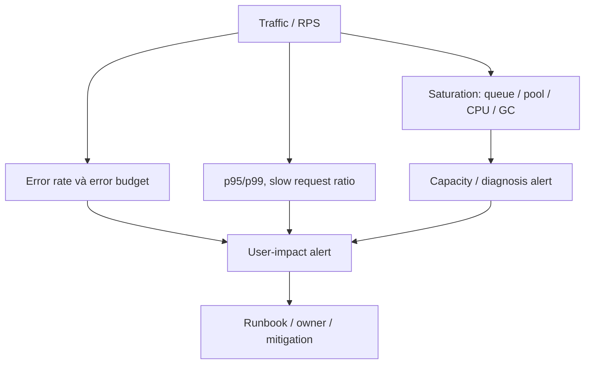
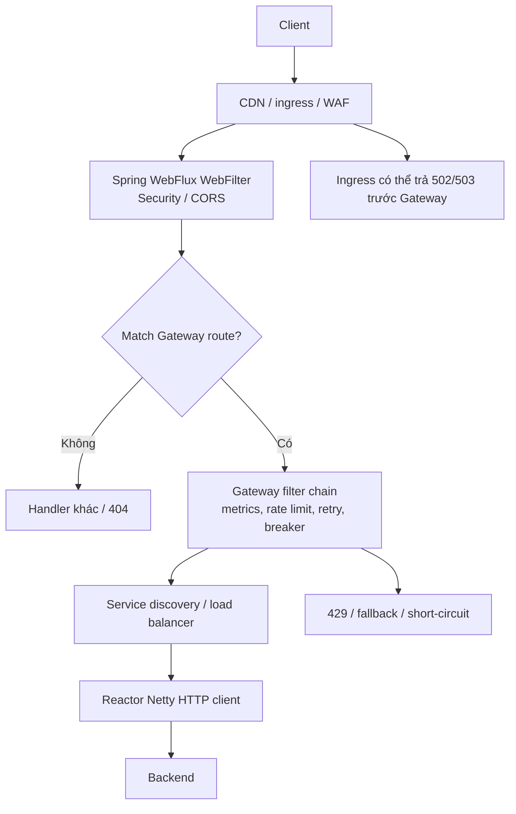
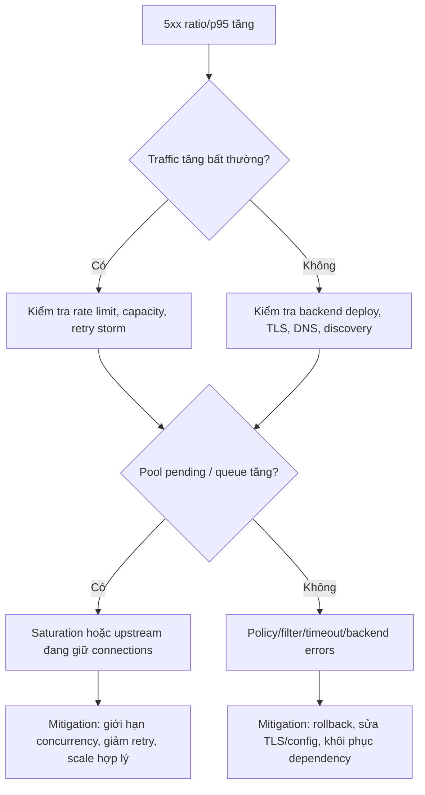
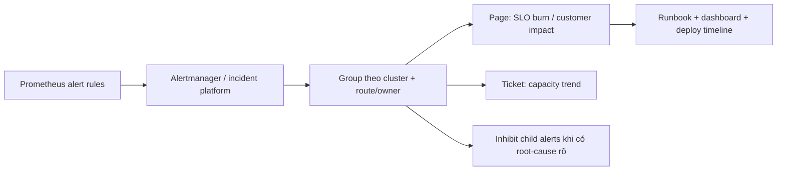

# Thiết kế cảnh báo theo tỷ lệ lỗi, độ trễ và mức bão hòa

Một **API Gateway** có thể vẫn trả lời `/actuator/health` bình thường trong khi khách hàng gặp nhiều lỗi `502/503/504`, thời gian chờ tăng đột biến hoặc các kết nối outbound bị xếp hàng dài. Nếu chỉ giám sát “pod còn sống”, đội vận hành biết dịch vụ đã chết **quá muộn**. Nếu chỉ đặt một luật “CPU trên 80%”, họ có thể bị đánh thức vì tải bình thường dù người dùng chưa bị ảnh hưởng. Thiết kế cảnh báo tốt phải kết hợp **tín hiệu trải nghiệm người dùng** và **tín hiệu khả năng phục vụ của hạ tầng**.

Trong **Spring Cloud Gateway Server WebFlux**, mỗi request đã match route có thể đi qua route predicate, filter chain, xác thực, rate limiting, circuit breaker, retry, TLS, load balancing và Reactor Netty HTTP client trước khi tới microservice. Một lỗi được người dùng thấy có thể do **Gateway**, **discovery**, **backend**, **ingress** hoặc một filter từ chối có chủ đích. Vì vậy, công thức cảnh báo đúng không chỉ là “đếm mọi status khác 200”.

Bài thuộc chương **Quan sát hệ thống** của module **SPRING_CLOUD_GATEWAY**. Trọng tâm là **thiết kế cảnh báo theo tỷ lệ lỗi, độ trễ và mức bão hòa**: xác định đúng mẫu số, dùng metrics theo route, áp SLI/SLO và error budget, tính p95/p99 từ histogram, phát hiện saturation trước khi hệ thống sập, và đưa cảnh báo tới người có thể xử lý.

**Kết quả học tập:**

1. Phân biệt RED (Rate, Errors, Duration) và bốn Golden Signals (Latency, Traffic, Errors, Saturation).
2. Định nghĩa tỷ lệ lỗi theo **request hợp lệ**, tránh nhầm `4xx` của client với `5xx` của nền tảng.
3. Thu thập metrics của Gateway qua **Actuator + Micrometer + Prometheus** với các tag có kiểm soát.
4. Viết PromQL cho RPS, error ratio, p95 và phần trăm request đáp ứng giới hạn độ trễ.
5. Nhận biết saturation ở **connection pool, event loop, CPU, memory/GC, thread pool** và tầng upstream.
6. Thiết kế alert theo **SLO burn rate** và cửa sổ dài/ngắn, hạn chế false positives khi lưu lượng ít.
7. Kiểm thử alert bằng tình huống giả lập và viết runbook có hành động cụ thể.

> **Phạm vi:** Ví dụ metric và HTTP client saturation dùng **Spring Cloud Gateway Server WebFlux** 5.x + Reactor Netty. Cấu hình route theo `spring.cloud.gateway.server.webflux.routes`; bản WebFlux 4.3.x thường dùng `spring.cloud.gateway.routes`. **Gateway Server Web MVC** dùng Servlet/WebMvc.fn và có nguồn metrics/concurrency khác; **Proxy Exchange** dùng controller cũng không mặc nhiên đi qua GatewayMetricsFilter. Đừng sao chép ngưỡng Netty sang MVC mà chưa kiểm tra instrumentations thật.

## 1. Cảnh báo tốt trả lời ba câu hỏi

Một alert nên giúp người trực xử lý quyết định:

1. **Ai bị ảnh hưởng?** Ví dụ khách hàng của route `orders-api`, không phải chỉ “JVM có CPU cao”.
2. **Mức nghiêm trọng nào?** SLO/error budget đang bị đốt nhanh hay chỉ là cảnh báo năng lực cần xử lý trong giờ làm?
3. **Có hành động nào ngay bây giờ?** Rollback route/filter, tạm giảm retry, tăng capacity, khôi phục service discovery hay liên hệ owner backend.

Ví dụ:

| Cảnh báo kém | Cảnh báo tốt hơn |
| --- | --- |
| “Nhiều lỗi HTTP” | “`orders-api` vượt 1,44% 5xx trong cả cửa sổ 5 phút và 1 giờ, lượng request đủ lớn” |
| “Gateway chậm” | “p95 latency của `catalog-api` trên 500 ms trong 10 phút, sau khi loại nhiễu lưu lượng quá thấp” |
| “CPU 85%” | “HTTP client pool pending acquire tăng liên tục, active/max gần trần và p95 tăng” |
| “503 xuất hiện” | “503 do `lb://order-service` thiếu instance, đúng thời điểm rollout registry” |
| “Một pod mất metric” | “Prometheus không scrape được một Gateway target; chưa kết luận khách hàng nhận 5xx” |

**Mục tiêu không phải tạo nhiều alert**, mà là phát hiện sự cố quan trọng sớm, với ngữ cảnh đủ để quyết định.

## 2. RED và bốn Golden Signals trong Gateway

**RED** hữu ích với request/response services:

- **Rate:** số request xử lý trên một đơn vị thời gian, thường `requests/second` (RPS).
- **Errors:** số request thất bại hoặc phần trăm request không đáp ứng contract.
- **Duration:** phân phối thời gian xử lý (p50, p95, p99, bucket SLO).

**Golden Signals** của SRE gồm **Latency, Traffic, Errors, Saturation**. Chúng gần RED nhưng bổ sung **Saturation**: mức độ tài nguyên hoặc hàng đợi đã tiến gần giới hạn.

| Tín hiệu | Câu hỏi với Gateway | Metric gợi ý |
| --- | --- | --- |
| Traffic | Có bao nhiêu request/giây vào `orders-api`? | Timer count + `rate()` |
| Errors | Bao nhiêu request trả `5xx` hoặc vi phạm SLI? | Timer count theo `httpStatusCode` |
| Latency | p95/p99 hoặc tỷ lệ dưới 500 ms là bao nhiêu? | Timer histogram bucket |
| Saturation | Connection pool có phải chờ acquire? Event loop có bị nghẽn? | Reactor Netty pool, CPU, GC, thread/queue metrics |

**Traffic là ngữ cảnh, không mặc nhiên là alert.** QPS tăng từ 100 lên 200 có thể là thành công kinh doanh; nhưng cùng mức tăng trong khi queue/5xx/latency tăng thì đó có thể là dấu hiệu quá tải.



Đừng lấy “CPU chưa cao” làm bằng chứng hệ thống không bão hòa: Gateway vẫn có thể kẹt do **DNS/TLS, pool acquire, upstream timeout, blocking trên event loop hoặc giới hạn socket**.

## 3. Đường đi request quyết định tín hiệu nào nhìn thấy lỗi

Không phải mọi request tới cổng vào đều được một metric Gateway route ghi nhận.



Các trường hợp khác nhau:

- **Ingress trả 502** vì không có Gateway pod: Gateway process **không ghi request đó**.
- **Spring Security trả 401/403** trước khi route match: Gateway route timer có thể **không thấy request**.
- **Không match route**: request có thể bị xử lý 404 ngoài `FilteringWebHandler`.
- **Gateway `RequestRateLimiter` trả 429**: route đã match nhưng không gọi backend.
- **CircuitBreaker fallback trả 200**: client thấy 200, trong khi backend đang có lỗi; cần metric fallback/breaker riêng.
- **Retry 503 → 200**: metric kết quả client có thể chỉ ghi **một request 200**, còn upstream đã nhận **hai attempts**.
- **Client ngắt kết nối**: có thể không có một HTTP status hoàn chỉnh; cần quan sát cancellation/transport logs.

Vì vậy nên có **ít nhất hai lớp đo**:

1. **Edge/inbound HTTP metrics** ở ingress hoặc HTTP server, phản ánh mọi request đi vào tầng tương ứng.
2. **Gateway per-route metrics** cho những request đã chọn một route, kết hợp backend, retry, breaker và pool metrics.

**Không dùng mỗi `spring.cloud.gateway.requests` để tuyên bố đo đủ mọi lỗi khách hàng nhìn thấy.**

## 4. Phân loại HTTP errors theo ý nghĩa vận hành

Một HTTP status có thể là lỗi của người dùng, của backend hoặc là **kết quả có chủ đích của policy**.

| Mã / loại | Cách hiểu phổ biến | Có tính vào error SLI 5xx? | Alert bổ sung |
| --- | --- | --- | --- |
| `200/201/204` | Thành công HTTP | Không | Latency, tính đúng nội dung |
| `301/302/304` | Redirect/cache | Thường không | Redirect loop nếu xảy ra |
| `400` | Input không hợp lệ | Thường không | Spike do thay đổi client/API |
| `401` | Chưa xác thực/token lỗi | Không theo 5xx SLI | IdP/token issues, auth failure spike |
| `403` | Không có quyền | Không theo 5xx SLI | Security/policy rollout |
| `404` | Không có route hoặc resource không tồn tại | Theo contract; thường không mặc định | No-route spike, route regression |
| `408` | Request timeout từ phía client/path cụ thể | Tùy SLI | Proxy/client network |
| `429` | Rate limiting có chủ đích | Không theo 5xx SLI, nhưng có thể vi phạm availability SLO riêng | Quota abuse hoặc capacity/policy issue |
| `500` | Lỗi server | **Có** | Backend/Gateway exception |
| `502` | Bad Gateway | **Có** | DNS/TLS/upstream proxy |
| `503` | Service unavailable | **Có** | No instance, breaker OPEN, overload |
| `504` | Gateway timeout | **Có** | Connect/response timeout, retry budget |
| Cancel / client-closed | Không nhất thiết có status chuẩn | Cần định nghĩa riêng | Client abort, timeout chain |

**Phân biệt SLI do bạn định nghĩa với mã HTTP:** Một lệnh GET trả 200 nhưng body sai hoặc trả dữ liệu fallback không hợp lệ **vẫn có thể là bad event** theo contract nghiệp vụ. Ngược lại, 404 hợp lệ của `GET /items/nonexistent` không nhất thiết là downtime.

**Quy tắc nhất quán:** Nếu định nghĩa SLI availability là “request hợp lệ không nhận 5xx”, hãy áp bộ lọc **request hợp lệ** nhất quán cho cả tử số lẫn mẫu số.

## 5. Xác định rõ mẫu số và phạm vi cảnh báo

Tỷ lệ lỗi đơn giản:

\[
\text{Error Ratio}(W) =
\frac{\text{Số request lỗi trong cửa sổ }W}
     {\text{Tổng số request đủ điều kiện trong }W}
\]

Ví dụ `orders-api` trong 5 phút có:

- 9.800 request trả 2xx/3xx.
- 100 request trả 4xx do client.
- 100 request trả 5xx.

Nếu SLI là **5xx trên mọi request đã match route**, error ratio bằng:

\[
\frac{100}{9800+100+100}=1\%.
\]

Nếu contract **loại trừ 4xx không hợp lệ khỏi denominator**, tỷ lệ là:

\[
\frac{100}{9800+100} \approx 1{,}0101\%.
\]

Hai cách đều có thể đúng theo **định nghĩa SLI**, nhưng không được trộn chúng giữa dashboard và alert. Với những route có nhiều 401/404, đưa toàn bộ 4xx vào mẫu số có thể vô tình **pha loãng lỗi 5xx**.

### Phạm vi theo route, nhóm và toàn cổng

| Phạm vi | Ưu điểm | Hạn chế |
| --- | --- | --- |
| Toàn Gateway | Nhanh thấy sự cố diện rộng | Route traffic lớn che lỗi route nhỏ |
| Theo `routeId` | Trúng owner và API bị ảnh hưởng | Nhiều routes → nhiều time series và alerts |
| Theo nhóm critical routes | Dễ thiết kế SLO chung | Cần danh mục route ownership ổn định |
| Theo instance/pod | Phát hiện một pod lỗi, saturation | Pod-level không đồng nghĩa user-level outage |
| Theo region/cluster | Thấy lỗi phân vùng hạ tầng | Cần labels chuẩn hóa |

**Khuyến nghị:** Page cho **dịch vụ/route SLO quan trọng**, còn alert theo pod/CPU/pool dùng để chẩn đoán hoặc xử lý capacity. Không cho một lỗi toàn cluster tạo 200 trang thông báo giống nhau.

## 6. Định nghĩa SLI, SLO và error budget

Giả sử đội sở hữu `orders-api` đưa ra hai SLO **minh họa**, không phải chuẩn chung:

1. **Availability SLO:** Trong 30 ngày, ít nhất **99,9%** request GET hợp lệ không nhận `5xx`.
2. **Latency SLO:** Trong 30 ngày, ít nhất **99%** request GET thành công hoàn tất trong **500 ms** theo thời gian đo tại Gateway.

**Error budget** của availability là:

\[
1 - 0{,}999 = 0{,}001 = 0{,}1\%.
\]

Nếu trong 30 ngày có **1.000.000** eligible requests, ngân sách cho bad events tương ứng là khoảng:

\[
1.000.000 \times 0{,}001 = 1.000.
\]

Đây là phép tính theo mẫu request trong kỳ; số requests thực tế không cố định. Nếu 30 ngày tăng traffic, budget tuyệt đối cũng thay đổi, trong khi budget **theo tỷ lệ** vẫn là 0,1%.

### Latency SLO cần phân biệt với p95

“**p95 dưới 500 ms**” có nghĩa tối thiểu khoảng **95%** samples đạt ngưỡng, không đủ cho “**99% request thành công dưới 500 ms**”.

Để đánh giá SLO 99% dưới 500 ms, dùng tỷ lệ samples trong **bucket ≤0,5 giây**, không chỉ một con số p95. p95/p99 vẫn hữu ích để chẩn đoán tail latency và phát hiện dấu hiệu bất thường sớm.

### Chọn người dùng làm trung tâm

Nếu người dùng bị lỗi ở CDN/ingress trước khi request tới Gateway, availability SLO **end-to-end** phải tính ở edge/synthetic monitor, không thể chỉ lấy metrics của Gateway. Có thể có một SLO nội bộ `gateway-routed-availability` riêng, nhưng đừng trình bày nó như toàn bộ trải nghiệm người dùng.

## 7. Bật Gateway metrics bằng Actuator, Micrometer và Prometheus

Theo tài liệu **Gateway Server WebFlux 5.1**, `GatewayMetricsFilter` tạo **Timer** tên:

```text
spring.cloud.gateway.requests
```

Các tags được tài liệu mô tả:

| Tag | Ý nghĩa | Ghi chú |
| --- | --- | --- |
| `routeId` | Route ID đã match | Tốt cho alert theo API |
| `routeUri` | URI của route | Không nên group theo URI động tùy ý |
| `outcome` | Nhóm HTTP outcome | Ví dụ `SUCCESSFUL`, `SERVER_ERROR` |
| `status` | HTTP status được trả | Biểu diễn tùy mapping/version |
| `httpStatusCode` | Mã HTTP status cụ thể | Dùng regex `5..` sau khi xác minh label |
| `httpMethod` | GET/POST/... | Tách SLO theo methods nếu contract khác nhau |

Tài liệu 5.1 nói metrics chạy khi có Actuator và không tắt `spring.cloud.gateway.metrics.enabled`. Bảng configuration properties 5.x còn liệt kê `spring.cloud.gateway.server.webflux.metrics.enabled`. Vì có khác biệt giữa các trang, ví dụ này **bật tường minh namespace WebFlux 5.x** và yêu cầu **kiểm chứng metric thực tế** thay vì tin một dòng config đã bind thành công.

Dependencies:

```xml
<dependency>
  <groupId>org.springframework.boot</groupId>
  <artifactId>spring-boot-starter-actuator</artifactId>
</dependency>

<dependency>
  <groupId>io.micrometer</groupId>
  <artifactId>micrometer-registry-prometheus</artifactId>
</dependency>
```

Sử dụng BOM Spring Boot/Spring Cloud tương thích; không gắn version ngẫu nhiên cho hai dependencies trên.

### application.yml minh họa cho WebFlux 5.x

```yaml
spring:
  cloud:
    gateway:
      server:
        webflux:
          metrics:
            enabled: true
            path-tags:
              enabled: false
          httpclient:
            pool:
              metrics: true

management:
  server:
    port: 9090
  endpoints:
    web:
      exposure:
        include: health,info,metrics,prometheus
  metrics:
    distribution:
      percentiles-histogram:
        spring.cloud.gateway.requests: true
      slo:
        spring.cloud.gateway.requests:
          - 100ms
          - 300ms
          - 500ms
          - 1s
          - 2s
```

Giải thích:

- `metrics.enabled: true`: bật collecting Gateway metrics theo property WebFlux 5.x khi được hỗ trợ.
- `path-tags.enabled: false`: tránh đưa **path raw** có resource ID/token lên metric labels.
- `httpclient.pool.metrics: true`: bật Reactor Netty **connection pool metrics**; default trong config properties 5.x là **false**.
- `management.server.port: 9090`: tách port quản trị **trên cùng app**, không tự tạo network isolation.
- `percentiles-histogram`: yêu cầu các histogram buckets để tổng hợp p95/p99 bằng Prometheus.
- `slo`: thêm boundaries, đặc biệt **500 ms**, cho phép đo tỷ lệ đáp ứng latency SLO.

**Lưu ý performance:** Histogram nhân số time series theo số **route × method × status × instance × buckets**. Không bật cho mọi metric vô điều kiện và không đưa raw path, userId, sessionId, token hoặc query string vào labels.

### WebFlux 4.3.x và Gateway MVC

WebFlux 4.3.x có nhiều property namespace khác (ví dụ `spring.cloud.gateway.httpclient.pool.metrics` hoặc `spring.cloud.gateway.routes`). Bản MVC có các meter của Servlet/MVC tương ứng, nhưng **không mặc định có Netty pool metric**. Hãy xem đúng version/configuration properties, thử một request rồi kiểm tra Actuator để biết metric nào thực sự tồn tại.

## 8. Xác minh metrics có thật trước khi viết alert

Một lỗi phổ biến là tạo 20 PromQL alerts cho metric **chưa từng được export**. Bước đầu tiên là kiểm tra với đúng binary/starter.

Sau khi ứng dụng chạy và đã có request match một route:

```bash
# Kiểm tra meter bằng tên Micrometer (chỉ trên management network).
curl -fsS \
  http://localhost:9090/actuator/metrics/spring.cloud.gateway.requests

# Kiểm tra Prometheus exposition: phải xem cả labels và tên series.
curl -fsS \
  http://localhost:9090/actuator/prometheus \
  | grep '^spring_cloud_gateway_requests_seconds'
```

Prometheus Timer của Micrometer thường có:

```text
spring_cloud_gateway_requests_seconds_count
spring_cloud_gateway_requests_seconds_sum
spring_cloud_gateway_requests_seconds_max
spring_cloud_gateway_requests_seconds_bucket  # khi có histogram
```

Tên `_seconds_*` phù hợp Prometheus/Micrometer hiện hành; **metric cũ, exporter khác, native histograms hoặc cấu hình tùy biến có thể thay đổi cách biểu diễn**. Kiểm tra thực tế thay vì tự tạo query trên giả định.

Ví dụ một dòng minh họa:

```text
spring_cloud_gateway_requests_seconds_count{
  routeId="orders-api",
  httpStatusCode="503",
  httpMethod="GET",
  outcome="SERVER_ERROR",
  job="gateway-prod"
} 125
```

Đây là **ví dụ cấu trúc**, không phải output bắt buộc. `job` thường được Prometheus gắn khi scrape, không nhất thiết xuất hiện trên `/actuator/prometheus`; các labels khác có thể thêm/bớt theo phiên bản.

### Nếu metric trống

1. Có Actuator và registry Prometheus đúng dependency chưa?
2. Gateway metrics có bị disable qua property/MeterFilter không?
3. Request đã **match route** của Gateway chưa?
4. Bạn đang gọi đúng **port/base path** management chưa?
5. Prometheus có scrape đúng endpoint và target `up=1` không?
6. Query label `routeId` và `httpStatusCode` có đúng tên thực tế không?
7. Histogram có thực sự xuất `_bucket` không?
8. Bạn có dùng Gateway Web MVC/ProxyExchange thay vì WebFlux không?

**Không** biến “không có dữ liệu” thành “0% lỗi” nếu target không scrape hoặc route timer không hoạt động.

## 9. Prometheus scrape và bảo vệ endpoint

Ví dụ job scrape tối giản trong môi trường quản trị nội bộ:

```yaml
scrape_configs:
  - job_name: gateway-prod
    scrape_interval: 15s
    metrics_path: /actuator/prometheus
    static_configs:
      - targets:
          - gateway-a.internal:9090
          - gateway-b.internal:9090
```

Khi triển khai Kubernetes, ServiceMonitor/PodMonitor hoặc discovery config có thể thay static targets; điều quan trọng là **giữ labels environment/cluster/instance rõ ràng**.

**Bảo mật:**

- `/actuator/prometheus` có thể tiết lộ route topology, backend instance, memory/CPU details.
- Đặt trên management plane/port có **network isolation, authentication/TLS** theo tổ chức.
- Không public `/actuator/metrics`/`/actuator/prometheus` cho anonymous Internet.
- Bảo vệ gateway Actuator routes với **read-only** nếu chỉ quan sát; endpoint thay đổi route cần quyền riêng.
- Không đặt username/password hoặc bearer token của scrape job trong tài liệu/command logs.
- Nếu exporter bị quá tải, metrics mất → monitoring cũng có thể mất; giám sát cả scrape duration và `up`.

## 10. PromQL cơ bản: Traffic / RPS

Prometheus counters tăng theo thời gian và **reset khi process restart**. Để lấy RPS, dùng `rate()` trên counter, không lấy raw cumulative count.

RPS của toàn Gateway (các routes mà timer ghi nhận):

```promql
sum(
  rate(spring_cloud_gateway_requests_seconds_count{
    job="gateway-prod"
  }[5m])
)
```

RPS theo route:

```promql
sum by (routeId) (
  rate(spring_cloud_gateway_requests_seconds_count{
    job="gateway-prod"
  }[5m])
)
```

RPS riêng `orders-api`:

```promql
sum(
  rate(spring_cloud_gateway_requests_seconds_count{
    job="gateway-prod",
    routeId="orders-api"
  }[5m])
)
```

**Tại sao phải dùng `sum by(routeId)`?** Các Gateway replicas có counters riêng; `rate()` tính tốc độ mỗi time series (xử lý counter reset), sau đó `sum` gộp traffic của toàn cụm. Đừng cộng raw counters từ các pods rồi so sánh một ngưỡng cố định.

### Traffic drop cần baseline

`RPS=0` có thể là:

- API ít người dùng lúc ban đêm.
- Deployment tắt routing ngoài ý muốn.
- Ingress không chuyển request vào Gateway.
- Metrics/scrape lỗi.
- Một route mới chưa có client.

Với route **ít traffic nhưng critical**, ưu tiên synthetic checks hoặc business heartbeat thay vì page chỉ dựa trên `rate=0`. Với route traffic cao, có thể cảnh báo **giảm đột ngột so với baseline theo giờ/ngày**, nhưng phải xét tính mùa vụ.

## 11. PromQL: tỷ lệ lỗi 5xx đúng tử số và mẫu số

Một mẫu số phổ biến là **mọi request được Gateway route timer ghi nhận**; tử số là `5xx`.

```promql
sum by (routeId) (
  rate(spring_cloud_gateway_requests_seconds_count{
    job="gateway-prod",
    httpStatusCode=~"5.."
  }[5m])
)
/
clamp_min(
  sum by (routeId) (
    rate(spring_cloud_gateway_requests_seconds_count{
      job="gateway-prod"
    }[5m])
  ),
  0.000001
)
```

Kết quả là tỷ lệ từ `0` đến `1`. Nhân `100` nếu muốn hiển thị phần trăm. `clamp_min` chỉ tránh chia cho 0 khi series còn tồn tại; **nó không giải quyết tình trạng thiếu metric/scrape**.

**Quan trọng:** Với route không có bất kỳ 5xx nào, Prometheus có thể **không có series tử số** trong một khoảng, khiến tỷ lệ trả về rỗng thay vì 0. Để dashboard hiển thị 0 khi mẫu số có traffic, có thể bổ sung:

```promql
(
  sum by (routeId) (
    rate(spring_cloud_gateway_requests_seconds_count{
      job="gateway-prod",
      httpStatusCode=~"5.."
    }[5m])
  )
  or on (routeId)
  (
    0 * sum by (routeId) (
      rate(spring_cloud_gateway_requests_seconds_count{
        job="gateway-prod"
      }[5m])
    )
  )
)
/
clamp_min(
  sum by (routeId) (
    rate(spring_cloud_gateway_requests_seconds_count{
      job="gateway-prod"
    }[5m])
  ),
  0.000001
)
```

`or on(routeId)` chỉ tạo **0 tương ứng route có traffic**, không tự bịa dữ liệu khi toàn bộ Gateway/Prometheus mất kết nối. Muốn phát hiện no-data, tạo alert `up`/missing data riêng.

### Mẫu số chỉ gồm requests hợp lệ?

Nếu SLO loại những 4xx do client, phải dùng **cùng điều kiện** ở denominator và policy nhất quán. Ví dụ một API không tính 401/403/404 vào eligible requests:

```promql
sum by (routeId) (
  rate(spring_cloud_gateway_requests_seconds_count{
    job="gateway-prod",
    httpStatusCode=~"5.."
  }[5m])
)
/
clamp_min(
  sum by (routeId) (
    rate(spring_cloud_gateway_requests_seconds_count{
      job="gateway-prod",
      httpStatusCode!~"401|403|404"
    }[5m])
  ),
  0.000001
)
```

Đây **chỉ là một lựa chọn SLI**, không có nghĩa 401/403/404 luôn được loại. Nếu những mã này là lỗi client-visible của một thay đổi authentication/route, cần alert riêng hoặc SLI khác.

## 12. Alert lỗi: vừa có tỷ lệ vừa có traffic guard

Một route nhận **1 request trong 5 phút**, thất bại một lần, sẽ có `100%` lỗi. Page cho cả đội chỉ vì một sample có thể gây nhiều nhiễu. Nhưng bỏ qua hoàn toàn route ít traffic cũng nguy hiểm.

Ví dụ Prometheus alert **mang tính khởi điểm cho route traffic cao**:

```yaml
groups:
  - name: gateway-basic-errors
    rules:
      - alert: GatewayHigh5xxRatio
        expr: |
          (
            sum by (routeId) (
              rate(spring_cloud_gateway_requests_seconds_count{
                job="gateway-prod", httpStatusCode=~"5.."
              }[5m])
            )
            /
            clamp_min(
              sum by (routeId) (
                rate(spring_cloud_gateway_requests_seconds_count{
                  job="gateway-prod"
                }[5m])
              ),
              0.000001
            )
          ) > 0.02
          and on (routeId)
          (
            sum by (routeId) (
              increase(spring_cloud_gateway_requests_seconds_count{
                job="gateway-prod"
              }[5m])
            ) > 100
          )
        for: 3m
        labels:
          severity: warning
          team: gateway
        annotations:
          summary: "Gateway route {{ $labels.routeId }} vượt 2% HTTP 5xx"
          description: "Kiểm tra backend, route, retry, breaker và ingress."
```

Điều kiện trên yêu cầu:

- `5xx ratio > 2%` trong 5 phút.
- Có **hơn 100 requests** trong 5 phút cho route đó.
- Điều kiện giữ đủ `for: 3m` trước khi firing.

**2%**, **100 requests** và **3 phút** là **giá trị minh họa**, không phải mặc định phù hợp mọi SLO. Với route critical traffic thấp, thay guard bằng synthetic check hoặc một quy tắc **số lỗi tuyệt đối + tác động** có tiêu chí riêng.

**Lỗi thường gặp:** Dùng `sum(errors) / sum(total)` toàn cụm rồi page. Một route traffic lớn khỏe có thể che route payments nhỏ đang hỏng 100%.

## 13. Latency: vì sao không chỉ nhìn average?

Giả sử 100 requests:

- 95 requests mất 100 ms.
- 5 requests mất 5 giây.

Average là:

\[
\frac{95 \times 0{,}1 + 5 \times 5}{100}
=0{,}345\text{ giây}.
\]

Average 345 ms có thể trông ổn trong khi 5% người dùng chờ 5 giây. Các percentiles giúp nhìn **đuôi phân phối**:

- **p50**: trung vị, trải nghiệm phổ biến.
- **p95**: khoảng 95% observations không vượt giá trị này.
- **p99**: nhóm 1% chậm nhất, nhạy với tail latency.
- **Bucket SLO**: tỷ lệ observations không vượt một ngưỡng đã định.

**Đừng lấy trung bình các p95 giữa Gateway pods.** Quantiles không có tính cộng gộp; dùng **histogram buckets** rồi tính p95 trên tổng samples.

### Đơn vị thời gian

Micrometer Timer khi export Prometheus thường dùng **giây** cho `_seconds_*`. Như vậy:

| Mục tiêu | Ngưỡng PromQL |
| --- | ---: |
| 100 ms | `0.1` |
| 300 ms | `0.3` |
| 500 ms | `0.5` |
| 1 giây | `1` |
| 2 giây | `2` |

Không viết `p95 > 500` nếu muốn cảnh báo 500 ms; đó sẽ là **500 giây** trên metric `_seconds`.

## 14. Tính p95/p99 đúng bằng histogram_quantile

Khi histogram `spring_cloud_gateway_requests_seconds_bucket` đã được export, p95 theo route:

```promql
histogram_quantile(
  0.95,
  sum by (routeId, le) (
    rate(spring_cloud_gateway_requests_seconds_bucket{
      job="gateway-prod"
    }[5m])
  )
)
```

p99 cùng cấu trúc với `0.99`:

```promql
histogram_quantile(
  0.99,
  sum by (routeId, le) (
    rate(spring_cloud_gateway_requests_seconds_bucket{
      job="gateway-prod"
    }[10m])
  )
)
```

**Vì sao giữ `le`?** Với **classic Prometheus histogram**, `le` là giới hạn bucket và `histogram_quantile` cần biết phân phối các bucket. `sum by(routeId,le)` gộp các pods trong cùng route mà vẫn giữ bucket boundaries.

### Chỉ đo requests thành công

Một số hệ thống có **5xx cực nhanh**. Nếu p95 tính cả lỗi, chúng có thể làm p95 **trông tốt hơn** khi availability lại giảm. Một dashboard hữu ích nên có:

- p95 **của requests thành công** để đo latency trải nghiệm thành công.
- **5xx ratio** riêng.
- p95 của toàn bộ traffic để thấy ảnh hưởng thực tế.
- **Slow request ratio** theo SLO nếu cần.

Ví dụ p95 của 2xx/3xx:

```promql
histogram_quantile(
  0.95,
  sum by (routeId, le) (
    rate(spring_cloud_gateway_requests_seconds_bucket{
      job="gateway-prod",
      httpStatusCode=~"2..|3.."
    }[5m])
  )
)
```

Không lấy `avg(quantile="0.95")` của các pods: đó là phép tính không có ý nghĩa thống kê cho percentiles toàn cluster.

### Histogram là ước lượng

Prometheus nội suy trong bucket nên p95/p99 là **ước lượng**, độ chính xác phụ thuộc bucket layout. Nếu SLO là **≤500 ms**, dùng **bucket 0.5s** được cấu hình rõ để đo tỷ lệ qua ngưỡng trực tiếp thay vì chỉ so p95 với 0.5.

## 15. Latency SLI: bao nhiêu request đạt 500 ms?

Với SLO “**99% request thành công ≤500 ms**”, cần tính tỷ lệ thành công trong bucket ≤0.5 giây.

```promql
sum by (routeId) (
  rate(spring_cloud_gateway_requests_seconds_bucket{
    job="gateway-prod",
    httpStatusCode=~"2..|3..",
    le="0.5"
  }[5m])
)
/
clamp_min(
  sum by (routeId) (
    rate(spring_cloud_gateway_requests_seconds_count{
      job="gateway-prod",
      httpStatusCode=~"2..|3.."
    }[5m])
  ),
  0.000001
)
```

Kết quả là **phần requests thành công** đáp ứng latency threshold, từ 0 tới 1. Nếu muốn **một SLO hợp nhất** vừa availability vừa latency, có thể dùng **mẫu số toàn eligible requests** và chỉ đếm requests **2xx/3xx ≤500 ms** ở tử số. Hai định nghĩa khác nhau, cần ghi rõ trong SLO document.

**Yêu cầu:** Hệ thống phải có bucket `le="0.5"`. Cấu hình `management.metrics.distribution.slo.spring.cloud.gateway.requests` ở mục 7 đặt ranh giới này. Nếu exporter không tạo bucket tương ứng, query sẽ không có sample đầy đủ; đừng tự giả định bucket 0.5 luôn hiện diện.

### Ví dụ threshold theo số liệu

Trong 5 phút có 10.000 request thành công, trong đó 9.920 request có latency ≤500 ms. Latency-good fraction:

\[
9.920/10.000=99{,}2\%.
\]

Nếu SLO 99%, cửa sổ đó **đạt yêu cầu**; nhưng p99 có thể vẫn khá cao vì 0,8% còn lại chậm. Vì thế đặt alert theo burn của latency error budget hoặc slow ratio sẽ hữu ích hơn so với chỉ giám sát p95.

## 16. Cảnh báo độ trễ không gây nhiễu bởi lưu lượng nhỏ

Ví dụ warning khi p95 **successful requests** vượt **500 ms** trong 10 phút và có đủ samples:

```yaml
groups:
  - name: gateway-latency
    rules:
      - alert: GatewayHighP95Latency
        expr: |
          histogram_quantile(
            0.95,
            sum by (routeId, le) (
              rate(spring_cloud_gateway_requests_seconds_bucket{
                job="gateway-prod",
                httpStatusCode=~"2..|3.."
              }[5m])
            )
          ) > 0.5
          and on (routeId)
          (
            sum by (routeId) (
              increase(spring_cloud_gateway_requests_seconds_count{
                job="gateway-prod",
                httpStatusCode=~"2..|3.."
              }[5m])
            ) > 100
          )
        for: 10m
        labels:
          severity: warning
          team: gateway
        annotations:
          summary: "p95 của route {{ $labels.routeId }} vượt 500ms"
          description: "Xem kết hợp 5xx, upstream latency và pool pending."
```

Ngưỡng này **không thay thế** availability alert; một route có 100% fast 503 có thể **không có** successful latency p95, nhưng availability alert phải phát hiện.

**Với streaming/SSE/WebSocket:** Thời gian sống connection/stream dài không thể so trực tiếp với latency SLO của JSON GET. Tách route/endpoint class theo transport; đo handshake latency, first-byte latency và duration của stream riêng nếu cần.

## 17. Saturation là gì trong API Gateway?

**Saturation** là mức gần chạm trần một tài nguyên hoặc biểu hiện đã có **queue/waiting**. Với Gateway WebFlux, cần quan sát nhiều chỗ:

| Nút nghẽn | Tín hiệu |
| --- | --- |
| Reactor Netty outbound connection pool | Active/max, pending acquire, pending acquire time |
| Event loop | Blocking task, queue delay, event-loop lag |
| CPU | CPU sử dụng so với **quota/cores** được cấp, throttling |
| JVM heap/GC | Heap pressure, GC pause, allocation rate, OOM |
| TLS/DNS | TLS handshake latency/errors, DNS lookup failure/timeout |
| Network | Socket errors, packet drops/retransmissions, bandwidth |
| Redis rate limiter | Redis latency/errors, key resolution errors |
| CircuitBreaker/Retry | OPEN states, calls blocked, retry amplification |
| LoadBalancer/discovery | No instance `503`, stale instances, discovery refresh lag |
| Ingress | Pending requests, upstream connection errors, proxy timeouts |

Một metric `CPU=90%` **không đủ** để gọi là outage. Ngược lại, `pending acquire` tăng liên tục **trong khi p95/5xx tăng** là một dấu hiệu mạnh rằng Gateway hoặc outbound dependency đang bão hòa.

### Saturation không đồng nghĩa utilization

- **Utilization:** bao nhiêu % capacity đang được dùng.
- **Saturation:** có hay không **yêu cầu đang phải chờ** hoặc bị từ chối do capacity.
- **Queueing latency:** độ trễ cộng thêm vì đợi resource.

Khi utilization tiến gần 100%, queueing latency có thể tăng phi tuyến. Nhưng mức “85% là nguy hiểm” phụ thuộc loại pool, workload, burst profile và headroom; phải hiệu chỉnh bằng load test.

## 18. Reactor Netty connection pool metrics

Reactor Netty có các metrics cho `ConnectionProvider` (khi đã bật pool metrics):

| Micrometer meter | Ý nghĩa |
| --- | --- |
| `reactor.netty.connection.provider.active.connections` | Connections đang được dùng |
| `reactor.netty.connection.provider.idle.connections` | Connections rảnh |
| `reactor.netty.connection.provider.total.connections` | Tổng connections |
| `reactor.netty.connection.provider.max.connections` | Trần connection pool, khi có giới hạn |
| `reactor.netty.connection.provider.pending.connections` | Số yêu cầu đang chờ acquire |
| `reactor.netty.connection.provider.max.pending.connections` | Trần pending queue |
| `reactor.netty.connection.provider.pending.connections.time` | Thời gian chờ acquire |

Prometheus names thường biến thành:

```text
reactor_netty_connection_provider_active_connections
reactor_netty_connection_provider_max_connections
reactor_netty_connection_provider_pending_connections
reactor_netty_connection_provider_pending_connections_time_seconds_count
reactor_netty_connection_provider_pending_connections_time_seconds_sum
```

Các names/phần tags cần được **xác nhận qua `/actuator/prometheus`**. Reactor Netty có thể gắn `name`, `id` và `remote.address`; khi chuyển thành Prometheus label, tên trường có thể được chuẩn hóa theo exporter.

### Khi nào metric không hiện?

- Property `spring.cloud.gateway.server.webflux.httpclient.pool.metrics` chưa bật.
- Connection provider chưa có traffic hoặc metric lazy-registered.
- Gateway không dùng Reactor Netty pool ở code path đó.
- Connection pool type có semantics khác với fixed pool.
- MeterRegistry/exporter bị filter hoặc không scrape.

Nếu dùng **elastic/unbounded semantics**, “active/max > 85%” có thể không có ý nghĩa hoặc không có max comparable. Khi đó ưu tiên **pending/time/errors** và đo capacity thực bằng test.

## 19. PromQL: saturation trên pool

**Pending connections** thường là tín hiệu trực tiếp hơn CPU trong HTTP client pool.

```promql
sum by (instance, name) (
  reactor_netty_connection_provider_pending_connections{
    job="gateway-prod"
  }
)
```

Một cảnh báo gợi ý:

```yaml
groups:
  - name: gateway-saturation
    rules:
      - alert: GatewayHttpClientPoolPending
        expr: |
          sum by (instance, name) (
            reactor_netty_connection_provider_pending_connections{
              job="gateway-prod"
            }
          ) > 10
        for: 5m
        labels:
          severity: warning
          team: platform
        annotations:
          summary: "HTTP client pool pending cao ở {{ $labels.instance }}"
          description: "Kiểm tra active/max, upstream latency, DNS/TLS, retry và egress."
```

`10 pending` và `5 phút` là **giá trị khởi điểm minh họa**. Với pool max 50, 10 pending có thể nghiêm trọng; với pool max 10.000, cần đánh giá theo SLO và tải. Cảnh báo thực tế nên có **cùng panel active/max, pending acquire duration và 5xx/latency**.

### Một tỷ lệ sử dụng khi có fixed pool

```promql
sum by (instance, name) (
  reactor_netty_connection_provider_active_connections{
    job="gateway-prod"
  }
)
/
clamp_min(
  sum by (instance, name) (
    reactor_netty_connection_provider_max_connections{
      job="gateway-prod"
    }
  ),
  1
)
```

**Cẩn thận:** Nhóm theo `instance,name` chỉ an toàn nếu các pools trong nhóm có cùng ý nghĩa capacity. Khi có nhiều `remote.address` hoặc tên pool lặp, xem vector labels thật và điều chỉnh aggregation để không vô tình cộng sai giới hạn.

Khi các connections giữ quá lâu, pending queue tăng nhưng CPU chưa cao, hãy tìm **upstream chậm, keep-alive leak, SSE/WebSocket traffic, timeout và connection release**, không mặc định scale pod ngay.

## 20. CPU, memory, event loop và saturation không phải một con số

### CPU

`process_cpu_usage` hoặc node/container CPU metrics có thể giúp phát hiện một Gateway pod gần giới hạn. Nhưng phải phân biệt:

- Process CPU tính theo process host context.
- Container CPU so với request/limit/quota được cấp.
- CPU throttling ở cgroup làm tăng latency dù process usage chưa chạm 100%.
- Multi-core CPU utilization không thể đọc thành cùng một tỷ lệ nếu chưa chuẩn hóa.

Ví dụ minh họa query (chỉ khi meter tồn tại và cùng semantics):

```promql
max by (instance) (
  process_cpu_usage{job="gateway-prod"}
)
```

**Không** mặc định `>0.8` phải page. Hãy kết hợp pending, latency và throttling/trend.

### JVM và GC

Các tín hiệu phù hợp:

- Heap used so với max, allocation rate.
- GC pause count/duration và độ dài stop-the-world.
- Direct/off-heap memory ở Netty, ByteBuf allocator metrics.
- Container OOMKilled và restart count.
- Open file descriptors/sockets.

Một Gateway dùng Reactor Netty có thể thiếu **direct memory** dù Java heap vẫn thấp. Chỉ theo dõi `jvm_memory_used_bytes{area="heap"}` sẽ bỏ sót vấn đề này.

### Event loop

Nếu custom `GlobalFilter` gọi `Thread.sleep()`, `WebClient.block()` hoặc JDBC đồng bộ trên event loop, một số request bị delay trong khi CPU toàn máy có thể không quá cao. Cần:

- Theo dõi event-loop scheduler/lag nếu đã instrument.
- Phân tích thread dumps và blocking detector trong staging.
- Theo dõi p95 inbound latency, Netty client latency và pending acquire để phân biệt.
- Không tăng số event-loop threads như cách chữa duy nhất cho blocking work.

**Gateway MVC khác:** Trên Servlet stack, thread pool/queue và HTTP client blocking metrics quan trọng hơn Netty event-loop lag. Đừng dùng một bộ alert saturation chung cho cả hai stacks.

## 21. Từ tỷ lệ lỗi sang error budget burn rate

Một SLO 99,9% có **error budget fraction** `0.001`. Burn rate cho biết budget đang bị tiêu thụ **nhanh gấp bao nhiêu lần** tốc độ cho phép nếu traffic ổn định.

\[
\text{Burn rate}
=\frac{\text{observed bad-event ratio}}
       {\text{allowed bad-event ratio}}.
\]

Ví dụ:

- SLO 99,9% → error budget 0,1% = `0.001`.
- Error ratio 1% = `0.01` → burn rate = `10`.
- Error ratio 1,44% = `0.0144` → burn rate = **14,4**.
- Error ratio 0,6% = `0.006` → burn rate = **6**.

Các con số **14,4×** và **6×** theo đề xuất mẫu trong *Google SRE Workbook*, phù hợp như **điểm khởi đầu** cho SLO 30 ngày.

| Cấp | Window dài | Window ngắn | Burn rate | Tỷ lệ lỗi tương ứng với SLO 99,9% |
| --- | --- | --- | ---: | ---: |
| Page nhanh | 1 giờ | 5 phút | 14,4× | >1,44% |
| Page chậm hơn | 6 giờ | 30 phút | 6× | >0,6% |
| Ticket | 3 ngày | 6 giờ | 1× | >0,1% |

Tùy tổ chức có thể dùng cặp ticket `24h/2h` với burn rate `3×` hoặc `3d/6h` với `1×`. Không dùng nguyên ngưỡng nếu error budget/SLO window khác.

### Tại sao cần hai cửa sổ cùng vượt ngưỡng?

Nếu chỉ nhìn error ratio trong **1 giờ**, một đợt outage 2 phút đã kết thúc vẫn để average cao, page kéo dài. Cặp điều kiện:

```text
error_ratio_1h > 1.44%
AND
error_ratio_5m > 1.44%
```

yêu cầu **vừa có mức tiêu hao budget trong window dài, vừa vẫn có lỗi mới ở window ngắn**. Điều này giảm cảnh báo dai dẳng khi sự cố đã kết thúc.

## 22. Recording rules cho burn-rate alerts

Để alert không lặp những PromQL quá dài, có thể tạo recording rules. Ví dụ dưới đây tính theo route ID trên Gateway WebFlux có metrics như mục 7.

> **Giả định:** `httpStatusCode=~"5.."` là bad event, tất cả requests đã route match là eligible; `job="gateway-prod"` chỉ chứa production targets. Nếu SLI của bạn loại 4xx hoặc bao gồm 429/slow requests, phải đổi biểu thức **một cách nhất quán** trước khi áp dụng.

```yaml
groups:
  - name: gateway-slo-recording
    interval: 30s
    rules:
      - record: gateway:requests:increase5m
        expr: |
          sum by (routeId) (
            increase(spring_cloud_gateway_requests_seconds_count{
              job="gateway-prod"
            }[5m])
          )

      - record: gateway:error_ratio:5m
        expr: |
          (
            sum by (routeId) (
              rate(spring_cloud_gateway_requests_seconds_count{
                job="gateway-prod", httpStatusCode=~"5.."
              }[5m])
            )
            or on (routeId)
            (
              0 * sum by (routeId) (
                rate(spring_cloud_gateway_requests_seconds_count{
                  job="gateway-prod"
                }[5m])
              )
            )
          )
          /
          clamp_min(
            sum by (routeId) (
              rate(spring_cloud_gateway_requests_seconds_count{
                job="gateway-prod"
              }[5m])
            ),
            0.000001
          )

      - record: gateway:error_ratio:1h
        expr: |
          (
            sum by (routeId) (
              rate(spring_cloud_gateway_requests_seconds_count{
                job="gateway-prod", httpStatusCode=~"5.."
              }[1h])
            )
            or on (routeId)
            (
              0 * sum by (routeId) (
                rate(spring_cloud_gateway_requests_seconds_count{
                  job="gateway-prod"
                }[1h])
              )
            )
          )
          /
          clamp_min(
            sum by (routeId) (
              rate(spring_cloud_gateway_requests_seconds_count{
                job="gateway-prod"
              }[1h])
            ),
            0.000001
          )

      - record: gateway:error_ratio:30m
        expr: |
          (
            sum by (routeId) (
              rate(spring_cloud_gateway_requests_seconds_count{
                job="gateway-prod", httpStatusCode=~"5.."
              }[30m])
            )
            or on (routeId)
            (
              0 * sum by (routeId) (
                rate(spring_cloud_gateway_requests_seconds_count{
                  job="gateway-prod"
                }[30m])
              )
            )
          )
          /
          clamp_min(
            sum by (routeId) (
              rate(spring_cloud_gateway_requests_seconds_count{
                job="gateway-prod"
              }[30m])
            ),
            0.000001
          )

      - record: gateway:error_ratio:6h
        expr: |
          (
            sum by (routeId) (
              rate(spring_cloud_gateway_requests_seconds_count{
                job="gateway-prod", httpStatusCode=~"5.."
              }[6h])
            )
            or on (routeId)
            (
              0 * sum by (routeId) (
                rate(spring_cloud_gateway_requests_seconds_count{
                  job="gateway-prod"
                }[6h])
              )
            )
          )
          /
          clamp_min(
            sum by (routeId) (
              rate(spring_cloud_gateway_requests_seconds_count{
                job="gateway-prod"
              }[6h])
            ),
            0.000001
          )
```

**Chú ý Prometheus:** Recording metric names có thể chứa dấu `:`, ví dụ `gateway:error_ratio:5m`. Khi dùng multiple clusters/regions, nên giữ nhãn `cluster`/`region` trong aggregation hoặc lọc `job` đủ cụ thể, tránh trộn production với staging hay trộn những SLO khác nhau.

Các recording rules ở trên tạo tỷ lệ **theo route**, và trả 0 cho route có traffic nhưng không có 5xx sample trong window. Chúng không đo được request bị ingress từ chối **trước Gateway**, nên cần synthetic/inbound SLI riêng.

## 23. Page alert: multi-window, multi-burn-rate

Khi recording rules đã sẵn sàng:

```yaml
groups:
  - name: gateway-slo-alerts
    rules:
      - alert: GatewayFastErrorBudgetBurn
        expr: |
          (
            gateway:error_ratio:1h > 0.0144
            and on (routeId)
            gateway:error_ratio:5m > 0.0144
          )
          and on (routeId)
          gateway:requests:increase5m > 100
        for: 2m
        labels:
          severity: page
          team: gateway
        annotations:
          summary: "Route {{ $labels.routeId }} đốt error budget quá nhanh"
          description: "Burn rate >14.4x trong cả 1h và 5m. Xem runbook Gateway 5xx."

      - alert: GatewaySlowErrorBudgetBurn
        expr: |
          (
            gateway:error_ratio:6h > 0.006
            and on (routeId)
            gateway:error_ratio:30m > 0.006
          )
          and on (routeId)
          gateway:requests:increase5m > 100
        for: 5m
        labels:
          severity: page
          team: gateway
        annotations:
          summary: "Route {{ $labels.routeId }} đốt error budget kéo dài"
          description: "Burn rate >6x trong cả 6h và 30m."
```

**Lưu ý:** Cảnh báo này là **mẫu bài học**, chưa có grouping/inhibition/deduplication của Alertmanager, ownership routing theo team và logic low-volume critical routes. Hai alerts có thể cùng firing; trong hệ thống thật hãy **gom/inhibit** để on-call nhận đúng số thông báo có ích.

### Số liệu minh họa

Trong một giờ, route có 100.000 requests, trong đó 1.500 là 5xx:

\[
1.500 / 100.000 = 1{,}5\% > 1{,}44\%.
\]

Trong 5 phút gần nhất, có 20.000 requests và 320 lỗi:

\[
320 / 20.000 = 1{,}6\% > 1{,}44\%.
\]

Cả hai cửa sổ vượt ngưỡng, traffic guard >100 đã đạt. Nếu tình trạng này được duy trì đủ `for`, alert `GatewayFastErrorBudgetBurn` sẽ firing. Đây là tín hiệu **khách hàng bị ảnh hưởng**, ưu tiên hơn một CPU warning đơn lẻ.

## 24. Warning hoặc ticket cho latency và saturation

Không phải mọi alert đều nên đánh thức người trực lúc nửa đêm.

| Tình huống | Cách xử lý gợi ý |
| --- | --- |
| Availability budget burn rất nhanh, ảnh hưởng khách hàng | **Page**, xử lý ngay |
| Một critical route không có request success theo synthetic | **Page**, dù traffic thực thấp |
| p95 tăng vượt target nhưng SLO chưa burn nghiêm trọng | **Warning/ticket**, điều tra capacity |
| Pending pool tăng, latency chưa ảnh hưởng | **Warning**, chủ động tuning |
| Một pod scrape `up=0` nhưng còn capacity khỏe | **Infrastructure alert** theo policy, không mặc định customer outage |
| Burst 401 sau thay IdP config | Security/identity alert, chọn owner |
| 429 tăng do policy rate limit dự kiến | Monitor/ticket để điều chỉnh, không tự coi upstream outage |
| 503 do breaker OPEN ở nhiều replicas | Page nếu SLO bị burn, debug breaker + backend |
| Route count thay đổi bất thường sau dynamic refresh | Config validation alert; đừng chỉ dựa count |
| Metrics/traces biến mất | Monitoring pipeline alert, vì có nguy cơ mất khả năng phát hiện outage |

**Nguyên tắc:** Page cần hành động ngay và có người xử lý; warning/ticket cho xu hướng capacity hoặc vấn đề không ngay lập tức ảnh hưởng SLO. Alert không có runbook hoặc owner thường là noise.

## 25. Phân biệt retry, circuit breaker, rate limiter và fallback trong alerts

### Retry có thể che 5xx của upstream

Request logic:

```text
Client GET /api/catalog/42
  → Backend attempt #1: 503
  → Retry backoff 100ms
  → Backend attempt #2: 200
  → Client thấy 200
```

Gateway timer có thể ghi một successful logical request. Nhưng dependency đã nhận **hai attempts** và latency tăng vì backoff. Nếu tỷ lệ retry cao, backend đang yếu dù 5xx của client chưa tăng.

Nên đo:

- **Gateway logical request RPS**.
- **Outbound attempts per logical request** theo HTTP client/Retry instrumentation.
- **Retry count / retry exhausted**.
- **Backend error rate trước retry**.
- **Duration của toàn logical request**, kể cả retry/backoff.

**Không cộng số backend attempts vào mẫu số SLI client**: một request client không biến thành hai requests khách hàng chỉ vì Gateway thử lại.

### Circuit breaker có thể che lỗi bằng fallback

```text
Client GET /api/reports
  → CircuitBreaker OPEN
  → fallbackUri trả HTTP 200 với dữ liệu stale
```

Nếu business contract **không cho phép dữ liệu stale**, HTTP 200 fallback vẫn là **bad event**. Theo dõi breaker `OPEN`, số call bị từ chối, fallback count/status và **business success** riêng. Tên metrics Resilience4j phụ thuộc integration (ví dụ `resilience4j_circuitbreaker_state` khi exporter hỗ trợ), phải kiểm chứng thực tế.

### RequestRateLimiter và 429

`429` có thể là cơ chế bảo vệ công bằng, nhưng tăng đột biến sau một deploy có thể do `KeyResolver` sai, Redis outage hoặc quota cấu hình quá thấp. Giám sát 429 theo route/tenant **ở mức labels đã được tổng hợp**, không dùng raw tenant ID nếu cardinality lớn.

### LoadBalancer và 503

Nếu `lb://order-service` không tìm thấy `ServiceInstance`, Gateway có thể trả `503` mà backend không nhận request. Kiểm tra discovery/registry và health/readiness. Tăng số retries Gateway **không tạo ra service instance** khi registry trống.

## 26. Traffic và saturation phải được đo cùng nhau

Một pipeline phân tích sự cố hữu ích:



**Vì sao không auto-scale chỉ vì pending >10?** Nếu backend DB đang deadlocked, thêm Gateway replicas có thể tạo **nhiều kết nối hơn** tới backend đang bệnh. Đôi khi mitigation đúng là giảm traffic, điều chỉnh timeout/backoff hoặc mở breaker để bảo vệ dependency.

### Theo dõi hệ thống upstream

Gateway không phải điểm đo duy nhất. Tối thiểu cần:

- Lỗi/latency của backend service.
- DB/Redis/queue saturation.
- LoadBalancer service instance health/count.
- DNS/TLS/connect errors ở Gateway outbound.
- Ingress HTTP status trước Gateway.
- Container restarts, pod readiness và network errors.

Alert cần liên kết **route ID → upstream service → team owner/runbook** để người trực không mất thời gian tìm đích.

## 27. Thiết kế dashboard phục vụ cảnh báo

Một dashboard tốt không phải 100 biểu đồ. Với route `orders-api`, nên có các panels theo trình tự:

| Panel | Nội dung |
| --- | --- |
| 1. User impact | Availability SLO hiện tại, error budget consumed, active alert |
| 2. Throughput | RPS tổng và theo route |
| 3. Errors | 5xx ratio và breakdown 500/502/503/504 |
| 4. Latency | p50/p95/p99, SLO bucket ≤500ms |
| 5. Dependencies | Backend attempts/latency/error, LoadBalancer 503 |
| 6. Resilience | Retry attempts, breaker OPEN/fallback, 429 rate-limit |
| 7. Saturation | Active/max/pending pool, queue time |
| 8. Runtime | CPU/quota, JVM heap/direct memory, GC, event loop |
| 9. Fleet | Pods healthy, scrape status, version/revision/region |
| 10. Timeline | Deploys, route refresh, cert rotation, IdP/Redis changes |

Dùng cùng **routeId**, `cluster` và time range giữa panels. Logs và traces nên có correlation/trace ID được chuẩn hóa để drill down một request; nhưng đừng đưa raw trace ID vào metric tag.

**Percentiles và histogram:** Hãy chọn bucket layout đủ hữu ích quanh latency SLO (ví dụ 100/300/500/1000 ms) thay vì chỉ xem average. Đừng copy một dashboard cũ có query metric tên `gateway_requests_seconds_count` khi version hiện tại export `spring_cloud_gateway_requests_seconds_count`.

## 28. Tracing và logs dùng khi nào?

**Metrics** trả lời “có vấn đề không, ảnh hưởng bao nhiêu?”. **Traces** và **logs** trả lời “request nào và vì sao?”.

Ví dụ một alert 5xx trên `orders-api`:

1. Dashboard chỉ ra 503 tăng từ lúc route refresh.
2. Actuator read-only cho thấy `orders-api` dùng `lb://order-service`.
3. Distributed trace cho thấy request dừng ở LoadBalancer, không tới backend.
4. Discovery/registry logs báo không có healthy instances.
5. Runbook khôi phục registrations/readiness, không tăng retry mù quáng.

### Observability phải tôn trọng privacy

- Không log `Authorization`, `Cookie`, refresh token, API key.
- Không gắn raw URL query, userId, email, tenant ID có cardinality lớn vào metric labels.
- Không ghi request/response body nhạy cảm từ Gateway để debug mặc định.
- Sampling traces có thể bỏ sót trường hợp hiếm; dùng metrics counters/histograms cho quyết định SLO.
- Bảo vệ access logs, traces và Actuator endpoints bằng RBAC/retention policy.
- Dùng correlation ID theo hợp đồng; dữ liệu client gửi vẫn cần validate trước khi ghi log.

**Không để một filter đo metrics tự gọi `block()` hoặc serialize body lớn trên Reactor Netty event loop**; instrumentation không được làm Gateway chậm hơn đáng kể.

## 29. Runbook mẫu: Gateway route 5xx tăng

### Bước 1 — Xác nhận tác động

- Alert nào firing? Route ID, cluster, severity và burn rate?
- RPS đủ lớn không? Có no-data/scrape outage không?
- 5xx breakdown là 502, 503 hay 504?
- Ingress cũng thấy lỗi hay chỉ Gateway metrics?

### Bước 2 — Tìm nguyên nhân theo lớp

| Dấu hiệu | Ưu tiên kiểm tra |
| --- | --- |
| `502` nhiều sau TLS rotation | SNI/certificate chain/truststore, upstream proxy |
| `503` đồng thời service instance count về 0 | Registry/LoadBalancer/readiness |
| `503` cùng breaker OPEN | Backend health, failure rate, fallback behavior |
| `504` và p95 tăng | Connect/response timeout, pool pending, upstream slow |
| `429` tăng đột biến | RateLimiter Redis, KeyResolver, quota policy |
| `401/403` tăng sau deploy | OAuth2/IdP audience/scopes, security matcher |
| 5xx chỉ trên một pod | Pod version/config, pool, DNS, CPU/GC |
| 5xx sau route refresh | Predicate/filter ordering, URI, metadata, rollback |

### Bước 3 — Mitigation an toàn

- Nếu lỗi do route config, rollback **last-known-good definition** và refresh từng pod, rồi verify.
- Nếu backend lỗi, kiểm tra breaker/fallback; giảm retry amplification trước khi scale Gateway.
- Nếu pool bão hòa do backend chậm, giới hạn concurrency và xử lý dependency chậm.
- Nếu TLS fail, sửa trust/certificate; **không tắt TLS verification**.
- Nếu discovery trống, khôi phục service registry/health; đừng gửi ồ ạt retries.
- Không thay đổi security/rate-limiting policy trong khủng hoảng mà thiếu đánh giá impact.

### Bước 4 — Xác nhận phục hồi

- 5xx ratio ở cửa sổ ngắn trở về dưới ngưỡng.
- SLO burn chậm lại và traffic bình thường.
- p95 và pool pending giảm theo thời gian.
- Backend attempts/retries trở về baseline.
- Cả Gateway replicas/regions đã dùng config đúng.
- Không còn suppression/maintenance alert quá hạn.

## 30. Runbook mẫu: p95 cao nhưng 5xx vẫn thấp

**Giả định:** `catalog-api` có p95 1,2 giây thay vì 300 ms, 5xx <0,1%.

Đừng kết luận “không có sự cố” chỉ vì HTTP 200. Có thể người dùng đang bị ảnh hưởng latency SLO.

Thứ tự:

1. Xem RPS trước/sau khi p95 tăng; có đột biến traffic không?
2. Xem p95 của backend, gateway HTTP client và ingress.
3. Xem Reactor Netty pool pending và time chờ acquire.
4. Xem số attempts Retry/logical request, backoff, breaker state.
5. Xem event-loop blocking, heap/direct memory và GC pause.
6. Xem DNS/TLS handshake latency nếu gần đây đổi target/cert.
7. Kiểm tra các paths như upload, SSE, WebSocket có vô tình trộn vào latency của API JSON không?
8. Chọn mitigation: giảm retries, sửa downstream query, tối ưu connection pool, phân route streaming, scale đúng dependency.

**Đừng dùng p95 của toàn Gateway** để phân tích một route chậm: các routes traffic cao/nhanh có thể pha loãng triệu chứng.

## 31. Runbook mẫu: pool pending tăng, chưa có lỗi

Một pod có:

```text
HTTP client pool active: 190
HTTP client pool max:    200
Pending acquire:        35
5xx ratio:              0.1%
p95:                    tăng từ 250ms lên 420ms
```

Utilization:

\[
190/200 = 95\%.
\]

**Đánh giá:** Đây là tín hiệu bão hòa **đang hình thành**, dù 5xx chưa vượt SLO. Đội vận hành có thời gian xử lý trước khi timeout/exhaustion gây 5xx.

Hành động:

- Xác định upstream nào làm giữ connection lâu.
- Kiểm tra outbound connection leak, keep-alive, streaming và backend latency.
- Giảm retry storm/concurrency khi phù hợp.
- Kiểm tra DNS/TLS/pool acquire timeout, số connection thực cần.
- Chỉ tăng `max-connections` nếu backend, file descriptors và network capacity còn headroom.
- Theo dõi sau thay đổi: pending giảm, p95 cải thiện, không làm backend quá tải.

Nếu request rate thấp và pool max metric không tồn tại do pool elastic, **không áp công thức 95% máy móc**. Quan sát gauges và config thật.

## 32. Thiết kế alert routing, ownership và chống alert fatigue

Một luồng cảnh báo nên rõ:



**Quy tắc nhóm và dedup:**

- Group những alert cùng `routeId`/cluster/incident, tránh page từng HTTP status hoặc từng pod.
- Inhibit các downstream symptoms khi đã có root-cause alert đáng tin (ví dụ cả Gateway fleet down), nhưng **không suppress toàn bộ SLO alert**.
- Dùng labels ổn định: `team`, `service`, `severity`, `cluster`, `runbook`.
- Gắn link dashboard/tracing/runbook trong annotations.
- Không gắn `pod UID`/`request ID` vào alert labels cấp route gây alert explosion.
- Điều chỉnh `for` và window theo severity; page phải bắt kịp outage thật.
- Có chính sách maintenance window/silence có audit, expiry và người phê duyệt.
- Đo alert precision: bao nhiêu pages actionable, false positives và missed incidents.

**Nếu mỗi route có owner riêng**, control plane có thể duy trì metadata ownership. Nhưng đừng cho client tự quyết `owner` qua request header, và đừng coi route metadata thay authentication/RBAC của incident platform.

## 33. Kiểm thử alert trước production

Một alert chưa được kích hoạt thử trong môi trường staging có thể không bao giờ firing vì sai metric name hoặc label.

### Bộ bài test đề xuất

| Case | Cách mô phỏng ở staging | Kỳ vọng |
| --- | --- | --- |
| 1. Không có lỗi, có traffic | Backend luôn 200 | Error ratio gần 0; không page |
| 2. Một lỗi duy nhất, traffic rất thấp | 1 GET → 503 | Low-volume guard chống page không cần thiết |
| 3. 10% lỗi trong 10 phút | Backend định kỳ trả 503 | Error ratio cao; alert đúng theo window/for |
| 4. 503 rồi 200 qua Retry | Retry 1 attempt | Gateway logical 200, backend attempts=2 |
| 5. Backend chậm 1s | Delay có kiểm soát | p95/latency bucket phản ánh chậm |
| 6. Pool connection bị giữ | Stub giới hạn concurrent responses | Pending metric tăng |
| 7. CircuitBreaker OPEN | Backend lỗi vượt ngưỡng | Backend attempts giảm, breaker/fallback metric tăng |
| 8. RateLimiter 429 | Gửi vượt quota test | 429 tăng, không tự coi 5xx |
| 9. OAuth2 401/403 | Test principal/token sai | Security alert đúng, không Retry |
| 10. Gateway pod restart | Restart staging pod | `rate()` xử lý reset counter |
| 11. Scrape target down | Ngắt metrics endpoint | `up=0`/no-data alert, không “0% error” |
| 12. Route không match | Gọi một Path 404 | Không mặc định thấy trong Gateway route timer |
| 13. Ingress trả 502 trước Gateway | Mock ingress-to-pod failure | Edge metrics tăng, Gateway timer có thể không tăng |
| 14. Dynamic route đổi ID | Cập nhật route có kiểm soát | Dashboard/alerts được cập nhật route labels |
| 15. Nhiều pods, một pod lỗi | Cô lập canary pod lỗi | Cluster SLI và pod diagnosis phân biệt |

### Tiêu chí nghiệm thu alert

Một alert đạt yêu cầu khi:

1. Query thật sự trả dữ liệu với **tên metric và labels** có trong hệ thống.
2. Ngưỡng đơn vị đúng (giây/mili giây, ratio/percentage).
3. Tử số/mẫu số theo đúng SLI; không bị 4xx/no-data pha loãng.
4. Alert firing trong tình huống test xấu và resolve khi phục hồi.
5. Không page vì một sample đơn lẻ ở route ít traffic nếu policy không yêu cầu.
6. Có dashboard/runbook/owner, không lộ secrets.
7. Có định nghĩa riêng cho những request không qua Gateway route timer.
8. Không gây lặp alerts cho nhiều pods cùng một incident.

## 34. Lỗi phổ biến trong cảnh báo Gateway

| Sai lầm | Vì sao nguy hiểm | Cách sửa |
| --- | --- | --- |
| Dùng `spring_cloud_gateway_requests_seconds_count` raw để tính RPS | Counter tăng mãi, reset sau restart | `rate(counter[5m])` |
| Lấy mọi `status!=200` là lỗi server | 201/204/3xx/4xx hợp lệ | SLI theo contract; 5xx riêng |
| Tính 5xx toàn cluster | Route traffic lớn che route nhỏ lỗi | Group theo route critical/SLO owner |
| Chia 5xx cho raw total không cùng filter | Mẫu số sai, tỉ lệ bị pha loãng | Thống nhất eligibility |
| Coi không có metric là 0% lỗi | Monitoring outage bị che | Alert `up`/missing data riêng |
| Tính `avg` của p95 từng pod | Quantiles không cộng gộp | Histogram + `sum by(le,routeId)` |
| Dùng `p95 > 500` cho metric giây | Ngưỡng lệch 1.000 lần | 500ms = `0.5` |
| Không bật `_bucket` | `histogram_quantile` không có dữ liệu | Bật histogram/SLO buckets |
| Bật raw path label | Cardinality explosion, nguy cơ PII | Path tags off, routeId bounded |
| Bỏ qua traffic guard | Một request lỗi làm page | Min samples hoặc synthetic monitor |
| Page CPU cao đơn lẻ | Có thể không ảnh hưởng user | Kết hợp latency/error/queue |
| Bỏ qua pool pending | CPU chưa cao nhưng acquire timeout | Bật pool metrics và xem queue |
| Coi breaker fallback 200 là success business | Ẩn outage | Breaker/fallback + business SLI |
| Đếm retries là client requests | SLI sai và mẫu số bị nhân | Phân logical request/attempt |
| Coi 429 là 5xx | Phân loại sai policy | Theo dõi riêng 429 và quota |
| Coi 503 luôn từ backend | Có thể no instance/breaker/ingress | Trace nguyên nhân 503 |
| Chỉ theo dõi Gateway timer | Bỏ qua ingress 502, security 401 và no-route 404 | Edge/server metrics + Gateway |
| Dùng một alert theo mọi pod | Đánh thức nhiều lần | Group/inhibit theo incident |
| Chọn ngưỡng theo cảm giác | Nhiều false positives/missed incident | Baseline, SLO, load test |
| Không test alert sau nâng cấp | Meter names/labels có thể đổi | CI/staging alert tests |
| Dùng metric names Netty cho Gateway MVC | Sai runtime/transport | MVC/Servlet-specific metrics |

## 35. Bài tập tự luyện

### Bài 1 — Tính tỷ lệ lỗi

Trong 5 phút `orders-api` có 12.000 eligible requests và 180 response 5xx.

**Hỏi:** Error ratio?

**Đáp án:**

\[
180/12.000=0{,}015=1{,}5\%.
\]

Nếu ngưỡng là 2% thì không vượt; nếu burn-rate threshold 1,44% thì có thể vượt, nhưng còn cần **cửa sổ dài** và traffic guard.

### Bài 2 — Error budget

Một route có SLO availability 99,9% trên 30 ngày và 2.000.000 eligible requests.

**Đáp án:** Budget cho bad events ~`2.000` trong kỳ, nếu dùng SLI request-based 5xx.

### Bài 3 — Hai cửa sổ burn rate

Error ratio 1h = 1,7%, error ratio 5m = 0,2%, SLO 99,9%.

**Hỏi:** Fast burn-rate 14,4× có firing không?

**Đáp án:** Không; 1h vượt 1,44% nhưng 5m **không vượt**. Nguyên nhân có thể đã phục hồi. Vẫn cần xem hiệu ứng window/for và error budget đã tiêu thụ.

### Bài 4 — p95 các pods

Pod A p95 = 100 ms, pod B p95 = 900 ms. Có thể lấy 500 ms làm p95 của toàn cluster không?

**Đáp án:** Không. Không được trung bình quantiles. Cần histogram buckets và tổng phân phối với `sum by(le,routeId)`.

### Bài 5 — 5xx trong Retry

Một client GET vào Gateway; backend trả 503 ở attempt 1, 200 ở attempt 2.

**Hỏi:** Có thể coi đây là hai client requests, một failed một success không?

**Đáp án:** Không. Đó là **một logical client request** với hai outbound attempts. Client thấy 200, còn Retry instrumentation cần ghi attempt/503 của dependency.

### Bài 6 — CPU thấp nhưng pending cao

CPU Gateway chỉ 35%, outbound pool pending 40 requests và p95 tăng liên tục.

**Đáp án:** Gateway hoặc upstream có thể bão hòa ở **connection pool/remote latency** dù CPU thấp. Kiểm tra active/max, acquire time, timeout, TCP/TLS, backend health trước khi tăng số pod.

### Bài 7 — Route 404 không có metric

Client gọi Path không tồn tại và thấy 404, nhưng `spring.cloud.gateway.requests` không ghi.

**Đáp án:** Có thể request không match Gateway route và không đi qua GatewayMetricsFilter. Dùng ingress/HTTP server metrics và synthetic check riêng nếu no-route là incident.

### Bài 8 — Histogram le

SLO latency ≤500 ms. Bạn chỉ xuất buckets `le=0.1`, `le=1`.

**Hỏi:** Query với `le="0.5"` có đúng không?

**Đáp án:** Không có bucket 0.5. Cần cấu hình SLO boundary `500ms` hoặc sử dụng histogram cách khác, không tự nội suy một bucket không tồn tại.

### Bài 9 — Giám sát 429

Sau khi tăng giới hạn RedisRateLimiter, 429 giảm nhưng backend 503 tăng.

**Đáp án:** Rate limit có thể đang bảo vệ backend. Đừng chỉ tối ưu giảm 429; phải xem capacity, breaker, backend SLO và tác động tổng thể.

### Bài 10 — Missing metrics

Prometheus `up{job="gateway-prod"}==0` cho một pod, 5xx ratio query không trả sample.

**Đáp án:** Không được diễn giải “tỷ lệ lỗi bằng 0”. Đây là **mất khả năng quan sát** pod; alert target/scrape và xem ingress/service readiness.

### Bài 11 — Alert p95 thay đổi khi lỗi tăng

Backend bắt đầu trả 503 rất nhanh; p95 tính cả 5xx giảm từ 400 ms còn 100 ms.

**Đáp án:** Latency có vẻ đẹp hơn nhưng availability xấu đi. Cần **error SLI riêng** và xem p95 successful requests.

### Bài 12 — Cấu hình sai stack

Ứng dụng dùng **Gateway Server Web MVC** nhưng đội dùng metric saturation `reactor_netty_connection_provider_pending_connections` mà chưa thấy hiện.

**Đáp án:** MVC không mặc định dùng Reactor Netty outbound pool; chọn metrics Servlet/HTTP client MVC thực tế và kiểm tra exporter.

## 36. Checklist triển khai cảnh báo production

- [ ] Xác định rõ **Gateway WebFlux** hay MVC/ProxyExchange; không trộn metric/filter properties.
- [ ] Định nghĩa **eligible requests, good/bad events và SLO window** theo API contract.
- [ ] Phân biệt lỗi 5xx, 4xx hợp lệ, 429, client cancellation và fallback success giả.
- [ ] Bật Actuator + Prometheus registry; xác minh meter `spring.cloud.gateway.requests` thật sự có data.
- [ ] Kiểm tra tên Prometheus `_seconds_count`/`_seconds_bucket` và labels thực tế trước khi viết alert.
- [ ] Dùng `rate()`/`increase()` trên counters, không lấy raw cumulative values.
- [ ] Gộp đúng replicas bằng `sum by(routeId)`, không pha staging/production.
- [ ] Tắt raw path labels để tránh cardinality explosion/PII.
- [ ] Bật histogram/SLO boundary hợp lý; xác nhận có bucket `le="0.5"` nếu SLO 500ms.
- [ ] Tính p95/p99 từ histogram; không lấy trung bình p95 của pods.
- [ ] Có alert **availability/error ratio** và **latency** riêng.
- [ ] Có traffic guard cho route nhiều traffic; dùng synthetic monitor cho critical low-volume routes.
- [ ] Có multi-window burn rate với ngưỡng theo error budget, không chỉ một threshold cố định.
- [ ] Có cảnh báo `up`/missing metrics, ingress failures và no-route 404 riêng.
- [ ] Bật Netty pool metrics theo version nếu cần saturation; kiểm tra pending/active/max thực sự hiện.
- [ ] Đừng page chỉ vì CPU, heap hoặc pending tăng mà chưa đánh giá tác động và capacity.
- [ ] Theo dõi Redis/discovery/LoadBalancer, TLS/DNS, breaker, retry, rate limiter, fallback.
- [ ] Phân biệt logical Gateway requests và outbound attempts.
- [ ] Đo latency end-to-end phù hợp; streaming/SSE/WebSocket có SLI riêng.
- [ ] Có label team/cluster/routeId và mapping tới owner/runbook.
- [ ] Group/inhibit alerts theo incident; không page từng pod cho cùng user impact.
- [ ] Cấu hình `for`/routing/silence có chủ đích, test firing/resolution.
- [ ] Bảo vệ Actuator/Prometheus endpoint, tránh lộ token/query/route topology công khai.
- [ ] Giới hạn metrics cardinality, histogram bucket count và log body sampling.
- [ ] Có dashboard liên kết traffic, errors, latency, saturation và deploy timeline.
- [ ] Test backend 503→200 retry, breaker OPEN, 429, no-route, ingress 502 và scrape down.
- [ ] Test multi-pod/rolling deploy, reset counters và đổi route ID.
- [ ] Hiệu chỉnh threshold theo baseline/load test/SLO thay vì lấy số minh họa làm mặc định.
- [ ] Định kỳ xem lại alerts không actionable và những sự cố đã bỏ sót.
- [ ] Chỉ xác nhận “observability ready” khi **alert thật có thể firing, được route tới owner và có runbook khắc phục**.

## Kết luận

Thiết kế cảnh báo cho **Spring Cloud Gateway** cần kết hợp ba tín hiệu: **tỷ lệ lỗi phản ánh trải nghiệm request**, **độ trễ phản ánh chất lượng đáp ứng** và **mức bão hòa phản ánh nguy cơ mất năng lực phục vụ**. Gateway Server WebFlux cung cấp Timer `spring.cloud.gateway.requests` để tính traffic/5xx/latency theo route; histogram Micrometer/Prometheus cho phép tính p95/p99 và phần trăm requests dưới SLO threshold; Reactor Netty connection pool metrics cho thấy pending requests trước khi lỗi bùng phát.

Cảnh báo có giá trị hơn khi được xây từ **SLI/SLO/error budget**, dùng **multi-window burn rate**, có **traffic guard** và phân biệt no-data với zero-error. Đặc biệt, Retry có thể che lỗi backend, CircuitBreaker fallback có thể trả 200 khi dịch vụ không khỏe, RateLimiter có thể trả 429 có chủ đích, và ingress/Security có thể từ chối request trước khi Gateway route timer kịp ghi nhận. Vì vậy phải đối chiếu **edge, route, dependency và capacity metrics**.

Một hệ thống giám sát hoàn chỉnh không dừng ở dashboard: mỗi alert phải có owner, severity, điều kiện kích hoạt có thể kiểm thử, dashboard liên quan và runbook đủ rõ để người trực ra quyết định. Đó là cách vận hành API Gateway microservices **an toàn, đo lường được và ít cảnh báo nhiễu**.

## Tài liệu tham khảo

- [Spring Cloud Gateway Server WebFlux 5.1 — Gateway Metrics Filter](https://docs.spring.io/spring-cloud-gateway/reference/spring-cloud-gateway-server-webflux/global-filters.html)
- [Spring Cloud Gateway Server WebFlux 4.3 — Metrics Filter](https://docs.spring.io/spring-cloud-gateway/reference/4.3/spring-cloud-gateway-server-webflux/global-filters.html)
- [Spring Cloud Gateway — Configuration Properties WebFlux metrics/httpclient pool](https://docs.spring.io/spring-cloud-gateway/reference/configprops.html)
- [Spring Cloud Gateway — Actuator API](https://docs.spring.io/spring-cloud-gateway/reference/spring-cloud-gateway-server-webflux/actuator-api.html)
- [Spring Boot Actuator — Metrics and Distribution Statistics](https://docs.spring.io/spring-boot/reference/actuator/metrics.html)
- [Micrometer — Prometheus Registry and Timer Export](https://docs.micrometer.io/micrometer/reference/implementations/prometheus)
- [Micrometer — Histograms and Percentiles](https://docs.micrometer.io/micrometer/reference/concepts/histogram-quantiles.html)
- [Prometheus — Histograms and Summaries](https://prometheus.io/docs/practices/histograms/)
- [Prometheus — Query Functions including histogram_quantile](https://prometheus.io/docs/prometheus/latest/querying/functions/)
- [Prometheus — Alerting Rules, for/keep_firing_for](https://prometheus.io/docs/prometheus/latest/configuration/alerting_rules/)
- [Prometheus — Recording Rules](https://prometheus.io/docs/prometheus/latest/configuration/recording_rules/)
- [Reactor Netty — Observability and Connection Provider Metrics](https://projectreactor.io/docs/netty/release/reference/observability.html)
- [Google SRE Workbook — Alerting on SLOs, Multiwindow/Multi-Burn-Rate](https://sre.google/workbook/alerting-on-slos/)
- [Google SRE Book — Monitoring Distributed Systems, Golden Signals](https://sre.google/sre-book/monitoring-distributed-systems/)
