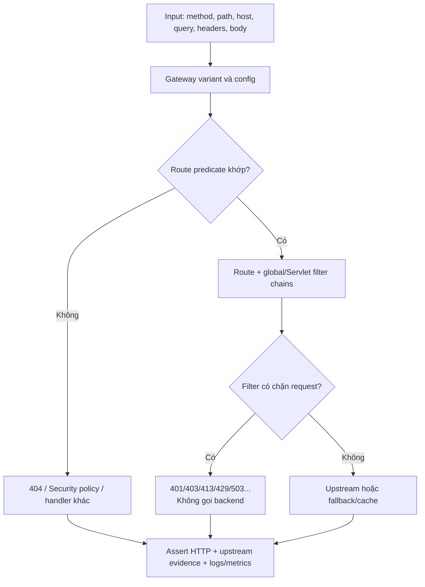
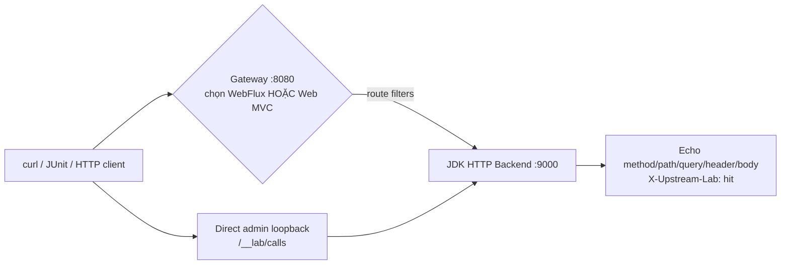
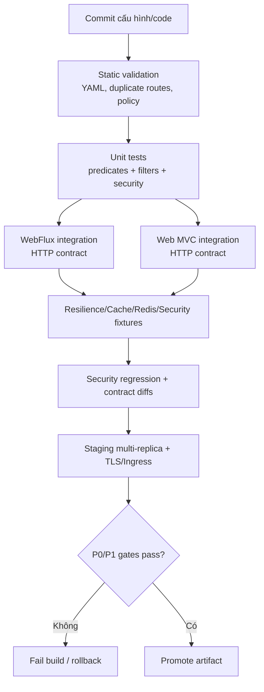

# Ma trận kiểm thử theo biến thể, tuyến và nhóm bộ lọc trong Spring Cloud Gateway

Spring Cloud Gateway là **API Gateway** của hệ sinh thái Spring, hỗ trợ định tuyến theo predicate, tổ chức filter chain, biến đổi path/header, tìm dịch vụ theo discovery và áp dụng chính sách xác thực, rate limiting, circuit breaker, retry, TLS, quan sát request. Một cấu hình chạy được với một URL **không có nghĩa** Gateway đang xử lý đúng mọi tuyến, mọi phương thức HTTP hay mọi nhóm filter trong các tình huống lỗi.

Ví dụ `GET /public/catalog/42` trả `200 OK` có thể che giấu hàng loạt vấn đề: route bắt nhầm backend, `StripPrefix` sai, cookie phiên bị chuyển xuống upstream, header do client giả mạo không được ghi đè, caching trả dữ liệu cũ, hoặc Gateway không giới hạn request khi backend lỗi. Những lỗi này thường chỉ lộ ra khi ta kiểm tra **đa chiều** thay vì chạy một vài “happy-path smoke tests”.

Bài thuộc chương **Kiểm thử** của module `SPRING_CLOUD_GATEWAY`. Trọng tâm là xây dựng **ma trận kiểm thử theo ba trục chính — biến thể Gateway, tuyến, nhóm bộ lọc** — kết hợp loại request, input boundary, security và failure mode; từ đó chuyển ma trận thành bộ kiểm thử tự động, có thể chạy khi thay đổi YAML, Java config, dependency hoặc triển khai nhiều replica.

> **Phiên bản và phạm vi:** Ví dụ tham chiếu **Spring Cloud Gateway Server 5.0.x** trên Spring Boot 4.x/Spring Framework 7 và hai biến thể **Server WebFlux** và **Server Web MVC**. Starter và namespace YAML là **khác nhau**; không chạy cả hai starter trong cùng một app lab. Tài liệu này phân biệt hành vi chuẩn theo HTTP contract với những hành vi phụ thuộc implementation/version hoặc các dependency tùy chọn. Đừng suy từ tên filter giống nhau rằng API, thứ tự, trạng thái mặc định, exception mapping và cơ chế cache của hai biến thể hoàn toàn giống nhau.

## 1. Kết quả học tập

Sau bài này, bạn có thể:

1. Xác định các trục của một test matrix: `variant × route × filter-group × input × outcome`.
2. Lập danh sách tuyến theo `id`, `Path`, `Method`, `Host/Header/Query`, `order`, upstream và chính sách auth.
3. Xây ma trận **khả năng tương thích** giữa Server WebFlux và Server Web MVC thay vì giả định mọi filter có cùng cơ chế.
4. Chọn các ca **match/no-match, overlap, boundary, invalid input, upstream failure** cho từng route predicate.
5. Kiểm tra nhóm filter request path/query/header, response status/header/body, Security, rate limit, retry, circuit breaker, cache, TLS và streaming.
6. Phân biệt **status do Gateway tạo**, **status từ backend**, **response từ fallback**, **response từ cache** và kết quả khi request không match route.
7. Dựng backend kiểm thử độc lập, chạy một trong hai biến thể Gateway với cùng contract và dùng `curl`/HTTP client để assert kết quả.
8. Tự động hóa smoke, integration, contract, concurrency, resilience và regression tests; quản lý dữ liệu, clock, retries và môi trường.
9. Đo route coverage, matrix coverage, kết quả quan sát upstream và rủi ro security/consistency mà không làm nổ số tổ hợp.

## 2. Vì sao chỉ “gửi request xem 200” là thiếu?

Một test đơn giản:

```bash
curl -i http://localhost:8080/public/catalog/42
```

Chỉ nhìn `HTTP/1.1 200 OK`, ta chưa biết:

- Request thực sự tới **catalog-service** hay một route catch-all?
- Path backend nhận là `/catalog/42`, `/public/catalog/42` hay `/42`?
- `Cookie`/`Authorization` có bị chuyển đến service không được phép?
- `SetRequestHeader` đã thay hết giá trị client gửi hay chỉ append?
- Response là mới từ backend, từ cache hoặc từ một fallback?
- Filter bảo vệ có chạy trên cùng route khi request đi qua instance khác?
- Một request `POST`/`OPTIONS` hoặc sai header có bị bắt nhầm?
- Khi backend trả 404 hoặc 503, Gateway giữ nguyên contract hay chuyển sang status khác?
- Khi route không match, có thật là backend **không** được gọi?

**Một test tốt cần có cả oracle và bằng chứng.** *Test oracle* là điều kiện xác định thế nào là đúng. Ngoài status, nên assert body/path, headers, upstream hit count, route ID/instance nếu có instrumentation, Security decision và việc **không có side effect** khi request bị từ chối.



Lưu ý sơ đồ mang tính khái niệm. Với **Server Web MVC**, Servlet `SecurityFilterChain` chạy trước khi MVC handler/route được chọn. Với **WebFlux**, Reactive `SecurityWebFilterChain` cũng có thể từ chối sớm. Thứ tự exact của từng `GlobalFilter`/`GatewayFilter`/MVC filter phải kiểm tra trên ứng dụng thật.

## 3. Thiết kế test matrix nhiều trục

### 3.1. Năm trục chính

| Trục | Giá trị ví dụ | Rủi ro nếu bỏ qua |
|---|---|---|
| **V — Variant** | `WEBFLUX`, `WEBMVC` | Một bản hoạt động nhưng bản khác dùng API/filter behavior khác |
| **R — Route** | `catalog-special`, `catalog-generic`, `public-catchall`, `guarded`, `ingest` | Route shadow, sai `order`, sai Method/Path |
| **F — Filter group** | Path/header/body/security/rate/retry/circuit/cache/TLS/streaming | Filter tương tác sai, status/mutation không đúng |
| **I — Input class** | Happy, no-match, boundary, malformed, unauthorized, concurrent | Chỉ test valid GET bỏ qua lỗi nghiêm trọng |
| **O — Observable outcome** | HTTP status, headers, body, backend QPS, timing, metrics | 200 giả, request bị forward dù đáng lẽ chặn |

Một dòng ma trận có thể mô tả bằng **test ID**:

```text
ID:   GW-WF-CAT-HEADER-NEG-004
V:    WEBFLUX
R:    catalog-generic
F:    REQUEST_HEADER
I:    Client gửi Cookie và X-Lab-Route giả mạo
O:    Upstream không thấy Cookie, X-Lab-Route là "generic"
```

Với MVC:

```text
ID:   GW-MVC-CAT-HEADER-NEG-004
V:    WEBMVC
R:    catalog-generic
F:    REQUEST_HEADER
I:    Tương đương input trên
O:    Tương đương HTTP contract, không bắt buộc cùng log/filter class
```

Hai case có thể **cùng business contract** nhưng cách setup unit test, filter chain, thread model và exceptions khác nhau.

### 3.2. Không nhân mọi trục thành toàn bộ tích Descartes

Nếu có 2 variants × 30 routes × 12 filter groups × 8 input classes × 5 outcomes thì có:

\[
2 \times 30 \times 12 \times 8 \times 5 = 28{,}800\ \text{tổ hợp}.
\]

Đa số là vô nghĩa: route `public-catalog` có thể không có JWT, websocket route không có HTTP response cache, và nhiều outcomes không thể xảy ra trong cùng một request.

Thay vì 28.800 tests, xây **coverage có rủi ro**:

1. Mỗi route có ít nhất **một positive match**, một **negative match** và một case **overlap/priority** khi có route cạnh tranh.
2. Mỗi filter group có **happy path + refusal/failure path + boundary** trên route áp dụng.
3. Những tương tác rủi ro cao có **pairwise/cross-filter tests**: auth × cache, retry × non-idempotent POST, rate limit × multi-replica, TLS × forwarded headers, body modify × content length, WebSocket × ingress timeouts.
4. Các trường hợp có **nguy cơ lộ dữ liệu/mất tiền/bypass auth** nhận nhiều coverage hơn các biến thể chỉ khác header trang trí.
5. Với tổ hợp chưa kiểm thử, ghi **rationale** trong test inventory; không tuyên bố “100%” chỉ vì tuyến nào cũng có một GET 200.

### 3.3. Một dòng test case phải đủ thông tin tái lập

Một test case có cấu trúc tối thiểu:

| Trường | Ví dụ |
|---|---|
| `id` | `GW-WF-RTE-007` |
| `variant/version` | `Server WebFlux 5.0.x` |
| `routeId / configRevision` | `catalog-special` / `rev42` |
| `environment` | Lab loopback, stub catalog backend |
| `preconditions` | Upstream healthy, cache reset, auth fixture A |
| `input` | `GET /public/catalog/special` + headers/Host |
| `expected route` | `catalog-special` thay vì `catalog-generic` |
| `expected upstream` | `/catalog/special`, header `X-Lab-Route=special` |
| `expected HTTP` | `200`, `X-Edge-Lab: matrix` |
| `negative assertion` | Không đi sang catch-all, không gửi Cookie |
| `evidence` | Backend log/counter, response, trace/route metric |
| `cleanup` | Reset stub/counter, xóa session/token test |
| `owner/priority` | Gateway team / P1 |

**Không phụ thuộc chỉ vào route ID trong HTTP response**. Gateway không mặc định gửi `routeId` ra client; nếu cần assert route, dùng upstream marker hoặc instrumentation an toàn trong test, và xem Actuator routes (được bảo vệ) để kiểm tra effective routing.

## 4. Ma trận theo **biến thể Server WebFlux vs Server Web MVC**

Trước tiên phân chia hai runtime khác nhau về mặt kiến trúc:

| Khía cạnh | Server WebFlux | Server Web MVC | Điều phải test |
|---|---|---|---|
| HTTP runtime | Reactor Netty + WebFlux reactive | Servlet container + Spring MVC/WebMvc.fn | Thread model, timeout, body/stream handling |
| Starter | `spring-cloud-starter-gateway-server-webflux` | `spring-cloud-starter-gateway-server-webmvc` | Không trộn classpath |
| YAML route prefix | `spring.cloud.gateway.server.webflux.routes` | `spring.cloud.gateway.server.webmvc.routes` | Effective config và route loading |
| Route model | `Route`, `RoutePredicateFactory`, `GatewayFilterFactory` | `RouterFunction`/`HandlerFunctions`, MVC predicates/filters | Matcher, route order, filter phase |
| Request/response filters | `GatewayFilter`/`GlobalFilter`, Reactor | `HandlerFilterFunction`/`BeforeFilterFunctions`/`AfterFilterFunctions`, Servlet | Header/path/body mutation và order |
| Spring Security | `ServerHttpSecurity` / `SecurityWebFilterChain` | `HttpSecurity` / `SecurityFilterChain` | 401/403/CSRF/session behavior |
| Session | Reactive `WebSession` (nếu dùng) | Servlet `HttpSession` (nếu dùng) | Cookie, store, invalidation, scale |
| HTTP client test | `WebTestClient` (WebFlux unit/integration/live) | `MockMvc` cho Servlet; live HTTP tests | Test harness đúng runtime |
| Stream/upgrade | Reactor Netty WebSocket / streaming | Servlet MVC/HTTP streaming + WebSocket proxy behavior theo MVC | Handshake/session/flush/idle |
| Resilience/cache | Filter và optional dependencies theo WebFlux release | MVC filter implementation và optional dependencies riêng | Không suy default/exception mapping giống nhau |
| Route config introspection | Gateway WebFlux Actuator APIs | Gateway MVC Actuator/diagnostics theo phiên bản | Quan sát route đã có hiệu lực |

Tài liệu Gateway 5.0.x là nguồn chuẩn cho mỗi variant. Hai cấu hình có cùng `Path=/public/**` và `StripPrefix=1` có thể mong đợi cùng **HTTP contract**; nhưng không đồng nghĩa mọi filter có cùng tên class, tham số, hỗ trợ body streaming hoặc fallback semantics.

### 4.1. Những nhóm test phải chạy trên **cả hai** variant

- Route matching (Path/Method/Header/Host/Query) và thứ tự ưu tiên.
- Path transformations (StripPrefix/SetPath/RewritePath) mà variant hỗ trợ.
- Header add/set/remove và response status/header.
- Status forwarding/404 gateway vs 404 backend; HTTP semantics.
- Request body forwarding và content-type/transfer encoding.
- Authentication/authorization **theo Security stack tương ứng**.
- Outbound TLS/hostname validation, ingress forwarded headers, request-size limit.
- Observability route ID, 5xx, timeout, latency nếu API instrumentation có sẵn.

### 4.2. Những test cần thiết kế **theo variant** thay vì sao chép

- Unit test `GatewayFilter`/`GlobalFilter` dùng `MockServerWebExchange`/Reactor `StepVerifier` chỉ cho WebFlux; không đem chúng vào MVC.
- Servlet `SecurityFilterChain`/`MockMvc`/`HttpSession` chỉ cho Server Web MVC; WebFlux cần reactive security fixtures.
- `ModifyRequestBody`/`ModifyResponseBody` trong WebFlux thường cấu hình Java DSL và yêu cầu codec/rewrite functions; không copy yaml body filter từ MVC một cách cơ học.
- `Retry` trong MVC 5.0 có thể dùng Spring Retry hoặc Spring Framework retry tùy classpath/property; WebFlux retry sử dụng reactor-specific semantics. Assertions nên đo **số attempts**, body preservation và idempotency.
- LocalResponseCache/Caffeine, shared Redis store, WebSocket handshake và custom filter availability phải xác minh **đúng phiên bản và đúng variant**.
- Khi sử dụng `forward:` để fallback tới local handler, kiểm tra lỗi response đã commit ở từng runtime; không giả định một fallback test của WebFlux đủ để chứng minh MVC.

### 4.3. Nhãn variant không phải nhãn môi trường

Một ma trận nên phân biệt:

```text
variant = WEBFLUX | WEBMVC
deployment = LOCAL | CI | STAGING | PRODUCTION
replicas = 1 | N
tlsMode = DIRECT | INGRESS_TERMINATION | MTLS_OUTBOUND
configVersion = git SHA / route revision
```

**Kết quả** `WEBFLUX / LOCAL / 1 replica` không có nghĩa `WEBFLUX / STAGING / 8 replicas` cũng đúng ở auth/caching/rate limiter. Những điều đó cần test đặc thù môi trường phân tán.

## 5. Ma trận theo **tuyến và route predicates**

Giả sử một Gateway công bố năm route:

| Route ID | Predicate | `order` | Destination và filters |
|---|---|---:|---|
| `catalog-special` | `GET /public/catalog/special` | -10 | Catalog, StripPrefix=1, header route=special |
| `catalog-generic` | `GET /public/catalog/**` | 0 | Catalog, StripPrefix=1, header route=generic |
| `public-catchall` | `GET /public/**` | 10 | Public service, StripPrefix=1, header route=catch |
| `guarded` | `GET /guarded/**` + `Header=X-Scenario,allow` | 0 | Guarded service, StripPrefix=1 |
| `ingest` | `POST /ingest/**` | 0 | Ingest service, StripPrefix=1, giữ body |

Thứ tự `order` nhỏ hơn được ưu tiên **khi có nhiều tuyến cùng match**, nhưng không làm một route với `Path`/`Method` sai trở thành match. Tùy biến thể, route matching cũng chịu ảnh hưởng của framework handler mappings, default route predicates và các Security filters trước đó.

### 5.1. Các ca positive/negative/overlap

| ID | Input | Expected route | Expected backend path | Expected outcome |
|---|---|---|---|---|
| R01 | `GET /public/catalog/special` | `catalog-special` | `/catalog/special` | `200`; marker `special` |
| R02 | `GET /public/catalog/42` | `catalog-generic` | `/catalog/42` | `200`; marker `generic` |
| R03 | `GET /public/other` | `public-catchall` | `/other` | `200`; marker `catch` |
| R04 | `GET /guarded/ping` + `X-Scenario: allow` | `guarded` | `/ping` | `200`; upstream called |
| R05 | `GET /guarded/ping` **không header** | Không | — | 404 nếu không có handler khác; upstream **không** called |
| R06 | `GET /guarded/ping` + `X-Scenario: deny` | Không | — | 404; upstream không called |
| R07 | `POST /ingest/items` + JSON | `ingest` | `/items` | Body/Content-Type preserved |
| R08 | `GET /ingest/items` | Không | — | 404; backend không called |
| R09 | `POST /public/catalog/42` | Không | — | 404 hoặc Security refusal theo config |
| R10 | `GET /missing` | Không | — | Gateway/handler 404, không có upstream marker |
| R11 | `GET /public/status/404` | `public-catchall` | `/status/404` | **Backend 404** có upstream marker |
| R12 | `GET /public/status/503` | `public-catchall` | `/status/503` | **Backend 503**, nếu không có fallback/retry |
| R13 | `GET /public/catalog/special?lang=vi` | `catalog-special` | `/catalog/special?lang=vi` | Query preserved theo contract |
| R14 | `HEAD /public/catalog/42` | Không nếu Method chỉ GET | — | Không giả định HEAD luôn route như GET |
| R15 | `GET /public/catalog/42` + `Cookie: secret=...` | `catalog-generic` | `/catalog/42` | Upstream không thấy Cookie nếu route remove |
| R16 | `GET /public/catalog/42` + `X-Lab-Route: forged` | `catalog-generic` | `/catalog/42` | Upstream thấy giá trị header do Gateway `Set` |
| R17 | `GET /PUBLIC/CATALOG/42` | Phụ thuộc Path case matching chính xác | — | Test theo variant/config, không tự suy |
| R18 | `GET /public/catalog/42/` | Có thể khác path không slash cuối | — | Assert contract/normalization |
| R19 | `GET /public/catalog/%2Fadmin` | Phụ thuộc container/firewall/decoding | — | Không được bypass auth, path policy |
| R20 | `GET /public//catalog/42` | Phụ thuộc normalization | — | Không được bypass constraints |
| R21 | `GET /public/catalog/42` với Host khác | Nếu không có Host predicate thì vẫn có thể match | `/catalog/42` | Phải test Host/tenant policy riêng |
| R22 | Gửi hai headers `X-Scenario` trái nhau | Phụ thuộc implementation/Header predicate | — | Không chấp nhận giá trị bất kỳ mà bỏ qua contract |
| R23 | Route `catalog-special` bị xóa/reorder | `catalog-generic` có thể nhận request | `/catalog/special` | Phát hiện route shadow/regression |
| R24 | Cập nhật route động, một instance chưa refresh | Revision cũ trên instance đó | Theo revision cũ | Phát hiện route drift giữa replicas |

**Không biến mọi 404 thành một assertion như nhau.** R10 là *Gateway route miss*; R11 là *upstream 404*. Trong lab, backend gắn `X-Upstream-Lab: hit` vào response, giúp xác định bên nào tạo status. Production có thể dùng tracing/route metrics thay marker; không dựa duy nhất vào status.

### 5.2. Predicate `Host` và `Header` cần test spoofing

Ví dụ khi tổ chức route theo tenant:

```yaml
predicates:
  - Host=tenant-a.example.test
  - Path=/api/**
```

Ma trận phải thử:

- Host đúng/sai; port và casing theo HTTP semantics.
- Request tới IP Gateway nhưng `Host` được client tự đặt.
- `X-Forwarded-Host` do ingress **đã sanitize** và header giả từ client Internet.
- Tenant A token truy cập Host tenant B: authentication thành công nhưng **authorization phải fail**.
- Header nhiều giá trị, trùng tên khác casing, whitespace/invalid bytes.

**Host/Path matching không phải ranh giới tenant security đầy đủ.** Quyền truy cập phải dựa trên danh tính đã được xác minh và policy ở Gateway/backend; một attacker có thể tự gửi Host header trong một HTTP client.

### 5.3. Test route precedence và namespace overlap

Lỗi phổ biến:

```yaml
# Minh họa RỦI RO chồng lấn, không copy vào production.
- id: overly-broad
  uri: http://backend-a
  order: -100
  predicates:
    - Path=/**
- id: payments
  uri: http://backend-payments
  order: 0
  predicates:
    - Path=/api/payments/**
```

Nếu route rộng có precedence cao hơn, có thể lấy traffic payments mà không chạy các filter/authorization mong đợi ở route hẹp. Những test bắt buộc:

1. Mọi route nhạy cảm có positive test khẳng định đúng upstream và đúng security policy.
2. Những route `/**`/`/api/**` có negative test chứng minh **không** shadow routes cụ thể.
3. Regression test chạy khi thay `order`, thêm wildcard/Host/Method hoặc bật discovery locator.
4. Kiểm tra route IDs không trùng giữa YAML, code Java, discovery và source động.

## 6. Ma trận theo **nhóm bộ lọc**

Đây là trục có nhiều khả năng sai lệch nhất, vì filter có tác động **trước và sau proxy**, có thể chặn request, chỉnh request, tiêu thụ body, trả fallback, cache response hoặc thay status/headers.

| Nhóm | Filter/khả năng điển hình | Positive | Negative/boundary | Bằng chứng quan trọng |
|---|---|---|---|---|
| **F01 Path** | `StripPrefix`, `SetPath`, `RewritePath` | Backend thấy path mới đúng | Regex unmatched, encoded slash, trailing slash | Upstream raw/decoded path; path traversal test |
| **F02 Query** | `AddRequestParameter`, `RewriteRequestParameter` | Query chứa đúng giá trị | Duplicate keys, encoding `%20`, unicode | Raw query và parsed params ở backend |
| **F03 Request header** | `Add/Set/RemoveRequestHeader` | Giá trị header đã được ghi/sửa/xóa | Client spoofing, multiple values, casing | Headers nhận tại backend |
| **F04 Response header** | `Add/Set/RemoveResponseHeader`, `DedupeResponseHeader` | Response header đúng | Duplicate CORS, Set-Cookie, newline | Headers tới client, không nhìn chỉ upstream |
| **F05 Redirect/status** | `RedirectTo`, `SetStatus`, `RewriteLocationResponseHeader` | 3xx và Location đúng contract | Relative vs absolute, host poisoning, status masking | HTTP status + Location + no backend call khi redirect |
| **F06 Request body** | `ModifyRequestBody` / request-size / body caching | Content-Type/JSON body đúng | Empty/invalid/too large/streaming | Byte payload, status 413, backend count |
| **F07 Response body** | `ModifyResponseBody`, header length adjustment | Output body thay đổi hợp lệ | Binary/gzip, empty body, chunked | Actual bytes + Content-Length/Encoding |
| **F08 Authentication** | Spring Security `SecurityWebFilterChain`/`SecurityFilterChain`, TokenRelay | Authorized principal đến đúng route | Missing/expired/bad token; wrong tenant | 401/403, upstream not called, identity boundaries |
| **F09 Rate limit** | `RequestRateLimiter`/provider limiter | Cho request khi quota còn | Vượt quota, unknown key, concurrent bursts | 429/configured status, no backend call, quota state |
| **F10 Circuit breaker** | `CircuitBreaker`, `FallbackHeaders` | Healthy upstream trả trực tiếp | Timeout/5xx/error, OPEN/HALF_OPEN, fallback failure | Backend attempts, fallback marker, breaker metrics |
| **F11 Retry** | `Retry` | Transient error rồi thành công | Non-idempotent POST, retry storm, body replay | **Đếm attempts**, side effects, latency, response |
| **F12 Cache** | `LocalResponseCache`, edge/shared cache | Repeated safe GET can hit | `no-store`/`private`, invalidation, variant, multi-replica | Upstream call count, freshness, cache hit/miss |
| **F13 Service discovery** | `lb://...`, service instance resolution | Chọn healthy instance | Empty registry, stale instance, scheme/port mismatch | Instance ID + backend call + 503/other error |
| **F14 TLS** | HTTPS outbound, mTLS, forwarded headers | Trusted CA/SAN accepted | Untrusted/expired cert, wrong hostname | Handshake/HTTP failure **without bypassing TLS verify** |
| **F15 WebSocket** | `ws://`/`wss://` WebSocket proxy | HTTP 101 + messages round-trip | Origin, 401/403, close, ping/pong, long-lived | WebSocket client session, close codes, backend messages |
| **F16 Streaming** | SSE/streaming, HTTP chunking | Incremental data delivered | Buffering, timeout, cancellation | First-byte/first-event latency, resource cleanup |
| **F17 Observability** | Global filters, metrics, tracing, request ID | Route/trace recorded | Errors, fallback, cache hit, body redaction | Logs/metrics/traces without secrets |
| **F18 Global filter order** | WebFlux `GlobalFilter`/`Ordered`, MVC servlet/functional filters | Pre- and post-order correct | Short-circuit, exception, route filter interaction | Execution trace/mocks in correct stack |

**Không phải tên nào trong bảng cũng có một factory y hệt ở cả hai variants.** Hãy coi đây là **danh mục hợp đồng cần thử**, sau đó đối chiếu tài liệu filter của từng Server WebFlux/MVC release và bỏ dòng `N/A` có lý do. Đặc biệt body transform, retry, rate limiter, local cache, WebSocket, circuit breaker và `TokenRelay` có cơ chế riêng cần đọc đúng docs.

### 6.1. Nhóm biến đổi path/query/header

Một bài test `RewritePath` cần có đủ:

- Regex match đúng, path backend và query sau rewrite.
- Regex không match và cách filter xử lý đúng contract.
- Capture group có tên, YAML escaping của dấu `$`/`\\` và Unicode.
- Encoded path `%2F`/`%2E`, duplicate slash, `..`; không làm bypass Security.
- Filter order khi kết hợp `StripPrefix`, `SetPath`, `RewritePath` hoặc `lb://`.
- Client header `X-User-Id` giả; filter set/remove có ghi đè như dự kiến không.
- `Host`/`Forwarded` và CORS response headers có được xử lý bởi lớp trusted proxies không.

**Phân biệt `AddRequestHeader` và `SetRequestHeader`:** Add có thể giữ cả giá trị client gửi; Set thay các giá trị header cùng tên. Với header bảo mật/identity do Gateway kiểm soát, cần test **client spoofing** và sử dụng cơ chế đáng tin, không chỉ append một giá trị mới.

### 6.2. Nhóm body và request-size

Trong JSON API:

```http
POST /ingest/items HTTP/1.1
Content-Type: application/json

{"sku":"A-42","count":2}
```

Các phép kiểm tra khác nhau:

| Test | Điều cần assert |
|---|---|
| Body bình thường | JSON đúng byte/structure tại backend |
| Body rỗng | Route/filter có contract rõ cho no body |
| JSON malformed | 4xx phù hợp, backend không xử lý như JSON hợp lệ |
| Body vượt `RequestSize` | Status `413 Payload Too Large`, backend **không** nhận body |
| Chunked transfer | Không cần `Content-Length` từ client; truyền nguyên payload hoặc reject theo policy |
| `Content-Length` sai/xung đột | Server/ingress chống request smuggling, không parse nhập nhằng |
| Body chứa Unicode | UTF-8 và content type không bị sai |
| Body nén | `Content-Encoding` và body bytes nhất quán |
| Response streaming | Không aggregate vô hạn trong filter body rewrite |

Đừng coi status `413` luôn đến từ Gateway: ingress có thể từ chối trước, Servlet container có upload/request size limit riêng, và Gateway filter chỉ chạy khi route match. Test nên gắn marker/metrics để biết **layer đã từ chối**.

### 6.3. Rate limiting phải test cả **thời gian và khóa**

Ví dụ WebFlux `RequestRateLimiter` dùng Redis/token bucket. Ma trận:

- Một identity hợp lệ dưới quota, request được forward.
- Nhiều request cùng key vượt quota, trả `429` mặc định (trừ khi đổi config).
- Hai user khác key: quota độc lập theo resolver contract.
- Key rỗng/chưa xác thực: **không tự cho qua** nếu policy deny-empty.
- Hai Gateway replicas cùng dùng Redis: quota vẫn có hiệu lực **toàn cụm** theo key, không nhân đôi mỗi pod.
- Redis unavailable: có behavior/failure policy được ghi rõ, không fail-open quyền/quota nhạy cảm ngoài chủ đích.
- Với WebSocket, limiter ở **handshake** không tự giới hạn số frames/messages.
- Độ trễ/jitter của refill interval: dùng test clock/awaiting/tolerance, không assert chính xác millisecond từ `sleep`.

Không cố phát một loạt request thật lên production để đo 429; thực hành trên Redis/test provider hoặc môi trường cô lập có quota riêng.

### 6.4. Circuit breaker: kiểm tra **fallback không che lỗi nghiệp vụ**

Các trường hợp:

| Backend outcome | Câu hỏi |
|---|---|
| 200 bình thường | Breaker có tránh fallback và trả đúng body? |
| 404 entity không tồn tại | Có bị sai config biến thành “dịch vụ lỗi” không? |
| 401/403 unauthorized/forbidden | Fallback có **che lỗi bảo mật** không? |
| 409/422 business conflict | Không trả 200 giả hoặc dữ liệu cached của người khác |
| 503/timeout/network failure | Có fallback/error hợp lệ, marker và metrics? |
| OPEN state | Có short circuit không, backend không bị gọi? |
| HALF_OPEN | Permit/probe và recovery theo policy |
| Fallback lại lỗi | Không recursion vô hạn hoặc vòng `forward:` |
| Client disconnect/response committed | Không retry/fallback làm phát một HTTP response thứ hai |

Một bài test chỉ assert “trả 200 khi backend 500” **có thể là test sai** nếu fallback đáng lẽ phải trả 503 có kiểm soát. Dùng failure contract theo nghiệp vụ, không mặc định fallback luôn success.

### 6.5. Retry phải đo side effects và số lần gọi

Với WebFlux/MVC, `Retry` có thể có implementation và tham số khác nhau; đánh giá policy đang chạy:

- GET idempotent: upstream lần 1 trả 503, lần 2 trả 200 → response cuối đúng và **upstream attempts = 2** nếu config cho retry một lần.
- GET 404: thường không retry nếu policy chỉ nhắm 5xx; kiểm chứng thực tế.
- POST tạo đơn/charge: **không retry mù quáng** khi không có idempotency key và deduplication.
- POST có body: xác minh body replay/caching behavior và áp lực RAM khi bật.
- Retry + CircuitBreaker: đo thứ tự filters, metric counting và giới hạn tổng số upstream attempts.
- Timeout sau khi upstream **đã commit side effect** nhưng response thất lạc: retry có thể tạo hai giao dịch nếu backend không idempotent.

**Đừng chỉ assert final status `200`:** nó che giấu retry 5 lần, tăng chi phí, duplicate writes hoặc latency vượt SLO. Stub backend phải ghi rõ **attempt count** và request ID.

### 6.6. Cache phải test freshness và cách ly dữ liệu

Một local cache có thể hit hoàn hảo trên replica A nhưng miss hoặc lưu revision khác trên replica B. Ma trận cho `LocalResponseCache`:

| Điều kiện | Điều cần kiểm tra |
|---|---|
| GET public, 200 cacheable | Lần sau có thể hit; backend call count giảm |
| `Cache-Control: private, no-store` | Không lưu response nhạy cảm |
| POST/PUT/PATCH | Không tự cache như GET theo filter WebFlux này |
| URL/query/Host/`Vary` khác | Không trả nhầm response variant |
| Authorization/Cookie/tenant khác | Không lộ data cross-user/cross-tenant |
| TTL hết hạn | Entry refresh theo policy và upstream revision mới |
| Cache eviction | Không crash/OOM; miss/evictions đo được |
| Cache hit + backend unavailable | Có thể trả dữ liệu cũ theo policy cache; không tự chứng minh backend khỏe |
| Gateway scale 2 → 5 replicas | Cache Caffeine **mỗi JVM riêng**, cold misses |
| Request có `no-cache` | Kiểm chứng semantics của **đúng release**, không coi là distributed purge |

Test caching ở Gateway **và** tại CDN/browser nếu có; một header `Cache-Control` có thể bị xử lý ở nhiều layer. Với auth/private routes, ưu tiên **không cache** nếu không có thiết kế key và phân vùng quyền đã được chứng minh.

### 6.7. Security là nhóm test **ưu tiên cao nhất**

| Test | Expectation |
|---|---|
| Thiếu credential | 401 hoặc 302 login theo security scheme, backend không called |
| Token hết hạn/sai chữ ký/sai issuer/audience | Bị từ chối trước upstream |
| User role đúng nhưng không sở hữu resource | Backend/domain authorization vẫn từ chối |
| Client giả `X-User-Id`/`X-Tenant` | Không được tin nếu chưa xác minh/ghi lại |
| Tenant A gọi Host/path tenant B | Bị deny theo identity/policy |
| Servlet form POST thiếu CSRF | 403; không bypass bằng Gateway route |
| WebFlux JWT chain vs MVC Servlet chain | Dùng đúng framework API; cùng policy nhưng implementation khác |
| Cached response của user A tới user B | **Không bao giờ** lộ private data |
| Response `Set-Cookie` từ upstream | Cookie boundary và SameSite/Domain/Path đúng |
| TLS outbound host untrusted | Fail handshake, không bật trust-all |
| Actuator/control plane ở public | Không thể CRUD/refresh/cấu hình Gateway khi chưa có quyền |

**Không dùng password/token/cookie thật trong test logs, HAR files, failed assertions hoặc CI artifacts.** Fixtures phải giả lập, ngắn hạn và có secret masking. Khi kiểm tra HTTP headers, assert sự hiện diện/vắng mặt hoặc giá trị đã redact; đừng in raw `Authorization`.

### 6.8. WebSocket/SSE: test sau handshake

HTTP `101 Switching Protocols` chỉ chứng minh WebSocket handshake. Cần tiếp tục gửi/nhận frames, kiểm tra close code, heartbeat, Origin, per-message authorization, size/quota và reconnect qua replica. Với SSE, `200 text/event-stream` cần assert **các event đến dần**, không phải đợi stream kết thúc mới đọc body. Các bài test phải giải phóng session/connection khi kết thúc, tránh CI treo.

## 7. Ma trận **tương tác giữa các nhóm filter**

Không đủ để mỗi filter pass khi chạy một mình. Một số lỗi nghiêm trọng chỉ xuất hiện khi **hai hoặc ba filter cùng áp dụng**.

| Tổ hợp | Tình huống | Assertion quan trọng |
|---|---|---|
| Security × RewritePath | Client path public bị rewrite thành admin path | Security không bị bypass do mismatch original vs rewritten path |
| Security × Cache | Hai JWT/cookie khác nhau gọi cùng URL | Không trả dữ liệu riêng tư của user A cho B |
| Retry × CircuitBreaker | Upstream trả 503 rồi 200 | Attempts/CB metrics và filter order đúng; không retry quá quota |
| Retry × Request body | POST có JSON body và retry | Không mất/trùng body; idempotency key/dedup hoặc không retry |
| Retry × RateLimiter | Một request client tạo nhiều backend attempts | Tính quota client và backend budget đúng contract |
| Header rewrite × TokenRelay | Client tự gửi Authorization/identity header | Token relay/auth policy không bị override sai |
| RewritePath × LoadBalancer | `lb://` sau path rewrite | Backend nhận đúng URI/path, port/scheme |
| Response body × Content-Length | Body dài ngắn thay đổi | `Content-Length`/encoding/chunked hợp lệ, không cắt payload |
| CORS × DedupeResponseHeader | Gateway và backend cùng đặt Allow-Origin | Header chuẩn, không nhân đôi bất hợp lệ |
| RateLimiter × Multi-replica | Burst từ cùng user đi hai pods | Quota theo key vẫn áp dụng toàn cụm |
| CircuitBreaker × Fallback | Fallback gọi lại route gốc | Không đệ quy hoặc trả dữ liệu sai quyền |
| Cache × Rolling restart | Pod mới cache lạnh, pod cũ warm | SLO/staleness và backend QPS còn trong budget |
| TLS × Forwarded headers | Ingress terminate TLS, client giả forwarded host | Không open redirect hoặc cấp cookie insecure |
| WebSocket × Security/Origin | Browser cross-origin có session cookie | Origin allowlist, auth handshake, per-message auth |
| Streaming × Body filter | Response SSE vô hạn | Không buffer toàn stream, first event đúng deadline |
| Response header × 304/204 | Response không có body | Không tạo body trái semantics/headers không hợp lệ |

### 7.1. Pairwise testing dùng để làm gì?

Pairwise giúp chọn một tập con sao cho **mỗi cặp giá trị của các trục** có xuất hiện ít nhất một lần, thay vì toàn bộ tích Descartes. Nó hữu ích với các biến thể host, method, header values, TLS modes và filter combinations.

**Nhưng pairwise không bảo đảm bắt tất cả bugs**. Một lỗi “CSRF disable chỉ khi route rewrite + cache hit + tenant B” là tương tác ba chiều. Với security/payment/authorization, hãy thêm các **targeted triples** hoặc test cụ thể theo threat model.

### 7.2. Coverage theo độ rủi ro

Một cách chia mức ưu tiên:

| P0 | P1 | P2 |
|---|---|---|
| Auth bypass, cross-tenant leak, payment duplicate, TLS trust-all | Route priority, cache staleness, retry storm, circuit breaker fallback | Header trang trí, metrics labels thứ yếu |
| Gateway admin exposed, SSRF, request smuggling | Redis outage, no-instance, body size/encoding | Human-readable error formatting |
| Security regression khi variant/version đổi | Multi-replica consistency, rolling update | Cosmetic ordering của non-critical headers |

Không dùng P0/P1/P2 như một “chuẩn của Spring”; đây là **cách đội dự án tự ưu tiên**. Mức độ thực tế phụ thuộc dữ liệu, threat model, SLA/SLO và route contract.

## 8. Lab: cùng một HTTP contract, chạy hai biến thể Gateway riêng

Lab cố tình dùng **một backend JDK độc lập** và **hai ứng dụng Gateway độc lập**. Mỗi lần chỉ cần chạy **một Gateway** ở port `8080`:



**Không chạy cả hai starter trong cùng một JVM lab.** Khi muốn so sánh, dừng Gateway WebFlux rồi bật Gateway MVC hoặc dùng hai project/ports khác nhau. Tránh trộn Security stack, starters hay route prefixes trong một classpath để kết quả test không nhập nhằng.

### 8.1. Dựng backend ghi nhận đường đi request

Tạo file `MatrixUpstream.java` trong thư mục thực hành:

```java
import com.sun.net.httpserver.HttpExchange;
import com.sun.net.httpserver.HttpServer;
import java.net.InetSocketAddress;
import java.nio.charset.StandardCharsets;
import java.util.concurrent.Executors;
import java.util.concurrent.atomic.AtomicInteger;

public class MatrixUpstream {
    private static final AtomicInteger CALLS = new AtomicInteger();

    public static void main(String[] args) throws Exception {
        HttpServer server = HttpServer.create(
                new InetSocketAddress("127.0.0.1", 9000), 0);

        server.createContext("/", MatrixUpstream::handle);
        server.setExecutor(Executors.newFixedThreadPool(4));
        server.start();

        System.out.println("Matrix backend on http://127.0.0.1:9000");
        System.out.println("Diagnostics: GET /__lab/calls, POST /__lab/reset");
    }

    private static void handle(HttpExchange exchange) throws java.io.IOException {
        try (exchange) {
            String method = exchange.getRequestMethod();
            String path = exchange.getRequestURI().getRawPath();

            // Endpoints quản trị CHỈ CHO LAB TRÊN LOOPBACK.
            if ("/__lab/calls".equals(path) && "GET".equals(method)) {
                respond(exchange, 200, "calls=" + CALLS.get(), false);
                return;
            }
            if ("/__lab/reset".equals(path) && "POST".equals(method)) {
                CALLS.set(0);
                respond(exchange, 200, "reset=ok", false);
                return;
            }

            int call = CALLS.incrementAndGet();
            String rawQuery = exchange.getRequestURI().getRawQuery();
            String route = exchange.getRequestHeaders()
                    .getFirst("X-Lab-Route");
            String cookie = exchange.getRequestHeaders()
                    .getFirst("Cookie");
            String body = new String(
                    exchange.getRequestBody().readAllBytes(),
                    StandardCharsets.UTF_8);

            String result = "call=" + call
                    + "\nmethod=" + method
                    + "\npath=" + path
                    + "\nquery=" + (rawQuery == null ? "" : rawQuery)
                    + "\nroute=" + (route == null ? "" : route)
                    + "\ncookiePresent=" + (cookie != null)
                    + "\nbody=" + body + "\n";

            int status = switch (path) {
                case "/status/404" -> 404;
                case "/status/503" -> 503;
                default -> 200;
            };

            respond(exchange, status, result, true);
            System.out.println(method + " " + path
                    + " status=" + status + " call=" + call);
        }
    }

    private static void respond(HttpExchange exchange, int status,
                                String body, boolean markUpstream)
            throws java.io.IOException {
        byte[] bytes = body.getBytes(StandardCharsets.UTF_8);
        exchange.getResponseHeaders().set("Content-Type",
                "text/plain; charset=utf-8");
        exchange.getResponseHeaders().set("Cache-Control", "no-store");

        if (markUpstream) {
            exchange.getResponseHeaders().set("X-Upstream-Lab", "hit");
        }
        exchange.sendResponseHeaders(status, bytes.length);
        try (var output = exchange.getResponseBody()) {
            output.write(bytes);
        }
    }
}
```

Chạy backend bằng JDK 21+ (Java 17 cũng có `switch` expression và `readAllBytes()`; Spring Boot 4 tương thích Java 17+):

```bash
java --add-modules jdk.httpserver MatrixUpstream.java
```

Backend chỉ bind `127.0.0.1`. `/__lab/calls` và `/__lab/reset` **không có xác thực** và chỉ để kiểm thử; **không triển khai chúng lên production**, không mở port ra Internet. Trong production backend cần auth, body size limits, validation, observability và resource management khác.

Ưu điểm của backend này: ta có thể phân biệt một response **đi qua upstream** (có `X-Upstream-Lab: hit`) với một response Gateway trả trực tiếp vì route miss/short-circuit. Counter đếm số request thật đến backend, không đoán bằng latency.

### 8.2. Tạo dự án Gateway WebFlux

Tạo project Spring Boot 4.x cùng Spring Cloud BOM 2025.1.x tương thích. Dependency chính:

```xml
<dependency>
    <groupId>org.springframework.cloud</groupId>
    <artifactId>spring-cloud-starter-gateway-server-webflux</artifactId>
</dependency>
```

Class khởi động:

```java
import org.springframework.boot.SpringApplication;
import org.springframework.boot.autoconfigure.SpringBootApplication;

@SpringBootApplication
public class MatrixGatewayWebFluxApp {
    public static void main(String[] args) {
        SpringApplication.run(MatrixGatewayWebFluxApp.class, args);
    }
}
```

`src/main/resources/application.yml`:

```yaml
server:
  address: 127.0.0.1
  port: 8080

spring:
  application:
    name: gateway-webflux-matrix-lab

  cloud:
    gateway:
      server:
        webflux:
          routes:
            - id: catalog-special
              order: -10
              uri: http://127.0.0.1:9000
              predicates:
                - Path=/public/catalog/special
                - Method=GET
              filters:
                - StripPrefix=1
                - SetRequestHeader=X-Lab-Route,special
                - AddResponseHeader=X-Edge-Lab,matrix

            - id: catalog-generic
              order: 0
              uri: http://127.0.0.1:9000
              predicates:
                - Path=/public/catalog/**
                - Method=GET
              filters:
                - StripPrefix=1
                - SetRequestHeader=X-Lab-Route,generic
                - RemoveRequestHeader=Cookie
                - AddResponseHeader=X-Edge-Lab,matrix

            - id: public-catchall
              order: 10
              uri: http://127.0.0.1:9000
              predicates:
                - Path=/public/**
                - Method=GET
              filters:
                - StripPrefix=1
                - SetRequestHeader=X-Lab-Route,catch

            - id: guarded
              order: 0
              uri: http://127.0.0.1:9000
              predicates:
                - Path=/guarded/**
                - Method=GET
                - Header=X-Scenario,allow
              filters:
                - StripPrefix=1
                - SetRequestHeader=X-Lab-Route,guarded

            - id: ingest
              order: 0
              uri: http://127.0.0.1:9000
              predicates:
                - Path=/ingest/**
                - Method=POST
              filters:
                - StripPrefix=1
                - SetRequestHeader=X-Lab-Route,ingest
```

Các tuyến cho lab **không có Security và chạy trên loopback**. `/public/catalog/special` có thể match cả ba `Path` predicates, nhưng nhờ `order=-10` route `catalog-special` được chọn trước. `/public/catalog/42` match generic và catch-all, generic được ưu tiên. `Header=X-Scenario,allow` là predicate riêng của route `guarded`; không có header thì không proxy.

### 8.3. Tạo dự án Gateway Server Web MVC riêng

Dùng một project Spring Boot **khác**, có:

```xml
<dependency>
    <groupId>org.springframework.cloud</groupId>
    <artifactId>spring-cloud-starter-gateway-server-webmvc</artifactId>
</dependency>
```

Class khởi động:

```java
import org.springframework.boot.SpringApplication;
import org.springframework.boot.autoconfigure.SpringBootApplication;

@SpringBootApplication
public class MatrixGatewayMvcApp {
    public static void main(String[] args) {
        SpringApplication.run(MatrixGatewayMvcApp.class, args);
    }
}
```

`application.yml` MVC chỉ khác **prefix** còn giữ cùng HTTP contract và cùng route/filter configuration:

```yaml
server:
  address: 127.0.0.1
  port: 8080

spring:
  application:
    name: gateway-mvc-matrix-lab

  cloud:
    gateway:
      server:
        webmvc:
          routes:
            - id: catalog-special
              order: -10
              uri: http://127.0.0.1:9000
              predicates:
                - Path=/public/catalog/special
                - Method=GET
              filters:
                - StripPrefix=1
                - SetRequestHeader=X-Lab-Route,special
                - AddResponseHeader=X-Edge-Lab,matrix

            - id: catalog-generic
              order: 0
              uri: http://127.0.0.1:9000
              predicates:
                - Path=/public/catalog/**
                - Method=GET
              filters:
                - StripPrefix=1
                - SetRequestHeader=X-Lab-Route,generic
                - RemoveRequestHeader=Cookie
                - AddResponseHeader=X-Edge-Lab,matrix

            - id: public-catchall
              order: 10
              uri: http://127.0.0.1:9000
              predicates:
                - Path=/public/**
                - Method=GET
              filters:
                - StripPrefix=1
                - SetRequestHeader=X-Lab-Route,catch

            - id: guarded
              order: 0
              uri: http://127.0.0.1:9000
              predicates:
                - Path=/guarded/**
                - Method=GET
                - Header=X-Scenario,allow
              filters:
                - StripPrefix=1
                - SetRequestHeader=X-Lab-Route,guarded

            - id: ingest
              order: 0
              uri: http://127.0.0.1:9000
              predicates:
                - Path=/ingest/**
                - Method=POST
              filters:
                - StripPrefix=1
                - SetRequestHeader=X-Lab-Route,ingest
```

Ở MVC, routes được biểu diễn qua Spring WebMvc.fn `RouterFunction`/`HandlerFunction` và MVC filter functions, **không** bằng reactive `GatewayFilter` của WebFlux. Hai file YAML này dùng các filter với **cú pháp chung đã được cả hai biến thể tài liệu hóa**. Với những filter chuyên sâu khác, cần tạo fixture/config riêng cho từng variant.

**Lưu ý:** Đây là các dependency **trọng tâm**, không phải `pom.xml` hoàn chỉnh. Mỗi project cần parent/BOM/plugin phù hợp với Java/Boot/Cloud. Không khai báo cả WebMVC/WebFlux starters trong một project để “so sánh”, vì Boot có thể chọn application type và infrastructure khác dự tính.

### 8.4. Khởi động lab theo từng biến thể

Giữ terminal backend `:9000` đang chạy. Mở terminal khác trong dự án Gateway muốn kiểm tra:

```bash
# Trên Linux/macOS
./mvnw spring-boot:run

# Trên Windows PowerShell
.\mvnw.cmd spring-boot:run
```

Lần đầu chạy **WebFlux** tại `:8080`, thực hiện ma trận. Sau đó dừng WebFlux, kiểm tra cổng `8080` đã giải phóng, khởi động **MVC** và thực hiện lại ma trận. Nếu cần chạy cùng lúc thì cấu hình **hai port khác nhau** và điều chỉnh biến `GATEWAY_BASE_URL` của bộ test; backend `9000` có thể dùng chung, nhưng khi so sánh backend counter phải reset/partition test để tránh nhiễu.

### 8.5. Chạy ma trận smoke bằng `curl`

**Reset counter (loopback backend):**

```bash
curl -i -X POST http://127.0.0.1:9000/__lab/reset
curl -s http://127.0.0.1:9000/__lab/calls
```

Kỳ vọng: `calls=0`.

**Ca R01 — route cụ thể được ưu tiên:**

```bash
curl -i http://127.0.0.1:8080/public/catalog/special
```

Kỳ vọng những tín hiệu chính:

```http
HTTP/1.1 200 OK
X-Upstream-Lab: hit
X-Edge-Lab: matrix
Content-Type: text/plain; charset=utf-8

call=1
method=GET
path=/catalog/special
query=
route=special
cookiePresent=false
body=
```

Headers có thể khác casing/order theo runtime và số `call` thay đổi nếu test khác chạy trước; **assert giá trị contract**, không assert header ordering. `route=special` là dữ liệu backend đọc từ header do Gateway set; nó cho phép xác minh route đã chọn.

**Ca R02/R15/R16 — generic route, cookie và header spoofing:**

```bash
curl -i \
  -H "Cookie: SESSION=synthetic-test-only" \
  -H "X-Lab-Route: forged" \
  "http://127.0.0.1:8080/public/catalog/42?lang=vi"
```

Expected:

```text
method=GET
path=/catalog/42
query=lang=vi
route=generic
cookiePresent=false
```

`route=generic` là bằng chứng `SetRequestHeader` ghi đè giá trị client `forged`. `cookiePresent=false` chứng minh `RemoveRequestHeader=Cookie` đã chạy trên route **catalog-generic**. Không dùng cookie phiên thật để kiểm thử header forwarding.

**Ca R03 — catch-all:**

```bash
curl -i http://127.0.0.1:8080/public/other
```

Expected `route=catch` và `path=/other`, chứ không phải `route=generic`.

**Ca R04/R05 — Header predicate:**

```bash
curl -i \
  -H "X-Scenario: allow" \
  http://127.0.0.1:8080/guarded/ping

curl -i http://127.0.0.1:8080/guarded/ping
```

Request thứ nhất có thể trả 200, backend thấy `path=/ping`. Request thứ hai không match bất kỳ route nào trong lab và thường trả 404; cần xác nhận **counter upstream không tăng** ở request thứ hai.

**Ca R07 — POST body preservation:**

```bash
curl -i -X POST \
  -H "Content-Type: application/json" \
  --data '{"sku":"A-42","count":2}' \
  http://127.0.0.1:8080/ingest/items
```

Expected: `route=ingest`, `method=POST`, `path=/items`, và dòng `body={"sku":"A-42","count":2}`. Không có body-modification filter ở lab này, nên **payload phải được forward**, không tự rewrite JSON.

**Ca R10 vs R11 — phân biệt hai nguồn 404:**

```bash
curl -i http://127.0.0.1:8080/missing
curl -i http://127.0.0.1:8080/public/status/404
```

Expected:

- `/missing` không match route, response 404 của Gateway/handler và **không có** `X-Upstream-Lab: hit`.
- `/public/status/404` match catch-all, backend cố tình trả 404 **có** `X-Upstream-Lab: hit` và tăng counter.

Đây là một trong những test quan trọng nhất để tránh chẩn đoán nhầm “Gateway không tìm thấy route” với “backend trả entity not found”.

**Ca R12 — backend 503 không có retry/fallback:**

```bash
curl -i http://127.0.0.1:8080/public/status/503
```

Nếu chưa bật retry/circuit breaker/fallback, body từ upstream và `X-Upstream-Lab: hit` giúp nhận biết 503 đến từ backend. Khi thêm các filter resilience, **expected outcome phải cập nhật theo chính sách**; không giữ nguyên test cũ rồi mặc định filter mới làm hỏng hệ thống.

### 8.6. Test bảo đảm “không forward” phải kiểm tra counter

Ví dụ:

```bash
# Snapshot trước khi test âm tính
curl -s http://127.0.0.1:9000/__lab/calls

# Không có route GET /ingest/** trong YAML
curl -s -o /dev/null -w "%{http_code}\n" \
  http://127.0.0.1:8080/ingest/items

# Snapshot sau test
curl -s http://127.0.0.1:9000/__lab/calls
```

Counter trước/sau phải bằng nhau nếu **không có request nào khác** đang dùng backend. Trong CI chạy song song, counter toàn cục dễ bị nhiễu: dùng per-test upstream server, test ID trong header và request journal của mock backend, hoặc cách ly tests.

**Không dùng status 404 làm bằng chứng duy nhất về việc backend không được gọi**, vì backend cũng có thể trả 404. Khi áp dụng Security/rate limiter, một 403/429 cũng có thể đến từ upstream; phải dùng request journal hoặc instrumentation để chứng minh short-circuit xảy ra tại Gateway.

### 8.7. Khác biệt nhỏ vẫn phải được định nghĩa theo contract

Các biến thể WebFlux/MVC có thể khác ở:

- Header casing/order hoặc những header hop-by-hop được container/proxy loại.
- Thông điệp exception/`error` body.
- Hành vi `HEAD`/`OPTIONS` khi có framework handler khác.
- Connection reuse, transfer encoding, chunked streaming.
- Timing chính xác của timeout/retry và format logs.

Khi yêu cầu business chỉ là “GET `/public/catalog/42` tới catalog, không forward Cookie”, **không** assert một dạng whitespace/header ordering chỉ xuất hiện tình cờ trên một runtime. Nhưng khi hợp đồng yêu cầu header cụ thể hoặc status cụ thể, hãy test đúng giá trị và phát hiện sai khác giữa hai biến thể.

## 9. Các tầng kiểm thử: nhanh đến gần production

Một bài test Gateway không nhất thiết phải chạy Docker/Kubernetes, nhưng cũng không thể chỉ mock một filter rồi tuyên bố định tuyến end-to-end đã đúng.

| Tầng | Đối tượng | Công cụ gợi ý | Ưu điểm | Giới hạn |
|---|---|---|---|---|
| **L0 Static checks** | YAML/Java config, route IDs, duplicate/overlap | Schema/Config validation, lint/test cấu hình | Nhanh, chạy mỗi commit | Không chứng minh HTTP proxy thật |
| **L1 Unit** | Predicate/filter/factory riêng | JUnit 5, Mockito, Reactor Test (WebFlux), MockMvc/Spring MVC mocks | Dễ phủ branches và error handling | Không thấy Netty/Servlet/real socket |
| **L2 Slice/component** | Một route + filter chain + upstream stub | WebTestClient, MockMvc/WebMvc.fn context, WireMock/mock server | Có thể kiểm tra chaining trong app context | Có thể thiếu TLS/ingress/security hoàn chỉnh |
| **L3 Integration live HTTP** | Gateway chạy thật + upstream stub | JUnit Java HttpClient/RestClient/WebTestClient, Testcontainers | Kiểm tra proxy/headers/body/status thật | Chậm hơn, cần lifecycle test fixtures |
| **L4 System/contract** | Gateway + auth server/Redis/discovery/services | Testcontainers + isolated environment | Auth/rate limit/cb/cache/discovery gần thực tế | Tốn hạ tầng; cần deterministic fixtures |
| **L5 Pre-prod resilience** | Nhiều replicas + ingress/TLS + faults | Load tests/chaos, controlled traffic | Phát hiện consistency, cold cache, retry storm | Không nên chạy phá hủy trên production |

### 9.1. WebFlux test stack

Với Gateway Server WebFlux:

- Unit test predicates/filter functions bằng reactive mocks (`MockServerWebExchange`, `StepVerifier`), khi code được thiết kế hỗ trợ.
- `WebTestClient.bindToApplicationContext(...)` phù hợp để test **WebFlux application context**; `bindToServer()` để test HTTP thật.
- `@SpringBootTest(webEnvironment = RANDOM_PORT)` có thể khởi động embedded reactive server; dùng test client gắn với port thực.
- Stub upstream nên có request journal để assert Gateway **có/không forward** và ghi nhận headers/body.

Không tự gọi `block()` trong Netty event-loop của production code; trong **test thread** có thể block để chờ assertion nếu được giới hạn timeout rõ.

### 9.2. MVC test stack

Với Gateway Server Web MVC:

- `MockMvc` kiểm tra Servlet `SecurityFilterChain`, routing/controller và hành vi HTTP của Spring MVC.
- Các WebMvc.fn routes có thể cần **full `WebApplicationContext` hoặc embedded servlet test**; tài liệu `WebTestClient` không hỗ trợ mọi cách bind trực tiếp MVC functional router như WebFlux.
- Dùng JUnit live HTTP `HttpClient` hoặc `WebTestClient.bindToServer()` nếu muốn một **contract test** không phụ thuộc WebFlux/MVC implementation ở phía client.
- Kiểm tra Servlet session/CSRF với Spring Security Test ở đúng stack, thay vì đem `SecurityWebFilterChain` reactive sang MVC.

### 9.3. Test càng gần route thật càng có giá trị

Khi route dùng cả Security, `StripPrefix`, `RemoveRequestHeader` và `CircuitBreaker`:

- Unit test `StripPrefix` có thể pass.
- Unit test `SecurityFilterChain` có thể pass.
- Nhưng integration test có thể phát hiện `Path=/api/**` được rewrite trước/sau rule, làm một đường nhạy cảm không được bảo vệ đúng.

Đó là lý do cần **ít nhất một L3 end-to-end test** cho mỗi route production quan trọng và các cặp filter nguy hiểm, bên cạnh các L1/L2 tests nhanh.

## 10. JUnit 5: cùng một HTTP contract cho hai biến thể

Vì Gateway WebFlux/MVC có runtime khác nhau, một lựa chọn hữu ích là viết **HTTP black-box contract tests** bằng JDK `java.net.http.HttpClient`. Bộ test chỉ biết base URL và expected response, không biết nội bộ đang dùng Reactor hay Servlet.

Trong một project test JUnit 5 có `junit-jupiter`/`spring-boot-starter-test` phù hợp, tạo file `GatewayParityContractTest.java`:

```java
import static org.junit.jupiter.api.Assertions.*;

import java.net.URI;
import java.net.http.HttpClient;
import java.net.http.HttpRequest;
import java.net.http.HttpResponse;
import java.nio.charset.StandardCharsets;
import java.time.Duration;

import org.junit.jupiter.api.Test;

public class GatewayParityContractTest {

    private static final String BASE = System.getProperty(
            "gateway.baseUrl", "http://127.0.0.1:8080");

    private static final HttpClient HTTP = HttpClient.newBuilder()
            .connectTimeout(Duration.ofSeconds(3))
            .followRedirects(HttpClient.Redirect.NEVER)
            .build();

    private HttpResponse<String> exchange(HttpRequest request)
            throws Exception {
        return HTTP.send(
                request,
                HttpResponse.BodyHandlers.ofString(StandardCharsets.UTF_8));
    }

    private HttpRequest.Builder request(String path) {
        return HttpRequest.newBuilder(URI.create(BASE + path))
                .timeout(Duration.ofSeconds(5));
    }

    @Test
    void exactRouteWinsOverGenericAndCatchall() throws Exception {
        var response = exchange(request("/public/catalog/special")
                .GET().build());

        assertEquals(200, response.statusCode());
        assertTrue(response.body().contains("path=/catalog/special"));
        assertTrue(response.body().contains("route=special"));
        assertEquals("hit",
                response.headers().firstValue("X-Upstream-Lab")
                        .orElse(null));
        assertEquals("matrix",
                response.headers().firstValue("X-Edge-Lab")
                        .orElse(null));
    }

    @Test
    void genericRouteDropsCookieAndOverridesUntrustedHeader()
            throws Exception {
        var response = exchange(
                request("/public/catalog/42?lang=vi")
                    .header("Cookie", "SESSION=synthetic-test-only")
                    .header("X-Lab-Route", "forged")
                    .GET().build());

        assertEquals(200, response.statusCode());
        assertTrue(response.body().contains("route=generic"));
        assertTrue(response.body().contains("path=/catalog/42"));
        assertTrue(response.body().contains("query=lang=vi"));
        assertTrue(response.body().contains("cookiePresent=false"));
    }

    @Test
    void routeMissIsNotAnUpstream404() throws Exception {
        var response = exchange(
                request("/missing").GET().build());

        assertEquals(404, response.statusCode());
        assertTrue(response.headers()
                .firstValue("X-Upstream-Lab").isEmpty());
    }

    @Test
    void upstream404KeepsEvidenceOfForwarding() throws Exception {
        var response = exchange(
                request("/public/status/404").GET().build());

        assertEquals(404, response.statusCode());
        assertEquals("hit",
                response.headers().firstValue("X-Upstream-Lab")
                        .orElse(null));
        assertTrue(response.body().contains("route=catch"));
    }

    @Test
    void postPayloadIsForwarded() throws Exception {
        String json = "{\"sku\":\"A-42\",\"count\":2}";

        var response = exchange(request("/ingest/items")
                .header("Content-Type", "application/json")
                .POST(HttpRequest.BodyPublishers.ofString(
                        json, StandardCharsets.UTF_8))
                .build());

        assertEquals(200, response.statusCode());
        assertTrue(response.body().contains("route=ingest"));
        assertTrue(response.body().contains("method=POST"));
        assertTrue(response.body().contains("path=/items"));
        assertTrue(response.body().contains("body=" + json));
    }

    @Test
    void headerPredicateRejectsMissingHeader() throws Exception {
        var denied = exchange(
                request("/guarded/ping").GET().build());
        assertEquals(404, denied.statusCode());
        assertTrue(denied.headers()
                .firstValue("X-Upstream-Lab").isEmpty());

        var allowed = exchange(request("/guarded/ping")
                .header("X-Scenario", "allow")
                .GET().build());
        assertEquals(200, allowed.statusCode());
        assertTrue(allowed.body().contains("route=guarded"));
    }
}
```

**Đây là một integration test chủ động kết nối server ngoài**. Nó cần backend `:9000` và Gateway `:8080` đã chạy, và sẽ fail nếu không có server. Không gắn nó vào unit-test suite mặc định mà không chuẩn bị fixture/lifecycle; có thể chạy theo Maven profile/CI stage integration riêng hoặc sử dụng JUnit test fixtures tự khởi động cả backend lẫn Gateway.

Để chạy có chủ đích ở lab:

```bash
./mvnw -Dtest=GatewayParityContractTest \
  -Dgateway.baseUrl=http://127.0.0.1:8080 test
```

Trên PowerShell đặt toàn bộ lệnh một dòng hoặc dùng PowerShell backtick cho xuống dòng, không dùng Bash `\\` để nối command.

**Trình tự**: chạy WebFlux, test suite → dừng WebFlux → chạy Web MVC, test suite. Nếu cả hai pass, ta có bằng chứng **HTTP contract của sáu case giống nhau**, chưa phải chứng minh mọi filter chuyên sâu của hai variants tương đương.

### 10.1. Vì sao dùng Java HttpClient thay vì mock trực tiếp?

- Client không phụ thuộc WebFlux/MVC nên dùng lại test logic khi migrate variant.
- Nó đi qua **TCP HTTP thật** và embedded Gateway runtime.
- Test body/headers/status đúng như external client nhận.
- Có thể cấu hình TLS, timeouts, redirect policy và request methods tường minh.

Nhược điểm: nó không biết `GatewayFilter` nào đã chạy. Vì thế cần **upstream marker/counter**, Actuator đã bảo vệ, traces hoặc mocks ở unit tests. Một test black-box pass chưa chứng minh internal filter order trong tất cả code paths.

### 10.2. Không test timing bằng `Thread.sleep(50)` cố định

Khi kiểm thử:

- Retry backoff, CircuitBreaker OPEN/HALF_OPEN.
- Caffeine TTL/eviction.
- HPA rollout, dynamic route refresh.
- SSE first event/heartbeat.
- Redis rate limiter refill.

hãy dùng **clock ảo** nơi framework hỗ trợ, hoặc **polling với deadline hữu hạn** ở integration tests. Đặt timeout rõ, ví dụ “route revision được áp dụng trong tối đa 5s ở CI”, chứ không đòi refresh xảy ra chính xác trong 50ms.

Ví dụ pseudocode:

```java
// PSEUDO-CODE: điều kiện kiểm tra tùy API project.
// Awaitility hoặc polling helper chỉ chạy trong test thread.
await().atMost(Duration.ofSeconds(5)).untilAsserted(() -> {
    assertEquals("green", getEffectiveTargetFromGateway());
});
```

Pseudocode này cần dependency/implementation tương ứng; **không phải mã độc lập**.

### 10.3. Unit test riêng cho Security

Đối với Server WebFlux, có thể dùng `WebTestClient` cùng Spring Security reactive test configuration. Đối với Server Web MVC, dùng `MockMvc` + Spring Security Test cho Servlet:

- Unauthenticated request trả entry point đúng (302/401).
- Authenticated nhưng thiếu quyền trả 403.
- Session browser POST thiếu CSRF bị từ chối.
- Bearer token bad audience/expiry bị từ chối.
- Không gửi Cookie/TokenRelay sai đến backend.
- `SecurityFilterChain`/`SecurityWebFilterChain` catch-all không bỏ lọt path mới.

Không dùng “mock user” unit test làm bằng chứng production JWT signature/issuer validation hoạt động: phải có integration test với IdP/JWKs fixture hoặc token có chữ ký phù hợp.

## 11. Kiểm thử resilience, cache và phân tán cần fixture có điều khiển

### 11.1. Stub upstream phải hỗ trợ nhiều kịch bản hơn 200

Backend `MatrixUpstream` ở phần 8 cố tình đơn giản để tránh trộn yếu tố; với nhóm filter nâng cao, nên dùng WireMock, MockWebServer hoặc một stub kiểm soát theo **test case ID**:

```text
Case: RETRY-GET-01
Request: GET /api/items/42
Stub for this case:
    attempt 1 -> HTTP 503
    attempt 2 -> HTTP 200 {"id":42}
Expected:
    upstream attempts = 2
    final status = 200
    elapsed < test deadline
    request body not duplicated
```

Không dùng một global counter “lần đầu 503, lần hai 200” nếu nhiều tests/threads chạy song song: case sẽ nondeterministic. Dùng `X-Test-Case-Id`/request journal **trong môi trường cô lập** hoặc một stub server mỗi test. Không forward test-only headers sang môi trường thật.

### 11.2. Retry + circuit breaker + timeout

Ma trận đầy đủ hơn:

| ID | Upstream sequence | Filter policy | Assertion |
|---|---|---|---|
| RES01 | 200 | CircuitBreaker enabled | Không fallback, backend called đúng once |
| RES02 | 503 → 200 | Retry GET 1 lần | Attempts 2, response 200 |
| RES03 | 503 → 503 | Retry GET 1 lần | Attempts 2, response cuối theo policy |
| RES04 | 404 | Retry chỉ cho 5xx | Attempts 1, giữ 404 |
| RES05 | Connection refused | CircuitBreaker + fallback | Status/body fallback đúng; không recursion |
| RES06 | Timeout sau side effect POST | No unsafe retry | Không tạo duplicate write |
| RES07 | Breaker OPEN | Short-circuit | Backend không được gọi |
| RES08 | HALF_OPEN probe success | Resilience policy | Cho probe và chuyển trạng thái theo cấu hình |
| RES09 | Fallback cũng fail | Error handler | Không vô hạn đệ quy, không response 200 giả |
| RES10 | Client disconnect | Cancellation/cleanup | Không rò bộ nhớ/connection, không commit hai lần |

Đừng hard-code breaker mở sau đúng N request nếu library dùng sliding window, slow-call thresholds, minimum calls và state transitions khác. Với Resilience4j, dùng test configuration/clock và đọc metrics/state để tạo trường hợp deterministic.

### 11.3. Rate limiter + nhiều replicas

Test cùng user key trên **hai Gateway instances**:

```text
Client A --> Gateway 1 --\
                          > Redis token bucket (shared policy)
Client A --> Gateway 2 --/
```

Trong test, quan sát tổng các request được chấp nhận khi bắn concurrent traffic qua cả hai replica và so với quota trên **cùng Redis test instance**. Đừng lấy số 429 trong một cửa sổ thời gian bất kỳ và kết luận config sai: token bucket có burst capacity/refill/jitter. Cần biết thời điểm bắt đầu, replenish rate, requested tokens và keyResolver.

Nếu không có Redis mà mỗi replica dùng local limiter, test phải ghi nhận hạn chế: quota có thể bị nhân với số replica. Không lạm dụng load tests trên shared dev/prod Redis để tránh ảnh hưởng nhóm khác.

### 11.4. Cache và route động qua nhiều replicas

| ID | Cấu hình | Kỳ vọng |
|---|---|---|
| DIST01 | Gateway A đã cache, B chưa warm | A có thể hit, B miss |
| DIST02 | Backend cập nhật revision | A/B có thể trả version khác trong TTL |
| DIST03 | Rolling restart pod | Pod mới cache lạnh, backend QPS tạm tăng |
| DIST04 | Change route source revision | Mỗi pod phải refresh/activate route theo protocol |
| DIST05 | Event refresh chỉ tới A | B có thể tiếp tục chạy revision cũ |
| DIST06 | Shared session/cookie với MVC | Login ở A, request B vẫn xác thực khi store chung |
| DIST07 | Redis/session store outage | Response theo fail-closed/failure policy, có alert |
| DIST08 | Service discovery mất instance | Gateway trả lỗi có kiểm soát, không route sai đích |

Nếu service yêu cầu **consistency** mạnh (price checkout, payment, resource permission), một test thành công trên một replica không đủ. Phải kiểm tra mọi replica trong giai đoạn rollout, và không dùng local cache làm source of truth.

### 11.5. TLS, WebSocket, SSE có chuyên biệt riêng

**TLS**: dùng certificate test CA, hostname/SAN hợp lệ và không hợp lệ, expired/wrong audience, optional mTLS. Assert Gateway từ chối outbound untrusted certificate, và không log credential/disable SSL validation.

**WebSocket**: kiểm tra `101`, text/binary messages, subprotocol/Origin/auth, close codes và reconnect. Gateway Server WebFlux `ws:/wss:` dùng `WebsocketRoutingFilter`; Web MVC có stack khác. Đừng cho rằng `curl` GET 200 chứng minh WebSocket hoạt động.

**SSE**: kiểm tra response `Content-Type: text/event-stream`, event đầu tiên đến trước deadline, các event tiếp tục được flush trong khi connection mở; test cancellation giải phóng tài nguyên. Không gom toàn bộ stream vô hạn vào một body rồi assert độ dài cuối cùng.

**CORS/Origin**: test browser thật bên cạnh CLI. CORS preflight `OPTIONS` và WebSocket Origin validation là các cơ chế khác nhau, không dùng test cái này để chứng minh cái kia. Với WebSocket Gateway WebFlux, phải sử dụng bản có bản vá bảo mật Origin tương ứng và kiểm tra policy trên đúng release.

## 12. Quản lý dữ liệu kiểm thử để kết quả **có thể lặp lại**

Ma trận chỉ đáng tin khi preconditions và cleanup rõ ràng. Test bị nhiễu vì các test khác dùng chung user, Redis, database, route cache hoặc stub queue có thể tạo false positives và false negatives.

### 12.1. Mỗi ca có một test scenario ID

Tổ chức test fixtures có thể dùng:

```text
testRunId       = ci-8274
testCaseId      = GW-WF-RES-02
routeId         = inventory-public
principal       = user-fixture-42 (synthetic)
backendScenario = 503-then-200
expectedAttempts= 2
configRevision  = test-config-17
```

Không đưa `testRunId`/`testCaseId` vào **request ID hoặc HTTP headers production** nếu các service không được thiết kế để xử lý. Trong test environment, những marker này giúp stub backend giữ **per-test journal**, tránh nhiều cases cùng sửa một global counter.

### 12.2. Các nguồn state cần reset

| State | Reset / cô lập bằng gì? | Sai lệch nếu quên |
|---|---|---|
| Stub response sequence | Per-test mock server hoặc scenario reset | Retry lần sau không còn 503 lần đầu |
| Redis rate limit counters | Prefix key theo test run/TTL hoặc Redis riêng | Case khác đã tiêu quota |
| Caffeine local response cache | Restart instance, route/test key độc nhất hoặc purge được kiểm soát | Đọc lại body cũ |
| Circuit breaker registry | Bean/test context mới hoặc state reset theo API test | Breaker còn OPEN từ case trước |
| Servlet `HttpSession` | Cookie jar/browser context mới, logout/invalidate | Test anonymous tình cờ đã login |
| JWT tokens | Synthetic tokens có issuer/audience/exp rõ | Expired test token giữa quá trình chạy |
| Dynamic routes | Đặt lại revision APPROVED và refresh từng instance | Case sau match route phiên bản cũ |
| Service discovery | Registry/stub instances được kiểm soát | Instance ngẫu nhiên không sẵn sàng |
| TLS certificates | Test CA/truststore có expiry đủ, có fixtures negative | PKIX fail do cert test hết hạn bất ngờ |
| Backend database/queue | Transaction rollback/isolation namespace/testcontainers | Side effect làm thay đổi expected outputs |

### 12.3. Idempotency và retry-safe fixtures

Đối với API tạo đơn/charge, mỗi case cần một **idempotency key riêng** và backend stub phải ghi số lần side effect xảy ra, không chỉ số HTTP attempts.

Ví dụ:

```http
POST /orders HTTP/1.1
Idempotency-Key: test-order-742
Content-Type: application/json

{"sku":"A-42","quantity":1}
```

Nếu có retry sau timeout, có thể thấy **HTTP attempts=2** nhưng nghiệp vụ phải có **order records=1** khi contract yêu cầu idempotency. Một test chỉ đo HTTP status 201 không phát hiện double-charge.

### 12.4. Kiểm soát thời gian

Các trường hợp `After/Before/Between` route predicates, retry backoff, local-cache TTL, token expiration, rate limiter và circuit breaker timeouts phụ thuộc thời gian.

Nguyên tắc:

- Unit tests: dùng injected `Clock`/virtual time nếu implementation cho phép.
- Integration: chọn cửa sổ thời gian đủ lớn và polling deadline, không assert đúng `300ms` trên CI.
- NTP/synchronization: tránh test cluster expiry bằng clocks hệ thống lệch nhau.
- CORS/cookies/auth token: dùng token có `nbf`/`exp` kiểm soát và tolerance hợp lý.
- TTL: phải kiểm tra trước expiry và sau expiry ở điều kiện cô lập, không chỉ request một lần.
- Không dùng `Thread.sleep(60000)` trong hàng trăm tests; tách slow tests hoặc dùng fake clock nơi hợp lý.

### 12.5. Kiểm thử không được tự tạo lỗ hổng

- Không dùng access token/session cookie thật trong fixture.
- Không bật `trustAll` SSL để case HTTPS chạy được.
- Không public `/__lab/reset`, `/__lab/calls` hoặc actuator admin endpoints.
- Không cho test client tùy ý gọi private IP/metadata endpoints qua Gateway production.
- Không chạy destructive load test vào Redis/backend dùng chung.
- Không dùng `permitAll()` để “đơn giản hóa” Security tests rồi quên re-enable.
- Không cho stub/proxy log raw body từ các API nhạy cảm.

## 13. CI pipeline: ma trận phải là **cổng chặn release**

Một workflow CI gợi ý có các stage:



### 13.1. Một ví dụ matrix runner (khái niệm)

Một cấu hình pipeline độc lập với nhà cung cấp có thể mô tả:

```yaml
jobs:
  gateway-contract:
    matrix:
      variant:
        - webflux
        - webmvc
    steps:
      - checkout
      - install-jdk: "21"
      - start-test-backend: "127.0.0.1:9000"
      - start-gateway: "variant-specific starter / config"
      - wait-for-readiness
      - run:
          command: "mvn -Dtest=GatewayParityContractTest test"
      - collect-test-reports
      - shutdown-fixtures
```

**Đây là pseudocode mô tả workflow**, không phải YAML có thể chạy trực tiếp trong GitHub Actions/GitLab CI/Jenkins. Một pipeline thực phải có cú pháp chính xác, process lifecycle, base URL, readiness, cleanup và timeouts theo runner. Tránh copy pseudocode vào `.github/workflows` rồi kỳ vọng nó hợp lệ.

### 13.2. Thứ tự stage giảm thời gian và tăng độ tin cậy

| Stage | Trigger | Test cần chạy | Gate |
|---|---|---|---|
| **Commit/PR** | Mỗi thay đổi code/YAML | Static config, unit, route smoke, security P0 | Không merge nếu fail |
| **Integration** | PR và nhánh chính | Cả WebFlux/MVC nếu project hỗ trợ cả hai, backend fixtures | Contract pass |
| **Resilience** | PR chạm filter hoặc nightly | Retry/CB/RateLimiter/Cache, fault injection | Không trượt P0/P1 |
| **Compatibility** | Đổi Boot/Cloud/Java/library | Parity tests, timeout/filters/security regression | Không có breaking contract ngoài dự kiến |
| **Staging multi-replica** | Trước release | Redis/discovery, TLS, HPA/rolling update, session/cache drift | Chấp nhận theo SLO |
| **Canary rollout** | Sau deployment | Non-destructive synthetic checks, metrics alerts | Tự động rollback theo policy |

Nếu **chỉ triển khai WebFlux**, không nhất thiết bắt CI của service đó luôn chạy đủ MVC suite; tuy nhiên khi làm **migration từ WebFlux sang MVC**, hai bộ kiểm thử phải cùng chạy trong giai đoạn chuyển đổi để chứng minh parity. Matrix là cách **nhận diện phạm vi cần kiểm thử**, không phải yêu cầu sử dụng mọi biến thể ở mọi dự án.

### 13.3. Quản lý flaky tests

Một test bị flaky có thể vì:

1. Port 8080/9000 đã bị một process cũ giữ.
2. Upstream mock server chưa ready nhưng Gateway đã nhận request.
3. Redis bucket từ test khác còn token/counter.
4. Route refresh bất đồng bộ nhưng test assert ngay.
5. Retry/timeout chênh theo máy CI CPU chậm.
6. JVM đang warm JIT/GC, làm response p99 thay đổi.
7. Mock sequence dùng global counter bị chạy song song.
8. Test WebSocket/SSE không đóng connection khi kết thúc.
9. TLS certificate test hết hạn hoặc hostname không phù hợp.
10. Test order-dependent vì shared session/cached response.

Quy trình xử lý: **reproduce → xác định fixture/time dependencies → cô lập state → đặt deadline → assert contract**. Không sửa bằng cách tăng mọi timeout vô hạn, thêm `sleep` dài vào mọi test hoặc retry test một cách mù quáng cho đến khi “xanh”.

### 13.4. Evidence và báo cáo CI

Mỗi failure nên có:

```text
testId: GW-MVC-CAT-HEADER-NEG-004
variant: Server Web MVC
gatewayVersion: 5.0.x
routeId: catalog-generic
configRevision: 17
request: GET /public/catalog/42?lang=vi
expected: route=generic, cookiePresent=false
actual: route=generic, cookiePresent=true
upstreamCalls: 1
buildId: ci-8274
traceId: synthetic-opaque-id
severity: P0
```

**Không lưu raw Cookie, JWT, password hoặc request body nhạy cảm** trong báo cáo lỗi. Log phải đủ để debug nhưng được redact/giới hạn retention và quyền truy cập.

### 13.5. Dependency upgrade cũng phải chạy regression matrix

Khi nâng `Spring Boot`, `Spring Cloud Gateway`, Spring Security, Reactor Netty, Tomcat hoặc HTTP client:

- Kiểm tra thay đổi prefix/config properties và deprecated filters.
- Kiểm tra default behavior Security (CSRF, cookies, session, origin).
- Kiểm tra exception/status mapping, response commit và retry logic.
- Kiểm tra SSL trust/hostname validation, proxy headers và protocol HTTP/1.1/2.
- So sánh từng route P0/P1 trước/sau upgrade bằng upstream evidence.
- Ghi release version rõ ràng vào test report, không chỉ “latest”.

Tại thời điểm viết bài (24/11/2026), tài liệu chính thức nhánh `5.0` đang dùng Spring Cloud Gateway `5.0.5`; Spring Cloud 2025.1.5 phát hành 20/11/2026 và có Gateway 5.0.5. Mọi dự án phải chọn phiên bản tương thích thông qua **Spring Cloud BOM** và kiểm tra security advisories mới nhất trước release, không tự đoán version bằng năm hiện tại.

## 14. Định lượng coverage và giới hạn của con số phần trăm

### 14.1. Route coverage

\[
\mathrm{Route\ Coverage} =
\frac{\text{số route có positive + negative case đạt}}
{\text{tổng số route trong phạm vi}}
\times 100\%.
\]

Ví dụ có 20 routes, 17 routes có cả positive/negative cases đạt, thì route coverage theo định nghĩa này là `85%`. Những route chỉ có GET 200 nhưng không có negative test **chưa được tính**.

### 14.2. Filter-group coverage

\[
\mathrm{Filter\ Coverage} =
\frac{\text{số nhóm filter áp dụng có happy + failure + boundary tests đạt}}
{\text{số nhóm filter áp dụng trong release}}
\times 100\%.
\]

Nếu có tám nhóm filter thực tế và mới test đủ ba loại scenario cho sáu nhóm, thì coverage là `75%`. Nhóm không được dùng phải ghi `N/A` với rationale; không tính N/A thành “pass” để làm đẹp báo cáo.

### 14.3. Interaction coverage

Đếm số cặp/tổ hợp filter **rủi ro cao** có ít nhất một integration test xác minh. Có thể dùng:

- Security × Cache.
- Retry × non-idempotent side effect.
- CircuitBreaker × Retry.
- Path rewrite × authorization.
- Rate limiter × multi-replica.
- TLS × forwarded host.
- WebSocket × Origin.
- Response body × Content-Length.

Điểm cần nhớ: coverage chỉ cho biết **đã chạy những gì** theo cách tính của bạn. Nó không tự chứng minh test oracle đúng, test fixtures an toàn hoặc khả năng chịu tải production. Luôn báo **P0 uncovered scenarios**, không chỉ một con số 98%.

### 14.4. Một báo cáo ngắn cho release manager

| Trục | Planned | Passed | Failed | Not Applicable | Risk |
|---|---:|---:|---:|---:|---|
| WebFlux route coverage | 24 | 24 | 0 | 0 | Low |
| MVC route coverage | 24 | 22 | 2 | 0 | High — investigate parity |
| Security P0 | 12 | 12 | 0 | 0 | Low |
| Filter groups | 18 | 15 | 1 | 2 | Medium |
| Cross-filter P0/P1 | 14 | 11 | 3 | 0 | High — block release |
| Distributed tests | 8 | 6 | 2 | 0 | High — staging |

**Bảng chỉ là số liệu giả định để minh họa cách trình bày**, không phải kết quả của repository hiện tại. Một case P0 fail có thể chặn release dù tổng pass rate rất cao. Thống nhất tiêu chuẩn pass/fail và policy N/A trước khi chạy test.

## 15. Bảng sự cố thường gặp khi làm test matrix

| Hiện tượng | Nguyên nhân điển hình | Cách điều tra |
|---|---|---|
| WebFlux pass, MVC fail ở route giống nhau | Runtime/filter API/config prefix khác | So sánh `server.webflux` vs `server.webmvc`, effective routes |
| Cả hai đều 200 nhưng upstream sai | Route overlap, `order` hoặc catch-all che route | Backend marker `route=...`, Actuator route list |
| GET `/missing` và GET `/public/status/404` đều 404 | Gateway 404 và backend 404 là hai nguồn khác nhau | Marker `X-Upstream-Lab` + request journal |
| Header bảo mật bị giữ giá trị client gửi | Dùng `AddRequestHeader` thay vì `SetRequestHeader`, hoặc filter không match | Gửi spoofed header, inspect backend |
| Cookie phiên tới backend không đúng policy | Quên `RemoveRequestHeader` hoặc route khác match | Kiểm tra Cookie presence trên upstream |
| `StripPrefix` test pass một path, fail path khác | Sai số segment, trailing slash, query/encoding | Matrix path boundary và raw upstream path |
| Request POST body bị rỗng sau retry | Body đã bị tiêu thụ hoặc không cache/replay đúng | Inspect payload byte-level trên mỗi attempt |
| POST tạo hai orders dù final status 201 | Retry non-idempotent sau timeout | Đếm side effect, dùng idempotency key |
| Circuit breaker fallback trả 200 cho business 404 | StatusCodes/failure mapping sai | Test 401/403/404/409/422 riêng với 503 |
| Test 429 luôn chập chờn | Token bucket refill, key resolver hoặc Redis state không reset | Isolate Redis keys/test clock và kiểm tra quota |
| Test cache hit thấp sau scale-out | Caffeine cục bộ, pod mới lạnh | Test từng replica, đo backend calls |
| Cache trả data của tenant khác | Key không phân vùng quyền hoặc cache nhầm route | P0 security regression, tắt cache nhạy cảm |
| Gửi `X-Forwarded-Host` giả làm redirect sai | Proxy headers chưa sanitize | Test ingress + `server.forward-headers-strategy` |
| SSL test chỉ pass khi tắt certificate verify | CA/SAN/mTLS cấu hình sai | Dùng test CA và hostname hợp lệ; không trust-all |
| WebSocket handshake 101 rồi disconnect | Timeout/Origin/subprotocol/heartbeat hoặc backend state | Test message round trip và close codes |
| SSE test treo mãi | Stream không kết thúc, client chờ full body | Read incremental events với deadline và cancel |
| MockMvc test không thấy WebFlux filter | Đang dùng wrong test stack | WebTestClient/reactive mocks cho WebFlux |
| WebTestClient bindToRouterFunction không hoạt động với MVC fn | Binding API không tương đương với WebFlux | Dùng MockMvc/full Servlet context hoặc live HTTP |
| Test suite fail ngẫu nhiên ở CI | Shared counters/ports, readiness, time-based asserts | Per-test stub, random ports, health wait, deadlines |
| Test no-match 404 nhưng upstream vẫn called | Route khác match; backend trả 404 | Request journal, route marker, trace ID |
| Tắt Security trong tests nên route pass | Fixtures không phản ánh chain production | Integration test với Security bật và policy đúng |
| Java HTTP client follow redirect làm lộ 302 | Client tự đi tới `/login` rồi nhận 200 | Tắt auto redirects, assert 302/Location |
| Diff HTTP headers báo fail do casing/order | Semantics header case-insensitive/order không quan trọng | Normalize tên header, assert đúng giá trị cần |
| Content-Length sai sau body rewrite | Filter sửa body mà không sửa HTTP metadata | Assert bytes, encoding, chunked/length |
| Gateway response cached nên không gọi backend | Cache chưa reset hoặc no-store không đúng | Reset cache/test key, verify Cache-Control |
| Actuator route thấy đúng nhưng request sai | Security trước route, handler khác, route order, cache/refresh | Gắn correlation ID, xem effective route và real traffic |
| Redis unavailable làm test treo | Không có timeout/failure policy | Inject outage, assert deadline và no fail-open |
| Một replica refresh route, replica khác vẫn cũ | Event chỉ tới một instance | Per-instance revision check/reconciliation |
| Test pass local nhưng fail ingress | TLS, forwarded headers, WAF, timeouts | Staging live traffic qua ingress thật |
| Metrics báo pass nhưng backend bị gọi nhiều lần | Retry gây thêm attempts hoặc cache miss | Đo upstream QPS và request journal |
| Test suite chạy sai Gateway version | Dùng BOM/lockfile khác hoặc pipeline cache cũ | In version trong test report, đối chiếu dependency graph |
| `mvn test` không chạy contract class | Naming convention/Failsafe/Surefire filter hoặc profile | Chỉ định `-Dtest`/stage riêng, kiểm tra report |
| Route match nhưng status từ backend không như kỳ vọng | Test stub scenario bị race/shared state | Journal theo `testCaseId` và reset fixtures |

### 15.1. Quy trình debug một case thất bại

Khi `GW-MVC-CAT-HEADER-NEG-004` fail:

1. **Xác nhận phiên bản:** Gateway Server MVC 5.0.x và đúng profile/YAML loaded.
2. **Xác nhận input:** method, path, query, Host, request headers và body đã gửi thực tế.
3. **Xác nhận selected route:** expected `catalog-generic` hay đang bị `catalog-special`/catch-all shadow?
4. **Xác nhận filter output:** upstream có nhận `Cookie`, `X-Lab-Route` hay body sai?
5. **Xác nhận status layer:** response do Security, Gateway, fallback, cache hay upstream tạo?
6. **Xác nhận fixture:** backend counter/journal không bị case khác reset, ports đúng, service healthy.
7. **Xác nhận difference:** với cùng input, WebFlux pass hay fail? Nếu chỉ một variant fail, tìm tại implementation/config layer của variant đó.
8. **Cập nhật regression:** khi sửa, thêm test ngăn bug tái phát và ghi rõ nguyên nhân thay vì sửa test oracle theo output sai.

### 15.2. Đừng “sửa test” bằng cách phá contract

Những điều **không nên** làm chỉ để CI xanh:

- Bỏ assertion `upstreamCalls=0` vì mock không quan sát được.
- Đổi status expected 403 thành 200 khi Security đang chặn đúng.
- Tắt TLS certificate verification, CSRF, HTTP firewall hoặc token validation.
- Bỏ timeout hoàn toàn để test có thể treo.
- Tự động retry test case nhiều lần mà không sửa shared state/race.
- Cho phép `anyRequest().permitAll()` trong profile CI rồi vẫn tuyên bố kiểm thử auth.
- Giảm body size/traffic production trong test mà không ghi lại phạm vi.
- Xóa P0 test khi một migration WebFlux → MVC làm fail.

**Điều cần thay đổi là fixture hoặc code bị lỗi, không phải định nghĩa an toàn.**

## 16. Checklist tạo ma trận cho một route mới

Trước khi merge một route mới vào `application.yml` hoặc dynamic route store:

- [ ] Có `routeId` duy nhất, owner, business criticality và security classification.
- [ ] Ghi rõ Gateway variant(s), release version và starter/namespace tương ứng.
- [ ] Có positive test cho `Path`, `Method`, `Host/Header/Query` nếu được dùng.
- [ ] Có negative test cho no-match và route overlap/order.
- [ ] Có test chứng minh đúng **upstream URL/path/query** sau filters.
- [ ] Có assertions về request headers: `Cookie`/`Authorization`/tenant identity được xử lý theo trust boundary.
- [ ] Có assertions về response headers, CORS/Location/Set-Cookie nếu route áp dụng.
- [ ] Có test body/content-type/size/encoding/chunked phù hợp với HTTP method.
- [ ] Có test 401/403/404/413/429/5xx khi từng tình huống áp dụng.
- [ ] Có phân biệt Gateway-generated error, backend error, fallback và cache response.
- [ ] Có test authn/authz theo **đúng Security stack** của variant.
- [ ] Có test rate limiter key, quota và failure policy nếu bật.
- [ ] Có test retry attempts, non-idempotent writes và timeout nếu bật.
- [ ] Có test circuit breaker OPEN/HALF_OPEN, fallback, business errors nếu bật.
- [ ] Có test cache key/freshness/tenant separation/TTL trên nhiều replicas nếu bật.
- [ ] Có test TLS CA/hostname và forwarded headers qua ingress.
- [ ] Có WebSocket session hoặc SSE incremental tests nếu là streaming route.
- [ ] Có test load balancer discovery/no instance/multiple instances nếu dùng `lb://`.
- [ ] Có test config refresh/revision khi route động.
- [ ] Có evidence backend journal, route trace/metric và correlation ID an toàn.
- [ ] Có deterministic fixture, clear setup/teardown, timeout và state isolation.
- [ ] Có unit tests cho logic filter phức tạp và live HTTP contract tests cho route quan trọng.
- [ ] Có P0/P1 priority và release gate rõ; N/A có lý do.
- [ ] Có CI stage theo variant và theo thay đổi filter/dependency.
- [ ] Không lộ raw JWT, password, cookie, Redis session key hoặc nội dung body nhạy cảm trong report.
- [ ] Khi deploy nhiều replicas, đã kiểm chứng cross-replica state/consistency.
- [ ] Có regression test sau khi đổi Boot/Cloud/Netty/Servlet/security/filter implementation.

### 16.1. Mẫu test case có thể sao chép

```yaml
id: GW-WF-CAT-HEADER-NEG-004
title: "Gateway xóa Cookie và ghi đè X-Lab-Route"
variant: WEBFLUX
release: "5.0.x"
routeId: catalog-generic
priority: P0
preconditions:
  - "Gateway chạy trên loopback với cấu hình test"
  - "Backend :9000 đã sẵn sàng và request journal đã reset"
request:
  method: GET
  path: "/public/catalog/42?lang=vi"
  headers:
    Cookie: "SESSION=synthetic-test-only"
    X-Lab-Route: "forged"
expected:
  status: 200
  route: catalog-generic
  upstreamPath: "/catalog/42"
  upstreamQuery: "lang=vi"
  upstreamHeaders:
    X-Lab-Route: "generic"
    Cookie: ABSENT
  upstreamCalls: 1
  responseHeaders:
    X-Upstream-Lab: "hit"
cleanup:
  - "Reset stub request journal"
```

Đây là **schema test-case do nhóm dự án tự quy ước**, không phải file cấu hình Spring Cloud Gateway. Có thể chuyển thành YAML-driven JUnit parameterized tests, contract test catalog hoặc database của test management tool. Khi dùng nó, phải parse/validate dữ liệu để tránh “expected” bị viết sai nhưng test vẫn pass.

### 16.2. Phân loại testcase theo giá trị

- **Smoke**: chỉ kiểm tra những route quan trọng còn hoạt động sau deploy.
- **Functional**: match/transform/status/body/header đúng contract.
- **Security**: role/tenant/cache/header/CSRF/TLS.
- **Resilience**: retries, circuit breaker, rate limiting, fallback/timeout.
- **Performance**: QPS, latency, concurrency, memory.
- **Distributed**: multiple replicas, shared Redis, cache consistency, route refresh, rolling update.
- **Compatibility**: WebFlux vs MVC, Gateway/Boot upgrades, ingress/protocol versions.

Một case có thể thuộc **nhiều nhóm**; đừng tách quá vụn nếu làm mất việc quan sát tương tác. Ví dụ `Retry × Authorization` là vừa Security vừa Resilience.

## 17. Câu hỏi tự kiểm tra

**Câu 1.** Ba trục bắt buộc của ma trận trong bài là gì?

**Đáp án:** Biến thể Gateway (**Server WebFlux / Server Web MVC**), **route**, và **nhóm filter**. Nên bổ sung input classes, failure modes và observable outcomes để test có giá trị.

**Câu 2.** Vì sao hai request đều trả 404 nhưng cần hai test khác nhau?

**Đáp án:** Một request có thể không match route và Gateway tạo 404; request khác có thể match route, được forward và **backend** trả 404. Phải kiểm tra upstream marker, request journal hoặc tracing.

**Câu 3.** Nếu `GET /public/catalog/special` trả 200, làm sao biết route cụ thể chứ không phải generic/catch-all được chọn?

**Đáp án:** Stub backend echo `X-Lab-Route` được `SetRequestHeader` gán riêng theo route, hoặc kiểm tra route ID từ trace/metrics. Trong lab, expected marker là `route=special`.

**Câu 4.** Vì sao một `AddRequestHeader=X-User-Id,42` không đủ để chứng minh identity an toàn?

**Đáp án:** Add có thể để lại giá trị client tự gửi; hơn nữa user ID phải xuất phát từ authentication đã xác minh. Cần kiểm tra spoofing, header stripping/set và trust boundary, không tin header trần.

**Câu 5.** WebFlux và Web MVC có phải dùng cùng một loại `GatewayFilter`/`SecurityFilterChain` không?

**Đáp án:** Không. WebFlux dùng reactive GatewayFilter/GlobalFilter và `SecurityWebFilterChain`; MVC dùng WebMvc.fn filter functions và Servlet `SecurityFilterChain`. Có thể so **HTTP contract** nhưng internal test harness khác.

**Câu 6.** Khi test no-match, vì sao cần assert upstream count không tăng?

**Đáp án:** Status 404 chưa chứng minh Gateway không forward: backend cũng có thể trả 404. Counter/request journal chứng minh request bị short-circuit trước upstream.

**Câu 7.** `R01` và `R02` khác gì?

**Đáp án:** `R01` có path khớp route `catalog-special` với order ưu tiên hơn; `R02` khớp generic. Cả hai có thể trả HTTP 200 nhưng route marker và expected backend path khác nhau.

**Câu 8.** Vì sao không dùng một ma trận full Cartesian product cho mọi route/filter/input?

**Đáp án:** Số tổ hợp bùng nổ và nhiều case vô nghĩa. Dùng positive/negative per route, failure/boundary per filter, pairwise và targeted security/resilience interactions theo mức rủi ro.

**Câu 9.** Pairwise có đủ để bảo đảm không có auth bypass không?

**Đáp án:** Không. Lỗi có thể là tương tác ba chiều hoặc phụ thuộc dữ liệu/identity; các trường hợp P0 cần targeted tests theo threat model.

**Câu 10.** Kiểm thử `Retry` chỉ nhìn final 200 có thiếu gì?

**Đáp án:** Thiếu **attempt count**, request body replay, side effects, backoff/latency và idempotency. POST payment có thể bị duplicate dù final status thành công.

**Câu 11.** Kiểm thử `CircuitBreaker` nên bao gồm những business errors nào?

**Đáp án:** Ít nhất 401/403, 404, 409, 422 để bảo đảm không bị nhầm thành technical failure hoặc fallback 200 sai; và 503/timeout/network failures để kiểm tra fallback đúng.

**Câu 12.** Với local response cache, chạy test trên một replica đã đủ chưa?

**Đáp án:** Chưa. Caffeine local per-JVM có hit/miss/TTL khác theo replica; cần test cache cold/warm, freshness, eviction và data separation khi scale.

**Câu 13.** `RequestRateLimiter` trả 429 mặc định trong WebFlux có nghĩa mọi requests luôn trả 429 khi Redis hỏng không?

**Đáp án:** Không. 429 là kết quả khi limiter **từ chối do quota** theo cấu hình, còn Redis/network failure có error handling/failure policy riêng. Test không suy từ một status duy nhất.

**Câu 14.** Vì sao một test TLS không nên dùng `trustAll`?

**Đáp án:** Nó bỏ qua việc kiểm tra CA/hostname, nên test “pass” ngay cả khi production dễ bị tấn công MITM. Phải dùng test CA và negative cert fixtures thật.

**Câu 15.** WebSocket handshake 101 có đủ chứng minh chat hoạt động không?

**Đáp án:** Không. Cần message round trip, Origin/auth, subprotocol, close code, reconnect và giới hạn rate/size sau upgrade.

**Câu 16.** SSE `200 text/event-stream` có giống body HTTP bình thường không?

**Đáp án:** Không. Test cần kiểm tra event **đến từng phần khi connection còn mở** và khả năng cancellation, không chờ một body kết thúc.

**Câu 17.** Với Server Web MVC, có thể dùng `MockServerWebExchange` của WebFlux để chứng minh Servlet Security không?

**Đáp án:** Không. MVC cần Servlet/`MockMvc` hoặc live HTTP; reactive mocks thuộc WebFlux stack.

**Câu 18.** Để so sánh WebFlux với MVC, vì sao dùng Java `HttpClient` trong ví dụ JUnit?

**Đáp án:** Nó nói chuyện HTTP với server thật, không phụ thuộc internal runtime. Ta giữ cùng input/oracle trên hai ứng dụng riêng, rồi dùng upstream marker để xác minh đường proxy.

**Câu 19.** Vì sao test rate limiter cần key isolation khi chạy song song?

**Đáp án:** Nếu nhiều tests dùng cùng Redis key/bucket, một test có thể tiêu quota của test khác, làm expected 200/429 thay đổi. Dùng key prefix theo test run hoặc Redis/test namespace riêng.

**Câu 20.** Khi route động đã đổi ở database, mọi instance Gateway có lập tức chọn route mới không?

**Đáp án:** Không. Phải refresh/activate route runtime trên từng instance và xác nhận revision, tránh tình trạng A mới/B cũ.

**Câu 21.** Một metric route count trước/sau deployment giống nhau có chứng minh các route đúng không?

**Đáp án:** Không. Route ID/URI/predicate/filter có thể thay sai mà count không đổi; cần diff revision và smoke requests kiểm chứng backend thật.

**Câu 22.** Test HTTP 302 login có thể bị report thành 200 sai khi nào?

**Đáp án:** Khi HTTP client tự follow redirect đến `/login` rồi nhận response 200. Tắt auto redirects nếu muốn assert đúng 302/`Location` của Security.

**Câu 23.** Vì sao không dùng `Thread.sleep(50)` để chờ route refresh?

**Đáp án:** Refresh và CI scheduling bất đồng bộ; 50ms không bảo đảm. Dùng polling với deadline hữu hạn hoặc event/clock test theo framework.

**Câu 24.** Coverage 98% mà vẫn có một test cross-tenant data leak P0 fail thì có thể release không?

**Đáp án:** Không nên. Gate phải dựa vào rủi ro và P0 scenarios; tỷ lệ pass cao không biện minh cho bug bảo mật nghiêm trọng.

**Câu 25.** Những thông tin nào không được ghi vào failed assertion/CI reports?

**Đáp án:** Raw session cookie, `Authorization` token, password, refresh token, CSRF token, private keys, dữ liệu PII/financial body và Redis session IDs.

## 18. Bài tập mở rộng theo nhóm

### Bài 1 — Tự lập ma trận cho API công khai

Có ba route:

```text
GET /api/products/**
GET /api/products/special
GET /api/**
```

Hãy chọn route `order` hợp lý và viết **12 test cases** gồm positive/negative/overlap, query, trailing slash, status backend 404/503 và header spoofing. Mỗi case phải có `routeId` kỳ vọng và cách xác minh backend.

### Bài 2 — Thêm Security nhưng không phá route

Thêm Spring Security vào Gateway lab theo **đúng variant**:

- `GET /public/**` được phép (chỉ public fixture).
- `GET /guarded/**` yêu cầu identity/role thích hợp.
- Bất kỳ `/admin/**` nào không được công khai.
- Test anonymous, authenticated đúng/sai role và `X-User-Id` giả.
- Dùng counter chứng minh request bị từ chối **không được forward**.

Không giữ `permitAll()` cho mọi path trong production chỉ để test pass.

### Bài 3 — Body size và encoding

Tạo một route `POST /upload/**` với `RequestSize` theo đúng docs variant. Dùng client gửi body nhỏ, vừa đủ giới hạn và quá giới hạn, rồi assert 413 và no upstream call khi bị chặn. Thử body UTF-8, chunked transfer và không có Content-Length, kiểm tra thực tế chứ không đoán.

### Bài 4 — Retry có kiểm soát

Dùng stub trả `503 → 200` theo test ID, bật retry GET với **một retry**, assert attempts=2. Thử POST non-idempotent với timeout sau khi backend đã tạo một record; giải thích khi nào phải **không retry** hoặc cần idempotency key/dedup.

### Bài 5 — Fallback đúng hợp đồng

Thêm CircuitBreaker cho route test. Stub trả `404`/`409`/`422` và `503`, kiểm tra filter không che mất business errors, không recursion, fallback không trả 200 giả. Kiểm tra case breaker OPEN mà request không đến backend.

### Bài 6 — Cache qua hai Gateway instances

Bật cache cho GET public với TTL ngắn trên Gateway WebFlux, chạy A và B. Warm A rồi gọi B, đổi backend revision, so sánh staleness và upstream counts. Thử `Cache-Control: private, no-store` để bảo đảm không cache dữ liệu riêng tư.

### Bài 7 — Rate limiter trên Redis

Dùng Redis test riêng và keyResolver theo synthetic user ID đã xác minh trong môi trường test. Gửi burst từ hai Gateway replicas, kiểm tra quota tổng, refill, key rỗng và Redis unavailable. Không bắn flood lên Redis production.

### Bài 8 — TLS và proxy headers

Dựng ingress test có HTTPS certificate SAN hợp lệ và một certificate sai hostname. Test login redirect scheme, `Secure` cookie, forged `X-Forwarded-Host` và certificate validation outbound; không dùng `-k`/trust-all làm chuẩn pass.

### Bài 9 — WebSocket/SSE

Tạo echo WebSocket và SSE stream. Với WebSocket, assert 101, round trip `hello`/`echo:hello`, close/Origin/auth. Với SSE, assert nhận event đầu trong deadline và cleanup khi cancel. Ghi rõ test nào WebFlux/MVC-specific.

### Bài 10 — CI parity migration

Tạo hai project Gateway Server WebFlux và MVC dùng YAML baseline của lab, cùng backend. Chạy `GatewayParityContractTest` cho cả hai và xuất bảng:

```text
caseId | WEBFLUX | WEBMVC | difference | expected or regression?
R01    | PASS    | PASS   | none       | parity
R07    | PASS    | PASS   | none       | parity
R10    | PASS    | FAIL   | MVC 404 mapping differs | investigate
...
```

Hãy phân biệt khác biệt chỉ về format error body với khác biệt nguy hiểm về route path, authorization, cookie forwarding hoặc status. Chỉ gắn `EXPECTED_DIFFERENCE` khi có **lý do và hợp đồng rõ**, không dùng nhãn này để che test fail.

## 19. Tài liệu tham khảo chính thức

1. [Spring Cloud Gateway 5.0 — Overview](https://docs.spring.io/spring-cloud-gateway/reference/5.0/index.html). Hai biến thể Server WebFlux và Server Web MVC, Spring Boot 4/Spring Framework 7.
2. [Spring Cloud Gateway Server WebFlux — How It Works](https://docs.spring.io/spring-cloud-gateway/reference/5.0/spring-cloud-gateway-server-webflux/how-it-works.html). Route matching, gateway handler, pre/post filter chain.
3. [Spring Cloud Gateway Server Web MVC — How It Works](https://docs.spring.io/spring-cloud-gateway/reference/5.0/spring-cloud-gateway-server-webmvc/how-it-works.html). WebMvc.fn RouterFunction/HandlerFunction, before/after filters.
4. [Spring Cloud Gateway Server WebFlux — Configuration of Predicates and Filters](https://docs.spring.io/spring-cloud-gateway/reference/5.0/spring-cloud-gateway-server-webflux/configuring-route-predicate-factories-and-filter-factories.html). Shortcut và expanded YAML, filter args.
5. [Spring Cloud Gateway Server WebFlux — GatewayFilter Factories](https://docs.spring.io/spring-cloud-gateway/reference/5.0/spring-cloud-gateway-server-webflux/gatewayfilter-factories.html). Các route filter chuẩn và liên kết đến unit tests.
6. [Spring Cloud Gateway Server Web MVC — Gateway Request Predicates](https://docs.spring.io/spring-cloud-gateway/reference/5.0/spring-cloud-gateway-server-webmvc/gateway-request-predicates.html). Predicate matching trong MVC.
7. [Spring Cloud Gateway Server Web MVC — Java Routes API](https://docs.spring.io/spring-cloud-gateway/reference/5.0/spring-cloud-gateway-server-webmvc/java-routes-api.html). WebMvc.fn functional routes và handler/filter functions.
8. [Spring Cloud Gateway Server Web MVC — StripPrefix Filter](https://docs.spring.io/spring-cloud-gateway/reference/5.0/spring-cloud-gateway-server-webmvc/filters/stripprefix.html). Hành vi biến đổi path theo `parts`.
9. [Spring Cloud Gateway Server Web MVC — RequestSize Filter](https://docs.spring.io/spring-cloud-gateway/reference/5.0/spring-cloud-gateway-server-webmvc/filters/requestsize.html). Request body limit và HTTP 413.
10. [Spring Cloud Gateway Server Web MVC — Retry Filter](https://docs.spring.io/spring-cloud-gateway/reference/5.0/spring-cloud-gateway-server-webmvc/filters/retry.html). Semantics retry trên Servlet/MVC và lưu ý body caching.
11. [Spring Cloud Gateway Server WebFlux — RequestRateLimiter Filter](https://docs.spring.io/spring-cloud-gateway/reference/5.0/spring-cloud-gateway-server-webflux/gatewayfilter-factories/requestratelimiter-factory.html). KeyResolver, Redis limiter, HTTP 429 và key rỗng.
12. [Spring Cloud Gateway Server WebFlux — LocalResponseCache](https://docs.spring.io/spring-cloud-gateway/reference/5.0/spring-cloud-gateway-server-webflux/gatewayfilter-factories/local-cache-response-filter.html). Điều kiện GET/Cache-Control và TTL.
13. [Spring Cloud Gateway Server WebFlux — Actuator API](https://docs.spring.io/spring-cloud-gateway/reference/5.0/spring-cloud-gateway-server-webflux/actuator-api.html). Quan sát route/filter và refresh.
14. [Spring Cloud Gateway — Configuration Properties](https://docs.spring.io/spring-cloud-gateway/reference/5.0/configprops.html). Namespace và flags theo release.
15. [Spring Framework — WebTestClient](https://docs.spring.io/spring-framework/reference/testing/webtestclient.html). Client test WebFlux, mock context và live server HTTP.
16. [Spring Framework — MockMvc](https://docs.spring.io/spring-framework/reference/testing/mockmvc.html). Kiểm thử Servlet/MVC, kết hợp Spring Security Test.
17. [Spring Security — Reactive Testing](https://docs.spring.io/spring-security/reference/reactive/test/index.html). Test reactive authentication/authorization.
18. [Spring Security — Servlet Testing](https://docs.spring.io/spring-security/reference/servlet/test/index.html). Test `SecurityFilterChain`/CSRF/session trong MVC.
19. [Spring Boot — Testing](https://docs.spring.io/spring-boot/4.0/reference/testing/index.html). Test auto-configuration, integration test và môi trường kiểm thử.
20. [Spring Cloud Release Train Compatibility](https://spring.io/projects/spring-cloud/). Chọn Spring Cloud BOM tương thích với Spring Boot; không tự mix phiên bản.
21. [Spring Cloud 2025.1.5 Release](https://spring.io/blog/2026/11/20/spring-cloud-2025-1-5-has-been-released/). Ví dụ release 20/11/2026 gồm Spring Cloud Gateway 5.0.5.
22. [RFC 9110 — HTTP Semantics](https://www.rfc-editor.org/rfc/rfc9110). Phương thức, status, headers và HTTP messages dùng làm oracle.
23. [RFC 9111 — HTTP Caching](https://www.rfc-editor.org/rfc/rfc9111). HTTP Cache-Control, freshness và Vary.
24. [OWASP — Web Security Testing Guide](https://owasp.org/www-project-web-security-testing-guide/). Hướng dẫn thiết kế security test cases và threat scenarios.
25. [Java 17 HttpExchange](https://docs.oracle.com/en/java/javase/17/docs/api/jdk.httpserver/com/sun/net/httpserver/HttpExchange.html). JDK HTTP stub server dùng trong lab.

**Ghi nhớ:** Ma trận kiểm thử Gateway không phải một danh sách `curl` trả 200. Cần bao phủ **biến thể WebFlux/MVC × route/predicate × nhóm filter**, kết hợp input âm tính, lỗi upstream và các tương tác an toàn quan trọng. Mỗi case nên có **HTTP oracle + bằng chứng upstream** để phân biệt route miss, backend error, short-circuit, fallback và cache. Dùng một bộ HTTP contract tests có thể lặp lại cho cả hai biến thể, bổ sung unit/security/resilience tests theo đúng stack, ưu tiên P0/P1, và yêu cầu matrix đạt release gate trước khi phát hành cổng vào microservices.
