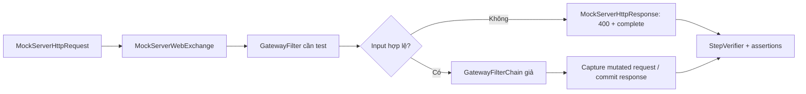
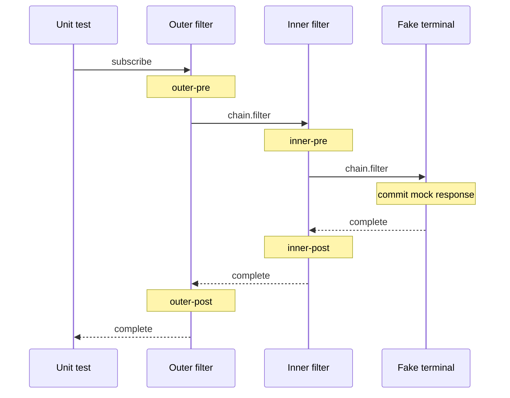

# Kiểm thử đơn vị bộ lọc bằng MockServerWebExchange

## 1. Vì sao unit test GatewayFilter lại quan trọng?

Trong **SPRING_CLOUD_GATEWAY**, request từ client thường trải qua **route predicates**, **filter chain**, biến đổi path/header, **service discovery** hoặc load balancing, rồi mới được chuyển tới một microservice. Trước hoặc trong luồng đó còn có các chính sách **authentication/authorization**, **rate limiting**, **circuit breaker**, **retry**, **TLS** và **observability**. Chỉ một custom filter xử lý sai header, gọi tiếp chain khi đáng lẽ phải từ chối, hoặc sửa response sau commit cũng có thể làm thay đổi ranh giới bảo mật của toàn API Gateway.

Ví dụ, một filter yêu cầu header `X-Correlation-Id`:

- Nếu header thiếu hoặc định dạng không hợp lệ, Gateway phải trả **400 Bad Request** và **không** gọi downstream chain.
- Nếu hợp lệ, filter ghi đè `X-Verified-Trace` trước khi chuyển tới downstream.
- Trước lúc phản hồi được commit, filter thêm `X-Trace-Accepted` cho client.
- Nếu downstream lỗi/cancel, filter không được tự subscribe, nuốt lỗi hoặc phát sinh side effect chạy ngoài luồng.

Có thể viết một test khởi động nguyên Spring Boot và gọi HTTP thật, nhưng test như vậy cần nhiều thành phần, chậm hơn và khó khoanh vùng nguyên nhân. Với **`MockServerWebExchange`**, chúng ta tự tạo request/response WebFlux giả lập **trong bộ nhớ**, rồi truyền exchange đó vào `GatewayFilter` cùng một `GatewayFilterChain` giả. Kết quả được xác minh bằng **JUnit 5 + AssertJ + Reactor `StepVerifier`**.



**Đây là bài học của chương Kiểm thử**, tập trung vào **đơn vị filter của Spring Cloud Gateway Server WebFlux**. Tên `MockServerWebExchange` chứa “Server Web” nhưng nó **không khởi động Netty**, **không tự định tuyến qua HTTP** và **không chạy tất cả built-in filters**. Đó là giới hạn chủ động của unit test, không phải một lỗi.

### Mục tiêu học tập

Sau bài này, bạn có thể:

1. Phân biệt `MockServerHttpRequest`, `MockServerWebExchange`, `MockServerHttpResponse`, `GatewayFilter`, `GatewayFilterChain` và `StepVerifier`.
2. Tạo exchange giả bằng `MockServerWebExchange.from(...)` với method, path, headers, query và body khi cần.
3. Viết một custom `AbstractGatewayFilterFactory<Config>` chạy theo mô hình reactive, không dùng `block()` hoặc tự `subscribe()`.
4. Tạo **fake chain** bằng lambda để kiểm tra số lần downstream được gọi và exchange được chuyển tiếp.
5. Kiểm tra **short-circuit**, **request mutation**, **response status/headers**, **beforeCommit**, propagation của lỗi và cancellation.
6. Thử **thứ tự pre/post** bằng chain thủ công, đồng thời hiểu khác biệt giữa mô phỏng thứ tự và thứ tự `Ordered` của Gateway runtime.
7. Phân biệt **route attributes** trên exchange với HTTP routing thật.
8. Biết khi nào cần nâng từ unit test sang `@SpringBootTest`, `WebTestClient`, backend giả hoặc Testcontainers để nghiệm thu bảo mật, discovery, retry và TLS.

> **Phạm vi phiên bản:** Spring Boot 3.5.x, Spring Cloud 2025.0.x, **Spring Cloud Gateway Server WebFlux 4.3.x**, Spring Framework 6.2.x và JDK 17+. Ví dụ Maven dùng Boot `3.5.0`/Cloud BOM `2025.0.0` để minh họa compatibility; trên hệ thống thật cần bản vá còn được hỗ trợ. `MockServerWebExchange` thuộc **Spring Test/WebFlux**, khác mock Servlet (`MockHttpServletRequest`) của Spring MVC. Không dùng bài này như hướng dẫn cho **Gateway Server Web MVC** hoặc Proxy Exchange.

## 2. Bức tranh API và phạm vi của unit test

### 2.1. Sáu đối tượng cần phân biệt

| Đối tượng | Package | Vai trò trong unit test |
| --- | --- | --- |
| `MockServerHttpRequest` | `org.springframework.mock.http.server.reactive` | Tạo inbound HTTP request giả (method, URI, headers, body). |
| `MockServerWebExchange` | `org.springframework.mock.web.server` | Cung cấp `ServerWebExchange` giả gồm request, response, attributes, session/principal nếu được cấu hình. |
| `MockServerHttpResponse` | `org.springframework.mock.http.server.reactive` | Nhận status/headers/body từ filter; hỗ trợ `getBodyAsString()`. |
| `GatewayFilter` | `org.springframework.cloud.gateway.filter` | Đơn vị xử lý `filter(exchange, chain)` cần kiểm thử. |
| `GatewayFilterChain` | `org.springframework.cloud.gateway.filter` | Đại diện phần filter chain còn lại; trong unit test được thay bằng lambda giả. |
| `StepVerifier` | `reactor.test` | Subscribe và xác minh publisher `Mono<Void>` hoàn tất/lỗi/cancel. |

**Quan hệ quan trọng:**

```java
// Đây là dạng biểu đạt chữ ký chính,
// không phải mã thay thế interface thật của Gateway.
Mono<Void> filter(ServerWebExchange exchange, GatewayFilterChain chain);
```

`Mono<Void>` thường **không emit một phần tử**. Nó chỉ báo rằng quá trình xử lý request đã **complete**, **error** hoặc bị **cancel**. Vì vậy một assertion kiểu `expectNext(1)` trên kết quả `GatewayFilter.filter(...)` sẽ không có ý nghĩa.

### 2.2. Unit test trả lời được gì?

| Cần chứng minh | `MockServerWebExchange` đủ không? | Bằng chứng |
| --- | --- | --- |
| Filter nhận header đúng/sai. | **Có**. | Set mock header, verify status/chain count. |
| Filter mutate request header/path. | **Có**. | Capture exchange mà fake chain nhận. |
| Filter short-circuit và không gọi chain. | **Có**. | `AtomicInteger` vẫn bằng `0`. |
| Filter đăng ký callback trước commit. | **Có** khi mock chain commit response. | `setComplete()`, assert response header. |
| Publisher báo lỗi/cancel đúng. | **Có** ở phạm vi fake chain. | `StepVerifier.expectError...`/`thenCancel()`. |
| Route predicate thực chọn đúng route. | **Không đầy đủ**. | Cần Gateway route mapping/integration test. |
| Kết hợp mọi `GlobalFilter` và `GatewayFilter` theo `Ordered`. | **Không tự động**. | Cần combined filter chain runtime hoặc test tích hợp. |
| Backend thật nhận header/path đã mutate. | **Không**. | Cần HTTP backend capture. |
| `lb://` thực sự chọn instance dịch vụ. | **Không**. | Cần LoadBalancer/discovery integration test. |
| TLS/mTLS handshake, DNS, connect timeout. | **Không**. | Cần network HTTP(S) test. |
| JWT/security/Redis rate limit chạy qua tất cả lớp. | **Không** chỉ với một mock exchange. | Cần Spring Security/WebFlux + external service tests. |

Một unit test có thể chứng minh **filter không gọi fake chain**, nhưng **không tự chứng minh không có HTTP request tới upstream trong toàn deployment**. Đây là hai cấp độ chứng cứ khác nhau.

## 3. Bắt đầu với `MockServerWebExchange.from(...)`

Spring Framework cung cấp static factories:

```java
MockServerWebExchange.from(MockServerHttpRequest request)
MockServerWebExchange.from(MockServerHttpRequest.BaseBuilder<?> builder)
MockServerWebExchange.builder(MockServerHttpRequest request)
```

Ví dụ cơ bản, không cần mở cổng HTTP:

```java
import org.springframework.mock.http.server.reactive.MockServerHttpRequest;
import org.springframework.mock.web.server.MockServerWebExchange;

MockServerHttpRequest request = MockServerHttpRequest
        .get("/api/items/A-42?lang=vi")
        .header("X-Correlation-Id", "req_42")
        .build();

MockServerWebExchange exchange =
        MockServerWebExchange.from(request);
```

Sau đó có thể đọc:

```java
exchange.getRequest().getMethod();       // GET
exchange.getRequest().getURI().getPath(); // /api/items/A-42
exchange.getRequest().getURI().getQuery();// lang=vi
exchange.getRequest().getHeaders()
        .getFirst("X-Correlation-Id");    // req_42

exchange.getResponse().getStatusCode();  // thường null trước khi set
exchange.getAttributes();                // mutable map per exchange
```

### 3.1. Tạo headers có nhiều giá trị

HTTP headers là đa trị (`MultiValueMap`). Vì vậy:

```java
MockServerWebExchange exchange = MockServerWebExchange.from(
        MockServerHttpRequest.get("/api/items")
                .header("X-Correlation-Id", "first", "second")
                .build());
```

Tại filter, `getHeaders().get("X-Correlation-Id")` là một `List<String>`, không phải `String`. Nếu một header dự kiến phải có **duy nhất một giá trị**, unit test cần đưa vào trường hợp header lặp và khẳng định xử lý rõ ràng. Với những header chứa dấu phẩy hoặc quá dài, cần validate theo schema chứ không tin `getFirst(...)` là đủ.

### 3.2. Query và request attributes

```java
MockServerWebExchange exchange = MockServerWebExchange.from(
        MockServerHttpRequest.get("/api/search?q=java&lang=vi").build());

exchange.getAttributes().put("lab.request.category", "catalog");
```

`exchange.getAttributes()` là **map dùng trong quá trình xử lý request**, khác với query params/HTTP headers. Các filter của Gateway còn lưu route/routing URI/URL history trong những key chuẩn, chẳng hạn `GATEWAY_ROUTE_ATTR` hoặc `GATEWAY_REQUEST_URL_ATTR`. Nếu filter của bạn phụ thuộc những key này, cần thiết lập **giá trị đúng kiểu** trong unit test, không thay chúng bằng chuỗi tùy ý rồi coi là route thực.

### 3.3. Response giả không tự commit

Một filter có thể gọi:

```java
exchange.getResponse().setStatusCode(HttpStatus.BAD_REQUEST);
return exchange.getResponse().setComplete();
```

`setComplete()` trả về `Mono<Void>`; muốn thực hiện việc commit cần **subscribe publisher** thông qua `StepVerifier` hoặc một subscriber thích hợp. Chỉ gọi phương thức tạo `Mono` mà không subscribe thì nhiều thao tác bất đồng bộ chưa chạy.

Để lấy response body sau khi response thực sự được ghi:

```java
StepVerifier.create(exchange.getResponse().getBodyAsString())
        .expectNext("blocked")
        .verifyComplete();
```

`MockServerHttpResponse` giữ body để test, nhưng **chỉ có nội dung khi filter/handler đã ghi nó**. Không mong `getBodyAsString()` tự tạo một error JSON khi filter chỉ set status.

## 4. Tạo project Maven chỉ để kiểm thử custom filter

Dựng một project Maven thực hành độc lập, JDK 17+. `pom.xml`:

```xml
<?xml version="1.0" encoding="UTF-8"?>
<project xmlns="http://maven.apache.org/POM/4.0.0"
         xmlns:xsi="http://www.w3.org/2001/XMLSchema-instance"
         xsi:schemaLocation="http://maven.apache.org/POM/4.0.0
                             https://maven.apache.org/xsd/maven-4.0.0.xsd">
    <modelVersion>4.0.0</modelVersion>

    <parent>
        <groupId>org.springframework.boot</groupId>
        <artifactId>spring-boot-starter-parent</artifactId>
        <version>3.5.0</version>
        <relativePath/>
    </parent>

    <groupId>com.example</groupId>
    <artifactId>gateway-filter-unit-lab</artifactId>
    <version>0.0.1-SNAPSHOT</version>

    <properties>
        <java.version>17</java.version>
    </properties>

    <dependencyManagement>
        <dependencies>
            <dependency>
                <groupId>org.springframework.cloud</groupId>
                <artifactId>spring-cloud-dependencies</artifactId>
                <version>2025.0.0</version>
                <type>pom</type>
                <scope>import</scope>
            </dependency>
        </dependencies>
    </dependencyManagement>

    <dependencies>
        <dependency>
            <groupId>org.springframework.cloud</groupId>
            <artifactId>spring-cloud-starter-gateway-server-webflux</artifactId>
        </dependency>

        <!-- Spring Test mock HTTP/exchange + JUnit 5, AssertJ -->
        <dependency>
            <groupId>org.springframework.boot</groupId>
            <artifactId>spring-boot-starter-test</artifactId>
            <scope>test</scope>
        </dependency>

        <!-- Reactor StepVerifier -->
        <dependency>
            <groupId>io.projectreactor</groupId>
            <artifactId>reactor-test</artifactId>
            <scope>test</scope>
        </dependency>
    </dependencies>

    <build>
        <plugins>
            <plugin>
                <groupId>org.springframework.boot</groupId>
                <artifactId>spring-boot-maven-plugin</artifactId>
            </plugin>
        </plugins>
    </build>
</project>
```

Tại sao có các dependency này?

- `spring-cloud-starter-gateway-server-webflux` cung cấp interfaces/classes `GatewayFilter`, `GatewayFilterChain`, `AbstractGatewayFilterFactory` và WebFlux Gateway runtime.
- `spring-boot-starter-test` cung cấp JUnit Jupiter, AssertJ, Spring Test và các **MockServer** WebFlux classes trên classpath test.
- `reactor-test` cung cấp `StepVerifier` để xác minh publishers của filter.
- **Không cần khởi động Spring Boot** khi test `GatewayFilter` thuần; không cần backend, Redis hay Docker cho các test ở mục 6.
- Không thêm `spring-boot-starter-web` Servlet để tránh lẫn Server MVC với WebFlux.
- Spring Boot BOM và Spring Cloud release BOM quản lý version dependency; không tự trộn các nhánh Gateway 4.x/5.x trong cùng lab.

**Lưu ý:** ví dụ `pom.xml` mô tả dự án thực hành của người học, **không phải thay đổi build của repository bài giảng**. Chưa chạy build/Content QA trong công việc viết bài ở STEP 4.

### 4.1. Cấu trúc thư mục gợi ý

```text
gateway-filter-unit-lab/
├── pom.xml
└── src/
    ├── main/
    │   └── java/
    │       └── com/example/gateway/
    │           └── CorrelationGateGatewayFilterFactory.java
    └── test/
        └── java/
            └── com/example/gateway/
                ├── CorrelationGateGatewayFilterFactoryTest.java
                ├── FilterOrderUnitTest.java
                └── ResponseBodyUnitTest.java
```

**Không cần `application.yml`** cho các unit tests thuần này: chúng ta gọi `factory.apply(config)` trực tiếp và chủ động tạo request/response mock. Khi cần kiểm tra tên filter YAML, route binding và Netty routing thật, mới cần một integration test với Spring ApplicationContext.

## 5. Viết filter mẫu: `CorrelationGateGatewayFilterFactory`

Đây là một filter đủ nhỏ để đọc được hết nhưng có nhiều hành vi cần test:

- Nhận duy nhất một `X-Correlation-Id`.
- Header có 1–32 ký tự thuộc tập chữ ASCII/số/`_`/`-`.
- **Thiếu, rỗng, trùng hoặc sai format** → 400 và **không gọi** `chain.filter`.
- Hợp lệ → **ghi đè** `X-Verified-Trace` trên request chuyển xuống downstream, không giữ giá trị giả do client gửi.
- Trước response commit → thêm `X-Trace-Accepted`.
- Không đọc body, không tạo một HTTP call trực tiếp, không tự `subscribe()`, không lưu request data trong field singleton.

Tên class kết thúc bằng **`GatewayFilterFactory`** là convention quan trọng của Spring Cloud Gateway: tên ngắn để khai báo sau này là `CorrelationGate`. Tuy nhiên trong các unit tests, chúng ta **không test binding YAML** mà test trực tiếp `GatewayFilter` do factory tạo.

Tạo `src/main/java/com/example/gateway/CorrelationGateGatewayFilterFactory.java`:

```java
package com.example.gateway;

import java.util.List;
import java.util.regex.Pattern;

import org.springframework.cloud.gateway.filter.GatewayFilter;
import org.springframework.cloud.gateway.filter.factory.AbstractGatewayFilterFactory;
import org.springframework.http.HttpStatus;
import org.springframework.http.server.reactive.ServerHttpRequest;
import org.springframework.stereotype.Component;
import org.springframework.util.StringUtils;
import org.springframework.web.server.ServerWebExchange;

import reactor.core.publisher.Mono;

@Component
public class CorrelationGateGatewayFilterFactory
        extends AbstractGatewayFilterFactory<
                CorrelationGateGatewayFilterFactory.Config> {

    private static final Pattern TRACE_FORMAT =
            Pattern.compile("[A-Za-z0-9_-]{1,32}");

    public CorrelationGateGatewayFilterFactory() {
        super(Config.class);
    }

    @Override
    public GatewayFilter apply(Config config) {

        if (config == null
                || !StringUtils.hasText(config.getSourceHeader())) {
            throw new IllegalArgumentException(
                    "sourceHeader must not be blank");
        }

        return (exchange, chain) -> {

            List<String> values = exchange.getRequest().getHeaders()
                    .get(config.getSourceHeader());

            if (values == null
                    || values.size() != 1
                    || !TRACE_FORMAT.matcher(values.get(0)).matches()) {

                exchange.getResponse()
                        .setStatusCode(HttpStatus.BAD_REQUEST);

                // Nhánh từ chối: không hề gọi chain.filter(...)
                return exchange.getResponse().setComplete();
            }

            String traceId = values.get(0);

            // Ghi đè thay vì append giá trị do client tự đặt.
            ServerHttpRequest forwardedRequest =
                    exchange.getRequest().mutate()
                            .headers(headers -> headers.set(
                                    "X-Verified-Trace", traceId))
                            .build();

            ServerWebExchange forwardedExchange =
                    exchange.mutate().request(forwardedRequest).build();

            // Đăng ký callback ngay trong PRE phase.
            // Chỉ chạy khi response chuẩn bị commit.
            exchange.getResponse().beforeCommit(() -> {
                exchange.getResponse().getHeaders()
                        .set("X-Trace-Accepted", traceId);
                return Mono.empty();
            });

            // Nhánh hợp lệ: để Gateway chain tiếp tục.
            return chain.filter(forwardedExchange);
        };
    }

    public static class Config {
        private String sourceHeader = "X-Correlation-Id";

        public String getSourceHeader() {
            return sourceHeader;
        }

        public void setSourceHeader(String sourceHeader) {
            this.sourceHeader = sourceHeader;
        }
    }
}
```

### 5.1. Hợp đồng bảo mật của ví dụ

**`X-Correlation-Id` không phải JWT, session ID hoặc danh tính xác thực.** Bất kỳ client nào cũng có thể chọn một correlation ID hợp format. `X-Verified-Trace` trong bài chỉ nghĩa là **đã qua kiểm tra định dạng**, không chứng minh user/tenant. Không dùng header này để cấp quyền.

Nếu cần downstream tin một header identity, phải:

1. Xác thực principal/JWT trước khi tạo header đó.
2. Xóa/ghi đè mọi giá trị do client tự gửi.
3. Bảo vệ Gateway → backend bằng TLS/mTLS và network policies.
4. Chặn client truy cập trực tiếp vào backend.
5. Để backend thực thi authorization theo tài nguyên/tenant.

### 5.2. Tại sao mutate thay vì sửa request trực tiếp?

`ServerHttpRequest` là một abstraction WebFlux có thiết kế bất biến ở nơi sử dụng. Để thay header:

```java
ServerHttpRequest mutated = exchange.getRequest().mutate()
        .headers(headers ->
                headers.set("X-Verified-Trace", traceId))
        .build();

ServerWebExchange downstream = exchange.mutate()
        .request(mutated)
        .build();
```

Điều phải test là **fake chain nhận được request đã mutate**, không phải mong rằng `exchange.getRequest()` gốc đã bị sửa. Nếu test chỉ đọc original exchange rồi thấy không có header mới, có thể kết luận sai rằng filter không hoạt động.

### 5.3. Tại sao chọn `beforeCommit`?

Ở pha pre, filter đăng ký:

```java
exchange.getResponse().beforeCommit(() -> {
    exchange.getResponse().getHeaders()
            .set("X-Trace-Accepted", traceId);
    return Mono.empty();
});
```

Khi downstream hoàn tất response bằng `setComplete()` hoặc `writeWith(...)`, hook chạy trước khi headers/body được commit. Ngược lại, một `.then(Mono.fromRunnable(...))` thực hiện sau downstream chain có thể đã **quá muộn** để sửa response headers nếu downstream đã commit. Trong unit test phải tạo tình huống commit có chủ đích để thực sự kiểm tra hook này.

### 5.4. Hợp đồng reactive

Lời gọi `filter(exchange, chain)` trả một publisher. Một số thao tác đồng bộ trong phần pre có thể xảy ra ngay khi **gọi method**; thao tác bất đồng bộ trong chain và `beforeCommit` chỉ hoàn tất khi có **subscription**. Không suy rằng mọi logic đều lazy chỉ vì kiểu trả về là `Mono<Void>`.

Không viết:

```java
// SAI: tự kích hoạt downstream ở một subscription khác.
chain.filter(exchange).subscribe();
return Mono.empty();
```

Cũng không viết:

```java
// SAI trên Netty event loop:
chain.filter(exchange).block();
return Mono.empty();
```

Hai cách trên có thể gây double execution, mất cancellation/error propagation, rò request body và chặn event loop.

## 6. Unit tests đầy đủ với `MockServerWebExchange` và `StepVerifier`

Bây giờ tạo file:

```text
src/test/java/com/example/gateway/CorrelationGateGatewayFilterFactoryTest.java
```

Test class không dùng `@SpringBootTest` và không inject Spring beans: tạo factory bằng `new`, gọi `apply(Config)` để lấy `GatewayFilter`. Nhờ đó lỗi validation/request mutation/short-circuit được phát hiện nhanh và độc lập với network.

### 6.1. Test class JUnit 5

```java
package com.example.gateway;

import java.util.concurrent.atomic.AtomicInteger;
import java.util.concurrent.atomic.AtomicReference;

import org.junit.jupiter.api.Test;
import org.junit.jupiter.params.ParameterizedTest;
import org.junit.jupiter.params.provider.ValueSource;
import org.springframework.cloud.gateway.filter.GatewayFilter;
import org.springframework.cloud.gateway.filter.GatewayFilterChain;
import org.springframework.http.HttpStatus;
import org.springframework.mock.http.server.reactive.MockServerHttpRequest;
import org.springframework.mock.web.server.MockServerWebExchange;
import org.springframework.web.server.ServerWebExchange;

import reactor.core.publisher.Mono;
import reactor.core.publisher.SignalType;
import reactor.test.StepVerifier;

import static org.assertj.core.api.Assertions.assertThat;
import static org.assertj.core.api.Assertions.assertThatThrownBy;

class CorrelationGateGatewayFilterFactoryTest {

    private final CorrelationGateGatewayFilterFactory factory =
            new CorrelationGateGatewayFilterFactory();

    private final GatewayFilter filter = factory.apply(
            new CorrelationGateGatewayFilterFactory.Config());

    @Test
    void missingHeaderReturns400AndNeverCallsChain() {
        MockServerWebExchange exchange = MockServerWebExchange.from(
                MockServerHttpRequest.get("/api/items/A-42").build());

        AtomicInteger downstreamCalls = new AtomicInteger();

        GatewayFilterChain next = forwarded -> {
            downstreamCalls.incrementAndGet();
            return forwarded.getResponse().setComplete();
        };

        StepVerifier.create(filter.filter(exchange, next))
                .verifyComplete();

        assertThat(exchange.getResponse().getStatusCode())
                .isEqualTo(HttpStatus.BAD_REQUEST);
        assertThat(exchange.getResponse().isCommitted()).isTrue();
        assertThat(downstreamCalls.get()).isZero();
    }

    @Test
    void emptyHeaderReturns400AndDoesNotContinue() {
        MockServerWebExchange exchange = MockServerWebExchange.from(
                MockServerHttpRequest.get("/api/items/A-42")
                        .header("X-Correlation-Id", "")
                        .build());

        AtomicInteger downstreamCalls = new AtomicInteger();

        StepVerifier.create(filter.filter(exchange, forwarded -> {
            downstreamCalls.incrementAndGet();
            return Mono.empty();
        })).verifyComplete();

        assertThat(exchange.getResponse().getStatusCode())
                .isEqualTo(HttpStatus.BAD_REQUEST);
        assertThat(downstreamCalls.get()).isZero();
    }

    @Test
    void duplicateHeaderValuesAreRejected() {
        MockServerWebExchange exchange = MockServerWebExchange.from(
                MockServerHttpRequest.get("/api/items/A-42")
                        .header("X-Correlation-Id",
                                "req_42", "another_42")
                        .build());

        AtomicInteger downstreamCalls = new AtomicInteger();

        StepVerifier.create(filter.filter(exchange, forwarded -> {
            downstreamCalls.incrementAndGet();
            return Mono.empty();
        })).verifyComplete();

        assertThat(exchange.getResponse().getStatusCode())
                .isEqualTo(HttpStatus.BAD_REQUEST);
        assertThat(downstreamCalls.get()).isZero();
    }

    @ParameterizedTest
    @ValueSource(strings = {
            "with space", "slash/path", "bad!", "é",
            "abcdefghijklmnopqrstuvwxyz123456789"
    })
    void invalidFormatIsRejected(String value) {
        MockServerWebExchange exchange = MockServerWebExchange.from(
                MockServerHttpRequest.get("/api/items/A-42")
                        .header("X-Correlation-Id", value)
                        .build());

        AtomicInteger downstreamCalls = new AtomicInteger();

        StepVerifier.create(filter.filter(exchange, forwarded -> {
            downstreamCalls.incrementAndGet();
            return Mono.empty();
        })).verifyComplete();

        assertThat(exchange.getResponse().getStatusCode())
                .isEqualTo(HttpStatus.BAD_REQUEST);
        assertThat(downstreamCalls.get()).isZero();
    }

    @Test
    void validHeaderReplacesForgedValueAndCommitsMarker() {
        MockServerWebExchange exchange = MockServerWebExchange.from(
                MockServerHttpRequest.get("/api/items/A-42")
                        .header("X-Correlation-Id", "req_42")
                        .header("X-Verified-Trace", "attacker-value")
                        .build());

        AtomicInteger downstreamCalls = new AtomicInteger();
        AtomicReference<ServerWebExchange> observed =
                new AtomicReference<>();

        GatewayFilterChain next = forwarded -> {
            downstreamCalls.incrementAndGet();
            observed.set(forwarded);
            return forwarded.getResponse().setComplete();
        };

        StepVerifier.create(filter.filter(exchange, next))
                .verifyComplete();

        assertThat(downstreamCalls.get()).isEqualTo(1);
        assertThat(observed.get()).isNotNull();

        // Fake downstream thấy request đã mutate.
        assertThat(observed.get().getRequest().getHeaders()
                .getFirst("X-Verified-Trace"))
                .isEqualTo("req_42");

        assertThat(observed.get().getRequest().getHeaders()
                .get("X-Verified-Trace"))
                .containsExactly("req_42");

        // Request gốc không bị sửa trực tiếp.
        assertThat(exchange.getRequest().getHeaders()
                .getFirst("X-Verified-Trace"))
                .isEqualTo("attacker-value");

        assertThat(exchange.getResponse().isCommitted()).isTrue();
        assertThat(exchange.getResponse().getHeaders()
                .getFirst("X-Trace-Accepted"))
                .isEqualTo("req_42");
    }

    @Test
    void sourceHeaderNameCanBeConfiguredPerFactory() {
        var config = new CorrelationGateGatewayFilterFactory.Config();
        config.setSourceHeader("X-Request-Trace");

        GatewayFilter custom = factory.apply(config);

        MockServerWebExchange exchange = MockServerWebExchange.from(
                MockServerHttpRequest.get("/api/items")
                        .header("X-Request-Trace", "custom_7")
                        .build());

        AtomicReference<String> forwardedTrace =
                new AtomicReference<>();

        StepVerifier.create(custom.filter(exchange, next -> {
            forwardedTrace.set(next.getRequest().getHeaders()
                    .getFirst("X-Verified-Trace"));
            return next.getResponse().setComplete();
        })).verifyComplete();

        assertThat(forwardedTrace.get()).isEqualTo("custom_7");
        assertThat(exchange.getResponse().getHeaders()
                .getFirst("X-Trace-Accepted"))
                .isEqualTo("custom_7");
    }

    @Test
    void invalidConfigFailsBeforeAnyHttpRequest() {
        var config = new CorrelationGateGatewayFilterFactory.Config();
        config.setSourceHeader(" ");

        assertThatThrownBy(() -> factory.apply(config))
                .isInstanceOf(IllegalArgumentException.class)
                .hasMessageContaining("sourceHeader");
    }

    @Test
    void downstreamErrorIsPropagatedWithoutFakeSuccess() {
        MockServerWebExchange exchange = MockServerWebExchange.from(
                MockServerHttpRequest.get("/api/items")
                        .header("X-Correlation-Id", "req_42")
                        .build());

        AtomicInteger downstreamCalls = new AtomicInteger();

        GatewayFilterChain next = forwarded -> {
            downstreamCalls.incrementAndGet();
            return Mono.error(
                    new IllegalStateException("upstream boom"));
        };

        StepVerifier.create(filter.filter(exchange, next))
                .expectErrorMatches(error ->
                        error instanceof IllegalStateException
                        && "upstream boom".equals(error.getMessage()))
                .verify();

        assertThat(downstreamCalls.get()).isEqualTo(1);

        // Fake chain lỗi, không commit response:
        // beforeCommit chỉ là callback đăng ký, không phải finally.
        assertThat(exchange.getResponse().isCommitted()).isFalse();
    }

    @Test
    void cancellationReachesDownstreamPublisher() {
        MockServerWebExchange exchange = MockServerWebExchange.from(
                MockServerHttpRequest.get("/api/items")
                        .header("X-Correlation-Id", "req_42")
                        .build());

        AtomicInteger downstreamCalls = new AtomicInteger();
        AtomicReference<SignalType> terminalSignal =
                new AtomicReference<>();

        GatewayFilterChain next = forwarded -> {
            downstreamCalls.incrementAndGet();

            return Mono.<Void>never()
                    .doFinally(terminalSignal::set);
        };

        StepVerifier.create(filter.filter(exchange, next))
                .thenCancel()
                .verify();

        assertThat(downstreamCalls.get()).isEqualTo(1);
        assertThat(terminalSignal.get())
                .isEqualTo(SignalType.CANCEL);
        assertThat(exchange.getResponse().isCommitted()).isFalse();
    }

    @Test
    void twoIndependentRequestsKeepDifferentTraceHeaders() {
        MockServerWebExchange exchangeA = MockServerWebExchange.from(
                MockServerHttpRequest.get("/api/items/A")
                        .header("X-Correlation-Id", "trace_A")
                        .build());

        MockServerWebExchange exchangeB = MockServerWebExchange.from(
                MockServerHttpRequest.get("/api/items/B")
                        .header("X-Correlation-Id", "trace_B")
                        .build());

        AtomicReference<String> seenA = new AtomicReference<>();
        AtomicReference<String> seenB = new AtomicReference<>();

        Mono<Void> requestA = filter.filter(exchangeA, next -> {
            seenA.set(next.getRequest().getHeaders()
                    .getFirst("X-Verified-Trace"));
            return next.getResponse().setComplete();
        });

        Mono<Void> requestB = filter.filter(exchangeB, next -> {
            seenB.set(next.getRequest().getHeaders()
                    .getFirst("X-Verified-Trace"));
            return next.getResponse().setComplete();
        });

        StepVerifier.create(Mono.when(requestA, requestB))
                .verifyComplete();

        assertThat(seenA.get()).isEqualTo("trace_A");
        assertThat(seenB.get()).isEqualTo("trace_B");
        assertThat(exchangeA.getResponse().getHeaders()
                .getFirst("X-Trace-Accepted"))
                .isEqualTo("trace_A");
        assertThat(exchangeB.getResponse().getHeaders()
                .getFirst("X-Trace-Accepted"))
                .isEqualTo("trace_B");
    }
}
```

### 6.2. Các test "happy path" phải quan sát đúng exchange

Ở method `validHeaderReplacesForgedValueAndCommitsMarker`, fake chain nhận **`forwarded`** (exchange do filter chuyển tiếp), không phải exchange gốc. Đây là assertion mạnh nhất cho request mutation:

```java
GatewayFilterChain next = forwarded -> {
    observed.set(forwarded);
    return forwarded.getResponse().setComplete();
};
```

Nếu viết:

```java
// Không chứng minh filter đã truyền request mới xuống chain.
assertThat(exchange.getRequest().getHeaders()
        .getFirst("X-Verified-Trace")).isEqualTo("req_42");
```

test có thể fail dù filter làm đúng, bởi vì **request gốc được giữ nguyên**, request mới được đặt trong `forwardedExchange`. Tương tự, một test chỉ khẳng định status 200 mà không capture downstream request sẽ **không phát hiện việc header giả vẫn tồn tại**.

### 6.3. Kiểm tra số lần gọi chain, không chỉ status

Khi input thiếu:

```java
StepVerifier.create(filter.filter(exchange, next))
        .verifyComplete();

assertThat(exchange.getResponse().getStatusCode())
        .isEqualTo(HttpStatus.BAD_REQUEST);
assertThat(downstreamCalls.get()).isZero();
```

Hai assertion đi cùng nhau. Nếu filter set 400 **nhưng vẫn gọi chain**, một downstream component có thể tiếp tục xử lý, phát HTTP request hoặc cố ghi response sau commit. Trong Gateway thật, đó không chỉ là lỗi status mà còn có thể là **vấn đề bảo mật hoặc double-write**.

Một fake chain **không tự gửi HTTP**. Trong integration test cần đếm request tại backend để chứng minh route thật không outbound.

### 6.4. Phân biệt `StepVerifier.verifyComplete()` và `expectErrorMatches(...)`

`filter.filter(...)` trả `Mono<Void>`:

```java
StepVerifier.create(filter.filter(exchange, next))
        .verifyComplete();
```

Thích hợp khi nhánh xử lý được mong đợi **complete bình thường**. Nhưng downstream có thể báo lỗi:

```java
StepVerifier.create(filter.filter(exchange, next))
        .expectErrorMatches(error ->
                error instanceof IllegalStateException)
        .verify();
```

**Đừng dùng `verifyComplete()` cho một test chủ đích mong lỗi**, rồi đổi filter để nuốt lỗi chỉ vì muốn test xanh. Điều đúng có thể là truyền lỗi cho một exception handler/route failure policy ở lớp cao hơn.

Cũng không dùng `filter.filter(exchange, chain).subscribe()` rồi assert ngay: bạn không nắm được lúc publisher chạy xong, lỗi có thể bị drop hoặc xử lý ngoài test thread.

### 6.5. Cancellation không phải HTTP 499 tự động

`thenCancel()` chủ động hủy subscription để mô phỏng client/ngữ cảnh dừng chờ kết quả. Nó chứng minh cancellation được truyền đến publisher downstream ở unit test, **không đồng nghĩa Gateway sẽ tự tạo status 499** hoặc đã đóng mọi socket thật.

Nếu filter gắn `doFinally`, kiểm tra signal `SignalType.CANCEL`; nếu cleanup liên quan request body buffers, subscription, Netty connection hoặc Redis call, cần test tích hợp/load test thêm. Trong ví dụ, `Mono.never()` không mở network connection nên phù hợp cho unit test không gây treo.

### 6.6. Test nhiều request không phải load test

Method `twoIndependentRequestsKeepDifferentTraceHeaders` chứng minh hai exchanges có trace riêng và filter không sử dụng một field mutable để giữ trace ID. Nó **chưa đo throughput, concurrency pressure hay race conditions ở hàng nghìn requests**. Khi cần, thêm các test đồng thời với `Flux.range(...).flatMap(...)` có giới hạn, cùng integration/load tests kiểm tra state, memory và latency.

### 6.7. Trường hợp config sai và version-specific binding

Test `invalidConfigFailsBeforeAnyHttpRequest` kiểm chứng `factory.apply(config)` từ chối tên header rỗng. Trong Gateway thật, việc bind YAML `name: CorrelationGate` với `args.sourceHeader` còn phụ thuộc Spring bean registration và `RouteDefinitionRouteLocator`. **Unit test không tự test tên factory hoặc YAML binding**. Cần integration test bổ sung để bảo đảm một route thực sự gắn filter này.

## 7. Kiểm tra thứ tự pre/post bằng chain thủ công

Khi Gateway Server WebFlux match một route, `FilteringWebHandler` kết hợp các route `GatewayFilter` và `GlobalFilter` rồi sắp xếp theo `Ordered`. Filter có precedence cao hơn (order nhỏ hơn) đi sớm ở pha **pre**, và phần **post** của nó thường chạy muộn hơn.

Một unit test có thể minh họa thứ tự lồng nhau:



Tạo `src/test/java/com/example/gateway/FilterOrderUnitTest.java`:

```java
package com.example.gateway;

import java.util.ArrayList;
import java.util.List;

import org.junit.jupiter.api.Test;
import org.springframework.cloud.gateway.filter.GatewayFilter;
import org.springframework.cloud.gateway.filter.GatewayFilterChain;
import org.springframework.mock.http.server.reactive.MockServerHttpRequest;
import org.springframework.mock.web.server.MockServerWebExchange;

import reactor.core.publisher.Mono;
import reactor.test.StepVerifier;

import static org.assertj.core.api.Assertions.assertThat;

class FilterOrderUnitTest {

    @Test
    void nestedFiltersRunPreInOrderAndPostInReverse() {
        List<String> events = new ArrayList<>();

        GatewayFilter outer = (exchange, chain) ->
                Mono.defer(() -> {
                    events.add("outer-pre");
                    return chain.filter(exchange)
                            .then(Mono.fromRunnable(() ->
                                    events.add("outer-post")));
                });

        GatewayFilter inner = (exchange, chain) ->
                Mono.defer(() -> {
                    events.add("inner-pre");
                    return chain.filter(exchange)
                            .then(Mono.fromRunnable(() ->
                                    events.add("inner-post")));
                });

        GatewayFilterChain terminal = exchange ->
                Mono.defer(() -> {
                    events.add("terminal");
                    return exchange.getResponse().setComplete();
                });

        MockServerWebExchange exchange = MockServerWebExchange.from(
                MockServerHttpRequest.get("/api/items").build());

        GatewayFilterChain next =
                forwarded -> inner.filter(forwarded, terminal);

        StepVerifier.create(outer.filter(exchange, next))
                .verifyComplete();

        assertThat(events).containsExactly(
                "outer-pre",
                "inner-pre",
                "terminal",
                "inner-post",
                "outer-post");
        assertThat(exchange.getResponse().isCommitted()).isTrue();
    }
}
```

**Ranh giới:** test chỉ chứng minh thứ tự do chính test lồng `outer` và `inner`, **không chứng minh Gateway runtime đã sort filters theo `Ordered`**. Nếu có `OrderedGatewayFilter`/ `GlobalFilter`/built-in filter với order riêng, phải kiểm tra combined chain ở mức integration test.

### 7.1. Vì sao sửa response ở post có thể quá muộn?

Ở test trên, `terminal` đã `setComplete()` trước khi `inner-post` và `outer-post` chạy. Vì vậy đoạn sau có thể không thêm được header vào response đã commit:

```java
return chain.filter(exchange)
        .then(Mono.fromRunnable(() -> {
            // Response có thể đã commit.
            exchange.getResponse().getHeaders()
                    .set("X-Late-Header", "value");
        }));
```

Nếu response header **bắt buộc** phải xuất hiện, hãy đăng ký `exchange.getResponse().beforeCommit(...)` ở pha pre như `CorrelationGate`. `doFinally` cũng không thay thế `beforeCommit`: nó phù hợp hơn cho cleanup/metrics, không đảm bảo response còn writable.

## 8. Unit test filter tự trả response body

Ví dụ `CorrelationGate` chỉ trả status 400 khi từ chối. Một số filter khác còn cần body JSON hoặc thông báo ngắn. `MockServerHttpResponse` có `getBodyAsString()` để kiểm chứng nội dung sau khi được ghi.

Tạo `src/test/java/com/example/gateway/ResponseBodyUnitTest.java`:

```java
package com.example.gateway;

import java.nio.charset.StandardCharsets;
import java.util.concurrent.atomic.AtomicInteger;

import org.junit.jupiter.api.Test;
import org.springframework.cloud.gateway.filter.GatewayFilter;
import org.springframework.http.HttpStatus;
import org.springframework.http.MediaType;
import org.springframework.mock.http.server.reactive.MockServerHttpRequest;
import org.springframework.mock.web.server.MockServerWebExchange;

import reactor.core.publisher.Mono;
import reactor.test.StepVerifier;

import static org.assertj.core.api.Assertions.assertThat;

class ResponseBodyUnitTest {

    @Test
    void shortCircuitWritesBodyWithoutInvokingNextFilter() {
        GatewayFilter deny = (exchange, chain) -> {
            var response = exchange.getResponse();

            response.setStatusCode(
                    HttpStatus.TOO_MANY_REQUESTS);
            response.getHeaders().setContentType(
                    MediaType.TEXT_PLAIN);

            byte[] bytes = "quota-exceeded"
                    .getBytes(StandardCharsets.UTF_8);

            return response.writeWith(Mono.just(
                    response.bufferFactory().wrap(bytes)));
        };

        MockServerWebExchange exchange = MockServerWebExchange.from(
                MockServerHttpRequest.get("/api/items").build());

        AtomicInteger downstreamCalls = new AtomicInteger();

        StepVerifier.create(deny.filter(exchange, forwarded -> {
            downstreamCalls.incrementAndGet();
            return forwarded.getResponse().setComplete();
        })).verifyComplete();

        assertThat(exchange.getResponse().getStatusCode())
                .isEqualTo(HttpStatus.TOO_MANY_REQUESTS);
        assertThat(exchange.getResponse().getHeaders()
                .getContentType()).isEqualTo(MediaType.TEXT_PLAIN);
        assertThat(downstreamCalls.get()).isZero();

        StepVerifier.create(
                exchange.getResponse().getBodyAsString())
                .expectNext("quota-exceeded")
                .verifyComplete();
    }
}
```

**Giới hạn:** filter `deny` chỉ **mô phỏng một response 429**, không dùng Redis token bucket. Test này không chứng minh `RequestRateLimiter` hay chính sách quota thật đã hoạt động. Nếu muốn nghiệm thu rate limiting, cần test `KeyResolver`, Redis policy và backend-call count trong một integration test.

### 8.1. Khi filter đọc/ghi body `DataBuffer`

`writeWith(...)` nhận `Publisher<DataBuffer>`. Nếu custom filter đọc hoặc rewrite request/response body, phải chú ý:

- Body có thể gồm nhiều chunks, không chỉ một chuỗi UTF-8.
- Thao tác join buffers có thể làm tăng memory; giới hạn body size và xử lý quá dung lượng.
- Khi cần release một `DataBuffer` đã đọc, dùng `DataBufferUtils.release(...)` đúng lifecycle, tránh leak hoặc double release.
- Nếu thay body, `Content-Length` có thể cần tính lại; `Transfer-Encoding` và media type phải nhất quán.
- Retry hoặc filter khác đọc body có thể làm publisher bị tiêu thụ, cần buffer/replay đúng cách.
- Cancellation giữa chừng phải hủy upstream publisher và dọn tài nguyên.

Những hợp đồng trên thường cần cả **unit tests cho body chunks** và **HTTP integration tests**; không chỉ so `getBodyAsString()` là đủ.

## 9. Kiểm thử route attributes trong `ServerWebExchange`

`ServerWebExchange` chứa map attributes cho một request. Gateway dùng những keys chuẩn để trao đổi trạng thái route/routing URI giữa các filter:

| Key | Kiểu dữ liệu thông dụng | Ý nghĩa |
| --- | --- | --- |
| `GATEWAY_ROUTE_ATTR` | `Route` | Route đã được chọn. |
| `GATEWAY_REQUEST_URL_ATTR` | `java.net.URI` | URI đã được tính cho request downstream. |
| `GATEWAY_ORIGINAL_REQUEST_URL_ATTR` | Tập các `URI` | URL trước các bước rewrite. |
| `GATEWAY_SCHEME_PREFIX_ATTR` | Scheme prefix khi áp dụng | Thông tin dành cho một số filter `lb://`. |
| `GATEWAY_ALREADY_ROUTED_ATTR` | Marker routing | Tránh routing lặp tùy ngữ cảnh. |

**Chỉ giả lập những attributes mà filter thực sự đọc.** `CorrelationGate` không phụ thuộc route ID, vì vậy các unit tests ở mục 6 không cần thêm `Route` vào exchange.

### 9.1. Ví dụ với `GATEWAY_ROUTE_ATTR`

Nếu custom filter cần route ID, trong unit test có thể tạo một `Route` đúng kiểu:

```java
import org.springframework.cloud.gateway.route.Route;
import org.springframework.mock.http.server.reactive.MockServerHttpRequest;
import org.springframework.mock.web.server.MockServerWebExchange;

import static org.springframework.cloud.gateway.support.ServerWebExchangeUtils.GATEWAY_ROUTE_ATTR;

MockServerWebExchange exchange = MockServerWebExchange.from(
        MockServerHttpRequest.get("/api/items").build());

Route selectedRoute = Route.async()
        .id("catalog-unit")
        .uri("http://127.0.0.1:9001")
        .predicate(swe -> true)
        .build();

exchange.getAttributes().put(
        GATEWAY_ROUTE_ATTR, selectedRoute);

Route route = exchange.getRequiredAttribute(
        GATEWAY_ROUTE_ATTR);

// route.getId() là "catalog-unit".
```

**Đừng làm điều này:**

```java
exchange.getAttributes().put(
        GATEWAY_ROUTE_ATTR, "catalog-unit");
```

Một filter có thể cast `GATEWAY_ROUTE_ATTR` thành `Route`; đặt một `String` vào đó sẽ dẫn tới lỗi kiểu. Việc tự set route attribute cũng **không có nghĩa Gateway đã chạy `RoutePredicateHandlerMapping`** hoặc route đó đã match một HTTP request thực. Unit test chỉ cấp dữ liệu đầu vào để filter phụ thuộc metadata hoạt động.

### 9.2. Ví dụ với `GATEWAY_REQUEST_URL_ATTR`

```java
import java.net.URI;
import static org.springframework.cloud.gateway.support.ServerWebExchangeUtils.GATEWAY_REQUEST_URL_ATTR;

exchange.getAttributes().put(
        GATEWAY_REQUEST_URL_ATTR,
        URI.create("http://127.0.0.1:9001/items/A-42"));
```

Đây là `URI` đúng kiểu để test một filter đọc target URL. **Nó không tự tạo HTTP request tới backend.** Muốn xác minh rewrite path/headers được Netty routing sử dụng, cần chạy Gateway thật cùng HTTP backend capture.

### 9.3. Thiếu route attribute và hành vi fail-fast

Nếu production filter gọi:

```java
Route route = exchange.getRequiredAttribute(
        GATEWAY_ROUTE_ATTR);
```

thì một unit test cần kiểm tra cả trường hợp attribute **không tồn tại**. Tùy hợp đồng filter, có thể muốn fail-fast với exception rõ ràng hoặc bỏ qua một chức năng phụ; nhưng không được âm thầm biến route ID thành quyền truy cập/identity.

Với những filter đọc `GATEWAY_ORIGINAL_REQUEST_URL_ATTR`, cần giữ lịch sử `URI` đúng kiểu và thứ tự theo cơ chế Gateway hỗ trợ; không tự suy rằng một attr trống nghĩa là filter rewrite chưa chạy ở runtime.

### 9.4. Session và principal mock

`MockServerWebExchange.builder(...)` có hỗ trợ gắn session; trên một số Spring Framework 6.2.x patch còn có `.principal(...)`. Nhưng một `Principal` được gắn trực tiếp **không thay thế integration test chạy `SecurityWebFilterChain` thật**. Nếu filter kiểm tra JWT/session/authentication, cần thêm test token signature/audience, security matcher order, 401/403 và backend no-call trong môi trường phù hợp.

Không dùng `X-User-Id` hoặc `X-Forwarded-For` do client gửi làm identity đáng tin trong mock chỉ để test xanh. Đó là nguồn dữ liệu có thể bị giả mạo.

## 10. Khi nào cần nâng lên `@SpringBootTest` và `WebTestClient`?

Unit test bằng `MockServerWebExchange` trả lời một câu hỏi hẹp: **filter này xử lý exchange như thế nào khi một chain giả tiếp tục hoặc dừng?** Nó không khởi tạo `RoutePredicateHandlerMapping`, không bind YAML, không chạy `FilteringWebHandler` với đầy đủ `GlobalFilter`, không proxy qua Reactor Netty và không dùng discovery/TLS thật.

Nếu yêu cầu là **“request HTTP thật đã đến đúng backend với header mới”**, bạn cần integration test. Một thiết kế tối thiểu:

```text
WebTestClient --HTTP--> Gateway RANDOM_PORT
                         |
                         | Route predicate Path=/api/**
                         | CorrelationGate
                         | StripPrefix=1
                         v
                   Reactor Netty HttpClient
                         |
                         v
                    Stub backend :0
                    records request/path/headers
```

### 10.1. Khai báo route cho bài thử tích hợp

Khác với unit test, integration test phải có **Spring Boot application** quét được `@Component CorrelationGateGatewayFilterFactory` và đăng ký route:

```java
package com.example.gateway;

import org.springframework.boot.SpringApplication;
import org.springframework.boot.autoconfigure.SpringBootApplication;

@SpringBootApplication
public class GatewayApplication {
    public static void main(String[] args) {
        SpringApplication.run(GatewayApplication.class, args);
    }
}
```

`application.yml` cho **project integration**:

```yaml
spring:
  cloud:
    gateway:
      server:
        webflux:
          routes:
            - id: correlation_route
              uri: http://127.0.0.1:9001
              predicates:
                - Path=/api/**
              filters:
                - name: CorrelationGate
                  args:
                    sourceHeader: X-Correlation-Id
                - StripPrefix=1
```

Trong môi trường CI nên dùng **backend port ngẫu nhiên**, cấp URI qua `@DynamicPropertySource` hoặc override route property đúng index thay vì cố định 9001. Ở đây YAML chỉ giúp nhìn rõ route và tên factory; các **unit tests ở mục 6 không cần file này**.

Một HTTP contract test tối thiểu (giả định đã có backend stub và Gateway khởi động):

```java
@SpringBootTest(
        webEnvironment = SpringBootTest.WebEnvironment.RANDOM_PORT)
@AutoConfigureWebTestClient
class GatewayHttpContractTest {

    @Autowired
    WebTestClient client;

    @Test
    void invalidInputIsRejectedByRealRoute() {
        client.get()
                .uri("/api/items/A-42")
                .exchange()
                .expectStatus().isBadRequest();
    }

    @Test
    void validInputGetsResponseMarker() {
        client.get()
                .uri("/api/items/A-42")
                .header("X-Correlation-Id", "req_42")
                .exchange()
                .expectStatus().isOk()
                .expectHeader().valueEquals(
                        "X-Trace-Accepted", "req_42");
    }
}
```

**Đây là khung bổ sung**: để test chạy được, cần import JUnit, `SpringBootTest`, `AutoConfigureWebTestClient`, `WebTestClient` và **một backend thật hoặc stub đang lắng nghe ở URI của route**. `@SpringBootTest(RANDOM_PORT)` tạo Gateway port ngẫu nhiên, nhưng không tự dựng backend. Test thứ hai chỉ có thể `200` khi upstream được cấu hình và hoạt động.

Một integration test mạnh hơn còn phải đọc từ stub backend:

- Nó đã nhận **chính xác một request** khi trace hợp lệ?
- Nó có nhận `X-Verified-Trace: req_42` và **không** nhận giá trị giả của client?
- Nó nhận path `/items/A-42` sau `StripPrefix=1`?
- Với trace thiếu/sai, **backend counter có giữ nguyên không**?
- Có thêm các header `Forwarded`/`X-Forwarded-*` hoặc `Host` ngoài kỳ vọng không?
- Khi downstream lỗi, status/exception handling và retry/fallback có đúng chính sách?

Đừng thay assertion về backend bằng việc chỉ nhìn response status từ client: filter có thể trả 400 nhưng một nhánh khác vẫn gửi HTTP request sai, hoặc route khác match và trả 200.

### 10.2. Phân biệt ba cấp độ test

| Cấp độ | Công cụ | Những gì kiểm chứng |
| --- | --- | --- |
| **Unit filter** | `MockServerWebExchange`, fake `GatewayFilterChain`, `StepVerifier`. | Branching, mutation, short-circuit, lỗi/cancel, callback commit. |
| **Integration Gateway** | `@SpringBootTest`, `WebTestClient`, stub HTTP backend, tùy chọn Testcontainers. | Route binding, filter order, HTTP proxy thật, auth, backend request count. |
| **Staging/E2E** | Ingress, IdP, Redis, TLS/mTLS, service registry, nhiều Gateway pods. | Ranh giới mạng/identity, quota phân tán, circuit breaker, discovery, SLO. |

Không gắn nhãn một unit test là “end-to-end” chỉ vì đã tạo được `MockServerWebExchange`. Ngược lại, không nhất thiết phải chạy cả Kubernetes để kiểm tra một nhánh `if` trong factory; test ở tầng thấp giúp bắt lỗi sớm, nhanh và dễ tìm nguyên nhân.

## 11. Kiểm thử lỗi, thời gian, race và cancellation cẩn thận

### 11.1. Test dùng `Mono.never()` có thể treo nếu quên cancel

Trong test cancellation ở mục 6, ta chủ động:

```java
StepVerifier.create(filter.filter(exchange, next))
        .thenCancel()
        .verify();
```

Nếu một test vô tình mong `verifyComplete()` từ `Mono.never()`, nó có thể chờ vô hạn. Với các test có nguy cơ treo, đặt timeout rõ:

```java
StepVerifier.create(filter.filter(exchange, next))
        .expectComplete()
        .verify(java.time.Duration.ofSeconds(2));
```

**Không** làm cho production filter chặn response bằng `block()` chỉ để đơn giản hóa test.

### 11.2. Test thời gian bằng virtual time khi đúng trường hợp

Nếu custom filter có một delay reactive bằng `Mono.delay`, tránh `Thread.sleep(5000)`. Reactor Test hỗ trợ virtual time:

```java
GatewayFilter delayed = (exchange, chain) ->
        Mono.delay(java.time.Duration.ofSeconds(5))
                .then(chain.filter(exchange));

MockServerWebExchange exchange = MockServerWebExchange.from(
        MockServerHttpRequest.get("/api/items").build());

StepVerifier.withVirtualTime(
        () -> delayed.filter(
                exchange,
                forwarded -> forwarded.getResponse().setComplete()))
        .thenAwait(java.time.Duration.ofSeconds(5))
        .verifyComplete();
```

`withVirtualTime` cần một **publisher supplier** để tạo các time-based operators **sau khi** virtual scheduler được kích hoạt. Nó không giả lập DNS/TCP/TLS latency thật; dùng HTTP integration/load tests cho timeout behavior trên network.

### 11.3. Concurrency và request-scoped state

Factory thường là **Spring singleton**. Nếu giữ `currentTraceId` trong một field mutable của factory, hai requests đồng thời có thể trộn headers:

```java
// Mẫu cần tránh:
private String currentTraceId;
```

Trong filter đúng, `traceId` là **local variable của request**, dùng trong callback của chính exchange đó. Test hai exchanges ở mục 6 giúp phát hiện một số trường hợp trộn state, nhưng để kiểm tra race conditions nghiêm túc cần phát nhiều concurrent requests bằng `Flux.flatMap`/WebTestClient và assert correlation trên từng request. Không dùng `ThreadLocal` tự quản lý để thay Reactor Context rồi kỳ vọng identity luôn được mang theo mọi scheduler.

### 11.4. Khi downstream phát lỗi

`GatewayFilterChain` có thể trả `Mono.error`; nếu filter không có nhiệm vụ xử lý lỗi, hãy để lỗi lan lên error handler. Nếu filter dùng `onErrorResume` để tạo fallback, test phải nêu cụ thể:

- Những exception/status nào được chuyển thành fallback?
- Fallback có trả đúng HTTP status và body không?
- Có vô tình chuyển 401/403/429 thành 200 không?
- Đã commit response hay chưa?
- Backend có được gọi lại bởi `Retry` hay không?
- Có làm lộ dữ liệu tenant khi fallback trả stale data không?

Không viết `onErrorResume(ex -> Mono.empty())` vô điều kiện chỉ để mọi unit test hoàn tất: nó có thể che lỗi backend và khiến caller nhận response không rõ ngữ nghĩa.

## 12. Tương tác với những phần khác của Spring Cloud Gateway

| Thành phần | Unit test bằng mock exchange kiểm được | Nên thêm gì ở mức cao hơn? |
| --- | --- | --- |
| `RemoveRequestHeader` / `SetRequestHeader` | Fake chain quan sát header sau mutation. | Backend HTTP capture để phát hiện filter order/Host/forwarded behavior. |
| `StripPrefix` / `RewritePath` | Request URI/attributes sau filter. | HTTP backend kiểm tra path thực. |
| `RequestRateLimiter` | Nhánh 429/chain count nếu mock limiter/key resolver. | Redis quota, trusted identity và nhiều instances. |
| `CircuitBreaker` | Một fallback/exception propagation giả. | State CLOSED/OPEN/HALF_OPEN, lỗi thật và backend attempts. |
| `Retry` | Idempotency và số lần fake downstream được gọi. | HTTP attempts, timeout budgets và replay body. |
| `TokenRelay` / Security | Header transform với principal/context giả. | JWT signature/audience/scope, 401/403, ngăn truy cập sai tenant. |
| `LocalResponseCache` | Một số preconditions/headers. | Cache hit/expiry/eviction, privacy, multi-instance scope. |
| `lb://` LoadBalancer | Attributes/routing decision nếu được inject mock. | Instance discovery/selection, 503 khi không có instance. |
| Outbound TLS/mTLS | Không kiểm tra handshake bằng mock exchange. | Test CA/SAN/SNI, client cert và rotation. |
| Metrics/traces | Có thể kiểm tra việc phát signal/event từ filter. | Tên metric, route tags, span propagation và latency thật. |

### 12.1. Một GatewayFilter không tự xác thực người dùng

`MockServerWebExchange` có thể chứa một header `Authorization` giả, nhưng header đó **không tự sinh ra principal đã xác thực**. Nếu yêu cầu bảo mật là “request không có JWT hợp lệ không đến backend”, hãy dùng Spring Security tests và integration tests thực thi `SecurityWebFilterChain`, không chỉ set một chuỗi `Bearer test` rồi cho filter pass.

### 12.2. Kiểm thử `lb://` và route URL khác HTTP status của fake chain

Unit test `CorrelationGate` không mở socket, nên fake chain trả `Mono.empty()` không chứng minh backend trả 200. Hệ thống thật còn có `RouteToRequestUrlFilter`, load-balancer filter, `NettyRoutingFilter` và `NettyWriteResponseFilter`. Các bước đó dùng attributes/cấu hình tương ứng để kết nối upstream.

Khi một test cần xác minh **route URL**, có thể đặt `GATEWAY_REQUEST_URL_ATTR` đúng kiểu `URI` rồi assert logic của một filter, nhưng khi cần chứng minh **HTTP exchange thật**, phải chạy routing client và backend giả.

### 12.3. Response 4xx/5xx có thể phát sinh ở nhiều tầng

Một request thiếu header có thể nhận:

- **400** từ `CorrelationGate`.
- **401/403** từ Spring Security trước khi Gateway route filter chạy.
- **429** từ `RequestRateLimiter`.
- **404** từ route miss (Gateway) hoặc HTTP 404 từ backend.
- **502/503/504/5xx** từ DNS/TCP/TLS/timeout/upstream/exception policy.

Unit test của custom guard phải assert **nhánh nào phát status**, nhưng không suy rằng mọi request thiếu correlation ID trong production luôn nhận 400: nếu SecurityWebFilterChain chặn trước, client có thể nhận 401.

## 13. Những lỗi khi viết unit test `MockServerWebExchange`

| Triệu chứng | Nguyên nhân thường gặp | Cách sửa |
| --- | --- | --- |
| Compiler không tìm thấy `MockServerWebExchange` | Thiếu `spring-test` trong test classpath hoặc import nhầm. | Thêm `spring-boot-starter-test`, import `org.springframework.mock.web.server.MockServerWebExchange`. |
| Compiler không tìm thấy `StepVerifier` | Chưa khai báo `reactor-test`. | Thêm dependency `io.projectreactor:reactor-test` scope `test`. |
| Test dùng `MockHttpServletRequest` | Nhầm Spring MVC Servlet và WebFlux. | Dùng `MockServerHttpRequest`/ `MockServerWebExchange` của WebFlux. |
| Test tạo `Mono` nhưng assert status/header sai | Chưa subscribe publisher. | Dùng `StepVerifier.create(...).verifyComplete()` hoặc `verify()` đúng terminal expectation. |
| Test mong `expectNext("OK")` trên `Mono<Void>` | Kết quả filter không emit response body như giá trị Reactor. | Assert response status/headers/body qua mock response. |
| Header đã mutate nhưng test thấy giá trị cũ | Đọc `exchange.getRequest()` gốc, không phải exchange được chuyển vào fake chain. | Capture tham số `forwarded` của `chain.filter`. |
| Test 400 xanh nhưng filter vẫn gọi downstream | Chỉ assert status mà không đếm chain. | Dùng `AtomicInteger` và assert `0` ở nhánh từ chối. |
| `beforeCommit` không chạy | Fake chain trả `Mono.empty()` nhưng không commit response. | Cho fake downstream trả `response.setComplete()` hoặc ghi body. |
| Post filter không thấy header cuối | Response đã commit trước khi `.then(...)` chạy. | Đăng ký `beforeCommit` sớm, kiểm tra final response. |
| Error test fail vì `verifyComplete()` | Publisher đúng ra ném lỗi. | Dùng `expectErrorMatches`/ `verifyError` theo contract. |
| Test treo vô hạn | Dùng `Mono.never()` nhưng không cancel hoặc không timeout. | `thenCancel()` hoặc `verify(Duration)`. |
| Cancellation test không thấy cleanup | Subscriber không cancel, `doFinally` chưa chạy hoặc cleanup bất đồng bộ. | Test cancel signal và cleanup riêng, tránh `Thread.sleep` tùy tiện. |
| Config `sourceHeader` không được bind | Unit test gọi factory trực tiếp, không khởi tạo route YAML. | Thêm integration test binding `name: CorrelationGate`/ `args`. |
| `GATEWAY_ROUTE_ATTR` gây `ClassCastException` | Đã đặt route ID dạng `String` thay vì object `Route`. | Dùng `Route.async()...` đúng type. |
| Test báo 200 nhưng backend thật sai header | Fake chain không chạy HTTP routing/built-in filters. | Thêm `WebTestClient` với upstream HTTP stub. |
| Test 401/403 fail dù custom filter đúng | Spring Security chạy trước filter hoặc test chưa có authentication context. | Kiểm tra `SecurityWebFilterChain` trong test tích hợp. |
| Tests chạy riêng pass, chạy song song fail | Chia sẻ mutable singleton state hoặc static test counter. | Tạo exchange mới mỗi test; cô lập data, kiểm soát parallel execution. |
| Test route/order xanh nhưng production khác | Test đã tự sắp thứ tự filters, không chạy `FilteringWebHandler` thực. | Xác minh combined chain và HTTP behavior trong integration test. |
| `lb://` hoặc TLS test không có ý nghĩa | Mock exchange không mở network socket. | Dùng backend HTTP(S) thật/stub, Testcontainers hoặc staging. |

### 13.1. Một lỗi đáng chú ý: fake chain trả `Mono.empty()`

Ví dụ:

```java
GatewayFilterChain next = forwarded -> Mono.empty();
```

Fake chain này có thể đủ để chứng minh `next` được gọi và filter complete. Nhưng nó **không commit HTTP response**. Vì vậy nếu bạn định kiểm tra `beforeCommit`, phải làm:

```java
GatewayFilterChain next =
        forwarded -> forwarded.getResponse().setComplete();
```

Nếu unit test nhìn `X-Trace-Accepted` trước khi commit, nó có thể chưa xuất hiện; đó là đúng lifecycle của callback. Đừng đổi production code sang set header quá muộn/chạy bên ngoài publisher để chữa một test setup sai.

### 13.2. Một lỗi bảo mật: mock header thay cho principal

```java
MockServerWebExchange exchange = MockServerWebExchange.from(
        MockServerHttpRequest.get("/api/private")
                .header("X-Authenticated-User", "admin")
                .build());
```

Chỉ tạo được một request có header **do client cung cấp**. Nó không chứng minh JWT hợp lệ, không tạo authentication trusted hoặc kiểm tra quyền truy cập. Muốn test principal, dùng Spring Security test helpers và **chạy security chain**; sau đó kiểm tra backend counter không tăng khi 401/403.

## 14. Ma trận hợp đồng cho CI

| ID | Đầu vào / điều kiện | Expected mock response | Expected downstream chain |
| --- | --- | --- | --- |
| U01 | Không có `X-Correlation-Id` | 400, complete. | 0 calls. |
| U02 | Header rỗng | 400, complete. | 0 calls. |
| U03 | Header lặp hai giá trị | 400, complete. | 0 calls. |
| U04 | Header có khoảng trắng/slash/ký tự ngoài regex | 400, complete. | 0 calls. |
| U05 | Header dài hơn 32 ký tự | 400, complete. | 0 calls. |
| U06 | `req_42` hợp lệ | Complete, response marker khi commit. | 1 call, forwarded trace đúng. |
| U07 | Header `X-Verified-Trace` client giả mạo | Không giữ giá trị giả trong forwarded request. | Nhận duy nhất `req_42`. |
| U08 | Config `sourceHeader` trống | `IllegalArgumentException` khi tạo filter. | Không có HTTP request. |
| U09 | Config đổi source header | Marker theo header mới. | 1 call, trace từ config mới. |
| U10 | Downstream `Mono.error` | Error không bị che thành 200. | 1 call, error propagate. |
| U11 | Downstream `Mono.never` + cancel | Không commit response. | Subscription được cancel. |
| U12 | Hai exchanges với trace riêng | Hai response markers riêng. | Không trộn header/route state. |
| U13 | Fake outer/inner chain | Thứ tự pre/post theo nesting. | Terminal được gọi đúng một lần. |
| U14 | Filter tự tạo 429/body | 429, body `quota-exceeded`. | 0 calls. |
| U15 | Route attribute đúng kiểu `Route` | Filter đọc được route ID. | Chain tùy hợp đồng. |
| U16 | Thiếu route attribute bắt buộc | Fail-fast hoặc fallback được định nghĩa. | Không tự coi string là `Route`. |
| I01 | HTTP request hợp lệ qua route thật | 200 + marker theo policy. | Backend 1 request, header/path đúng. |
| I02 | HTTP request sai qua route thật | 400. | Backend 0 request. |
| I03 | Thêm `StripPrefix`/ `RewritePath` | Path/headers không sai. | Backend nhận URI đúng. |
| I04 | Có Security JWT | 401/403 theo policy. | Không tới backend nếu không đủ quyền. |
| I05 | Rate limiter hoặc breaker kích hoạt | 429/fallback theo policy. | Số attempts đúng kỳ vọng. |
| I06 | Upstream HTTPS certificate sai | TLS failure, không bỏ verify. | Không có HTTP exchange thành công. |

**U** là những điều unit test thuần có thể kiểm chứng; **I** cần integration test. Một bảng CI tốt phân biệt rõ hai nhóm để không tạo cảm giác hệ thống đã kiểm chứng TLS/Redis/JWT chỉ vì vài test sử dụng `MockServerWebExchange`.

### 14.1. Test về race conditions nên có giới hạn và timeout

Nếu dùng `Flux.range(1, 1000).flatMap(...)` để thử concurrent requests, cần tự tạo **một `MockServerWebExchange` mới cho mỗi request**. Không tái sử dụng một exchange trên nhiều subscriptions và mong attributes/response không bị race. Mỗi response chỉ nên có một lifecycle commit.

Khi đo performance thực, dùng benchmark/load test thích hợp: `MockServerWebExchange` chỉ là in-memory simulation, không đo socket, TLS handshake, HTTP connection pool hoặc throughput toàn hệ thống.

## 15. Checklist trước khi hoàn tất bài unit test filter

- [ ] Dự án dùng **Gateway Server WebFlux** và đúng package mocks; không trộn Servlet MVC.
- [ ] Có `spring-boot-starter-test` + `reactor-test` trong test scope.
- [ ] Mỗi test tạo exchange riêng từ `MockServerHttpRequest`.
- [ ] Fake `GatewayFilterChain` đếm số lần được gọi.
- [ ] Nhánh từ chối assert **status + downstream calls = 0**.
- [ ] Nhánh hợp lệ assert **headers/path của exchange fake chain nhận**, không chỉ exchange gốc.
- [ ] Trường hợp header trùng, rỗng, dài, ký tự không hợp lệ đều được kiểm thử.
- [ ] Header giả mạo từ client được ghi đè/xóa trước downstream.
- [ ] Khi kiểm tra `beforeCommit`, fake chain thực sự commit response.
- [ ] Test body gọi `getBodyAsString()` sau `StepVerifier` đã hoàn tất ghi response.
- [ ] `Mono<Void>` được verify complete/error/cancel đúng ý nghĩa, không `expectNext`.
- [ ] Không gọi `block()`, tự `subscribe()`, `Thread.sleep` trong production Gateway filter.
- [ ] Route attributes nếu dùng có đúng **kiểu `Route`/`URI`** và key chuẩn.
- [ ] Test pre/post thủ công không bị hiểu nhầm là đã kiểm chứng `Ordered` runtime.
- [ ] Các filter không giữ mutable per-request state trong bean singleton.
- [ ] Nếu có body rewrite, kiểm tra `DataBuffer` lifecycle, size, chunks và cancellation.
- [ ] Với JWT, quotas, retries, service discovery và TLS, có kế hoạch **integration/E2E tests** riêng.
- [ ] Logs/metrics không ghi access token, cookie, dữ liệu cá nhân hoặc URL nhạy cảm.
- [ ] CI có giới hạn thời gian hợp lý và tái lập được; sử dụng patch versions còn được hỗ trợ.

## 16. Câu hỏi tự kiểm tra

**1. `MockServerWebExchange` có mở một HTTP server thật không?**

Không. Đây là exchange giả của Spring Test; nó mô phỏng request/response/attributes trong bộ nhớ.

**2. Vì sao unit test `GatewayFilter` thường dùng `StepVerifier`?**

Vì `filter(...)` trả về `Mono<Void>`, phải kiểm tra publisher complete/error/cancel và kích hoạt các thao tác reactive đúng lúc.

**3. Vì sao test nên capture exchange được truyền vào `GatewayFilterChain`?**

Vì filter có thể tạo **request/exchange đã mutate**; exchange gốc có thể giữ header cũ. Chỉ downstream exchange cho biết dữ liệu mà filter đã chuyển tiếp.

**4. Nếu filter trả 400, assertion nào thêm để chứng minh short-circuit?**

`downstreamCalls.get() == 0`. Status 400 đơn lẻ không chứng minh chain không được gọi.

**5. Vì sao `beforeCommit` có thể chưa chạy trong test với `next -> Mono.empty()`?**

Vì fake chain complete mà không commit response. Cần gọi `response.setComplete()` hoặc ghi response body trong mock downstream.

**6. Thứ tự post của hai filters lồng nhau ra sao?**

Filter đi trước trong pre thường hoàn tất sau ở post. Test `outer/inner` chứng minh thứ tự theo **nesting**, không tự chứng minh `Ordered` đã được Gateway runtime áp dụng.

**7. `MockServerWebExchange` có thể chứng minh `NettyRoutingFilter` đã gọi backend không?**

Không. Cần `@SpringBootTest`/ `WebTestClient` và backend HTTP capture để chứng minh outbound HTTP thực.

**8. Có thể set `GATEWAY_ROUTE_ATTR` bằng tên route dạng string không?**

Không nên. Key này thường chứa object `Route`; dùng đúng type để tránh `ClassCastException`.

**9. Một `Mono<Void>` của filter có thể emit response body trực tiếp bằng `expectNext` không?**

Không. Body nằm trong `ServerHttpResponse` và được ghi qua `DataBuffer`; kiểm tra body trên mock response sau khi publisher complete.

**10. Vì sao token JWT giả gửi trong mock header chưa đủ để kết luận endpoint an toàn?**

Vì không có chứng minh signature/audience/authorities hoặc thực thi `SecurityWebFilterChain`; cần test Spring Security và backend authorization ở tầng phù hợp.

## Kết luận

**Kiểm thử đơn vị bộ lọc bằng `MockServerWebExchange`** là cách nhanh và chính xác để chứng minh các hợp đồng cục bộ của **Spring Cloud Gateway Server WebFlux**: filter đọc request, kiểm tra header, mutate exchange, gọi hoặc chặn `GatewayFilterChain`, thêm response headers trước commit và truyền lỗi/cancellation đúng qua publisher `Mono<Void>`.

Bài thực hành dùng `CorrelationGateGatewayFilterFactory` với `MockServerHttpRequest`, fake chain, `StepVerifier` và AssertJ. Các test chỉ ra hai quy tắc quan trọng: **request sai phải trả 400 mà không gọi chain**, còn **request hợp lệ phải chuyển chính exchange đã mutate** tới downstream. `MockServerHttpResponse` giúp kiểm tra status/headers/body; `StepVerifier` kiểm tra complete/error/cancel; test lồng chain giúp hiểu pre/post nhưng không thay cho `Ordered` runtime.

Khi cần kiểm chứng **route matching, YAML binding, Netty HTTP routing, JWT/auth, Redis rate limiting, circuit breaker/retry, service discovery, TLS/mTLS hoặc hiệu năng**, hãy bổ sung **integration tests và E2E tests** phù hợp. Một bộ kiểm thử Gateway đáng tin phải kết hợp **độ chính xác của unit tests** với **bằng chứng từ HTTP request thật tới backend**.

### Tài liệu tham khảo chính thức

- [Spring Cloud Gateway Server WebFlux 4.3 — Developer Guide / Custom GatewayFilter](https://docs.spring.io/spring-cloud-gateway/reference/4.3/spring-cloud-gateway-server-webflux/developer-guide.html)
- [Spring Cloud Gateway Server WebFlux 4.3 — How It Works](https://docs.spring.io/spring-cloud-gateway/reference/4.3/spring-cloud-gateway-server-webflux/how-it-works.html)
- [Spring Cloud Gateway Server WebFlux 4.3 — Global Filters / Ordered Chain](https://docs.spring.io/spring-cloud-gateway/reference/4.3/spring-cloud-gateway-server-webflux/global-filters.html)
- [Spring Cloud Gateway Server WebFlux 4.3 — GatewayFilter Factories](https://docs.spring.io/spring-cloud-gateway/reference/4.3/spring-cloud-gateway-server-webflux/gatewayfilter-factories.html)
- [Spring Cloud Gateway Server WebFlux 4.3 — Starter](https://docs.spring.io/spring-cloud-gateway/reference/4.3/spring-cloud-gateway-server-webflux/starter.html)
- [Spring Framework 6.2 — MockServerWebExchange Javadoc](https://docs.spring.io/spring-framework/docs/6.2.14/javadoc-api/org/springframework/mock/web/server/MockServerWebExchange.html)
- [Spring Framework 6.2 — MockServerHttpResponse Javadoc](https://docs.spring.io/spring-framework/docs/6.2.18/javadoc-api/org/springframework/mock/http/server/reactive/MockServerHttpResponse.html)
- [Spring Framework 6.2 — WebTestClient](https://docs.spring.io/spring-framework/reference/testing/webtestclient.html)
- [Reactor — Testing with StepVerifier](https://projectreactor.io/docs/core/release/reference/testing.html)
- [Reactor Test — StepVerifier API](https://projectreactor.io/docs/test/release/api/reactor/test/StepVerifier.html)
- [Spring Boot 3.5 — Testing Spring Boot Applications](https://docs.spring.io/spring-boot/3.5/reference/testing/spring-boot-applications.html)
- [Spring Cloud — Release Train Compatibility](https://spring.io/projects/spring-cloud/)


