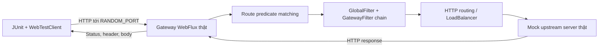
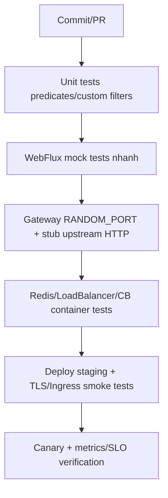

# WebTestClient cho kiểm thử toàn trình qua Gateway Server WebFlux

Một API Gateway có thể khởi động thành công, có đầy đủ route definitions và vượt qua unit test của từng filter nhưng vẫn chuyển tiếp request sai đường dẫn, xóa nhầm header xác thực, trả status khác backend, retry quá số lần cho phép hoặc định tuyến tới service ID không tồn tại. Những lỗi này thường chỉ lộ ra khi kiểm tra **toàn bộ đường đi qua Gateway**, từ HTTP client đến một upstream thực sự đang lắng nghe, rồi quay lại client.

Trong **Spring Cloud Gateway Server WebFlux**, `WebTestClient` của Spring Framework là một công cụ phù hợp để viết phép thử HTTP với cú pháp gọn, assertion rõ ràng và khả năng kiểm tra response body, headers, status, JSON hoặc streaming. Điểm quan trọng nhất của bài là **chọn đúng cách bind client**: để kiểm tra HTTP proxy thực, phải cho client kết nối tới một **Gateway server đang chạy** thay vì chỉ mock một controller hoặc một `WebHandler`.

Bài thuộc chương **Kiểm thử** của module `SPRING_CLOUD_GATEWAY`. Gateway thực hiện route predicates, filter chain, biến đổi path/header, service discovery và load balancing; trong thực tế còn có Spring Security/JWT, rate limiting, circuit breaker, retry, TLS và observability. Một bộ test đáng tin phải kiểm tra những thành phần này theo **hợp đồng đầu vào/đầu ra và hành vi upstream**, không chỉ khẳng định HTTP 200.

**Mục tiêu học tập:**

1. Phân biệt unit test, WebFlux mock test, integration test và **end-to-end trong phạm vi Gateway**.
2. Dùng `@SpringBootTest(webEnvironment = RANDOM_PORT)` kết hợp `WebTestClient.bindToServer()`.
3. Tạo upstream giả qua Reactor Netty hoặc công cụ tương đương, với cổng động và phản hồi có kiểm soát.
4. Kiểm tra `Path`, `Method`, `Host`, `StripPrefix`, request/response headers, JSON body, 404 và 503.
5. Kiểm tra chuỗi xử lý có Spring Security/JWT, Redis RateLimiter, LoadBalancer, Retry và CircuitBreaker mà không nhầm phạm vi test.
6. Thiết kế test độc lập, không flaky, có timeout rõ, cleanup tài nguyên và các phép kiểm tra âm tính.
7. Biết khi nào `WebTestClient` chưa đủ: WebSocket frames, TLS thực, production ingress và contract nghiệp vụ.

> **Phạm vi:** Ví dụ áp dụng cho **Spring Cloud Gateway Server WebFlux** sử dụng Spring WebFlux/Reactor Netty. Gateway Server Web MVC vận hành trên Servlet/WebMvc.fn và có khác biệt về route/filter/test wiring. Namespace ví dụ `spring.cloud.gateway.server.webflux.routes` phù hợp các nhánh Gateway mới; một số nhánh cũ dùng `spring.cloud.gateway.routes`. Annotation và artifact test có thể đổi package giữa Spring Boot 3 và 4; cần đối chiếu BOM/version thực tế. Bài soạn học liệu, **không chạy build hoặc phép thử trên repository**.

## 1. Thế nào là kiểm thử toàn trình qua Gateway?

Trong bài này, “toàn trình” (*end-to-end within the Gateway boundary*) nghĩa là:



Ở mức này ta kiểm tra các thành phần thực:

- Gateway application context và HTTP listener đang chạy.
- Route configuration được nạp từ properties/Bean theo phiên bản.
- Gateway `RoutePredicateHandlerMapping` lựa chọn route.
- Các filters được gắn và thực thi đúng thứ tự có hiệu lực.
- HTTP client của Gateway mở kết nối tới một backend test.
- Response từ backend và các response filters được trả tới test client.

“Upstream giả” **không** làm phép thử trở thành unit test: HTTP socket của Gateway và outbound socket vẫn tồn tại thật. Tuy nhiên, đây **không phải** end-to-end toàn bộ hệ thống production gồm CDN, ingress, identity provider, registry thật, database và người dùng trên Internet.

### 1.1. Ranh giới từng loại test

| Loại test | Cách dựng | Mục tiêu | Không chứng minh được |
| --- | --- | --- | --- |
| **Unit test** | Tạo predicate/filter/Java class và mock dependencies. | Logic nhỏ, branch, edge cases. | Route binding và Netty proxy thật. |
| **Mock WebFlux test** | `WebTestClient.bindToController(...)`, `bindToApplicationContext(...)` hoặc `bindToWebHandler(...)`. | WebFlux handler chain mà không mở server thật. | TCP connect/TLS/outbound proxy socket thật trong mọi trường hợp. |
| **Gateway HTTP integration test** | `@SpringBootTest(RANDOM_PORT)` + `bindToServer()` + test upstream. | Route/predicate/filter/Netty routing/response contract. | Hạ tầng Internet/ingress/registry production. |
| **System E2E** | Deployed Gateway + thật hoặc staging dependencies. | Tích hợp network, service discovery, auth, TLS, deploy. | Không thay unit test/fault injection chi tiết. |
| **Load/soak test** | Công cụ tạo tải, nhiều instances, SLO. | Latency, throughput, connection/memory. | Không tự chứng minh logic từng filter đúng. |

Không cần mọi test đều khởi động toàn bộ hệ thống. Chọn lớp test nhỏ nhất kiểm tra được rủi ro, nhưng giữ một nhóm **Gateway HTTP integration tests** cho các route quan trọng.

## 2. WebTestClient là gì?

`WebTestClient` thuộc package:

```java
org.springframework.test.web.reactive.server.WebTestClient
```

Nó cung cấp một DSL để gửi request và assert response:

```java
client.get()
    .uri("/api/catalog/products/42")
    .exchange()
    .expectStatus().isOk()
    .expectHeader().exists("Content-Type")
    .expectBody()
    .jsonPath("$.id").isEqualTo(42);
```

Luồng chính:

1. `get()/post()/put()/method(...)` chọn HTTP method.
2. `uri(...)` đặt path và query.
3. `header(...)/headers(...)/bodyValue(...)` đặt headers/body.
4. `exchange()` thực thi request.
5. `expectStatus()/expectHeader()/expectBody()` kiểm tra kết quả.

Điểm khác giữa `WebTestClient` và `WebClient` thông thường là **test assertion facade** sau `exchange()`. Nó có thể dùng client connector để nói chuyện với server thật hoặc mock server-side setup, tùy cách khởi tạo.

### 2.1. Chọn cách bind có chủ đích

| Khởi tạo | Có mở HTTP connection đến server thật? | Có phù hợp full Gateway proxy test? |
| --- | --- | --- |
| `WebTestClient.bindToController(...)` | Không. | **Không**: chỉ controller/handler. |
| `WebTestClient.bindToRouterFunction(...)` | Không. | Không kiểm chứng toàn bộ Gateway auto-configuration. |
| `WebTestClient.bindToApplicationContext(context)` | Không dùng listening server; mock WebFlux request/response. | Phù hợp test handler/context nhanh, nhưng **không thay** real HTTP test. |
| `WebTestClient.bindToWebHandler(...)` | Không. | Phù hợp kiểm tra handler riêng. |
| **`WebTestClient.bindToServer()`** | **Có**: kết nối tới một server đang chạy. | **Có** nếu base URL là Gateway test server. |

Một sai lầm hay gặp là viết:

```java
WebTestClient client =
    WebTestClient.bindToController(new HealthController()).build();
```

rồi đặt tên test `gatewayEndToEndTest`. Client ở đây **không đi qua route predicates và outbound routing của Gateway**.

### 2.2. `@AutoConfigureWebTestClient`

Spring Boot cũng có thể auto-configure `WebTestClient` trong `@SpringBootTest`. Với `webEnvironment = RANDOM_PORT` và hỗ trợ phù hợp, một client được inject có thể kết nối tới server đang chạy.

Ví dụ:

```java
@SpringBootTest(webEnvironment = SpringBootTest.WebEnvironment.RANDOM_PORT)
@AutoConfigureWebTestClient
class GatewaySmokeIT {

    @Autowired
    WebTestClient client;

    @Test
    void healthIsReachable() {
        client.get().uri("/actuator/health")
            .exchange()
            .expectStatus().isOk();
    }
}
```

**Nhưng:** package của `@AutoConfigureWebTestClient` có thay đổi giữa các thế hệ Spring Boot (Boot 3 và Boot 4), và một số starter test đã được modularize. Để nội dung minh họa ít phụ thuộc package annotation, bài thực hành chính sẽ **tự tạo WebTestClient bằng `bindToServer()`** với `@LocalServerPort`.

Đây là ví dụ *smoke test HTTP*, chưa phải kiểm thử route proxy vì `/actuator/health` có pipeline riêng và có thể không đi qua Gateway route.

## 3. Chuẩn bị môi trường test tối thiểu

Hệ thống test gồm:

- Ứng dụng Gateway Server WebFlux thực, được `@SpringBootTest` khởi động.
- Một **stub upstream** lắng nghe `127.0.0.1` trên cổng được OS chọn tự động.
- `WebTestClient` kết nối tới Gateway qua `127.0.0.1:<random-port>`.
- Cấu hình route được **inject vào test ApplicationContext** qua `@DynamicPropertySource`.
- Assertions xác minh **response** và **request thật tới stub**.

### 3.1. Dependencies liên quan

Với dự án Maven dùng Spring Cloud Gateway Server WebFlux, ví dụ khái niệm:

```xml
<!-- Dependency chính của Gateway Server WebFlux. -->
<dependency>
    <groupId>org.springframework.cloud</groupId>
    <artifactId>spring-cloud-starter-gateway-server-webflux</artifactId>
</dependency>

<!-- Spring Boot 3.x phổ biến: dùng test starter do BOM quản lý. -->
<dependency>
    <groupId>org.springframework.boot</groupId>
    <artifactId>spring-boot-starter-test</artifactId>
    <scope>test</scope>
</dependency>
```

Trong Spring Boot 4, các test starters/API được tách module hơn; tùy dependency tree, có thể cần `spring-boot-starter-webflux-test` hoặc test starter tương ứng để có `WebTestClient`/JUnit. **Không trộn vô điều kiện Boot 3 starter với Boot 4 artifacts**. Test Reactor Netty yêu cầu `reactor-netty-http`, thường có sẵn khi Gateway WebFlux dùng Netty, nhưng cần xác nhận dependency tree.

Phiên bản phụ thuộc được chọn theo **Spring Boot + Spring Cloud BOM tương thích**, không tự đặt một version mới nhất riêng cho Gateway.

### 3.2. Không hard-code port

Tránh:

```text
Gateway: http://localhost:8080
Stub:    http://localhost:8081
```

trong CI, vì hai test suites hoặc process khác có thể đang dùng cùng cổng.

`@SpringBootTest(webEnvironment = RANDOM_PORT)` để OS chọn port Gateway; stub cũng dùng `port(0)`. Sau đó inject địa chỉ upstream thật vào route property.

### 3.3. Cấu hình test phải được nạp trước khi route được tạo

Nếu Gateway có `uri: http://localhost:12345` trong một property đã bind lúc startup, thay property sau khi Spring context chạy **không tự đổi route**. Dùng `@DynamicPropertySource` để truyền URI khi tạo context, hoặc một cơ chế route refresh đã được kiểm thử và có version rõ ràng.

## 4. Bài thực hành đầy đủ: Gateway thật, upstream Netty thật

Giả sử client gọi:

```text
GET /api/catalog/products/42
```

Gateway phải thực hiện:

1. Match route ID `catalog-test`.
2. `StripPrefix=2`, chuyển `/api/catalog/products/42` thành `/products/42`.
3. Thêm request header `X-Test-From-Gateway: yes` trước khi gọi upstream.
4. Nhận JSON response từ stub upstream.
5. Thêm response header `X-Gateway-Response: active`.
6. Trả `200` và body JSON ban đầu cho client.

### 4.1. Một test class độc lập với cổng động

Đặt đoạn sau trong test source set của **ứng dụng Gateway WebFlux**. Giả sử Spring Boot test tìm thấy main `@SpringBootApplication` theo package convention và không có security route khác ghi đè đường test:

```java
package com.example.gateway;

import java.time.Duration;
import java.util.concurrent.atomic.AtomicInteger;
import java.util.concurrent.atomic.AtomicReference;

import org.junit.jupiter.api.AfterAll;
import org.junit.jupiter.api.BeforeEach;
import org.junit.jupiter.api.Test;

import org.springframework.boot.test.context.SpringBootTest;
import org.springframework.boot.test.context.SpringBootTest.WebEnvironment;
import org.springframework.boot.test.web.server.LocalServerPort;
import org.springframework.test.annotation.DirtiesContext;
import org.springframework.test.context.DynamicPropertyRegistry;
import org.springframework.test.context.DynamicPropertySource;
import org.springframework.test.web.reactive.server.WebTestClient;

import reactor.core.publisher.Mono;
import reactor.netty.DisposableServer;
import reactor.netty.http.server.HttpServer;

import static org.junit.jupiter.api.Assertions.assertEquals;
import static org.junit.jupiter.api.Assertions.assertNull;

@SpringBootTest(webEnvironment = WebEnvironment.RANDOM_PORT)
@DirtiesContext(classMode = DirtiesContext.ClassMode.AFTER_CLASS)
class CatalogGatewayIT {

    private static final AtomicInteger upstreamCalls =
        new AtomicInteger();

    private static final AtomicReference<String> observedPath =
        new AtomicReference<>();

    private static final AtomicReference<String> observedHeader =
        new AtomicReference<>();

    private static final AtomicInteger upstreamStatus =
        new AtomicInteger(200);

    // Stub HTTP thực: mở socket local, dùng cổng động.
    private static final DisposableServer STUB =
        HttpServer.create()
            .host("127.0.0.1")
            .port(0)
            .handle((request, response) -> {
                upstreamCalls.incrementAndGet();
                observedPath.set(request.uri());
                observedHeader.set(
                    request.requestHeaders().get(
                        "X-Test-From-Gateway"));

                return response
                    .status(upstreamStatus.get())
                    .header("Content-Type", "application/json")
                    .header("X-Upstream", "catalog-stub")
                    .sendString(
                        Mono.just(
                            "{\"id\":42,\"source\":\"stub\"}"));
            })
            .bindNow();

    @DynamicPropertySource
    static void testGatewayRoute(DynamicPropertyRegistry properties) {
        String prefix =
            "spring.cloud.gateway.server.webflux.routes[0].";

        properties.add(prefix + "id", () -> "catalog-test");
        properties.add(prefix + "uri",
            () -> "http://127.0.0.1:" + STUB.port());

        properties.add(prefix + "predicates[0]",
            () -> "Path=/api/catalog/**");

        properties.add(prefix + "filters[0]",
            () -> "StripPrefix=2");

        properties.add(prefix + "filters[1]",
            () -> "AddRequestHeader=X-Test-From-Gateway,yes");

        properties.add(prefix + "filters[2]",
            () -> "AddResponseHeader=X-Gateway-Response,active");
    }

    @LocalServerPort
    int gatewayPort;

    WebTestClient client;

    @BeforeEach
    void setup() {
        upstreamCalls.set(0);
        observedPath.set(null);
        observedHeader.set(null);
        upstreamStatus.set(200);

        client = WebTestClient.bindToServer()
            .baseUrl("http://127.0.0.1:" + gatewayPort)
            .responseTimeout(Duration.ofSeconds(5))
            .build();
    }

    @Test
    void forwardsMatchingRouteAndFilters() {
        client.get()
            .uri("/api/catalog/products/42")
            .exchange()
            .expectStatus().isOk()
            .expectHeader()
                .valueEquals("X-Upstream", "catalog-stub")
            .expectHeader()
                .valueEquals("X-Gateway-Response", "active")
            .expectBody()
                .jsonPath("$.id").isEqualTo(42)
                .jsonPath("$.source").isEqualTo("stub");

        assertEquals(1, upstreamCalls.get());
        assertEquals("/products/42", observedPath.get());
        assertEquals("yes", observedHeader.get());
    }

    @Test
    void unmatchedPathDoesNotCallUpstream() {
        client.get()
            .uri("/not-a-gateway-route")
            .exchange()
            .expectStatus().isNotFound();

        assertEquals(0, upstreamCalls.get());
        assertNull(observedPath.get());
    }

    @Test
    void preservesUpstreamErrorStatusByDefault() {
        upstreamStatus.set(503);

        client.get()
            .uri("/api/catalog/products/42")
            .exchange()
            .expectStatus().isEqualTo(503)
            .expectHeader()
                .valueEquals("X-Upstream", "catalog-stub");

        assertEquals(1, upstreamCalls.get());
    }

    @AfterAll
    static void shutdownStub() {
        STUB.disposeNow();
    }
}
```

### 4.2. Đọc kết quả test từng lớp

| Assertion | Kiểm tra điều gì? | Nếu sai, nên xem đâu? |
| --- | --- | --- |
| `expectStatus().isOk()` | Client nhận HTTP 200. | Route match, upstream, Security, filter. |
| `X-Upstream = catalog-stub` | Response thực đi qua backend stub. | Gateway routing/route URI. |
| `X-Gateway-Response = active` | Gateway response filter đã chạy. | Filter binding, filter order. |
| `jsonPath("$.id") = 42` | Body JSON được proxy đúng. | Codec/body transformation/upstream response. |
| `upstreamCalls = 1` | Stub nhận một request trong scenario này. | Retry, duplicate send, route mismatch. |
| `observedPath = /products/42` | `StripPrefix=2` đúng. | Prefix count, route path. |
| `observedHeader = yes` | Gateway đã thêm header ở outbound request. | Request header filter. |
| No-route status 404 + 0 upstream calls | Không có route phù hợp và không gọi backend. | Handler mapping, catch-all route khác. |
| Upstream 503 vẫn 503 | Không có filter biến đổi status ở test này. | Fallback, SetStatus, Retry, exception mapping. |

**Điều kiện của ví dụ:** Những test này giả định ứng dụng chỉ có route test liên quan hoặc không có route catch-all/security policy làm thay đổi kết quả. Nếu ứng dụng Gateway thật có thêm route glob `Path=/**`, filter bảo mật hoặc default-filters, phải cô lập profile/test configuration hoặc cập nhật assertions theo hợp đồng thực tế.

### 4.3. Vì sao phải assert request ở stub?

Chỉ viết:

```java
client.get().uri("/api/catalog/products/42")
    .exchange()
    .expectStatus().isOk();
```

là chưa đủ: một mock filter, fallback hoặc route khác cũng có thể trả 200. Kiểm tra request thực tế **đến upstream** giúp chứng minh outbound routing đã xảy ra.

### 4.4. Lưu ý isolation khi chạy song song

Test class dùng `AtomicInteger` và `AtomicReference` làm state để minh họa. Chúng thread-safe cho thao tác đơn lẻ nhưng **không tự cô lập các test methods chạy song song**. Nếu project bật JUnit parallel execution, mỗi test cần stub/route/key riêng hoặc áp chính sách chạy tuần tự phù hợp.

`@DirtiesContext` và `@AfterAll` giúp giảm nguy cơ một context được cache rồi tái sử dụng với upstream đã tắt, nhưng có chi phí startup. Với nhiều test classes, cân nhắc fixtures có lifecycle được quản lý bởi test extension và unique property scope.

## 5. Thay thế upstream: WireMock, MockWebServer hoặc Testcontainers

Không bắt buộc luôn dùng Reactor Netty stub. Mục tiêu quan trọng là có **HTTP server thật**, có thể điều khiển response và kiểm tra request nhận được.

| Công cụ | Điểm mạnh | Cần chú ý |
| --- | --- | --- |
| **Reactor Netty HttpServer** | Ít dependency ngoài stack WebFlux/Gateway, tự tạo handler cho test. | Muốn trả lời theo scenario phức tạp phải tự viết state. |
| **WireMock** | Stub mapping theo method/path/header, request journal, delays, fault injection. | Pin version/extension phù hợp Boot/JUnit; reset request journal. |
| **OkHttp MockWebServer** | Queue responses và kiểm tra `RecordedRequest`. | Quản lý lifecycle, concurrency và dependency riêng. |
| **Testcontainers** | Chạy Redis, registry hoặc backend container thật gần production. | Docker/container runtime trong CI, chậm hơn unit test. |
| **Embedded controller trong cùng Gateway** | Dễ khởi tạo. | Có thể **bỏ qua outbound proxy**, không chứng minh network routing. |

Một pattern với WireMock (pseudocode có tên API phổ biến; adapter/extension tùy version):

```text
Given stub:
  GET /products/42
  require X-Test-From-Gateway = yes
  respond 200 + application/json + {"id":42}

When:
  WebTestClient → Gateway /api/catalog/products/42

Then:
  status = 200
  JSON id = 42
  WireMock request journal thấy đúng 1 request
```

Đừng chỉ assert body. Hãy xác minh stub nhận **đúng method, path sau rewrite và các header đáng quan tâm**.

### 5.1. Khởi động upstream trước khi Gateway bind route

Với random port, route URI phải nhận đúng địa chỉ của stub **trước khi context bind route definitions**. Nếu stub được start trong `@BeforeEach` nhưng Gateway application context đã tạo trước đó, property route có thể đã bind vào giá trị cũ/không có.

Một phương án đơn giản là start stub trong static fixture hoặc test container lifecycle được `@DynamicPropertySource` tham chiếu.

### 5.2. Đừng dùng mock object thay thế HTTP socket khi muốn test proxy

`@MockitoBean` có thể phù hợp khi test custom service/filter logic, nhưng một mock `WebClient` hay mock `NettyRoutingFilter` có thể làm phép thử mất chính phần cần xác minh: URI, outbound HTTP và response propagation.

Test quan trọng nên đi qua Gateway listener rồi tới một stub HTTP thật.

## 6. Kiểm thử Route Predicate: Path, Method, Host, Header, Query

Một route có thể kết hợp nhiều predicates với quan hệ AND. `WebTestClient` gửi HTTP request thật nên test được các điều kiện này qua client request API.

Ví dụ cấu hình route riêng:

```yaml
spring:
  cloud:
    gateway:
      server:
        webflux:
          routes:
            - id: partner-orders
              uri: http://127.0.0.1:18081
              predicates:
                - Path=/partner/orders/**
                - Method=GET
                - Host=api.partner.test
                - Header=X-Partner-Tier,premium
```

**Cổng 18081 chỉ minh họa route config**, không dùng fixed port trong test suite chạy song song; thay bằng stub dynamic port theo mẫu mục 4.

### 6.1. Case khớp đủ điều kiện

```java
client.get()
    .uri("/partner/orders/42")
    .header("Host", "api.partner.test")
    .header("X-Partner-Tier", "premium")
    .exchange()
    .expectStatus().isOk();
```

### 6.2. Các case âm tính

| Request | Predicate thất bại | Kỳ vọng khi không có route khác |
| --- | --- | --- |
| `POST /partner/orders/42` | `Method=GET`. | 404, không tới stub. |
| `GET /partner/unknown` | `Path`. | 404, không tới stub. |
| Host `wrong.partner.test` | `Host`. | 404, không tới stub. |
| Thiếu `X-Partner-Tier` | `Header`. | 404, không tới stub. |
| Header `X-Partner-Tier: basic` | Regex tier. | 404, không tới stub. |

**Caveat:** Một Gateway có thêm route khác hoặc Spring Security có thể trả status khác trước/no-route. Assertion mạnh hơn là **“không tới upstream này”**, cùng kiểm tra route inventory và response status phù hợp contract.

### 6.3. Query và path encoding

Các test nên bao gồm:

- `?page=1&size=20` có đi tới backend và được encode đúng không?
- Path chứa `%20`, dấu cộng hoặc Unicode có bị decode/rewrite ngoài ý muốn?
- `RewritePath` có giữ đúng path variables và query string không?
- `Host` qua reverse proxy có dùng host header/trust boundary được cấu hình không?

`WebTestClient.uri(...)` có cơ chế URI building/encoding; đừng tự nối chuỗi đã encode hai lần rồi kết luận Gateway làm sai. Với URI cần byte-level fidelity, dùng URI builder và assert request-target ghi tại upstream.

## 7. Kiểm thử request và response filters

Filter chain là nơi dễ phát sinh regression: `StripPrefix`, `RewritePath`, `AddRequestHeader`, `RemoveRequestHeader`, `SetRequestHeader`, `AddResponseHeader`, `DedupeResponseHeader` hoặc `SetStatus`.

### 7.1. Request header đã tới upstream hay chưa?

Ví dụ:

```yaml
filters:
  - AddRequestHeader=X-Internal-Trace,gw-test
  - RemoveRequestHeader=X-Untrusted-Role
```

Test nên gửi `X-Untrusted-Role: administrator` rồi kiểm tra **stub**:

```text
Stub received:
  X-Internal-Trace = gw-test
  X-Untrusted-Role = absent
```

Chỉ assert client response không chứng minh một request header đã được xóa trước outbound hop.

### 7.2. Response header sau filter

```java
client.get().uri("/api/catalog/products/42")
    .exchange()
    .expectStatus().isOk()
    .expectHeader()
        .valueEquals("X-Gateway-Response", "active");
```

Để kiểm tra `RemoveResponseHeader`, dùng `expectHeader().doesNotExist("X-Secret")`. Để kiểm tra bảo mật, không expose raw `Set-Cookie` hoặc credentials từ upstream vô tình.

### 7.3. Kiểm tra filter ordering

Một route có `StripPrefix` và `RewritePath` có thể ra kết quả khác nếu đổi thứ tự. Thiết kế test:

```text
Given:
  /api/public/catalog/items/42
  StripPrefix=2
  RewritePath=/catalog/(?<remaining>.*), /$remaining

Expect:
  Upstream request-target = /items/42
```

Đây là minh họa logic; cần escape `$`/regex theo syntax YAML/shell, tránh copy trực tiếp mà không kiểm tra. Đặt **assert ở stub** để thấy thứ tự filter cuối cùng, không chỉ đọc thứ tự trong YAML.

### 7.4. JSON và binary body

`WebTestClient` hỗ trợ `bodyValue(...)`, `expectBody().jsonPath(...)`, `expectBody(byte[].class)` và các phương thức kiểm tra raw body. Với upload multipart hoặc streaming request, cần kiểm tra codecs, request size và upstream body bytes.

Body transformation filters (nếu dùng) có thể thay `Content-Length`/`Content-Type` và semantics của body; test cả content và headers. Không coi một response `200` là bằng chứng dữ liệu không bị cắt.

## 8. Kiểm thử status propagation: 2xx, 3xx, 4xx, 5xx

Một Gateway thường chuyển tiếp response status từ upstream trừ khi có filter/policy thay đổi nó.

| Stub upstream response | Phép kiểm tra nên có |
| --- | --- |
| `200 OK` + JSON | Status, Content-Type, JSON fields, body integrity. |
| `201 Created` + Location | Status và Location không bị đổi sai host/path. |
| `204 No Content` | Status và body rỗng. |
| `302/307 Redirect` | Location/header, tránh open redirect và mất method sai contract. |
| `400/422` | Error body/schema được giữ hoặc chuẩn hóa đúng. |
| `401/403` | Nguồn lỗi là Gateway Security hay backend? |
| `404` | Backend resource 404 hay route không match? |
| `429` | RateLimiter Gateway hay upstream? Header retry/quota. |
| `500/502/503/504` | Upstream error hay Gateway tạo lỗi trước backend. |

### 8.1. Phân biệt no-route 404 và backend 404

**No-route:** không có route match, upstream counter = 0.

**Backend 404:** route match và stub nhận request, nhưng trả 404.

```text
No-route 404:
  WebTestClient → Gateway → không match route → 404
  Stub requests = 0

Backend 404:
  WebTestClient → Gateway → route match → Stub trả 404
  Stub requests = 1
```

Hai test có thể cùng `expectStatus().isNotFound()` nhưng chứng minh hành vi hoàn toàn khác.

### 8.2. Kiểm tra 503 do LoadBalancer

Nếu route trỏ `lb://inventory-service` và không có instance nào, Gateway WebFlux thường trả **503** mặc định ở một số nhánh; một setting có thể đổi thành **404**. Điều đó khác với backend thật trả 503.

Để kiểm thử chính xác, cần kiểm soát `ServiceInstanceListSupplier`/registry của environment, **không chỉ** tạo một stub HTTP rồi tắt nó: khi stub chết, có thể là **connection refused/502/5xx khác**, không phải “không có service instance”.

## 9. Kiểm thử `lb://` và service discovery không ổn định

Một test chỉ dùng `uri=http://127.0.0.1:port` xác nhận Gateway Netty routing, nhưng **chưa xác nhận LoadBalancer path**. Nếu production dùng `lb://catalog-service`, có test riêng.

### 9.1. Hai cách tổ chức test

1. **SimpleDiscoveryClient/test supplier:** đăng ký một `ServiceInstance` trỏ tới stub dynamic port; route dùng `lb://catalog-service`.
2. **Registry thật trong Testcontainers/staging:** chạy Eureka/Consul/Kubernetes integration phù hợp và kiểm tra registration, readiness, load balancing.

Cách 1 nhanh, deterministic và phù hợp CI thường xuyên. Cách 2 gần hệ thống production nhưng tốn nhiều tài nguyên.

### 9.2. Fragment config cho SimpleDiscoveryClient

Nếu version hỗ trợ `SimpleDiscoveryClient` property binding:

```properties
spring.cloud.discovery.client.simple.instances.catalog-service[0].uri=http://127.0.0.1:18081
```

Trong test, **thay 18081 bằng stub port động**, cung cấp trước khi context khởi động, đồng thời route:

```yaml
uri: lb://catalog-service
```

Cần dependency Spring Cloud LoadBalancer phù hợp. Khi không có starter/loadbalancer filter tương ứng, Gateway không thể xử lý `lb://` như production.

### 9.3. Đừng nhầm “registry không có instance” với “stub down”

| Setup | Kết quả cần hiểu |
| --- | --- |
| Service ID không được discovery trả instance. | No-instance branch, 503/404 tùy version/config. |
| Discovery có instance nhưng socket bị refused. | Connection failure, status/exception mapping khác. |
| Instance trả 503 thật. | Backend-originated 503. |
| Instance trả 200 nhưng service ID sai tenant. | Security/routing regression dù HTTP success. |

### 9.4. Kiểm thử 2 instances

Tạo hai upstream stubs với header `X-Instance=A` và `X-Instance=B`, đăng ký hai `ServiceInstance`. Sau nhiều requests, có thể kiểm tra traffic phân phối theo policy LoadBalancer. **Không assert cứng “request 1 tới A, request 2 tới B”** nếu dùng round-robin/random, health checks hoặc connection-affinity không được cố định cho test. Chỉ assert hợp đồng phân phối ở mức phù hợp và kiểm tra instance selection logs/metrics.

## 10. Kiểm thử Spring Security, JWT và các header đáng tin

Trong Gateway WebFlux, **Spring Security WebFlux** có thể trả 401/403 trước khi route được match. Một bộ test proxy nên phân biệt:

- Bảo vệ route qua một `SecurityWebFilterChain` thật sự được nạp trong test application context, thay vì vô tình bỏ Security khi chuyển sang test slice.
- Client không gửi credential.
- Client gửi JWT hết hạn/chữ ký sai/audience sai.
- Client có JWT hợp lệ nhưng thiếu scope.
- Client có JWT hợp lệ với scope đúng.
- Client cố gửi `X-User-Id`/`X-Role` giả mạo.

### 10.1. Security test qua HTTP thật khác mock authentication

Trong test dùng `WebTestClient.bindToApplicationContext(...)`, có thể dùng Spring Security test helpers như `mockJwt()` để dựng authentication context. **Đừng mặc định `mockJwt()` sẽ tạo một JWT hợp lệ đi qua mạng** khi dùng `WebTestClient.bindToServer()`. Với live HTTP test, Gateway thật phải nhận một Bearer token được verify bằng cấu hình resource server tương ứng.

Lựa chọn an toàn:

1. Chạy **test identity issuer/JWK server** hoặc mock endpoint JWK được cấu hình riêng.
2. Tạo token thử có chữ ký/issuer/audience/expiry/scope theo policy của ứng dụng.
3. Gửi token qua `Authorization: Bearer <test-token>`.
4. Assert 401/403/200 và kiểm tra upstream chỉ được gọi khi được phép.
5. Đảm bảo test credentials không dùng ở production và không bị log.

### 10.2. Test 401 trước route

```java
client.get()
    .uri("/api/orders/42")
    .exchange()
    .expectStatus().isUnauthorized();
```

Chỉ assert 401 khi test profile **thật sự yêu cầu authentication** trên path này. Nếu route khác hoặc profile có `permitAll()`, 401 không phải kỳ vọng hợp lệ.

Thêm assert `stub requests = 0` để chứng minh không chuyển request trái phép xuống backend.

### 10.3. Test thiếu quyền

```java
client.get()
    .uri("/api/orders/42")
    .headers(headers ->
        headers.setBearerAuth(validTokenWithoutOrdersScope))
    .exchange()
    .expectStatus().isForbidden();
```

`validTokenWithoutOrdersScope` là **fixture token đã ký** từ test issuer, không phải Java variable được Spring tự cấp. Test này phải có security policy yêu cầu scope và issuer phù hợp.

### 10.4. Không tin header danh tính từ client

Gửi `X-Internal-User: admin` từ client thường và xác minh Gateway xóa/bỏ qua giá trị đó hoặc backend không chấp nhận nó. Để test **identity propagation**, so sánh request mà stub nhận với authentication đáng tin từ JWT/mTLS, không chỉ một header client tự đặt.

### 10.5. CORS preflight

WebTestClient gửi `OPTIONS`:

```java
client.options()
    .uri("/api/orders")
    .header("Origin", "https://app.example.test")
    .header("Access-Control-Request-Method", "POST")
    .header("Access-Control-Request-Headers", "authorization")
    .exchange()
    .expectStatus().isOk()
    .expectHeader()
        .valueEquals(
            "Access-Control-Allow-Origin",
            "https://app.example.test");
```

Đây là **kỳ vọng cho policy đã cấu hình để cho phép origin**, không phải mặc định. Preflight có thể trả 200 hoặc 204 theo xử lý CORS/version; test cần bám API contract. CORS preflight thường được xử lý trước Gateway route hoặc ở WebFilter khác, nên không suy rằng stub phải nhận OPTIONS.

## 11. Kiểm thử RequestRateLimiter và HTTP 429

Với Gateway Server WebFlux, `RequestRateLimiter` có thể dùng RedisRateLimiter và `KeyResolver` reactive. Test rate limiting cần **storage có state**, hoặc một limiter mock/deterministic tuân theo contract.

### 11.1. Những bất biến nên test

- Key/user A được phép trong quota.
- A vượt quota nhận 429 (nếu dùng default response status).
- Key/user B không tự bị chặn bởi A, nếu policy per-user.
- Upstream counter không tăng đối với các requests bị limiter chặn.
- Nếu không xác định được key, policy deny-empty xử lý như đã cấu hình.
- Không thể đổi header không đáng tin để né rate limit.
- Quota không vô tình được reset giữa requests vì tạo key mới.

### 11.2. Khi nào cần Redis Testcontainer?

Nếu production dùng `RedisRateLimiter`, một Redis container thật trong integration test có thể xác minh Redis script/state, namespace, concurrency và exception handling gần production hơn mock `RateLimiter`.

Nhưng cần:
- Image/version được pin và container lifecycle độc lập.
- Không dùng Redis production.
- Key namespace riêng cho mỗi test.
- Dọn state mà **không** xóa keys của test khác.
- Kiểm tra quay vòng token theo thời gian thay vì dùng `Thread.sleep(...)` tùy tiện.

### 11.3. Tại sao test 429 dễ flaky?

Token bucket có refill, vì vậy gửi 11 requests tuần tự với capacity 10 **không chắc** request thứ 11 bị 429 nếu thời gian đã đủ nạp token.

Nên:
- Dùng quota nhỏ và refill window dài trong test.
- Cô lập keys; bắt đầu từ state rõ ràng.
- Assert số accepted/denied trong một burst có kiểm soát.
- Nếu cần thời gian chính xác, unit test limiter với clock/test scheduler phù hợp.
- Đo rate-limit decision **và upstream hit count**.

## 12. Kiểm thử Retry: số lần gọi upstream mới là chứng cứ

Gateway có thể retry khi upstream trả status phù hợp. Một client request có thể tạo **nhiều upstream attempts**.

Ví dụ policy **chỉ GET**:

```yaml
filters:
  - name: Retry
    args:
      retries: 1
      statuses:
        - SERVICE_UNAVAILABLE
      methods:
        - GET
```

Đây là một **fragment route filter**, không phải full application YAML. Cần đối chiếu tên filter/args với Gateway version.

### 12.1. Scenario có kiểm soát

```text
Given upstream:
  Attempt 1 → HTTP 503
  Attempt 2 → HTTP 200

When:
  WebTestClient GET /api/catalog/products/42

Then:
  Gateway trả 200 nếu retry thành công
  Upstream nhận 2 requests
  Path/header được giữ đúng ở cả hai attempts
```

Một phép thử chỉ assert client nhận 200 **không chứng minh Retry đã chạy**: stub có thể đã trả 200 ngay từ attempt đầu. Ghi nhận số attempts và status sequence tại mock upstream.

### 12.2. Tránh Retry POST không có idempotency

Không tự bật retry cho `POST /api/payments` rồi kỳ vọng không double-charge. Kiểm thử POST retry chỉ hợp lệ khi backend có idempotency contract/unique operation ID và có thể xác minh số lần commit. Rate limiter chỉ giới hạn số request, không bù trừ tác dụng phụ.

### 12.3. Retry và timeout

Nếu Gateway retry sau connect timeout, thời gian tổng cộng có thể vượt một timeout mà test client đặt. Cần định nghĩa **deadline end-to-end** và **per-attempt timeout** riêng, không đơn giản tăng `WebTestClient.responseTimeout` vô hạn cho test pass.

## 13. Kiểm thử CircuitBreaker, fallback và status cuối

Nếu Gateway route dùng CircuitBreaker:

- Khi upstream khỏe, request đến backend và trả status/body thật.
- Khi upstream lỗi theo policy, fallback có thể trả `200` hoặc `503` tùy contract.
- Khi breaker **OPEN**, request có thể bị từ chối mà **không tới upstream**.
- Khi breaker HALF_OPEN, số probe requests phụ thuộc cấu hình và concurrency.

### 13.1. Kiểm thử trạng thái, không dựa vào sleep

Một test tốt cần có cách điều khiển CircuitBreaker state/registry của riêng test:

```text
Test 1: CLOSED
  upstream returns 200
  expect upstream hit = 1

Test 2: OPEN
  controlled breaker state = OPEN
  expect response/fallback theo contract
  expect upstream hit = 0

Test 3: HALF_OPEN
  controlled clock/state + permitted probe
  expect đúng số probe mà policy cho phép
```

Tránh gọi nhiều requests và `Thread.sleep(10000)` rồi mong breaker đã mở/chuyển trạng thái theo đúng thời điểm trên mọi CI machine.

### 13.2. HTTP 200 có thể là fallback

Nếu fallback controller trả 200 khi upstream 503, chỉ assert status 200 có thể tạo **false green test**. Bổ sung:
- Header/body marker của fallback.
- Upstream hit count.
- CircuitBreaker metric/event.
- Trace/observation cho lỗi gốc.

## 14. Timeout: ba tầng không được nhầm

Trong integration test có ít nhất ba loại timeout:

| Timeout | Nằm ở đâu? | Ý nghĩa |
| --- | --- | --- |
| **Test client response timeout** | `WebTestClient.bindToServer().responseTimeout(...)`. | Test client không chờ response vô hạn. |
| **Gateway connect timeout** | HTTP client của Gateway tới upstream. | Giới hạn thời gian thiết lập kết nối. |
| **Gateway response timeout** | HTTP proxy/client route config. | Giới hạn chờ response theo contract/version. |
| **Mock upstream delay** | Stub HTTP. | Mô phỏng backend chậm hoặc không phản hồi. |
| **JUnit/build timeout** | Test runner/CI. | Không để job treo vô thời hạn. |

`WebTestClient.responseTimeout(Duration.ofSeconds(5))` **không** thay đổi Gateway `connect-timeout` hay `response-timeout`. Nếu test client hết hạn trước, bạn chỉ biết **client không nhận được response trong 5 giây**, chưa biết Gateway đã map upstream timeout thành status nào.

### 14.1. Test thời gian không nên đo bằng sleep tuyệt đối

Thay vì test “Gateway phải trả timeout sau đúng 500 ms”, hãy:
- Dùng mock upstream có delay vượt Gateway timeout một khoảng an toàn.
- Chọn deadline có biên, tránh chạy sát threshold.
- Assert status/exception theo contract.
- Theo dõi requests và cancellation/connection close ở stub.
- Tránh đòi một millisecond chính xác khi CI có tải/GC/network scheduling khác.

### 14.2. `Connection refused` khác no-instance 503

Nếu registry trả địa chỉ một instance nhưng stub đã dừng, Gateway có thể gặp connection refused/connection reset/timeout. Status từ Gateway phụ thuộc exception handling/version/filter, không được ép mọi trường hợp thành 503 không có instance.

Một test nên mô tả **sự cố cụ thể**: no instance, socket refused, slow response, TLS failure hay backend HTTP 503.

## 15. HTTP request và response body: JSON, form, multipart

Một Gateway không được tự đổi nội dung JSON nếu route không có body modification filter.

Ví dụ request JSON:

```java
client.post()
    .uri("/api/orders")
    .contentType(org.springframework.http.MediaType.APPLICATION_JSON)
    .header("Idempotency-Key", "operation-test-42")
    .bodyValue("""
        {"sku":"A-42","quantity":2}
        """)
    .exchange()
    .expectStatus().isCreated()
    .expectBody()
    .jsonPath("$.orderId").exists();
```

**Lưu ý:** Java text blocks yêu cầu Java 15+; với Java 17 hoặc 21 hiện đại có thể dùng. Đây là ví dụ trên route đã được cấu hình để **cho phép POST và trả 201**, còn stub phải được chuẩn bị cho đúng response.

### 15.1. Header/bytes cần kiểm chứng tại upstream

Khi test `Content-Type: application/json`, `Idempotency-Key` hoặc file upload multipart:

- Stub nhận header đúng không?
- Body bytes có giữ nguyên không?
- Gateway có accidentally consume/release request body trước khi routing không?
- Query encoding và path variables có bị thay sai không?
- Max request size limit trả status nào?
- Retry có phát lại body không; có giới hạn/idempotency không?

Multipart và binary có thể không phù hợp để so sánh raw body byte-by-byte nếu boundary/transfer encoding thay; kiểm tra **cấu trúc part, tên file, content và chính sách kích thước**.

### 15.2. Không log body nhạy cảm trong test output

Wiretap/Gateway debug logs có thể ghi JWT, cookie, body payment hoặc file upload. Chỉ bật ở staging cô lập, dùng test tokens, ẩn credentials và kiểm soát CI artifacts/retention.

## 16. Kiểm thử SSE/streaming: không đợi stream kết thúc

`WebTestClient` hỗ trợ test HTTP streaming. Với `text/event-stream` hoặc NDJSON, response có thể **không bao giờ hoàn tất**; gọi `expectBodyList(...)` để collect toàn bộ có thể làm test treo.

Một pattern từ Spring Framework là lấy `FluxExchangeResult` và dùng Reactor Test `StepVerifier`:

```java
import java.time.Duration;

import org.springframework.http.MediaType;
import org.springframework.test.web.reactive.server.FluxExchangeResult;

import reactor.test.StepVerifier;

FluxExchangeResult<String> result =
    client.get()
        .uri("/api/events")
        .accept(MediaType.TEXT_EVENT_STREAM)
        .exchange()
        .expectStatus().isOk()
        .expectHeader()
            .contentTypeCompatibleWith(MediaType.TEXT_EVENT_STREAM)
        .returnResult(String.class);

StepVerifier.create(result.getResponseBody())
    .expectNextCount(2)
    .thenCancel()
    .verify(Duration.ofSeconds(10));
```

**Điều kiện:** Backend stub thực sự phát ít nhất hai data elements được String decoder giải mã. Nếu backend chỉ gửi SSE comment heartbeat mà không có data events, `expectNextCount(2)` có thể không bao giờ thỏa. Test phải có **bounded event fixture** và cancellation observation.

### 16.1. Streaming test nên kiểm tra gì?

- Response có HTTP status và Content-Type đúng.
- Client nhận dữ liệu theo thứ tự, không chỉ sau khi stream đóng.
- Không bị buffer toàn bộ vô hạn tại Gateway/proxy.
- Cancel subscription khiến upstream connection/handler cleanup theo hợp đồng.
- Một slow consumer không làm queue tăng không giới hạn.
- Timeout/liveness của stream được hiểu riêng với HTTP JSON request ngắn.

### 16.2. WebSocket frames là bài toán khác

`WebTestClient` là HTTP test client và phù hợp để test **HTTP handshake preparation** hoặc WebFlux HTTP streaming. Nó **không phải công cụ đầy đủ để gửi/nhận WebSocket frames sau Upgrade**.

Với Gateway WebFlux `ws://`/`wss://`, hãy dùng **WebSocket client** thích hợp như `ReactorNettyWebSocketClient` hoặc `StandardWebSocketClient` để test:
- Handshake 101.
- Ping/Pong hoặc application heartbeat.
- Frame forwarding hai chiều.
- Close code/reconnect.
- Giới hạn frame size và session cleanup.

Đừng assert 101 bằng WebTestClient rồi tuyên bố đã test WebSocket proxy thành công đầu-cuối.

## 17. TLS, proxy headers và sự khác nhau giữa local HTTP và production HTTPS

Test main ở mục 4 dùng:

```text
Client → http://127.0.0.1:<gateway-port>
Gateway → http://127.0.0.1:<stub-port>
```

Nó **không kiểm thử**:
- TLS certificate chain, hostname verification, mTLS.
- Ingress/CDN `X-Forwarded-For`/`Forwarded` trust boundary.
- HTTP/2, ALPN, proxy protocol.
- DNS/mesh/network policy/firewall thật.
- Timeouts/retries do external load balancer áp dụng.

Nếu Gateway production dùng `https://` upstream, cần integration/staging test riêng với **test CA và certificates hợp lệ**, xác minh Gateway từ chối sai hostname/CA. Không tắt TLS validation chỉ để làm test pass rồi tái sử dụng cấu hình ấy trong production.

### 17.1. Host và forwarded headers phải kiểm tra trust policy

Một client có thể tự gửi `X-Forwarded-Host` hoặc `X-Forwarded-Proto`. Test nên xác minh Gateway chỉ tin forwarded headers từ ingress đã được cấu hình tin cậy, không phản chiếu header giả vào redirect URL hay authorization context.

### 17.2. Ingress test khác Gateway local integration

Một route có thể pass qua Gateway Netty HTTP test nhưng fail ở ingress do rewrite/idle timeout/max body size. Hãy giữ một nhóm **deployed smoke/system tests** để kiểm tra ingress production-like topology, không cố ép một local Gateway test chứng minh mọi hop.

## 18. Observability trong quá trình test

Dữ liệu theo route rất hữu ích khi test thất bại:

- Gateway logs có route ID được chọn và request correlation.
- Stub có request journal/hit count.
- `spring.cloud.gateway.requests` metric (nếu version/Actuator bật) có thể phân biệt request status theo route.
- HTTP client observations/tracing chỉ ra attempts/latency.
- Security logs cho 401/403 trước Gateway route.
- Redis/LoadBalancer/CircuitBreaker metrics cho 429/503/fallback.

Nếu môi trường test bật Micrometer và xuất số liệu sang **Prometheus**, có thể kiểm tra meter `spring.cloud.gateway.requests` và tag `routeId` sau một request thực, nhưng exporter/scrape có độ trễ và không thay assertion HTTP/stub. Không buộc integration test phụ thuộc một Prometheus server bên ngoài khi mục tiêu chỉ là xác minh routing.

### 18.1. Correlation ID không phải credential

Có thể gửi một test correlation header:

```java
client.get()
    .uri("/api/catalog/products/42")
    .header("X-Test-Correlation-Id", "case-42")
    .exchange()
    .expectStatus().isOk();
```

Sau đó kiểm tra stub/log/tracing có cùng marker, **nếu hệ thống có filter propagation**. Đây không phải một header mặc định luôn được Gateway copy theo mọi policy.

### 18.2. Test định tuyến nên kiểm tra route ID không?

Có thể bật logging/metrics/Actuator trong staging và xác minh route ID, nhưng test không nên phụ thuộc raw Netty debug log format vốn thay đổi qua phiên bản. Hợp đồng chính vẫn là:
- Request đến đúng stub.
- Path/header/status/body đúng.
- Không match route khác.
- Ứng dụng quan sát đủ để phân tích khi thất bại.

### 18.3. 401 và 404 trước route không nhất thiết có Gateway route metrics

Một request chưa match route hoặc bị Spring Security chặn sớm có thể **không** xuất hiện trong `spring.cloud.gateway.requests{routeId=...}`. Kiểm tra HTTP server observation hoặc ingress logs nếu muốn đo toàn bộ input traffic.

## 19. Tránh flaky tests: thời gian, trạng thái và cổng

Những nguyên nhân test chỉ fail trong CI:

| Triệu chứng | Nguồn gây flaky | Cách khắc phục |
| --- | --- | --- |
| Connection refused ngẫu nhiên | Stub chưa start hoặc đã dispose trước Gateway. | Start trước context, quản lý fixture lifecycle. |
| Port already in use | Hard-code 8080/8081. | `RANDOM_PORT` và `port(0)`. |
| Retry test đôi khi 1, đôi khi 2 attempts | Stub queue state bị dùng chung. | Reset mỗi scenario, không chạy đồng thời trên cùng fixture. |
| RateLimit 429 lúc có lúc không | Bucket refill, key dùng chung, Redis state cũ. | Key riêng, fixed quota/test clock, reset state. |
| CircuitBreaker chưa OPEN | Dựa vào sleep/timing. | Điều khiển state/event bằng API test phù hợp. |
| Test body treo | Stream vô hạn và `expectBodyList`. | `returnResult` + StepVerifier + cancel + deadline. |
| Auth bất ngờ 401 | Test issuer/JWK chưa sẵn, token sai giờ. | Clock/test issuer có chủ đích, valid token fixture. |
| Sau khi test A chạy, test B fail | Mutate shared config/route cache. | Isolation, context lifecycle, cleanup. |
| Metrics chưa xuất hiện | Chưa có request hoặc scrape chưa đến. | Assert meter/fixtures có polling bounded nếu cần. |
| Local pass, CI fail do HTTPS | CA/certificate/hostname khác. | Test CA và trust store rõ, không disable verification. |
| Timeout thất bại ngẫu nhiên | Deadline quá sát, CI/GC/network jitter. | Deadline có biên, fault injection deterministic. |
| Nhiều instance kết quả khác | Registry/LoadBalancer chọn ngẫu nhiên. | Test supplier có kiểm soát, không assert thứ tự không bảo đảm. |

### 19.1. Tách test data theo class

Nếu cùng Redis, Testcontainers hoặc mock upstream được nhiều tests dùng:
- Unique namespace/key theo class/test.
- Reset request journal và server response scenario.
- Không sửa route definitions global trong lúc test khác đang chạy.
- Dừng mock servers ở đúng lifecycle.
- Không dùng `Thread.sleep` dài để chờ eventual consistency; dùng polling có timeout và điều kiện rõ.

### 19.2. Không tạo quá nhiều ApplicationContexts

`@DirtiesContext` giúp cô lập nhưng làm mất Spring context caching. Dùng có chọn lọc:
- Unit/fast handler tests không cần restart Gateway.
- Integration suite nhóm routes cùng config có thể chia một context ổn định.
- Chỉ dùng `@DirtiesContext` khi test thay state/config ảnh hưởng các test khác.

### 19.3. Assert cả số lần upstream không được gọi

Để chứng minh ngăn chặn sớm, `upstreamRequests == 0` là assertion mạnh:

- 401/403 do Security.
- 429 do RequestRateLimiter.
- 404 do không match route.
- CircuitBreaker OPEN có fallback cục bộ.
- Invalid input chặn tại Gateway.

Đừng chỉ kiểm tra response code vì chính stub cũng có thể trả mã đó.

## 20. Khi nào dùng `StepVerifier`, khi nào dùng `WebTestClient`?

`WebTestClient` kiểm tra HTTP request-response bên ngoài. `StepVerifier` kiểm tra **Reactor Publishers** hoặc response body streaming.

| Mục tiêu | Công cụ chính |
| --- | --- |
| HTTP status, headers, JSON body sau Gateway | **WebTestClient**. |
| Streaming response có nhiều elements không kết thúc | WebTestClient `returnResult` + **StepVerifier**. |
| Custom `GlobalFilter` trả một `Mono<Void>`, unit-level | StepVerifier hoặc mock exchange/chain phù hợp. |
| CircuitBreaker state/event publisher | Reactor testing, registry-specific test API. |
| WebSocket frame exchange | Dedicated WebSocket client + Reactor Test. |
| Redis/quota state end-to-end | WebTestClient + Redis Testcontainer + metrics/assertions. |
| Route predicate logic độc lập | Unit test factory/predicate, bổ sung HTTP integration test. |

`StepVerifier` không tự mở socket Gateway. Ngược lại, `WebTestClient` không thay được tool kiểm tra backpressure/virtual time của một Publisher bên trong Reactor pipeline.

## 21. Tối ưu bộ test cho pipeline CI/CD

Một lộ trình thực tế:



Không cần mọi commit chạy full production-like cluster; nhưng **các route quan trọng phải có integration assertions**.

### 21.1. Tag test theo chi phí

- **Fast:** logic pure Java, custom predicate, key resolver.
- **Gateway integration:** random-port server, test HTTP stub.
- **Dependency integration:** Redis/Testcontainers, discovery, JWT issuer.
- **Staging system:** CDN, ingress, mTLS, multiple replicas.
- **Load/soak:** burst, p95/p99, memory/leaks.

Tên class `*IT` hay JUnit tags chỉ là convention; phải cấu hình Maven Surefire/Failsafe hoặc Gradle test tasks đúng thì test mới chạy trong pipeline.

### 21.2. Test failure phải có khả năng chẩn đoán

Khi fail, report nên có:
- Scenario/route ID/method/path.
- Response status và một phần body **đã che dữ liệu nhạy cảm**.
- Recorded requests tới upstream (số lượng, path, key headers).
- Gateway log/trace ID/test correlation ID.
- Stub server scenario (200/503/delay).
- Spring Boot/Cloud/Gateway version và active test profile.
- Không bao gồm bearer token/cookie/PII.

## 22. Ma trận test tối thiểu cho Gateway Server WebFlux

| Case | Input/fixture | Kỳ vọng |
| --- | --- | --- |
| Path match | `GET /api/catalog/products/42`. | Stub nhận path sau `StripPrefix` và trả 200. |
| Path mismatch | `GET /not-a-route`. | No-route response, stub 0 hits. |
| Method predicate | `POST` vào route chỉ GET. | Không tới target stub. |
| Host/header predicate | Thiếu Host/Header đúng. | Không match route tương ứng. |
| Query/path encoding | Query và encoded URL. | Upstream nhận request-target theo contract. |
| AddRequestHeader | Gateway thêm marker. | Stub thấy header chính xác. |
| RemoveRequestHeader | Client gửi untrusted header. | Stub không thấy giá trị cấm. |
| Response headers | Stub và Gateway thêm headers. | Client thấy headers cuối. |
| JSON response | Stub trả body nhiều fields. | Client JSONPath/bytes đúng. |
| Binary/multipart | Upload/download fixture. | Size/content/parts giữ đúng theo policy. |
| Upstream 404 | Stub trả 404. | Stub hit=1, client 404 nếu không mapping khác. |
| No-route 404 | Không route match. | Stub hit=0, client 404 nếu không handler khác. |
| Upstream 503 | Stub trả 503. | Client final status theo filter contract, hit=1. |
| No-instance LoadBalancer | `lb://` không có instances. | 503/404 theo version/config, không request tới stub. |
| Connection refused | Discovery vẫn có instance nhưng port đóng. | Lỗi network được map và ghi nhận đúng. |
| Authentication thiếu | Route cần JWT, không có token. | 401 theo Security policy, stub 0 hits. |
| Authorization thiếu | Token hợp lệ thiếu scope. | 403, stub 0 hits. |
| Forged identity header | Client tự gửi admin header. | Không bypass security hoặc truyền trust header sai. |
| CORS preflight | OPTIONS hợp lệ. | Allowed origin/method headers, không leak credentials. |
| RequestRateLimiter | Key A burst quá quota. | 429 theo policy, upstream không nhận denied request. |
| Retry GET 503→200 | Stub response sequence. | Client 200, stub thấy 2 attempts. |
| Retry POST | Không idempotency. | Không vô tình bật retry tạo side effects. |
| CircuitBreaker OPEN | State được điều khiển. | Fallback/status đúng, stub 0 hits. |
| Upstream delay | Stub trì hoãn quá route timeout. | Gateway timeout semantics và client budget đúng. |
| SSE | Stream phát 2 events. | StepVerifier nhận 2 elements rồi cancel. |
| WebSocket | ws/wss route. | Dùng WebSocket client để kiểm tra frames/close. |
| Actuator metrics | Có route traffic. | Meter routeId/status cập nhật theo version. |
| Multi-replica | Hai Gateway instances. | Cấu hình/route/quota state nhất quán. |
| Dynamic route refresh | Source version mới. | Effective route đổi, không còn route cũ ngoài contract. |

## 23. Những nhầm lẫn thường gặp

| Nhận định | Vì sao sai hoặc thiếu? | Cách làm đúng |
| --- | --- | --- |
| “Có WebTestClient là đã end-to-end.” | Client có thể bind mock controller/context. | Dùng `bindToServer` tới Gateway thật. |
| “RANDOM_PORT là đủ.” | Nếu gọi Actuator health, chưa proxy upstream. | Kiểm tra route và recorded upstream request. |
| “HTTP 200 nghĩa là route đúng.” | Fallback hoặc handler khác có thể trả 200. | Assert stub hits/path/headers/body. |
| “404 luôn là no-route.” | Backend cũng có thể trả 404. | So sánh stub hit count. |
| “503 luôn là không có service instance.” | Có thể upstream thật trả 503 hoặc socket lỗi. | Kiểm soát discovery và mock status riêng. |
| “mockJwt dùng được cho real HTTP tự động.” | Mock auth context không tự tạo JWT có chữ ký qua wire. | Dùng test issuer/token hợp lệ. |
| “Một client request = một upstream request.” | Retry có thể tạo nhiều attempts. | Count requests tại stub. |
| “429 chỉ cần assert một lần.” | Bucket refill/keys/states khác nhau. | Cô lập bucket và quota window. |
| “responseTimeout test client là Gateway timeout.” | Hai tầng khác nhau. | Cấu hình/kiểm chứng cả hai. |
| “Dùng localhost:8080 làm CI ổn.” | Port collision khi tests chạy song song. | Random ports/DynamicPropertySource. |
| “Chỉ mock NettyRoutingFilter vẫn là proxy test.” | Bỏ qua actual outbound routing. | HTTP stub thật. |
| “Đổi property giữa test methods tự reload route.” | Context/route cache có lifecycle riêng. | Cấu hình trước start hoặc refresh đúng cơ chế. |
| “Chỉ status 200 chứng minh Security pass.” | Có thể config permitAll/fallback route. | Auth fixtures và stub assertions. |
| “WebTestClient kiểm tra mọi WebSocket frame.” | HTTP testing và WebSocket frame protocol khác. | Dedicated WebSocket client. |
| “SSE dùng expectBodyList cho stream vô hạn.” | Chờ body hoàn tất có thể treo. | FluxExchangeResult + StepVerifier cancel. |
| “Mọi test chạy thật nên tốt nhất.” | Chậm/flaky, khó debug các branch nhỏ. | Unit + integration + staging có phân tầng. |

## 24. Bài tập có đáp án

### Bài 1 — Nhận diện test không qua socket

Một test dùng `WebTestClient.bindToController(new ProductController())` và assert 200. Nó có chứng minh Gateway đã proxy tới catalog-service không?

**Đáp án:** Không. Nó chỉ kiểm tra mock controller; cần `bindToServer()` tới Gateway thật và recorded request tại upstream.

### Bài 2 — Tác dụng của `RANDOM_PORT`

Vì sao `@SpringBootTest(webEnvironment=RANDOM_PORT)` tốt hơn port 8080 cố định?

**Đáp án:** Giảm port collision khi chạy CI hoặc nhiều test/process đồng thời; lấy port thật bằng `@LocalServerPort`.

### Bài 3 — `StripPrefix=2`

Client gọi `/api/catalog/products/42`, route dùng `StripPrefix=2`. Upstream nên nhận path nào?

**Đáp án:** `/products/42`, giả sử không có filter rewrite khác.

### Bài 4 — Route trả 404

Một request trả 404. Bằng chứng nào giúp phân biệt Gateway no-route và backend 404?

**Đáp án:** Stub hit count và recorded request: no-route không tới stub; backend 404 thì có request đến stub.

### Bài 5 — Header bảo mật

Client gửi `X-Internal-Role: admin`, nhưng Gateway cần xóa header ấy. Nên assert ở đâu?

**Đáp án:** Tại recorded request của stub upstream; client response status không đủ chứng minh header đã bị xóa.

### Bài 6 — Retry GET

Stub trả 503 ở attempt 1 và 200 ở attempt 2; Gateway được cấu hình retry GET 1 lần. Hai assertion quan trọng nhất?

**Đáp án:** Client final status 200 và stub nhận **2 requests** với method/path đúng.

### Bài 7 — Token JWT

Test dùng `bindToServer()`, gọi `mockJwt()` rồi mong server ngoài mạng nhận JWT. Có vấn đề gì?

**Đáp án:** Mock auth context không phải bearer token đã ký qua HTTP. Cần test issuer/JWK và signed token hoặc một phương án authentication fixture được server thật chấp nhận.

### Bài 8 — RateLimiter

Capacity nhỏ, nhưng request thứ tư đôi khi không nhận 429. Có chứng minh limiter sai không?

**Đáp án:** Chưa. Token có thể refill, Redis state hoặc key khác. Cần isolated key/state và kiểm soát khoảng test.

### Bài 9 — SSE vô hạn

Test `expectBodyList(String.class)` trên SSE stream vô hạn bị treo. Khắc phục?

**Đáp án:** Dùng `returnResult(String.class)` để lấy Flux, `StepVerifier` nhận số phần tử hữu hạn rồi `thenCancel()` cùng deadline.

### Bài 10 — Client timeout

`WebTestClient.responseTimeout(2s)` bị lỗi khi backend chậm. Có thể suy Gateway response-timeout là 2 giây không?

**Đáp án:** Không. Đó là timeout của **test client**, không phải Gateway outbound HTTP client.

### Bài 11 — `lb://` vs HTTP literal

Test route dùng `http://127.0.0.1:port` có chứng minh LoadBalancer hoạt động không?

**Đáp án:** Không. Phải có test riêng route `lb://service-id` cùng controlled service discovery/supplier.

### Bài 12 — Không có instance hay connection refused?

Stub đã shutdown nhưng discovery vẫn trả địa chỉ của nó. Đây có phải “no service instance” không?

**Đáp án:** Không. Instance vẫn có trong danh sách; lỗi là không kết nối được socket. Để test no-instance, supplier phải trả danh sách rỗng.

### Bài 13 — Body JSON

Gateway proxy JSON nhưng response id thay từ 42 thành null. Assertion nào phát hiện?

**Đáp án:** `expectBody().jsonPath("$.id").isEqualTo(42)`; có thể assert thêm raw body/Content-Type nếu filter biến đổi nội dung.

### Bài 14 — CORS preflight

Tại sao OPTIONS không nhất thiết tới upstream stub dù browser request hoạt động?

**Đáp án:** CORS WebFilter/Security/Gateway có thể xử lý preflight trước routing. Kiểm tra origin/method/headers và request thật riêng.

### Bài 15 — CircuitBreaker fallback

Gateway trả 200, nhưng stub không nhận request. Đây có thể là lỗi test không?

**Đáp án:** Có thể Gateway fallback đã trả 200 khi circuit mở. Cần assert fallback marker và breaker state/metrics; không coi 200 là upstream success.

### Bài 16 — Dữ liệu test chạy song song

Hai test methods cùng dùng một `AtomicInteger` upstreamCalls và một stub. Test nào dễ xảy ra lỗi?

**Đáp án:** Các assertions count/reset có thể va chạm nếu chạy parallel. Tách fixture/namespace hoặc chạy tuần tự có chủ đích.

### Bài 17 — Cổng giả cố định

CI chạy hai suites cùng dùng upstream port 18081. Rủi ro?

**Đáp án:** Port collision hoặc test kết nối nhầm stub của suite khác. Dùng `port(0)` và truyền URI bằng `@DynamicPropertySource`.

### Bài 18 — 202 Accepted

Gateway trả 202 đúng như backend, nhưng job tạo report lỗi sau 5 phút. Test có bao trùm toàn bộ business workflow không?

**Đáp án:** Không. Gateway HTTP test xác nhận response acceptance; cần backend job completion/queue/idempotency test riêng.

### Bài 19 — WebSocket

`WebTestClient` nhận HTTP 101. Có thể coi WebSocket frames, heartbeat và close cleanup đã đạt không?

**Đáp án:** Không. Dùng WebSocket test client trao đổi frames hai chiều, kiểm tra close codes và lifecycle.

### Bài 20 — Định nghĩa một test đủ mạnh

Hãy đề xuất ba bằng chứng rằng `GET /api/catalog/products/42` thật sự đi qua route `catalog-test`, strip prefix đúng và trả dữ liệu stub.

**Đáp án:** (1) Client nhận status/header/JSON mong đợi; (2) stub nhận đúng **một** HTTP request với path `/products/42`; (3) stub nhận marker header do Gateway filter thêm. Có thể bổ sung route ID trong logs/metrics.

## 25. Checklist trước khi đưa bộ test vào CI

- [ ] Đúng biến thể **Spring Cloud Gateway Server WebFlux** và namespace config theo version.
- [ ] Đã phân biệt mock WebTestClient với `bindToServer()` đến Gateway HTTP thật.
- [ ] `@SpringBootTest(webEnvironment=RANDOM_PORT)` thực sự khởi động Gateway server.
- [ ] Stub upstream là HTTP server thật, có cổng động và lifecycle rõ.
- [ ] Route URI test được inject trước khi application context bind config.
- [ ] Test assert cả status/header/body của client và recorded request ở upstream.
- [ ] Kiểm tra negative cases: no-route, method/host/header mismatch, upstream 4xx/5xx.
- [ ] Có test `StripPrefix`/`RewritePath` và header mutation qua stub.
- [ ] Test JWT/security qua wire dùng token test hợp lệ; không nhầm `mockJwt()` với signed token HTTP.
- [ ] 401/403/429 bị chặn trước upstream đều có assertion upstream hit count = 0.
- [ ] RequestRateLimiter test có state riêng, hạn chế flakiness do refill/key collision.
- [ ] Retry test có response sequence và upstream attempt counter.
- [ ] CircuitBreaker test có controlled state, không phụ thuộc sleep/counter ngẫu nhiên.
- [ ] LoadBalancer test dùng `lb://` + controlled discovery instances, không giả với literal HTTP route.
- [ ] Phân biệt no-instance, connection-refused, upstream 503 và Gateway-generated status.
- [ ] Test client/Gateway/upstream timeout được cấu hình và assert theo tầng riêng.
- [ ] Streaming `text/event-stream` dùng `StepVerifier` với cancellation/deadline.
- [ ] WebSocket frame-level tests dùng WebSocket client thay vì chỉ WebTestClient.
- [ ] Test binary/multipart/body size và CORS nếu route phục vụ browser/mobile.
- [ ] TLS/mTLS/forwarded headers/ingress behaviors có staging/system tests bổ sung.
- [ ] Không dùng port cố định hoặc data/Redis keys chung giữa test suites.
- [ ] Cleanup stub, subscriptions, containers và Spring contexts đúng lifecycle.
- [ ] Tránh chạy tests chia sẻ `AtomicInteger`/stub state song song không kiểm soát.
- [ ] Metrics/logs cho test failures có route, correlation ID và stub journal, không chứa secrets.
- [ ] Đã định nghĩa integration test nào chạy mỗi PR và test nào chỉ chạy nightly/staging.
- [ ] Không xem test pass là chứng nhận STEP 6 Content QA, production readiness hay business correctness.

## 26. Tài liệu tham khảo và kiểm tra tương thích

Các tài liệu chính thức có ích khi triển khai bằng version cụ thể:

1. **Spring Framework — WebTestClient** (các cách bind, status/header/body assertions, streaming/`StepVerifier`):  
   https://docs.spring.io/spring-framework/reference/testing/webtestclient.html
2. **Spring Boot — Testing Spring Boot Applications** (`@SpringBootTest`, `RANDOM_PORT`, `@LocalServerPort`, `@AutoConfigureWebTestClient`):  
   https://docs.spring.io/spring-boot/reference/testing/spring-boot-applications.html
3. **Spring Cloud Gateway — Route Predicate Factories cho Server WebFlux**:  
   https://docs.spring.io/spring-cloud-gateway/reference/spring-cloud-gateway-server-webflux/request-predicates-factories.html
4. **Spring Cloud Gateway — StripPrefix GatewayFilter Factory**:  
   https://docs.spring.io/spring-cloud-gateway/reference/spring-cloud-gateway-server-webflux/gatewayfilter-factories/stripprefix-factory.html
5. **Spring Cloud Gateway — Global Filters và Netty Routing/ReactiveLoadBalancer**:  
   https://docs.spring.io/spring-cloud-gateway/reference/spring-cloud-gateway-server-webflux/global-filters.html
6. **Spring Security — Reactive tests và JWT** (đối chiếu mock authentication với live HTTP):  
   https://docs.spring.io/spring-security/reference/reactive/test/web/authentication.html
7. **Reactor — StepVerifier**:  
   https://projectreactor.io/docs/core/release/reference/testing.html

**Không copy cơ học imports và properties từ latest vào dự án ở nhánh cũ.** Đối chiếu Spring Boot 3/4, Spring Cloud Gateway 4.x/5.x, Reactor Netty và test starter theo dependency/BOM. Cụ thể, một ví dụ chạy với `bindToApplicationContext` không tự chứng minh `bindToServer` qua socket có cùng kết quả.

## 27. Tổng kết

**WebTestClient cho kiểm thử toàn trình qua Gateway Server WebFlux** là cách chứng minh một request HTTP thực sự đi xuyên qua **HTTP listener của Gateway → route predicates → filter chain → Netty routing/LoadBalancer → upstream HTTP server → response filters → client**. Cấu hình cốt lõi là **`@SpringBootTest(webEnvironment=RANDOM_PORT)`**, `WebTestClient.bindToServer()` và một **stub upstream có cổng động**, thay vì chỉ mock controller/handler.

Bộ test mạnh không dừng ở `expectStatus().isOk()`. Nó kiểm tra **upstream hit count, method/path sau rewrite, request headers, response headers/body, 404 no-route so với 404 backend, 503 thật so với no-instance, và số upstream attempts khi Retry chạy**. Với Spring Security/JWT, Redis RateLimiter, CircuitBreaker, TLS, WebSocket hoặc SSE, phải chọn fixture và công cụ đúng tầng — không giả định một HTTP test duy nhất chứng minh tất cả.

Khi thiết kế tests độc lập, có timeout và cleanup rõ ràng, theo dõi request thật ở mock backend và chạy theo tháp unit–integration–staging, nhóm vận hành `SPRING_CLOUD_GATEWAY` sẽ phát hiện sớm lỗi định tuyến, filter, bảo mật và resilience trước khi chúng ảnh hưởng các microservices phía sau.
