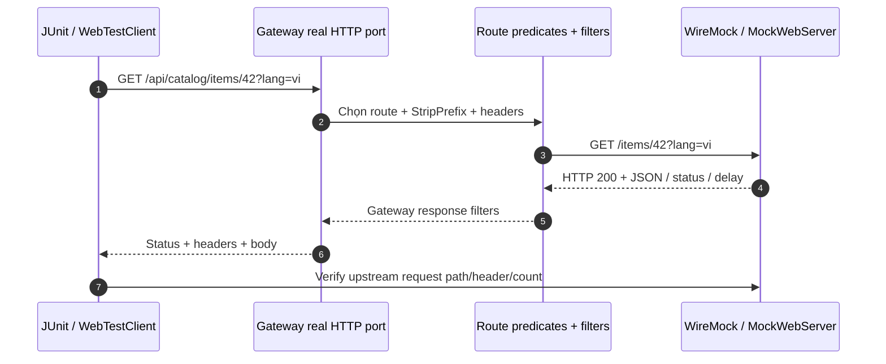
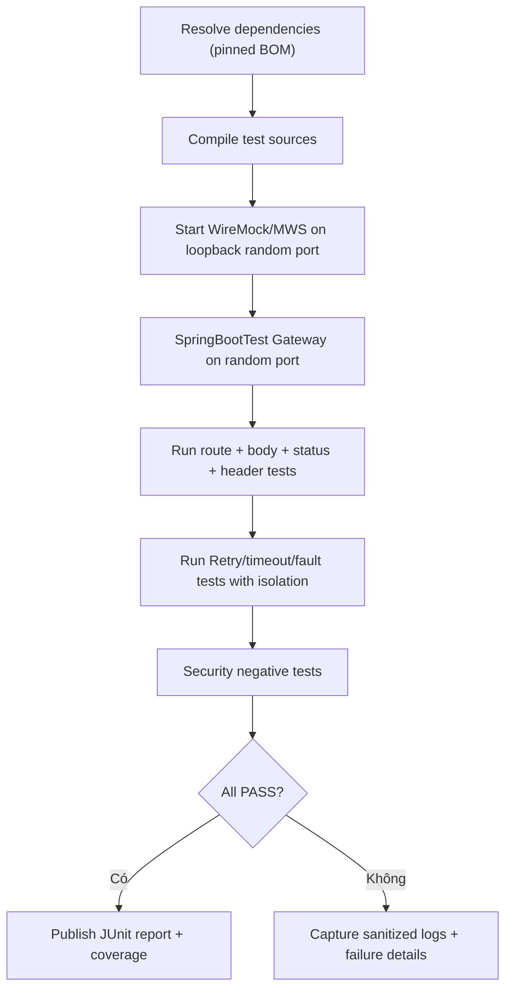

# Mô phỏng dịch vụ phía sau bằng WireMock hoặc MockWebServer

**Chương:** Kiểm thử  
**Module:** `SPRING_CLOUD_GATEWAY` — Spring Cloud Gateway  
**Phạm vi:** Kiểm thử một API Gateway với route predicates, filter chain, sửa path/header/body, service discovery, xác thực, rate limiting, circuit breaker, retry, TLS và khả năng quan sát request.

Khi kiểm thử một **API Gateway**, chỉ gọi trực tiếp một REST controller hoặc mock `GatewayFilter` bằng Mockito là chưa đủ. Một Gateway đúng nghĩa phải nhận HTTP request từ client, **chọn route**, chạy **predicate/filter chain**, thực hiện kết nối HTTP/HTTPS đến dịch vụ phía sau và đưa status/headers/body về client. Nếu backend thật không ổn định, quá chậm, đòi tài khoản dùng chung hoặc không thể chủ động phát lỗi 503, ta rất khó chứng minh Gateway có cấu hình chính xác.

**WireMock** và **MockWebServer** giải quyết vấn đề này bằng cách tạo **HTTP server giả chạy trên một cổng thật trong máy test**. Gateway không cần biết nó đang gọi mock; mỗi request thực sự đi qua TCP/HTTP đến một upstream được dựng trong quá trình kiểm thử. Ta điều khiển được upstream trả 200/401/404/503, JSON, headers, delay, redirect, body chunked hoặc một lỗi transport; đồng thời kiểm tra **backend đã nhận request gì và bao nhiêu lần**.

Bài này trình bày một nền tảng kiểm thử tích hợp với **Spring Cloud Gateway Server WebFlux**, JUnit Jupiter, `@SpringBootTest(webEnvironment = RANDOM_PORT)` và `WebTestClient.bindToServer()`; sau đó triển khai hai cách thay thế: **WireMock 3** khi cần mapping/matching/scenario/verification phong phú, hoặc **OkHttp MockWebServer 3 (OkHttp 5)** khi cần một queue response nhẹ và truy vấn `RecordedRequest`. Cuối bài là ma trận kiểm thử về route, headers, request/response body, auth, timeout, Retry, CircuitBreaker, LoadBalancer, TLS, streaming, rate limit, security và CI.

> **Lưu ý phiên bản:** Ví dụ chính nhắm tới **Spring Cloud Gateway Server WebFlux 5.x** với starter `spring-cloud-starter-gateway-server-webflux` và prefix `spring.cloud.gateway.server.webflux.*`; một số dự án Gateway 4.x dùng `spring.cloud.gateway.routes`/tên starter khác. Với **Gateway Server Web MVC**, dùng `spring-cloud-starter-gateway-server-webmvc`, prefix `spring.cloud.gateway.server.webmvc.*`, Servlet/RestClient và bộ test MVC riêng. Không đem nguyên `GatewayFilter`, `WebTestClient.bindToApplicationContext` hoặc cấu hình Reactive Netty sang MVC. Đường dẫn và dependency phải được kiểm tra với release train/Boot BOM của dự án đang học.

## 1. Mục tiêu học tập

Sau bài này, bạn có thể:

1. Nêu rõ khác biệt giữa **mock một dependency Java** và **mô phỏng một downstream HTTP server** trong integration test Gateway.
2. Chọn WireMock hoặc MockWebServer theo nhu cầu request matching, sequential response, fault injection và verification.
3. Dựng mock upstream với **port ngẫu nhiên**, gán địa chỉ vào route Gateway **trước khi Spring ApplicationContext khởi tạo**, và không hardcode `8081`.
4. Dùng JUnit, `@SpringBootTest(RANDOM_PORT)` và `WebTestClient.bindToServer()` để đi qua HTTP networking thật.
5. Kiểm tra `Path`, `Method`, `Host`, `Header`, `StripPrefix`, `RewritePath`, `Add/RemoveRequestHeader` và query string ở **phía upstream**.
6. Mô phỏng status/header/body, JSON Unicode, redirects, delays, reset connection và streaming response.
7. Viết kiểm thử Retry bằng **số lần upstream thật được gọi**, phân biệt status retry, timeout, fail-fast và exception.
8. Kiểm thử khả năng bảo vệ: authentication/authorization, không relay token sai đích, rate limit, CircuitBreaker/fallback và bảo mật CORS/forwarded headers.
9. Nhận biết giới hạn: không test được toàn bộ discovery thật, TLS trust production, WebSocket session semantics hay năng lực tải cao chỉ bằng một mock HTTP server.
10. Thiết kế các bài kiểm thử độc lập, deterministic, ít flaky và có thể chạy song song trong CI.

## 2. Mock downstream HTTP nằm ở đâu trong kiến trúc?



Có **ba vị trí quan sát**:

| Vị trí | Điều gì được kiểm tra? | Ví dụ |
|---|---|---|
| **Client → Gateway** | HTTP status, response body/headers, security và latency | `WebTestClient.expectStatus()` |
| **Gateway route/filter layer** | Route ID, predicates, filter order, timeout/retry, actuator metrics | Gateway logs/observability phù hợp |
| **Gateway → mock backend** | Method, path, query, headers, request body và số lần gọi | `WireMock.verify(...)` hoặc `RecordedRequest` |

Chỉ kiểm tra “client nhận 200” không chứng minh `StripPrefix` đúng; backend giả có thể trả 200 cho mọi path. Chỉ kiểm tra “mock nhận request” cũng chưa chứng minh response filter, security và status mapping. **Cần xác nhận hai phía**.

### 2.1. Phân loại kiểm thử

| Loại | Tài nguyên thật | Mục tiêu | Ví dụ |
|---|---|---|---|
| Unit test | Không khởi động HTTP | Logic một predicate/filter/mapper | JUnit + Mockito cho Java helper |
| Gateway slice test | Spring context hoặc mock exchange | Kiểm tra logic cụ thể của route/filter | WebFlux test với mocked collaborator |
| **Gateway integration test** | **Gateway HTTP server + mock HTTP backend** | Kiểm tra end-to-end routing/filtering, serialization, socket và errors | **Bài học này** |
| Contract test | Gateway + mock dựa trên hợp đồng API | Bảo đảm contract status/body/headers đã phê duyệt | Stub JSON + assertions |
| System/E2E | Gateway + backend thật + Redis/registry/TLS/ingress | Kiểm tra nhiều thành phần production-like | Testcontainers/kind/test cluster |
| Performance/chaos | Workload và hạ tầng phù hợp | Capacity/latency/failure behavior | k6/Gatling + observability |

**Không được gọi WireMock test là “E2E production”**: nó không kiểm tra truy vấn DB thật, nghiệp vụ backend, schema migration, propagation qua Kubernetes Ingress hay registry thực. Ngược lại, unit test không thay thế integration test của route parser và HTTP routing.

### 2.2. Chọn WireMock hay MockWebServer?

| Tiêu chí | WireMock 3 | OkHttp MockWebServer 3 |
|---|---|---|
| Mục đích nổi bật | HTTP API mocking với DSL cho request/response | Lightweight scripted HTTP test server |
| Request matching | URL/path/query/header/body, JSONPath, priority, scenarios | Chủ yếu response queue/Dispatcher + inspect RecordedRequest |
| Response lần 1/2/3 | Scenarios có trạng thái | `enqueue` các `MockResponse` theo thứ tự |
| Kiểm tra số request | `verify(count, requestedFor(...))` và request journal | `takeRequest(timeout, unit)`, `requestCount` |
| Delay/fault | `withFixedDelay`, `withFault`, chunked/dribble | `headersDelay`/`bodyDelay`/`throttleBody`, socket policies |
| Khả năng đọc testcase | Mạnh với nhiều endpoint/contract phức tạp | Mạnh với một chuỗi vài requests và kiểm tra thứ tự |
| JUnit | `WireMockExtension` hoặc `WireMockServer` | `MockWebServer`, tùy chọn JUnit 5 extension |
| JSON/response file fixture | Hỗ trợ `__files`/mappings | Tự tạo response/dispatcher bằng code |
| Giao diện HTTP admin | Có admin API; cần giữ private | Không cùng mô hình admin/stubbing |
| Mức độ phụ thuộc | Nhiều thành phần, dùng đúng artifact version | Nhẹ; OkHttp 5 đã đổi package/artifact |

**Không có công cụ nào thắng tuyệt đối.** Chọn **WireMock** khi cần stub phong phú, test failure scenarios và xác minh chính xác requests; chọn **MockWebServer** khi muốn kiểm tra queue/request order đơn giản hoặc logic client/proxy nhỏ. Cả hai phải được đưa vào `test` scope, bind loopback/random port và dọn dẹp lifecycle.

### 2.3. Những điều mock không tự bảo đảm

- Gateway route thực sự khớp nếu test chỉ gọi mock backend trực tiếp.
- LoadBalancer/service registry có topology đúng ở production.
- `@MockBean`/`@MockitoBean` cho downstream service thay thế **HTTP call** đã được Gateway gửi đến URI khác.
- Retry an toàn với POST có side effect.
- Timeout hoặc close socket ở mock sẽ luôn cho một status HTTP cố định trên mọi Netty/Servlet versions.
- HTTPS test self-signed là bằng chứng truststore production đúng.
- WebSocket handshake/frame hoặc gRPC streaming được test đầy đủ chỉ bằng các HTTP response stubs đơn giản.

## 3. Chuẩn bị môi trường test Spring Cloud Gateway

### 3.1. Dự án Gateway WebFlux mẫu

Tạo project Maven Spring Boot tương thích Spring Cloud Gateway **Server WebFlux**. Chọn Java 17+ nếu sử dụng dòng Spring Boot 3; Boot 4 hoặc tương lai dùng JDK theo yêu cầu chính thức của release train.

`pom.xml` — chỉ hiển thị các dependencies liên quan, **cần có Spring Cloud BOM phù hợp và phần parent/plugin do project tạo**:

```xml
<dependencies>
    <!-- Gateway Server WebFlux: API Gateway thật. -->
    <dependency>
        <groupId>org.springframework.cloud</groupId>
        <artifactId>spring-cloud-starter-gateway-server-webflux</artifactId>
    </dependency>

    <!-- JUnit Jupiter, SpringBootTest, assertions, test tools. -->
    <dependency>
        <groupId>org.springframework.boot</groupId>
        <artifactId>spring-boot-starter-test</artifactId>
        <scope>test</scope>
    </dependency>

    <!-- WebTestClient; nếu test starter không kéo spring-test/webflux phù hợp
         thì bổ sung dependency test tương ứng theo Boot version. -->
    <dependency>
        <groupId>org.springframework.boot</groupId>
        <artifactId>spring-boot-starter-webflux</artifactId>
        <scope>test</scope>
    </dependency>

    <!-- Lựa chọn A: WireMock 3.x. -->
    <dependency>
        <groupId>org.wiremock</groupId>
        <artifactId>wiremock</artifactId>
        <version>3.13.2</version>
        <scope>test</scope>
    </dependency>
</dependencies>
```

`3.13.2` là **phiên bản minh họa WireMock 3** được trang cài đặt chính thức sử dụng tại thời điểm viết; khi dùng thật, kiểm tra patch fixes, các dependencies bị conflict và lockfile/BOM của bạn. Không tự kết luận test sẽ build trên mọi Spring Cloud Gateway 4.x/5.x chỉ vì Maven resolve được artifact. Nếu dùng một môi trường Jakarta/Jetty phức tạp, có thể cân nhắc `org.wiremock:wiremock-standalone` với cùng version để giảm classpath conflict; **không khai đồng thời hai artifacts** nếu chưa biết lý do.

### 3.2. Application class

`src/main/java/com/example/gateway/GatewayApplication.java`:

```java
package com.example.gateway;

import org.springframework.boot.SpringApplication;
import org.springframework.boot.autoconfigure.SpringBootApplication;

@SpringBootApplication
public class GatewayApplication {
    public static void main(String[] args) {
        SpringApplication.run(GatewayApplication.class, args);
    }
}
```

### 3.3. Không đưa mock URI vào cấu hình production

Không commit một route kiểu:

```yaml
spring:
  cloud:
    gateway:
      server:
        webflux:
          routes:
            - id: catalog
              uri: http://localhost:8081
```

vào `application.yml` production chỉ để chạy test. Dùng **test profile** hoặc test-time property overrides. Trong lab dưới đây:

- `src/test/resources/application-gatewaytest.yml` chứa routes giả **chỉ dành cho test**.
- `@ActiveProfiles("gatewaytest")` chọn profile khi JUnit chạy.
- `@DynamicPropertySource` cung cấp URI backend ngẫu nhiên trước khi Gateway khởi tạo context.
- `@SpringBootTest(webEnvironment=RANDOM_PORT)` mở **Gateway HTTP port thật**, cũng ngẫu nhiên.
- `WebTestClient.bindToServer()` gọi đúng Gateway HTTP port, không bind mock controller thay cho networking.

Nếu ứng dụng đang có routes production trong `application.yml`, **test profile có thể merge thêm** thay vì loại bỏ toàn bộ routes, tùy Spring property binding. Để test cô lập, cần thiết kế tách cấu hình production/test hoặc explicitly override danh sách routes, rồi kiểm tra route inventory lúc test. Không giả định `application-gatewaytest.yml` luôn tự loại bỏ mọi route khác.

### 3.4. Test topology

```text
JUnit Jupiter (same JVM)
   |
   | WebTestClient -> http://127.0.0.1:<RANDOM_GATEWAY_PORT>
   v
Spring Cloud Gateway Server WebFlux (real server)
   |
   | route uri resolves to http://127.0.0.1:<RANDOM_MOCK_PORT>
   v
WireMockServer / MockWebServer (real loopback HTTP server)
```

**Port ngẫu nhiên** giảm collisions khi CI chạy song song. **Loopback** tránh lộ stub/admin endpoints lên mạng. Quan trọng nhất: test không cần Internet hoặc backend thật; phần lớn kiểm thử hoàn tất trong cùng máy chạy JUnit.

## 4. Cấu hình route test: dùng URI động, không hardcode port

`src/test/resources/application-gatewaytest.yml`:

```yaml
spring:
  cloud:
    gateway:
      server:
        webflux:
          routes:
            - id: catalog-mock
              uri: ${test.backend.base-url}
              predicates:
                - Path=/api/catalog/**
              filters:
                - StripPrefix=2
                - AddRequestHeader=X-Gateway-Test, via-gateway

            - id: retry-mock
              uri: ${test.backend.base-url}
              predicates:
                - Path=/api/retry/**
                - Method=GET
              filters:
                - StripPrefix=2
                - name: Retry
                  args:
                    retries: 1
                    statuses: SERVICE_UNAVAILABLE
                    methods: GET
                    backoff:
                      firstBackoff: 10ms
                      maxBackoff: 30ms
                      factor: 2
```

**Giải thích đường đi:**

| Client URL | Route | Downstream path |
|---|---|---|
| `GET /api/catalog/items/SKU-42` | `catalog-mock` | `GET /items/SKU-42` |
| `POST /api/catalog/echo` | `catalog-mock` | `POST /echo` |
| `GET /api/catalog/items/SKU-42?lang=vi` | `catalog-mock` | `GET /items/SKU-42?lang=vi` |
| `GET /api/retry/flaky` | `retry-mock` | `GET /flaky` |
| `GET /not-mapped` | Không khớp | Không có downstream call |

`StripPrefix=2` bỏ hai segments đầu `api`, `catalog` hoặc `api`, `retry`. `AddRequestHeader` giúp test kiểm tra **header thực xuất hiện ở upstream**. Retry chỉ bật ở route `retry-mock` để test GET bình thường không bị retry bất ngờ.

Một số lưu ý:

- `${test.backend.base-url}` là placeholder Spring property, **không** phải host của mock mặc định; JUnit sẽ cung cấp đúng port.
- Không đặt `uri: http://localhost:0`: port 0 hợp lệ để **server lắng nghe một cổng tự chọn**, không hợp lệ như đích mà Gateway phải gọi.
- Các property key `spring.cloud.gateway.server.webflux.routes` thuộc Gateway **Server WebFlux 5.x**. Nếu project đang dùng Gateway 4.x, xác minh namespace qua bảng Configuration Properties đúng version.
- Đừng trộn filter test với những `default-filters` production thật; nếu có default auth/rate-limit, bạn phải cấu hình test contract tương ứng thay vì tắt bảo mật vô điều kiện.
- `Retry.retries=1` có nghĩa **một lần retry sau lần thử đầu**, nên kịch bản 503→200 có thể tạo **hai** downstream GET. Không đồng nhất con số retries với tổng số HTTP attempts.

## 5. WireMock 3: bài tích hợp đầy đủ với Gateway WebFlux

WireMock 3 hỗ trợ `WireMockServer` và JUnit 5 `WireMockExtension`. Với bài test cần cấu hình `@DynamicPropertySource` trước khi ApplicationContext của Spring được dựng, cách minh bạch là **khởi động `WireMockServer` tĩnh sớm**, lấy `baseUrl()` và dừng sau toàn bộ class.

### 5.1. Vòng đời mock trước khi Spring nạp route

```java
package com.example.gateway;

import com.github.tomakehurst.wiremock.WireMockServer;
import org.junit.jupiter.api.AfterAll;
import org.junit.jupiter.api.BeforeEach;
import org.springframework.test.context.DynamicPropertyRegistry;
import org.springframework.test.context.DynamicPropertySource;

import static com.github.tomakehurst.wiremock.core.WireMockConfiguration
    .wireMockConfig;

class ExampleLifecycle {
    static final WireMockServer backend =
        new WireMockServer(wireMockConfig()
            .dynamicPort()
            .bindAddress("127.0.0.1"));

    static {
        backend.start();
    }

    @DynamicPropertySource
    static void bindBackend(DynamicPropertyRegistry registry) {
        registry.add("test.backend.base-url", backend::baseUrl);
    }

    @BeforeEach
    void resetMock() {
        backend.resetAll();
    }

    @AfterAll
    static void stopMock() {
        backend.stop();
    }
}
```

Đoạn trên **chỉ minh họa lifecycle**; test hoàn chỉnh trong mục tiếp theo có annotation `@SpringBootTest`. Static initializer bảo đảm mock đã mở port trước khi `backend::baseUrl` được Spring resolve. `@BeforeEach resetAll()` xóa các stubs, scenarios và request journal của test trước; cần tránh để tests chạy song song sử dụng **cùng mock instance** rồi reset lẫn nhau.

Nếu Spring TestContext cache dùng lại ApplicationContext sau khi mock đã stop, Gateway có thể giữ URI của cổng không còn server. Khi có các test classes/profile cùng dùng dynamic URI, tách test contexts hoặc dùng `@DirtiesContext(classMode = AFTER_CLASS)`/test container lifecycle phù hợp để tránh reused stale URI.

### 5.2. `WireMockGatewayIntegrationTest.java`

Ví dụ sau sử dụng **một backend thật trên loopback** và Gateway chạy ở **random HTTP port**. Code cần project `GatewayApplication` ở package `com.example.gateway` và profile YAML ở mục 4.

```java
package com.example.gateway;

import com.github.tomakehurst.wiremock.WireMockServer;
import org.junit.jupiter.api.AfterAll;
import org.junit.jupiter.api.BeforeEach;
import org.junit.jupiter.api.Test;
import org.springframework.beans.factory.annotation.Value;
import org.springframework.boot.test.context.SpringBootTest;
import org.springframework.boot.test.web.server.LocalServerPort;
import org.springframework.test.context.ActiveProfiles;
import org.springframework.test.context.DynamicPropertyRegistry;
import org.springframework.test.context.DynamicPropertySource;
import org.springframework.test.annotation.DirtiesContext;
import org.springframework.test.web.reactive.server.WebTestClient;

import static com.github.tomakehurst.wiremock.client.WireMock.*;
import static com.github.tomakehurst.wiremock.core.WireMockConfiguration
    .wireMockConfig;
import static org.springframework.boot.test.context.SpringBootTest
    .WebEnvironment.RANDOM_PORT;

@SpringBootTest(classes = GatewayApplication.class,
                webEnvironment = RANDOM_PORT)
@ActiveProfiles("gatewaytest")
@DirtiesContext(classMode = DirtiesContext.ClassMode.AFTER_CLASS)
class WireMockGatewayIntegrationTest {

    static final WireMockServer backend =
        new WireMockServer(wireMockConfig()
            .dynamicPort()
            .bindAddress("127.0.0.1"));

    static {
        backend.start();
    }

    @DynamicPropertySource
    static void downstreamUri(DynamicPropertyRegistry registry) {
        registry.add("test.backend.base-url", backend::baseUrl);
    }

    @LocalServerPort
    int gatewayPort;

    private WebTestClient client() {
        return WebTestClient.bindToServer()
            .baseUrl("http://127.0.0.1:" + gatewayPort)
            .build();
    }

    @BeforeEach
    void cleanMock() {
        backend.resetAll();
    }

    @AfterAll
    static void stopBackend() {
        backend.stop();
    }

    @Test
    void forwardsPathQueryAndAddedHeader() {
        backend.stubFor(get(urlPathEqualTo("/items/SKU-42"))
            .withQueryParam("lang", equalTo("vi"))
            .withHeader("X-Gateway-Test", equalTo("via-gateway"))
            .willReturn(okJson(
                "{\"sku\":\"SKU-42\",\"source\":\"wiremock\"}")));

        client().get()
            .uri("/api/catalog/items/SKU-42?lang=vi")
            .exchange()
            .expectStatus().isOk()
            .expectHeader()
                .contentTypeCompatibleWith(
                    org.springframework.http.MediaType.APPLICATION_JSON)
            .expectBody()
                .jsonPath("$.sku").isEqualTo("SKU-42")
                .jsonPath("$.source").isEqualTo("wiremock");

        backend.verify(1, getRequestedFor(
                urlPathEqualTo("/items/SKU-42"))
            .withQueryParam("lang", equalTo("vi"))
            .withHeader("X-Gateway-Test", equalTo("via-gateway")));
    }

    @Test
    void forwardsPostJsonWithoutChangingBusinessBody() {
        String json = "{\"message\":\"xin chào\"}";

        backend.stubFor(post(urlEqualTo("/echo"))
            .withHeader("Content-Type",
                containing("application/json"))
            .withRequestBody(equalToJson(json))
            .willReturn(okJson(json)
                .withHeader("X-Backend", "wiremock")));

        client().post()
            .uri("/api/catalog/echo")
            .header("Content-Type", "application/json")
            .bodyValue(json)
            .exchange()
            .expectStatus().isOk()
            .expectHeader().valueEquals("X-Backend", "wiremock")
            .expectBody().jsonPath("$.message")
                .isEqualTo("xin chào");

        backend.verify(1,
            postRequestedFor(urlEqualTo("/echo"))
                .withRequestBody(equalToJson(json))
                .withHeader("X-Gateway-Test",
                    equalTo("via-gateway")));
    }

    @Test
    void preservesDownstreamNotFoundStatus() {
        backend.stubFor(get(urlEqualTo("/items/missing"))
            .willReturn(aResponse()
                .withStatus(404)
                .withHeader("Content-Type", "application/json")
                .withBody("{\"code\":\"ITEM_NOT_FOUND\"}")));

        client().get()
            .uri("/api/catalog/items/missing")
            .exchange()
            .expectStatus().isNotFound()
            .expectBody().jsonPath("$.code")
                .isEqualTo("ITEM_NOT_FOUND");

        backend.verify(1,
            getRequestedFor(urlEqualTo("/items/missing")));
    }

    @Test
    void noMatchingRouteDoesNotCallBackend() {
        client().get()
            .uri("/not-mapped")
            .exchange()
            .expectStatus().isNotFound();

        org.junit.jupiter.api.Assertions.assertEquals(
            0, backend.getAllServeEvents().size());
    }
}
```

**Đầu ra cần hiểu đúng:**

- Test thực sự gọi Gateway port ngẫu nhiên; không gọi `backend.baseUrl()` trực tiếp trong client assertion.
- `WireMockServer` nhận downstream `/items/SKU-42` sau `StripPrefix=2`, nên có thể xác minh path/query/header sau filter.
- `verify(1, ...)` bắt được việc Gateway **lỡ gọi upstream hai lần** do Retry/default filter ngoài dự kiến.
- Test `/not-mapped` kiểm tra route selection. Nếu application production có catch-all route hoặc security chặn request trước khi mapping, expected status/call count phải dựa trên context đã cô lập của profile test.
- `@DirtiesContext` được dùng để không để context giữ URI trỏ đến mock đã stop sau class. Đừng lạm dụng annotation ở mọi method vì sẽ làm test suite chậm.
- Import `@LocalServerPort` áp dụng cho Spring Boot 3.x/4.x thuộc package test web server thông dụng; nếu phiên bản Boot khác, kiểm tra class chính xác.

### 5.3. Khi nào dùng `WireMockExtension` thay `WireMockServer`?

WireMock JUnit Jupiter hỗ trợ:

```java
@RegisterExtension
static WireMockExtension wm =
    WireMockExtension.newInstance()
        .options(wireMockConfig().dynamicPort())
        .build();
```

Extension khởi động server, reset mappings/request journal theo test và stop sau class. Thích hợp test thông thường hoặc khi sử dụng `WireMockRuntimeInfo` để lấy port. **Nhưng với `@SpringBootTest` và `@DynamicPropertySource`**, cần bảo đảm mock đã start **trước khi Spring ApplicationContext bind route URI**; thứ tự lifecycle của các JUnit/Spring extensions là một điểm dễ gây race. Ví dụ chính chủ động start trong static initializer để thứ tự rõ ràng. Nếu dùng `@RegisterExtension`, hãy thiết kế lifecycle, ordering, context caching và thử chạy cả suite trong CI.

### 5.4. Lỗi thiết lập thường gặp

| Triệu chứng | Vì sao? | Hướng xử lý |
|---|---|---|
| `Connection refused localhost:8081` | Route vẫn trỏ backend thật/cổng cũ | In route URI đã bind property dynamic chưa? |
| Gateway trả 404 nhưng WireMock không thấy call | Sai `Path` predicate, prefix cấu hình hoặc security | Xác minh route inventory và `Path` |
| Mock trả 404 “Request was not matched” | Mapping URL/headers không khớp | Xem `/__admin/requests/unmatched` trong mock cục bộ |
| Mock chưa start khi Spring resolve URI | JUnit lifecycle ordering | Khởi động sớm hoặc tích hợp extension lifecycle đúng |
| Test đơn chạy, cả suite fail | Shared context/port/test journal | Reset, isolate, `@DirtiesContext` khi cần |
| Thêm WireMock rồi lỗi Jetty/classpath | Version conflict | Dùng WireMock-compatible artifact hoặc standalone, khóa BOM |
| WebTestClient không kết nối | Bind vào mock application context, không vào live port | Dùng `bindToServer` và `@LocalServerPort` |
| Test “retry=1” nhưng chỉ thấy 1 call | Đã bật Retry ở route khác hoặc status không match | Kiểm tra Route ID/statuses/methods |

## 6. MockWebServer 3 (OkHttp 5): một lựa chọn nhẹ và rõ thứ tự request

**MockWebServer** thuộc dự án OkHttp. Ở OkHttp 5, API mới tách ra:

- Maven artifact **`com.squareup.okhttp3:mockwebserver3`**;
- Package Java **`mockwebserver3.*`**;
- Response được tạo bằng **`new MockResponse.Builder().code(...).body(...).build()`**;
- `RecordedRequest` cung cấp `method`, `target`, `headers` và `body` (body có thể null).

Đây **không phải** API cũ `okhttp3.mockwebserver.MockResponse#setResponseCode/setBody` của OkHttp 4. Tại OkHttp 5, artifact `mockwebserver` cũ vẫn tồn tại nhưng có JUnit 4 dependency/kiểu API legacy; với JUnit Jupiter mới, nên chọn `mockwebserver3` hoặc `mockwebserver3-junit5` theo nhu cầu. Không trộn hai package trong cùng test.

### 6.1. Dependency Maven

Nếu chọn **MockWebServer thay WireMock**, giữ Gateway/test starter và thay dependency WireMock bằng:

```xml
<dependency>
    <groupId>com.squareup.okhttp3</groupId>
    <artifactId>mockwebserver3</artifactId>
    <version>5.5.1</version>
    <scope>test</scope>
</dependency>
```

`5.5.1` là ví dụ phiên bản OkHttp 5 có trên Maven Central tại thời điểm viết, không phải lời khuyên bỏ qua dependency management. Dự án Maven/Gradle nên đồng bộ phiên bản OkHttp core/Okio/Kotlin theo BOM tương thích để tránh `NoSuchMethodError`. Nếu dùng JUnit extension, thêm `mockwebserver3-junit5` cùng version; ví dụ dưới đây quản lý lifecycle trực tiếp nên **không cần extension**.

### 6.2. Test class tương đương

Sử dụng **cùng `application-gatewaytest.yml` ở mục 4**, nhưng **chạy riêng test class này** với không gian ứng dụng đã cô lập (không cùng JVM test class sử dụng cùng mock cổng cũ đang cached).

```java
package com.example.gateway;

import java.io.IOException;
import java.util.concurrent.TimeUnit;

import mockwebserver3.MockResponse;
import mockwebserver3.MockWebServer;
import mockwebserver3.RecordedRequest;
import org.junit.jupiter.api.AfterAll;
import org.junit.jupiter.api.Test;
import org.springframework.boot.test.context.SpringBootTest;
import org.springframework.boot.test.web.server.LocalServerPort;
import org.springframework.test.annotation.DirtiesContext;
import org.springframework.test.context.ActiveProfiles;
import org.springframework.test.context.DynamicPropertyRegistry;
import org.springframework.test.context.DynamicPropertySource;
import org.springframework.test.web.reactive.server.WebTestClient;

import static org.junit.jupiter.api.Assertions.*;
import static org.springframework.boot.test.context.SpringBootTest
    .WebEnvironment.RANDOM_PORT;

@SpringBootTest(classes = GatewayApplication.class,
                webEnvironment = RANDOM_PORT)
@ActiveProfiles("gatewaytest")
@DirtiesContext(classMode = DirtiesContext.ClassMode.AFTER_CLASS)
class MockWebServerGatewayIntegrationTest {

    static final MockWebServer backend = new MockWebServer();

    static {
        try {
            backend.start(); // Port 0 -> random loopback port.
        } catch (IOException ex) {
            throw new ExceptionInInitializerError(ex);
        }
    }

    @DynamicPropertySource
    static void downstreamUri(DynamicPropertyRegistry registry) {
        registry.add("test.backend.base-url",
            () -> backend.url("/").toString());
    }

    @LocalServerPort
    int gatewayPort;

    @AfterAll
    static void stopBackend() {
        backend.close();
    }

    @Test
    void inspectsRealRequestSeenByMockBackend()
            throws InterruptedException {
        backend.enqueue(new MockResponse.Builder()
            .code(200)
            .addHeader("Content-Type: application/json")
            .addHeader("X-Upstream: mockwebserver")
            .body("{\"sku\":\"SKU-42\",\"source\":\"mws\"}")
            .build());

        WebTestClient client = WebTestClient.bindToServer()
            .baseUrl("http://127.0.0.1:" + gatewayPort)
            .build();

        client.get()
            .uri("/api/catalog/items/SKU-42?lang=vi")
            .exchange()
            .expectStatus().isOk()
            .expectHeader()
                .valueEquals("X-Upstream", "mockwebserver")
            .expectBody()
                .jsonPath("$.sku").isEqualTo("SKU-42");

        // Luôn dùng timeout: không block vô hạn khi route bị lỗi.
        RecordedRequest request =
            backend.takeRequest(2, TimeUnit.SECONDS);

        assertNotNull(request, "Gateway did not call mock backend");
        assertEquals("GET", request.getMethod());
        assertEquals("/items/SKU-42?lang=vi",
            request.getTarget());
        assertEquals("via-gateway",
            request.getHeaders().get("X-Gateway-Test"));
        assertEquals(1, backend.getRequestCount());
    }
}
```

**Tại sao code này là integration test Gateway?**

1. Backend `MockWebServer` bắt đầu trên cổng riêng và phát một HTTP response đã `enqueue`.
2. Gateway đọc `test.backend.base-url` lúc Spring context khởi tạo rồi dùng nó làm route `uri`.
3. `WebTestClient` gọi Gateway **random port**, Gateway chọn route + filter và gửi HTTP thực tới mock.
4. `takeRequest(2, TimeUnit.SECONDS)` kiểm tra request mà mock nhìn thấy, bao gồm URL **sau StripPrefix** và header do filter thêm.
5. `getRequestCount()` phân biệt một request với việc vô tình retry.

**Cẩn thận:** `enqueue` là **FIFO**. Nếu Gateway phát thêm health check/proxy request hoặc tests chạy song song vào cùng server, response có thể bị tiêu thụ bởi request không mong đợi, gây flaky results. Để match nhiều endpoints hoặc route theo URL, viết **Dispatcher** cho MockWebServer hoặc dùng WireMock stubs rõ ràng. **Đừng dùng `takeRequest()` không timeout** trong CI: khi path không match, nó có thể chờ mãi.

### 6.3. Kiểm tra POST body với MockWebServer 3

Với một test riêng và một response được enqueue:

```java
backend.enqueue(new MockResponse.Builder()
    .code(201)
    .addHeader("Content-Type: application/json")
    .body("{\"saved\":true}")
    .build());

client.post()
    .uri("/api/catalog/echo")
    .header("Content-Type", "application/json")
    .bodyValue("{\"message\":\"xin chào\"}")
    .exchange()
    .expectStatus().isCreated();

RecordedRequest req = backend.takeRequest(2, TimeUnit.SECONDS);
assertNotNull(req);
assertEquals("POST", req.getMethod());
assertEquals("/echo", req.getTarget());
assertNotNull(req.getBody());
assertEquals("{\"message\":\"xin chào\"}",
    req.getBody().utf8());
```

Đây là **mảnh mã đặt trong một test method** có `client`/`backend` được khởi tạo như mục 6.2, không phải Java file hoàn chỉnh. Với MockWebServer 3, `RecordedRequest.getBody()` trả `ByteString` có thể null khi không có request body. Không cố gọi `readUtf8()` theo Buffer API đời cũ trên một đối tượng `ByteString`.

### 6.4. Response queue giúp kiểm tra Retry như thế nào?

Giả sử Gateway route có `Retry.retries=1` cho GET trả 503. Trong một test cô lập:

```java
backend.enqueue(new MockResponse.Builder()
    .code(503)
    .body("temporarily unavailable")
    .build());

backend.enqueue(new MockResponse.Builder()
    .code(200)
    .addHeader("Content-Type: application/json")
    .body("{\"ok\":true}")
    .build());

client.get().uri("/api/retry/flaky")
    .exchange()
    .expectStatus().isOk();

RecordedRequest first =
    backend.takeRequest(2, TimeUnit.SECONDS);
RecordedRequest second =
    backend.takeRequest(2, TimeUnit.SECONDS);

assertNotNull(first);
assertNotNull(second);
assertEquals("/flaky", first.getTarget());
assertEquals("/flaky", second.getTarget());
```

Đây là một ví dụ dễ đọc vì mock **lần đầu 503, lần hai 200**. Nhưng queue có thể đánh lừa khi HTTP client retry ở tầng khác hoặc một request phụ ăn response. Với route nhiều endpoints hay routing song song, dùng **WireMock scenarios** hoặc custom dispatcher để match theo method/path, thay vì queue phụ thuộc global order.

### 6.5. MockWebServer 4.x so với 5.x

| OkHttp | Artifact | Import | Response |
|---|---|---|---|
| 4.x | `com.squareup.okhttp3:mockwebserver` | `okhttp3.mockwebserver.*` | `new MockResponse().setResponseCode(200).setBody(...)` |
| **5.x** | **`com.squareup.okhttp3:mockwebserver3`** | **`mockwebserver3.*`** | **`new MockResponse.Builder().code(200).body(...).build()`** |

`RecordedRequest.getPath()` của API cũ được thay bằng `getTarget()` trong API 5, và `body` trở thành `ByteString?`. Có thể tiếp tục sử dụng artifact legacy trên 5 nhưng phải kiểm tra JUnit 4 transitives; bài lab dùng API 5 để tránh dạy mã cũ dưới dependency mới.

## 7. WireMock scenarios: kiểm tra Retry bằng đúng số lần backend nhận

Với WebFlux route `retry-mock` ở phần 4, cần kiểm tra:

1. Lần đầu downstream trả `503 Service Unavailable`;
2. Gateway nhận ra status thuộc `Retry.statuses` và method `GET`;
3. Gateway thử lại **một lần**;
4. Lần tiếp theo downstream trả 200;
5. Client nhận 200 và WireMock ghi nhận **hai** GET.

WireMock có **stateful scenarios** phù hợp cho kiểm thử này.

```java
import static com.github.tomakehurst.wiremock.client.WireMock.*;
import static com.github.tomakehurst.wiremock.stubbing.Scenario.STARTED;

backend.stubFor(get(urlEqualTo("/flaky"))
    .inScenario("retry-check")
    .whenScenarioStateIs(STARTED)
    .willReturn(aResponse()
        .withStatus(503)
        .withBody("temporary failure"))
    .willSetStateTo("RECOVERED"));

backend.stubFor(get(urlEqualTo("/flaky"))
    .inScenario("retry-check")
    .whenScenarioStateIs("RECOVERED")
    .willReturn(okJson("{\"state\":\"recovered\"}")));

client().get()
    .uri("/api/retry/flaky")
    .exchange()
    .expectStatus().isOk()
    .expectBody().jsonPath("$.state")
        .isEqualTo("recovered");

backend.verify(2,
    getRequestedFor(urlEqualTo("/flaky")));
```

Đây là **mảnh test method** dùng `backend` và `client()` của class WireMock ở mục 5, không phải route config mới. Để chuyển thành method `@Test`, đặt stubs và assertions vào một hàm trong class đó. `backend.resetAll()` ở `@BeforeEach` bảo đảm scenario quay về `STARTED`, không phụ thuộc test chạy trước.

### 7.1. Tại sao cần xác minh call count?

Chỉ thấy 200 không chứng minh retry đã xảy ra. Nếu mock đã trả 200 ngay lần đầu, hoặc client kết nối route khác, test vẫn có thể 200. Ngược lại:

| Client status | WireMock call count | Diễn giải có thể |
|---|---:|---|
| 200 | 1 | Upstream thành công ngay lần đầu; không chứng minh Retry |
| **200** | **2** | Phù hợp kịch bản `503 → 200` với một retry |
| 503 | 1 | Retry không bật/không match status/method |
| 503 | 2 | Cả hai attempts thất bại hoặc scenario không đổi |
| 500/502/504 | 1+ | Có transport/timeout/other filter; cần xem root cause |

Không gọi `retries=1` là “hai retries”: đó là **một lần retry bổ sung** sau initial call, tổng tối đa hai calls trong case đơn giản. Với CircuitBreaker/LoadBalancer/các filters khác, số attempt và trạng thái không còn chỉ do Retry quyết định.

### 7.2. Test không retry với POST ngoài hợp đồng

`retry-mock` có `Method=GET`; một request POST vào `/api/retry/flaky` không match route đó, không đi upstream. Để test “POST không bị retry” **thực sự**, tạo một **route khác** cho phép cả GET/POST nhưng cấu hình Retry chỉ `methods: GET`; mock trả 503 khi POST và kiểm tra:

```java
backend.verify(1, postRequestedFor(urlEqualTo("/write")));
```

**Không thử retry POST thanh toán thật.** Một request có body có thể đã tạo side effect trước khi response lỗi; WebFlux Retry có thể cache body trong `DataBuffer`, tăng memory. Nếu cần retry POST nghiệp vụ, phải có idempotency key, retry budget và contract cụ thể.

## 8. Mô phỏng timeout, HTTP errors và transport faults

Mock backend phát **HTTP 503** khác với mock backend **chậm đến mức Gateway timeout** hoặc **đóng TCP connection**. Chúng kích hoạt các nhánh `Retry`, `CircuitBreaker` và error mapping khác nhau; test chỉ một loại “500” không đủ.

### 8.1. HTTP error là response hợp lệ

WireMock:

```java
backend.stubFor(get(urlEqualTo("/unavailable"))
    .willReturn(aResponse()
        .withStatus(503)
        .withHeader("Content-Type", "application/problem+json")
        .withHeader("Retry-After", "3")
        .withBody("""
            {"type":"about:blank",
             "title":"Service Unavailable",
             "status":503}
            """)));
```

Nếu route không có Retry, CircuitBreaker fallback hoặc SetStatus:

- **Client:** thường nhận 503, content type và body từ upstream theo proxy semantics.
- **Mock backend:** đúng **một** HTTP GET được ghi lại.
- **Gateway:** vẫn xử lý route/filter chain; việc client nhận 503 không phải bằng chứng Gateway mất kết nối.

`Retry-After: 3` chỉ là header upstream; `Retry` GatewayFilter **không nhất thiết** tự tính wait time dựa trên nó. Đừng tự suy số lần retry/backoff từ header nếu chưa cấu hình và đo.

### 8.2. WireMock fixed delay

```java
backend.stubFor(get(urlEqualTo("/slow"))
    .willReturn(aResponse()
        .withStatus(200)
        .withFixedDelay(1500)
        .withBody("slow response")));
```

Thêm một **route lab riêng** vào `application-gatewaytest.yml` (không cần bật Retry trên route này):

```yaml
- id: timeout-mock
  uri: ${test.backend.base-url}
  predicates:
    - Path=/api/timeout/**
    - Method=GET
  filters:
    - StripPrefix=2
  metadata:
    response-timeout: 200
    connect-timeout: 200
```

Đây là **mảnh phần tử** cần đặt vào danh sách `server.webflux.routes` trong YAML test, không phải file hoàn chỉnh. Theo tài liệu Gateway WebFlux, **per-route `response-timeout` và `connect-timeout` dùng đơn vị milliseconds**, còn **global response-timeout** thuộc `httpclient` dùng `java.time.Duration` như `5s`. Nhầm `200` ms với `200s` sẽ làm test sai hoặc treo.

Một test định hướng:

```java
long startNanos = System.nanoTime();

client().get()
    .uri("/api/timeout/slow")
    .exchange()
    .expectStatus().is5xxServerError();

long elapsedMs = java.util.concurrent.TimeUnit
    .NANOSECONDS.toMillis(System.nanoTime() - startNanos);

org.junit.jupiter.api.Assertions.assertTrue(
    elapsedMs < 4000,
    "Gateway should not wait indefinitely for upstream");

backend.verify(1, getRequestedFor(urlEqualTo("/slow")));
```

**Cảnh báo về độ ổn định:** kiểm thử elapsed time là **ước lượng** và có thể flaky khi CI overload/GC pause. Không đặt ngưỡng cách `response-timeout` vài mili giây rồi kỳ vọng ổn định. Cần xác minh **mã HTTP chính xác theo release train/error handler** trong integration test của chính project; không mặc định mọi timeout đều trả 504 hay 502. Nếu một filter fallback biến 5xx thành 200, hãy test fallback contract thay vì status gốc.

### 8.3. Các lỗi khác nhau nên được mô phỏng riêng

| Tình huống downstream | WireMock/MockWebServer mô phỏng | Điều cần quan sát ở Gateway |
|---|---|---|
| HTTP 404 với JSON | `withStatus(404)` | Proxy status 404/body, không rewrite thành 500 |
| HTTP 500/503 | `withStatus(500/503)` | Retry/breaker theo status config |
| Response chậm | `withFixedDelay(1500)` | Response timeout, cancellation, latency |
| Header delay | MockWebServer `headersDelay(...)` | Gateway chờ headers có timeout không |
| Body stream chậm | WireMock dribble/MockWebServer throttle | Buffering, response timeout, stream flush |
| Connection reset | `withFault(Fault.CONNECTION_RESET_BY_PEER)` | Exception path, không luôn có HTTP status |
| Malformed HTTP chunk | `withFault(Fault.MALFORMED_RESPONSE_CHUNK)` | Netty decoder/protocol error handling |
| Empty response | `withFault(Fault.EMPTY_RESPONSE)` | Client disconnect hoặc Gateway 5xx |
| Host unreachable | Không mở server trên target port | Connect timeout/refused, không đồng nhất HTTP 503 |
| TLS handshake thất bại | HTTPS mock cert/trust mismatch | TLS/hostname error, không tắt verify |
| Redirect | `withStatus(302).withHeader("Location",...)` | Có tự follow redirect không, header giữ gì? |

### 8.4. Transport fault của WireMock

```java
import com.github.tomakehurst.wiremock.http.Fault;

backend.stubFor(get(urlEqualTo("/disconnect"))
    .willReturn(aResponse()
        .withFault(Fault.CONNECTION_RESET_BY_PEER)));
```

**Không chốt một status như 502 bằng lời đoán.** Connection reset có thể làm Gateway phát 5xx hoặc khiến client gặp lỗi connection riêng, tùy thời điểm đóng socket, HTTP framing và exception mapping. WireMock documentation ghi rõ `CONNECTION_RESET_BY_PEER` có thể không tương tác giống nhau trên Windows; dùng kịch bản này để **quan sát error classification**, không để test CI đa nền tảng phụ thuộc vào một chuỗi exception cụ thể.

Với những failures xảy ra **sau khi HTTP response headers đã được gửi cho client**, Gateway có thể **không đổi được status** vì response đã committed. Cần xem metrics/logs và client stream events, không ép mọi trường hợp đều có một HTTP status mới.

### 8.5. MockWebServer có thể trì hoãn headers/body

Với MockWebServer 3:

```java
backend.enqueue(new MockResponse.Builder()
    .code(200)
    .headersDelay(500, TimeUnit.MILLISECONDS)
    .body("delayed headers")
    .build());
```

Hoặc mô phỏng downstream gửi dữ liệu nhỏ giọt:

```java
backend.enqueue(new MockResponse.Builder()
    .code(200)
    .addHeader("Content-Type: text/plain")
    .body("abcdef")
    .throttleBody(2, 200, TimeUnit.MILLISECONDS)
    .build());
```

Đây là **mảnh test method**, yêu cầu `TimeUnit` import và backend mock đang chạy. `throttleBody(2, 200, ...)` mô phỏng gửi theo các phần nhỏ; không bảo đảm client sẽ thấy chính xác từng 2 bytes thành một network packet vì TCP/HTTP proxy có buffering/coalescing. Để test SSE, phải assert **định dạng event, thời điểm event tới và không kết thúc sớm** chứ không so packet boundaries.

### 8.6. Phân biệt connect timeout và response timeout

```text
Client --(Gateway)---> target IP:port
                  |
                  |-- TCP connect timeout / connection refused
                  |
                  |-- TLS handshake / certificate validation
                  |
                  |-- HTTP request sent
                  |
                  |-- Wait headers / response-timeout
                  |
                  |-- Stream body (may be long-lived)
```

Một mock server luôn đang lắng nghe và chỉ chậm phản hồi **không** mô phỏng được TCP SYN timeout. Nếu muốn thử connect timeout, cần một **network fault fixture** được kiểm soát như Toxiproxy hoặc container/network rules trên môi trường test; một port không mở thường tạo `Connection refused` ngay, không giống packet drop. Không gửi test packets đến IP public/metadata service để tạo timeout.

## 9. Kiểm tra response transformation, headers và HTTP contract

### 9.1. Headers phải được kiểm tra ở cả hai phía

Giả sử contract Gateway cần:

```yaml
filters:
  - StripPrefix=2
  - RemoveRequestHeader=X-Internal-Admin
  - AddRequestHeader=X-Gateway-Test, via-gateway
  - AddResponseHeader=X-Edge, gateway
```

Test:

1. Client cố gửi `X-Internal-Admin: true`.
2. WireMock verify **không có** header đó khi tới backend.
3. WireMock verify `X-Gateway-Test: via-gateway`.
4. Client nhận `X-Edge: gateway`, kể cả khi upstream trả status 404/503 theo policy.

WireMock xác minh:

```java
backend.verify(1, getRequestedFor(urlEqualTo("/items/SKU-42"))
    .withHeader("X-Internal-Admin", absent())
    .withHeader("X-Gateway-Test", equalTo("via-gateway")));
```

**Đừng dùng header `X-Gateway-Test` làm bằng chứng người dùng đã được xác thực.** Header do Gateway thêm giúp test filter nhưng không thay authorization; nếu backend chỉ dựa trên header identity nội bộ, nó cần kiểm tra chặng tin cậy, mTLS và chặn direct client requests.

### 9.2. Path, query, method và Host

Một số pitfalls chỉ phát hiện ở downstream:

| Input public | Hành vi cần test |
|---|---|
| `GET /api/catalog/items/SKU-42` | Strip đúng hai segments |
| `POST /api/catalog/echo` | Method không đổi, body không bị mất |
| `GET /api/catalog/items/SKU-42?a=1&a=2` | Query có duplicate keys còn đúng |
| `GET /api/catalog/items/a%2Fb` | URL encoding/path parser và security policy |
| `Host: api.example.test` | Host predicate có match, `Host` forwarded theo trust policy |
| `X-Forwarded-For` client tự khai | Không tin làm identity khi proxy chain chưa trusted |
| `Cookie`/`Authorization` | Không log hoặc relay đến backend không cùng audience |
| `OPTIONS` preflight | Không bị Method predicate/SSO filter chặn sai khi CORS policy cho phép |

Với WireMock `urlPathEqualTo` chỉ so **đường dẫn**, còn `urlEqualTo` so **path + query**. Chọn API đúng; nếu chỉ dùng `urlPathMatching(".*")`, bạn có thể không phát hiện lỗi Gateway bỏ query hoặc rewrite sai path.

### 9.3. Body JSON, binary và charset

WireMock có `equalToJson`/`matchingJsonPath` để match **ngữ nghĩa JSON**, tránh thất bại do whitespace/object key order không quan trọng. Nhưng khi kiểm tra HTTP signature/HMAC hoặc binary upload, phải so **raw bytes**, bởi khoảng trắng, Unicode normalization và encoding thực sự quan trọng.

Với POST:

```json
{
  "message": "Xin chào",
  "items": [1, 2, 3],
  "enabled": true
}
```

Test không chỉ `200` mà còn:

- Backend nhận đúng body/`Content-Type` và UTF-8;
- Không thêm `Content-Length` cũ nếu Gateway sửa body;
- Không gzip/deflate sai, sai `Content-Encoding`;
- Không ăn request body trước khi forwarding mà quên replay;
- Không log raw password/token/payment details.

Nếu filter có `CacheRequestBody` hoặc `ModifyRequestBody` trong WebFlux, hãy kiểm tra có đủ body sau khi filter thực thi và giới hạn codec/memory. Request body là một stream `Flux<DataBuffer>` với khả năng tiêu thụ một lượt ở nguồn HTTP; gọi `subscribe()` tùy tiện trong custom filter có thể khiến downstream mất body, leak `DataBuffer` hoặc race.

### 9.4. Response headers và điều kiện HTTP

Mock backend trả:

```java
backend.stubFor(get(urlEqualTo("/cacheable"))
    .willReturn(aResponse()
        .withStatus(200)
        .withHeader("Cache-Control", "public, max-age=60")
        .withHeader("ETag", "\"catalog-v1\"")
        .withHeader("Vary", "Accept-Language")
        .withBody("public data")));
```

Khi Gateway **không có response cache** và không rewrite headers, có thể kiểm tra chuyển tiếp `Cache-Control`/`ETag`/`Vary`. Khi dùng `LocalResponseCache`, phải test riêng cache eligibility, TTL, `max-age` rewriting, body privacy, cache key/route isolation và conditional GET. **Mock backend luôn trả ETag không làm Gateway tự sinh 304** nếu không có cache/revalidation logic phù hợp; chính backend phải xử lý precondition hoặc proxy có HTTP cache semantics đúng.

### 9.5. Redirect, Set-Cookie và hop-by-hop headers

Mock:

```java
backend.stubFor(get(urlEqualTo("/go"))
    .willReturn(aResponse()
        .withStatus(302)
        .withHeader("Location", "/new-location")
        .withHeader("Set-Cookie",
                    "SESSION=lab; HttpOnly; SameSite=Lax")));
```

Hãy test client nhận 302 và `Location` đúng; đừng dùng client tự follow redirect rồi chỉ assert body 200. Với `Set-Cookie`, test cookie attributes `Secure`/`HttpOnly`/`SameSite`/`Path`/`Domain` theo contract, không ghi session IDs thật vào logs. HTTP `Connection`/`Transfer-Encoding`/`Upgrade` là hop-by-hop headers; Gateway/HTTP client có thể xử lý lại chúng theo protocol, không bắt buộc forward nguyên byte.

## 10. CircuitBreaker và fallback: test bằng một backend trả lỗi có kiểm soát

`CircuitBreaker` không nhất thiết giống `Retry`. Retry quyết định **có gọi lại** không; CircuitBreaker xem các failures để quyết định **có cho phép gọi tiếp** hay không và có thể chuyển sang fallback. Cần kiểm tra **trạng thái breaker, status mapping, số calls và fallback body**.

### 10.1. Dependency tích hợp

Với **Gateway Server WebFlux** trên release train được tài liệu hóa:

```xml
<dependency>
    <groupId>org.springframework.cloud</groupId>
    <artifactId>spring-cloud-starter-circuitbreaker-reactor-resilience4j</artifactId>
</dependency>
```

Thêm vào project có Gateway starter phù hợp; Spring Cloud BOM quyết định phiên bản tương thích. Nếu chưa thêm dependency này mà cấu hình `CircuitBreaker`, route/filter có thể không được tạo hoặc startup báo thiếu bean.

### 10.2. Cấu hình một route riêng cho CircuitBreaker

Mảnh YAML thêm vào danh sách `spring.cloud.gateway.server.webflux.routes` trong test profile:

```yaml
- id: breaker-mock
  uri: ${test.backend.base-url}
  predicates:
    - Path=/api/breaker/**
    - Method=GET
  filters:
    - StripPrefix=2
    - name: CircuitBreaker
      args:
        name: catalogTestBreaker
        fallbackUri: forward:/fallback/catalog
        statusCodes:
          - 500
          - 503
```

Thêm handler fallback trong **Gateway test application context**:

```java
package com.example.gateway;

import java.util.Map;
import org.springframework.http.ResponseEntity;
import org.springframework.web.bind.annotation.GetMapping;
import org.springframework.web.bind.annotation.RestController;
import reactor.core.publisher.Mono;

@RestController
class TestFallbackController {

    @GetMapping("/fallback/catalog")
    Mono<ResponseEntity<Map<String, String>>> catalog() {
        return Mono.just(
            ResponseEntity.status(503)
                .body(Map.of("source", "gateway-fallback",
                             "status", "DEGRADED")));
    }
}
```

**Nên chỉ khai handler này trong test configuration**, hoặc bảo đảm route fallback production có authentication/privacy policy riêng. Đây là response suy giảm, không phải dữ liệu thật; không để fallback trả 200 với một body nghiệp vụ giả rồi khiến monitoring hiểu nhầm backend khỏe.

WireMock:

```java
backend.stubFor(get(urlEqualTo("/unhealthy"))
    .willReturn(aResponse()
        .withStatus(503)
        .withBody("backend down")));
```

Test client:

```java
client().get()
    .uri("/api/breaker/unhealthy")
    .exchange()
    .expectStatus().isEqualTo(503)
    .expectBody()
        .jsonPath("$.source").isEqualTo("gateway-fallback");
```

Đây là một **happy-path cho fallback** nếu `statusCodes` khớp 503, handler có mặt và filter được đặt đúng. Test production còn cần:

- Khi downstream 200, **không** gọi fallback;
- Khi downstream HTTP 503, breaker được ghi failure theo `statusCodes` và chuyển fallback;
- Khi breaker OPEN, downstream call count có thể bằng **0** cho các request bị từ chối;
- HALF_OPEN/RECOVERY sau wait duration, không tiếp tục fallback vô hạn khi backend đã khỏe;
- Fallback không nhận bearer token sai audience hoặc leak thông tin exception;
- Thứ tự CircuitBreaker với Retry quyết định breaker thấy một attempt hay một operation tổng.

**Không test breaker OPEN bằng một request duy nhất** rồi suy trạng thái: Resilience4j thường có sliding window/minimum calls/wait duration. Để làm test deterministic, cấu hình breaker test profile với threshold/minimum calls nhỏ, isolation per-test và kiểm tra registry/metrics thay vì chỉ dùng `Thread.sleep` tùy ý. Nếu dùng chung ApplicationContext giữa các tests, breaker state có thể làm test sau fail dù WireMock đã `resetAll()`.

## 11. Kiểm thử LoadBalancer và service discovery bằng hai mock servers

Mô phỏng một service có **hai instances** để xác minh `lb://catalog-service` có thể chọn từ nhiều upstream. WireMock không thay thế Eureka/Consul/Kubernetes registry; nó chỉ giả HTTP servers để thấy request thực đi vào một trong các instances được cấu hình cho LoadBalancer.

### 11.1. Cấu hình test với SimpleDiscoveryClient

Để route dùng `lb://catalog-service`, Gateway WebFlux cần:

```xml
<dependency>
    <groupId>org.springframework.cloud</groupId>
    <artifactId>spring-cloud-starter-loadbalancer</artifactId>
</dependency>
```

Trong test profile:

```yaml
spring:
  cloud:
    gateway:
      server:
        webflux:
          routes:
            - id: catalog-lb-test
              uri: lb://catalog-service
              predicates:
                - Path=/api/lb/**
              filters:
                - StripPrefix=2
```

Đây là **đoạn ví dụ độc lập**; nếu dùng chung test profile với mục 4, thêm route vào danh sách hiện có thay vì chép đè cùng key `spring.cloud.gateway.server.webflux.routes`.

Giả sử JUnit có hai `WireMockServer` tĩnh chạy trên random ports:

```java
static final WireMockServer a =
    new WireMockServer(wireMockConfig().dynamicPort());
static final WireMockServer b =
    new WireMockServer(wireMockConfig().dynamicPort());

static {
    a.start();
    b.start();
}

@DynamicPropertySource
static void instances(DynamicPropertyRegistry r) {
    r.add("spring.cloud.discovery.client.simple.instances."
        + "catalog-service[0].uri", a::baseUrl);
    r.add("spring.cloud.discovery.client.simple.instances."
        + "catalog-service[1].uri", b::baseUrl);
}
```

Đây là **mảnh cấu hình cho một test class riêng** (cần `@SpringBootTest` và teardown cho cả A/B), không gắn vào class chỉ có một static backend ở mục 5 mà chưa sửa route/profile. Nếu muốn giới hạn lắng nghe mock vào loopback, đặt `wireMockConfig().dynamicPort().bindAddress("127.0.0.1")` cho **cả hai**.

Mỗi server trả marker riêng:

```java
a.stubFor(get(urlEqualTo("/which"))
    .willReturn(okJson("{\"instance\":\"A\"}")));
b.stubFor(get(urlEqualTo("/which"))
    .willReturn(okJson("{\"instance\":\"B\"}")));
```

Sau khi gửi N request GET `/api/lb/which`, bạn có thể kiểm:

```java
int total = a.getAllServeEvents().size()
          + b.getAllServeEvents().size();

assertEquals(N, total);
```

Giả định test không có Retry và không có health probes vào mock endpoints; nếu có, filter requests tương ứng trước khi đếm. **Không hardcode kỳ vọng A,B,A,B...** nếu LoadBalancer policy, cache, health supplier, connection reuse hoặc concurrency khác; hãy kiểm tra **tổng số calls đúng N, instance được chọn nằm trong danh sách hợp lệ**, rồi thử nhiều lần/collect distribution có kiểm soát nếu cần.

### 11.2. Không có instance: 503 hay 404?

Nếu route dùng:

```yaml
uri: lb://missing-service
```

nhưng không có `ServiceInstance`, Gateway WebFlux thường trả **503 Service Unavailable** theo mặc định; có config chuyển sang 404 ở một số releases. Đừng chốt “WireMock phải thấy một request” vì **LoadBalancer có thể từ chối trước khi có upstream socket**.

Kiểm tra cả:

1. Client nhận status theo config/release.
2. WireMock A/B **không nhận** HTTP call.
3. Gateway logs/metrics chỉ ra không tìm được service instance, không nhầm với backend trả 503.

### 11.3. Kiểm tra service discovery thực là một test khác

`SimpleDiscoveryClient` không có semantics health/lease của Eureka, Consul hoặc Kubernetes. Khi cần test unregister/re-register, readiness, zone affinity hoặc refresh routes, dùng registry thật trong Testcontainers/kind hoặc môi trường tích hợp; WireMock chỉ giả các HTTP backends. Dữ liệu services trống ở mock không chứng minh registry đang khỏe.

## 12. Security: xác minh request bị chặn trước khi tới backend

Một nguyên tắc rất quan trọng: **negative security test phải xác minh backend không được gọi**. Client 401/403 có thể do backend trả sau khi Gateway đã vô tình forward access token, vì vậy chỉ assert status là chưa đủ.

### 12.1. Authentication ở Gateway

Với `SecurityWebFilterChain` và route `/api/catalog/**` yêu cầu JWT/session:

| Client | Kết quả mong đợi | Backend WireMock |
|---|---|---|
| Không token/cookie | `401` hoặc login redirect theo contract | **0 calls** |
| Token expired/issuer sai | `401` | **0 calls** |
| Token hợp lệ nhưng thiếu scope | `403` | **0 calls** |
| Token hợp lệ + scope đúng | 2xx/4xx từ backend | Đúng 1 call |
| Client giả `X-User-Role: admin` | Không có quyền admin nếu chưa xác thực | Không được tin header client |
| Actuator write endpoint từ public | 403/404 hoặc không route | Không tạo/sửa route |

**Test phải có Spring Security config thật** và token issuer/decoder test phù hợp. Đừng chỉ thêm `with(mockUser(...))` lên một JUnit test rồi giả định HTTP request thực qua TCP đã mang principal đó: `SecurityMockServerConfigurers` thường hữu ích khi binding mock server/application context, không tự gắn principal vào live HTTP request `WebTestClient.bindToServer()`. Với live-server integration test, sử dụng **test JWT được ký bằng khóa lab** hoặc test auth session cookie được tạo qua luồng hợp lệ.

### 12.2. Kiểm tra Header injection/TokenRelay

Nếu route có `TokenRelay` hoặc custom auth:

- Dùng test authorization token **giả** có audience/scope được kiểm soát.
- Stub downstream để match `Authorization: Bearer test-token` **nếu** token relay được cấu hình đúng và policy cho phép.
- Với route public/route sang service khác audience, verify `Authorization` **absent** hoặc đúng contract.
- Không log raw token/cookie; chỉ log token present/absent, hash/ID không nhạy cảm khi cần.
- Không cho request header `X-Authenticated-User` client tự khai thay thế việc xác thực tại Gateway.

WireMock có:

```java
backend.verify(1,
    getRequestedFor(urlEqualTo("/private-data"))
      .withHeader("Authorization", absent()));
```

Đây là một **assertion cho route mà contract yêu cầu không forward token**. Với route cần TokenRelay, assertion phải khác; không áp dụng rule `Authorization absent` toàn hệ thống rồi vô tình làm backend Resource Server mất quyền kiểm tra.

### 12.3. CORS preflight

Gửi:

```http
OPTIONS /api/catalog/items/SKU-42 HTTP/1.1
Origin: https://frontend.example.test
Access-Control-Request-Method: GET
Access-Control-Request-Headers: Authorization
```

Nếu Gateway đã cấu hình CORS cho origin đó, test status/`Access-Control-Allow-Origin`/`Vary: Origin` và bảo đảm preflight **không gọi backend**, trừ khi contract chủ động forward OPTIONS. Nếu test profile chưa khai CORS, **không mặc định** phải có 200/204 hay bất kỳ ACAO nào.

WebSocket Origin check khác REST CORS preflight. Mock một response 101 không đủ chứng minh WebSocket frames, subprotocol, ping/pong hoặc long-lived connection hoạt động; cần WebSocket test server/handler thực sự khi bài kiểm thử mở rộng sang streaming protocol đó.

### 12.4. Header spoofing và trusted proxies

Các headers như `X-Forwarded-For`, `X-Forwarded-Proto`, `Forwarded` và `Host` phải được kiểm tra trong mô hình reverse proxy **đáng tin**. WireMock có thể chỉ ra upstream thấy header gì, nhưng không tự chứng minh Gateway đã phân biệt trusted/untrusted proxies.

Hãy gửi hai requests trong test:

1. Client tự đặt `X-Forwarded-For: 127.0.0.1`; Gateway phải không trao quyền nội bộ dựa trên giá trị này khi không có trusted proxy.
2. Một ingress test container được allowlist thêm/chuẩn hóa forwarded headers; Gateway sử dụng chúng theo policy.

Không sử dụng IP/user-controlled headers làm key `RequestRateLimiter`/tenant authorization nếu chưa xác minh trust boundary.

## 13. RateLimiter: giới hạn HTTP calls, không phải mock Redis

WireMock có thể đếm downstream requests; nó **không thay Redis** cho `RedisRateLimiter` của Gateway WebFlux hoặc **Bucket4j backend** cho Gateway Server Web MVC. Nếu muốn kiểm thử quota distribution và tính nhất quán nhiều Gateway replicas, cần một kho limiter thật trong môi trường test.

### 13.1. Test đơn giản khi có rate limiter configured

Giả sử policy của route là tối đa 3 requests trong một khoảng test đủ ngắn, theo **test principal/key ổn định**. Với 5 requests:

```text
Client requests:  5
Gateway status:   200, 200, 200, 429, 429   (ví dụ contract)
Upstream calls:   3
```

**Đây chỉ là ví dụ chính sách được cấu hình**, không phải default rate của Gateway. Khi có token bucket refill/time jitter, thứ tự chính xác có thể khác; cần cố định clock/limiter test setup hoặc dùng timeout/retry có kiểm soát.

Điểm cần assert **ở hai phía**:

- Client bị giới hạn nhận 429 và các rate-limit headers theo policy.
- WireMock **không** nhận yêu cầu đã bị từ chối ở Gateway.
- Requests của key A không ảnh hưởng key B ngoài shared/global bucket đã thiết kế.
- Không dùng `X-User: alice` client tự khai để giả principal.
- Với nhiều Gateway replicas, các bucket có dùng chung Redis/AsyncProxyManager thật không?

### 13.2. Tách unit test KeyResolver và integration test limiter

Một `KeyResolver` reactive có thể được unit test bằng `MockServerWebExchange` và principal giả để chắc key selection, **không cần WireMock**. Nhưng chính khả năng phân phối token bucket/Redis Lua script/latency/fail-open/fail-closed cần test integration với kho thật; không thể được chứng minh chỉ bằng mock một method `isAllowed`.

Giữ các test quota tách khỏi test Retry/Fault để tránh quota khiến response 429 trước khi request đến mock, làm call-count test đột nhiên thất bại.

## 14. HTTPS/TLS: mock backend có thể dùng certificate thử nghiệm

Gateway nhận HTTPS từ client và Gateway gọi HTTPS tới upstream là **hai chặng TLS khác nhau**. Khi thử outbound TLS, cần tạo một mock HTTPS server với certificate/CA lab và cấu hình Gateway tin đúng CA đó.

### 14.1. WireMock dynamic HTTPS port

WireMock hỗ trợ mở cổng HTTPS ngẫu nhiên:

```java
WireMockServer httpsBackend =
    new WireMockServer(wireMockConfig()
        .dynamicPort()
        .dynamicHttpsPort()
        .bindAddress("127.0.0.1"));

httpsBackend.start();
String upstreamUri =
    "https://localhost:" + httpsBackend.httpsPort();
```

**Chưa đủ để kiểm thử HTTPS thành công:** WireMock cần certificate phù hợp với hostname `localhost` và Gateway **phải** trust certificate chain thông qua truststore/CA của môi trường test. `httpsBackend.baseUrl()` thông thường trỏ HTTP URI; không dùng nó thay HTTPS URI vừa tạo. Các lựa chọn trust configuration khác nhau giữa Gateway Server WebFlux (Reactor Netty) và Server Web MVC (RestClient/Boot SSL bundle).

### 14.2. Test cases TLS tối thiểu

| Trường hợp | Kỳ vọng |
|---|---|
| Cert hợp lệ, truststore có CA lab, hostname đúng | Proxy HTTPS thành công, body/status đúng |
| Cert self-signed không được trust | TLS handshake bị từ chối |
| Cert có hostname khác target | Hostname verification thất bại nếu policy đúng |
| Cert hết hạn/không hợp lệ | Kết nối bị từ chối, không tự fail-open |
| Backend yêu cầu mTLS, Gateway thiếu client cert | Handshake thất bại |
| mTLS client cert hợp lệ | Kết nối thành công theo policy |
| TLS handshake chậm | Timeout phù hợp, không treo cả test suite |

**Không dùng trust-all/`useInsecureTrustManager` để làm một test “HTTPS thành công”.** Nếu mục tiêu riêng là kiểm tra routing mà không kiểm tra certificate, hãy dùng HTTP loopback test; nếu mục tiêu là TLS, phải thực sự validate certificate.

### 14.3. Header Forwarded và scheme public

Trong production, ingress có thể terminate TLS rồi Gateway nhận HTTP. Test này không thể được mô phỏng đầy đủ bằng mock upstream một mình: cần một ingress/reverse proxy hoặc setup headers đáng tin ở đầu vào. Hãy dùng mock backend để quan sát `Host`/`Forwarded`/`X-Forwarded-Proto` được gửi ra sao; xác minh Gateway **không tin** headers do client tự khai ngoài trusted-proxy policy.

## 15. Streaming, SSE và giới hạn dùng HTTP mocks

HTTP response streaming khác với WebSocket:

- **SSE (`text/event-stream`):** server gửi liên tục các events theo dòng text trên một HTTP response.
- **Chunked HTTP:** body được chia thành các chunks ở transport layer; chunk boundaries không nhất thiết là event/message boundaries.
- **WebSocket:** HTTP upgrade/extended handshake rồi messages/frames hai chiều.
- **gRPC:** HTTP/2 với protobuf/trailers/streaming semantics; không tự coi một JSON WireMock response là gRPC call.

### 15.1. WireMock có thể phát dữ liệu nhỏ giọt

Ví dụ SSE stub:

```java
backend.stubFor(get(urlEqualTo("/events"))
    .willReturn(aResponse()
        .withStatus(200)
        .withHeader("Content-Type", "text/event-stream")
        .withBody("""
            id: 1
            data: first

            id: 2
            data: second

            """)
        .withChunkedDribbleDelay(2, 600)));
```

Khi Gateway route `/api/catalog/events` → `/events`, test:

1. Client nhận `200` và `Content-Type: text/event-stream`.
2. Nhận được events đúng thứ tự, đúng `id`/`data`.
3. Đo **first-event latency**, không chỉ tổng body khi response hoàn tất.
4. Client disconnect được xử lý, không để backend/gateway giữ connection/buffer vô hạn.
5. Lặp lại với ingress/proxy thực tế nếu production có, vì mỗi tầng có thể buffer hoặc terminate stream.

### 15.2. WebTestClient + Reactor StepVerifier

Nếu test dependencies đã có `reactor-test` và type `ServerSentEvent`:

```java
import org.springframework.core.ParameterizedTypeReference;
import org.springframework.http.MediaType;
import org.springframework.http.codec.ServerSentEvent;
import reactor.test.StepVerifier;

var response = client().get()
    .uri("/api/catalog/events")
    .accept(MediaType.TEXT_EVENT_STREAM)
    .exchange()
    .expectStatus().isOk()
    .returnResult(
        new ParameterizedTypeReference<ServerSentEvent<String>>() {});

StepVerifier.create(response.getResponseBody())
    .assertNext(event ->
        org.junit.jupiter.api.Assertions.assertEquals(
            "first", event.data()))
    .assertNext(event ->
        org.junit.jupiter.api.Assertions.assertEquals(
            "second", event.data()))
    .verifyComplete();
```

**Đây là mảnh test method** gắn vào WireMock test class, không phải file Java độc lập. Nếu Spring Boot test starter không có `reactor-test`, thêm dependency test scope. Bài test chứng minh **events được decode và có thứ tự**, nhưng **không chứng minh thời điểm flush** nếu không đo timestamp lúc event thật đến. `withChunkedDribbleDelay` chỉ tạo độ trễ ở mock, còn Gateway/TCP/client có thể coalesce chunks; dùng StepVerifier/`doOnNext` ghi thời gian hoặc một test client với timestamp để xác minh latency requirement.

### 15.3. WebSocket cần test server thực sự hỗ trợ WebSocket

Không đủ khi stub:

```http
HTTP/1.1 101 Switching Protocols
Upgrade: websocket
```

và cho rằng một WebSocket session hai chiều đã mở. Protocol còn yêu cầu `Sec-WebSocket-Accept`, framing, masking, ping/pong, close codes, extensions/subprotocol và kết nối lâu dài. Để test `ws://`/`wss://` hoặc `lb:ws://` của Gateway WebFlux, dùng WebSocket server/handler được framework hỗ trợ hoặc một test server tương thích RFC 6455. Các HTTP mocks trong bài chủ yếu kiểm thử **HTTP/HTTPS routing**, không thay thế WebSocket protocol integration tests.

### 15.4. SSE với Retry và CircuitBreaker

Một stream có thể gửi headers/event đầu rồi sau đó bị lỗi. `Retry`/`CircuitBreaker` HTTP filters không thể mặc định rewind một response đã committed hoặc replay những events client đã nhận. Vì vậy test **lỗi trước first byte** và **lỗi giữa stream** phải tách:

| Thời điểm lỗi | Có thể thử lại theo HTTP filter? | Điều cần xác minh |
|---|---|---|
| Trước connect | Tùy Retry exception config | Số attempts, timeout |
| Sau connect, trước headers | Tùy gateway/circuit breaker | Error mapping, fallback |
| Sau headers/first SSE event | Không được tự coi là replay an toàn | Client stream error/close, resume cursor |
| Backend dừng sau WebSocket 101 | Không tự đổi instance cho từng frame | Client reconnect/resubscribe |

Ứng dụng cần `Last-Event-ID`/sequence/idempotent replay nếu yêu cầu không mất dữ liệu. WireMock có thể phát body chậm để kiểm tra một số tầng HTTP, nhưng không tự mô phỏng toàn bộ app-level stream recovery.

## 16. Spring Cloud Gateway Server Web MVC: dùng mock HTTP giống nhau, test runtime khác nhau

WireMock và MockWebServer đều là **HTTP servers độc lập** nên có thể làm downstream của cả Gateway Server WebFlux và Gateway Server Web MVC. Tuy nhiên **test clients, property namespace, filter implementation và failure mapping** cần đối chiếu.

| Thành phần | Server WebFlux | Server Web MVC |
|---|---|---|
| Starter | `spring-cloud-starter-gateway-server-webflux` | `spring-cloud-starter-gateway-server-webmvc` |
| Route prefix 5.x | `spring.cloud.gateway.server.webflux.routes` | `spring.cloud.gateway.server.webmvc.routes` |
| Runtime | Reactor/WebFlux/Netty | Servlet/WebMvc.fn/RestClient |
| Test HTTP thật | `@SpringBootTest(RANDOM_PORT)` + `WebTestClient.bindToServer` | `@SpringBootTest(RANDOM_PORT)` + `RestTestClient` (Boot 4) hoặc test HTTP client phù hợp; `WebTestClient.bindToServer` cũng có thể kết nối live Servlet server nếu dependencies đủ |
| Test slice | `@WebFluxTest` cho web components, không đủ cho full Gateway routing | `@WebMvcTest`/MockMvc cho Servlet components, không đủ cho full network |
| Retry | Reactive `Retry`, body cache thuộc `DataBuffer` | `Retry` có `cacheBody`/`AdaptCachedBody` theo docs MVC |
| RateLimiter | `RequestRateLimiter`/RedisRateLimiter reactive | `RateLimiter` với Bucket4j trong MVC 5.x |
| CircuitBreaker | Reactive Spring Cloud CircuitBreaker | Filter MVC có integration/starter riêng theo docs |
| TLS | Reactor Netty HTTP client | Boot `RestClient`/`spring.http.client.ssl.bundle` theo version |
| WebSocket | WebFlux WebsocketRoutingFilter | Servlet WebSocket proxy, ping/size behavior khác |

### 16.1. Test MVC phải mở HTTP port thật khi muốn kiểm tra proxy

Với Boot 4:

```java
@SpringBootTest(webEnvironment =
    SpringBootTest.WebEnvironment.RANDOM_PORT)
@AutoConfigureRestTestClient
class GatewayMvcHttpIntegrationTest {
    // @Autowired RestTestClient client;
    // WireMock/MockWebServer vẫn ở cổng loopback riêng.
}
```

Đây là **skeleton**, cần imports/Boot test starter đúng phiên bản và cấu hình route MVC trong test profile. Boot 3 có thể dùng `TestRestTemplate`, `MockMvc` hoặc `WebTestClient.bindToServer()` khi có reactive client dependency; **MockMvc không mở network thật ở Gateway inbound** và không thay thế test SSL/Servlet container/connection pool.

### 16.2. Không so một filter name rồi tuyên bố parity

Ví dụ một bài test Retry HTTP POST:

- WebFlux có thể cache request body vào `DataBuffer` nếu retry phương thức có body.
- Web MVC docs mô tả `cacheBody=true` và `AdaptCachedBody` khi gửi lại body.

Hai Gateway có thể cùng nhận mock 503 rồi retry, nhưng khác **memory, connection lifecycle, filter ordering và timeout**. Test quan sát **raw request body ở mock cho từng attempt**, không chỉ số request.

### 16.3. WebMvc.fn filters khác Reactive GatewayFilter

Nếu một custom WebFlux `GatewayFilter` gắn `X-Tenant`, không mang nguyên code `Mono<Void> filter(ServerWebExchange, GatewayFilterChain)` sang MVC. Thay bằng `BeforeFilterFunctions`/`AfterFilterFunctions`/`HandlerFilterFunction` phù hợp. Mock backend cho phép xác nhận **semantic behavior** giống nhau mà không buộc hai implementations có cùng Java API.

### 16.4. Cẩn thận version-specific properties

Nhiều bài blog dùng `spring.cloud.gateway.routes` hoặc `spring.cloud.gateway.mvc.routes` từ dòng cũ. Với starter mới, sai prefix có thể khiến Gateway **không đăng ký route nào**, khiến mock backend hoàn toàn không nhận call. Khi test 404, phải phân biệt:

1. Gateway chưa load route;
2. Route predicate không match;
3. StripPrefix/path rewrite sai;
4. Mock backend trả 404 vì không có stub;
5. Spring Security đã chặn trước routing.

Không dùng một Mockito mock `DiscoveryClient` hoặc mock service method để “sửa” lỗi chưa bind routes.

## 17. Giảm flaky tests: tính lặp lại quan trọng hơn số testcase

Một integration test bất định có thể khiến nhóm bỏ qua red builds, đúng lúc có regression thật. Các nguồn flaky phổ biến khi mock Gateway downstream:

| Dấu hiệu | Nguyên nhân thường gặp | Biện pháp |
|---|---|---|
| Thỉnh thoảng `Connection refused` | Gateway start trước mock hoặc mock bị stop trong context cached | Start mock trước Spring context; `@DirtiesContext` đúng phạm vi |
| Port đã được dùng | Hardcode `8080/8081`, CI tests song song | Random ports cho Gateway và mock |
| Test retry trả 200 từ lần đầu | WireMock scenario chưa reset | `backend.resetAll()` trước test |
| MWS response bị “ăn” bởi request khác | Global FIFO queue dùng chung | Một server/test, dispatcher riêng, không parallel shared queue |
| `takeRequest()` treo không hết | Request không tới mock | Dùng timeout, assert non-null |
| Kết quả phụ thuộc thứ tự chạy tests | Shared WireMock journal, cache, breaker state | Reset toàn state có liên quan; context isolation |
| Expected status lúc khác 502, lúc 504 | Fault timing, timeout/error handler/platform | Test theo contract của release train; tránh quá khớp exception text |
| Slow test fail khi CI đông | Threshold sát thời gian delay, scheduler/JIT/GC | Time budget có biên, dùng Awaitility/eventually |
| Quota test phụ thuộc thời gian thực | Token bucket refill, clock jitter | Kiểm soát limiter clock/timeslot hoặc test deterministic policy |
| LoadBalancer test kỳ vọng A/B/A/B | Caching/concurrency/policy khác | Assert requests đến allowed instances, không ép exact sequence |
| Hai contexts dùng chung dynamic URI sai | Spring TestContext cache reuse property cũ | Tách profile/context/`@DirtiesContext` |
| HTTP response cached ngoài ý định | Client/browser/CDN/LocalResponseCache | Tắt cache ngoài scope hoặc test contract caching riêng |

### 17.1. Không dùng `Thread.sleep` làm điều kiện chờ duy nhất

Sai:

```java
// Không chắc trạng thái breaker đã chuyển.
Thread.sleep(1000);
assertEquals("OPEN", readBreakerState());
```

Tốt hơn, có giới hạn chờ/điều kiện rõ:

```java
// Pseudo-example: dùng Awaitility hoặc một vòng poll bounded.
await()
  .atMost(Duration.ofSeconds(3))
  .untilAsserted(() ->
      assertEquals("OPEN", readBreakerState()));
```

Đoạn là **mảnh mã** yêu cầu dependency/import Awaitility, một hàm `readBreakerState()` do test cung cấp, và breaker test configuration hợp lệ. “Eventually” không có nghĩa bỏ deadline: phải timeout rõ và đưa thông tin chẩn đoán khi fail.

### 17.2. Parallel tests và static server

Nếu các methods dùng chung:

```java
static final WireMockServer backend = ...;

@BeforeEach
void cleanMock() {
    backend.resetAll();
}
```

thì **không chạy các methods song song trên cùng backend** mà không có isolation: một method có thể reset stubs khi method khác đang chờ response. Những lựa chọn tốt hơn:

- Default JUnit sequential methods trong một class;
- Một mock server/route dynamic URI cho **mỗi test class**;
- Một mock server/method với riêng ApplicationContext hoặc test routing configurable, chấp nhận startup cost;
- WireMock scenario names/requests độc lập và reset có quản lý;
- Với MockWebServer, một queue riêng cho mỗi test hoặc Dispatcher có request matching.

Context caching giúp test chạy nhanh, nhưng **context giữ route URI đã bind lúc startup**. Nếu stop mock rồi start mock cổng khác trong cùng context mà không refresh route, Gateway có thể tiếp tục gọi URI cũ.

### 17.3. Giữ fixtures nhỏ, rõ và versioned

Với WireMock phức tạp, có thể lưu JSON mappings dưới `src/test/resources/mappings` và body files dưới `__files`, nhưng STEP 4 ở đây **chỉ viết bài Markdown**; những path đó là gợi ý thực hành, không phải file worker tạo. Mỗi fixture cần mô tả:

- HTTP method/path/query/header/body matching;
- HTTP status/response headers/body;
- Version/contract endpoint;
- Delay/fault đặc biệt nếu có;
- Quy định có chứa dữ liệu cá nhân thật không (nên **không**);
- Điều kiện reset state.

Không ghi cả bearer token/production cookies/password vào fixtures chỉ để test forwarding. Dùng `test-token` giả, JWT test keys và dữ liệu synthetic.

### 17.4. Test không nên phụ thuộc Internet

Không cấu hình route test trỏ:

```yaml
uri: https://httpbin.org
```

rồi chạy CI như thể đó là downstream deterministic. Dịch vụ công khai có thể rate limit, thay đổi phản hồi, outage hoặc xử lý dữ liệu test không phù hợp. Dùng loopback mock cho phần lớn contract cases; dùng môi trường staging/service thật trong những test E2E có quyền riêng.

### 17.5. Xử lý lỗi mạng có thể khác theo OS

WireMock `Fault.CONNECTION_RESET_BY_PEER` hoặc một TCP socket close có thể cho exception khác trên Linux/Windows/macOS. Nếu test nhằm xác minh **Gateway không rò stack trace/token và trả lỗi có kiểm soát**, assert outcome ở mức contract; chỉ assert class exception chi tiết khi nền tảng và version đã cố định. Với network chaos, dùng Toxiproxy/container network test chạy trong môi trường Linux CI cố định.

## 18. Ma trận kiểm thử integration theo năng lực Gateway

| ID | Nhóm | Mock downstream | Assertions phía client | Assertions phía backend |
|---|---|---|---|---|
| G01 | Path + StripPrefix | `GET /items/42 → 200` | JSON/200 | `/items/42`, không phải `/api/catalog/items/42` |
| G02 | Query | `lang=vi` | Response đúng | Query được giữ, duplicate keys nếu cần |
| G03 | Method predicate | Stub GET/POST | 2xx hoặc 404/405 theo route | Không forward method bị cấm |
| G04 | Host predicate | Host hợp lệ/không hợp lệ | Chọn route đúng | Đúng mock/service nhận request |
| G05 | Header filter | Match `X-Gateway-Test` | Status/response header | Header được thêm/xóa đúng |
| G06 | Request body | Match JSON/Unicode | 200/201 | JSON raw/semantic đúng |
| G07 | Response body | Stub JSON | Body biến đổi theo contract | Mock vẫn trả body gốc |
| G08 | Backend 404 | `404 + problem JSON` | 404 + body | 1 call |
| G09 | Backend 503 | `503 + Retry-After` | 503/fallback theo policy | Call count |
| G10 | HTTP Retry | 503 rồi 200 | 200 | 2 calls khi retries=1 |
| G11 | No Retry POST | POST trả 503 | 503 | 1 call, không double-write |
| G12 | Response timeout | Delay > timeout | 5xx theo error handler | 1 call nếu không Retry |
| G13 | Connection error | Fault/port closed | Failure có kiểm soát | Có/không có call tùy phase |
| G14 | CircuitBreaker | HTTP 503 | Fallback/status/headers | OPEN có thể 0 call |
| G15 | LoadBalancer | A/B mocks | JSON marker hợp lệ | Requests tới đúng instances |
| G16 | LB no instance | Service ID không tồn tại | 503/404 theo policy | 0 calls |
| G17 | Auth missing | Mock có route protected | 401/redirect | 0 calls |
| G18 | Token missing scope | Mock protected | 403 | 0 calls |
| G19 | TokenRelay | Mock match Authorization | Đúng security policy | Token có/không đúng audience |
| G20 | CORS preflight | Mock không có OPTIONS | ACAO/Vary theo policy | 0 calls nếu Gateway tự xử lý |
| G21 | Rate limit | Mock trả 200 | 429 sau quota | Chỉ requests accepted tới backend |
| G22 | SSL trust | HTTPS mock | Success hoặc TLS failure | Certificate/trust validation |
| G23 | Redirect | HTTP 302 Location | 302/Location | 1 call, không follow nếu không được yêu cầu |
| G24 | Cache headers | ETag/Cache-Control | Header đúng, 304 logic riêng | Cache hit/miss + call count |
| G25 | SSE | Stream 2-3 events | Đúng thứ tự/flush/close | GET đúng, stream lifecycle |
| G26 | WebSocket | WebSocket server thật | 101, frames, close | Handler nhận messages đúng |
| G27 | No matching route | Không cần stub | 404/other policy | 0 calls |
| G28 | Header spoof | Client tự đặt Forwarded/Host/Role | Không nâng quyền | Backend chỉ nhận trusted metadata |

Không phải mọi route đều cần chạy đủ 28 ca. Một route GET public không có body không cần test POST body mutation; nhưng **mọi khả năng thực sự được route sử dụng** phải có contract và negative cases tương ứng.

## 19. Thiết kế CI: ưu tiên kết quả có thể tái hiện

Một job CI tối thiểu:



### 19.1. Chạy Maven ngoài bước viết tài liệu

Trong một dự án test thực tế, người học có thể chạy:

```bash
./mvnw test
```

hoặc chọn một class:

```bash
./mvnw -Dtest=WireMockGatewayIntegrationTest test
```

Lệnh thứ hai dùng syntax Maven Surefire; **không phải lệnh worker STEP 4 đang thực thi**. Tại đây, nhiệm vụ chỉ là viết Markdown vào file được giao; không chạy build, Gradle, Python, Testcontainers hoặc content QA chuyên môn STEP 6.

### 19.2. Fail fast nhưng vẫn lưu bằng chứng

Khi test fail, CI nên lưu:

- Tên test, route ID, expected status, actual status;
- Mock mappings bị mismatch, **sanitized** request journal;
- Gateway startup logs, filter errors (không có bearer/cookies);
- Backend call count và actual method/path/query;
- Gateway version/Boot/Cloud BOM và active profile;
- Ports được khởi tạo (chỉ phục vụ debug, không hardcode);
- Thời gian timeout, phase kết nối nếu có.

Không in raw request bodies chứa user PII, production tokens hoặc secret URI vào artifact CI mà mọi developer có thể xem. Khi cần test auth, token phải là synthetic fixture với issuer/audience test.

### 19.3. Phân tầng job

| Job | Tốc độ mục tiêu | Mục đích |
|---|---|---|
| PR fast checks | Nhanh | Route/headers/body/HTTP status với mock trên JVM |
| PR security contract | Trung bình | Auth/CORS/forwarded headers/fallback |
| Nightly integration | Trung bình/lâu | Redis rate limiter, LoadBalancer/registry, TLS/mTLS, dynamic routes |
| Load/chaos | Lâu, cách ly | 1.000+ connections, retries under load, HTTP/2, SSE/WebSocket failover |

**Không chạy load test bằng WireMock trên cùng JVM và suy ra throughput production.** Mock có thể trở thành bottleneck, và tài nguyên CI không phản ánh Pod/certificate/sidecar/backend thật. Tách functional determinism khỏi performance realism.

### 19.4. Ngăn test vượt qua ranh giới môi trường

Các test phải bảo đảm:

- Không trỏ tới `localhost` sai network namespace khi chạy Docker.
- Không truy cập public endpoints/người dùng thật trong CI.
- Test Docker/Testcontainers có random published ports; không giả `localhost:6379` khi service ở container khác.
- WireMock admin API chỉ bind localhost hoặc network CI private; không expose open port ra Internet.
- Dùng namespace/test data riêng, không xóa toàn Redis/DB dùng chung khi cleanup.
- Không cho client sử dụng test truststore/cert/secret trên production.

## 20. Bảng xử lý sự cố khi test Gateway với mock backend

| Hiện tượng | Nguyên nhân có khả năng | Điều cần kiểm tra |
|---|---|---|
| Test compile nhưng `GET` trả 404 từ Gateway | Sai prefix route, `@ActiveProfiles` chưa bật, route không match | `server.webflux.routes` đúng bản; route IDs trong context |
| `Connection refused` tới port cũ | URI không lấy từ `@DynamicPropertySource` | Placeholder property, Spring context cache |
| Spring context không khởi động do URI placeholder | `test.backend.base-url` chưa có giá trị | Mock start trước, property được register |
| WireMock nói request unmatched | URL/headers/HTTP method lệch stub | Request journal, `urlPathEqualTo` vs `urlEqualTo` |
| Gateway 404 nhưng WireMock có 404 response | Route có thể đã forward, mock mapping sai | So Gateway 404 vs downstream 404 bằng request count |
| Gateway trả 200 nhưng verify count=0 | Test client gọi backend trực tiếp hoặc response cache | Base URL client, route/cache settings |
| 200 nhưng path downstream sai | Stubs quá rộng hoặc `StripPrefix` sai | Verify exact URL/path/query |
| Test POST Unicode fail | Charset/content-type/body publisher khác | Raw body, JSON semantic, Content-Type |
| Header cần thêm không có | Sai filter order/route/bean | Inspect RecordedRequest, route ID |
| Client gửi credential nhưng upstream không nhận | RemoveRequestHeader/Security/TokenRelay policy | Contract: có cần forward token? |
| Token xuất hiện trong route public | Filter auth/TokenRelay cấu hình sai | Verify absent Authorization, route security |
| Test Retry dự kiến 2 calls, nhận 1 | Route Retry không match status/method | `statuses`, `methods`, `retries` |
| Test Retry nhận 3 calls | Retry defaults/filters khác hoặc connection retry | Kiểm tra config và logs attempt |
| MockWebServer trả response “nhầm” | FIFO queue bị request khác tiêu thụ | Dispatcher hoặc isolate server/test |
| `takeRequest()` treo | Không có request tới mock | Dùng bounded timeout và assert |
| HTTP timeout test fail ngẫu nhiên | Ngưỡng sát delay, CI scheduler chậm | Biên thời gian rộng, bỏ sleep cực ngắn |
| Gateway trả 5xx khác dự kiến | Error handler/framework version hoặc committed response | Xác minh contract theo version, request journal |
| Mock reset làm test khác fail | Shared static backend + parallel test methods | Tắt parallel trên class hoặc per-test instances |
| Một số tests dùng URL cũ | Spring TestContext cache với DynamicPropertySource thay giá trị | `@DirtiesContext`/isolation |
| CircuitBreaker fallback không chạy | Chưa có starter/handler/fallbackUri/statusCodes | Logs bean/route, test handler riêng |
| Breaker OPEN giữa các tests | Resilience4j registry state còn từ test trước | Test profile/context isolation, reset registry đúng |
| RateLimit nhận 429 trước mock | Redis/token bucket chặn ở Gateway | Không nhầm upstream 503/404; isolate quota tests |
| `lb://` trả 503 khi A/B đang chạy | Thiếu LoadBalancer/DiscoveryClient/ServiceInstance | Service ID, `simple.instances`, host/port |
| Test chỉ vào A | LoadBalancer policy/caching/ít mẫu | Không ép A/B luân phiên; đo tổng requests |
| TLS test chạy khi trust-all | Test không thực sự xác minh certificate | Bật trust thật, hostname/CA mismatch negative cases |
| SSE nhận đủ body nhưng bị trễ | Proxy buffering/flush/client decoder | Đo first-event latency thay vì tổng body |
| WebSocket 101 nhưng frames không chạy | Mock HTTP chưa là WS handler | Dùng WebSocket server hỗ trợ RFC 6455 |
| Gateway MVC test không bind route | Dùng `server.webflux.routes` trong MVC | Prefix `server.webmvc.routes`, đúng starter |
| Test JUnit5 báo thiếu extension | WireMock/MockWebServer version/package lệch | Kiểm tra `wiremock:3.x` hoặc `mockwebserver3:5.x` |
| CI báo `NoSuchMethodError` | OkHttp/Okio/Kotlin hoặc Jetty conflict | Dependency tree/BOM, không mix 4.x/5.x |
| Log test lộ secrets | Wiretap/full headers/raw body | Sanitize/test credentials, hạn chế artifacts |

### 20.1. Quy trình debug 8 bước

1. **Cố định version:** Spring Boot, Spring Cloud BOM, Gateway flavor, WireMock/OkHttp, JDK.
2. **Kiểm tra mock:** server đã start, port ngẫu nhiên, loopback, correct stubs/queue?
3. **Kiểm tra binding:** `test.backend.base-url` đã được Spring resolve vào route URI lúc khởi động?
4. **Kiểm tra Gateway:** random gateway port và route `Path`/`Method`/filters đã được nạp?
5. **Kiểm tra phía client:** request thật đi đến Gateway hay vô tình đến mock?
6. **Kiểm tra mock journal:** HTTP method/path/query/headers/body thực nhận là gì và bao nhiêu calls?
7. **Kiểm tra policy:** Retry, CircuitBreaker, RateLimiter, Security, CORS, LocalResponseCache có tác động?
8. **Kiểm tra lifecycle:** tests parallel, reset scenario/queue, context cache và teardown?

**Ưu tiên xác định tầng lỗi trước khi sửa cấu hình.** Nếu mock không thấy request, đừng vội thay `withBody(...)`; nếu mock đã nhận hai calls dù client chỉ gửi một, kiểm tra Retry/HTTP client thay vì tăng response delay.

## 21. Bài tập thực hành

Thực hành trong dự án **Gateway test riêng**, không gửi request tới backend production hoặc chứa token thật.

### Bài 1 — Mở một backend fake

Tạo một test chỉ với WireMockServer hoặc MockWebServer3, bind loopback random port, stub `GET /ping → 200 {"ok":true}`, gọi trực tiếp bằng một HTTP client lab và đọc request journal. Ghi cách lấy port/base URL và lúc đóng server.

### Bài 2 — Chứng minh client đi qua Gateway thật

Tạo route `/api/catalog/**` → mock, rồi gọi `/api/catalog/items/42` qua `WebTestClient.bindToServer()`/Gateway random port. Stub mock trả JSON và verify `/items/42`. Tại sao chỉ gọi thẳng `mock.baseUrl()` không chứng minh filter chain Gateway?

### Bài 3 — Kiểm thử `StripPrefix`

Tạm đổi `StripPrefix=2` thành `StripPrefix=1` trong **test profile**. WireMock sẽ thấy `/catalog/items/42`, không còn khớp `/items/42`. Ghi client status và request journal, sau đó khôi phục. Vì sao một stub `anyUrl()` có thể che lỗi này?

### Bài 4 — Query và Host predicate

Tạo route chỉ match `Host=api.test.local` và query `lang=vi`. Test Host đúng/sai bằng request header có chủ ý, verify backend call count. Không sử dụng Host request từ client như chứng thực user.

### Bài 5 — JSON Unicode POST

Gửi:

```json
{
  "name": "Bản kiểm thử tiếng Việt",
  "items": [1, 2, 3]
}
```

WireMock `equalToJson` xác minh JSON semantics; MockWebServer3 `RecordedRequest.getBody().utf8()` so raw string. Nêu trường hợp nào cần so raw bytes thay vì semantic JSON (ví dụ HMAC).

### Bài 6 — Retry với scenario

Tạo WireMock scenario 503 lần đầu, 200 lần sau. Cấu hình Gateway `retries=1` và `methods=GET`. Assert client 200, mock nhận 2 GET. Sau đó tắt Retry, chạy lại và giải thích khác biệt.

### Bài 7 — POST không được retry

Tạo một route nhận POST với Retry chỉ áp GET. Stub POST trả 503; xác nhận **đúng một** downstream POST. Vì sao POST thanh toán cần idempotency key nếu muốn retry?

### Bài 8 — Thử timeout và fault

Mock response trễ 1,5 giây, route timeout 200 ms. Dùng test với deadline hợp lý. Sau đó thử `Fault.CONNECTION_RESET_BY_PEER` trong môi trường đã cố định OS. So failure classification và giải thích tại sao không phải lỗi nào cũng chắc chắn trả 504.

### Bài 9 — Header bảo mật

Client gửi `X-Internal-Admin: true`, route `RemoveRequestHeader` xóa header; backend verify absent. Đồng thời thêm `X-Gateway-Test` và kiểm tra có mặt. Tại sao **header có giá trị từ Gateway** không tự là authentication proof?

### Bài 10 — CircuitBreaker fallback

Mock backend trả 503; route có `CircuitBreaker` với `statusCodes=503` và fallback `forward:/fallback/catalog`. Assert fallback body. Khi breaker OPEN, backend được gọi mấy lần? Cần config sliding window/min calls/timeout nào để test deterministic?

### Bài 11 — Hai mock instances + LoadBalancer

Dựng A/B, dùng `SimpleDiscoveryClient` và `lb://catalog-service`. Gửi 20 requests, ghi số calls từng mock. Bài này có chứng minh production registry health/zone affinity hay không? Muốn kiểm thử registry thật cần bổ sung gì?

### Bài 12 — Không có instance

Đổi URI thành `lb://missing-service`, xác nhận mock không nhận call và client nhận status theo config/release. Phân biệt **no instance** với backend trả HTTP 503 như thế nào?

### Bài 13 — CORS preflight

Đặt global CORS test policy cho origin frontend được phép. Gửi OPTIONS preflight và verify Gateway trả ACAO/Vary đúng, mock **không** nhận request (nếu policy xử lý ở Gateway). Sau đó thử một Origin không được phép.

### Bài 14 — Authentication negative cases

Thêm Spring Security test config thật và test token signed bởi test key. Thử anonymous/expired/wrong scope/valid. Với 401/403, assert mock zero calls. Không dùng `mockUser()` trên client HTTP thật để giả định token đã được chuyển qua socket.

### Bài 15 — Mô phỏng SSL

Dựng HTTPS WireMock có certificate lab. Cấu hình Gateway trust đúng CA, test thành công; bỏ CA khỏi truststore để test failure. **Không dùng trust-all** để “sửa”.

### Bài 16 — SSE event timing

WireMock trả hai SSE events và dribble delay. Dùng `WebTestClient`/StepVerifier kiểm tra thứ tự/complete; bổ sung đo first-event timestamp. Vì sao tổng body đúng không chứng minh streaming realtime đúng?

### Bài 17 — MockWebServer queue bị sai thứ tự

Enqueue responses 503 rồi 200; thêm một HTTP probe không liên quan trước khi gọi route Retry. Quan sát response bị tiêu thụ lệch. Đề xuất dùng Dispatcher theo path/method hoặc tách server riêng.

### Bài 18 — Test độc lập khi chạy song song

Cho hai JUnit methods cùng dùng static mock rồi chạy parallel. Mô tả tình huống `@BeforeEach resetAll()` gây race. Đưa ra hai phương án isolation khác nhau và trade-off về startup time.

### Bài 19 — So WebFlux và Web MVC

Dùng cùng mock JSON endpoint cho Gateway WebFlux và Gateway MVC trong **hai project riêng**. Giữ hợp đồng method/path/body/security giống nhau, so status/body/upstream call count; ghi rõ khác biệt route property, Java DSL và Retry body caching.

### Bài 20 — Viết CI contract suite

Chia các tests G01–G28 thành nhóm PR nhanh và nightly integration. Xác định tiêu chí pass/fail, logging an toàn, random ports, lifecycle cleanup, không public WireMock admin port, và cách tái hiện một test fail tại máy developer.

### Bảng tự đánh giá

| Tiêu chí | Điều kiện đạt |
|---|---|
| Test architecture | Nêu được client → Gateway HTTP thật → mock upstream |
| Dynamic ports | Không hardcode backend port; mock start trước Spring context |
| WireMock | Stub URL/header/body/status và verify call count |
| MockWebServer3 | Dùng Builder và `RecordedRequest` API 5.x đúng |
| Route/filter | Verify downstream path/query/method/headers |
| Retry | Giải thích retries vs attempts, scenario 503→200 |
| Timeout/fault | Phân biệt HTTP status, socket reset, response timeout |
| CircuitBreaker | Hiểu fallback/OPEN/half-open và state isolation |
| LoadBalancer | Dùng hai instances fake, không giả registry thật |
| Security | 401/403 chặn trước backend, không relay token trái policy |
| RateLimiter | Không dùng WireMock thay Redis limiter |
| TLS/Streaming | Biết giới hạn HTTP mock và cần test server phù hợp |
| CI | Test độc lập, có cleanup, deadlines và sanitized logs |

## 22. Câu hỏi ôn tập và đáp án định hướng

**1. Tại sao dùng WireMock hoặc MockWebServer khi kiểm thử Spring Cloud Gateway?**  
Để Gateway thực sự gọi một **HTTP downstream server** có thể kiểm soát response, delay và lỗi, đồng thời xác minh method/path/headers/body và số lần upstream nhận request. Chúng cô lập Gateway khỏi backend thật, giúp kiểm thử reproducible.

**2. MockWebServer có khác Mockito mock một `CatalogService` không?**  
Có. Mockito mock thay method gọi trong JVM, còn MockWebServer mở **TCP/HTTP server thật**. Gateway filter/routing/HTTP client đi qua network stack, nên mock HTTP phát hiện được lỗi URI, path rewrite, headers và timeout mà unit mock thường không thấy.

**3. Vì sao dùng random ports?**  
Tránh xung đột khi chạy CI song song, không lệ thuộc `8080/8081` hay service đã chạy trên máy. Cần truyền `baseUrl`/port được server cấp vào Gateway **trước khi** ApplicationContext tạo routes.

**4. `@DynamicPropertySource` giải quyết việc gì?**  
Đăng ký dynamic property (ví dụ `test.backend.base-url`) để Spring config binder dùng URI mock đã khởi động. Nó không tự tạo server, không tự refresh route khi port đổi sau startup.

**5. Vì sao dùng `@SpringBootTest(RANDOM_PORT)` và `WebTestClient.bindToServer()`?**  
Vì muốn thực hiện HTTP request **đến Gateway live server** để test toàn bộ routing/filter/client networking. `bindToController()` hoặc `bindToApplicationContext()` trong một slice test có thể không mở socket inbound nên không chứng minh full network behavior.

**6. WireMock `urlPathEqualTo` và `urlEqualTo` khác nhau gì?**  
`urlPathEqualTo` chỉ match path; `urlEqualTo` match path kèm query. Khi test query forwarding, cần verify `withQueryParam` hoặc exact URL để không bỏ sót lỗi.

**7. Tại sao một status 200 không đủ chứng minh Gateway route đúng?**  
Stub quá rộng hoặc response cache có thể trả 200 dù downstream path sai/không được gọi. Cần inspect request journal/`RecordedRequest` ở backend và route ID.

**8. WireMock scenario hữu ích với Retry ra sao?**  
Cho phép một URL trả `503` lần đầu rồi `200` khi state chuyển sang `RECOVERED`, giúp kiểm tra Gateway thử lại đúng policy. Kết hợp `verify(2, ...)` để tránh false positive.

**9. `retries=1` thường tạo tối đa bao nhiêu HTTP calls?**  
Trong test GET đơn giản, **1 attempt ban đầu + 1 retry = 2** nếu lần đầu thất bại theo status/exception config. Không hiểu 1 retry là 1 total call.

**10. Tại sao retry POST nguy hiểm?**  
Backend có thể đã thực thi side effect trước khi response lỗi; gọi lại tạo giao dịch/đơn hàng trùng. Body streaming phải được cache/replay phù hợp, tốn memory, và cần idempotency key khi policy cho phép retry.

**11. Mock upstream trả HTTP 503 có giống connection reset không?**  
Không. HTTP 503 là response hợp lệ qua protocol; reset xảy ra ở transport layer và có thể gây exception/status mapping khác. Test cả hai khi hệ thống cần xử lý.

**12. Vì sao không thể khẳng định mọi timeout trả HTTP 504?**  
Gateway có thể timeout ở connect, TLS, chờ headers hoặc body; exception handler/fallback/release version và response committed state quyết định outcome. Assertion phải theo contract triển khai thực tế.

**13. Nếu MockWebServer được enqueue 503 rồi 200, vì sao đôi khi client lại nhận 200 ngay?**  
Vì một request khác có thể đã tiêu thụ response 503 hoặc test dùng chung queue; cần isolate/mock dispatcher phù hợp. `enqueue` mặc định là FIFO, không tự match URL.

**14. Có nên gọi `takeRequest()` không timeout trong CI?**  
Không. Nếu route không match hoặc Gateway lỗi trước upstream, lời gọi có thể chờ vô hạn. Dùng `takeRequest(2, TimeUnit.SECONDS)` và assert non-null.

**15. OkHttp 5 `mockwebserver3` khác API mockwebserver 4.x ở đâu?**  
Artifact/package đổi sang `mockwebserver3.*`, `MockResponse.Builder`/`code`/`body` thay cho setter API cũ, và `RecordedRequest.getTarget()`/`ByteString` body thay cho một số API cũ.

**16. Một test LoadBalancer dùng hai WireMock servers đã kiểm chứng Eureka/Consul chưa?**  
Chưa. Nó xác minh Gateway có thể chọn giữa hai ServiceInstances được cấp qua nguồn test. Lease/health/registry watch/zone affinity cần kiểm tra với registry/cluster thật hoặc Testcontainers.

**17. Vì sao no-instance case cần verify zero upstream calls?**  
Vì `lb://missing-service` có thể thất bại **trước khi** Gateway mở kết nối downstream. Nếu WireMock thấy call, có thể route đang trỏ sai hoặc có fallback/proxy khác.

**18. Có thể dùng WireMock thay RedisRateLimiter không?**  
Không. WireMock giả HTTP downstream, còn RedisRateLimiter dùng Redis và bucket/token logic. Mock downstream giúp đo số HTTP calls được phép đến backend; quota correctness cần limiter/Redis test riêng.

**19. Tại sao 401/403 security test cần kiểm tra call count?**  
Vì phản hồi 403 có thể đến từ backend sau khi Gateway đã forward một request chứa token/headers nhạy cảm. Với auth deny ở Gateway, hợp đồng thường yêu cầu upstream **không bị gọi**.

**20. `Origin` trong CORS có phải authentication không?**  
Không. Origin hỗ trợ browser cross-origin policy; không xác thực user. Non-browser clients có thể giả Origin; cần JWT/session/mTLS và authorization thích hợp.

**21. WireMock HTTPS chạy với self-signed certificate là đủ test TLS production chưa?**  
Chưa. Cần kiểm tra truststore/certificate chain/hostname/SNI/mTLS và network. Không bật trust-all để làm test pass rồi kết luận security đúng.

**22. SSE test có nhận đủ events thì chứng minh streaming realtime không?**  
Không. Proxy có thể buffer events rồi trả tất cả khi kết thúc. Cần kiểm tra first-event latency, inter-event timing, client cancel và memory.

**23. Tại sao HTTP mock trả 101 không đủ kiểm thử WebSocket?**  
WebSocket còn framing, masking, subprotocol, ping/pong, close codes và session hai chiều dài hạn. Dùng một WebSocket test server/handler thực sự.

**24. Gateway MVC có thể dùng WireMock/MockWebServer giống Gateway WebFlux không?**  
Có, vì downstream là HTTP server độc lập. Nhưng Servlet/RestClient runtime, property prefix, test client, Retry/body caching, RateLimiter/CircuitBreaker integration có thể khác; phải kiểm thử theo flavor.

**25. Vì sao `@BeforeEach backend.resetAll()` có thể khiến test flaky khi parallel?**  
Hai test methods dùng chung static mock: method A vừa stub xong, method B reset trong lúc A gọi Gateway. Cần chạy tuần tự hoặc dùng mock instance/context riêng.

**26. Spring TestContext cache có thể gây lỗi gì với mock random port?**  
Context vẫn giữ route URI cũ sau khi mock đã stop hoặc đổi port. `@DirtiesContext` hoặc lifecycle/context isolation giúp tránh reused stale endpoint.

**27. Đối với Gateway Retry, chỉ đếm downstream calls đã đủ chưa?**  
Chưa. Cần kiểm tra method/body đúng ở từng call, status/timeouts, idempotency, filter order, metrics và các exceptions. Retry 2 lần với body bị mất vẫn là lỗi.

**28. Vì sao không dùng `httpbin.org` làm backend mock chính cho CI?**  
Nó là external dependency có thể thay đổi, rate limit/outage và gây lo ngại dữ liệu. Cổng loopback mock cho response deterministic và không cần Internet.

**29. Nếu có CircuitBreaker/RateLimiter, vì sao WireMock call count có thể là 0?**  
Breaker OPEN hoặc limiter reject có thể từ chối ngay tại Gateway; đó có thể là hành vi đúng. Test cần đọc client status, filter metrics và state, không kết luận route không hoạt động.

**30. Khi nào chọn E2E/Testcontainers thay vì chỉ WireMock?**  
Khi cần kiểm tra Redis/registry thật, TLS/mTLS qua ingress, Kubernetes load balancing, backend DB, WebSocket/gRPC protocol hay capacity/performance. HTTP mocks phù hợp cho Gateway integration contracts nhưng không thay toàn hệ thống.

## 23. Checklist trước khi đưa test suite vào CI

- [ ] Xác định Gateway **Server WebFlux** hay **Server Web MVC**, version/starter/BOM tương thích.
- [ ] Test code có `@SpringBootTest(webEnvironment=RANDOM_PORT)` hoặc lựa chọn full-server tương đương.
- [ ] Mock backend start trên **loopback random port** trước khi Gateway route resolve URI.
- [ ] URI mock được cung cấp qua `@DynamicPropertySource`/profile, không hardcode backend cổng thật.
- [ ] Route profile **không chứa routes production** ngoài scope test hoặc đã cô lập chúng có kiểm chứng.
- [ ] Test client gọi **Gateway HTTP port** chứ không gọi mock backend trực tiếp.
- [ ] Có test `Path/Method/Host/Header/Query` predicates và **negative unmatched-route**.
- [ ] Có test `StripPrefix`/`RewritePath`/headers ở **downstream journal**.
- [ ] Có test JSON Unicode, request body empty/large/chunked, Content-Type/Length và raw bytes khi cần.
- [ ] Có HTTP 2xx/3xx/4xx/5xx status, response headers, redirects và caching conditional headers.
- [ ] Retry tests xác minh **số attempts**, status/method/backoff và không lặp side effects.
- [ ] Timeout/fault tests tách HTTP status vs transport errors, dùng deadlines có biên CI.
- [ ] CircuitBreaker tests có handler fallback, test state/threshold và isolation.
- [ ] LoadBalancer tests dùng nhiều mock instances nếu route `lb://`, không giả registry thật đã pass.
- [ ] Authn/authz/CORS negative tests kiểm tra backend **zero calls** khi Gateway từ chối.
- [ ] Test không forward bearer/headers nhạy cảm sang backend sai audience.
- [ ] RateLimiter tests dùng Redis/Bucket4j thật khi cần quota correctness, không chỉ mock HTTP.
- [ ] TLS tests dùng CA/truststore/cert phù hợp, không trust-all.
- [ ] SSE/streaming tests kiểm tra event timing/flush/disconnect, không chỉ tổng body.
- [ ] WebSocket/gRPC tests dùng protocol-level server phù hợp, không chỉ mock HTTP 101/JSON.
- [ ] WireMock `resetAll()` và MockWebServer FIFO/Dispatcher được quản lý để tránh state leak.
- [ ] JUnit parallelism và shared static mocks được kiểm soát; tránh reset đồng thời.
- [ ] Spring TestContext không reuse route URI của mock đã stop/đổi port.
- [ ] `takeRequest` có timeout; không dùng `Thread.sleep` tùy ý làm synchronization.
- [ ] Test có assertion **cả client lẫn backend**, không chỉ HTTP status.
- [ ] Không assert exact Netty exception text hoặc timeout milliseconds sát ngưỡng khi chạy đa OS.
- [ ] Không ghi token/PII/response bodies nhạy cảm vào WireMock journals và CI artifacts.
- [ ] Test reports có Gateway version, route ID, expected/actual và sanitized failure details.
- [ ] PR tests nhanh và ổn định; test registry/Redis/TLS/chaos/load chạy ở job phù hợp.
- [ ] Không chạy tests làm thay đổi backend production hoặc public external endpoints.

## 24. Tổng kết

**WireMock** và **MockWebServer** là hai lựa chọn hiệu quả để **mô phỏng dịch vụ HTTP phía sau Spring Cloud Gateway**. Thay vì chỉ mock một Java method, ta cho Gateway khởi động với **route configuration thật**, nhận request qua **HTTP server port thật**, gửi HTTP tới upstream giả ở **random port**, rồi kiểm tra **status/headers/body phía client** và **method/path/query/headers/body/số calls phía backend**.

WireMock 3 đặc biệt hữu ích khi cần **matching đa điều kiện, scenarios, fault injection và verify request count**. MockWebServer 3 của OkHttp 5 gọn cho **response queue, kiểm tra thứ tự calls và `RecordedRequest`**, nhưng phải dùng đúng artifact/API mới: `mockwebserver3`, `MockResponse.Builder` và `getTarget()`. Cả hai yêu cầu quản lý lifecycle/context caching đúng để không tạo flaky tests.

Khi kiểm thử Gateway có Retry, CircuitBreaker, RateLimiter, LoadBalancer hoặc security, **một HTTP status không đủ làm bằng chứng**. Cần xác định request đã đến upstream chưa, bao nhiêu lần, có đổi path/header/body không, bị limiter/breaker chặn ở đâu, và failover/timeout có theo đúng hợp đồng không. Đặc biệt, **không cho Retry tự động hợp thức hóa POST có side effect**, không tắt TLS validation, không test authentication bằng một header client tự khai và không dùng shared production services làm mock.

Cuối cùng, **HTTP mocks không thay thế** kiểm thử production-like cho Eureka/Consul/Kubernetes, Redis, WebSocket/gRPC, TLS/mTLS/Ingress hoặc capacity dài hạn. Sử dụng đúng lớp kiểm thử — unit, Gateway integration, contract, system/E2E, load/chaos — để phát hiện regression sớm mà vẫn giữ độ tin cậy của CI.

## Tài liệu tham khảo chính thức

1. [Spring Cloud Gateway — Server WebFlux: Route Predicate Factories](https://docs.spring.io/spring-cloud-gateway/reference/spring-cloud-gateway-server-webflux/request-predicates-factories.html) — `Path`, `Method`, `Host`, `Header`, `Query`.
2. [Spring Cloud Gateway — Server WebFlux: GatewayFilter Factories](https://docs.spring.io/spring-cloud-gateway/reference/spring-cloud-gateway-server-webflux/gatewayfilter-factories.html) — path/header/body transformations.
3. [Spring Cloud Gateway — Retry GatewayFilter Factory](https://docs.spring.io/spring-cloud-gateway/reference/spring-cloud-gateway-server-webflux/gatewayfilter-factories/retry-factory.html) — retries, statuses/methods/backoff, body caching caveat.
4. [Spring Cloud Gateway — CircuitBreaker GatewayFilter Factory](https://docs.spring.io/spring-cloud-gateway/reference/spring-cloud-gateway-server-webflux/gatewayfilter-factories/circuitbreaker-filter-factory.html) — Resilience4j integration, statusCodes/fallback.
5. [Spring Cloud Gateway — HTTP Timeouts Configuration](https://docs.spring.io/spring-cloud-gateway/reference/spring-cloud-gateway-server-webflux/http-timeouts-configuration.html) — global Duration vs per-route milliseconds.
6. [Spring Cloud Gateway — Configuration Properties](https://docs.spring.io/spring-cloud-gateway/reference/configprops.html) — đúng prefix `spring.cloud.gateway.server.webflux.*` và `server.webmvc.*`.
7. [Spring Cloud Gateway — Server Web MVC: Retry Filter](https://docs.spring.io/spring-cloud-gateway/reference/spring-cloud-gateway-server-webmvc/filters/retry.html) — `cacheBody`/`AdaptCachedBody` khác WebFlux.
8. [Spring Cloud Gateway — Server Web MVC: RateLimiter Filter](https://docs.spring.io/spring-cloud-gateway/reference/spring-cloud-gateway-server-webmvc/filters/ratelimiter.html) — Bucket4j.
9. [Spring Boot — Testing Spring Boot Applications](https://docs.spring.io/spring-boot/reference/testing/spring-boot-applications.html) — `@SpringBootTest(RANDOM_PORT)`, `@LocalServerPort`, RestTestClient/WebTestClient theo bản.
10. [Spring Framework — WebTestClient](https://docs.spring.io/spring-framework/reference/testing/webtestclient.html) — `bindToServer` và expectations.
11. [Spring Framework — Dynamic Property Sources](https://docs.spring.io/spring-framework/reference/testing/testcontext-framework/ctx-management/dynamic-property-sources.html) — `@DynamicPropertySource` và TestContext.
12. [WireMock — Download and Installation](https://wiremock.org/docs/download-and-installation/) — `org.wiremock:wiremock` 3.x, standalone.
13. [WireMock — JUnit Jupiter](https://wiremock.org/docs/junit-jupiter/) — extension, lifecycle, reset state.
14. [WireMock — Stubbing](https://wiremock.org/docs/stubbing/) — request matching/response definitions.
15. [WireMock — Verifying](https://wiremock.org/docs/verifying/) — requests journal, verification counts.
16. [WireMock — Stateful Behavior](https://wiremock.org/docs/stateful-behaviour/) — scenarios `STARTED`/`RECOVERED`.
17. [WireMock — Simulating Faults](https://wiremock.org/docs/simulating-faults/) — fixed delay, response chunking, malformed responses/connection faults.
18. [WireMock — Java Configuration](https://wiremock.org/docs/configuration/) — dynamic ports/HTTPS.
19. [OkHttp — MockWebServer Documentation](https://square.github.io/okhttp/features/mocking/) — HTTP mock server; phần API mới dùng `mockwebserver3`.
20. [OkHttp — Changelog](https://square.github.io/okhttp/changelogs/changelog/) — chuyển từ `okhttp3.mockwebserver` sang `mockwebserver3`, `MockResponse.Builder` và `RecordedRequest.target`.
21. [OkHttp — MockWebServer 3 API](https://square.github.io/okhttp/5.x/mockwebserver3/mockwebserver3/-mock-web-server/) — `enqueue`, `takeRequest`, start/close, Dispatcher.
22. [JUnit Jupiter — User Guide](https://junit.org/junit5/docs/current/user-guide/) — lifecycle/extension/parallel execution.

> **Ghi chú giới hạn:** Các ví dụ Java/YAML có nhắc đến những bản Gateway Server WebFlux 5.x, WireMock 3.13.x và OkHttp 5.x; khi dùng thật phải đối chiếu dependencies, API và properties với phiên bản đã khóa trong project. Worker STEP 4 chỉ viết tài liệu tại Markdown đã giao, **không chạy build/test, không sửa project file thật** và không tiến hành QA/refactor chuyên môn của STEP 6.
