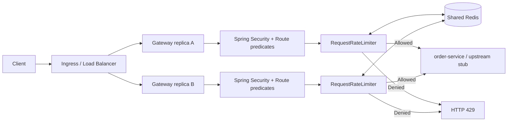
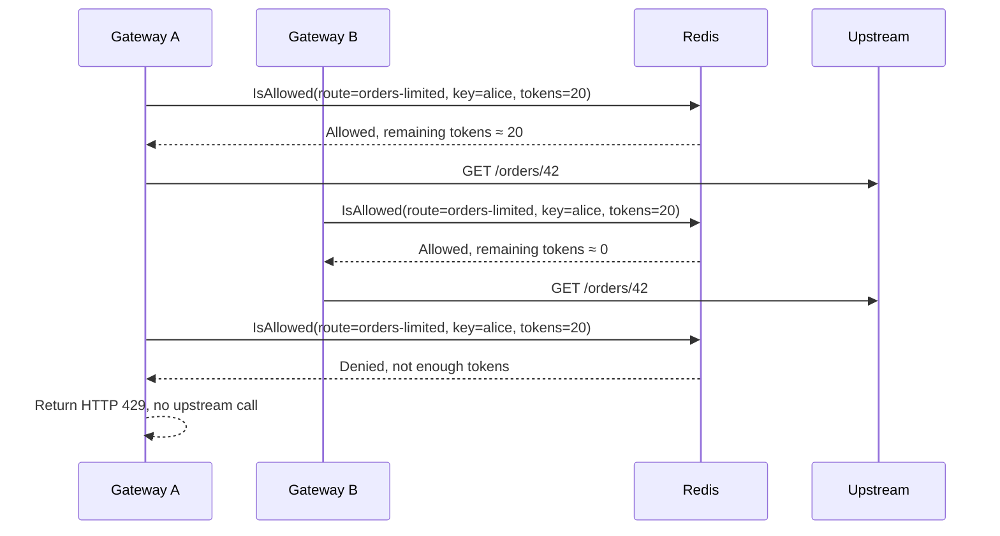
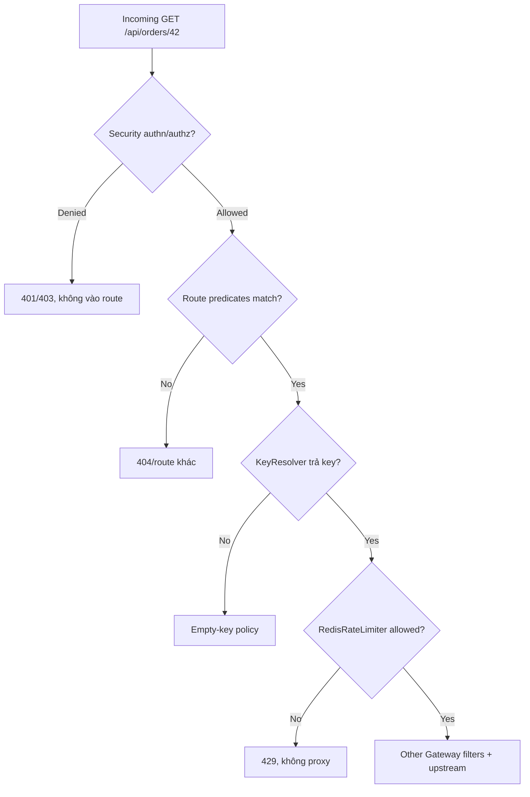

# Kiểm thử Redis rate limiting và nhiều bản sao khi phù hợp

**Spring Cloud Gateway** thường là điểm vào chung của nhiều microservices. Khi một API nhận lưu lượng đột biến, **RequestRateLimiter** có thể giới hạn số request được phép chuyển tới backend. Nếu dùng **RedisRateLimiter**, các Gateway replicas có thể phối hợp dùng **cùng một hạn mức** thay vì mỗi replica tự cấp một bộ token riêng. Tuy nhiên, một cấu hình YAML có `replenishRate` và `burstCapacity` **không tự chứng minh** việc giới hạn diễn ra chính xác, an toàn hoặc nhất quán khi scale-out.

Bài thuộc chương **Kiểm thử**, hướng dẫn xây dựng bộ kiểm thử từ **unit test KeyResolver**, **integration test với Redis thật và upstream stub**, đến **kiểm thử đồng thời qua nhiều Gateway replicas**. Phạm vi gắn với mục tiêu vận hành API Gateway bằng Spring Cloud Gateway: route predicate, filter chain, biến đổi path/header, service discovery qua `lb://`, xác thực, rate limiting, circuit breaker, retry, TLS và observability.

> **Phạm vi kỹ thuật:** Nội dung chính sử dụng **Spring Cloud Gateway Server WebFlux** và filter `RequestRateLimiter` với implementation `RedisRateLimiter`. Gateway Server Web MVC có integration/filters khác; không áp nguyên xi những test WebFlux. Tên dependency, prefix cấu hình, response headers, cấu trúc Redis keys và behavior khi Redis mất kết nối có thể khác theo phiên bản. Các giá trị hạn mức và số request bên dưới chỉ phục vụ lab; production cần capacity test và chính sách bảo mật riêng.

## 1. Mục tiêu: kiểm thử chính sách, không chỉ HTTP 429

Một test đơn giản thường gửi nhiều requests đến cùng một route, thấy một request trả `429 Too Many Requests` rồi kết luận “rate limiter hoạt động”. Kết luận này còn thiếu nhiều điều kiện.

Bộ kiểm thử tốt cần chứng minh:

1. **Đúng route:** Chỉ những requests thuộc route định áp limit mới dùng bucket đó.
2. **Đúng danh tính:** KeyResolver tạo key từ **identity đã được xác thực**, không phải raw header mà client tùy ý đổi.
3. **Đúng thuật toán:** Burst, tốc độ bổ sung token và số token/request khớp chính sách.
4. **Đúng phản hồi:** Request bị từ chối trả status được thiết kế, không rơi vào fallback trả thành công giả.
5. **Không tới upstream:** Khi limiter từ chối, backend không nhận request bị chặn.
6. **Đúng phạm vi:** Hai users độc lập không tự tiêu hết bucket của nhau; các routes có scope riêng khi đó là chủ đích.
7. **Đúng khi scale-out:** N Gateway replicas dùng một quota chung nếu cấu hình chính sách yêu cầu.
8. **Đúng dưới concurrency:** Requests đồng thời không vượt quota chỉ vì race condition.
9. **Đúng khi Redis lỗi:** Hệ thống có chính sách rõ ràng, không tự động fail-open ngoài ý muốn.
10. **Có thể quan sát:** Metrics, logs và traces phân biệt 429, thiếu key, Redis error và upstream 5xx.

**Điểm cốt lõi:** Một HTTP `429` chỉ là triệu chứng tại client. Kiểm thử hệ thống phải gắn **response status**, **Redis-backed decision** và **upstream request count** trong cùng một kịch bản.

## 2. Mô hình request qua Spring Cloud Gateway



Ở mỗi Gateway replica:

1. Request được tiếp nhận, xác thực/phân quyền theo Security policy.
2. Route predicates chọn route.
3. `RequestRateLimiter` gọi `KeyResolver` để xác định quota subject.
4. `RedisRateLimiter` quyết định có đủ token cho subject/route hay không.
5. Nếu được phép, Gateway tiếp tục filters và proxy tới upstream.
6. Nếu bị từ chối, Gateway kết thúc response theo policy mà không tạo backend call tương ứng.

Thứ tự chi tiết giữa Security, route filters, Retry, CircuitBreaker và body rewriting có thể phụ thuộc configuration/stack. **Không suy tất cả các requests đều được đo và tính token ở cùng điểm** mà chưa kiểm tra filter ordering.

## 3. RedisRateLimiter hoạt động theo token bucket

Một **token bucket** có:

- **Capacity** \(B\): số token tối đa bucket có thể giữ.
- **Replenish rate** \(r\): số token được bổ sung trong mỗi giây theo thuật toán.
- **Requested tokens** \(q\): số token cần cho mỗi request.
- **Available tokens** \(T\): số token còn lại tại thời điểm ra quyết định.

Logic khái quát:

\[
T_{\text{new}} = \min(B, T_{\text{old}} + \Delta t \times r)
\]

Nếu \(T_{\text{new}} \geq q\), cho phép request và giảm \(q\) token; nếu không đủ, từ chối. Công thức phản ánh **mô hình token bucket**, không cam kết cách làm tròn thời gian, phép tính Lua hoặc metadata của mọi version.

Ví dụ lab:

```text
replenishRate = 1 token/giây
burstCapacity = 40 token
requestedTokens = 20 token/request

Ban đầu bucket đầy: 40 tokens

Request 1: 40 -> 20, allowed
Request 2: 20 ->  0, allowed
Request 3 ngay sau đó: 0 < 20, denied (429)

Sau khoảng 20 giây không có requests:
  thêm khoảng 20 tokens -> một request có thể được phép
```

**Lưu ý:** RedisRateLimiter không phải fixed-window counter “reset vào đầu mỗi phút”. Quota phụ thuộc token tích lũy theo thời gian; ranh giới giây, timestamp, đồng hồ và độ trễ network có thể ảnh hưởng một test đếm chính xác nếu cấu hình sát ngưỡng.

### Quan hệ giữa ba tham số

| Tham số | Tác dụng | Lỗi test thường gặp |
| --- | --- | --- |
| `replenishRate` | Tốc độ hồi token | Giả định 1 token/s nghĩa là chắc chắn 1 request/s với mọi `requestedTokens` |
| `burstCapacity` | Giới hạn token tồn tối đa | Nghĩ đây là max concurrent requests; thực chất không phải |
| `requestedTokens` | Chi phí một request | Quên set hoặc hiểu mặc định, khiến tính số requests được phép sai |
| Bucket key | Phân chia quota theo chủ thể | Cho nhiều users dùng chung vì resolver sai |
| Route ID | Tham gia scope bucket trong RedisRateLimiter phổ biến | Đổi ID khiến quota bị tách/reset ngoài ý muốn |

Khi `requestedTokens=1`, `burstCapacity=40` cho phép một burst tối đa khoảng 40 requests từ bucket đầy, rồi hồi token theo `replenishRate`. Khi `requestedTokens=20`, cùng capacity 40 chỉ cho phép hai requests liên tiếp từ bucket đầy.

### Vì sao nên dùng chi phí token lớn trong integration test ngắn?

Nếu dùng `replenishRate=1`, `burstCapacity=2`, `requestedTokens=1`, bạn gửi ba requests liên tiếp nhưng một request đi qua ranh giới một giây thì có thể được hồi thêm token. Kỳ vọng “chính xác 2 request thành công” trở nên dễ flaky.

Với `replenishRate=1`, `burstCapacity=40` và `requestedTokens=20`, bucket cần khoảng **20 giây** để hồi đủ cho request tiếp theo sau khi cạn. Test gửi ba requests trong vài giây ít gặp sai số ở ranh giới thời gian hơn.

**Đây chỉ là kỹ thuật thiết kế fixture để test ổn định**, không phải cấu hình hạn mức đề xuất cho một API production.

## 4. Redis chia sẻ quota như thế nào?

Trong implementation RedisRateLimiter thông dụng, trạng thái bucket được lưu trong Redis theo định danh liên quan **route ID và key từ KeyResolver**. Lua script làm công việc tính token/ghi trạng thái theo cơ chế nguyên tử phù hợp với Redis, giúp các Gateway replicas không tự trừ token riêng lẻ trong RAM.



Điểm cần kiểm thử:

- Gateway A và B dùng **cùng Redis backend/namespace**.
- Route ID thực tế **giống nhau** nếu muốn chung bucket theo route.
- KeyResolver trả **cùng key chuẩn hóa** cho một subject ở cả hai Gateway.
- `replenishRate`/`burstCapacity`/`requestedTokens` đồng nhất giữa các replicas.
- Redis script và connection health hoạt động trong cả hai tiến trình.
- Quota được áp trên **tổng requests qua A+B**, không phải quota nhân đôi theo số replicas.

**Không kết luận Redis “chia sẻ quota” chỉ vì hai Gateway cùng kết nối tới một hostname Redis.** Có thể chúng dùng Redis DB khác, key namespace khác, route ID khác hoặc key resolver không nhất quán.

## 5. Redis-backed quota khác local limiter

Một số hệ thống dùng limiter lưu token trong local memory của từng Gateway process. Khi scale-out:

```text
Mỗi replica có capacity 40, requestedTokens 20:

Gateway A: 2 requests allowed
Gateway B: 2 requests allowed
=> Tổng có thể 4 requests allowed

Đây là quota riêng cho mỗi replica, KHÔNG phải quota global.
```

Nếu dùng Redis đúng cách và cả A/B cùng bucket:

```text
Redis bucket chung capacity 40, requestedTokens 20:

Gateway A: 1 allowed
Gateway B: 1 allowed
Request tiếp theo ở A hoặc B: denied
=> Tổng khoảng 2 requests allowed trong burst đầu
```

Kiểm thử nhiều bản sao chỉ cần thiết khi **hạn mức phải áp dụng chung trên nhiều Gateway replicas**. Nếu hệ thống chủ ý giới hạn **per-instance** vì một mục tiêu kỹ thuật khác, kiểm thử theo scope đó thay vì mặc định shared Redis là bắt buộc.

### Những chính sách quota khác nhau

| Chính sách | Bucket mong muốn | Cần kiểm thử |
| --- | --- | --- |
| Mỗi user trên một route | `routeId + trusted userId` | User A/B độc lập, A trên hai replicas dùng chung |
| Mỗi tenant trên một route | `routeId + trusted tenantId` | Nhiều users cùng tenant tiêu chung quota |
| Mỗi API key | `routeId + validated API-key identity` | Key đã thu hồi không được bypass |
| Mỗi route toàn bộ clients | `routeId + fixed trusted key` | Tổng lưu lượng một route bị giới hạn |
| Một quota chung cho nhiều routes | **Custom policy/scope rõ ràng** | Không mặc định route IDs khác nhau chia sẻ token |
| Per-IP pre-auth | Trusted client IP từ network boundary | Không tin spoofed forwarded headers; NAT fairness |
| Hạn mức per-replica | Local state nếu được thiết kế vậy | Không hứa quota global |

**RedisRateLimiter mặc định thường phân tách theo route ID và key**. Nếu muốn “100 requests/user cho toàn bộ API” qua các route IDs khác nhau, không thể chỉ set cùng KeyResolver rồi tin rằng mọi routes sẽ dùng chung bucket; cần kiểm tra cách tạo key/route scope, hoặc thiết kế một centralized policy khác.

## 6. Cấu hình route giới hạn lưu lượng trong WebFlux

Một ví dụ lab với backend stub chạy tại `http://localhost:18081`:

```yaml
spring:
  cloud:
    gateway:
      routes:
        - id: orders-limited
          uri: http://localhost:18081
          predicates:
            - Path=/api/orders/**
            - Method=GET
          filters:
            - name: RequestRateLimiter
              args:
                key-resolver: "#{@userRateKeyResolver}"
                redis-rate-limiter.replenishRate: 1
                redis-rate-limiter.burstCapacity: 40
                redis-rate-limiter.requestedTokens: 20
            - StripPrefix=1
```

Ý định:

- `GET /api/orders/42` match route `orders-limited`.
- KeyResolver chọn subject đã xác thực.
- RedisRateLimiter cấp phép hoặc từ chối.
- Nếu được phép, `StripPrefix=1` chuyển `/api/orders/42` thành `/orders/42`.
- Upstream test stub nhận request và trả `200`.
- Nếu hết token, client nhận `429` theo default denial policy, và upstream **không nhận** request bị chặn.

**Tên thuộc tính và starter:** Ví dụ dùng namespace `spring.cloud.gateway.routes` quen thuộc của Gateway Server WebFlux. Những bản mới có thể chuyển sang `spring.cloud.gateway.server.webflux.routes` và các property prefixes khác. Kiểm tra Spring Cloud Gateway BOM, configuration metadata và actual route list trước khi test; file YAML được parse thành công không chứng minh route đã được nạp.

### Phụ thuộc Redis reactive

Một project Gateway WebFlux thường cần dependency tương thích với:

```xml
<dependency>
    <groupId>org.springframework.cloud</groupId>
    <artifactId>spring-cloud-starter-gateway</artifactId>
</dependency>
<dependency>
    <groupId>org.springframework.boot</groupId>
    <artifactId>spring-boot-starter-data-redis-reactive</artifactId>
</dependency>
<dependency>
    <groupId>org.springframework.boot</groupId>
    <artifactId>spring-boot-starter-test</artifactId>
    <scope>test</scope>
</dependency>
```

Đây là ví dụ cho dòng Gateway có starter `spring-cloud-starter-gateway`; dòng mới có thể dùng starter tên `server-webflux`. Không pin phiên bản độc lập không tương thích BOM. Nếu dùng Testcontainers và WireMock, cần thêm các test dependencies tương ứng; không được hiểu XML trên là POM hoàn chỉnh.

### Kết nối Redis trong Spring Boot

Ví dụ với Boot 3.x thường dùng:

```yaml
spring:
  data:
    redis:
      host: localhost
      port: 6379
      timeout: 2s
```

Ở một số dòng Boot cũ, prefix Redis có thể là `spring.redis`. Test phải kiểm tra Redis connection thực, không chỉ property có tên đúng. Redis password/TLS phải lấy từ secret manager/environment; không ghi plaintext credentials trong tài liệu hoặc repository.

## 7. KeyResolver phải dựa trên danh tính đáng tin

Một `KeyResolver` đơn giản dựa vào authenticated principal:

```java
@Configuration
public class RateLimitKeyConfiguration {

    @Bean
    KeyResolver userRateKeyResolver() {
        return exchange -> exchange.getPrincipal()
            .map(Principal::getName);
    }
}
```

Trong ví dụ này, Gateway yêu cầu có principal đã được xác thực. `Principal::getName` phải **ổn định và duy nhất trong phạm vi quota mong muốn**. Nếu nhiều tenants có cùng username `alice` nhưng quota cần tách tenant, phải dùng một key được cấu thành từ **tenant ID và subject đã được xác minh**.

### Không dùng header do client tự khai làm identity

Anti-pattern:

```java
// ANTI-PATTERN: client có thể đổi X-User-Id để né quota.
@Bean
KeyResolver unsafeResolver() {
    return exchange -> Mono.justOrEmpty(
        exchange.getRequest().getHeaders().getFirst("X-User-Id"));
}
```

Một client có thể gửi:

```http
X-User-Id: alice
```

rồi đổi thành `bob`, `charlie`... để tạo buckets mới. Tương tự, dùng `X-Forwarded-For` tùy ý khi không xác nhận trusted proxy chain có thể cho attacker spoof IP để vượt quota.

**Thiết kế đúng:** Security xác thực JWT/session/API key trước, sau đó KeyResolver lấy identity từ Authentication/claims đã được kiểm tra chữ ký, issuer, audience và scope.

### Ví dụ bucket theo tenant và user đã được xác minh

```java
@Bean
KeyResolver tenantUserKeyResolver() {
    return exchange -> exchange.getPrincipal()
        .ofType(JwtAuthenticationToken.class)
        .map(auth -> {
            Jwt jwt = auth.getToken();
            String tenant = jwt.getClaimAsString("tenant_id");
            String subject = jwt.getSubject();

            if (tenant == null || tenant.isBlank()
                    || subject == null || subject.isBlank()) {
                throw new AccessDeniedException("Missing validated identity");
            }

            return "tenant:" + tenant + ":subject:" + subject;
        });
}
```

Đây là mẫu về **cách lấy giá trị từ JWT đã xác minh**, không phải yêu cầu dùng claim tên `tenant_id` ở mọi IdP. Nếu JWT không chứa tenant tin cậy, backend/identity service phải cung cấp mapping đáng tin; không lấy tenant ID từ path/header người dùng tự chọn mà không kiểm tra membership.

**Vấn đề riêng tư:** Raw tenant/user identifiers có thể nằm trong key Redis hoặc logs. Trong production có thể dùng một ID opaque hoặc **HMAC ổn định** của tuple tenant+subject, với khóa bảo mật được quản lý và namespace rõ ràng. Không dùng một hash không bí mật nếu threat model yêu cầu khó suy ra user IDs.

### Empty key khác exhausted quota

Nếu `KeyResolver` trả `Mono.empty()`, filter có thể áp **deny-empty-key** và trả một status riêng (thường `403` trong cấu hình mặc định của một số phiên bản). Điều này **không phải** Redis đã hết token.

Nếu request không có token:

- Spring Security có thể trả `401` **trước route/filter**.
- Nếu đã qua Security nhưng KeyResolver không tạo được key, limiter có thể từ chối do **empty key**.
- Nếu có key hợp lệ nhưng bucket không đủ token, limiter thường trả `429`.
- Nếu Redis lỗi, status/exception lại phụ thuộc fail policy và integration.

Phải kiểm thử **bốn nhánh riêng**, không nhóm tất cả vào “rate limited”.

## 8. Security và limiter nằm ở đâu trong filter chain?

Trong WebFlux, Spring Security hoạt động qua `WebFilter`, còn `RequestRateLimiter` là GatewayFilter trên route. Khi request bị Security từ chối trước mapping, nó thường không tiêu token của route này.



Sơ đồ là mô hình bình thường của WebFlux stack; thứ tự thực tế còn tùy custom filters, route order và Security config.

### Cấu hình Security ví dụ

```java
@Bean
SecurityWebFilterChain apiSecurity(ServerHttpSecurity http) {
    return http
        .authorizeExchange(ex -> ex
            .pathMatchers(HttpMethod.GET, "/api/orders/**")
                .hasAuthority("SCOPE_orders.read")
            .anyExchange().authenticated())
        .oauth2ResourceServer(oauth2 ->
            oauth2.jwt(Customizer.withDefaults()))
        .build();
}
```

Đoạn này chỉ minh họa role của Security, cần configuration issuer/JWT verification và các quy tắc bảo mật cho API khác, Actuator và management context. Không coi `.anyExchange().authenticated()` là chính sách phân quyền đầy đủ cho production.

**Test phải dùng token thực sự được chấp nhận theo test IdP/JWT setup**, không chỉ đặt chuỗi `Bearer alice` rồi giả định Gateway đã xác thực.

## 9. Thiết kế bộ test theo các lớp

| Cấp kiểm thử | Mục tiêu | Phải có Redis thật? |
| --- | --- | --- |
| **Unit test KeyResolver** | Identity/tenant/key normalization đúng, empty identity bị chặn | Không |
| **Unit/contract test filter** | Denied response không tiếp tục filter chain | Không nếu dùng stub `RateLimiter` đáng tin |
| **Single-instance integration** | YAML/SpEL, Redis script, status/headers, upstream count | **Nên có** |
| **Concurrency integration** | N requests đồng thời tiêu đúng quota cùng bucket | **Có** |
| **Multi-replica integration** | N Gateway processes dùng quota chung | **Có, cùng Redis** |
| **Failure injection** | Redis timeout/partition/restart, fallback policy | **Có môi trường kiểm soát** |
| **Load/capacity test** | Latency của limiter, Redis CPU/network, 429 theo burst | Có, môi trường gần production |
| **Security test** | Không giả mạo key/bypass backend, 401/403/429 đúng | Tùy lớp; integration nên có |

**Không cần chạy hai Gateway processes cho mọi unit test**. Nhưng nếu yêu cầu “khi scale-out quota vẫn giữ nguyên”, ít nhất một integration test phải có **hai tiến trình Gateway độc lập** thật, cùng Redis và cùng policy.

## 10. Testcontainers: dùng Redis thật thay vì mock Lua

Mock `ReactiveRedisTemplate` có thể giúp kiểm tra một số method calls, nhưng không chứng minh:

- Lua script được Redis hỗ trợ/có tính nguyên tử như kỳ vọng.
- Key TTL và cách token được lưu/đọc đúng.
- Redis serialization/codec phù hợp.
- Hai Gateway replicas cùng tranh token một cách nhất quán.
- Behavior timeout/network failure thật.

**Vì vậy nên dùng Testcontainers Redis** cho integration tests. Một fixture tối giản:

```java
@Testcontainers
@SpringBootTest(
    webEnvironment = SpringBootTest.WebEnvironment.RANDOM_PORT)
class RedisRateLimiterIntegrationTest {

    @Container
    static final GenericContainer<?> REDIS =
        new GenericContainer<>(
            DockerImageName.parse("redis:7.4-alpine"))
            .withExposedPorts(6379);

    @DynamicPropertySource
    static void redisProperties(DynamicPropertyRegistry registry) {
        registry.add("spring.data.redis.host", REDIS::getHost);
        registry.add("spring.data.redis.port",
            () -> REDIS.getMappedPort(6379));
    }
}
```

Đây là **khung lớp test**, không phải một file có đầy đủ imports/test methods. Cần dependency Testcontainers/JUnit 5, Docker runner cho CI và Redis image đã pin theo chính sách. Nếu dùng Spring Boot 2, kiểm tra property prefix Redis khác. Redis container bắt đầu trước khi `@DynamicPropertySource` được đánh giá và test context tạo kết nối.

### Một cạm bẫy với Testcontainers

Nếu test Gateway A và Gateway B có **hai Redis containers riêng**, kết quả không chứng minh distributed shared quota. Trong multi-replica test, hai tiến trình bắt buộc trỏ tới **cùng container Redis hoặc cùng Redis test cluster**.

### Isolation giữa tests

Token bucket có state tồn tại một thời gian. Nếu test T1 cạn bucket rồi T2 dùng cùng route/key, T2 có thể bị `429` ngay request đầu, gây flaky test.

Chiến lược tốt:

1. Dùng **Redis container riêng cho một test suite** hoặc isolate namespace/DB được hỗ trợ.
2. Dùng route ID/subject key độc lập, có prefix test-run hữu hạn.
3. Đợi trạng thái bucket được reset theo policy khi cần kiểm tra TTL.
4. Không chạy các test can thiệp cùng key song song trừ test concurrency chủ đích.
5. Chỉ cleanup **test keys thuộc quyền sở hữu** của suite, không `FLUSHALL` trên Redis dùng chung.
6. Không hard-code key format nội bộ của RedisRateLimiter để cleanup nếu chưa kiểm tra implementation version.

Nếu dùng Testcontainers với `@DirtiesContext` hoặc container lifecycle, cân nhắc chi phí startup và phạm vi context cache để CI vừa đúng vừa đủ nhanh.

## 11. Upstream stub: kiểm tra request bị deny không tới backend

Một test đúng phải có **backend request journal**. WireMock, MockWebServer hoặc một HTTP stub có thể trả:

```http
HTTP/1.1 200 OK
Content-Type: application/json

{"id":"42","state":"READY"}
```

Trên Gateway route lab:

```text
GET /api/orders/42
  -> RequestRateLimiter
  -> StripPrefix=1
  -> http://localhost:18081/orders/42
```

Khi bucket đã cạn:

```text
Request bị denied:
  client <- 429

Backend:
  KHÔNG có GET /orders/42 tương ứng
```

Nếu chỉ assert client `429` mà không kiểm tra backend, vẫn có thể xảy ra lỗi filter trả 429 **sau khi** upstream đã nhận request — điều này không còn bảo vệ tải backend như mong muốn.

### Chú ý response caching và fallback

Nếu route còn `LocalResponseCache` hoặc `CircuitBreaker` fallback, client có thể nhận `200` mà upstream không bị gọi; hoặc client nhận `429` từ một lớp khác. Để test Redis limiter:

- Ban đầu cấu hình upstream stub đơn giản, không cache/fallback/retry.
- Xác nhận hai HTTP 200 đầu thật sự đến stub.
- Xác nhận 429 không tạo request stub.
- Sau đó mới thêm các filters khác và kiểm tra tương tác.

## 12. Một integration test cho burst ban đầu

Với fixture `replenishRate=1`, `burstCapacity=40`, `requestedTokens=20`, từ một bucket mới:

```text
Alice request 1 -> 200, upstream gọi lần 1
Alice request 2 -> 200, upstream gọi lần 2
Alice request 3 -> 429, upstream KHÔNG được gọi lần 3
```

Một phác thảo test WebTestClient:

```java
@Test
void burstThenRejectsWithoutCallingUpstream() {
    // WebTestClient, WireMock, Redis Testcontainer đã được cấu hình.
    // jwtFor("alice") là test helper cấp một JWT HỢP LỆ cho test issuer.
    String aliceJwt = jwtFor("alice");

    webTestClient.get()
        .uri("/api/orders/42")
        .headers(h -> h.setBearerAuth(aliceJwt))
        .exchange()
        .expectStatus().isOk();

    webTestClient.get()
        .uri("/api/orders/42")
        .headers(h -> h.setBearerAuth(aliceJwt))
        .exchange()
        .expectStatus().isOk();

    webTestClient.get()
        .uri("/api/orders/42")
        .headers(h -> h.setBearerAuth(aliceJwt))
        .exchange()
        .expectStatus().isEqualTo(429);

    wireMockServer.verify(2,
        getRequestedFor(urlEqualTo("/orders/42")));
}
```

**Đây là test sketch, chưa phải class compile độc lập.** Cần setup `webTestClient`, `wireMockServer`, `jwtFor`, Redis và Spring Security. Test chỉ đúng khi bucket của Alice trên route này **ban đầu đầy**, ba requests chạy trước khi hồi đủ 20 token, và backend stub trả HTTP 200.

Một test dạng này không nên phụ thuộc vào “sleep 100 ms” rồi đếm token chính xác ở ranh giới thời gian; hãy chọn profile có đủ khoảng cách với ngưỡng hồi token và kiểm soát test key/fixture.

### Kiểm tra response headers

Ở những phiên bản hỗ trợ, RedisRateLimiter có thể thêm các header `X-RateLimit-*` thể hiện replenish rate, burst capacity, remaining/requested tokens. Nhưng:

- Tên header và việc bật/tắt có thể cấu hình hoặc thay đổi theo version.
- Remaining tokens có thể được tính tại thời điểm decision, không đồng nghĩa trạng thái Redis hiện thời sau requests đồng thời.
- `Retry-After` **không được mặc định giả định luôn có**.
- Header không chứng minh upstream đã/không được gọi.

Test nên kiểm tra các header **thực sự thuộc contract public API**; đừng hard-code header phụ thuộc implementation nếu không có version pin và compatibility test.

## 13. Test refill mà không tạo flaky timing

Token bucket bổ sung token theo thời gian. Một test thiếu ổn định:

```java
// Không nên viết integration test phụ thuộc đúng mốc refill sát giây:
Thread.sleep(1000);
assertAllowed();
```

Vấn đề:

- RedisRateLimiter có thể dùng timestamp tính theo độ phân giải giây.
- CI scheduler/GC/network làm request đến Redis sớm hoặc muộn.
- Test container bị chậm vào lúc máy build tải cao.
- Nhiều replicas có thể có clock drift nếu implementation lấy thời gian ở application nodes.

### Hai tầng kiểm chứng refill

**A. Unit-level / deterministic test thuật toán**

Với một implementation testable của token bucket hoặc contract wrapper có clock injection, dùng fake clock để xác nhận:

```text
t = 0s: bucket 40 tokens
t = 0s: request q=20 allowed -> 20
t = 0s: request q=20 allowed -> 0
t = 0s: request q=20 denied  -> 0
t = 19s: q=20 denied (nếu dùng số giây/tokens như giả định)
t = 20s: q=20 allowed
```

Lưu ý RedisRateLimiter tích hợp sẵn không nhất thiết expose fake clock; **không viết unit test giả rồi tuyên bố đã kiểm tra chính Lua script**.

**B. Integration test Redis thật**

Dùng profile có refill nhanh hơn nhưng chừa biên thời gian, đợi trạng thái với bounded polling và deadline hợp lý. Ví dụ bật một key test riêng, chờ **đủ xa** qua thời điểm dự đoán, rồi assert request được phép. Ghi thời gian thực tế để debug. Không chờ vô hạn.

### Vì sao không dùng `Thread.sleep` trên Gateway event loop?

Trong **test driver** độc lập, đợi thời gian ngắn có thể chấp nhận khi cần kiểm thử thời gian thật; nhưng **không block Reactor Netty event loop** trong Gateway filter hay reactive handler. Test integration nên dùng Awaitility/scheduler bên ngoài request pipeline nếu cần polling.

## 14. Test requestedTokens và cấu hình cận biên

Đừng chỉ test default `requestedTokens=1`. Cần kiểm chứng:

| Case | Cấu hình | Điều cần chứng minh |
| --- | --- | --- |
| Q1 | q=1, B=5 | Cho tối đa burst phù hợp |
| Q2 | q=20, B=40 | Hai requests từ bucket đầy, tiếp theo bị deny |
| Q3 | q=B | Một request tiêu toàn bộ bucket |
| Q4 | q lớn hơn B | Không tạo policy vô nghĩa hoặc được validation chặn |
| Q5 | r rất thấp, B lớn | Hạn mức trung bình thấp với burst hữu hạn |
| Q6 | r và B thay đổi khi route refresh | State cũ và policy mới có lifecycle được đo |
| Q7 | Giá trị âm/zero sai contract | Configuration validation / startup failure theo version |
| Q8 | Không khai báo requestedTokens | Default theo implementation/version được ghi nhận |

Trong tài liệu/lab, nên chọn các giá trị hợp lệ; không mặc định thuật toán xử lý input không hợp lệ theo cách an toàn. Tốt nhất có validation ở control plane/config review, không chỉ đợi Lua script fail.

## 15. Phân biệt `429`, `403`, `401` và `503`

| HTTP status / triệu chứng | Nguồn thường gặp | Điều cần assert |
| --- | --- | --- |
| `401` | Missing/invalid token, Security chặn trước route | Không proxy, authn logs đúng |
| `403` | Không đủ quyền hoặc KeyResolver không tạo key theo empty-key policy | Phân biệt authz vs empty key |
| `429` | Bucket không đủ token theo limiter | Không proxy, quota subject đúng |
| `404` | Route không match hoặc upstream resource not found | Route ID và backend request journal |
| `503` | No-instance, backend unavailable, Redis integration lỗi theo error policy | Phân biệt lớp gốc bằng logs/metrics |
| `500` | Redis command/connection exception hoặc bug không được xử lý theo policy | Không coi là 429 hợp lệ |
| `200` | Upstream success hoặc fallback/cache | Xác minh upstream đã nhận nếu đó là mục tiêu test |

Không hard-code “Redis down phải trả 429”: **hết token** và **không thể truy vấn trạng thái token** là hai tình huống khác nhau. Khi Redis lỗi, status thực tế phụ thuộc integration/exception handling/fail policy.

### Header `Retry-After` có bắt buộc?

HTTP `429` có thể đi kèm `Retry-After` theo hợp đồng ứng dụng, nhưng không giả định RedisRateLimiter tự phát header này ở mọi bản. Nếu API công bố `Retry-After`, hãy kiểm thử riêng cách tính, đơn vị giây/date, accuracy tương đối, và không chỉ tin `X-RateLimit-Remaining`.

## 16. Test KeyResolver: cùng user, khác user, khác tenant

Một bộ unit tests cho resolver nên chứng minh:

1. Cùng JWT principal → cùng key qua nhiều requests.
2. Hai users khác nhau → hai keys khác nhau.
3. Cùng username ở hai tenants khác nhau → hai keys khác nhau nếu quota theo tenant+user.
4. Token không có claim bắt buộc → bị từ chối, không fallback sang key cố định ngoài ý muốn.
5. Case normalization có chủ đích; không có collision sau lowercasing/trim tùy ý.
6. Token do issuer khác/không đủ audience → Security từ chối trước resolver.
7. Principal chưa xác thực hoặc absent → no key theo policy.
8. User đổi raw `X-User-Id`/`X-Tenant-Id` → key vẫn theo validated identity, không theo header.
9. User đổi query/path → key không đổi trừ khi policy muốn scope theo resource.
10. Không log key có raw PII/secret.

### Test độc lập hai users

Với bucket mới của Alice và Bob:

```text
Alice: allowed, allowed, denied
Bob:   allowed

Nếu Bob bị denied vì Alice đã cạn,
KeyResolver hoặc bucket key scope có thể đang bị dùng chung ngoài ý muốn.
```

Trong integration test, không chỉ nhìn status; ghi số calls upstream cho từng user nếu backend stub có identity fixture hợp lệ. **Không chuyển JWT của Alice sang Bob trong backend test mà không cấu hình Security**; mỗi user phải có credential test riêng được ký/xác minh đúng.

## 17. Route ID ảnh hưởng scope bucket

Giả sử có hai routes:

```yaml
- id: orders-read-limited
  uri: lb://order-service
  predicates:
    - Path=/api/orders/**
    - Method=GET
  filters:
    - name: RequestRateLimiter
      args:
        key-resolver: "#{@userRateKeyResolver}"
        redis-rate-limiter.replenishRate: 1
        redis-rate-limiter.burstCapacity: 40
        redis-rate-limiter.requestedTokens: 20

- id: catalog-read-limited
  uri: lb://catalog-service
  predicates:
    - Path=/api/catalog/**
    - Method=GET
  filters:
    - name: RequestRateLimiter
      args:
        key-resolver: "#{@userRateKeyResolver}"
        redis-rate-limiter.replenishRate: 1
        redis-rate-limiter.burstCapacity: 40
        redis-rate-limiter.requestedTokens: 20
```

Trong RedisRateLimiter phổ biến, keys được chia theo **route ID + resolved key**. Do đó Alice cạn bucket `orders-read-limited` không nhất thiết cạn bucket `catalog-read-limited`.

**Nếu nghiệp vụ yêu cầu tổng 100 requests/phút cho toàn bộ APIs**, hãy thiết kế quota scope toàn cục bằng policy/service/implementation phù hợp. Không xem dùng cùng một `KeyResolver` là bằng chứng một Redis bucket chung cho nhiều route IDs.

### Route ID thay đổi giữa deployments

Nếu Gateway-A dùng `orders-limited` nhưng Gateway-B dùng `orders-limited-v2` cho cùng public endpoint, RedisRateLimiter có thể tạo **hai bucket riêng**. Đây là một lỗi scale-out dễ bỏ qua.

Test rollout cần so sánh:

- Effective route ID trên mỗi replica.
- KeyResolver bean và logic normalization.
- RateLimiter parameters.
- Redis connection namespace/cluster.
- Route filters/order sau refresh.
- Version/deployment revision.

Trong canary rollout thay route ID, quota chung có thể **tạm thời phân đôi**. Cần kế hoạch migration/compatibility nếu đây là policy bắt buộc.

## 18. Test hai Gateway replicas: cùng Redis, cùng key

Đây là bài kiểm thử trọng tâm.

### Topology đúng

```text
                           +---------------------+
                           | Redis Testcontainer |
                           | host:port cố định   |
                           +----------+----------+
                                      |
                      +---------------+---------------+
                      |                               |
              Gateway A :8081                 Gateway B :8082
              routeId=orders-limited          routeId=orders-limited
              same KeyResolver                same KeyResolver
              r=1, B=40, q=20                 r=1, B=40, q=20
                      |                               |
                      +---------------+---------------+
                                      |
                           WireMock :18081
                           GET /orders/42
```

Bắt buộc A và B là **hai Spring Boot processes/contexts với runtime độc lập**, cùng trỏ tới Redis test backend thật. Khởi động A/B khác ports và xác thực chúng có cùng route configuration; tránh test chỉ gửi nhiều requests vào một Gateway process rồi gọi là “multi replica”.

### Trình tự test đơn giản

Với **một bucket mới của Alice**:

| Bước | Đích gọi | Expected HTTP | Upstream calls tích lũy |
| --- | --- | ---: | ---: |
| 1 | Gateway A | 200 | 1 |
| 2 | Gateway B | 200 | 2 |
| 3 | Gateway A | 429 | 2 |
| 4 | Gateway B | 429 | 2 |

Kết quả mong muốn: tổng số phép cấp token từ **hai replicas** không vượt capacity của **một bucket**. Fixture q=20/B=40/r=1 cho đủ khoảng cách hồi token để chạy bốn calls trong thời gian ngắn.

### Bash kiểm tra trực tiếp từng replica

```bash
# Hai biến TOKEN_* được cấp từ test issuer, KHÔNG phải token sản xuất.
# Gateway A/B chạy trên hai ports riêng và cùng Redis.
curl -sS -o /dev/null -w 'A1 status=%{http_code}\n' \
  -H "Authorization: Bearer $TOKEN_ALICE" \
  http://127.0.0.1:8081/api/orders/42

curl -sS -o /dev/null -w 'B1 status=%{http_code}\n' \
  -H "Authorization: Bearer $TOKEN_ALICE" \
  http://127.0.0.1:8082/api/orders/42

curl -sS -o /dev/null -w 'A2 status=%{http_code}\n' \
  -H "Authorization: Bearer $TOKEN_ALICE" \
  http://127.0.0.1:8081/api/orders/42

curl -sS -o /dev/null -w 'B2 status=%{http_code}\n' \
  -H "Authorization: Bearer $TOKEN_ALICE" \
  http://127.0.0.1:8082/api/orders/42
```

Đây là test chạy ở môi trường lab đã được bảo vệ, không phải yêu cầu chạy curl trên production. **Không paste token thật** vào shell history/logs. Do script không kiểm soát thời gian tuyệt đối, với CI cần kiểm tra total duration và sử dụng profile refill/burst thích hợp để tránh false failures.

### Trường hợp test vẫn pass nhưng quota không global

Nếu A được test trước khi Redis reset, còn B test sau khi bucket đã hết hạn/được reset, hai phía đều có thể cho phép traffic mà test không chứng minh tính chia sẻ. Phải test **xen kẽ trong cùng thời đoạn, cùng subject và cùng Redis state**.

## 19. Test đồng thời qua hai replicas và Lua atomicity

Các requests đồng thời quan trọng vì hai Gateway có thể cùng cố trừ token gần một thời điểm.

Giả sử burstCapacity=40, requestedTokens=20, replenishRate=1:

```text
Tại thời điểm bucket mới đầy:
  20 concurrent requests của Alice
  phân phối 10 requests tới A và 10 tới B

Kỳ vọng khi diễn ra trong khoảng ngắn hơn rất nhiều thời gian refill:
  khoảng 2 requests allowed (tổng trên A+B)
  khoảng 18 requests denied
  backend nhận khoảng 2 requests
```

**Vì có thời gian thật, network scheduling và replenishment**, không nên hard-code “chính xác 2” nếu load test có thể kéo dài đủ lâu cho thêm 20 tokens. Hãy:

- Sử dụng profile burst/test token cost sao cho refill không đáng kể trong thời gian test.
- Đo duration của toàn batch.
- Kiểm soát bucket ban đầu và start time.
- Assert upper bound hợp lý trong khoảng thời gian đã đo.
- Nếu cần strict atomicity property, thiết kế deterministic test với Redis script/test harness riêng hoặc profile rất chậm refill.

### Lỗi nếu dùng local state

Nếu mỗi Gateway dùng limiter trong RAM, A và B có thể **mỗi bên** cho 2 requests; tổng 4 allowed. Bài test concurrency phải phát hiện chênh lệch đó.

### Ví dụ test driver giả mã

```text
1. Khởi tạo Redis bucket mới cho (orders-limited, alice).
2. Tạo 20 HTTP requests có JWT Alice hợp lệ.
3. Dùng barrier để phát đồng thời tới A/B.
4. Ghi status và latency của từng request.
5. Đợi tất cả requests hoàn tất hoặc deadline.
6. Tính allowed/denied trên cả hai replicas.
7. Kiểm tra WireMock request journal.
8. Lặp với 100/1000 concurrent requests trong staging.
9. Chạy lại sau restart một Gateway.
```

Đừng viết test driver cũng làm Redis bị nghẽn vì dùng một thread blocking cho mọi future theo cách không kiểm soát; load generator nên có concurrency/timeout budget rõ ràng.

## 20. Multi-replica test phải giữ cấu hình nhất quán

| Thuộc tính | A | B | Nếu khác |
| --- | --- | --- | --- |
| Effective route ID | `orders-limited` | `orders-limited` | Bucket chia đôi nếu key gắn route ID |
| KeyResolver | Trusted user | Trusted user | Một user thành hai keys |
| Key normalization | Cùng quy tắc | Cùng quy tắc | Case/tenant mismatch |
| Redis endpoint/DB | Shared Redis test | Shared Redis test | Hai trạng thái riêng |
| Replenish rate | 1 | 1 | Quyết định lệch theo replica |
| Burst capacity | 40 | 40 | Quyết định lệch theo replica |
| Requested tokens | 20 | 20 | Tiêu token khác nhau |
| JWT issuer/audience | Cùng contract | Cùng contract | A 401, B pass |
| Clock/time source | Đồng bộ theo chính sách | Đồng bộ | Refill bất thường nếu dùng app timestamps |
| Filter chain/route order | Cùng behavior | Cùng behavior | Một replica không chạy limiter |
| Library/BOM version | Đã kiểm chứng tương thích | Đã kiểm chứng | Script/headers/keys behavior có thể khác |

Ngay cả khi A/B truy cập cùng Redis, **khác biệt cấu hình** cũng có thể làm hạn mức sai.

### Đồng hồ và Redis script

Token bucket cần thời gian để tính refill. Tùy implementation/version, timestamp có thể được lấy ở Gateway application hoặc qua cơ chế khác. Nếu Gateway A nhanh hơn B nhiều giây, tính token có thể bị ảnh hưởng.

- Đồng bộ NTP/clock của các nodes.
- Không tự sửa đồng hồ system của production khi test.
- Test clock skew có kiểm soát nếu yêu cầu quota nghiêm ngặt.
- Kiểm tra implementation/version thay vì giả định Redis luôn quyết định thời gian.
- Cảnh báo nếu hosts/pods có clock offset lớn.

Một Lua script nguyên tử giúp tránh race trên update state, **không tự giải quyết mọi clock/configuration skew**.

## 21. Redis Cluster và key locality

RedisRateLimiter thường sử dụng hơn một Redis key cho một bucket (ví dụ lưu token và lần refresh gần nhất). Với Redis Cluster, các keys được thao tác trong một Lua script cần nằm trên **cùng hash slot** hoặc tuân thủ cơ chế được phiên bản Redis/script hỗ trợ.

Implementation Gateway RedisRateLimiter phổ biến có cơ chế xây key/hash tag phù hợp với Redis Cluster, nhưng **đừng dựa vào key layout của một bài blog** khi chuyển Redis deployment. Hãy kiểm thử:

- Bucket keys của một subject được xử lý trên cluster đúng slot.
- Không xuất hiện `CROSSSLOT` hoặc Lua script key errors.
- Script load/`EVALSHA`/`NOSCRIPT` recovery theo Redis client configuration.
- Redirect/failover giữa cluster nodes không tạo sai quota hoặc timeout quá mức.
- TTL/eviction behavior khi nhiều subjects.
- Khi network partition/failover, chính sách chấp nhận/từ chối được xác định rõ.

**Testcontainers một Redis standalone là tầng cơ bản, không thay thế cluster/failover test** nếu production dùng Redis Cluster/Sentinel.

## 22. Redis mất kết nối: fail-open hay fail-closed?

Giả sử Gateway cần hỏi Redis nhưng:

- Redis process dừng.
- DNS không phân giải.
- Network policy cắt kết nối.
- TLS handshake Redis lỗi.
- Redis CPU/network quá tải.
- Command timeout.
- Redis cluster failover/re-sharding.
- Lua script bị lỗi hoặc key type không tương thích.

Khi đó Gateway **không biết chắc** bucket còn token hay không.

### Hai chính sách kinh doanh

| Chính sách | Hành vi mong muốn | Lợi ích | Rủi ro |
| --- | --- | --- | --- |
| **Fail-closed** | Không cho request đi tiếp khi không thể xác minh quota | Bảo vệ backend và quota nghiêm ngặt | API có thể unavailable vì Redis outage |
| **Fail-open có kiểm soát** | Có thể cho request tiếp tục khi Redis lỗi | Giữ tính khả dụng | Attacker/traffic burst có thể vượt quota |
| **Degraded fallback limiter** | Dùng local cap rất chặt/ngắn hạn nếu đã thiết kế | Giới hạn một phần blast radius | Quota không còn global, phức tạp state |
| **Fail per policy/route** | Route nhạy cảm fail-closed, public read có policy khác | Tối ưu theo nghiệp vụ | Cần audit, quan sát và review |

**Không khẳng định RedisRateLimiter mặc định tự fail-open hoặc tự fail-closed theo đúng các nhãn trên.** Behavior thực tế có thể là exception/5xx, do Gateway filter/error handling quyết định. Phải thiết kế rõ rồi kiểm thử integration; nếu thay behavior mặc định, cần custom error handling đúng và security review.

### Failure injection an toàn

Trong lab, dừng Redis container hoặc chặn network có kiểm soát rồi gửi requests qua A và B. Kiểm tra:

1. HTTP status/exception đúng policy đã công bố.
2. Request không vượt policy bảo vệ backend.
3. Không silently bypass limiter do một exception bị swallow.
4. Gateway không giữ pending Redis commands vô hạn.
5. Timeout budget hợp lý.
6. Metrics/logs có error category `redis_unavailable` nhưng không lộ credentials.
7. Redis hồi phục, các Gateway reconnect và limiter hoạt động lại.
8. Không có flood đột ngột sau Redis restart vì bucket state bị mất.

**Không chạy thử ngắt Redis production** nếu không có kế hoạch bảo trì/chaos engineering được phê duyệt.

## 23. Redis restart và mất trạng thái bucket

RedisRateLimiter dựa trên Redis state, không chỉ vào JVM memory. Nếu Redis Testcontainer restart mà **không có persistence phù hợp**, bucket keys có thể biến mất.

Hệ quả:

```text
Trước restart:
  Alice bucket cạn, request bị 429.

Redis restart, state bị mất:
  Bucket Alice có thể được khởi tạo lại như bucket mới.

Sau restart:
  Alice có thể được cấp burst mới.
```

Đây không phải “bug atomicity” của một request; đó là vấn đề **lifecycle state**.

Test cần phân biệt:

- Redis network disconnect ngắn nhưng state giữ nguyên.
- Redis process restart có AOF/RDB persistence theo policy.
- Redis failover sang replica với replication lag.
- Bucket TTL hết hạn tự nhiên sau idle.
- Redis key eviction do `maxmemory` policy.
- Route ID/key namespace đổi khi deploy.

**Nếu quota có ý nghĩa tài chính hoặc pháp lý**, không mặc định Redis token bucket là một ledger kiểm toán tuyệt đối chính xác dưới mọi kiểu failover. Cần thiết kế lưu vết, consistency/reconciliation và nguồn dữ liệu authoritative phù hợp.

## 24. TTL, key explosion và cardinality

Rate limiting theo user/tenant có thể tạo nhiều keys Redis:

```text
routeId=orders-limited, user=alice
routeId=orders-limited, user=bob
routeId=catalog-limited, user=alice
...
```

RedisRateLimiter implementation thường dùng TTL cho bucket state; TTL có thể phụ thuộc burst/replenish configuration. Nhưng **TTL chính xác và key format là implementation details**.

Điều cần kiểm thử:

- Keys idle có được dọn theo chính sách không?
- Với 100.000 users hoặc dynamic API keys, Redis memory tăng bao nhiêu?
- Một attacker có thể tạo vô số keys bằng danh tính giả không?
- Keys có chứa user IDs/PII không?
- Redis eviction policy có xóa bucket state còn cần thiết không?
- Key count/hit/miss/evictions có dấu hiệu bất thường không?
- Route IDs đổi liên tục có tạo nhiều buckets cũ không?

**Không dùng `KEYS *` trên Redis production** để kiểm tra toàn bộ buckets; thao tác quét có thể tốn tài nguyên. Chọn lệnh scan/metrics có giới hạn theo policy hoặc một môi trường lab riêng.

### Đừng đưa raw bucket key vào metrics

Một metric có tag `userId=alice` hoặc `bucketKey=route.alice` vừa rò dữ liệu vừa tăng cardinality. Dùng route ID có tập giá trị được quản lý, status/decision labels hữu hạn và error category. Với tenants lớn, nếu cần per-tenant analytics, dùng hệ event/log bảo vệ thay vì metric time series cho từng tenant.

## 25. KeyResolver theo IP: khi nào và kiểm thử ra sao?

Một số hệ thống cần chống flood **trước login**; lúc đó chưa có principal. Có thể dùng limiter per-IP tại Ingress/WAF hoặc Gateway policy chuyên biệt.

Nhưng sau Ingress, địa chỉ remote mà Gateway thấy có thể là IP của reverse proxy. Nếu dùng `X-Forwarded-For`:

- Chỉ tin header do **proxy đã được xác thực/trusted network** đặt.
- Xóa hoặc chuẩn hóa giá trị client tự gửi ở ingress.
- Xác định đúng hop/canonical client address.
- Test IPv4, IPv6, NAT và shared corporate proxies.
- Không coi IP là identity mạnh; nhiều users có thể dùng chung NAT.
- Không dùng toàn bộ chuỗi `X-Forwarded-For` làm key vì attacker có thể thay đổi nội dung/cardinality.

### Vì sao limiter theo principal chưa đủ chống anonymous flood?

Nếu Spring Security từ chối unauthenticated request trước `RequestRateLimiter` của route, Redis bucket theo user không bảo vệ CPU/TLS/JWT parsing khỏi một lượng requests anonymous lớn. Cần một lớp bảo vệ sớm hơn (Ingress/WAF/pre-auth IP policy/admission) theo threat model.

Test riêng:

- Anonymous flood không tới backend.
- Đường login/OAuth2 callback không bị limiter theo principal yêu cầu key chưa tồn tại làm hỏng.
- IP reputation/trusted proxy policy không để attacker bypass qua spoofed headers.
- Authenticated quota không bị một user khác tiêu hết.

## 26. Filter ordering với RewritePath, Retry và CircuitBreaker

Một route có thể dùng:

```yaml
filters:
  - name: RequestRateLimiter
    args:
      key-resolver: "#{@userRateKeyResolver}"
      redis-rate-limiter.replenishRate: 1
      redis-rate-limiter.burstCapacity: 40
      redis-rate-limiter.requestedTokens: 20
  - StripPrefix=1
  - name: CircuitBreaker
    args:
      name: ordersBreaker
      fallbackUri: forward:/fallback/orders
  - name: Retry
    args:
      retries: 2
      methods:
        - GET
      series:
        - SERVER_ERROR
```

**Filter list không phải một bằng chứng đầy đủ về execution nesting**. GlobalFilters, factory order, retry/circuit breaker wrapper và Spring Security có lifecycle riêng. Vì vậy cần kiểm thử behavior thực tế:

| Câu hỏi | Kiểm thử |
| --- | --- |
| Request bị `429` có đi upstream không? | WireMock request journal phải không tăng |
| Một client request được retry có bị trừ token nhiều lần không? | Đếm Redis decisions/limit responses theo implementation |
| CircuitBreaker fallback có nuốt `429` thành `200` không? | Assert client status và fallback invocation count |
| Request có bị limit trước khi rewrite body lớn không? | Memory/latency/ordering tests |
| Rejected request có trả header auth/cors đúng policy không? | HTTP response contract |
| Cache hit có tiêu token không? | Test khi response caching bật, theo policy quyết định |
| Redis lỗi có kích hoạt Retry upstream sai chỗ không? | Failure injection, backend calls bằng 0/đúng policy |

### Đừng retry HTTP 429 vô hạn

`429 Too Many Requests` là tín hiệu client **đang vượt quota**. Một client hoặc Gateway retry policy không nên tự động biến mỗi 429 thành nhiều requests tức thời. Nếu có `Retry-After` hợp lệ, client có thể tuân thủ, dùng backoff/jitter và deadline; không dùng retry 429 như cách “thử đến khi được”.

### Token tính trên client request hay upstream attempt?

Đây là **hợp đồng cần ghi rõ**:

- Nếu limit tính theo **client request logic**, một request dù có ba upstream attempts thường nên tiêu token theo một quyết định admission.
- Nếu policy tính theo **upstream cost**, cần một cơ chế định lượng attempts/weight khác.

Đừng giả định vị trí RequestRateLimiter và Retry luôn tạo chính xác một Redis call trên mọi phiên bản/configuration. Viết test với backend trả `503 → 200`, đếm client request, upstream attempts và quota remaining/denials sau đó.

## 27. LoadBalancer và số replica backend là một chiều khác

Giả sử có:

```text
2 Gateway replicas: gateway-a, gateway-b
3 order-service instances: order-1, order-2, order-3
1 Redis cluster: shared quota state
```

**Số Gateway replicas** ảnh hưởng việc quota có bị nhân đôi nếu dùng local state.

**Số backend instances** ảnh hưởng việc traffic được phân phối sau khi request **đã qua limiter**.

Nếu Gateway cho phép tổng hai requests, LoadBalancer có thể gửi cả hai tới cùng backend hoặc hai instances khác nhau. RedisRateLimiter không tự phân chia quota đồng đều theo backend instance trừ khi được thiết kế đặc biệt.

### Test không có backend instance

Khi Redis cho phép request nhưng `lb://order-service` không có instance, Gateway có thể trả `503` do LoadBalancer. Điều này khác request bị Redis limiter từ chối `429`.

Test phải xác minh:

- Redis decision allowed trước khi proxy attempt.
- HTTP status từ no-instance handling đúng config.
- Backend request journal = 0 vì không có instance.
- Metrics/logs phân biệt `no_instance` với `rate_denied`.

Một lỗi 503 không chứng minh Redis limiter không hoạt động.

## 28. Metrics và logs cho rate limiting

Những chỉ số nên thu thập:

| Tín hiệu | Ý nghĩa | Ghi chú |
| --- | --- | --- |
| Allowed decisions | Bao nhiêu requests được limiter chấp nhận | Không nhất thiết bằng upstream successes |
| Denied decisions | Bao nhiêu requests bị quota từ chối | Có thể suy từ 429 nếu tất cả 429 do limiter |
| Empty-key denials | Không xác định được quota subject | Khác exhausted tokens |
| Redis command latency | Thời gian đánh giá policy qua Redis | Có thể ảnh hưởng p95 toàn route |
| Redis timeouts/errors | Limiter không thể quyết định | Tách khỏi 429 |
| Gateway HTTP 429 rate | Client nhìn thấy bị giới hạn | Cẩn thận status source |
| Gateway HTTP 5xx rate | Có thể do Redis/backends/transport | Cần error category |
| Backend request count | Đo hiệu quả “deny trước upstream” | So với allowed requests |
| Retry attempts | Kiểm tra amplification | Không phải token decisions mặc định |
| Route ID/deployment version | Xem drift giữa replicas | Cardinality phải kiểm soát |
| Redis used memory/evictions | Quota state scale | Không dùng raw user key labels |

Không phải Spring Cloud Gateway tự cung cấp đủ một metric cho mọi dòng. Dùng Micrometer instrumentation đã được hỗ trợ hoặc custom counter ở điểm quyết định **có semantics rõ ràng**, không tự gọi một request `429` là “Redis timeout”.

### Tránh lộ dữ liệu trong telemetry

- Không log `Authorization`, API keys, raw JWT claims.
- Không log raw Redis bucket keys nếu chứa user/tenant IDs.
- Không dùng userId/tenantId/route ID động vô hạn làm labels.
- Tránh ghi full request path/query chứa PII.
- Dùng trace/correlation ID trong logs, nhưng không làm Prometheus metric label.
- Bảo vệ `/actuator/prometheus` và `/actuator/gateway/routes` bằng management network/role.

## 29. PromQL quan sát 429 theo route

Trong nhiều dòng Spring Cloud Gateway Server WebFlux, timer `spring.cloud.gateway.requests` có thể được xuất như:

```text
spring_cloud_gateway_requests_seconds_count
```

Một PromQL **minh họa** (chỉ khi exporter có labels `routeId` và `httpStatusCode` như ví dụ):

```promql
sum by (routeId) (
  rate(
    spring_cloud_gateway_requests_seconds_count{
      httpStatusCode="429"
    }[5m]
  )
)
```

Tỷ lệ 429 trong các Gateway requests có route:

```promql
sum by (routeId) (
  rate(
    spring_cloud_gateway_requests_seconds_count{
      httpStatusCode="429"
    }[5m]
  )
)
/
clamp_min(
  sum by (routeId) (
    rate(spring_cloud_gateway_requests_seconds_count[5m])
  ),
  0.001
)
```

**Không coi PromQL trên là khẳng định metric/labels có sẵn.** Hãy đọc `/actuator/metrics` và raw `/actuator/prometheus` từ phiên bản đang chạy. Nếu một request bị Security chặn trước route instrumentation, nó có thể không xuất hiện trong Gateway route metric; đối chiếu thêm `http.server.requests` và Security metrics/logs.

### Dashboard nên có thêm Redis status

Một panel 429 tăng không nói rõ do abuse hay quota cấu hình sai. Nên so:

- Requests per second theo route.
- 429 rate, empty-key rejects, Redis error count.
- Redis command latency và Redis connectivity.
- Upstream calls/5xx/latency.
- Gateway replicas và deployment revision.
- Token policy version theo route.
- Redis memory/evictions/cluster health.

Nếu 429 tăng đồng thời Redis error tăng, đừng kết luận “người dùng đột nhiên vượt quota” trước khi kiểm tra error handling.

## 30. Chống test flaky trong CI

Các nguồn flakiness thường gặp:

| Nguyên nhân | Triệu chứng | Cách xử lý |
| --- | --- | --- |
| Bucket state còn từ test trước | Request đầu đã `429` | Unique test key/Redis isolation |
| Test chạy qua mốc refill | Thỉnh thoảng request thứ 3 được allow | Profile token cost lớn, assert trong timeframe |
| Gateway app chưa ready | `Connection refused`/`404` | Readiness/route check có deadline |
| Redis container chưa ready | `500`/timeout | Container health/wait strategy |
| WireMock chưa stub đúng path | `404` ngoài ý muốn | Verify stub readiness và expected path |
| Security token không hợp lệ | `401` thay vì `429` | Test IdP/JWT fixture |
| A/B trỏ Redis khác nhau | Tổng quota bị nhân đôi | Assert shared Redis host/DB/namespace |
| Route ID khác giữa replicas | Shared Redis nhưng buckets tách | Runtime route readback |
| System clock skew | Refill không đồng nhất | Time synchronization và test allowance |
| Redis key collision giữa suites | Các tests tranh token | Per-suite namespace/subject |
| Retry/fallback/cache đang bật | Client status không phản ánh limiter | Isolate rate limiter tests trước |
| Ingress load balancer không xác định replica | Không biết A/B được gọi | Direct port/pod address |
| Pipeline quá tải | Requests trễ đủ lâu để refill | Đo duration; tăng biên thời gian test |
| Cluster failover ngẫu nhiên | Lua/timeout errors không ổn định | Tách functional test và chaos test |

Không dùng `Thread.sleep(5000)` ở tất cả tests như cách giải quyết universal. Hãy thiết kế fixture bền vững, đợi readiness có deadline và dùng đồng hồ giả chỉ ở lớp thực sự hỗ trợ deterministic clock.

## 31. Kiểm thử dữ liệu Redis và Lua một cách an toàn

Khi debug một integration test trong lab, có thể kiểm tra:

- Có Redis connection/commands thực hay không.
- Key TTL có hữu hạn và hợp lý không.
- Memory/key count tăng sau nhiều subjects ra sao.
- Command latency/timeout.
- Lua script errors.
- Kết quả allowed/denied theo cùng bucket.

**Không** phụ thuộc vào tên chính xác như `request_rate_limiter.{id}.tokens` trong assertion lâu dài nếu implementation chưa được pin/version-reviewed. Key format có thể thay đổi khi nâng framework.

Để kiểm tra tính nguyên tử ở nhiều replicas, bằng chứng mạnh hơn là **status và upstream call count trên một batch concurrent** cùng với Redis không báo lỗi, không phải việc nhìn một key trong Redis đang chứa giá trị 0 tại một thời điểm.

### Lua script atomicity không đồng nghĩa exactly-once end-to-end

Một request có thể bị hủy/kết nối client mất **sau khi Redis đã trừ token** nhưng **trước khi backend nhận request**. Việc trừ token nguyên tử không có nghĩa token được hoàn lại tự động cho mọi disconnect.

Do vậy:

- Không định nghĩa quota là một ledger giao dịch tài chính nếu chưa thiết kế bù trừ.
- Không kỳ vọng số allowed tokens luôn bằng số backend requests trong mọi network failures.
- Với bình thường, denied requests **không nên** tạo backend call.
- Với cancellation và lỗi sau admission, allowed count có thể lớn hơn completed backend calls.

Đây là giới hạn quan trọng khi diễn giải metrics và viết assertions.

## 32. Các test về cancellation và timeout

Ngoài happy path, cần kiểm thử:

1. Client hủy request **trước** khi limiter quyết định.
2. Redis response đến chậm, client timeout; có request được cấp token muộn không?
3. Client hủy **sau** limiter allowed nhưng trước upstream connect.
4. Upstream response chậm, client ngắt giữa chừng.
5. Redis timeout trong lúc script đã chạy nhưng response chưa về.
6. Retry hoặc client reconnect làm gửi lại cùng HTTP request.

Không thể mặc định từ status của client biết chắc Redis đã hoặc chưa trừ token. **Khi timeout xảy ra, kết quả Redis command có thể không rõ đối với caller** dù server đã thực thi.

Nếu một use case đòi hỏi accounting chặt chẽ, cần contract idempotency hoặc transaction/reconciliation ngoài limiter token bucket thông thường.

## 33. Quản lý timeout và Redis connection pool

RedisRateLimiter cũng phụ thuộc vào network/Redis client connections. Khi Redis chậm, hàng trăm Gateway requests có thể chờ quyết định admission.

Theo dõi:

- Redis command latency và timeout.
- Active/pending client connections tới Redis nếu instrumentation hỗ trợ.
- Gateway event loop pending tasks (WebFlux).
- Request latency cả allowed lẫn denied.
- Redis CPU/memory/network.
- Gateway rate limiter errors.
- Bulkhead/timeout budget ở lớp truy vấn Redis.

**Không dùng blocking Redis client trên Reactor Netty event loop**. Cấu hình WebFlux thông thường dùng reactive Redis integration; nếu viết custom limiter, đảm bảo không `.block()` trong GatewayFilter.

### Timeout policy cần xác định

Nếu deadline client = 2 s, nhưng Redis command timeout = 5 s và còn retry, limiter có thể giữ request lâu hơn cần thiết. Thiết kế tổng budget từ Ingress → Security → limiter → LoadBalancer → upstream → response, tránh retry vô hạn.

## 34. Test khi route hoặc policy được cập nhật động

Spring Cloud Gateway có thể cập nhật route qua cấu hình/repository và refresh runtime. Nếu route thay đổi:

- `redis-rate-limiter.replenishRate`.
- `burstCapacity`.
- `requestedTokens`.
- `KeyResolver`.
- Route ID.
- Filter order.
- URI backend hoặc rate limiting scope.

cần test:

1. Configuration mới đã được lưu/bind trên từng Gateway replica.
2. Route runtime đã refresh và dùng policy mới.
3. A/B không dùng hai policies khác nhau quá thời gian rollout chấp nhận.
4. Các Redis buckets cũ hoạt động với semantics được thiết kế khi config đổi.
5. Không để route ID mới tạo một burst quota ngoài ý muốn.
6. Nếu rollback, tất cả replicas và policy revision hội tụ.
7. Metrics/audit ghi ai đổi policy và khi nào.

**Refresh route ở một Gateway process không tự broadcast sang các replicas khác.** Việc có Redis chung không tự đồng bộ **policy configuration**; Redis chỉ đồng bộ trạng thái bucket theo các keys/parameters mà mỗi Gateway gửi đến.

### Canary rollout và quota

Nếu A chạy rate `1/s` còn B chạy `5/s` trong quá trình canary, cùng bucket sẽ nhận requests với tham số thuật toán khác nhau, gây behavior khó dự đoán. Để thay đổi limiter policy, nên lên kế hoạch rollout đồng bộ/kiểm soát và có thời gian hội tụ ngắn, thay vì canary lẻ tẻ với hạn mức nhạy cảm.

## 35. Kiểm thử bảo mật: không bypass limiter bằng đường khác

Giới hạn tại Gateway chỉ có ý nghĩa nếu client không thể bỏ qua nó.

Test cần xem:

- Backend service không expose public URL cho người ngoài bypass Gateway, trừ khi có policy riêng.
- Các public ingress routes đều qua limiter phù hợp.
- Một đường alias hoặc route khác không vô tình bỏ `RequestRateLimiter`.
- URL rewrite không đổi scope key sai.
- Header spoofing không làm đổi identity.
- Đăng nhập bằng nhiều tài khoản/API keys có thể bypass per-user limit nếu policy muốn per-account/tenant; cần thiết kế subject scope phù hợp.
- Multi-tenant users không tiêu bucket của tenant khác.
- GET/POST có thể cần policy khác nhau; không mặc định một limiter GET bảo vệ tất cả methods.
- WebSocket handshake limiter không thay thế **message rate limit** sau `101`.
- CORS không phải access control: client không phải browser vẫn gọi API được.

Một API yêu cầu rate limit toàn tenant không nên dựa chỉ vào `Principal::getName` nếu nhiều users cùng tenant có thể tạo tài khoản để nhân quota. Chọn key subject theo **mục tiêu abuse/capacity/business**.

## 36. Ma trận kiểm thử chức năng và bảo mật

| ID | Kịch bản | Kết quả cần chứng minh |
| --- | --- | --- |
| F01 | Một user, bucket mới | Những request đầu được allow theo burst |
| F02 | Vượt burst nhanh | 429 và upstream count không tăng |
| F03 | Refill đủ thời gian | Request được phép lại theo token bucket |
| F04 | Chưa đủ token | Request vẫn bị deny |
| F05 | RequestedTokens khác 1 | Token cost được áp đúng |
| F06 | Hai users khác nhau | Bucket độc lập nếu policy per-user |
| F07 | Cùng username khác tenants | Bucket tách nếu policy tenant+user |
| F08 | Nhiều users cùng tenant | Bucket chung nếu policy per-tenant |
| F09 | Không có JWT | Security 401 trước limiter theo policy |
| F10 | JWT sai chữ ký/audience | Không cho truy cập |
| F11 | KeyResolver trả empty | Empty-key policy, không nhầm với token exhausted |
| F12 | Header X-User-Id giả | Không thay quota key đã xác thực |
| F13 | Client đổi X-Forwarded-For | Không spoof IP khi policy dùng trusted proxy |
| F14 | Route không match | Không tiêu bucket route đang test |
| F15 | Route khác cùng user | Quota tách theo route ID nếu đó là policy |
| F16 | Route ID đổi | Phát hiện bucket scope/state thay đổi |
| F17 | POST khác GET | Policy Method predicate/filter đúng |
| F18 | Bị 429 | Không có backend call/circuit breaker fallback bất ngờ |
| F19 | Response headers | Contract đúng, không mặc định Retry-After |
| F20 | Cache hit | Có tiêu quota đúng policy hay không |
| F21 | Retry upstream 503 | Số token/attempts theo contract thực tế |
| F22 | CircuitBreaker OPEN | Denied/allowed/fallback status đúng ordering |
| F23 | Backend không có instance | No-instance 503 khác 429 |
| F24 | Upstream trả 404 | Không nhầm rate limit rejection |
| F25 | User bị thu hồi quyền | Không sử dụng principal cũ để bypass |
| F26 | Backend public URL | Không thể đi tắt bypass limiter |
| F27 | WebSocket nhiều frames | HTTP limiter không bị coi là message limiter |
| F28 | Token/PII trong telemetry | Không lộ raw credentials/subject |
| F29 | Route config sai prefix | Test phát hiện route/filter không được nạp |
| F30 | Invalid limiter args | Configuration validation/không active policy sai |

Khi thực thi, tạo test keys/route IDs riêng cho từng case và không cho chúng tương tác trừ khi đó là chủ đích của test.

## 37. Ma trận kiểm thử distributed và sự cố Redis

| ID | Kịch bản | Kỳ vọng |
| --- | --- | --- |
| D01 | Gateway A và B cùng Redis, cùng subject | Một bucket chia sẻ |
| D02 | Xen kẽ A/B trong một burst | Tổng allowed không nhân hai |
| D03 | 20 requests concurrent qua A+B | Số allowed bị chặn bởi quota chung |
| D04 | Cùng Redis nhưng route IDs khác | Test phát hiện quota bị tách |
| D05 | Cùng route ID nhưng KeyResolver khác | Test phát hiện mismatch |
| D06 | Một replica khác Redis DB/namespace | Test không pass false-global |
| D07 | Một replica dùng tham số limiter cũ | Phát hiện config drift |
| D08 | Restart Gateway A | Quota của Redis không được reset do restart process |
| D09 | Restart Redis không persistence | Test bucket reset theo state lifecycle |
| D10 | Redis có persistence/failover | Behavior theo policy thực |
| D11 | Redis unavailable cho cả cluster | HTTP/error behavior theo fail policy |
| D12 | Redis unavailable riêng Gateway A | Không silent bypass qua A |
| D13 | Redis command timeout | Không giữ request vô hạn |
| D14 | Redis Cluster re-shard/failover | Không có CROSSSLOT/script errors ngoài error budget |
| D15 | Clock skew có kiểm soát | Refill/limit behavior không vượt contract |
| D16 | Redis key eviction/TTL | Bucket lifecycle được hiểu rõ |
| D17 | Test concurrent suites | Không va quota subjects |
| D18 | 10x traffic burst trong staging | Latency/Redis CPU/memory theo budget |
| D19 | HPA thêm Gateway replica C | Quota global giữ nguyên |
| D20 | Canary policy update | Không tạo quota split ngoài ý muốn |
| D21 | Logout/revocation | Subject mapping và authorization đúng |
| D22 | Client cancellation giữa chừng | Không giả định token được refund tự động |
| D23 | TLS Redis connection failure | Error category/secure config đúng |
| D24 | Multi-region Redis latency/partition | SLO/fail policy rõ, không hứa linearizable global khi kiến trúc không bảo đảm |

Đây là một ma trận **để chọn lọc theo deployment topology**. Không bắt mọi dự án nhỏ chạy full Redis Cluster chaos suite; nhưng production scale-out với quota nghiêm ngặt không nên bỏ qua D01–D07 và các lỗi Redis cơ bản.

## 38. Load test: số liệu nào cần đo?

Một load test có thể chạy qua ba pha:

```text
Pha A — Baseline:
  10 RPS, backend khỏe, kiểm tra status/latency bình thường.

Pha B — Controlled burst:
  100–1000 clients cùng quota subject,
  quan sát allowed vs denied, Redis latency, upstream calls.

Pha C — Mixed identities:
  N users/tenants phân bố traffic,
  quan sát fairness và Redis key cardinality.

Pha D — Failure injection:
  Redis chậm/down/partition,
  xác minh policy và phục hồi.

Pha E — Scale-out:
  Tăng từ 1 lên 2 rồi 4 Gateway replicas,
  quota global không nhân theo số replicas.
```

Các phép đo nên có:

| Metric | Câu hỏi |
| --- | --- |
| Client RPS | Có bao nhiêu requests đến? |
| Client 429 rate | Bao nhiêu requests bị chặn quota? |
| Client 401/403/5xx | Lỗi Security/Redis/backend có tăng? |
| Backend RPS | Limiter có thực sự bảo vệ upstream? |
| Redis commands/s, p95 latency | Redis có thành bottleneck không? |
| Gateway p95/p99 | Quyết định limiter có kéo dài tail latency? |
| Gateway CPU/event loop tasks | Custom resolver/client có block không? |
| Redis memory/key count | Bucket cardinality có nằm trong budget? |
| Retry attempts | Có tự khuếch đại requests? |
| Allowed/denied per route | Policy có phân phối đúng traffic? |
| Per-Gateway replica counts | Có replica bypass/misconfigured? |

**Một limiter có thể đúng quota nhưng làm Gateway p99 quá cao do Redis RTT.** Vì thế performance test phải kiểm tra cả **chính xác** lẫn **latency/capacity**.

## 39. Runbook: “Tăng số Gateway replicas thì quota bị nhân đôi”

Điều tra theo thứ tự:

1. **Xác định quota contract:** Per user, per tenant, per route, toàn cụm hay mỗi replica?
2. **Xác nhận đúng Gateway variant:** Server WebFlux có `RequestRateLimiter`/`RedisRateLimiter` thực sự hoạt động không?
3. **Kiểm tra actual route IDs** ở A/B: có trùng không?
4. **Kiểm tra KeyResolver:** Cùng user/tenant trả cùng key hay bị khác case/prefix?
5. **Kiểm tra Redis connections:** A/B có trỏ cùng Redis logical DB/cluster/namespace không?
6. **Kiểm tra limiter parameters:** `replenishRate`, `burstCapacity`, `requestedTokens` có giống nhau?
7. **Kiểm tra filter presence:** Có replica thiếu `RequestRateLimiter` hoặc route khác bắt request không?
8. **Kiểm tra Security:** Caller có đổi token/API key/header để né quota không?
9. **Chạy test xen kẽ A/B** với một bucket mới và đủ khoảng cách refill.
10. **Chạy concurrent test**, so tổng 200/429 và backend request count.
11. **Kiểm tra Redis error/clock drift:** Có fallback fail-open ngoài ý muốn hoặc script errors?
12. **Kiểm tra config rollout:** Gateway mới có route ID/policy revision khác?
13. **Sửa cấu hình và xác minh:** Tăng từ 1 → N replicas vẫn giữ quota tổng đã định.

### Một lỗi rất dễ bỏ qua

`routeId` A = `orders-limited` nhưng `routeId` B = `orders-limited-v2`. Cả hai dùng cùng Redis, cùng KeyResolver, cùng thuật toán nhưng **buckets khác nhau**. Nếu chỉ kiểm tra Redis host/port và HTTP 429 của từng replica, có thể bỏ sót nguyên nhân.

## 40. Runbook: “Gateway trả 503, tôi tưởng do Redis rate limiter”

1. Lấy timestamp, route ID, Gateway pod, trace ID và status.
2. Kiểm tra request có qua Security không.
3. Kiểm tra limiter decision có được thực hiện/allowed/denied không.
4. Nếu denied, status mặc định thường 429 — xác minh có custom status policy không.
5. Nếu Redis command error, xem connection/DNS/TLS/timeout và error handling.
6. Nếu limiter allowed, xem `lb://` có instance, TLS outbound, circuit breaker và backend errors.
7. Nếu upstream 503 được retry, đếm attempts và quan sát client-visible status.
8. Nếu fallback trả 200, không kết luận backend khỏe.
9. Dùng WireMock/trace để biết backend có nhận request thật.
10. Sau khi sửa, test Redis slow/down và no-instance riêng biệt để phân biệt failure categories.

**Đừng chữa mọi `503` bằng cách tăng Redis connection timeout**: điều đó có thể làm Gateway chậm hơn nếu nguyên nhân nằm ở backend/LoadBalancer.

## 41. Checklist trước khi đưa limiter lên production

- [ ] Phạm vi quota được xác định rõ: user, tenant, API key, route, toàn service hay IP.
- [ ] KeyResolver dùng identity đã được xác thực và không để header spoofing.
- [ ] Chọn `replenishRate`/`burstCapacity`/`requestedTokens` dựa trên capacity.
- [ ] Hợp đồng `429`/`Retry-After`/error body được ghi rõ.
- [ ] Bị deny thì upstream không nhận request tương ứng.
- [ ] Không nhầm HTTP 401/403 empty-key với bucket exhaustion.
- [ ] Có integration test với Redis thật.
- [ ] Test scale-out dùng ít nhất hai Gateway processes **cùng Redis**.
- [ ] Concurrency test không vượt quota tổng theo thời đoạn đo.
- [ ] Route ID, KeyResolver và parameters hội tụ giữa replicas.
- [ ] Redis outage/failover behavior có policy được phê duyệt và test.
- [ ] Redis credentials dùng secret/TLS, không nằm trong code.
- [ ] Redis key cardinality, memory và TTL/eviction được kiểm soát.
- [ ] Retry/CircuitBreaker/cache không bypass limiter ngoài ý muốn.
- [ ] Backend không có đường public bypass Gateways nếu quota là bắt buộc.
- [ ] Prometheus/Actuator được bảo vệ; không lộ raw user/key/token.
- [ ] Có alerts cho 429 spikes, Redis errors và p95 limiter.
- [ ] CI tests isolate Redis state, không dùng `FLUSHALL` trên shared Redis.
- [ ] Route/policy upgrades có compatibility test và rollback plan.
- [ ] Load test xác nhận backend được bảo vệ và Gateway/Redis có headroom.

## 42. Bài tập thực hành: tenant quota qua ba Gateway replicas

Một ứng dụng SaaS có:

- Frontend gọi `GET /api/reports/**` qua Gateway.
- Ba Gateway replicas: `gateway-a`, `gateway-b`, `gateway-c`.
- Redis dùng chung do nhóm platform quản trị.
- Route ID đồng nhất: `reports-read-limited`.
- JWT chứa subject và tenant ID đã được IdP xác minh.
- Quota mong muốn: **hai requests/burst cho mỗi tenant trên route reports**, sau đó hồi token chậm.
- Backend `report-service` có một stub ghi request journal.
- Một route khác `GET /api/public/catalog/**` không chia cùng quota với reports.

### Nhiệm vụ A — Thiết kế key

Xây KeyResolver từ **tenant ID đã xác minh**, không dùng `X-Tenant-Id` raw. Nếu muốn cả user+tenant, giải thích sự khác biệt với quota per-tenant.

### Nhiệm vụ B — Cấu hình lab

```yaml
spring:
  cloud:
    gateway:
      routes:
        - id: reports-read-limited
          uri: http://localhost:18081
          predicates:
            - Path=/api/reports/**
            - Method=GET
          filters:
            - name: RequestRateLimiter
              args:
                key-resolver: "#{@tenantRateKeyResolver}"
                redis-rate-limiter.replenishRate: 1
                redis-rate-limiter.burstCapacity: 40
                redis-rate-limiter.requestedTokens: 20
            - StripPrefix=1
```

Với fixture này, hai requests từ cùng tenant có thể được phép ngay khi bucket đầy; request thứ ba trong vài giây sẽ bị 429.

### Nhiệm vụ C — Test qua ba replicas

```text
Tenant Alpha:
  Gateway A -> 200
  Gateway B -> 200
  Gateway C -> 429

Tenant Beta:
  Gateway C -> 200

Backend request count:
  Alpha = 2
  Beta  = 1
```

Nếu Tenant Alpha được cấp tổng 6 requests (mỗi replica cho 2), hệ thống có thể đang dùng local buckets, tách Redis namespace hoặc các route IDs khác nhau.

### Nhiệm vụ D — Concurrent test

Gửi 50 requests đồng thời từ Tenant Alpha phân phối đều qua A/B/C. Đo tổng allowed, denied và upstream calls; ghi toàn bộ batch duration. Giải thích vì sao không assert tuyệt đối một con số nếu thời gian test đủ dài để hồi token.

### Nhiệm vụ E — Redis outage

Dừng Redis **trong test environment**. Xác minh Gateway trả status/failure category theo fail policy được phê duyệt; không tự bypass đến report-service hoặc giữ connection vô hạn. Khởi động lại Redis, kiểm tra chính sách bucket state/TTL đã được hiểu đúng.

### Nhiệm vụ F — Rollout thay đổi quota

Giả sử một replica nâng `burstCapacity=80` trong khi hai replicas còn lại `40`. Thử gửi requests và mô tả vì sao cùng Redis nhưng tham số khác có thể gây kết quả không nhất quán. Đề xuất canary/rollout và test readback route policy để tránh drift.

### Câu hỏi tự kiểm tra

1. `RequestRateLimiter` và `RedisRateLimiter` có vai trò gì khác nhau?
2. Token bucket dùng `replenishRate`, `burstCapacity` và `requestedTokens` ra sao?
3. Vì sao `burstCapacity` không phải là số request đồng thời tối đa?
4. Với r=1, B=40, q=20, burst ban đầu cho phép khoảng bao nhiêu requests?
5. Vì sao test sát ranh giới refill một giây thường flaky?
6. Tại sao cần test upstream request count ngoài HTTP status?
7. Vì sao `KeyResolver` dùng raw `X-User-Id` có thể bị bypass?
8. Với SaaS đa tenant, key per-user khác key per-tenant thế nào?
9. RedisRateLimiter phổ biến phân scope bucket theo route ID và resolved key ra sao?
10. Hai routes dùng cùng KeyResolver có tự chia quota toàn API không?
11. Vì sao đổi route ID có thể tạo bucket mới?
12. `401` của Security khác `403` do empty key và `429` do hết token thế nào?
13. Redis bị timeout có mặc định phải trả 429 không?
14. Vì sao nhiều Gateway processes cần cùng Redis test container khi xác minh quota global?
15. Tại sao chỉ test A rồi B sau nhiều phút chưa đủ chứng minh shared quota?
16. Một Lua script nguyên tử có đảm bảo toàn bộ HTTP request exactly-once không?
17. Client disconnect sau token deduction có được tự động hoàn token không?
18. Vì sao A/B dùng cùng Redis nhưng KeyResolver khác vẫn tách quota?
19. NTP/clock skew có ảnh hưởng gì nếu implementation dùng app-side timestamps?
20. Redis Cluster multi-key script cần chú ý hash slot thế nào?
21. Redis restart không persistence có thể ảnh hưởng burst allowance ra sao?
22. Vì sao Redis key cardinality có thể thành vấn đề khi mỗi user một bucket?
23. Rate limiter theo principal có bảo vệ được anonymous flood trước login không?
24. Vì sao không nên retry 429 ngay lập tức?
25. Retry một client request có chắc tiêu đúng một token không nếu filter ordering thay đổi?
26. CircuitBreaker OPEN và rate limiter denied khác nhau ở upstream call count ra sao?
27. Khi route dùng `lb://service` nhưng không có instance, 503 có chứng minh hết quota không?
28. Những metric nào cần để phân biệt `429` với Redis outage?
29. Khi HPA tăng Gateway replicas từ 2 lên 4, quota global cần giữ bất biến gì?
30. Test isolation trong CI nên làm thế nào để tránh Redis state từ test trước?
31. Khi nào cần Redis Cluster/failover test ngoài standalone Testcontainers?
32. Tại sao một test chỉ dùng `mockJwt` trong một context chưa đủ chứng minh hệ thống hai Gateway processes hoạt động?
33. Một token bucket có phù hợp làm ledger tài chính chặt chẽ không?
34. Vì sao phải bảo vệ raw Redis keys, JWT claims và Actuator metrics khỏi bị lộ?
35. Nếu route limiter bị xóa ở một replica, bài test nào phát hiện?
36. Làm sao chứng minh backend không có đường truy cập public bypass Gateway?
37. Khi change policy, điều gì phải đồng bộ ngoài chính Redis shared state?
38. Vì sao tests cần phân loại functional, security, concurrency, distributed, failover và performance?

**Ghi nhớ:** Kiểm thử Redis rate limiting không dừng ở **“đã thấy HTTP 429”**. Hãy xác nhận **route đúng → identity key đáng tin → token bucket decision đúng → request bị deny không tới upstream**. Khi nhiều Spring Cloud Gateway Server WebFlux replicas cùng phục vụ API, chúng phải dùng **cùng Redis, cùng route ID, cùng KeyResolver, cùng tham số limiter** để quota chung không bị nhân theo số replicas. Dùng **Testcontainers Redis thật**, upstream stub, test xen kẽ và đồng thời qua hai hoặc nhiều Gateway processes, kiểm soát timing/flaky state, và kiểm tra riêng Redis errors, refill, authentication, Retry/CircuitBreaker và telemetry. Với production, quota là một chính sách bảo vệ cần **bằng chứng tích hợp, vận hành và bảo mật** — không chỉ một đoạn YAML.

