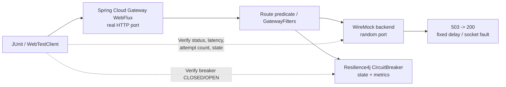
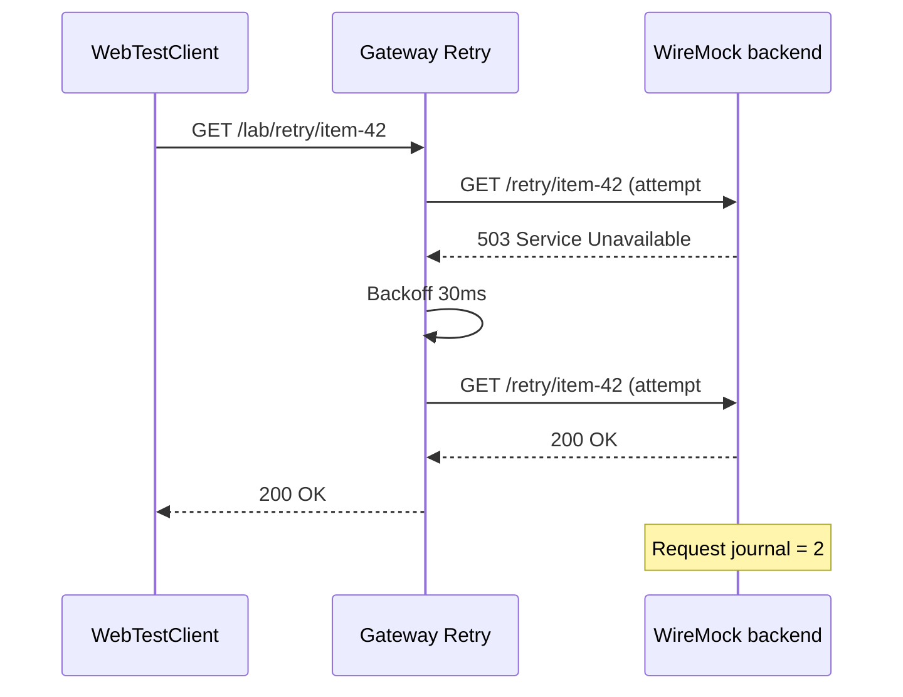
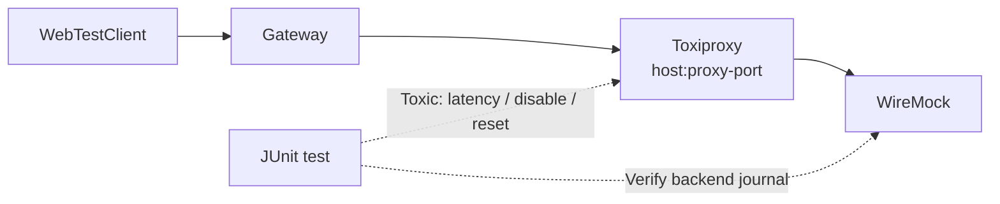
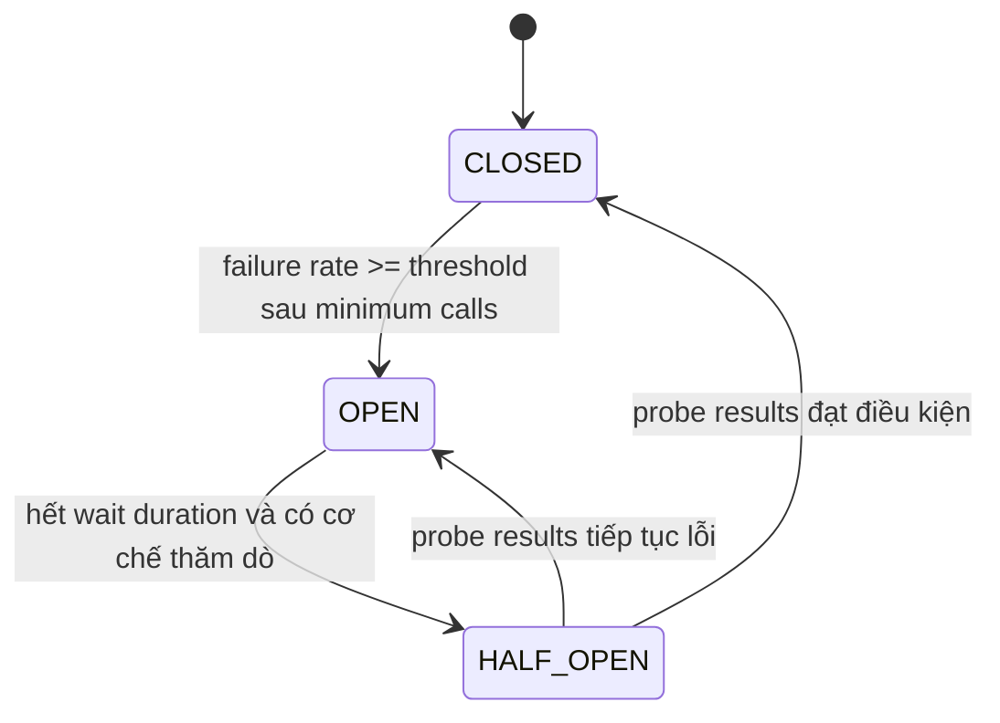

# Mô phỏng timeout, lỗi kết nối, retry và circuit breaker

Một **API Gateway** có thể được cấu hình đầy đủ route predicate, filter chain, rewrite path/header, service discovery, xác thực, rate limiting, Retry, CircuitBreaker và TLS nhưng vẫn vận hành sai khi upstream gặp sự cố. Ví dụ: backend chậm hai giây nhưng Gateway chờ quá lâu; một lỗi kết nối khiến request GET được gửi đi quá nhiều lần; CircuitBreaker luôn CLOSED vì response `503` chưa được tính là failure; hoặc fallback trả `200` khiến hệ thống tưởng giao dịch thành công dù dịch vụ đang ngừng hoạt động.

Trong chương **Kiểm thử** của module **SPRING_CLOUD_GATEWAY**, bài này hướng dẫn **mô phỏng lỗi có kiểm soát** để kiểm chứng hành vi thực tế của **Spring Cloud Gateway Server WebFlux**: HTTP response timeout, connection refusal/reset, retry có giới hạn, backoff, CircuitBreaker CLOSED → OPEN → HALF_OPEN và xử lý fallback. Trọng tâm không phải “thấy mã 500 là đủ”, mà là **xác minh số lần gọi backend, thời gian chờ, trạng thái breaker và kết quả client nhìn thấy**.

**Mục tiêu học tập:**

1. Phân biệt **connect timeout**, **response timeout**, connection refused/reset, slow response, HTTP `5xx` và lỗi TLS/DNS.
2. Dựng bộ kiểm thử Gateway WebFlux bằng **JUnit + Spring Boot test + WebTestClient + WireMock**, dùng cổng động và source route thực.
3. Mô phỏng lỗi 503 thoáng qua, lỗi 503 liên tục, response chậm và connection reset.
4. Kiểm tra chính xác giới hạn `retries`, backoff, số outbound attempts và tính idempotent.
5. Kiểm tra `CircuitBreaker` qua Resilience4j: số mẫu tối thiểu, ngưỡng failure, trạng thái OPEN, fallback và phục hồi.
6. Biết cách tách test **Retry độc lập**, **CircuitBreaker độc lập** và **hai filter kết hợp**.
7. Tránh test chập chờn do state dùng chung, thời gian thực, connection pooling, dynamic ports và nhiều Gateway replicas.
8. Dùng metrics/logs/traces để chẩn đoán và thiết kế kiểm thử chaos an toàn trong CI/staging.

> **Phiên bản:** Ví dụ hướng đến **Spring Cloud Gateway Server WebFlux 5.x** với cấu hình `spring.cloud.gateway.server.webflux.routes`, `Retry GatewayFilter`, `CircuitBreaker GatewayFilter` và Reactor Netty. Với **WebFlux 4.3.x**, prefix thường là `spring.cloud.gateway.routes` và `spring.cloud.gateway.httpclient.*`. Với **Gateway Server Web MVC**, Retry có cơ chế Spring Retry/Framework Retry và HTTP stack khác; không dùng các ví dụ WebFlux nguyên xi. Không chạy thử nghiệm gây lỗi trên backend production thật.

## 1. Vì sao phải mô phỏng lỗi thay vì chỉ test HTTP 200?

Một bài integration test có thể xác nhận `GET /api/catalog/items/42` trả `200` khi backend khỏe. Nhưng không trả lời được những câu hỏi:

- Backend mất **100 ms, 500 ms hay 5 giây** thì request bị timeout?
- Khi socket không kết nối được, lỗi có **được retry** và số lần là bao nhiêu?
- Khi backend trả `503` ở lần đầu rồi `200` ở lần sau, Gateway có **trả 200** và backend thấy đúng **hai attempts**?
- Nếu 503 kéo dài, Gateway có **dừng retry** không?
- Khi CircuitBreaker OPEN, request mới có bị chặn **trước khi chạm backend** không?
- Khi breaker HALF_OPEN, chỉ bao nhiêu request thăm dò được phép?
- Nếu filter trả fallback `200` dù upstream hỏng, dashboard có phát hiện trạng thái degradation không?
- Một `POST /orders` có bị gửi lại và tạo đơn hàng trùng không?

Vì thế cần một **fault-injection test suite** có thể điều khiển trực tiếp response code, delay, socket failure và thứ tự kết quả của backend giả lập.



**Ba loại assertion cần phối hợp:** **client outcome**, **upstream requests** và **internal resilience state**. Thiếu một loại có thể khiến bài test pass nhưng hệ thống vẫn sai.

## 2. Bảng phân loại lỗi: mô phỏng cái gì?

| Tình huống | Mô tả ở mạng/HTTP | Công cụ phù hợp | Kỳ vọng cần kiểm chứng |
| --- | --- | --- | --- |
| Backend trả `503` | HTTP response hợp lệ | WireMock `withStatus(503)` | Retry theo `statuses`, breaker theo `statusCodes` |
| Backend trả `502` | HTTP response hợp lệ | WireMock `withStatus(502)` | Có/không retry theo config |
| Backend đáp chậm | Kết nối thành công, chưa nhận response kịp | WireMock `withFixedDelay(...)` | Route `response-timeout`, gateway status/exception |
| TCP connection refused | Không có listener hoặc proxy từ chối kết nối | Closed port/Toxiproxy | Connect error nhanh, không nhầm response timeout |
| TCP connection reset | Kết nối bị đóng bất thường | WireMock `Fault.CONNECTION_RESET_BY_PEER` hoặc Toxiproxy | Exception, retry policy và cleanup |
| Black-holed connection | SYN/packet không được trả lời | Toxiproxy/network sandbox | `connect-timeout`, không treo mãi |
| HTTP response bị ngắt giữa chừng | Headers/body chưa hoàn tất hoặc đã commit | WireMock chunk/fault + proxy | Client error/cancel, không retry mù quáng |
| TLS handshake fail | Certificate/SNI/trust lỗi | Test TLS server với cert sai | Không tắt TLS verification |
| Không có `ServiceInstance` | `lb://` không tìm được backend | Test discovery supplier | `503`/`404` tùy config; không phải TCP refusal |
| CircuitBreaker OPEN | Filter từ chối call trước outbound | Resilience4j state | Backend counter **không tăng** |

**Cảnh báo thuật ngữ:** `503 HTTP` là response ứng dụng; `Connection refused` là lỗi ở tầng TCP; `Connect timeout` là thời gian thiết lập kết nối bị vượt; `Response timeout` là thời gian chờ phản hồi khi kết nối đã được thiết lập. Chúng có thể được map thành HTTP status khác nhau ở Gateway tùy version và exception handler.

## 3. Test pyramid cho một API Gateway

| Lớp test | Nhanh/chậm | Kiểm tra được | Không đủ để chứng minh |
| --- | --- | --- | --- |
| Unit test predicate/filter riêng | Nhanh | Logic route/order, request mutation | HTTP socket/Netty timeout thật |
| `StepVerifier` cho Reactor publisher | Nhanh | Retry/cancel/backoff pipeline ở mức reactive | HTTP codec, TLS và proxy routing |
| WireMock + Gateway real HTTP port | Trung bình | Route, HTTP status, retries, delay, fallback | Network partition/real DNS đầy đủ |
| Toxiproxy + Testcontainers | Trung bình/chậm | Latency, reset, packet loss, connection failure | Toàn bộ production topology |
| Staging chaos test | Chậm | Ingress, TLS, registry, Redis, multi-pod | Không thể thay thế unit/integration test |
| Synthetic production check | Liên tục/giới hạn | User journey an toàn | Không thích hợp gây outage có chủ đích |

**Khuyến nghị thực tế:** Dùng **WireMock** cho các trường hợp 503/200/delay/retry cơ bản; chỉ dùng **Toxiproxy** khi cần thao tác chính xác ở tầng TCP. Đừng biến test của một filter đơn giản thành bài chaos tốn nhiều phút nếu một stub HTTP đã đủ.

## 4. Dependency cho bài thực hành WebFlux

Ví dụ Maven chỉ liệt kê **các dependency cần thiết**, phiên bản do Spring Boot/Spring Cloud BOM tương thích quản lý:

```xml
<!-- Spring Cloud Gateway Server WebFlux -->
<dependency>
  <groupId>org.springframework.cloud</groupId>
  <artifactId>spring-cloud-starter-gateway-server-webflux</artifactId>
</dependency>

<!-- Reactive circuit breaker + Resilience4j -->
<dependency>
  <groupId>org.springframework.cloud</groupId>
  <artifactId>spring-cloud-starter-circuitbreaker-reactor-resilience4j</artifactId>
</dependency>

<!-- Actuator cho health/metrics, không bắt buộc riêng cho Retry -->
<dependency>
  <groupId>org.springframework.boot</groupId>
  <artifactId>spring-boot-starter-actuator</artifactId>
</dependency>

<!-- Kiểm thử Spring Boot, JUnit và WebTestClient theo BOM -->
<dependency>
  <groupId>org.springframework.boot</groupId>
  <artifactId>spring-boot-starter-test</artifactId>
  <scope>test</scope>
</dependency>

<!-- Kiểm thử WebFlux/WebTestClient nếu bản starter-test không mang theo -->
<dependency>
  <groupId>org.springframework.boot</groupId>
  <artifactId>spring-boot-starter-webflux-test</artifactId>
  <scope>test</scope>
</dependency>

<!-- WireMock 3.x: chọn bản tương thích Java/JUnit đang chạy -->
<dependency>
  <groupId>org.wiremock</groupId>
  <artifactId>wiremock</artifactId>
  <scope>test</scope>
</dependency>
```

> **Kiểm tra dependency version:** Spring Boot 4 có thay đổi nhóm test starters; phiên bản WireMock 3.x và các artifacts của Spring Boot 3.x/4.x phải được giải quyết bằng BOM/quản lý dependency thật. `spring-boot-starter-webflux-test` là artifact của dòng Spring Boot 4; nếu sử dụng Boot 3.x, hãy dựa vào `spring-boot-starter-test` và `spring-test`/WebFlux test dependencies có sẵn theo BOM tương ứng, không thêm một artifact không tồn tại ở release train đó. Trong bài, code chủ yếu dùng `WebTestClient.bindToServer()` nên không phụ thuộc vào auto-inject client của một test annotation cụ thể.

**Đừng dùng** `spring-cloud-starter-circuitbreaker-resilience4j` non-reactive cho bài Gateway WebFlux này. Documentation yêu cầu `spring-cloud-starter-circuitbreaker-reactor-resilience4j`.

## 5. Định nghĩa hợp đồng của test trước khi chạy

Một suite có thể gồm **bốn routes độc lập**, mỗi route phục vụ một mục đích:

| Route ID | Public path | Mục đích | Filter/metadata |
| --- | --- | --- | --- |
| `lab-retry` | `/lab/retry/**` | 503 → 200, 503 liên tục | Retry 1 lần GET |
| `lab-timeout` | `/lab/timeout/**` | Fixed delay vượt response timeout | Metadata `response-timeout: 250` |
| `lab-reset` | `/lab/reset/**` | TCP reset/empty response | Không Retry để cô lập exception |
| `lab-breaker` | `/lab/breaker/**` | CircuitBreaker OPEN, fallback | CB với statusCodes 503 |

**Tại sao không gom mọi filter vào một route ngay?** Nếu một test chờ 503 nhưng lại thấy fallback 503, không biết nguyên nhân do Retry, CircuitBreaker hay HTTP client. Cô lập từng behavior trước, rồi mới kiểm tra sự phối hợp.

Các backend path được giữ nhất quán bằng `StripPrefix=1`:

```text
GET /lab/retry/item-42    -> GET /retry/item-42
GET /lab/timeout/slow     -> GET /timeout/slow
GET /lab/reset/socket     -> GET /reset/socket
GET /lab/breaker/item-42  -> GET /breaker/item-42
```

`StripPrefix=1` bỏ đúng segment `lab`, không bỏ `retry`/`timeout`/`breaker`. Dùng WireMock request journal để khẳng định path thực sự đến backend.

## 6. application-test.yml: bốn routes, cổng backend động

Đặt ví dụ cấu hình **dành riêng cho test profile**, không triển khai nguyên trạng vào production:

```yaml
spring:
  cloud:
    gateway:
      server:
        webflux:
          routes:
            - id: lab-retry
              uri: ${test.backend-url}
              predicates:
                - Path=/lab/retry/**
                - Method=GET
              filters:
                - StripPrefix=1
                - name: Retry
                  args:
                    retries: 1
                    methods: GET
                    statuses: SERVICE_UNAVAILABLE
                    backoff:
                      firstBackoff: 30ms
                      maxBackoff: 30ms
                      factor: 1
              metadata:
                connect-timeout: 500
                response-timeout: 1500

            - id: lab-timeout
              uri: ${test.backend-url}
              predicates:
                - Path=/lab/timeout/**
                - Method=GET
              filters:
                - StripPrefix=1
              metadata:
                connect-timeout: 500
                response-timeout: 250

            - id: lab-reset
              uri: ${test.backend-url}
              predicates:
                - Path=/lab/reset/**
                - Method=GET
              filters:
                - StripPrefix=1
              metadata:
                connect-timeout: 500
                response-timeout: 1500

            - id: lab-breaker
              uri: ${test.backend-url}
              predicates:
                - Path=/lab/breaker/**
                - Method=GET
              filters:
                - StripPrefix=1
                - name: CircuitBreaker
                  args:
                    name: labCatalogBreaker
                    fallbackUri: forward:/fallback/lab-catalog
                    statusCodes:
                      - 503
              metadata:
                connect-timeout: 500
                response-timeout: 1500

resilience4j:
  circuitbreaker:
    instances:
      labCatalogBreaker:
        slidingWindowType: COUNT_BASED
        slidingWindowSize: 4
        minimumNumberOfCalls: 4
        failureRateThreshold: 50
        waitDurationInOpenState: 10s
        permittedNumberOfCallsInHalfOpenState: 2
  timelimiter:
    instances:
      labCatalogBreaker:
        timeoutDuration: 3s
```

**Đọc kỹ đơn vị:**

- Metadata `connect-timeout: 500` là **500 mili giây**.
- Metadata `response-timeout: 250` là **250 mili giây**.
- `firstBackoff: 30ms` là duration của Retry.
- `waitDurationInOpenState: 10s` là thời gian mở breaker.
- `timeoutDuration: 3s` là TimeLimiter Resilience4j, khác với Gateway Netty response timeout.

**Quan trọng:** Với Gateway WebFlux 5.x, route nằm dưới `spring.cloud.gateway.server.webflux.routes`. Trong các trang timeout của một số phiên bản, ví dụ global còn dùng prefix cũ `spring.cloud.gateway.httpclient`; hãy kiểm tra property thực tế trên bản dùng. Ví dụ **route metadata** ở đây không phụ thuộc vào prefix global.

### Vì sao đặt TimeLimiter 3 giây?

Mục tiêu test `lab-breaker` là quan sát **HTTP 503** và policy `statusCodes`, nên TimeLimiter đặt **cao hơn** response-timeout 1,5 giây để không cướp quyền xử lý bằng một timeout khác. Trong production, chọn toàn bộ deadline theo latency SLO, không sao chép 3 giây như giá trị mặc định.

## 7. Fallback controller reactive trả hợp đồng lỗi rõ ràng

Với WebFlux:

```java
package example.gateway.testing;

import java.util.Map;

import reactor.core.publisher.Mono;
import org.springframework.http.HttpStatus;
import org.springframework.http.ResponseEntity;
import org.springframework.web.bind.annotation.GetMapping;
import org.springframework.web.bind.annotation.RestController;

@RestController
class LabFallbackController {

    @GetMapping("/fallback/lab-catalog")
    Mono<ResponseEntity<Map<String, String>>> catalogUnavailable() {
        return Mono.just(
            ResponseEntity.status(HttpStatus.SERVICE_UNAVAILABLE)
                .header("X-Lab-Fallback", "true")
                .body(Map.of(
                    "code", "CATALOG_UNAVAILABLE",
                    "message", "Backend đang gián đoạn")));
    }
}
```

Ý nghĩa:

- `fallbackUri: forward:/fallback/lab-catalog` dùng **forward nội bộ**, không phải backend `http://...`.
- Header `X-Lab-Fallback: true` là **marker cho test**, không phải security marker.
- `503` mô tả rõ dịch vụ chưa sẵn sàng; không trả `200` thành công giả khi không có dữ liệu thay thế.
- Không chuyển tiếp stack trace, token, địa chỉ nội bộ, request body nhạy cảm vào fallback response.
- Controller này **chỉ dành cho lab**, không để endpoint fallback công khai trở thành đường bypass authorization.

**Lưu ý:** Response `503` trực tiếp từ backend và `503` do fallback tạo có cùng HTTP status. Test phải kiểm tra thêm header/body hoặc request journal để biết filter đã fallback thực sự.

## 8. Khởi tạo WireMock bằng cổng động trong JUnit

Một template tích hợp dùng:

- `@SpringBootTest(webEnvironment = RANDOM_PORT)` để khởi chạy Gateway với **HTTP listener thật**.
- `@ActiveProfiles("test")` để đọc `application-test.yml`.
- `@DynamicPropertySource` để gán URI upstream của Gateway vào port thực của WireMock.
- `WebTestClient.bindToServer()` để gửi HTTP requests qua Gateway.
- `@BeforeEach` để reset các stubs và request journal.

```java
package example.gateway.testing;

import java.time.Duration;

import com.github.tomakehurst.wiremock.WireMockServer;
import io.github.resilience4j.circuitbreaker.CircuitBreakerRegistry;
import org.junit.jupiter.api.AfterAll;
import org.junit.jupiter.api.BeforeEach;
import org.junit.jupiter.api.Test;
import org.springframework.beans.factory.annotation.Autowired;
import org.springframework.boot.test.context.SpringBootTest;
import org.springframework.boot.test.web.server.LocalServerPort;
import org.springframework.test.context.ActiveProfiles;
import org.springframework.test.context.DynamicPropertyRegistry;
import org.springframework.test.context.DynamicPropertySource;
import org.springframework.test.web.reactive.server.WebTestClient;

import static com.github.tomakehurst.wiremock.core.WireMockConfiguration.wireMockConfig;

@SpringBootTest(webEnvironment = SpringBootTest.WebEnvironment.RANDOM_PORT)
@ActiveProfiles("test")
class GatewayResilienceIT {

    private static final WireMockServer BACKEND =
        new WireMockServer(wireMockConfig().dynamicPort());

    static {
        // Khởi động trước khi Spring context đọc DynamicPropertySource.
        BACKEND.start();
    }

    @DynamicPropertySource
    static void upstreamProperties(DynamicPropertyRegistry registry) {
        registry.add("test.backend-url", BACKEND::baseUrl);
    }

    @LocalServerPort
    int gatewayPort;

    @Autowired
    CircuitBreakerRegistry circuitBreakers;

    WebTestClient client;

    @BeforeEach
    void prepare() {
        BACKEND.resetAll();
        circuitBreakers.circuitBreaker("labCatalogBreaker").reset();
        client = WebTestClient.bindToServer()
            .baseUrl("http://127.0.0.1:" + gatewayPort)
            .responseTimeout(Duration.ofSeconds(6))
            .build();
    }

    @AfterAll
    static void stopBackend() {
        BACKEND.stop();
    }

    // Các @Test ở những mục kế tiếp nằm trong class này.
}
```

> **Tính tương thích:** Tùy Spring Boot line, package của `@LocalServerPort` có thể khác; dòng Boot 3.x minh họa dùng `org.springframework.boot.test.web.server.LocalServerPort`, còn Boot 4.x có cơ cấu package/testing annotations cập nhật. Cần chọn import tương ứng với BOM thực tế. Nguyên lý **dynamic port → DynamicPropertySource → WebTestClient real HTTP** không đổi. Ví dụ đặt stubs/test methods vào cùng class để tránh Spring test context cache tham chiếu port WireMock đã dừng ở một class khác.

### Vì sao không dùng port cứng 8081?

- Chạy CI song song dễ đụng port.
- Một dịch vụ dev thật có thể đang nghe port đó, khiến test vô tình gọi nhầm backend.
- Random port đảm bảo **test cô lập**; backend nhận request được xác định rõ qua `BACKEND.verify(...)`.
- Nếu cần Toxiproxy, test phải cấp và quản lý port của proxy cũng theo fixture, không dùng địa chỉ Internet ngẫu nhiên.

### Không dùng `WebTestClient.bindToController()` để kết luận Netty timeout

`bindToController()`/mock WebFlux có thể phù hợp cho unit/slice testing, nhưng nếu muốn đo socket/HTTP client response timeout thật, phải chạy Gateway với **real HTTP server** và backend có listener thật. Một test chỉ mock filter không đủ chứng minh TCP reset hay TLS handshake.

## 9. Baseline: test route đúng khi backend khỏe

Đầu tiên cần xác minh route/prefix trước khi mô phỏng lỗi:

```java
import static com.github.tomakehurst.wiremock.client.WireMock.*;

@Test
void healthyBackendIsProxiedOnce() {
    BACKEND.stubFor(get(urlEqualTo("/retry/item-42"))
        .willReturn(aResponse()
            .withStatus(200)
            .withHeader("Content-Type", "application/json")
            .withBody("{\"id\":\"item-42\"}")));

    client.get()
        .uri("/lab/retry/item-42")
        .exchange()
        .expectStatus().isOk()
        .expectBody()
        .jsonPath("$.id").isEqualTo("item-42");

    BACKEND.verify(1,
        getRequestedFor(urlEqualTo("/retry/item-42")));
}
```

Nếu baseline không đạt, kiểm tra route predicate `Path`, `StripPrefix`, dynamic URL, filter config và backend stub. **Không bắt đầu debug CircuitBreaker** khi HTTP route cơ bản còn sai.

**Một request đến upstream** là chứng cứ quan trọng: Retry phải **không** tạo attempt thứ hai khi call đầu đã thành công.

## 10. Retry: mô phỏng 503 ở lần đầu, 200 ở lần hai

WireMock có **scenarios** để thay đổi response theo số lần gọi. Kết quả mong muốn:



Java test method (thêm vào fixture `GatewayResilienceIT`):

```java
import static com.github.tomakehurst.wiremock.client.WireMock.*;
import static com.github.tomakehurst.wiremock.stubbing.Scenario.STARTED;

@Test
void retriesOne503AndThenSucceeds() {
    BACKEND.stubFor(get(urlEqualTo("/retry/item-42"))
        .inScenario("one-transient-503")
        .whenScenarioStateIs(STARTED)
        .willReturn(aResponse().withStatus(503))
        .willSetStateTo("healthy"));

    BACKEND.stubFor(get(urlEqualTo("/retry/item-42"))
        .inScenario("one-transient-503")
        .whenScenarioStateIs("healthy")
        .willReturn(aResponse()
            .withStatus(200)
            .withBody("recovered")));

    client.get()
        .uri("/lab/retry/item-42")
        .exchange()
        .expectStatus().isOk()
        .expectBody(String.class).isEqualTo("recovered");

    BACKEND.verify(2,
        getRequestedFor(urlEqualTo("/retry/item-42")));
}
```

**Bằng chứng thành công cần cả hai:**

- Client nhận `200` và body `recovered`.
- Backend nhận **đúng 2 GET**. Nếu backend chỉ nhận 1, Retry không chạy; nếu nhận 3, policy `retries` đang rộng hơn bạn nghĩ.

Tài liệu Gateway WebFlux nêu `retries` là **số lần retry thêm**. `retries: 1` → tối đa **2 outbound attempts** cho những lỗi phù hợp. Lỗi `503` thuộc `statuses: SERVICE_UNAVAILABLE`.

### Backoff có nên assert đúng 30 ms?

Không kiểm tra bằng `assertEquals(30, elapsedMs)`: scheduler, CPU, GC và CI có jitter. Hãy kiểm tra **không retry ngay vô hạn**, tổng thời gian trong deadline hợp lý, và với bài test riêng về backoff hãy dùng virtual-time ở mức publisher/Retry logic khi có thể. Integration test chủ yếu nên xác minh **số attempts và kết quả**.

## 11. Retry: backend luôn trả 503

Mục tiêu là đảm bảo Retry **dừng** sau budget, không lặp vô hạn:

```java
@Test
void stopsAfterConfiguredRetryBudget() {
    BACKEND.stubFor(get(urlEqualTo("/retry/item-42"))
        .willReturn(aResponse()
            .withStatus(503)
            .withBody("unavailable")));

    client.get()
        .uri("/lab/retry/item-42")
        .exchange()
        .expectStatus().isEqualTo(503);

    BACKEND.verify(2,
        getRequestedFor(urlEqualTo("/retry/item-42")));
}
```

Nếu response cuối bị custom error handler thay đổi, đừng chỉ khóa test vào một HTTP status mà bỏ qua mục tiêu quan trọng: **backend request count = retries + 1**. Tuy vậy, với HTTP 503 thông thường và chỉ Retry filter, trả lại 503 sau khi hết attempts là hành vi mong muốn.

**Nhớ:** Retry với `POST` có body tiềm ẩn side effects. Đừng dùng `methods: GET,POST` vô điều kiện. Nếu backend đã commit rồi Gateway timeout, thử lại có thể tạo đơn/thu tiền trùng dù HTTP response đầu bị mất.

## 12. HTTP response timeout: backend nhận request nhưng phản hồi quá chậm

Với route `lab-timeout` có `metadata.response-timeout: 250` (ms), tạo backend chậm 1,5 giây:

```java
@Test
void failsWhenUpstreamResponseExceedsRouteTimeout() {
    BACKEND.stubFor(get(urlEqualTo("/timeout/slow"))
        .willReturn(aResponse()
            .withStatus(200)
            .withFixedDelay(1500)
            .withBody("too late")));

    long started = System.nanoTime();

    client.get()
        .uri("/lab/timeout/slow")
        .exchange()
        .expectStatus().is5xxServerError();

    long elapsedMs =
        Duration.ofNanos(System.nanoTime() - started).toMillis();

    // Biên rộng để tránh flaky CI: chứng minh không chờ đủ 1,5s.
    org.assertj.core.api.Assertions.assertThat(elapsedMs)
        .isLessThan(1200);

    BACKEND.verify(1,
        getRequestedFor(urlEqualTo("/timeout/slow")));
}
```

Đây là **mẫu mong đợi trong môi trường CI ổn định**. Những máy CI chậm có thể làm phép đo thời gian chập chờn; trong thực tế hãy đo nhiều lần/cho tolerance phù hợp và không assert chính xác 250 ms. Có thể tách wall-clock SLO test thành một suite performance riêng.

### Tránh nhầm HTTP status

Gateway response timeout thường biểu hiện thành một lỗi 5xx, nhưng **mã cụ thể** (`500`, `504`...) phụ thuộc mapping exception, version và error handler của ứng dụng. Nếu contract của hệ thống yêu cầu **504 Gateway Timeout**, hãy cấu hình error mapping tương ứng rồi test chính xác 504. Không khẳng định Gateway WebFlux mặc định **luôn** trả 504.

### Cần xác minh cả phía backend

- Request có **đã tới** WireMock không?
- Sau timeout, backend có thể vẫn đang xử lý/gửi dữ liệu dù client đã hủy.
- Gateway có giải phóng connection/cancel reactive pipeline không?
- Khi bật Retry, delay có khiến request **gửi hai lần** không?
- Nếu backend là POST có side effects, timeout **không chứng minh** request chưa commit.

## 13. Connect timeout khác response timeout và connection refused

Đừng dùng `withFixedDelay(1500)` để chứng minh **connect timeout**. Nó tạo **response delay sau khi TCP connection đã mở**, do đó đo **response timeout**.

| Tình huống | TCP handshake | Backend có thể ghi HTTP request? | Loại lỗi chính |
| --- | --- | --- | --- |
| Response chậm | Thành công | Có | Response timeout |
| Port không có listener | Bị từ chối ngay (RST) | Không | Connection refused |
| Đường mạng black-hole | Không hoàn tất handshake | Không | Connect timeout |
| TCP reset sau khi connect | Đã connect rồi bị reset | Tùy thời điểm | Connection reset / premature close |
| TLS certificate sai | TCP có thể thành công, TLS handshake lỗi | Chưa thành request HTTP chuẩn | SSL/TLS handshake |

**Cách mô phỏng bền vững:**

1. **Response timeout:** WireMock `withFixedDelay`.
2. **Connection refused:** route test tới một cổng do fixture sở hữu nhưng không có listener, hoặc dùng Toxiproxy để từ chối/disable; không chọn tùy tiện một public IP.
3. **Connect timeout:** Toxiproxy/network namespace chặn SYN/traffic theo luật test; một `localhost` closed port thường trả refused ngay, **không chờ connect timeout**.
4. **Connection reset:** WireMock Fault (chú ý hệ điều hành) hoặc Toxiproxy reset/timeout toxin.

### Cấu hình global và route timeout khác đơn vị

```yaml
spring:
  cloud:
    gateway:
      server:
        webflux:
          httpclient:
            connect-timeout: 1000  # millisecond (global)
            response-timeout: 2s    # java.time.Duration (global)
          routes:
            - id: timeout-override
              uri: http://localhost:18081
              predicates:
                - Path=/test/**
              metadata:
                connect-timeout: 250  # millisecond (route)
                response-timeout: 500 # millisecond (route)
```

**Sai lầm phổ biến:** `metadata.response-timeout: 5` không phải 5 giây mà là **5 ms**. Giá trị **âm** của per-route response-timeout được tài liệu mô tả là cách **vô hiệu global response-timeout** cho route đó. Không dùng `-1` cho API cần giới hạn latency chặt.

## 14. Mô phỏng connection reset bằng WireMock

WireMock hỗ trợ faults không phải HTTP response hợp lệ:

```java
import com.github.tomakehurst.wiremock.http.Fault;

@Test
void surfacesConnectionResetAsTransportFailure() {
    BACKEND.stubFor(get(urlEqualTo("/reset/socket"))
        .willReturn(aResponse()
            .withFault(Fault.CONNECTION_RESET_BY_PEER)));

    client.get()
        .uri("/lab/reset/socket")
        .exchange()
        .expectStatus().is5xxServerError();

    BACKEND.verify(1,
        getRequestedFor(urlEqualTo("/reset/socket")));
}
```

**Giới hạn hệ điều hành quan trọng:** WireMock docs lưu ý `CONNECTION_RESET_BY_PEER` dựa trên socket `SO_LINGER=0`, thường hoạt động trên Unix/Linux nhưng có thể **hang trên Windows** thay vì reset ngay. Nếu test CI chạy Windows, ưu tiên **Toxiproxy/Testcontainers** trong Linux container, hoặc dùng `Fault.EMPTY_RESPONSE`/`RANDOM_DATA_THEN_CLOSE` với assertion đã kiểm chứng trên môi trường đó.

**Không cần khóa test vào một exception class cụ thể** như `ConnectException` nếu code path đang gặp reset sau kết nối; Reactor Netty có thể báo `PrematureCloseException` hoặc lỗi khác tùy thời điểm. Quan trọng là **không có HTTP 200 giả**, request nằm trong retry policy đúng và kết nối được dọn.

## 15. Mô phỏng connection refused mà không dựa vào cổng ngẫu nhiên

Một cách dễ nhưng **không hoàn toàn deterministic** là trỏ URI tới `http://127.0.0.1:19999` khi không có process nghe. Tình huống này có thể thất bại nếu một tiến trình khác chiếm port.

Đối với integration tests đáng tin cậy:

- Có thể khởi tạo TCP listener với port được hệ điều hành cấp, giữ quyền sở hữu, rồi cố ý đóng listener trước request; cần tránh race nếu test song song.
- Hoặc dùng **Toxiproxy** với proxy port thuộc container đã tạo và disable proxy để gây connection refusal/transport failure.
- Hoặc inject một `HttpClient`/`ConnectionProvider` có transport fake ở unit test tầng Netty, nếu mục tiêu chỉ là mapping exception.

### Xác minh refused khác timeout

Một kết nối **refused** thường thất bại rất nhanh. **Connect timeout** chỉ có thể được thử chính xác khi đường kết nối **không được trả lời** trong thời hạn, không phải bị RST ngay.

Các assertion nên gồm:

1. Client không nhận success response.
2. Không có backend HTTP request (khi TCP chưa kết nối).
3. Retry count không vượt budget đã cấu hình.
4. HTTP client không bị treo quá test deadline.
5. Sau khi proxy/network được khôi phục, request mới thành công.

Không cố tạo lỗi bằng cách gửi nhiều packets tới host nội bộ/metadata của môi trường thật. Tất cả fault targets phải thuộc **test fixture** do bạn quản lý.

## 16. Dùng Toxiproxy để test mạng thật hơn

**Toxiproxy** là một TCP proxy có thể điều khiển bằng API để thêm latency, bandwidth cap, timeout hoặc cắt kết nối. Trong Java integration test, thường dùng **Testcontainers Toxiproxy module** để khởi chạy một proxy giữa Gateway và backend giả.



Ví dụ **khái niệm setup**, cần điều chỉnh theo API/version Testcontainers và Docker network cụ thể:

```java
// Pseudocode định hướng Testcontainers, không phải lớp test độc lập.
// Docker network phải cho cả WireMock upstream và Toxiproxy
// nhìn thấy nhau; upstream "wiremock:8080" là Docker alias.

Network network = Network.newNetwork();

GenericContainer<?> wiremock = new GenericContainer<>(
        DockerImageName.parse("wiremock/wiremock:3.10.0"))
    .withNetwork(network)
    .withNetworkAliases("wiremock")
    .withExposedPorts(8080);

ToxiproxyContainer toxiproxy = new ToxiproxyContainer(
        DockerImageName.parse("ghcr.io/shopify/toxiproxy:2.9.0"))
    .withNetwork(network);

wiremock.start();
toxiproxy.start();

ToxiproxyContainer.ContainerProxy proxy =
    toxiproxy.getProxy(wiremock, 8080);

// Gateway outbound URL phải dùng host/port do proxy cung cấp.
String testBackendUrl =
    "http://" + proxy.getContainerIpAddress()
        + ":" + proxy.getProxyPort();

// Kích hoạt từng toxic trong test:
// proxy.toxics().latency("slow-down", TOXIC_DIRECTION.DOWNSTREAM, 1500);
// proxy.setConnectionCut(true);
// ...
```

**Lưu ý tránh nhầm:** Đây là *pseudocode* minh họa thành phần, **không phải snippet đã chạy/biên dịch**. Trong Testcontainers, Gateway process trên **host** không phải luôn truy cập được container IP trực tiếp (đặc biệt Windows/macOS). Dùng **mapped host/port** của Toxiproxy tương ứng; container-to-container có thể dùng alias/network. Cần lựa chọn API Testcontainers 1.x/2.x đúng version và kiểm thử thật. Phần quan trọng của bài là **điều khiển transport failure** thay vì phụ thuộc cổng bên ngoài.

### Tại sao dùng proxy thay vì ngủ 5 giây?

- Tạo failure theo **hướng upstream/downstream** cụ thể.
- Test timeout khi network chậm mà backend không cần sửa code.
- Có thể cắt và khôi phục kết nối để kiểm chứng retry/recovery.
- Reproducible trong CI với Docker/Toxiproxy, nếu cả môi trường được cô lập.
- Dễ xác minh Gateway kết nối tới **đúng proxy address** và backend chỉ nhận requests khi kết nối cho phép.

## 17. CircuitBreaker: những trạng thái phải kiểm thử

Resilience4j CircuitBreaker có ba trạng thái vận hành thường gặp:



| State | Hành vi với call mới | Điều cần assert |
| --- | --- | --- |
| CLOSED | Cho phép call, ghi nhận success/failure | Backend request count tăng |
| OPEN | Từ chối call mới, thường vào fallback | Backend count **không tăng** |
| HALF_OPEN | Cho tối đa số probe cho phép | Không vượt `permittedNumberOfCallsInHalfOpenState` |
| CLOSED trở lại | Lại phục vụ bình thường | Request thật tới backend khỏe |
| FORCED_OPEN/ DISABLED | Trạng thái quản trị đặc biệt | Không dùng nhầm để “test OPEN do lỗi” |

Với cấu hình bài lab:

```yaml
resilience4j:
  circuitbreaker:
    instances:
      labCatalogBreaker:
        slidingWindowSize: 4
        minimumNumberOfCalls: 4
        failureRateThreshold: 50
        waitDurationInOpenState: 10s
        permittedNumberOfCallsInHalfOpenState: 2
```

Bốn calls liên tục có kết quả bị ghi nhận là failure → breaker sẽ mở sau khi đủ mẫu (theo quy tắc threshold của Resilience4j). **Một lỗi đầu tiên không thể tự mở breaker** khi `minimumNumberOfCalls=4`.

### Vì sao phải có statusCodes?

HTTP `503` từ backend là một **HTTP response hợp lệ**, không nhất thiết là exception. Gateway `CircuitBreaker` cho phép `statusCodes: [503]` để **chủ động biến response status thành failure của breaker**. Nếu không cấu hình và không có exception, breaker có thể tiếp tục xem call là successful theo logic filter.

## 18. Test breaker OPEN và xác nhận backend không bị gọi

Với route `lab-breaker` và fallback controller ở mục 7, backend luôn trả 503:

```java
import io.github.resilience4j.circuitbreaker.CircuitBreaker;

@Test
void circuitBreakerOpensAndShortCircuitsNewCalls() {
    BACKEND.stubFor(get(urlEqualTo("/breaker/item-42"))
        .willReturn(aResponse().withStatus(503)));

    CircuitBreaker breaker =
        circuitBreakers.circuitBreaker("labCatalogBreaker");

    for (int i = 0; i < 4; i++) {
        client.get()
            .uri("/lab/breaker/item-42")
            .exchange()
            .expectStatus().isEqualTo(503)
            .expectHeader().valueEquals("X-Lab-Fallback", "true");
    }

    org.assertj.core.api.Assertions.assertThat(breaker.getState())
        .isEqualTo(CircuitBreaker.State.OPEN);

    // Request thứ 5 phải được từ chối sớm, không chạm backend.
    client.get()
        .uri("/lab/breaker/item-42")
        .exchange()
        .expectStatus().isEqualTo(503)
        .expectHeader().valueEquals("X-Lab-Fallback", "true");

    BACKEND.verify(4,
        getRequestedFor(urlEqualTo("/breaker/item-42")));
}
```

**Điều cần lưu ý:**

- Nếu filter `Retry` cũng được gắn vào route, backend có thể được gọi nhiều lần cho mỗi logical request. Bài test này **cố ý chỉ gắn CircuitBreaker** để đếm đơn giản.
- `CircuitBreakerRegistry` phải là registry **thực** được Spring Cloud CircuitBreaker factory sử dụng; khi tích hợp version thay đổi, kiểm tra tên/registry wiring.
- `breaker.reset()` trước test giúp xóa state/tần suất failure cũ; không làm điều này trên production service.
- Khi OPEN, request thứ 5 vẫn có thể trả `503` fallback, nhưng WireMock counter giữ nguyên **4**.
- Nếu fallback được xử lý bởi security chain hoặc route khác, cần bảo đảm endpoint `/fallback/lab-catalog` thật sự được forward đúng.

**Không đủ:** chỉ assert `HTTP 503`. Nó có thể là 503 từ backend, 503 từ CircuitBreaker OPEN hoặc lỗi discovery. Cần **state OPEN + header fallback + backend count không tăng**.

## 19. Test HALF_OPEN và phục hồi có kiểm soát

Mục tiêu sau OPEN:

1. Hết thời gian chờ.
2. Breaker chuyển sang HALF_OPEN (có thể **lazy** chỉ khi request tiếp theo, tùy config).
3. Cho số lượng probe nhỏ.
4. Nếu backend khỏe, breaker đóng; nếu vẫn lỗi, lại mở.

**Không viết bài test đơn giản `Thread.sleep(10000)` rồi assert state ngay.** Nó vừa chậm vừa có thể sai với `automaticTransitionFromOpenToHalfOpenEnabled=false`: Resilience4j có thể giữ OPEN đến khi có call mới đủ điều kiện chuyển state.

### Cách thử state machine nhanh hơn

Trong một test **đơn vị cho breaker state** (không dùng để xác nhận wait duration) có thể thực hiện:

```java
CircuitBreaker breaker =
    circuitBreakers.circuitBreaker("labCatalogBreaker");

breaker.transitionToHalfOpenState();

// Gửi probe thành công qua route (backend stub trả 200).
// Xác minh permit/concurrency và state sau đủ probe results.
```

**Đây là state injection phục vụ test**, không mô phỏng timing thực. Nên có **một integration test riêng** dùng `waitDurationInOpenState` ngắn, Wait/Awaitility có deadline, và xác minh request sau thời gian chờ thực sự đi tới backend.

### Điểm cần tránh khi test HALF_OPEN

- Không đếm chỉ một probe rồi mong CLOSED khi cấu hình cho phép 2 probes; quyết định tùy tổng kết quả/setting.
- Không cho 10 requests chạy song song rồi kỳ vọng 10 backend calls: HALF_OPEN có giới hạn permits.
- Không để breaker của một test bị test khác đổi state do JUnit chạy song song.
- Không tạo polling loop không deadline.
- Không dùng `transitionToClosedState()` trong test “phục hồi tự nhiên”, vì điều đó bỏ qua điều kiện thực sự cần xác minh.

## 20. CircuitBreaker và TimeLimiter: hai loại timeout khác nhau

Có ít nhất ba khái niệm:

| Cơ chế | Vị trí | Câu hỏi |
| --- | --- | --- |
| Netty `connect-timeout` | Mở TCP connection | Có kết nối được trước deadline không? |
| Netty `response-timeout` | Chờ phản hồi HTTP upstream | Upstream có đáp trước deadline không? |
| Resilience4j `TimeLimiter` | Bao quanh execution được breaker quản lý | Logical operation có vượt tổng thời gian cho phép không? |

Spring Cloud CircuitBreaker Resilience4j **mặc định có TimeLimiter** trong các cấu hình được documentation mô tả, trừ khi disable qua cơ chế được hỗ trợ. Do đó, nếu test Netty response timeout `250ms` nhưng TimeLimiter đặt `100ms`, lỗi có thể đến từ **TimeLimiter trước**, khiến test kết luận sai.

### Ví dụ cấu hình ưu tiên rõ

```yaml
resilience4j:
  timelimiter:
    instances:
      labCatalogBreaker:
        timeoutDuration: 3s
```

Đây là cấu hình của `lab-breaker`. Route `lab-timeout` **không gắn CircuitBreaker**, nên mô phỏng response timeout độc lập.

**Quan trọng:** TimeLimiter timeout/cancellation không chứng minh backend dừng xử lý ngay; nếu request đã được backend nhận, nó có thể tiếp tục công việc. Với side effects, phải xét idempotency và truy vấn trạng thái sau timeout.

## 21. Retry và CircuitBreaker kết hợp: thứ tự filter thay đổi kết quả

Hai cách lồng logic thường gặp:

```text
A. CircuitBreaker bọc Retry:

  CircuitBreaker
     └── Retry
           ├── attempt #1: 503
           └── attempt #2: 200
  Breaker có thể thấy logical call thành công.

B. Retry bọc CircuitBreaker:

  Retry
     └── CircuitBreaker
           └── attempt #1: 503
     └── CircuitBreaker
           └── attempt #2: 200
  Breaker có thể ghi nhiều outcomes cho một logical request.
```

**Không đồng nhất** thứ tự dòng YAML với kết quả điều hành trong mọi code path mà không kiểm chứng. Gateway filters được gắn vào route và có ordering; khi có `Ordered`, pre/post phases và custom filters, cách bọc chain ảnh hưởng retry/CB/fallback. Tài liệu Gateway Retry nêu rõ **các filters đứng sau Retry có thể được chạy lại**.

### Kịch bản test tối thiểu

| Upstream response | Cấu hình | Kỳ vọng cần đếm |
| --- | --- | --- |
| 503 → 200 | Retry 1 lần, CB bọc Retry | 2 attempts, final 200, breaker đánh giá policy đúng |
| 503 → 503 | Retry 1 lần, CB bọc Retry | 2 attempts, final fallback 503, breaker nhận failure |
| 503 → 200 | Retry bọc CB | 2 attempts, breaker có thể ghi 2 calls |
| Breaker OPEN | Retry bọc CB | Tránh Retry liên tục `CallNotPermittedException` |
| Backend không connect được | Retry + CB | Loại exception retryable, số attempts có giới hạn |
| 401/403 | Retry + CB | Không retry/không trip breaker nếu policy không cho |
| 429 | Retry + CB | Không retry mù quáng, giữ rate-limit contract |

Đừng dùng **chung một breaker name** cho test A và B rồi so số outcomes nếu các requests của test A đã làm bẩn sliding window. Cách an toàn là **tạo breaker name riêng cho mỗi route/chuỗi test** hoặc reset registry trong fixture đã cô lập.

### Retry bên ngoài một fallback 503

Nếu `Retry` bọc `CircuitBreaker` và fallback trả `503`, status này có thể tiếp tục bị Retry bắt và tạo thêm lượt gọi filter/fallback. Vì vậy cần kiểm tra **fallback được thực hiện bao nhiêu lần**, **backend count** và **breaker state**, không chỉ status cuối.

## 22. Không retry response đã commit hoặc streaming theo cách ngây thơ

Đối với HTTP response streaming/SSE/large download, backend có thể đã gửi headers hoặc một phần body rồi mới ngắt kết nối.

```text
Client ← Gateway ← Backend

HTTP/1.1 200 OK
Transfer-Encoding: chunked

chunk #1: đã được gửi tới client
chunk #2: socket reset
```

Trong trường hợp này:

- Gateway không thể đơn giản trả lại status mới `503` sau khi response headers đã commit.
- Retry toàn bộ GET có thể **lặp dữ liệu đã gửi**, vi phạm stream contract.
- CircuitBreaker fallback JSON không thể thay thế nửa sau của một stream đã xuất hiện ở client.
- Test phải kiểm tra client nhận **partial body/connection error** và số outbound connections.
- Với SSE hoặc WebSocket, nên test lifecycle/cancellation riêng; không đánh đồng duration của stream với response-timeout JSON GET.

Tài liệu Gateway Retry đặc biệt cảnh báo `forward:` endpoint không được commit response lỗi trước khi Retry có cơ hội xử lý. Hãy kiểm thử **response commit semantics**, nhất là khi controller fallback hoặc custom filter dùng `setComplete()`/`writeWith()`.

## 23. POST body và idempotency: test nguy cơ gửi trùng

Tài liệu Gateway WebFlux nhắc rằng Retry với HTTP method có request body có thể **cache body** vào `DataBuffer` trong request attribute `ServerWebExchangeUtils.CACHED_REQUEST_BODY_ATTR`. Điều này gây **memory pressure** với upload/multipart lớn.

Ví dụ rủi ro:

```text
POST /api/orders
Attempt #1:
  backend lưu order-123 thành công
  nhưng TCP response bị ngắt

Gateway Retry:
Attempt #2:
  backend tạo order-124
  client nhận 201

=> Một hành động người dùng, hai orders.
```

**Chính sách mặc định nên là không retry lệnh ghi** trừ khi:

1. Có một `Idempotency-Key` duy nhất cho logical operation.
2. Backend kiểm tra và ghi key **nguyên tử** với transaction/side effect.
3. Retry requests dùng **cùng key**.
4. Response từ lần xử lý trước có thể được trả lại theo contract.
5. Token, tenant ID và audit được kiểm chứng nhất quán.
6. Có giới hạn body size, attempts và deadline.

### Bài test mẫu cho backend idempotent

```text
Given:
  POST /orders + Idempotency-Key: abc-123
  backend lưu kết quả của key abc-123 trong datastore test

When:
  attempt #1 commit, response bị mất
  attempt #2 cùng key được gửi lại

Then:
  backend nhận 2 HTTP requests
  nhưng chỉ có 1 order được tạo
  và cả hai attempts tham chiếu cùng logical operation
```

Đây là **business integration test**, không thể chứng minh chỉ bằng `BACKEND.verify(2, ...)`. Cần một backend stub có state hoặc một application test thật với datastore transactional. Tốt nhất test Retry GET độc lập trước và chỉ bật retry POST khi có yêu cầu nghiệp vụ rõ ràng.

## 24. Kiểm soát test state và chống flaky tests

Các nguyên nhân làm test resilience không ổn định:

| Hiện tượng | Nguyên nhân | Cách khắc phục |
| --- | --- | --- |
| Lần chạy sau breaker đã OPEN | State Resilience4j dùng chung | `breaker.reset()` hoặc context/route riêng |
| WireMock trả response cũ | Scenario/request journal chưa reset | `BACKEND.resetAll()` trước test |
| Assert backend count bị dư | Test chạy song song cùng stub | Cô lập fixture, không parallel cùng route |
| Port đụng nhau | Backend dùng port cố định | Dynamic port, register via `DynamicPropertySource` |
| DNS/socket cache làm test lẫn nhau | HTTP client pooled connection tái sử dụng | Cô lập route/backend, test network fault riêng |
| Exact elapsed 250ms thất bại | Scheduler/CI jitter | Assert margin, deadline, tránh equality |
| Sleep 10 giây lâu và sai state | HALF_OPEN transition lazy | Manual state unit test + timed integration riêng |
| HTTP status không đúng mong đợi | Error handler thay mapping | Test contract/version; không hard-code mặc định |
| WireMock reset không chạy Windows | `SO_LINGER` khác nhau | Dùng Toxiproxy/Linux CI |
| Spring context cache giữ URI cũ | Static backend bị stop giữa classes | Giữ cùng fixture/class, `@DirtiesContext` khi cần |
| Gateway không lên | Dependency Gateway MVC/WebFlux lẫn nhau | Chọn đúng starter và BOM |
| Toxiproxy container IP không truy cập được | Host khác Docker network | Dùng mapped host/port |
| No-data metrics bị hiểu là 0 | Metrics chưa export/scrape | Tạo request, kiểm tra meter và registry |

**Nguyên tắc:** Đừng dùng `@TestMethodOrder` để phụ thuộc vào “test trước mở breaker, test sau đóng breaker”; mỗi test phải có **Given state rõ ràng**. Nếu cần một test state transition xuyên nhiều bước, thực hiện **trong cùng một test method**.

## 25. Kiểm tra thời gian chờ bằng deadline, không bằng sleep cứng

Một test timeout đáng tin không cần biết scheduler sẽ thực thi chính xác ở mili giây thứ 250. Cần bảo đảm **bounded completion** và đúng loại lỗi.

### Ba phép kiểm tra

1. Backend stub cố ý chờ **lâu hơn** timeout cấu hình.
2. Client test có response timeout **dài hơn** Gateway timeout để không phải là tác nhân đóng trước.
3. Assertion yêu cầu request kết thúc trong deadline hợp lý và **không success**.

```java
// Client test chờ 6s; Gateway route timeout 250ms.
// Nếu backend delay 1500ms, failure từ Gateway phải đến sớm.
WebTestClient client = WebTestClient.bindToServer()
    .baseUrl("http://127.0.0.1:" + gatewayPort)
    .responseTimeout(Duration.ofSeconds(6))
    .build();
```

Không đặt client timeout **100ms** rồi kết luận gateway timeout 250ms đã được kiểm thử; lúc đó **client kết thúc trước**.

### Deadline theo lớp

| Đồng hồ | Ví dụ lab | Dùng để |
| --- | --- | --- |
| TCP connect timeout | 500ms | Giới hạn mở kết nối |
| Route response timeout | 250ms | Giới hạn chờ HTTP response |
| Retry backoff | 30ms | Giãn các attempts |
| CircuitBreaker TimeLimiter | 3s | Bảo vệ logical breaker execution |
| WebTestClient response timeout | 6s | Test harness không treo vô hạn |
| CI test timeout | 20–30s/test | Tránh test suite bị kẹt |

Những số này chỉ là **minh họa cho bài lab**; production phải dựa vào SLO, số hops, p95/p99 và tính chất backend. Một timeout 250ms có thể hợp lý cho cache read rất nhanh nhưng không phù hợp với workflow tổng hợp báo cáo.

## 26. Metrics cần xem khi mô phỏng lỗi

Trong thử nghiệm, dùng **Micrometer + Actuator** để xác nhận quan sát được fault effects:

| Tín hiệu | Ý nghĩa |
| --- | --- |
| `spring.cloud.gateway.requests` theo `routeId`/status | Logical request client thấy |
| Retry attempts / retry exhausted (nếu instrument) | Số attempts và budget |
| Breaker state CLOSED/OPEN/HALF_OPEN | Khả năng gọi upstream |
| Resilience4j successful/failed/not-permitted calls | Breaker đã ghi nhận gì |
| Reactor Netty HTTP client connections/errors | Connection/timeout/reset |
| Gateway/ingress 5xx | Availability ảnh hưởng client |
| Backend WireMock request journal | Bằng chứng outbound attempts |
| Response latency p95/p99 | Timeout/retry tác động SLO thế nào |
| Fallback count/marker | Tránh che outage bằng 200 |
| JVM/Netty pool pending | Saturation khi retries cùng tăng |

Nếu dùng actuator:

```bash
# Management endpoint chỉ dùng ở test/admin network được bảo vệ.
curl -fsS \
  http://127.0.0.1:9090/actuator/metrics/spring.cloud.gateway.requests
```

Resilience4j metrics đòi các dependencies/integration tương ứng, ví dụ `resilience4j-micrometer` với Spring Boot Actuator. **Không mặc định metric names/tags giống nhau ở mọi version**. Trước khi viết assertions Prometheus, kiểm tra meter thực tế xuất ra `/actuator/metrics`/`prometheus`.

### Phân biệt logical request và attempts

Nếu một request GET lỗi `503` rồi Retry thành `200`:

- Gateway timer có thể ghi **một client-visible request 200**.
- WireMock backend có **hai inbound HTTP attempts**.
- Resilience4j CircuitBreaker có thể thấy một hoặc nhiều results tùy filter order.
- Kết luận “backend khỏe vì gateway error rate 0%” là **sai** nếu retry rate tăng bất thường.

## 27. Test xác thực, rate limiting và các lỗi không nên retry

Không phải mọi non-200 đều là network transient failure.

| HTTP status | Thường do | Hành vi Retry mặc định nên kiểm chứng |
| --- | --- | --- |
| `400` | Validation | **Không retry** |
| `401` | Thiếu/expired token | **Không retry** |
| `403` | Thiếu quyền/Origin policy | **Không retry** |
| `404` | Sai Path/resource | **Không retry** |
| `409` | Conflict/business state | Không retry trừ contract riêng |
| `429` | RateLimiter/quotas | Không retry mù quáng tại Gateway |
| `500` | Backend failure | Theo policy; không mặc định mọi 500 transient |
| `502` | Proxy/upstream error | Có thể retry GET trong budget |
| `503` | Overload/maintenance/no instances | Có điều kiện, có thể gây storm |
| `504` | Upstream timeout | Có điều kiện; không chứng minh backend chưa xử lý |

Test cần xác nhận:

- `401/403` không bị CircuitBreaker ghi thành failure của backend health nếu đó là policy mong muốn.
- Spring Security WebFilter có thể từ chối request **trước khi Gateway route filters chạy**; lúc đó Retry/CB không được thực thi.
- `RequestRateLimiter` 429 là một tín hiệu policy, không nên bị retry để vượt quota.
- Các route filters làm thay đổi `Authorization` hoặc path phải được test song song; lỗi 401 do token sai **không phải** lý do tăng retries.
- Nếu CircuitBreaker đã OPEN, fallback vẫn không được vô tình lộ dữ liệu tenant không có quyền.

**Đừng dùng một test backend trả 503 để khẳng định Spring Security hoạt động.** Đây là các lớp khác nhau và cần test roles/scopes/tenants riêng.

## 28. Service discovery, TLS và lỗi kết nối theo từng tầng

Một route `lb://catalog-service` tạo ra thêm các tình huống:

1. Registry không có service instance → Gateway có thể trả `503` hoặc status khác theo cấu hình.
2. Registry có instance sai IP/port → TCP refused/timeout.
3. Instance DNS resolve sai → UnknownHost/route failure.
4. Upstream HTTPS sai cert/SNI → TLS handshake failure.
5. Gateway dùng proxy egress → có thể gặp proxy connect errors.

### Thiết kế test độc lập

| Mục tiêu | Fixture |
| --- | --- |
| Retry HTTP 503 | WireMock backend trên URI `http://127.0.0.1:{port}` |
| Không có service instance | Stub `ServiceInstanceListSupplier` trả danh sách rỗng |
| Service instance được chọn sai | Stub trả instance unreachable trong test network |
| TLS certificate lỗi | Test HTTPS server với self-signed/mismatched cert |
| DNS resolve fail | Test DNS resolver/dịch vụ trong sandbox |
| Redis RateLimiter outage | Test Redis/Toxiproxy riêng |

Không gộp **service discovery outage** và **TCP connection refused** trong cùng một assertion: nếu chưa có instance, HTTP client chưa được mở, nên đó **không** phải kết nối TCP bị từ chối.

**Không tắt TLS trust validation** để cho test HTTPS pass. Một test tốt phải xác minh gateway từ chối cert không tin cậy, rồi thành công khi được cấu hình truststore hợp lệ.

## 29. Chaos test ở staging: phạm vi và guardrails

Một số lỗi chỉ thấy khi **nhiều Gateway replicas**, ingress, load balancer, registry hoặc Redis thực cùng tham gia.

### Phương án staging an toàn

1. Tạo **namespace/cụm staging** với dữ liệu thử nghiệm, service identity riêng.
2. Chọn **một route test/canary** có thể cố ý giảm khả dụng.
3. Dùng Toxiproxy/chaos controller chỉ giữa Gateway canary và backend canary.
4. Đặt giới hạn QPS/concurrency để retry storm không ảnh hưởng shared dependencies.
5. Chạy thử: delay, reset, disable proxy, backend 503, khôi phục.
6. Đo HTTP error ratio, p95/p99, breaker states và backend request counts.
7. Xác minh rollback/recovery trong deadline.
8. Gỡ toxic và trả hệ thống về baseline sau test.
9. Ghi kết quả/owner/runbook; không để canary route public vô thời hạn.

### Multi-pod cần lưu ý

- CircuitBreaker state thường **local từng Gateway instance**, không tự chia sẻ OPEN/CLOSED qua Redis.
- Một pod A có thể OPEN trong khi pod B vẫn CLOSED; traffic chia qua ingress có kết quả khác.
- Retry tăng outbound load tại từng pod; tổng attempts trên cluster có thể lớn hơn dự kiến.
- Connection pool saturation/timeout có thể chỉ ảnh hưởng một subset pods.
- Actuator metrics/route status cần đọc **từng pod** hoặc gộp theo labels, không suy từ một request qua ingress chung.

**Không thực hiện test cắt mạng trên production thật** trừ khi đó là hoạt động chaos engineering được phê duyệt riêng với phạm vi, stop conditions và kế hoạch khôi phục rõ ràng.

## 30. Bảng acceptance tests tối thiểu

| ID | Given | When | Then |
| --- | --- | --- | --- |
| T01 | Backend 200 | GET qua Retry route | 200, backend 1 request |
| T02 | 503 → 200 | GET qua Retry route | 200, backend **2 requests** |
| T03 | Luôn 503 | GET qua Retry route | 503, backend **2 requests** |
| T04 | Delay 1,5s, route timeout 250ms | GET timeout route | 5xx theo mapping, kết thúc trước backend |
| T05 | Backend port refused | GET route phù hợp | Transport error; không hang, attempts bounded |
| T06 | Network black-hole | GET route connect-timeout | Bị cắt bởi connect timeout, không phải refused |
| T07 | TCP reset | GET reset route | Không có success response, client lỗi/5xx đúng mapping |
| T08 | 4 backend responses 503 | GET breaker route | Fallback 503, breaker OPEN |
| T09 | Breaker đang OPEN | GET breaker route | Fallback, **0 outbound mới** |
| T10 | Breaker phục hồi | HALF_OPEN probes với backend 200 | Chuyển CLOSED sau đủ kết quả |
| T11 | GET 503 rồi 200, breaker + retry | Call route combined | Attempts/state đúng thứ tự đã chọn |
| T12 | POST có side effect, lost response | Retry có idempotency key | 2 attempts nhưng **1 side effect** |
| T13 | 401/403 | GET theo route protected | Không Retry, không trip breaker sai |
| T14 | `lb://` không có instance | GET route discovery | 503/404 theo config, không phải TCP connect |
| T15 | TLS cert không tin cậy | GET HTTPS upstream | Không disable TLS verify |
| T16 | Two pods, breaker local | Requests qua từng pod | State có thể khác, kết quả được ghi nhận |
| T17 | Backend recovered | GET route sau fault | 200, không còn retry storm |
| T18 | Client cancels | Backend đang delay | Gateway không giữ unbounded connections |
| T19 | Fallback returns 503 | Backend down | Marker fallback + status đúng |
| T20 | Route predicate sai | GET unmatched path | 404/no-route, không đếm vào backend attempts |

## 31. Debug khi test resilience thất bại

| Triệu chứng | Khả năng | Cách kiểm chứng |
| --- | --- | --- |
| Test 503→200 vẫn trả 503 | Retry chưa bật, `statuses` sai, route bị match nhầm | Actuator routes/filter chain, WireMock journal |
| Backend nhận 3 thay vì 2 attempts | `retries`/default filter khác, double Retry | Kiểm tra effective config và route order |
| Timeout test trả 200 sau 1,5s | Metadata timeout sai đơn vị/chưa áp dụng | Xem route metadata và timer |
| Client timeout trước Gateway | WebTestClient timeout quá ngắn | Đặt client timeout > Gateway timeout |
| Connection refused test chờ rất lâu | Không phải refused, là black-hole/DNS | Packet/connection diagnostics |
| WireMock reset test hang trên Windows | SO_LINGER behavior | Dùng Toxiproxy/Linux CI |
| Breaker không OPEN sau 4 lỗi 503 | Thiếu `statusCodes`, không đủ mẫu, sai registry name | Xem breaker metrics/state |
| Breaker OPEN ngay từ test đầu | Chưa reset state từ test trước | Reset registry/cô lập context |
| HALF_OPEN test treo ở OPEN | Lazy transition chưa có call, wait duration chưa hết | Chọn cách thăm dò/auto transition đúng |
| Fallback 503 giống backend 503 | Không có marker/source validation | Verify header fallback và backend count |
| Backend 503 nhưng breaker tính success | Breaker không bọc HTTP status policy | `statusCodes` đúng và metrics |
| Backend chỉ nhận một request dù Retry=1 | First attempt thành công hoặc status không retryable | WireMock scenario state, method/status |
| Retry POST làm duplicated records | Không có idempotency key hoặc transaction | Dừng retry write, thiết kế dedupe |
| Route trả 404 | `StripPrefix` sai hoặc path predicate không khớp | Request journal, Actuator |
| TLS test pass dù cert sai | Code tắt validation/trust-all | Khôi phục truststore đúng, audit |
| Metrics không hiện | Chưa có Actuator/exporter/traffic | Kiểm tra meter names và tags |
| Nhiều tests lỗi ngẫu nhiên khi chạy parallel | Fixture/registry/stubs dùng chung | Cô lập tests, tắt parallel trên shared state |

### Trình tự điều tra nhanh

1. Kiểm tra **route ID, Path, Method, StripPrefix và URI** trước.
2. Kiểm tra **backend journal** để biết Gateway đã thực sự gọi mấy lần.
3. Kiểm tra response delay/socket failure có đúng tầng cần test không.
4. Kiểm tra Retry `retries`, `statuses`, `exceptions`, backoff.
5. Kiểm tra `statusCodes` và Resilience4j breaker instance/state.
6. Phân biệt Gateway Netty timeout với Resilience4j TimeLimiter và client timeout.
7. Kiểm tra fallback handler, error handler và response-commit behavior.
8. Kiểm tra shared fixture/context, cổng động, OS/Docker networking.
9. Kiểm tra metrics/traces và retry amplification trong các pods.
10. Sau khi sửa, chạy lại cả **healthy baseline** để chắc chắn phục hồi.

## 32. Bài tập củng cố

### Bài tập 1 — Đếm số attempts

Gateway có `Retry.retries: 2` cho GET, backend luôn trả 503.

**Đáp án:** Tối đa **3 outbound attempts** (lần đầu + 2 retries), nếu status/exception match policy và response chưa commit.

### Bài tập 2 — Phân biệt timeout

Backend WireMock đã mở connection, giữ request 1 giây rồi trả 200. Gateway có `connect-timeout: 100ms` và `response-timeout: 200ms`.

**Đáp án:** Đây là trường hợp **response timeout**, không phải connect timeout, vì TCP connection đã mở thành công.

### Bài tập 3 — Refused hay timeout?

Route tới localhost port không có listener. Request thất bại ngay sau vài ms.

**Đáp án:** Có thể là **connection refused (RST)**; không chứng minh connect-timeout config đã được thực thi. Muốn test connect-timeout cần đường mạng không trả lời SYN hoặc một fault proxy phù hợp.

### Bài tập 4 — Response 503 có mở breaker không?

CircuitBreaker chỉ ghi nhận exceptions; backend trả 503 hợp lệ bốn lần.

**Đáp án:** Không thể mặc định breaker mở. Gateway cần `statusCodes: [503]` nếu muốn tính 503 vào breaker failure theo policy filter.

### Bài tập 5 — OPEN nhưng backend vẫn tăng counter

Breaker đang OPEN, bạn gửi request thứ năm và WireMock count vẫn tăng.

**Đáp án:** Có thể request match route khác, breaker name sai, filter order/Retry sai hoặc state không thực sự OPEN. Cần kiểm tra route ID, breaker registry state và backend journal.

### Bài tập 6 — HALF_OPEN đợi mãi

Bạn dùng `await().until(() -> breaker.getState() == HALF_OPEN)` trong khi automatic transition tắt và không gửi probe.

**Đáp án:** Có thể treo/hết deadline vì chuyển state **lazy**. Cần request probe sau wait duration hoặc bật transition phù hợp theo config, không sleep vô hạn.

### Bài tập 7 — Timeout và idempotency

Backend đã ghi order nhưng response bị reset; Gateway Retry POST thêm lần nữa.

**Đáp án:** Nguy cơ duplicated order. Cần idempotency key, backend dedupe nguyên tử và test số **business side effects**, không chỉ HTTP attempts.

### Bài tập 8 — Fallback 200

CircuitBreaker OPEN nhưng fallback trả 200 `{"ok": true}` không có dữ liệu thật.

**Đáp án:** Đây là **success giả**. Nên trả 503 hoặc dữ liệu stale có nhãn/contract rõ, đồng thời ghi metrics fallback để observability không che outage.

### Bài tập 9 — Multi-pod

Gateway A breaker OPEN, B CLOSED. Client thấy thỉnh thoảng fallback và thỉnh thoảng backend 200.

**Đáp án:** Breaker state theo JVM có thể khác nhau. Test từng pod, không suy kết quả từ một request qua ingress.

### Bài tập 10 — Retry bao breaker

Retry filter ở ngoài CircuitBreaker filter, breaker OPEN và Retry bắt `CallNotPermittedException`.

**Đáp án:** Có thể retry vô ích một request đã bị breaker từ chối. Cần kiểm tra exception policy và thứ tự filter; thường tránh retry `CallNotPermittedException`.

## 33. Checklist trước khi đưa test vào CI/CD

- [ ] Chọn đúng **Gateway Server WebFlux** và dependency Reactor Resilience4j.
- [ ] Xác minh chính xác route config namespace theo version/starter.
- [ ] Chạy Gateway với real HTTP port khi kiểm tra Netty timeout/reset.
- [ ] Dùng backend mock trên dynamic port, không gửi traffic tới service production.
- [ ] Viết baseline test backend 200 và verify **1 outbound request**.
- [ ] WireMock scenario 503→200 phải verify **2 requests** khi `retries=1`.
- [ ] Backend luôn 503 phải verify **giới hạn attempts**, không có infinite retry.
- [ ] Tách route Retry khỏi route CircuitBreaker trong test hành vi cơ bản.
- [ ] Test response timeout bằng fixed delay, không nhầm với connect timeout.
- [ ] Kiểm tra đơn vị per-route metadata timeout **milliseconds**.
- [ ] Client test timeout > Gateway timeout để không che lỗi.
- [ ] Test refused/black-hole/reset bằng transport fixture phù hợp với OS/CI.
- [ ] CircuitBreaker có `statusCodes` phù hợp nếu tính HTTP 5xx là failure.
- [ ] Test threshold/minimum calls, OPEN, backend count không tăng, HALF_OPEN và CLOSED.
- [ ] Có fallback contract rõ ràng, không trả success giả và không lộ stack trace.
- [ ] Test kết hợp Retry+CB ở ít nhất hai orderings quan trọng.
- [ ] Với lệnh ghi có body, không retry tùy tiện; cần idempotency và body-size limits.
- [ ] Reset WireMock journal/scenario và breaker registry cho từng test.
- [ ] Không chạy parallel tests cùng fixture/state nếu chưa cô lập.
- [ ] Không assert wall-clock timeout chính xác tới từng ms.
- [ ] Test cancellation/streaming response và response đã commit nếu API hỗ trợ.
- [ ] Test 401/403/429 không bị retry hoặc trip breaker ngoài policy.
- [ ] Test LoadBalancer no-instance, TLS trust errors và DNS issues riêng.
- [ ] Có metrics logical requests, outbound attempts, breaker state và fallback counts.
- [ ] Kiểm tra riêng pods/regions khi staging nhiều Gateway replicas.
- [ ] Có deadline cho test và cơ chế cleanup proxy/toxics/containers.
- [ ] Ghi rõ config nào chỉ dành cho **test**, không sao chép trực tiếp production.
- [ ] Đặt ngưỡng Retry/timeout/CB theo SLO thực, không theo số từ ví dụ.
- [ ] Test suite phải thất bại khi attempts/state/outcome sai, không chỉ khi HTTP 500.
- [ ] Không coi test trên fixture là bằng chứng tuyệt đối cho TLS/ingress/registry production; cần staging validation bổ sung.

## Kết luận

Để kiểm thử **Spring Cloud Gateway** vững chắc, cần **mô phỏng từng loại lỗi ở đúng tầng**: WireMock trả `503` cho Retry, WireMock fixed delay cho response timeout, network proxy/closed port cho connection failure và Resilience4j state để xác minh CircuitBreaker. Một test đạt yêu cầu khi không chỉ nhận HTTP status mong muốn mà còn biết **Gateway đã gửi bao nhiêu outbound attempts, chờ bao lâu, breaker ghi nhận trạng thái gì và fallback có thực sự được kích hoạt không**.

Khi dùng Gateway Server WebFlux, hãy nhớ `Retry.retries` đếm **lượt thử thêm**, `response-timeout` trong route metadata tính **mili giây**, `CircuitBreaker.statusCodes` cần được cấu hình nếu muốn tính HTTP 503 là failure, và **TimeLimiter** là một deadline khác với Netty timeout. Retry và CircuitBreaker kết hợp có thứ tự bọc filter rất quan trọng; kiểm chứng bằng response, request journal và state/metrics thay vì dự đoán từ tên filter.

Cuối cùng, hãy **cô lập test state**, tránh HTTP requests có side effects bị gửi trùng, bảo vệ TLS/auth/rate-limit, không gây lỗi trên production backend và dùng runbook/observability để giải thích kết quả. Đó là nền tảng kiểm thử cần thiết trước khi vận hành API Gateway microservices với route predicate, filter chain, service discovery, TLS và các chính sách chịu lỗi trong thực tế.

## Tài liệu tham khảo

- [Spring Cloud Gateway Server WebFlux — Retry GatewayFilter Factory](https://docs.spring.io/spring-cloud-gateway/reference/spring-cloud-gateway-server-webflux/gatewayfilter-factories/retry-factory.html)
- [Spring Cloud Gateway Server WebFlux — CircuitBreaker GatewayFilter Factory](https://docs.spring.io/spring-cloud-gateway/reference/spring-cloud-gateway-server-webflux/gatewayfilter-factories/circuitbreaker-filter-factory.html)
- [Spring Cloud Gateway Server WebFlux — HTTP Timeouts](https://docs.spring.io/spring-cloud-gateway/reference/spring-cloud-gateway-server-webflux/http-timeouts-configuration.html)
- [Spring Cloud Gateway — Configuration Properties](https://docs.spring.io/spring-cloud-gateway/reference/configprops.html)
- [Spring Cloud CircuitBreaker — Resilience4j Starters](https://docs.spring.io/spring-cloud-circuitbreaker/reference/spring-cloud-circuitbreaker-resilience4j/starters.html)
- [Spring Cloud CircuitBreaker — Resilience4j Properties và TimeLimiter](https://docs.spring.io/spring-cloud-circuitbreaker/reference/spring-cloud-circuitbreaker-resilience4j/circuit-breaker-properties-configuration.html)
- [Spring Boot — Testing Spring Boot Applications](https://docs.spring.io/spring-boot/reference/testing/spring-boot-applications.html)
- [WireMock — Simulating Faults (Fixed Delay, Reset Connection)](https://wiremock.org/docs/simulating-faults/)
- [WireMock — Scenarios và Stateful Behaviour](https://wiremock.org/docs/stateful-behaviour/)
- [WireMock — JUnit Jupiter Extension](https://wiremock.org/docs/junit-jupiter/)
- [Testcontainers — Toxiproxy Module](https://java.testcontainers.org/modules/toxiproxy/)
- [Resilience4j — CircuitBreaker State Machine](https://resilience4j.readme.io/docs/circuitbreaker)
- [Resilience4j — Examples: Reset và State Transitions](https://resilience4j.readme.io/docs/examples)
