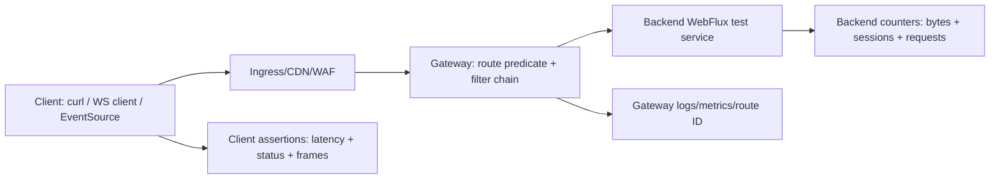
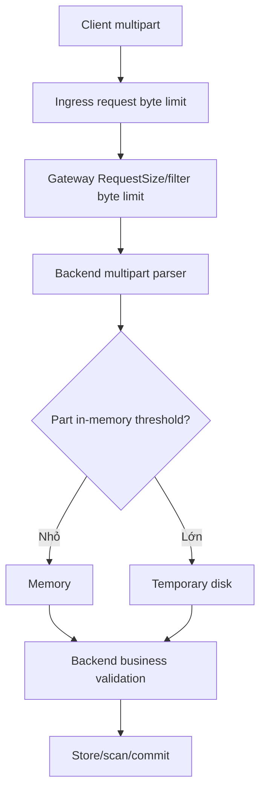

# Kiểm thử WebSocket, SSE, multipart và giới hạn nội dung trong Spring Cloud Gateway

## 1. Vì sao bốn nhóm kiểm thử này phải đi cùng nhau?

**Spring Cloud Gateway** là cửa vào microservices: sử dụng **route predicate**, **GatewayFilter/GlobalFilter chain**, sửa path/header, khám phá dịch vụ, xác thực, rate limiting, circuit breaker, retry, TLS và quan sát request. Trong hệ thống thực, không phải request nào cũng là `GET` trả JSON nhỏ. Gateway còn nhận **WebSocket upgrade**, proxy **Server-Sent Events (SSE)** lâu dài, nhận **multipart/form-data** chứa tệp và phải **giới hạn nội dung** để bảo vệ memory, disk, socket, thread/event loop và backend.

Một lỗi rất dễ bỏ qua: kiểm thử `GET /health` thành công rồi kết luận Gateway đã an toàn cho mọi giao thức. Trên thực tế:

- WebSocket handshake `101 Switching Protocols` thành công nhưng frame text/binary, `ping/pong`, closure hoặc authorization vẫn có thể lỗi.
- SSE trả `200` nhưng events bị gom 30 giây mới tới browser; một stream bị ngắt nhưng client không biết event nào đã mất.
- Multipart `curl -F` nhận `200` nhưng file bị cắt, một part sai tên hoặc body bị filter đọc trước và backend nhận rỗng.
- `RequestSize` trả `413` với request có `Content-Length`, nhưng đường truyền `Transfer-Encoding: chunked` hay HTTP/2 không khai báo trước tổng byte có thể khác; chỉ có một test sẽ bỏ sót lỗ hổng.

**Mục tiêu:** thiết kế bộ kiểm thử lặp lại được, cho cả **happy path, biên, sai định dạng, quá giới hạn, lỗi hạ tầng và bảo mật** của ba loại lưu lượng qua Gateway, đồng thời phân biệt rõ kết quả Gateway với kết quả backend.

> **Phạm vi:** ví dụ chính dùng **Spring Cloud Gateway Server WebFlux 4.3+/5.x**, Spring WebFlux backend, Reactor Netty và Spring Boot/Micrometer; YAML dùng `spring.cloud.gateway.server.webflux.*`. Các bản WebFlux cũ thường dùng `spring.cloud.gateway.routes`. Gateway Server Web MVC chạy Servlet/WebMvc.fn và có cấu hình, timeout, body-processing khác; không chuyển nguyên test WebFlux sang MVC.

### 1.1. Kết quả cần đạt

Sau bài học, bạn có thể:

1. Tạo ba routes riêng cho `ws://`, `text/event-stream` và `multipart/form-data`.
2. Viết backend demo có WebSocket echo, SSE stream và upload kiểm tra bytes để kiểm chứng đường truyền thật.
3. Test WebSocket handshake, frame, close, Origin, authentication và max frame length.
4. Test SSE `Content-Type`, event `id/event/data/retry`, flush timing, heartbeat, reconnect và `Last-Event-ID`.
5. Test multipart boundaries, form fields, file bytes, upload vượt `RequestSize` và giới hạn multipart từng part.
6. Phân biệt `413 Payload Too Large`, `400 Bad Request`, `401/403`, `404`, `5xx`, `1009` WebSocket close và timeout/cancellation.
7. Test `Content-Length` hợp lệ, thiếu/sai Content-Length, HTTP chunked và HTTP/2 bằng cách đo **backend có nhận body hay không**.
8. Dùng kiểm thử tự động kết hợp `WebTestClient`/`StepVerifier`, `ReactorNettyWebSocketClient` và kịch bản qua mạng thật.
9. Giữ môi trường test an toàn, không đẩy payload khổng lồ, token thật hoặc phép thử DoS vào production.

## 2. Ma trận kiểm thử: request/response thường khác kết nối dài

| Loại lưu lượng | Điểm thành công cần xác minh | Điểm rủi ro riêng |
|---|---|---|
| **WebSocket** | Handshake, frame echo, subprotocol nếu có, close sạch | `ws/wss` routing, Origin, session auth, ping/pong, fragment/frame cap |
| **SSE** | HTTP 200, `text/event-stream`, từng event tới kịp thời | Proxy buffering, idle timeout, reconnect/replay, canceled stream |
| **Multipart** | HTTP POST được proxy, đúng field/filename/content bytes | Boundary, request body một lần, buffer/temp disk, malformed parts |
| **Giới hạn nội dung** | Chính sách từ chối quá ngưỡng, backend không nhận body bị cấm | `Content-Length` không có hoặc sai, HTTP/2, chunked, codec max, aggregate memory |

Một test chỉ assert **status code** thường chưa đủ:

```text
WebSocket 101   +  frame nhận sai        = FAIL
SSE 200         +  10 sự kiện dồn cuối   = FAIL
Upload 200      +  backend nhận 0 bytes = FAIL
Upload > limit  +  backend vẫn ghi tệp   = FAIL, dù client có nhận lỗi muộn
```

### 2.1. Các lớp cần đặt điểm đo



**Vì sao phải có backend counters?** Nếu Gateway trả 413 nhưng backend đã nhận/ghi 1 MB trước đó, đó là khác biệt lớn với trường hợp request bị từ chối **trước khi proxy**. Nếu client nhận WebSocket close nhưng backend vẫn giữ session, đó là lỗi cleanup. Một ma trận test phải biết **ai phát lỗi** và **hành động phía backend đã xảy ra chưa**, không chỉ nhìn phản hồi client.

### 2.2. Các cấp độ kiểm thử

| Cấp | Cách chạy | Phát hiện tốt | Không thay thế |
|---|---|---|---|
| Unit | Mock route/policy/filter, `StepVerifier` | Logic size policy, permissions, event mapping | Không kiểm tra Netty handshake/multipart framing |
| Gateway integration | App Gateway thật + backend test qua HTTP port | Header/path, status, upgrade, body, timeouts | Chưa bao gồm proxy/CDN/mesh production |
| End-to-end sandbox | Client → ingress → Gateway → backend | TLS, HTTP/2, buffering, idle, sticky load balancing | Không chứng minh được capacity production |
| Controlled load/fault test | Concurrent sessions, slow clients, backend restart | Backpressure, queue, file descriptor, cleanup | Không thực hiện trên hệ thống thật khi chưa phê duyệt |

**Quy tắc xuyên suốt:** cùng một test nên ghi **route ID, HTTP version, Gateway/backend version, pod, trace/correlation ID đã chuẩn hóa và thời điểm**. Đừng đưa raw JWT, cookie, user ID hoặc toàn bộ upload body vào logs/metrics.

## 3. Dựng môi trường thử nghiệm độc lập

### 3.1. Hai ứng dụng và cổng

Các ví dụ giả định:

| Ứng dụng | Cổng | Chức năng |
|---|---:|---|
| Gateway Server WebFlux | `8080` | `/api/ws/echo`, `/api/events/stream`, `/api/upload` |
| Backend WebFlux test | `8081` | `/ws/echo`, `/events/stream`, `/upload` |
| Management Gateway (tùy chọn) | `9090` | Actuator/metrics trong mạng quản trị |

Chạy backend trước rồi mới Gateway. Các giá trị `localhost` chỉ hợp lệ khi cả hai process cùng một host/network namespace. Trong Docker/Kubernetes, `localhost` của Gateway không trỏ tới container backend khác; thay URI bằng DNS nội bộ đúng môi trường.

### 3.2. Dependencies Maven/Gradle

**Ứng dụng Gateway**:

```xml
<!-- versions do Spring Boot parent và Spring Cloud BOM tương thích quản lý -->
<dependency>
    <groupId>org.springframework.cloud</groupId>
    <artifactId>spring-cloud-starter-gateway-server-webflux</artifactId>
</dependency>
<dependency>
    <groupId>org.springframework.boot</groupId>
    <artifactId>spring-boot-starter-actuator</artifactId>
</dependency>
```

```groovy
dependencies {
    implementation 'org.springframework.cloud:spring-cloud-starter-gateway-server-webflux'
    implementation 'org.springframework.boot:spring-boot-starter-actuator'
}
```

**Ứng dụng backend test**:

```xml
<dependency>
    <groupId>org.springframework.boot</groupId>
    <artifactId>spring-boot-starter-webflux</artifactId>
</dependency>
```

Cho module **test** dùng JUnit 5, `spring-boot-starter-test` và `reactor-test` phù hợp BOM:

```xml
<dependency>
    <groupId>org.springframework.boot</groupId>
    <artifactId>spring-boot-starter-test</artifactId>
    <scope>test</scope>
</dependency>
<dependency>
    <groupId>io.projectreactor</groupId>
    <artifactId>reactor-test</artifactId>
    <scope>test</scope>
</dependency>
```

Với Boot 4, tổ chức starter test có thể được chia theo module/stack; hãy dùng dependencies test được release train thực tế khuyến nghị và bảo đảm `WebTestClient`/JUnit/StepVerifier có trên test classpath. **Không cần Redis, Eureka hoặc Resilience4j chỉ để kiểm thử ba routes cơ bản**.

### 3.3. Cấu hình ba routes Gateway

```yaml
# application.yml — Gateway Server WebFlux 4.3+/5.x, chỉ dành sandbox
server:
  port: 8080

spring:
  cloud:
    gateway:
      server:
        webflux:
          streaming-media-types:
            - text/event-stream
          httpclient:
            connect-timeout: 2000
            websocket:
              max-frame-payload-length: 65536
              proxy-ping: true
          routes:
            - id: echo-websocket
              uri: ws://localhost:8081
              predicates:
                - Path=/api/ws/echo
              filters:
                - StripPrefix=1

            - id: notifications-sse
              uri: http://localhost:8081
              predicates:
                - Path=/api/events/stream
                - Method=GET
              filters:
                - StripPrefix=1
              metadata:
                connect-timeout: 2000
                response-timeout: -1

            - id: upload-multipart
              uri: http://localhost:8081
              predicates:
                - Path=/api/upload
                - Method=POST
              filters:
                - StripPrefix=1
                - name: RequestSize
                  args:
                    maxSize: 1MB
```

**Giải thích ranh giới:**

- `ws://` → `WebsocketRoutingFilter`. Nếu cần service discovery, Gateway WebFlux hỗ trợ `lb:ws://service-id` với LoadBalancer; dùng `wss://` khi TLS được cấu hình đúng. Không dùng HTTP SSE route cho WebSocket.
- `http://` → `NettyRoutingFilter` HTTP. SSE không dùng WebSocket upgrade mà giữ một response `text/event-stream` mở lâu.
- `StripPrefix=1` làm `/api/ws/echo` → `/ws/echo`, `/api/events/stream` → `/events/stream`, `/api/upload` → `/upload`. Sai prefix dễ tạo lỗi 404.
- `max-frame-payload-length: 65536` là giới hạn trong **cấu hình WebSocket HTTP client** của Gateway, không bảo đảm mọi chiều/hạ tầng có đúng một giới hạn frame tương đương. Phải kiểm thử inbound/outbound separately.
- `response-timeout: -1` là **override của Gateway HTTP client response timeout** cho route SSE theo tài liệu WebFlux, không vô hiệu idle timeout của ingress/CDN/Firewall/browser.
- `RequestSize.maxSize` nhận `DataSize`. Theo tài liệu, request vượt ngưỡng có thể nhận `413 Payload Too Large` và header `errorMessage`. **Không coi một HTTP-header-based check là chính sách đếm byte bất khả vượt qua khi client không gửi Content-Length**; mục 10 kiểm tra trường hợp này riêng.

### 3.4. Không lẫn môi trường an toàn với production

Các ví dụ dùng `http://`/`ws://` **chỉ trong sandbox local**. Ở production, dùng `https://`/`wss://`, xác thực/authorization, origin policy, quota active connections, limits upload và bảo vệ backend trực tiếp bằng TLS/mTLS/network policy. Không dùng `server.ssl.enabled=false` hoặc `InsecureTrustManagerFactory` làm cách sửa test chứng chỉ TLS.

## 4. Backend WebSocket echo để kiểm chứng từng frame

### 4.1. Spring WebFlux `WebSocketHandler`

Trong **backend test app**:

```java
package com.example.gatewaytest.backend;

import java.util.Map;

import org.springframework.context.annotation.Bean;
import org.springframework.context.annotation.Configuration;
import org.springframework.web.reactive.HandlerMapping;
import org.springframework.web.reactive.handler.SimpleUrlHandlerMapping;
import org.springframework.web.reactive.socket.WebSocketHandler;
import org.springframework.web.reactive.socket.WebSocketMessage;
import org.springframework.web.reactive.socket.server.support.WebSocketHandlerAdapter;

@Configuration(proxyBeanMethods = false)
public class EchoWebSocketConfig {

    @Bean
    HandlerMapping websocketMapping() {
        WebSocketHandler echo = session ->
            session.send(session.receive()
                .filter(message ->
                    message.getType() == WebSocketMessage.Type.TEXT)
                .map(message -> session.textMessage(
                    "echo:" + message.getPayloadAsText())));

        SimpleUrlHandlerMapping mapping = new SimpleUrlHandlerMapping();
        mapping.setOrder(-1);
        mapping.setUrlMap(Map.of("/ws/echo", echo));
        return mapping;
    }

    @Bean
    WebSocketHandlerAdapter webSocketHandlerAdapter() {
        return new WebSocketHandlerAdapter();
    }
}
```

Đây là **echo text-only**; không phản hồi binary thành text tùy tiện. `session.receive()` là `Flux<WebSocketMessage>`, `session.send(...)` trả `Mono<Void>` gắn lifecycle của inbound/outbound. Ở production, thêm xác thực, quyền theo session, max frame/message size, origin và quy tắc protocol/subprotocol riêng.

**Điểm cần nhớ:** WebSocket handler bản chất giao tiếp bằng **frames**, không phải request body JSON của một HTTP POST. Test HTTP 101 chỉ kiểm tra **upgrade được chấp nhận**, chưa kiểm tra frame có đúng order/payload không.

### 4.2. Lỗi test nếu backend không đăng ký handler

Backend trả 404 cho `/ws/echo` dù Gateway đúng `ws://localhost:8081` sẽ làm handshake fail. Hãy kiểm tra trực tiếp backend trước khi quy lỗi Gateway. Spring WebFlux `WebSocketHandlerAdapter`, URL mapping và transport runtime phải tồn tại; không đăng ký duplicate mappings cùng path với một controller HTTP thông thường.

## 5. Backend SSE để kiểm thử chunk và heartbeat

SSE là **GET HTTP** trả các blocks `text/event-stream` theo thời gian, không phải WebSocket. Trong cùng backend test app:

```java
package com.example.gatewaytest.backend;

import java.time.Duration;
import org.springframework.http.MediaType;
import org.springframework.http.codec.ServerSentEvent;
import org.springframework.web.bind.annotation.GetMapping;
import org.springframework.web.bind.annotation.RestController;
import reactor.core.publisher.Flux;

@RestController
public class DemoSseController {

    @GetMapping(value = "/events/stream",
                produces = MediaType.TEXT_EVENT_STREAM_VALUE)
    public Flux<ServerSentEvent<String>> stream() {
        Flux<ServerSentEvent<String>> events =
            Flux.interval(Duration.ZERO, Duration.ofMillis(500))
                .map(i -> ServerSentEvent.<String>builder()
                    .id(Long.toString(i + 1))
                    .event("tick")
                    .retry(Duration.ofSeconds(2))
                    .data("tick-" + (i + 1))
                    .build());

        Flux<ServerSentEvent<String>> heartbeats =
            Flux.interval(Duration.ofSeconds(2))
                .map(ignored ->
                    ServerSentEvent.<String>builder()
                        .comment("heartbeat")
                        .build());

        return Flux.merge(events, heartbeats);
    }
}
```

SSE frames tiêu biểu:

```text
id: 1
event: tick
retry: 2000
data: tick-1

id: 2
event: tick
retry: 2000
data: tick-2

: heartbeat

```

Mỗi event cần **dòng trống kết thúc block**, và comment heartbeat `: heartbeat` **không phải event `tick`**. Thứ tự in `id/event/retry/data` có thể khác do encoder; test không nên assert nguyên chuỗi byte cố định nếu chỉ cần semantic event.

**Giới hạn của demo:** `i+1` được tính **theo mỗi subscription**, không ghi durable event log, nên `Last-Event-ID` không được xử lý. Browser reconnect có thể nhận `id:1` lại. Test resumability trong mục 8 phải dùng **backend có kho event bền vững**, không được coi demo này đã hỗ trợ replay.

## 6. Backend multipart: xác nhận số byte mà không gom toàn bộ tệp

Backend WebFlux có thể nhận `@RequestPart FilePart`. Để tránh làm demo vô tình tạo một bản sao lớn trong heap, ví dụ sau chỉ **đếm bytes** rồi release từng `DataBuffer`:

```java
package com.example.gatewaytest.backend;

import java.util.Map;

import org.springframework.http.MediaType;
import org.springframework.http.codec.multipart.FilePart;
import org.springframework.core.io.buffer.DataBufferUtils;
import org.springframework.web.bind.annotation.PostMapping;
import org.springframework.web.bind.annotation.RequestPart;
import org.springframework.web.bind.annotation.RestController;
import reactor.core.publisher.Mono;

@RestController
public class DemoUploadController {

    @PostMapping(path = "/upload",
                 consumes = MediaType.MULTIPART_FORM_DATA_VALUE)
    public Mono<Map<String, Object>> upload(
            @RequestPart("file") FilePart file,
            @RequestPart("description") String description) {

        return file.content()
            .map(buffer -> {
                try {
                    return (long) buffer.readableByteCount();
                } finally {
                    DataBufferUtils.release(buffer);
                }
            })
            .reduce(0L, Long::sum)
            .map(bytes -> Map.of(
                "filename", file.filename(),
                "description", description,
                "receivedBytes", bytes));
    }
}
```

**Ý nghĩa của test:** response JSON cho biết backend nhận **part `file`**, tên file và số bytes content. Nó **không** chứng minh file an toàn/đúng checksum/đã lưu, và **không** phải ví dụ upload production; `FilePart` parsing có thể tạm dùng disk/memory trước khi controller nhận được. Với production, dùng streaming vào object storage, hạn mức bytes/parts, checksum, malware scan, ownership, cleanup và không tin `filename()` để tạo đường dẫn tệp.

File metadata như `description` và `filename` từ client là **untrusted input**. Không đưa trực tiếp vào filesystem path, SQL, metric labels hoặc logs không redacted.

## 7. Kiểm thử WebSocket từ handshake đến close

### 7.1. Điều kiện PASS không chỉ là HTTP 101

WebSocket thông thường trên HTTP/1.1 bắt đầu bằng handshake upgrade, thành công trả `101 Switching Protocols`. Trên HTTP/2 có cơ chế extended CONNECT khác, nên **không luôn yêu cầu 101** ở mọi transport. Quan trọng hơn, một test end-to-end phải gửi **frame thật** và xác minh reply.

Checklist tối thiểu:

1. Kết nối `ws://localhost:8080/api/ws/echo` thành công bằng WebSocket client thực.
2. Gửi text `ping-1`, nhận lại chính xác `echo:ping-1`.
3. Gửi nhiều frames `A`, `B`; kiểm tra nội dung/thứ tự theo hợp đồng backend.
4. Đóng bình thường: client/server close handshake và giải phóng session.
5. Dùng path không match, ví dụ `/api/ws/unknown`: handshake **không được thành công** trên route echo.
6. Test `Origin` không được phép → handshake bị từ chối theo origin policy.
7. Test payload quá lớn, binary frame, invalid UTF-8, idle/ping-pong và backend disconnect.

### 7.2. Thử bằng `websocat` hoặc WebSocket CLI tương đương

Trên máy có công cụ `websocat`:

```bash
# Terminal 1: backend trực tiếp.
websocat -t ws://localhost:8081/ws/echo
# Gõ "hello" rồi Enter; mong thấy "echo:hello".

# Terminal 2: đi qua Gateway.
websocat -t ws://localhost:8080/api/ws/echo
# Gõ "gateway" rồi Enter; mong thấy "echo:gateway".
```

Đây là **lệnh dành cho test local**. `websocat` là công cụ ngoài dự án và có thể chưa cài; bạn có thể dùng `wscat` hoặc Spring `ReactorNettyWebSocketClient` ở mục 12 thay thế. Với WebSocket, **`curl -i` HTTP GET thông thường không kiểm tra được frame text/binary**; đừng công bố PASS chỉ vì nhận được HTTP status hoặc response headers.

### 7.3. Bảng test WebSocket và kết quả dự kiến

| Trường hợp | Cách kích hoạt | Điều cần assert |
|---|---|---|
| Handshake hợp lệ | `ws://.../api/ws/echo` | Kết nối WebSocket thành công, backend mở session |
| Text frame | Gửi `hello` | Nhận `echo:hello` **qua Gateway**, không phải response HTTP mới |
| Nhiều frames | Gửi `a`, `b`, `c` | Đúng sequence/payload theo contract |
| Không match route | `/api/ws/missing` | Không upgrade thành công trên route echo, không mở backend session |
| Origin sai | `Origin: https://attacker.example.test` | Từ chối handshake theo cấu hình, thường HTTP 403 |
| Binary frame | Gửi binary vào text-only echo | Không được âm thầm chuyển thành tin nhắn text có dữ liệu giả |
| Frame quá ngưỡng | Gửi frame vượt max được cấu hình thực tế | Connection/close/error theo đúng WebSocket implementation; không OOM |
| Client close bình thường | Close status `1000` | Server/Proxy cleanup, số active sessions trở về trước test |
| Backend crash giữa session | Kill/restart **backend demo** | Client nhận close/error có kiểm soát, không leak Gateway session |
| Mất mạng/ngắt proxy | Simulate disconnect trong sandbox | Timeout/cleanup phù hợp, không giữ session vô hạn |
| Ping/pong | Client chủ động ping | Chính sách forward/respond phù hợp, không nhầm ping với application text |
| Cùng người dùng mở nhiều sessions | 2–5 kết nối thử nghiệm | Quota/concurrency limit theo principal nếu được cấu hình |

**Không cứng hóa mọi status/close code:** frame quá lớn thường liên quan **WebSocket close code `1009 Message Too Big`**, nhưng code cụ thể còn tùy Netty/Spring handler, hướng truyền, frame fragmentation và việc proxy đóng socket đột ngột. Test phải assert **không chấp nhận payload trái policy, không rò tài nguyên**, đồng thời ghi close reason thực tế.

### 7.4. Origin không phải CORS của HTTP

WebSocket browser gửi `Origin` trong handshake, nhưng **không bị browser áp dụng CORS preflight giống `fetch()`**. Spring Cloud Gateway WebFlux 5.x có properties:

```yaml
# Fragment đặt dưới spring.cloud.gateway.server.webflux.
websocket:
  allowed-origins:
    - https://dashboard.example.test
```

Tài liệu Gateway mô tả mặc định cho phép **same-origin handshake** và request **không có Origin** (chẳng hạn CLI), từ chối cross-origin không được phép bằng 403. Dùng origin allowlist cụ thể; không dùng `*` cho môi trường nhạy cảm.

**Origin không thay authentication:** CLI có thể tự đặt hoặc bỏ header này. Với websocket private, vẫn phải xác minh session/JWT, scope và quyền truy cập stream. Khi dùng Gateway sau reverse proxy, cấu hình forwarded host/scheme **chỉ tin trusted proxies** để same-origin check đúng; không tin `X-Forwarded-Host` tùy ý từ Internet.

### 7.5. Test `wss://` và TLS

Trong sandbox có chứng chỉ test do CA tin cậy cấp:

```text
Client --wss://api.test.example.test/api/ws/echo--> Gateway
Gateway --wss://internal-ws.test.example.test/ws/echo--> Backend
```

Kiểm tra SAN/hostname, CA trust, TLS version, mTLS nếu cần và việc proxy headers qua ingress. **Một chặng `wss://` không tự bảo đảm chặng Gateway→backend cũng dùng TLS**; đó là route URI/HTTP client config riêng. Không tắt kiểm tra chứng chỉ bằng trust-all client trong CI để “sửa” sai DNS/certificate.

## 8. Kiểm thử SSE: HTTP thành công nhưng stream phải đến đúng thời điểm

### 8.1. `curl -N` qua backend rồi qua Gateway

```bash
# Backend WebFlux: phải thấy từng event khi phát.
curl --http1.1 -N -i --max-time 5 \
  -H 'Accept: text/event-stream' \
  http://localhost:8081/events/stream

# Gateway WebFlux: so sánh thời điểm và nội dung event.
curl --http1.1 -N -i --max-time 5 \
  -H 'Accept: text/event-stream' \
  http://localhost:8080/api/events/stream
```

Expected observations:

| Thuộc tính | Kiểm tra |
|---|---|
| HTTP status đầu | `200` (khi route/auth/backend đều hợp lệ) |
| Header | `Content-Type: text/event-stream` |
| Event 1 | `id: 1`, `event: tick`, `data: tick-1` |
| Event 2 | `id: 2`, `event: tick`, `data: tick-2` |
| Reconnect hint | `retry: 2000` (mili-giây) |
| Heartbeat | Dòng comment như `: heartbeat`, không dispatch thành `tick` |
| Thời điểm | Các `tick` xuất hiện **dần khoảng 500 ms**, không dồn sau 5 giây |
| Kết thúc test | `--max-time 5` hủy luồng, có thể có curl exit code `28` — dự kiến với stream vô hạn |

Đo thời gian ở **client**, không chỉ timestamp do backend gắn vào payload. Nếu backend gửi đúng nhưng Gateway/ingress giữ trong buffer, timestamp payload vẫn cũ trong khi người dùng thấy update trễ.

### 8.2. In timestamp từng dòng

Trên Bash có GNU `date`:

```bash
curl -N -sS --max-time 6 \
  http://localhost:8080/api/events/stream |
while IFS= read -r line; do
  printf '%s  %s\n' "$(date +%H:%M:%S.%3N)" "$line"
done
```

`curl -N` tắt stdout buffering của curl; nó **không tự tắt** buffering ở backend, Gateway, Nginx hoặc CDN. Khi test đi qua nhiều hop, dùng cùng lệnh ở đường **backend trực tiếp → Gateway → ingress**, so sánh event interval.

### 8.3. EventSource ở browser: reconnect và cleanup

Trong cùng-origin browser sandbox:

```javascript
const source = new EventSource("/api/events/stream");
const received = [];

source.addEventListener("tick", event => {
  received.push({ id: event.lastEventId, data: event.data });
  console.log("tick", event.lastEventId, event.data);
});

source.addEventListener("error", () => {
  console.warn("SSE connection state:", source.readyState);
});

// Khi rời trang/component:
function cleanup() {
  source.close();
}
```

Browser native `EventSource` **không có API để tự gắn Bearer Authorization header tùy ý**. Với API private hãy dùng same-origin BFF/session cookie có chính sách CSRF/Cookie/SameSite hoặc `fetch()` stream với parser/reconnect đúng, thay vì nhét JWT trong query string.

### 8.4. `Last-Event-ID` không đồng nghĩa backend phát lại dữ liệu

```bash
curl -i -N --max-time 3 \
  -H 'Accept: text/event-stream' \
  -H 'Last-Event-ID: 42' \
  http://localhost:8080/api/events/stream
```

Lệnh trên **chỉ chứng minh client đã gửi cursor**. Demo `Flux.interval` ở mục 5 không đọc cursor và không có event store, vì thế **không thể** bảo đảm trả sự kiện 43 trở đi. Để có test replay thật, phải có backend **lưu sự kiện bền vững** và logic `read after cursor` được phân quyền theo stream/tenant.

Kịch bản replay production:

1. Client nhận `id: 102` rồi mất mạng; producer tạo các events 103, 104, 105.
2. Client reconnect với `Last-Event-ID: 102`, có thể qua một Gateway/backend replica khác.
3. Backend kiểm tra identity/stream/cursor và replay 103–105 theo đúng thứ tự, sau đó nối live không bỏ gap.
4. Consumer xử lý duplicate idempotently; nếu cursor hết retention, server phát yêu cầu resync theo contract.
5. Test cursor quá dài, không hợp lệ hoặc thuộc tenant khác phải **bị từ chối**, không leak lịch sử.

**Đừng khẳng định `Last-Event-ID` header từ browser là credential**. Nó là dữ liệu untrusted; authentication/authorization phải độc lập.

### 8.5. Test idle timeout, heartbeat và response commit

| Kịch bản | Kết quả cần kiểm tra |
|---|---|
| Không có event nghiệp vụ 60s | Heartbeat có thật sự flush tới client? |
| Ingress idle timeout 30s | Stream sống qua ngưỡng hay bị ngắt? Ai đóng? |
| Backend restart khi stream đang mở | Client đóng/reconnect, không giữ zombie subscriptions |
| JWT hết hạn giữa stream | App có session lifetime/reauth policy, không mở vô hạn |
| Backend lỗi sau khi đã gửi 3 events | Không cố đổi HTTP 200 đã commit thành 503 trên **response cũ** |
| Nhiều `EventSource` trong cùng SPA | `close()` cleanup, số active streams không tăng sau mỗi render |
| Client đọc chậm | Không giữ buffer không giới hạn; có drop/disconnect/resync policy |

Với SSE, **Retry filter của Gateway không tự ghép một response mới vào stream cũ** sau khi HTTP body đã commit. Tối ưu là **client reconnect + backend replay/idempotency**. Tách SSE route khỏi response-body-caching, retry POST và TimeLimiter quá ngắn.

## 9. Kiểm thử multipart: dữ liệu phải nguyên vẹn, không chỉ HTTP 200

### 9.1. Tạo file thử nghiệm nhỏ và upload

Trong môi trường Linux/macOS shell hoặc Git Bash **chỉ trên máy test**:

```bash
# Tạo 1 file thử nghiệm 100 KiB không chứa dữ liệu thật.
head -c 102400 /dev/zero > /tmp/demo-100k.bin

# Gửi trực tiếp backend.
curl -i \
  -F 'description=small-test' \
  -F 'file=@/tmp/demo-100k.bin;filename=demo.bin;type=application/octet-stream' \
  http://localhost:8081/upload

# Gửi cùng multipart qua Gateway.
curl -i \
  -F 'description=small-test' \
  -F 'file=@/tmp/demo-100k.bin;filename=demo.bin;type=application/octet-stream' \
  http://localhost:8080/api/upload
```

Kỳ vọng backend demo trả:

```json
{
  "description": "small-test",
  "filename": "demo.bin",
  "receivedBytes": 102400
}
```

**Đừng đặt thủ công `Content-Type: multipart/form-data` khi dùng `curl -F`**; curl cần tự sinh **boundary** và thêm đúng `boundary=...` vào Content-Type. Nếu tự ghi thiếu boundary, backend có thể trả 400/415 dù route đúng. Hãy so sánh số bytes **của file part**, không so với `Content-Length` toàn request vì multipart còn headers, boundary và các form fields.

### 9.2. Kiểm thử các trường hợp multipart quan trọng

| Ca | Dữ liệu đầu vào | Điều cần assert |
|---|---|---|
| Nhỏ hợp lệ | 100 KiB + `description` | Backend nhận đúng part, bytes, filename đã được chuẩn hóa |
| File rỗng | `file` có 0 byte | Quyết định 200/4xx theo hợp đồng, không crash |
| Thiếu `file` | Chỉ có `description` | 400 hoặc lỗi validation đã quy định; backend không lưu gì |
| Sai part name | `attachment` thay vì `file` | Không im lặng nhận sai contract |
| Nhiều tệp | Hai `file` parts khi chỉ cho một | Reject hoặc xử lý rõ theo contract, không vô tình ghi cả hai |
| Text field quá dài | `description` > giới hạn | Decoder/validation từ chối đúng, không OOM |
| Filename lạ | `../../etc/passwd`, Unicode/emoji | Không dùng raw filename làm filesystem path; test sanitization |
| Content-Type lạ | `application/x-msdownload` hoặc sai MIME | Không chỉ tin MIME client gửi; validation/sniffing/scan theo policy |
| Multipart thiếu boundary | Header malformed | Reject 400/415, không chuyển payload sang backend như file hợp lệ |
| Nhiều parts/headers dài | Vượt `max-parts`/`max-headers-size` | Reject/cleanup theo parser configuration |
| File vượt tổng request size | 1,1–2 MB với route `maxSize: 1MB` | Mong 413 **nếu filter thấy chiều dài**, backend không xử lý |
| Chunked/không Content-Length | Stream bytes đến mà không biết tổng trước | **Test riêng**, không mặc định RequestSize bảo vệ được |
| Client abort giữa file | Đóng socket khi upload một phần | Cancellation/cleanup, không commit tệp hỏng |
| Concurrent uploads | Một lượng nhỏ có kiểm soát | Memory/temp disk/connection limits được giữ |

### 9.3. Byte integrity: tên và kích thước chưa đủ

`receivedBytes=102400` chứng minh **độ dài** file part, chưa chứng minh **nội dung**. Trong bài kiểm thử tích hợp sâu hơn, tính **SHA-256** trên raw file bytes ở client và backend rồi so sánh:

```bash
sha256sum /tmp/demo-100k.bin
```

Backend có thể trả checksum **chỉ trong sandbox** hoặc lưu metadata kiểm tra riêng. Với production, không trả hash của dữ liệu mật nếu contract không cho phép; checksum phải được tính khi streaming và release buffers đúng lifecycle.

Khi HTTP response trả 200 nhưng hash khác, tìm nguyên nhân: custom filter sửa body, multipart parser, character encoding, double-read request, `Content-Length`/transfer encoding hoặc backend lưu/đọc không đúng. Đừng chỉ tăng upload timeout.

## 10. Giới hạn nội dung: test đủ đường truyền để không lầm tưởng `RequestSize`

### 10.1. Bốn lớp giới hạn độc lập

| Lớp | Ví dụ chính sách | Giới hạn điều gì? |
|---|---|---|
| Ingress/WAF | `client_max_body_size`, max request bytes, streaming count | Tổng bytes từ client **trước Gateway**, tùy proxy |
| Gateway `RequestSize` | `maxSize: 1MB` theo route | Giới hạn tổng request do filter kiểm tra; cần test `Content-Length` và no-length |
| WebFlux multipart parser | `max-in-memory-size`, `max-disk-usage-per-part`, `max-parts` | Memory/disk/nội dung **mỗi part** khi parser thực sự chạy |
| Backend business policy | 800 KiB/file, 2 attachments/user, file type allowlist | Quy tắc nghiệp vụ và resource authorization |

**Không dùng `spring.codec.max-in-memory-size` hoặc multipart parser size để suy rằng toàn bộ HTTP body bị chặn chính xác ở Gateway.** Gateway có thể **proxy luồng body thô** mà không parse multipart, trong khi backend parser mới áp giới hạn per-part. Các giá trị đó bảo vệ các **điểm xử lý khác nhau**.

### 10.2. RequestSize với Content-Length khai báo

```bash
# File test 1.2 MB chỉ cho sandbox.
head -c 1200000 /dev/zero > /tmp/demo-1200k.bin

curl -i \
  -F 'description=large-test' \
  -F 'file=@/tmp/demo-1200k.bin;filename=large.bin' \
  http://localhost:8080/api/upload
```

Với `RequestSize.maxSize=1MB`, khi curl khai báo tổng `Content-Length` hợp lệ lớn hơn 1 MB, **dự kiến 413** (và một số Gateway versions thêm `errorMessage` header). **Kiểm tra backend không xử lý upload** bằng counter/log trong test, không chỉ assert 413.

`1MB` trong `DataSize` có thể được hiểu theo đơn vị byte của framework; khi muốn test boundary chính xác, hãy dùng **giá trị số bytes tường minh**, chẳng hạn `maxSize: 1048576`, và tính tổng multipart **kể cả headers/boundary**. Một file 1.048.576 bytes có thể làm cả request **lớn hơn giới hạn** vì multipart framing.

### 10.3. Trường hợp không có Content-Length/`Transfer-Encoding: chunked`

Tài liệu RequestSize mô tả hành vi 413, nhưng đã có báo cáo công khai về việc một số phiên bản filter **chỉ kiểm tra Content-Length**; khi request dùng chunked hoặc HTTP/2 không gửi tổng kích thước trước, downstream vẫn có thể nhận body vượt ngưỡng. Vì vậy đây phải là một **test độc lập**, không được coi mặc định an toàn.

Ví dụ để thử **chunked multipart** trên HTTP/1.1 trong sandbox:

```bash
# Đưa 1.2 MB giả từ stdin, yêu cầu curl gửi chunked.
head -c 1200000 /dev/zero |
curl --http1.1 -v -i \
  -H 'Transfer-Encoding: chunked' \
  -F 'description=chunked-test' \
  -F 'file=@-;filename=stream.bin;type=application/octet-stream' \
  http://localhost:8080/api/upload
```

Với `-v`, phải **xác minh request thực sự gửi `Transfer-Encoding: chunked` và không có Content-Length**; behavior của curl, shell và HTTP proxy có thể khác. Đo backend có nhận đủ 1,2 MB không.

Nếu Gateway **không** trả 413 và backend nhận file dù vượt policy, đó là **FAIL của kiến trúc kiểm soát bytes**. Đừng che bằng cách chỉ assert status 200/400 do backend parser. Cần áp dụng một **streaming byte-counting limit thực sự** ở ingress/Netty/GlobalFilter phù hợp, giới hạn ở backend và nâng cấp/kiểm thử Gateway version đã sửa khi có.

> **Giới hạn bảo mật quan trọng:** chỉ gửi payload nhỏ, được cho phép, vào sandbox; không tạo file vô hạn, request smuggling, đẩy dữ liệu vào API ngoài phạm vi hoặc chạy DoS để “kiểm tra ngưỡng”.

### 10.4. HTTP/2 và missing length

Trên đường HTTP/2 đã cấu hình TLS hợp lệ, request DATA frames không bắt buộc có `Content-Length`. Hãy thử một multipart upload qua `curl --http2`/HTTP/2 client có hỗ trợ, xác minh protocol thực ở ALPN/nginx logs, rồi đối chiếu Gateway/ingress/backend:

```bash
# Chỉ chạy khi https://api.test.example.test trỏ tới sandbox thực.
curl --http2 -v -i \
  -F 'description=http2-test' \
  -F 'file=@/tmp/demo-1200k.bin;filename=h2.bin' \
  https://api.test.example.test/api/upload
```

`--http2` **không bảo đảm** kết nối cuối cùng là HTTP/2 nếu tool/build/server không hỗ trợ; phải kiểm tra dòng protocol negotiated. Ngoài ra curl có thể tự thêm Content-Length nếu biết file size—muốn test missing-length phải dùng client streaming thích hợp hoặc route qua một proxy hỗ trợ HTTP/2 frames không có header đó.

### 10.5. Sai hoặc mâu thuẫn `Content-Length`

Các trường hợp nên có trong **bộ integration test có HTTP client chuyên dụng**:

1. `Content-Length` đúng và dưới ngưỡng.
2. `Content-Length` đúng và vượt ngưỡng.
3. Không có `Content-Length`, body chunked lớn.
4. `Content-Length` thấp hơn bytes thực gửi.
5. `Content-Length` lớn hơn bytes thực gửi rồi client disconnect.
6. Duplicated/mâu thuẫn `Content-Length`/`Transfer-Encoding`.
7. Multipart boundary malformed hoặc part không kết thúc.

Các case 4–7 có thể bị **Netty/ingress HTTP parser từ chối** trước Gateway route; đó là một kết quả hợp lệ nếu hệ thống reject sớm, không đụng backend và không để connection/request smuggling. **Không gửi các malformed raw requests vào hệ thống ngoài phạm vi hoặc production**; dùng test server cô lập và giới hạn dữ liệu chặt chẽ.

### 10.6. Multipart codec limits khác RequestSize

Trên **backend Spring WebFlux**, các properties phổ biến:

```yaml
# application.yml của BACKEND (không tự áp cho raw proxy tại Gateway).
spring:
  webflux:
    multipart:
      max-in-memory-size: 256KB
      max-disk-usage-per-part: 2MB
      max-headers-size: 8KB
      max-parts: 4
```

`max-in-memory-size` ảnh hưởng non-file parts và ngưỡng đẩy **file parts** ra disk; nó **không** có nghĩa tổng upload tối đa 256 KiB. `max-disk-usage-per-part` giới hạn phần lưu disk của một part khi parser tương ứng được dùng; `max-parts` giới hạn số parts. Nếu ứng dụng dùng `PartEvent` streaming parser, cách quản lý disk/buffer khác; không mặc định các thông số lưu file tạm có cùng hiệu ứng.

Các default của Boot 3.x/4.x có thể khác nhau; **đừng dựa vào default trong một tutorial cũ** để công bố an toàn. Đặt giá trị phù hợp **trên backend thực sự parse multipart**, kiểm thử chính xác 413/400/decoder errors theo version và monitor temp directory/disk quota.

## 11. Kết hợp kiểm thử hợp đồng và kiểm thử hệ thống thật

Một ca kiểm thử cần trả lời rõ **hợp đồng yêu cầu điều gì**, thay vì chỉ gắn cứng status cho mọi đường lỗi:

| Loại lỗi | Status/đầu ra có thể gặp | PASS về mặt hợp đồng |
|---|---|---|
| Không match route | Thường `404`, có thể Security chặn trước | Không gọi backend ngoài ý muốn |
| Thiếu JWT/quyền | `401`/`403` | Không mở WebSocket/SSE hoặc ghi file |
| WebSocket origin không cho phép | Thường `403` trước upgrade | Không nhận connection và không tạo session |
| WebSocket frame quá dài | Close `1009`/error/close transport tùy runtime | Không vượt quota, không leak session |
| Multipart sai boundary | `400`/`415`/decoder error theo version | Không ghi file hoặc forward như request hợp lệ |
| Body lớn có `Content-Length` | `413` từ RequestSize/ingress | Backend không nhận/quy trình không commit |
| Body lớn không có `Content-Length` | Cần đo; có thể không bị RequestSize chặn ở vài bản | Test phải phát hiện bypass, có lớp byte-counting bảo vệ |
| SSE backend trả lỗi **trước headers** | `5xx` hoặc fallback nếu được thiết kế | Không trả `200` giả |
| SSE/backend lỗi **sau khi body đã bắt đầu** | Disconnect, event control/close | Không cố sửa status HTTP đã commit |
| HTTP connect timeout | `5xx`/timeout mapping cụ thể | Đúng SLA và không rò connection |
| Client cancel giữa upload | Disconnect/cancellation | Temp files/buffers được cleanup; không commit tệp dở |

**Một assert status tự động chỉ là bước đầu.** Với kiểm thử hành vi phụ, có thể thêm backend counters có scope theo test ID (không đưa test ID raw vào production metrics), hoặc một mock server ghi received requests/body hashes. Một test FAIL khi Gateway trả 413 nhưng backend vẫn commit dữ liệu là **phát hiện đáng giá**, không nên “sửa” bằng cách đổi expected status sang 200.

### 11.1. Test fixture cần độc lập theo mỗi ca

Tránh để các tests ảnh hưởng lẫn nhau:

- Dùng backend stub riêng hoặc reset counters giữa tests.
- Mỗi WebSocket test tạo session mới, đóng ở `finally`/reactive completion.
- Mỗi SSE test có nguồn event xác định, hủy subscription sau số events cần assert.
- Upload dùng file tạm nhỏ, tạo/thu hồi trong sandbox test directory.
- Không dùng cùng một event ID/counter toàn cục để assert replay cho nhiều tests chạy song song.
- Khi test backend failover, ghi rõ target pod và route ID, tránh proxy load balancing làm test nondeterministic.

### 11.2. Đừng cho WebTestClient giả lập controller thay thế luôn test proxy

`WebTestClient.bindToController(...)`/`bindToRouterFunction(...)` rất hữu ích để test **backend handler**, nhưng không khởi động đủ **Reactor Netty Gateway HTTP client, WebSocket routing, TLS/ingress và kết nối thật**. Để chứng minh Gateway proxy qua network, test cần gọi Gateway đang chạy trên HTTP port thật cùng backend thử nghiệm.

Mô hình:

```text
Unit:          WebTestClient.bindToController(DemoSseController)
Integration:   WebTestClient.bindToServer() -> Gateway :8080 -> Backend :8081
WebSocket E2E: ReactorNettyWebSocketClient -> Gateway :8080 -> Backend :8081
Infra:         Client -> TLS ingress -> Gateway replicas -> backend replicas
```

## 12. Kiểm thử tự động với JUnit 5, WebTestClient và ReactorNettyWebSocketClient

Các ví dụ Java sau giả định **backend :8081 và Gateway :8080 đang chạy** theo cấu hình mục 3, hoặc được khởi chạy bằng một test harness/container tương đương. Đây là **network integration tests**; không cần chạy `@SpringBootTest` để bind một application context khác vào cùng port. Nếu muốn tự động startup cả hai ứng dụng, dùng test harness/containers và truyền base URLs qua properties thay vì hard-code ports trong CI.

### 12.1. WebTestClient kiểm thử SSE hữu hạn bằng `StepVerifier`

```java
package com.example.gatewaytest.it;

import static org.springframework.http.MediaType.TEXT_EVENT_STREAM;

import java.time.Duration;
import org.junit.jupiter.api.Test;
import org.springframework.test.web.reactive.server.FluxExchangeResult;
import org.springframework.test.web.reactive.server.WebTestClient;
import reactor.test.StepVerifier;

class GatewaySseIT {

    private final WebTestClient client = WebTestClient.bindToServer()
        .baseUrl("http://localhost:8080")
        .responseTimeout(Duration.ofSeconds(8))
        .build();

    @Test
    void streamsThreeEventsAndCancels() {
        FluxExchangeResult<String> result = client.get()
            .uri("/api/events/stream")
            .accept(TEXT_EVENT_STREAM)
            .exchange()
            .expectStatus().isOk()
            .expectHeader()
                .contentTypeCompatibleWith(TEXT_EVENT_STREAM)
            .returnResult(String.class);

        StepVerifier.create(result.getResponseBody())
            .expectNext("tick-1", "tick-2", "tick-3")
            .thenCancel()
            .verify(Duration.ofSeconds(8));
    }
}
```

**Lưu ý:**

- `returnResult(String.class)` dùng SSE decoder để nhận **data payloads**. Nó không tự assert `id/event/retry` trong code này; dùng decoder `ServerSentEvent<String>`/`ParameterizedTypeReference`, browser hoặc `curl` để test metadata riêng.
- `thenCancel()` quan trọng với `Flux.interval` **không kết thúc**. Dùng `expectComplete()` có thể khiến test chờ mãi.
- `responseTimeout`/`verify(Duration)` làm test có deadline, không bị treo cả CI khi proxy buffering hoặc backend không phản hồi.
- Test thấy ba data values **chưa chứng minh khoảng cách flush đúng 500 ms**. Muốn kiểm tra timing, ghi client timestamps/StepVerifier virtual time chỉ cho pure reactive source—**virtual time không mô phỏng network/ingress buffering**.
- Để kiểm thử cancel cleanup, backend cần instrument subscriber count và xác nhận giảm sau khi `thenCancel()`.

### 12.2. WebSocket echo qua Gateway bằng client thật

```java
package com.example.gatewaytest.it;

import static org.junit.jupiter.api.Assertions.assertEquals;

import java.net.URI;
import java.time.Duration;
import org.junit.jupiter.api.Test;
import org.springframework.web.reactive.socket.client.ReactorNettyWebSocketClient;
import reactor.core.publisher.Mono;
import reactor.test.StepVerifier;

class GatewayWebSocketIT {

    @Test
    void echoesTextFrameThroughGateway() {
        ReactorNettyWebSocketClient client =
            new ReactorNettyWebSocketClient();

        Mono<Void> conversation = client.execute(
            URI.create("ws://localhost:8080/api/ws/echo"),
            session -> {
                Mono<Void> send = session.send(
                    Mono.just(session.textMessage("hello")));

                Mono<Void> receive = session.receive()
                    .next()
                    .doOnNext(message ->
                        assertEquals("echo:hello",
                                     message.getPayloadAsText()))
                    .then();

                // Subscribe cả send và receive; hoàn tất rồi đóng session.
                return Mono.when(send, receive);
            });

        StepVerifier.create(conversation)
            .expectComplete()
            .verify(Duration.ofSeconds(8));
    }
}
```

**Test này mới xác minh echo một text frame.** Nếu hai sockets/clients dùng chung event loop có race hoặc echo server xử lý bất đồng bộ, `Mono.when(send, receive)` bảo đảm cả gửi và đọc được subscribe trong phạm vi session. Vẫn cần các tests khác cho binary, thứ tự nhiều frames, frame size, ping/pong, Origin, close và reconnect.

**Đừng gọi `block()` trong `WebSocketHandler` hoặc `GatewayFilter` của ứng dụng đang xử lý request.** Việc test runner/JUnit đợi cho một `Mono` hoàn thành với deadline là khác với việc block Netty event loop.

### 12.3. Test Origin bị từ chối bằng handshake thực

```java
package com.example.gatewaytest.it;

import java.net.URI;
import java.time.Duration;
import org.junit.jupiter.api.Test;
import org.springframework.http.HttpHeaders;
import org.springframework.web.reactive.socket.client.ReactorNettyWebSocketClient;
import reactor.core.publisher.Mono;
import reactor.test.StepVerifier;

class GatewayOriginIT {

    @Test
    void rejectsCrossOriginHandshake() {
        HttpHeaders headers = new HttpHeaders();
        headers.setOrigin("https://not-allowed.example.test");

        Mono<Void> handshake = new ReactorNettyWebSocketClient()
            .execute(
                URI.create("ws://localhost:8080/api/ws/echo"),
                headers,
                session -> Mono.empty()
            );

        StepVerifier.create(handshake)
            .expectError()
            .verify(Duration.ofSeconds(8));
    }
}
```

Test dựa trên **cấu hình Gateway thực sự từ chối origin trên** và không có security/ingress exception cho host. Nếu đang allowlist `*` hoặc có Origin policy khác, test sẽ fail có chủ đích. `expectError()` không kiểm tra được chính xác HTTP 403 trong ví dụ này; nếu contract yêu cầu 403, dùng WebSocket client/handshake exception có status detail hoặc capture HTTP handshake response trong test harness để assert chính xác.

### 12.4. Multipart nhỏ: assert JSON bytes đã đến backend

```java
package com.example.gatewaytest.it;

import java.time.Duration;
import org.junit.jupiter.api.Test;
import org.springframework.core.io.ByteArrayResource;
import org.springframework.http.MediaType;
import org.springframework.http.client.MultipartBodyBuilder;
import org.springframework.test.web.reactive.server.WebTestClient;
import org.springframework.web.reactive.function.BodyInserters;

class GatewayMultipartIT {

    private final WebTestClient client = WebTestClient.bindToServer()
        .baseUrl("http://localhost:8080")
        .responseTimeout(Duration.ofSeconds(8))
        .build();

    @Test
    void preservesFilePartBytes() {
        byte[] payload = new byte[64_000];

        ByteArrayResource resource = new ByteArrayResource(payload) {
            @Override public String getFilename() {
                return "fixture.bin";
            }
        };

        MultipartBodyBuilder parts = new MultipartBodyBuilder();
        parts.part("description", "integration-test");
        parts.part("file", resource)
            .contentType(MediaType.APPLICATION_OCTET_STREAM);

        client.post()
            .uri("/api/upload")
            .contentType(MediaType.MULTIPART_FORM_DATA)
            .body(BodyInserters.fromMultipartData(parts.build()))
            .exchange()
            .expectStatus().isOk()
            .expectBody()
            .jsonPath("$.filename").isEqualTo("fixture.bin")
            .jsonPath("$.receivedBytes").isEqualTo(64000);
    }
}
```

Tại sao `payload` chỉ 64 KiB? Vì đây là **test correctness** qua multipart framing, không phải stress test. Ngưỡng `RequestSize=1MB` tính **toàn HTTP multipart body**, gồm boundary/headers/form fields. Test lớn cần nằm ở ca riêng và có memory/time budget.

### 12.5. Test yêu cầu 413 với `Content-Length` có kiểm soát

```java
package com.example.gatewaytest.it;

import java.time.Duration;
import org.junit.jupiter.api.Test;
import org.springframework.http.HttpHeaders;
import org.springframework.http.HttpStatus;
import org.springframework.http.MediaType;
import org.springframework.test.web.reactive.server.WebTestClient;

class GatewaySizeLimitIT {

    @Test
    void rejectsDeclaredLengthAboveLimit() {
        byte[] payload = new byte[1_200_000];
        WebTestClient client = WebTestClient.bindToServer()
            .baseUrl("http://localhost:8080")
            .responseTimeout(Duration.ofSeconds(10))
            .build();

        client.post()
            .uri("/api/upload")
            .contentType(MediaType.APPLICATION_OCTET_STREAM)
            .header(HttpHeaders.CONTENT_LENGTH,
                Integer.toString(payload.length))
            .bodyValue(payload)
            .exchange()
            .expectStatus().isEqualTo(HttpStatus.PAYLOAD_TOO_LARGE);
    }
}
```

Route `/api/upload` ở mục 3 chỉ có predicate `Path`/`Method` và RequestSize, **không có predicate Content-Type**, nên test gửi octet-stream giúp cô lập việc reject theo độ dài trước khi đi tới backend multipart parser. Hãy xác minh bằng wire logs/test-server rằng HTTP client **thực sự gửi Content-Length**, không tự chuyển sang chunked và không ghi header mâu thuẫn. Nếu Gateway bỏ qua RequestSize, backend có thể trả `415`, và test **phải fail** để chỉ ra sự khác biệt.

**Tách riêng thêm test không Content-Length:** `WebTestClient.bodyValue(byte[])` thường có thể suy ra length, nên không phải bằng chứng cho case `chunked`. Cần một client phát `Flux<DataBuffer>` hoặc tool HTTP/2 thích hợp và xác minh network headers thực tế như mục 10.

### 12.6. Negative test phải xem trạng thái backend

Khi dùng backend mock có counter nhận upload:

```text
Given: route RequestSize maxSize=1048576 bytes
When:  client gửi Content-Length=1200000 bytes
Then:  Gateway status=413
And:   backend uploadReceivedCount không tăng
And:   không có temp file còn sót

When:  client gửi chunked multipart >1048576 bytes
Then:  Hệ thống phải áp byte-level limit tại một lớp được thiết kế
And:   nếu test quan sát backend nhận/ghi đủ file -> FAIL
```

Đây là **test contract**, không tự khẳng định RequestSize filter đơn lẻ luôn đáp ứng đoạn chunked. Việc có thêm lớp giới hạn streaming tại ingress/backend phải được ghi rõ trong kiến trúc.

## 13. Kiểm thử bảo mật xuyên suốt ba loại lưu lượng

### 13.1. Authentication là bước trước protocol/body, không phải phần thưởng sau khi kết nối

Với private endpoints, người dùng chưa xác thực phải bị chặn **trước khi mở WebSocket**, **trước khi SSE response commit** và **trước khi backend nhận multipart**.

| Endpoint | Ca không có credential | Ca có credential nhưng thiếu quyền | Ca hợp lệ |
|---|---|---|---|
| `/api/ws/echo` | Không upgrade thành công, thường 401 | Không upgrade, thường 403 | WebSocket session có quyền được mở |
| `/api/events/stream` | Không trả SSE 200, thường 401 | Không trả SSE 200, thường 403 | SSE trả events chỉ thuộc stream được phép |
| `/api/upload` | Không chuyển upload, thường 401 | Không chuyển upload, thường 403 | Backend xác minh ownership/type/size rồi xử lý |

Nếu dùng Spring Security WebFlux OAuth2 Resource Server, hãy kiểm thử token **issuer, signature, audience, scope, expiry và tenant/resource ownership**. Gateway auth không thay backend authorization—client có thể tìm cách gọi trực tiếp backend nếu network lộ hoặc quyền thay đổi trong lúc stream đang mở.

**Lưu ý cho WebSocket browser và SSE browser:** WebSocket browser cũng không cho script tùy tiện gắn Authorization header ở WebSocket constructor. Có thể dùng **same-origin session/cookie**, BFF, protocol cho access control riêng hoặc cơ chế token do backend/IdP thiết kế an toàn. **Không đưa bearer token vào query string** vì URLs dễ vào access logs, traces và analytics. Cần CSRF/Origin/SameSite policy nếu dựa vào cookies.

### 13.2. Phân biệt WebSocket Origin và SSE CORS

| Tính năng | Kiểm soát |
|---|---|
| Browser WebSocket handshake | WebSocket **Origin allowlist** được đánh giá tại handshake; không có CORS preflight kiểu fetch |
| Browser SSE cross-origin | CORS `Access-Control-Allow-Origin`/`Allow-Credentials` và cookie policy của browser |
| CLI `websocat`/`curl` | Có thể không gửi Origin; CORS không phải authentication |
| Direct backend | Network policy, TLS/mTLS, token/session/backend authorization |

Một test Origin 403 pass **không chứng minh WebSocket có authentication**: CLI thiếu Origin có thể vẫn mở nếu route public, theo quy tắc Gateway được cấu hình. Ngược lại, CORS pass chỉ chứng minh browser được phép đọc HTTP response, không chứng minh người dùng có quyền xem event.

### 13.3. Kiểm thử spoofed headers

Các headers `X-User-Id`, `X-Tenant-Id`, `X-Role` do client tự gửi **không đáng tin**. Nếu Gateway tạo identity headers cho backend, chúng phải được **ghi đè từ principal/JWT đã xác minh**, và backend cần một trust boundary (mTLS/ACL/signed assertion/audience) phù hợp.

Test:

1. Gửi JWT của user A với `X-Tenant-Id: tenant-B`.
2. Gửi SSE subscribe hoặc upload tới resource của tenant B.
3. Kỳ vọng bị từ chối hoặc chỉ được xử lý theo tenant A được xác thực.
4. Kiểm tra response không rò event của B và backend không lưu tệp dưới namespace B.

**Không bao giờ dùng `Last-Event-ID` như proof of identity.** Một cursor do client tự đặt chỉ định vị trí phát lại; backend phải kiểm tra cursor/stream thuộc tenant được phép.

### 13.4. Kịch bản lỗi sau response commit

SSE đã gửi HTTP 200 cùng 10 events, sau đó user mất quyền. Gateway **không thể đổi status của response cũ thành 401/403**. Chính sách đúng có thể là đóng stream khi token/session hết hạn, gửi event control an toàn nếu contract hỗ trợ và yêu cầu reconnect/reauth. Test cả **thời điểm mở** lẫn **trong vòng đời kết nối**.

WebSocket cũng có state lâu dài. Handshake thành công không có nghĩa user được phép gửi mọi frame command trong một giờ; backend phải authorize **messages/operations** theo ngữ cảnh, không chỉ tin initial upgrade.

### 13.5. Tiêu chí riêng tư và quan sát

Kiểm tra logs, traces và metrics sau các ca test:

- Không có raw `Authorization`, `Cookie`, SSE `data:` chứa PII, multipart content/filename riêng tư hoặc token trong URI.
- Metric labels theo **route ID ổn định**, status/outcome, không theo raw upload filename, user ID, trace ID hoặc SSE cursor.
- `wiretap` của Reactor Netty nếu bật trong sandbox chỉ dùng để điều tra tạm thời rồi tắt; có nguy cơ log payload.
- Backend test counters chỉ dùng dữ liệu demo, reset được; không public endpoint kiểm tra internals.
- Actuator/Prometheus ở mạng quản trị, không mở wildcard exposure trên public ingress.

## 14. Kiểm thử file lớn, buffer và resource lifecycle

### 14.1. Phân biệt tổng request size, per-part size và codec limit



`max-in-memory-size` **không** phải tổng request limit; file part có thể được ghi ra disk sau ngưỡng này. `max-disk-usage-per-part` và `max-parts` bảo vệ các tài nguyên khác. Với `Flux<PartEvent>` parser kiểu streaming, tiêu thụ/release `DataBuffer` và giới hạn bytes/disk ứng dụng vẫn cần được thiết kế riêng.

### 14.2. Những ca biên bắt buộc

| Kiểm thử | Kích thước/điều kiện | Kỳ vọng |
|---|---|---|
| Dưới ngưỡng | Tổng multipart < maxSize | 200 nếu hợp đồng và auth đúng |
| Đúng bằng ngưỡng | Tổng HTTP body = maxSize | Chấp nhận hoặc từ chối theo semantics `>`/`>=` đã được kiểm chứng |
| Vượt ngưỡng một byte | Tổng body = maxSize + 1 | Từ chối có kiểm soát |
| File gần ngưỡng, boundary làm vượt | File bytes < limit nhưng multipart bytes > limit | Tổng request policy quyết định, không chỉ file length |
| 100 parts nhỏ | Tổng nhỏ nhưng vượt `max-parts` | Multipart parser từ chối, cleanup |
| Header part cực dài | Vượt `max-headers-size` | Không cấp phát vô hạn |
| Tên file nhiều Unicode | Filename không ASCII/URL-encoded | Validate tên/encoding, không path traversal |
| Slow upload | Từng chunk đến rất chậm | Idle/deadline/quota phù hợp, không giữ socket vô hạn |
| Abrupt client disconnect | Dở dang trong part | Không commit tệp dở, cleanup temp files |
| 10 requests vừa đủ lớn | Concurrency thử nghiệm có giới hạn | Không tăng heap/temp disk ngoài budget |

**Khi test ranh giới 1 byte**, cần tạo **raw multipart body** hoặc dùng HTTP client cho phép biết chính xác toàn bộ bytes sau encoding. Một file đúng 1 MB không có nghĩa multipart request đúng 1 MB; Content-Disposition/boundary/name fields cũng chiếm bytes.

### 14.3. Không cache toàn bộ upload để retry vô điều kiện

Spring Cloud Gateway `Retry` filter với HTTP method có body có thể cache request body trong `DataBuffer` để phát lại, làm tăng memory theo **payload size × concurrent requests**. Nếu upload 1 MB × 500 requests đồng thời, riêng bản sao payload đã có thể đến **500 MB**, chưa kể Reactor/Netty/socket buffers và các bản sao khác.

Không gắn `Retry` mặc định cho multipart uploads/POST mutations. Chỉ retry khi backend có **idempotency key**/dedup và giới hạn attempts/deadline, đồng thời có chiến lược streaming/upload resume phù hợp. Đối với file lớn, nên dùng object storage direct/presigned flow hoặc chunked upload protocol được thiết kế đúng.

### 14.4. `DataBuffer` lifecycle là phần của test

Với Netty pooled buffers, không release `DataBuffer` khi tự tiêu thụ có thể gây **direct-memory leak**. Ngược lại, release quá sớm làm dữ liệu bị hỏng khi downstream còn dùng.

Test nên:

- Kiểm tra buffer leaks trong load test có JVM/direct-memory metrics và logging phù hợp.
- Không gọi `collectList()`/`blockFirst()` trên file/SSE vô hạn trong Gateway filter.
- Dùng `DataBufferUtils.release` khi tự tiêu thụ và không chuyển ownership tiếp.
- Không tự `subscribe()` ngoài request lifecycle; hủy subscription khi client disconnect.
- Test lỗi/cancel, không chỉ đường đi hoàn thành 200.
- Với file lớn, dùng streaming chuyển tới backend/storage và checksum thay vì load toàn bộ bytes vào heap.

**Không dùng một pass load test 30 giây để chứng minh không leak**: xem bộ nhớ/active subscriptions **sau nhiều chu kỳ mở/đóng** và sau GC, kết hợp heap/direct buffer tracking.

### 14.5. Slow consumer với WebSocket/SSE

| Kênh | Rủi ro chậm | Hành vi cần thiết kế/test |
|---|---|---|
| WebSocket | Client không đọc frames; pending sends tăng | Outbound queue cap, close khi vượt quota, ping/pong, cleanup |
| SSE | Client nhận sự kiện chậm; buffered events tăng | Backpressure/drop/coalesce/disconnect+replay policy |
| Multipart upload | Client gửi file chậm, socket bị giữ | Read idle timeout, total upload deadline, conn quota |
| Large download | Backend phát nhanh, client đọc chậm | Bounded output buffers, cancel propagate, bandwidth/conn quota |

`RequestRateLimiter` theo request/giây chỉ kiểm soát **lúc mở** một HTTP request/stream; nó không tự đếm WebSocket frames, SSE events hay số **active connections**. Trong load test, đo active sessions và memory queues, không chỉ total request count.

## 15. Fault injection và load test có kiểm soát

### 15.1. Chọn giới hạn thử nghiệm trước khi bắt đầu

Trong test environment được cấp quyền:

| Thành phần | Ngưỡng minh họa |
|---|---|
| Concurrent WebSocket sessions | 10, sau đó 20 để quan sát xu hướng |
| Concurrent SSE streams | 10, sau đó 20 |
| Concurrent multipart uploads | 5–10 tệp 100 KiB |
| Max upload test | Không quá 2 MB trong bài học |
| WebSocket test frame | 1 KiB, 63 KiB, 65 KiB (theo giới hạn 64 KiB giả định) |
| Test duration | 20–60 giây mỗi kịch bản |
| Cleanup | Đóng sessions, dừng publishers, xóa sandbox temp files |

Đây chỉ là **mức tải minh họa cho sandbox**, không phải capacity benchmark, SLO hay khuyến nghị chạy trên production. Các bài test nguy cơ resource exhaustion cần được phê duyệt, giới hạn thời gian/concurrency và có phương án dừng.

### 15.2. Kịch bản backend restart

1. Mở một WebSocket và SSE stream qua Gateway.
2. Gửi WebSocket `hello`, nhận echo; nhận vài SSE events.
3. **Restart backend demo** trong sandbox.
4. Ghi nhận close/error của WebSocket, SSE disconnect/error, thời gian phát hiện và số sessions còn tồn.
5. Khởi động backend, reconnect. WebSocket app phải tự thực hiện reconnect; native EventSource có thể tự reconnect theo protocol.
6. Xác minh không có zombie sessions hoặc unbounded retries. SSE demo **không có durable replay**; đừng xem event ID liên tục sau reconnect là bảo đảm.

### 15.3. Kịch bản Gateway restart/rolling deploy

1. Mở 5 WebSocket và 5 SSE streams qua **một Gateway replica**.
2. Restart đúng replica đó trong test cluster.
3. Client phải nhận close/disconnect có thể giải thích, không treo mãi.
4. Với reconnect qua replica khác, backend nhận lại handshake/GET đúng identity/route và thực hiện stream authorization.
5. Đếm total active connections cũ/mới; không tăng mãi sau nhiều vòng.
6. Đối chiếu route IDs, filter config và timeout giữa replicas; không kết luận “toàn cụm đúng” từ một pod.

**WebSocket không được Gateway tự di chuyển frame giữa các backend replicas** khi connection đã mở. Load balancing xảy ra khi **mở kết nối**, reconnect có thể tới replica khác. SSE `Last-Event-ID` phải dựa vào state bền vững/cluster-wide nếu muốn replay sau failover.

### 15.4. Kịch bản Nginx/ingress buffering

So sánh:

```bash
# Backend trực tiếp
curl -N -sS --max-time 6 http://localhost:8081/events/stream

# Gateway trực tiếp
curl -N -sS --max-time 6 http://localhost:8080/api/events/stream

# TLS ingress thực trong sandbox (nếu đã cấu hình)
curl -N -sS --max-time 6 \
  https://api.test.example.test/api/events/stream
```

Nếu backend/Gateway phát từng 500ms nhưng ingress dồn thành cụm, điều tra `proxy_buffering`, compression, idle timeout, HTTP/2 framing và CDN transformations. **Đừng fix bằng tăng Gateway buffer lên hàng MB** nếu lỗi do buffering phía ingress.

### 15.5. Kịch bản upload chậm / client disconnect

Một client test có thể giới hạn tốc độ gửi:

```bash
# Có file /tmp/demo-100k.bin từ mục 9, chỉ chạy sandbox.
curl -i --limit-rate 16k --max-time 12 \
  -F 'description=slow' \
  -F 'file=@/tmp/demo-100k.bin' \
  http://localhost:8080/api/upload
```

`--limit-rate` của curl có thể áp dụng cả upload/download tùy tool/version; xác minh wire rate trước khi suy kết quả. Với một file chỉ 100 KiB, bài test này kiểm tra **vòng đời kết nối và cancellation**, không thể đánh giá giới hạn 2 GB. Khi client hủy request, backend không được commit tệp chưa hoàn tất và temp storage cần cleanup theo chính sách.

### 15.6. Test client hỏng không được làm route khác ngừng phục vụ

Mở vài SSE/WebSocket streams test trong khi đồng thời gọi một HTTP health/echo route **không phụ thuộc backend chậm**. Theo dõi p95/p99 latency, Netty event loop CPU, active sockets, memory/direct buffers và errors. Nếu 10 clients chậm làm mọi routes tăng latency mạnh, kiểm tra blocking filter, unbounded buffers, GC hoặc pool starvation.

Không dùng `Thread.sleep()` trong custom `GatewayFilter` trên Reactor Netty event loop để mô phỏng chậm; dùng backend test có delay bất đồng bộ hoặc nguồn cố tình chậm bên ngoài Gateway.

## 16. Quan sát và phân loại lỗi: đừng quy hết cho Gateway

### 16.1. Thống nhất telemetry cho các test

| Tín hiệu | Ví dụ | Dùng để xác minh |
|---|---|---|
| Gateway route ID | `echo-websocket`, `notifications-sse`, `upload-multipart` | Request đi vào đúng tuyến chưa? |
| HTTP handshake/response status | `101`/`200`/`400`/`413`/`5xx` | Lỗi xảy ra trước hay sau response commit? |
| WebSocket active sessions | Gauge theo route/instance | Cleanup, connection quota, zombie sessions |
| WebSocket close code/reason | `1000`, `1009` hoặc transport failure | Normal close, frame limit, policy, backend crash |
| SSE active subscriptions | Open/cancel counters ở backend | `thenCancel()` có lan tới producer không? |
| SSE event delay | Timestamp producer và time received | Gateway/ingress có buffering không? |
| Upload total bytes/hash | Counter/checksum ở backend | Body có mất/cắt/sửa không? |
| Upload reject counters | Ingress 413, Gateway 413, backend parser errors | Lớp nào thực thi giới hạn? |
| Temp file/disk/direct memory | JVM, OS, parser storage metrics | Có leaks sau cancel/reject không? |
| Netty event loop/CPU/GC | Micrometer/JFR theo quyền | Blocking callback hoặc quá tải memory |

Metric tags phải **ít giá trị**: routeId/status/outcome/instance/environment. Không thêm raw WebSocket session ID, upload filename, SSE cursor, user ID hoặc trace ID vào mỗi meter series. Traces/logs riêng có thể hỗ trợ correlation nhưng vẫn cần redaction, sampling và retention.

### 16.2. Kiểm tra Gateway Actuator khi route sai

Trong sandbox có Actuator **read-only** và authentication phù hợp:

```yaml
management:
  server:
    port: 9090
    address: 127.0.0.1
  endpoint:
    gateway:
      access: read-only
  endpoints:
    web:
      exposure:
        include: health,info,gateway,metrics
```

```bash
# Chỉ truy cập qua management network/credentials hợp lệ.
curl -sS http://127.0.0.1:9090/actuator/gateway/routes
curl -sS http://127.0.0.1:9090/actuator/gateway/routes/echo-websocket
curl -sS http://127.0.0.1:9090/actuator/gateway/routes/notifications-sse
curl -sS http://127.0.0.1:9090/actuator/gateway/routes/upload-multipart
```

Actuator route view giúp xác minh **predicate, URI, route filters và route order**, nhưng **không chứng minh một WebSocket frame/SSE event/upload byte đã được backend nhận**. Muốn biết filter thứ tự nào được thực thi, đối chiếu `/globalfilters`, logs có correlation ID và kết quả end-to-end.

**Read-only không phải permit-all.** Thông tin route/URI/filter có thể tiết lộ topology nội bộ; không expose Actuator công khai, không bật route mutation endpoints chỉ để kiểm thử.

## 17. Ma trận sự cố và hướng kiểm tra nhanh

| Triệu chứng | Nguyên nhân có thể | Kiểm tra trước |
|---|---|---|
| `ws://...` nhận 404 | Route predicate/path sai, StripPrefix sai, backend không map `/ws/echo` | Actuator route, backend direct WebSocket client, Gateway filter |
| WebSocket chỉ trả HTTP 400 | Client gửi GET thường, thiếu WebSocket headers/handshake | Dùng WebSocket client thật, không dùng curl GET thường |
| WebSocket 403 với Origin trình duyệt | Origin allowlist không khớp hoặc Spring Security | So sánh same-origin, proxy forwarded scheme/host, auth policy |
| WebSocket kết nối được nhưng không có echo | Backend không subscribe `receive()`/`send()`, frame bị filter, wrong protocol | Client frame trace, backend handler, Netty routing |
| WebSocket frame lớn đóng đột ngột | Max frame payload, server limits, fragmentation hoặc network | Size settings hai chiều, close code, heap/direct memory |
| WebSocket binary bị bỏ qua | Backend demo text-only filter | Test đúng hợp đồng; đừng gửi binary rồi đòi text echo |
| WebSocket mất kết nối khi load balancer idle | Proxy idle/lifetime timeout, thiếu ping/pong | So sánh direct Gateway và ingress, heartbeat policy |
| SSE trả `application/json` | Backend sai `produces`/codec hoặc filter sửa Content-Type | `text/event-stream` và controller output |
| SSE status 200 nhưng không nhận data | Proxy buffering, event thiếu dòng trống, handler không phát | `curl -N` backend/Gateway/ingress, interval timing |
| SSE có `event: tick` nhưng browser `onmessage` trống | Client chỉ nghe default event type | `addEventListener("tick", ...)` |
| SSE đứt đúng sau 5s | Global response timeout, route metadata chưa override, ingress | `response-timeout: -1` đúng route, proxy idle, heartbeat |
| SSE reconnect nhận `id:1` lần nữa | Backend demo không replay, ID theo subscription | Durable cursor/event log; không yêu cầu demo có replay |
| SSE bị lỗi 401 trong browser nhưng curl Bearer thành công | EventSource không tự set Authorization header tùy ý | Session/BFF/cookie/CORS hoặc fetch streaming parser |
| Multipart 400/415 | Sai part name, thiếu boundary, Content-Type sai | `curl -F`, backend `@RequestPart` contract |
| Multipart trả 200 nhưng `receivedBytes=0` | Input stream bị filter đọc trước, body rewrite/caching lỗi | So direct backend/Gateway, checksum, filter chain |
| Multipart quá ngưỡng vẫn được backend xử lý | Không `Content-Length`/chunked, RequestSize chỉ kiểm header ở một số version | Wire headers, backend counter, streaming byte cap tại nhiều lớp |
| Multipart file <1MB nhưng bị 413 | Tổng multipart gồm boundary/headers >1MB | So full HTTP body size, không chỉ file length |
| Multipart parser gây đầy disk | Temp files vượt quota, cleanup khi cancel thiếu | `max-disk-usage-per-part`, temp dir, parser version |
| Multipart vượt `max-parts` nhưng vẫn chạy | Backend không dùng parser/config như dự kiến | Spring Boot config binding, stack WebFlux/MVC, PartEvent |
| SSE/upload làm memory tăng | `collectList()`, `Retry` cache body, unbounded buffers | Heap/direct memory, filters/body handling |
| Gateway 502/503 khi backend bị stop | Connect error, LB không có instance | Route URI/discovery, network, connect timeout |
| Client nhận 200 rồi stream lỗi | Response đã commit; late error | Logs/close, không cố đổi status 200 thành 500 |
| Một pod pass, pod khác fail | Cấu hình/route cache/versions khác trong rollout | Test từng replica, config revision |
| Load test có active sessions tăng mãi | Không cancel/release, WebSocket/SSE lifecycle lỗi | Backend counters, `doFinally`, session cleanup |

### 17.1. Quy trình sáu bước khi một test fail

1. **Giữ nguyên bằng chứng:** ghi URL đã redacted, HTTP version, request headers không nhạy cảm, test case, status/close reason và timestamps.
2. **Thử backend trực tiếp** cùng protocol/payload nhỏ. Nếu backend direct fail, chưa có cơ sở đổ lỗi Gateway.
3. **Thử Gateway trực tiếp**, bỏ ingress nếu có thể trong môi trường cho phép. Đo response chunks, frames hoặc file checksum.
4. **Thử qua ingress** với cùng test, xác minh TLS/ALPN, Origin/CORS, proxy buffer/timeout.
5. **Đọc route/filter config của đúng instance**: `Path`/`Method`, `uri ws/http`, `StripPrefix`, `RequestSize`, auth, custom body filters.
6. **Kiểm tra side effects và tài nguyên**: backend received bytes, active subscriptions, temp disk, metrics và trace trước khi điều chỉnh timeout/limits.

## 18. Đưa kiểm thử vào CI/CD với điều kiện chấp nhận rõ ràng

### 18.1. Phân nhóm test suites

```text
gateway-contract:
  - ws route identity/path/method/Origin policy
  - sse content-type and event serialization
  - multipart part name/file sizes/validation
  - request limits from declared length

gateway-integration:
  - ws echo via actual Gateway port
  - sse 3 events + cancellation + timing
  - multipart content length + checksum
  - oversize 413 + backend untouched
  - chunked/no-Content-Length oversize regression

gateway-preprod:
  - TLS WSS / HTTPS SSE / HTTPS upload
  - ingress buffering and HTTP/2 transfer
  - backend restart and rolling Gateway replica
  - slow client, session/stream cleanup
  - resource load under an approved budget
```

**Không bắt buộc** mọi PR phải chạy một test ingress/TLS nhiều phút. Một pipeline thực tế có thể chạy unit/integration deterministic trong PR, và fault/performance suite trong môi trường preprod có kiểm soát. Nhưng các case được coi là **security regression**, đặc biệt size limit thiếu Content-Length, phải được tự động chạy ở nơi có thể tạo đúng transport.

### 18.2. Đặt acceptance criteria

Một bảng có thể đưa vào PR:

| Nhóm | Điều kiện chấp nhận |
|---|---|
| Routing | Ba routes đúng ID, đúng URI scheme/path; không route overlap ngoài ý muốn |
| WebSocket | Echo text pass; Origin sai không upgrade; frame quá limit không được xử lý; sessions cleanup |
| SSE | 200 + đúng media type, ≥3 events đến theo thời gian, test hủy stream không leak |
| SSE reconnect | Có policy replay/resync nếu nghiệp vụ yêu cầu; demo interval không được ghi nhận replay PASS |
| Multipart | Dưới limit nhận đủ bytes/checksum; malformed part reject; không ghi filename raw làm path |
| Upload limits | Declared-length vượt limit bị 413 trước backend; **no-length/chunked** bị chặn ở ít nhất một lớp counting thật |
| Security | 401/403 trước proxy cho request không quyền; không rò tài nguyên tenant khác |
| Resilience | Backend/nginx/Gateway disconnect có timeout/cleanup hợp đồng; không treo CI |
| Observability | Có route ID/status/close/error metrics ít nhãn; không log credentials/body |
| Resource bounds | Worker/Netty/heap/direct/disk/connections trong budget khi thử concurrency nhỏ |

Không dùng `status=200` thay cho mọi assertion. Một WebSocket echo sai nội dung, SSE thiếu sự kiện, hoặc multipart mất bytes phải làm test **FAIL**, dù ứng dụng trả HTTP status thành công.

### 18.3. Chống flaky tests

- Không dựa vào thời điểm tuyệt đối từng `Flux.interval` tick; dùng timeout đủ rộng và ít events.
- Không dùng `Thread.sleep(500)` ở test runner để đo timing chính xác; dùng `StepVerifier`, điều kiện quan sát hoặc clock được kiểm soát khi test pure publisher.
- Với test qua mạng thật, tạo backend test fixture có liveness/health check rồi mới mở Gateway clients.
- Khi có port dynamic, truyền backend URL vào Gateway test properties trước khi app khởi động; tránh trùng `:8081`.
- Cố định test data, reset backend counters/event offsets và temp files giữa ca.
- Không cho các tests tác động lên cùng shared backend counter khi chạy song song nếu assertion yêu cầu chính xác.
- Có `verify(Duration)` và client connect/read timeout; test fail nhanh thay vì treo pipeline.
- Phân loại **kỳ vọng không có message** (Origin deny) khác **message lỗi vì môi trường offline** (backend không chạy).
- Chụp log/counters đã redacted khi fail; không bật Netty raw wiretap dài hạn trên mọi pipeline.

## 19. Câu hỏi tự luyện và đáp án

**Bài 1 — 101 chưa đủ.** WebSocket trả `101 Switching Protocols` nhưng không echo `hello`. Test đã PASS chưa?

**Đáp án:** chưa. Phải gửi frame text thật, assert `echo:hello`, closure/session lifecycle và policy nếu cần.

**Bài 2 — URI scheme.** SSE route dùng `ws://backend` vì “streaming”. Đúng không?

**Đáp án:** sai. SSE là **HTTP GET** `text/event-stream` qua `http://`/`https://`; `ws/wss` dành cho WebSocket upgrade.

**Bài 3 — StripPrefix.** Gateway nhận `/api/ws/echo`, backend map `/ws/echo`. Filter nào dùng trong ví dụ?

**Đáp án:** `StripPrefix=1`, bỏ segment `api`. Sai giá trị có thể khiến handshake 404/400.

**Bài 4 — WebSocket Origin.** `Origin: https://attacker.example.test` bị 403. Có chứng minh user đã được xác thực không?

**Đáp án:** không. Origin check không thay authentication và authorization. Một CLI không có Origin vẫn có thể kết nối theo policy nếu route không bảo vệ.

**Bài 5 — Frame quá lớn.** Gửi frame 65 KiB vào hệ giới hạn 64 KiB. Có phải client chắc chắn nhận HTTP 413?

**Đáp án:** không. Sau upgrade, giới hạn áp trên WebSocket frame/session; có thể close code `1009` hoặc transport error tùy implementation, không phải một HTTP 413 thông thường.

**Bài 6 — SSE flush.** `curl -N` nhận 10 events cùng lúc sau 5 giây dù backend phát mỗi 500ms. Có phải PASS vì đủ 10 events?

**Đáp án:** không. Đây là lỗi timeliness/streaming, cần phân tích buffering/flush ở backend, Gateway, ingress hoặc client.

**Bài 7 — Named SSE event.** Backend gửi `event: tick`, browser chỉ gắn `source.onmessage`. Cần đổi gì?

**Đáp án:** dùng `source.addEventListener("tick", handler)`; `onmessage` chỉ nhận event type mặc định `message`.

**Bài 8 — Replay.** Browser reconnect với `Last-Event-ID: 102`, backend chỉ dùng `Flux.interval()`. Có bảo đảm không mất events?

**Đáp án:** không. Header là cursor, cần backend durable event log/replay và không-gap catch-up/live.

**Bài 9 — Multipart file và tổng request.** File đúng 1 MiB có chắc pass `RequestSize.maxSize=1MB`?

**Đáp án:** không. Tổng multipart request còn boundary, Content-Disposition, fields và headers nên có thể vượt ngưỡng.

**Bài 10 — Tự đặt Content-Type.** Dùng `curl -F` nhưng tự thêm `Content-Type: multipart/form-data` không có boundary. Vì sao backend có thể 400?

**Đáp án:** multipart parser cần boundary để phân tách parts. Để curl tự tạo Content-Type kèm boundary.

**Bài 11 — Content-Length.** Upload 1.2 MB bị 413 khi có `Content-Length`. Đã chứng minh limit không thể bypass?

**Đáp án:** chưa. Cần thử chunked/HTTP/2 **không Content-Length** và xác minh backend không nhận vượt ngưỡng.

**Bài 12 — Multipart parser.** `max-in-memory-size=256KB` có nghĩa file 1 MB luôn bị 413?

**Đáp án:** không. Nó thường là ngưỡng lưu vào memory/chuyển file part sang disk; còn disk quota, max parts và tổng request-size policy là các giới hạn khác.

**Bài 13 — File content.** Backend báo `receivedBytes=102400` cho file client cũng 102400 bytes. Đã chứng minh content không đổi?

**Đáp án:** chưa. So checksum/hash trên bytes thật hoặc kiểm tra giá trị có cấu trúc; bằng độ dài không loại được hỏng nội dung.

**Bài 14 — DataBuffer.** Custom filter tự `subscribe()`, đọc toàn body rồi không release buffers. Rủi ro gì?

**Đáp án:** tách khỏi lifecycle, mất cancellation/backpressure và có thể gây direct-memory leak. Compose publisher và quản lý ownership/release đúng.

**Bài 15 — Retry.** Có nên gắn `Retry` cho mọi POST upload không?

**Đáp án:** không. Body có thể bị cache vào RAM; request đã ghi thành công nhưng response mất có thể tạo duplicate. Cần idempotency và policy rõ ràng.

**Bài 16 — 413 nhưng backend có side effect.** Gateway trả 413 cuối cùng, backend đã lưu file. Test nên PASS?

**Đáp án:** không. Nếu hợp đồng yêu cầu từ chối **trước khi backend xử lý**, đây là FAIL. Phải quan sát backend/cleanup, không chỉ status.

**Bài 17 — SSE test vô hạn.** `StepVerifier.expectComplete()` với `Flux.interval` không bao giờ tự hoàn tất là đúng?

**Đáp án:** không. Dùng `expectNext(...)` rồi `thenCancel()`, đặt deadline `verify(Duration)`.

**Bài 18 — Auth sau commit.** SSE đã gửi HTTP 200 rồi JWT hết hạn. Có thể đổi response cũ thành 401?

**Đáp án:** không. Response đã commit; thiết kế reauth/close/reconnect và quyền truy cập theo lifecycle.

**Bài 19 — RateLimiter.** Token bucket giới hạn 10 requests/giây có chặn một người mở 10.000 WebSocket sessions theo thời gian không?

**Đáp án:** không bảo đảm. Giới hạn requests/giây khác **active-connections quota**. Cần đồng thời giới hạn sessions per principal/tenant và resources.

**Bài 20 — Test pass ở một pod.** Một Gateway replica pass WebSocket/SSE/upload. Đã kết luận rollout toàn cluster đúng?

**Đáp án:** chưa. Phải đối chiếu versions/route configs/filter/limits giữa replicas và kiểm tra reconnect/failover qua pod khác.

## 20. Tài liệu tham khảo chính thức và lưu ý tương thích

- [Spring Cloud Gateway – Global Filters / Websocket Routing Filter](https://docs.spring.io/spring-cloud-gateway/reference/spring-cloud-gateway-server-webflux/global-filters.html): `ws://`, `wss://`, `lb:ws://`, WebSocket routing và Origin allowlist.
- [Spring Cloud Gateway – RequestSize GatewayFilter Factory](https://docs.spring.io/spring-cloud-gateway/reference/spring-cloud-gateway-server-webflux/gatewayfilter-factories/requestsize-factory.html): `DataSize`, `maxSize`, 413 và `errorMessage`.
- [Spring Cloud Gateway – Configuration Properties](https://docs.spring.io/spring-cloud-gateway/reference/configprops.html): `server.webflux.routes`, WebSocket max frame length, `streaming-media-types`, client timeouts.
- [Spring Cloud Gateway – HTTP Timeouts Configuration](https://docs.spring.io/spring-cloud-gateway/reference/spring-cloud-gateway-server-webflux/http-timeouts-configuration.html): connect/response timeouts, route metadata.
- [Spring Cloud Gateway – Retry GatewayFilter Factory](https://docs.spring.io/spring-cloud-gateway/reference/spring-cloud-gateway-server-webflux/gatewayfilter-factories/retry-factory.html): caching request body và retry filters downstream.
- [Spring Framework – WebFlux WebSocket](https://docs.spring.io/spring-framework/reference/web/webflux-websocket.html): `WebSocketHandler`, `WebSocketSession`, `ReactorNettyWebSocketClient`, frame lifecycle.
- [Spring Framework – WebFlux Multipart Content](https://docs.spring.io/spring-framework/reference/web/webflux/controller/ann-methods/multipart-forms.html): `FilePart`, `@RequestPart`, `PartEvent` và buffer ownership.
- [Spring Framework – WebTestClient](https://docs.spring.io/spring-framework/reference/testing/webtestclient.html): test reactive HTTP/streaming, `FluxExchangeResult` và `StepVerifier`.
- [Spring Framework – WebFlux Reactive Core / Codecs Limits](https://docs.spring.io/spring-framework/reference/web/webflux/reactive-spring.html): buffer max, multipart memory/disk/part limits và DataBuffer.
- [Spring Boot – Common Application Properties](https://docs.spring.io/spring-boot/appendix/application-properties/): `spring.webflux.multipart.*` và các config theo Boot version.
- [Reactor – Testing](https://projectreactor.io/docs/core/release/reference/testing.html): `StepVerifier`, cancellation và deterministic tests.
- [WHATWG – Server-sent Events](https://html.spec.whatwg.org/multipage/server-sent-events.html): `text/event-stream`, `id`, `retry`, `Last-Event-ID`, reconnect.
- [MDN – WebSocket API](https://developer.mozilla.org/en-US/docs/Web/API/WebSocket): browser lifecycle, message, close và readyState.
- [MDN – Using Server-Sent Events](https://developer.mozilla.org/en-US/docs/Web/API/Server-sent_events/Using_server-sent_events): EventSource, SSE fields và streaming behavior.
- [Spring Cloud Gateway issue #3843 – RequestSize without Content-Length](https://github.com/spring-cloud/spring-cloud-gateway/issues/3843): **báo cáo issue**, không phải kết luận mọi bản hiện tại có lỗi; vì vậy thêm regression test no-length/HTTP chunked.

**Ghi nhớ:** Kiểm thử Gateway không dừng ở HTTP status. Với **WebSocket**, phải kiểm tra upgrade **và frame/close**; với **SSE**, phải kiểm tra `text/event-stream`, **flush từng sự kiện**, reconnect và cancellation; với **multipart**, phải kiểm tra **đúng part, byte count, checksum, cleanup**. Với **giới hạn nội dung**, tách tổng request `RequestSize` khỏi multipart parser/codec limits, và nhất thiết kiểm thử **có lẫn không có Content-Length**. Luôn xác minh backend có nhận/commit dữ liệu vượt policy hay không, giữ các test quá tải trong sandbox được phép, và bảo vệ cổng microservices bằng TLS, authentication, quota cùng observability an toàn.
