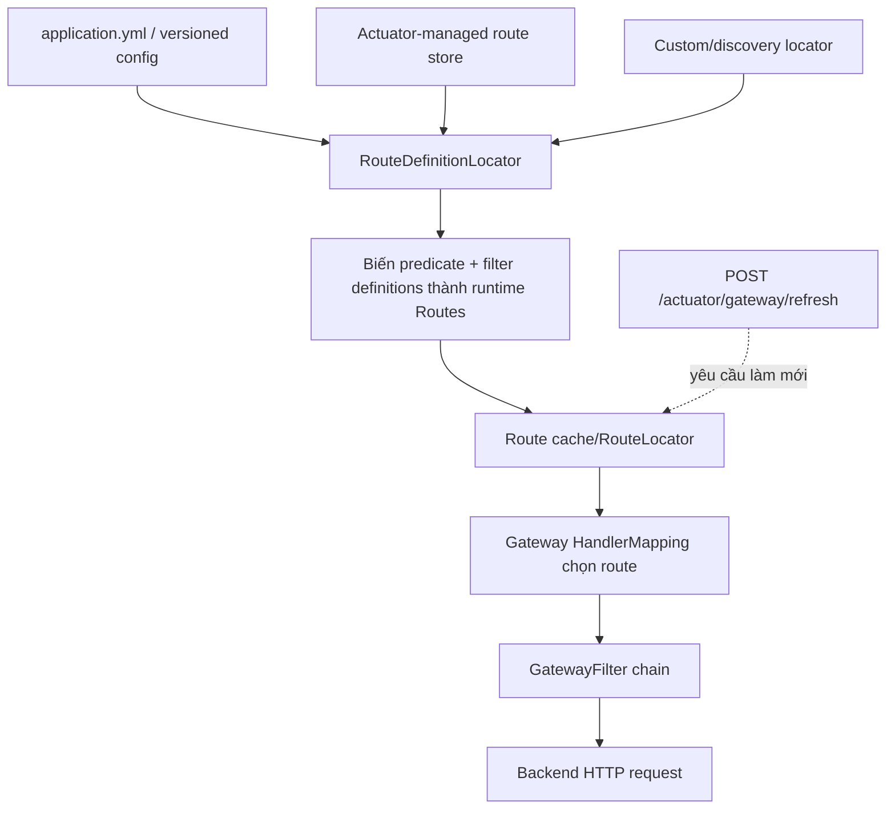
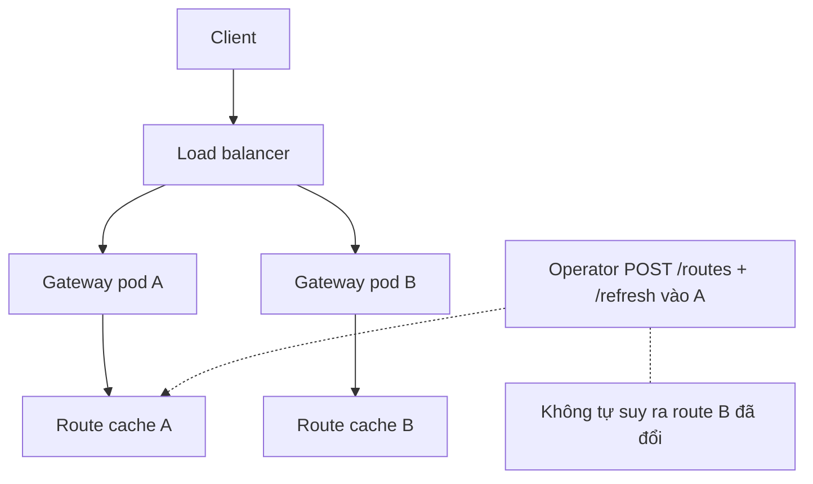

# Kiểm thử refresh tuyến, thứ tự tuyến và khôi phục cấu hình

## 1. Vì sao route đã được tạo vẫn có thể chưa xử lý đúng request?

Trong hệ thống microservices, **Spring Cloud Gateway** là cổng vào để chọn tuyến bằng route predicates, chạy filter chain, đổi path/header, khám phá dịch vụ, áp dụng xác thực, rate limiting, circuit breaker, retry và quan sát request. Một thay đổi route nhìn có vẻ đơn giản — ví dụ chuyển traffic từ catalog cũ sang catalog mới — có thể tạo lỗi trên cả ba phương diện:

1. **Refresh:** định nghĩa route đã được lưu nhưng **cache tuyến đang chạy** chưa được làm mới hoặc làm mới thất bại.
2. **Thứ tự:** hai route có `Path`/`Method` cùng match nhưng route được ưu tiên không phải route dự định.
3. **Khôi phục:** một bản thay đổi gây lỗi thì phải quay về route đã kiểm chứng, **không đánh mất nguồn cấu hình trước đó**.

Ví dụ hai tuyến cùng chấp nhận `GET /api/catalog/items/42`:

```text
Route catalog-baseline       order=100 → backend BLUE  :8081
Route catalog-candidate-v2   order=10  → backend GREEN :8082

Client GET /api/catalog/items/42
   → nếu cả hai route đang có hiệu lực: ưu tiên GREEN (order 10)
   → sau rollback xóa candidate và refresh: trở về BLUE
```

Nếu người vận hành chỉ nhìn HTTP 200 từ `POST /actuator/gateway/refresh` rồi tuyên bố deployment thành công, họ có thể bỏ qua lỗi bất đồng bộ, lỗi chọn sai route, backend không sẵn sàng hoặc các Gateway instances chưa đồng bộ.

### Mục tiêu của bài

Sau bài học thuộc chương **Kiểm thử**, bạn có thể:

- Phân biệt **route definition đã ghi**, **runtime route cache đã refresh** và **request thực sự được xử lý**.
- Thiết kế bài test chứng minh **order nhỏ hơn được ưu tiên** khi nhiều routes đồng thời match.
- Tạo một tuyến ứng viên bằng Actuator, refresh, kiểm tra kết quả, rồi **rollback** về tuyến baseline.
- Nhận biết **route order** khác **thứ tự filter chain**; không dựa vào thứ tự mảng JSON để kết luận mức ưu tiên.
- Kiểm tra lỗi **route ID trùng**, predicate/filter sai, endpoint quản trị không đủ quyền, backend unreachable và metadata refresh.
- Kết hợp `curl`, `WebTestClient`/JUnit, Actuator GET, backend echo và logs/metrics để kiểm thử tin cậy.
- Thiết kế quy trình khôi phục cấu hình versioned, nhất quán với môi trường nhiều Gateway instances.

> **Phạm vi kỹ thuật:** Spring Cloud Gateway **Server WebFlux 5.0.x**, namespace `spring.cloud.gateway.server.webflux`, Spring Boot 4.x và Spring Cloud BOM tương thích. Bài sử dụng Actuator management API trong **lab nội bộ**; không chạy thao tác chỉnh route trên Gateway production. Các ví dụ kết quả là **kỳ vọng để người học tự thực hiện**, không phải output đã chạy trong bước soạn bài.

## 2. Hiểu ba tầng trước khi viết test

### 2.1. RouteDefinition: nguồn của cấu hình

Một route definition thường gồm:

```yaml
id: catalog-baseline
uri: http://127.0.0.1:8081
predicates:
  - Path=/api/catalog/**
  - Method=GET
filters:
  - StripPrefix=2
order: 100
```

Các nguồn route có thể là:

- `application.yml` trong Git/IaC, được `PropertiesRouteDefinitionLocator` nạp khi ứng dụng khởi động.
- Route được tạo qua `POST /actuator/gateway/routes/{id}`, với store do Gateway Actuator quản lý.
- `RouteDefinitionLocator`/repository tùy biến hoặc nguồn discovery.
- `RouteLocator` viết bằng Java bean; không phải mọi route runtime đều có một definition có thể sửa qua Actuator.

**Không đồng nhất các nguồn này.** Một route tồn tại trong runtime không có nghĩa có thể xóa bằng Actuator hoặc sẽ tồn tại sau restart.

### 2.2. Route runtime và cache



Sơ đồ mô tả **quy trình khái niệm**. Trong Gateway WebFlux có `RouteDefinitionRouteLocator` và `CachingRouteLocator`; nguồn/từng hook có thể khác theo ứng dụng. Khi POST một definition mới, phải thực hiện **refresh route cache** để runtime nhìn thấy phiên bản đã cập nhật.

### 2.3. Ba loại bằng chứng kiểm thử

| Bằng chứng | Phép đo | Nó chứng minh điều gì? | Chưa chứng minh điều gì? |
|---|---|---|---|
| Definition đã lưu | `GET /actuator/gateway/routedefinitions` hoặc source of truth | Có cấu hình từ locator/store phù hợp | Route đã được runtime tạo và chọn |
| Runtime đã nạp | `GET /actuator/gateway/routes/{id}` hoặc `/routes` | Có route với `route_id`, predicate, filter, URI, `order` | Backend sẵn sàng; request thật chọn route này |
| Traffic đúng | `GET /api/catalog/items/42` + backend identity | Request thật được proxy đến backend dự định | Tất cả pods đã cập nhật; mọi failure path đều đúng |

**Bộ kiểm thử tốt phải có cả ba lớp**, đặc biệt sau một thay đổi có rủi ro. Tránh chỉ kiểm tra HTTP status 200 của API quản trị.

### 2.4. Refresh không phải reload mọi thứ

`POST /actuator/gateway/refresh` yêu cầu clear/refresh route cache và thường trả **200 không có body**. Nó **không**:

- Ghi lại `application.yml` vào Git hoặc thay file đang đóng gói trong JAR.
- Deploy class Java mới cho custom `GatewayFilterFactory`.
- Tự sửa upstream host/DNS, TLS trust hay lỗi chính sách trong một route.
- Tự đồng bộ thay đổi từ một Gateway pod sang mọi pod khác.
- Bảo đảm một request đang chạy sẽ dừng hoặc lập tức đổi sang route mới.

Tài liệu Gateway nêu rằng nếu refresh bất đồng bộ phát sinh lỗi, **tập route hiện có sẽ không được thay đổi** trong phạm vi cơ chế refresh được mô tả. Tuy nhiên, điều đó **không thay cho test rollback**: một definition **hợp lệ về cấu trúc nhưng sai về nghiệp vụ** vẫn có thể trở thành runtime route.

## 3. Route order khác filter order, và vì sao test phải có traffic thật

### 3.1. Quy tắc về thứ tự route

Khi nhiều routes đều có predicate match request, Gateway dùng **route order** để xác định route được xét trước: **giá trị nhỏ hơn được ưu tiên** (ví dụ `order: 10` trước `order: 100`).

```yaml
routes:
  - id: catalog-candidate-v2
    uri: http://127.0.0.1:8082
    predicates:
      - Path=/api/catalog/**
      - Method=GET
    order: 10

  - id: catalog-baseline
    uri: http://127.0.0.1:8081
    predicates:
      - Path=/api/catalog/**
      - Method=GET
    order: 100
```

**Đây chỉ là cấu hình minh họa hai route.** Trong lab chính, route baseline nằm trong YAML còn candidate được tạo qua Actuator; **không định nghĩa candidate lần thứ hai trong YAML**.

### 3.2. Phải match đồng thời tất cả predicates của một route

`Path=/api/catalog/**` và `Method=GET` trong cùng route được **AND**. Một candidate có `order: -100` nhưng `Method=POST` sẽ **không thắng** request GET chỉ vì order nhỏ hơn. Vì vậy test phải tách:

- **Cùng điều kiện match:** xác nhận route order quyết định.
- **Khác điều kiện:** xác nhận route không match không được xét là winner.
- **Route không tồn tại:** xác nhận fallback hoặc 404 như contract.

### 3.3. Filter order là chuyện khác

| Loại order | Chỉ tác động đến | Ví dụ |
|---|---|---|
| `RouteDefinition.order` | Thứ tự **chọn route** khi nhiều routes match | `order: 10` so với `order: 100` |
| `Ordered GatewayFilter`/`GlobalFilter` | Thứ tự **pre/post** của filters sau khi route đã chọn | Netty routing, rewrite headers, metrics |
| Thứ tự phần tử trong YAML `routes` | Không nên coi là policy precedence rõ ràng | Viết `order` minh bạch |
| Thứ tự đối tượng trong `GET /routes` | Không phải cơ sở duy nhất để xác nhận traffic priority | Dùng backend identity |

Nếu hai routes có **cùng order và cùng predicate**, **không nên kiểm thử dựa vào một winner cố định** chỉ vì một route đứng trước trong tệp hoặc JSON. Hãy chọn order khác nhau hoặc sửa predicates để chúng không chồng lấn.

### 3.4. Cách viết assertion đúng

```text
Given:
  baseline route order=100, upstream BLUE
  candidate route order=10, upstream GREEN
  Path và Method đều match GET /api/catalog/items/42
When:
  Gateway đã refresh thành công và client GET endpoint
Then:
  response backend="green", header variant="candidate"
  BLUE không nhận request thử này (đo bằng access counter nếu cần)
After rollback:
  response backend="blue", header variant="baseline"
```

Đây là kiểm thử **hành vi end-to-end**, mạnh hơn việc chỉ so sánh một cặp số `order`.

## 4. Chuẩn bị môi trường lab có thể kiểm chứng backend nào được chọn

### 4.1. Kiến trúc

```text
                        HTTP client / curl
                              |
                              v
                    Gateway Server WebFlux
                       :8080 (traffic)
                       :9090 (Actuator private)
                              |
             +----------------+----------------+
             |                                 |
   baseline, order=100                 candidate, order=10
             |                                 |
             v                                 v
       Backend BLUE :8081                 Backend GREEN :8082
             |                                 |
          JSON blue                        JSON green
```

Ta dùng **một ứng dụng echo backend chạy thành hai process** khác cổng/tên, giúp thấy chính xác route nào phục vụ request. Không nên dùng hai backend trả cùng một JSON vì như vậy không có bằng chứng phân biệt winner.

### 4.2. Backend Spring Boot Web MVC

Tạo ứng dụng độc lập `catalog-echo-backend` có dependency Spring Boot 4.x `spring-boot-starter-webmvc` và versions do Boot BOM quản lý. Class `CatalogEchoApplication.java`:

```java
package com.example.echo;

import java.util.Map;
import java.util.concurrent.atomic.AtomicInteger;
import org.springframework.beans.factory.annotation.Value;
import org.springframework.boot.SpringApplication;
import org.springframework.boot.autoconfigure.SpringBootApplication;
import org.springframework.http.ResponseEntity;
import org.springframework.web.bind.annotation.GetMapping;
import org.springframework.web.bind.annotation.PathVariable;
import org.springframework.web.bind.annotation.RequestHeader;
import org.springframework.web.bind.annotation.RestController;

@SpringBootApplication
@RestController
public class CatalogEchoApplication {

    private final AtomicInteger totalCalls = new AtomicInteger();

    @Value("${demo.backend-name}")
    private String backendName;

    public static void main(String[] args) {
        SpringApplication.run(CatalogEchoApplication.class, args);
    }

    @GetMapping("/items/{id}")
    public ResponseEntity<Map<String, Object>> item(
            @PathVariable long id,
            @RequestHeader(name = "X-Gateway-Variant",
                           defaultValue = "none")
            String routeVariant) {

        int callNo = totalCalls.incrementAndGet();
        return ResponseEntity.ok(Map.of(
            "backend", backendName,
            "id", id,
            "variant", routeVariant,
            "backendCall", callNo
        ));
    }

    @GetMapping("/stats")
    public Map<String, Object> stats() {
        return Map.of(
            "backend", backendName,
            "totalCalls", totalCalls.get()
        );
    }
}
```

**Giải thích:** Backend chỉ nhận `/items/{id}`, trả field `backend` và `variant`, đồng thời tăng counter mỗi lần handler item được gọi. `/stats` là endpoint dành cho **lab**, không nên công khai counters nội bộ hoặc thông tin hạ tầng trên production.

Chạy **hai process riêng** với hai bộ command-line properties; `application.yml` chung có thể không cần khai báo ngoài defaults:

```bash
# Terminal A: BLUE
java -jar target/catalog-echo-backend.jar \
  --server.port=8081 --demo.backend-name=blue

# Terminal B: GREEN
java -jar target/catalog-echo-backend.jar \
  --server.port=8082 --demo.backend-name=green
```

Kiểm tra trực tiếp:

```bash
curl --noproxy '*' -sS 'http://127.0.0.1:8081/items/42'
curl --noproxy '*' -sS 'http://127.0.0.1:8082/items/42'
```

Kỳ vọng `backend=blue` ở cổng 8081 và `backend=green` ở cổng 8082. **Phải khởi chạy cả hai backend trước** khi thử route order; nếu GREEN dừng thì lỗi 5xx ở candidate không phải bằng chứng Gateway chọn BLUE.

### 4.3. Gateway dependencies

Ứng dụng `gateway-testing-demo` chạy WebFlux, dùng Spring Boot/Cloud BOM tương thích. Dependencies cốt lõi:

```xml
<dependencies>
  <dependency>
    <groupId>org.springframework.cloud</groupId>
    <artifactId>spring-cloud-starter-gateway-server-webflux</artifactId>
  </dependency>
  <dependency>
    <groupId>org.springframework.boot</groupId>
    <artifactId>spring-boot-starter-actuator</artifactId>
  </dependency>
</dependencies>
```

**Không** đưa Spring Web MVC starter vào cùng Gateway WebFlux demo; Gateway Server Web MVC là một biến thể khác với runtime/filter APIs riêng.

### 4.4. Baseline route từ application.yml

File `application.yml` của **Gateway**, lúc đầu **chỉ có baseline**:

```yaml
server:
  port: 8080

spring:
  application:
    name: gateway-testing-demo
  cloud:
    gateway:
      server:
        webflux:
          routes:
            - id: catalog-baseline
              uri: http://127.0.0.1:8081
              predicates:
                - Path=/api/catalog/**
                - Method=GET
              filters:
                - StripPrefix=2
                - AddRequestHeader=X-Gateway-Variant,baseline
              order: 100

management:
  server:
    port: 9090
    address: 127.0.0.1
  endpoint:
    gateway:
      access: unrestricted
  endpoints:
    web:
      exposure:
        include: health,info,gateway
```

`StripPrefix=2` loại `api` và `catalog` để backend nhận `/items/42`. Route baseline mang ID ổn định `catalog-baseline`, nằm trong **source YAML có version** và được dùng làm điểm phục hồi.

**Cảnh báo:** `access: unrestricted` chỉ dành cho **lab cô lập trên localhost**. Trong production, ưu tiên `management.endpoint.gateway.access: read-only`, hạn chế management network, Spring Security/RBAC, mTLS hoặc VPN, audit thay đổi. Actuator có khả năng tạo tuyến đến các host nội bộ, nên để public là rủi ro SSRF và chiếm luồng traffic.

### 4.5. Hai cổng khác nhiệm vụ

| Cổng | Loại request | Ví dụ |
|---|---|---|
| `8080` | Traffic nghiệp vụ | `GET /api/catalog/items/42` |
| `9090` | Actuator quản trị riêng | `GET /actuator/gateway/routes` và `POST /actuator/gateway/refresh` |
| `8081` | Backend BLUE | `GET /items/42` |
| `8082` | Backend GREEN | `GET /items/42` |

Nếu backend/Gateway chạy trong **Docker/Kubernetes containers tách biệt**, `127.0.0.1` không trỏ sang container khác. Khi đó cần thay route `uri` bằng DNS/service address có thể truy cập **từ Gateway**, còn management interface phải được bảo vệ riêng.

## 5. Preflight: kiểm tra trạng thái trước khi thay đổi

### 5.1. Xác nhận baseline trả đúng BLUE

```bash
curl --noproxy '*' -i \
  'http://127.0.0.1:8080/api/catalog/items/42'
```

Body **kỳ vọng**:

```json
{
  "backend": "blue",
  "id": 42,
  "variant": "baseline",
  "backendCall": 1
}
```

`backendCall` là bộ đếm **không cố định**, phụ thuộc số request thử trước đó. Mục tiêu assertions là `backend=blue`, `variant=baseline` và status 200, **không** phải đếm chính xác số 1 trong mọi test.

### 5.2. Đọc danh sách routes đã chạy

```bash
curl --noproxy '*' -sS \
  'http://127.0.0.1:9090/actuator/gateway/routes'
```

Ở Gateway 5.0.x, biểu diễn verbose thường tương tự:

```json
[
  {
    "route_id": "catalog-baseline",
    "predicate": "(Paths: [/api/catalog/**], match trailing slash: true && Methods: [GET])",
    "filters": [
      "[[StripPrefix parts = 2], order = 1]",
      "[[AddRequestHeader X-Gateway-Variant = 'baseline'], order = 2]"
    ],
    "uri": "http://127.0.0.1:8081",
    "order": 100
  }
]
```

Đây là **ví dụ hình thức runtime**, không phải exact snapshot của các chuỗi predicate/filter cho mọi patch release. `route_id`, `predicate` string, `filters` descriptive strings **không phải JSON POST payload**. Cần xem các trường có ý nghĩa ổn định: ID, URI, route order và chức năng predicate/filter, rồi xác minh **traffic thật**.

### 5.3. Kiểm tra candidate ID chưa tồn tại

```bash
curl --noproxy '*' -i \
  'http://127.0.0.1:9090/actuator/gateway/routes/catalog-candidate-v2'
```

Trong lab sạch, `GET` theo ID ứng viên chưa tồn tại thường trả 404. **Không dùng ID `catalog-baseline` cho POST**, vì nó đã thuộc YAML. Một số cấu hình có route từ nhiều locators: preflight phải kiểm tra cả runtime và source-of-truth của deployment trước khi chọn ID.

### 5.4. Ghi baseline vào biên bản kiểm thử

Trước khi thay route, ghi nhận ít nhất:

```text
revision/config version:     baseline-git-commit-or-image-digest
gateway instance:            gateway-testing-demo :8080
expected route IDs:          catalog-baseline
expected order:              100
expected upstream:           blue :8081
expected path/method:        GET /api/catalog/**
expected response:           HTTP 200, backend=blue, variant=baseline
candidate route ID:          catalog-candidate-v2
rollback action:             DELETE candidate + POST refresh
```

Không lưu raw access tokens/cookies vào biên bản. Ở production cần thêm owner, change ticket, approver, rollout group và phiên bản route definition snapshot có thể phục hồi.

## 6. Tạo route ứng viên đúng format và kiểm thử refresh

### 6.1. POST nhận RouteDefinition, không nhận lại JSON của GET

Tài liệu Gateway 5.0.x mô tả `POST /actuator/gateway/routes/{id}` với body chứa các **shortcut DSL strings** trong `predicates` và `filters`. Trường `route_id` và chuỗi `predicate` mà `GET /routes/{id}` trả về là **runtime display**, không phải schema để gửi POST.

Tạo file **catalog-candidate-v2.json** ở workspace lab của người học (không thuộc các tệp của học liệu):

```json
{
  "predicates": [
    "Path=/api/catalog/**",
    "Method=GET"
  ],
  "filters": [
    "StripPrefix=2",
    "AddRequestHeader=X-Gateway-Variant,candidate"
  ],
  "uri": "http://127.0.0.1:8082",
  "order": 10,
  "metadata": {
    "group": "catalog-lab",
    "release": "v2"
  }
}
```

**Giải thích:**

- ID `catalog-candidate-v2` nằm trong **URL endpoint** create.
- Hai predicates **cùng match** với baseline cho GET `/api/catalog/**`.
- `order: 10` ưu tiên hơn baseline `order: 100`.
- URI trỏ backend **GREEN**, có field `backend=green` để test.
- `StripPrefix=2` tạo `/items/42` ở backend, giống baseline.
- Header `X-Gateway-Variant` giúp backend echo tên route.
- Metadata `group` là nhãn để minh họa refresh chọn lọc/quan sát; không tự cung cấp security hoặc canary.

Gửi request tạo route:

```bash
curl --noproxy '*' -i -X POST \
  'http://127.0.0.1:9090/actuator/gateway/routes/catalog-candidate-v2' \
  -H 'Content-Type: application/json' \
  --data-binary @catalog-candidate-v2.json
```

Theo tài liệu Gateway Actuator, tạo thành công trả **`201 Created`**. **Chưa kết luận traffic đã đổi** từ status này: cần bước refresh và kiểm chứng thực tế.

### 6.2. POST refresh cache

```bash
curl --noproxy '*' -i -X POST \
  'http://127.0.0.1:9090/actuator/gateway/refresh'
```

Response thành công được tài liệu mô tả là **`200 OK` và thường không có response body**. Refresh route cache có phần xử lý bất đồng bộ; nếu quá trình xây routes gặp lỗi, tài liệu nêu cache hiện hữu không bị thay đổi. Do đó một test tốt cần **đọc lại runtime và gửi traffic**, không chỉ assert status 200.

### 6.3. Kiểm tra route runtime sau refresh

```bash
curl --noproxy '*' -sS \
  'http://127.0.0.1:9090/actuator/gateway/routes/catalog-candidate-v2'
```

Output **minh họa** theo schema đọc runtime:

```json
{
  "route_id": "catalog-candidate-v2",
  "predicate": "(Paths: [/api/catalog/**], match trailing slash: true && Methods: [GET])",
  "filters": [
    "[[StripPrefix parts = 2], order = 1]",
    "[[AddRequestHeader X-Gateway-Variant = 'candidate'], order = 2]"
  ],
  "uri": "http://127.0.0.1:8082",
  "order": 10
}
```

**Không so sánh byte-for-byte** payload POST với JSON GET. Hai API có **hợp đồng khác nhau**. Với `GET`, route ID là `route_id`, `predicate` là một chuỗi mô tả và `filters` có các chuỗi hiển thị runtime; ở POST, `predicates`/`filters` chứa shortcut DSL strings.

Khi xác minh, cần kiểm tra **ngữ nghĩa**: route ID, URI, route order, Path/Method, các filters và metadata nếu route API có trả. Các chuỗi `toString()` và thứ tự filter mô tả có thể khác theo version.

### 6.4. Kiểm thử hành vi: candidate GREEN thắng baseline BLUE

```bash
curl --noproxy '*' -i \
  'http://127.0.0.1:8080/api/catalog/items/42'
```

Body **dự kiến**:

```json
{
  "backend": "green",
  "id": 42,
  "variant": "candidate",
  "backendCall": 1
}
```

`backendCall` có thể khác 1 tùy các request đã gửi. Hai assertions quan trọng:

```text
response.status == 200
response.json.backend == "green"
response.json.variant == "candidate"
```

Nếu nhìn thấy `backend=blue`, có thể route ứng viên **chưa refresh**, route không match, đã tạo ở **một Gateway instance khác**, hoặc có một route ưu tiên cao hơn. Nếu thấy 5xx, kiểm tra GREEN `:8082` có đang chạy và reachable từ Gateway không. **Không suy rằng order sai chỉ vì backend chưa khởi động**.

### 6.5. Xác minh số backend attempts bằng counters

Trước khi gọi qua Gateway, lưu counters:

```bash
curl --noproxy '*' -sS 'http://127.0.0.1:8081/stats'
curl --noproxy '*' -sS 'http://127.0.0.1:8082/stats'
```

Gọi **một** request qua Gateway, rồi đọc lại `/stats`. Trong môi trường lab không có traffic nền, mong đợi:

| Backend | Trước request | Sau request | Chênh lệch |
|---|---:|---:|---:|
| BLUE | B | B | 0 |
| GREEN | G | G+1 | +1 |

Không assert giá trị tuyệt đối khi counters đã chạy từ trước. Nếu có retry/circuit breaker hoặc người khác đang gọi backend, chênh lệch có thể khác; **cô lập test** hoặc gắn một test-request ID hợp lệ để đếm chính xác.

### 6.6. Không bỏ qua health của management API

Ngay cả khi `GET /routes/catalog-candidate-v2` trả route mới, traffic có thể vẫn thất bại vì:

- Backend GREEN không chạy, DNS/TLS/certificate sai.
- Filters `StripPrefix`/`RewritePath` tạo đường dẫn không tồn tại.
- CORS/Spring Security/RateLimiter chặn trước backend.
- Route khác `order` thấp hơn tiếp tục match.
- Client gửi `POST` trong khi candidate yêu cầu `Method=GET`.

**Bộ kiểm thử đủ ba tầng** là: definition tồn tại → runtime route đúng → backend **thực sự** nhận request dự kiến.

## 7. Kiểm thử route order bằng hai kịch bản có kiểm soát

### 7.1. Kịch bản O1: candidate order=10, baseline order=100

Hai route match cùng GET path. Sau refresh:

```text
Given  both routes exist and match
And    candidate.order=10
And    baseline.order=100
When   GET /api/catalog/items/42
Then   selected backend=green
And    variant=candidate
```

Nếu không đạt, kiểm tra cả predicates, runtime order, route IDs và backend connectivity. **Đừng chỉ đọc vị trí của các phần tử mảng `/routes` rồi kết luận thứ tự thực thi**.

### 7.2. Kịch bản O2: candidate order=200, baseline order=100

Để đổi thứ tự một route **do Actuator quản lý** trong lab, không POST đè lên cùng ID. Tài liệu Gateway 5.0.x cảnh báo POST trùng ID có thể sinh **duplicate route definitions** và khiến lần GET route list sau đó báo **500**.

Hãy thực hiện **DELETE rồi CREATE mới**, chỉ với candidate:

```bash
# 1. Xóa route Actuator-managed.
curl --noproxy '*' -i -X DELETE \
  'http://127.0.0.1:9090/actuator/gateway/routes/catalog-candidate-v2'

# 2. POST một definition candidate MỚI với order = 200
#    (các trường khác giữ nguyên, chỉ order thay 10 thành 200).
curl --noproxy '*' -i -X POST \
  'http://127.0.0.1:9090/actuator/gateway/routes/catalog-candidate-v2' \
  -H 'Content-Type: application/json' \
  --data-binary @catalog-candidate-order200.json

# 3. Refresh.
curl --noproxy '*' -i -X POST \
  'http://127.0.0.1:9090/actuator/gateway/refresh'
```

Nội dung file **catalog-candidate-order200.json** giống mục 6.1 ngoại trừ:

```json
{
  "predicates": ["Path=/api/catalog/**", "Method=GET"],
  "filters": [
    "StripPrefix=2",
    "AddRequestHeader=X-Gateway-Variant,candidate"
  ],
  "uri": "http://127.0.0.1:8082",
  "order": 200,
  "metadata": {"group": "catalog-lab", "release": "v2"}
}
```

Đọc runtime `/routes/catalog-candidate-v2` để thấy `order=200` rồi thử:

```bash
curl --noproxy '*' -sS \
  'http://127.0.0.1:8080/api/catalog/items/42'
```

Kỳ vọng **`backend=blue`, `variant=baseline`**, vì baseline `order=100` được ưu tiên hơn candidate `order=200`. **Việc candidate vẫn có mặt ở GET /routes không có nghĩa request sẽ đi qua candidate**.

### 7.3. Kịch bản O3: predicates không match thì order không có tác dụng

Thay candidate trong một lab riêng để nó chỉ match `Method=POST`, nhưng baseline chỉ match GET. Khi GET, candidate dù `order=-100` vẫn **không được chọn**. Đây là cách tách rõ hai điều kiện:

1. Predicate **match** (bắt buộc).
2. Route `order` quyết định winner giữa những route **đã match**.

Với kịch bản O3, đừng thay route đang dùng bởi người khác; đặt path riêng `/lab/order/**` hoặc chạy Gateway instance thử nghiệm. Khi request POST không có handler ở backend, kết quả backend có thể là 405; điều quan trọng là test **route selection** chứ không tự gán nghĩa HTTP 200.

### 7.4. Kịch bản O4: cùng order thì sao?

Nếu hai routes có `order=100` và predicates trùng nhau, **không dùng tie-break tự suy từ thứ tự YAML, tên ID hay thứ tự GET list** làm business contract. Trong tương lai, cách sắp xếp locators hoặc route definitions có thể đổi theo cấu hình/runtime.

Nên:

- Gán `order` khác nhau cho route chồng lấn; hoặc
- Tách predicates bằng `Host`/`Header`/`Method`/`Path` rõ ràng.

Đối với canary rollout theo phần trăm, nên dùng cơ chế **Weight Route Predicate** và test thống kê/phân phối riêng, **không** áp dụng cùng order rồi kỳ vọng “ngẫu nhiên” theo một tỷ lệ.

### 7.5. Kiểm thử route order không phải kiểm thử filter order

Ví dụ trong runtime GET có:

```text
route_id: catalog-candidate-v2
order: 10
filters:
  - [[StripPrefix parts = 2], order = 1]
  - [[AddRequestHeader ...], order = 2]
```

`order: 10` là priority chọn **route**. Các số `order = 1/2` bên trong `filters` chỉ thứ tự thực thi **GatewayFilters trong route đã chọn**. Chúng không nói GREEN hay BLUE sẽ thắng.

## 8. Khôi phục cấu hình sau khi thử candidate

### 8.1. Rollback nhỏ nhất: xóa candidate, giữ nguyên baseline

Trong lab, baseline `catalog-baseline` được khai báo ở `application.yml`. Candidate `catalog-candidate-v2` được tạo **qua Actuator**. Khi muốn quay về baseline, **không xóa baseline** mà xóa đúng candidate:

```bash
curl --noproxy '*' -i -X DELETE \
  'http://127.0.0.1:9090/actuator/gateway/routes/catalog-candidate-v2'

curl --noproxy '*' -i -X POST \
  'http://127.0.0.1:9090/actuator/gateway/refresh'
```

Theo tài liệu Gateway 5.0.x, DELETE route do Actuator quản lý thành công trả **200**; refresh thành công trả **200 không có body**. Các status này là **bằng chứng thao tác**, chưa phải bằng chứng runtime đã khôi phục.

### 8.2. Assertions sau rollback

**Bước A — Đọc runtime:**

```bash
# Baseline vẫn phải tồn tại.
curl --noproxy '*' -i \
  'http://127.0.0.1:9090/actuator/gateway/routes/catalog-baseline'

# Candidate phải biến mất khỏi runtime.
curl --noproxy '*' -i \
  'http://127.0.0.1:9090/actuator/gateway/routes/catalog-candidate-v2'
```

**Bước B — Gửi request nghiệp vụ:**

```bash
curl --noproxy '*' -i \
  'http://127.0.0.1:8080/api/catalog/items/42'
```

**Kết quả kỳ vọng:** HTTP 200, `backend=blue` và `variant=baseline`. Nếu candidate không còn trong list nhưng request vẫn tới GREEN, kiểm tra **Gateway pod/port thực tế**, caches khác, các route chồng lấn hoặc load balancer/ingress chưa trỏ đúng instance.

**Bước C — Kiểm tra negative path:**

```bash
curl --noproxy '*' -i \
  'http://127.0.0.1:8080/api/unknown/items/42'
```

Không được vô tình có một route `Path=/**` quá rộng còn tồn tại sau rollback. Nếu không có route khác match, thường Gateway trả 404.

### 8.3. Vì sao rollback bằng xóa candidate tốt hơn “POST lại baseline”?

Trong cấu hình lab:

- Baseline đã được quản lý bằng **YAML/Git**.
- Actuator không quản lý việc xóa/sửa baseline như một route dynamic.
- POST thêm route khác cũng tên `catalog-baseline` có thể tạo **trùng ID**, gây lỗi và làm khó phân biệt nguồn.
- Khi candidate bị xóa, route baseline còn nguyên và được chọn lại.

Hãy phục hồi bằng **nguồn sở hữu**: route từ Git/IaC thì khôi phục phiên bản Git/IaC; route từ Actuator store thì xóa/tạo lại qua store đó (với version/checkpoint), rồi refresh và xác minh. Đừng gom mọi route vào một lệnh POST “reset toàn cục” không xét provenance.

### 8.4. Nếu đã thay đổi chính baseline trong Git

Khi thay đổi route **khai báo trong YAML**, rollback phải:

1. Xác định **commit hoặc image/config release** chứa baseline đã kiểm chứng.
2. Revert/redeploy hoặc reload qua cơ chế config quản lý được ứng dụng hỗ trợ.
3. **Không giả định** `POST /refresh` sẽ đọc lại một file YAML trong JAR nếu chưa có cơ chế cập nhật properties/route definitions tương ứng.
4. Đọc lại `GET /routes` và test request trên từng Gateway instance.
5. Kiểm tra những route khác không bị đổi ngoài phạm vi.

`POST /refresh` **không thay thế deployment** khi config mới chưa được ứng dụng nạp; và nó không tự khôi phục Java code/custom filters bị deploy sai.

### 8.5. Bảng trạng thái mong đợi qua cả vòng đời

| Giai đoạn | Baseline (order=100) | Candidate | Traffic `GET /api/catalog/items/42` |
|---|---|---|---|
| S0: khởi động sạch | Có | Không | BLUE |
| S1: POST candidate=10, **trước refresh** | Có | Đã ghi definition | Không khẳng định, cần test thực tế |
| S2: refresh + xác minh | Có | Có, order=10 | GREEN |
| S3: DELETE + POST candidate=200 + refresh | Có | Có, order=200 | BLUE |
| S4: DELETE candidate + refresh | Có | Không | BLUE |
| S5: restart Gateway dùng lại YAML baseline | Có | Tùy loại route store | BLUE nếu không còn candidate hợp lệ |

**Chú ý S5:** route Actuator-managed có thể lưu trong **in-memory store** và mất khi restart, hoặc trong persistent repository tùy deployment. Không lấy một kết quả restart lab làm quy tắc cho mọi môi trường.

## 9. Kiểm thử lỗi refresh: cú pháp sai và hành vi sai khác nhau

### 9.1. Lỗi A: definition không thể biên dịch thành runtime route

Ví dụ một route tham chiếu filter factory không tồn tại:

```json
{
  "predicates": ["Path=/lab/invalid/**"],
  "filters": ["NonexistentFilterXYZ=1"],
  "uri": "http://127.0.0.1:8082",
  "order": -100
}
```

Đây là **payload cố tình sai** để minh họa lỗi. Khi engine biên dịch definition sang `GatewayFilter`, factory có thể không tìm thấy và refresh tạo lỗi. Tài liệu Actuator cho biết nếu xảy ra **lỗi bất đồng bộ trong refresh**, các route hiện tại sẽ không được thay đổi.

**Không thử bằng cách chèn payload hỏng vào Gateway đang phục vụ traffic thật.** Route hỏng có thể còn được lưu trong repository và tiếp tục khiến các lần refresh sau thất bại. Trong lab riêng:

1. Ghi **snapshot** danh sách baseline routes trước khi thử.
2. Chỉ POST một candidate ID mới có path `/lab/invalid/**`.
3. Thử refresh rồi đọc logs/Actuator.
4. Kiểm tra route baseline trước đó **vẫn tồn tại và xử lý đúng**.
5. **DELETE definition sai** khỏi Actuator-managed repository.
6. Refresh lại, kiểm tra route list và traffic đã trở về trạng thái sạch.

Không cố assert một HTTP status cố định cho *mọi* lỗi compile route. Lỗi có thể xảy ra lúc POST, lúc refresh hoặc khi route được lấy, phụ thuộc implementation/version. Assertion quan trọng là **không mất tuyến baseline**, cleanup hoàn tất và logs phản ánh nguyên nhân.

### 9.2. Lỗi B: route hợp lệ nhưng upstream không sẵn sàng

Ví dụ payload **hợp lệ về format** nhưng URI sai:

```json
{
  "predicates": ["Path=/lab/offline/**", "Method=GET"],
  "filters": ["StripPrefix=2"],
  "uri": "http://127.0.0.1:59999",
  "order": 1
}
```

Nếu không có backend ở `59999`, Gateway vẫn có thể **tạo runtime route hợp lệ**. `GET /routes/{id}` sẽ cho thấy route; chỉ khi gửi HTTP request vào path tương ứng mới phát hiện **connection refused / timeout / 5xx**.

Điều này chứng minh một nguyên tắc:

> **Refresh thành công chỉ xác nhận route được nạp hợp lệ; không xác nhận backend khỏe hoặc ngữ nghĩa nghiệp vụ đúng.**

Để bảo toàn baseline khi test âm tính, hãy dùng **path riêng** `/lab/offline/**`, không chồng lấn `/api/catalog/**`, sau đó DELETE và refresh. Không tạo một route `Path=/**` order=-100 để test backend offline: nó có thể chặn toàn bộ traffic thật.

### 9.3. Lỗi C: filter đúng cú pháp nhưng sai business contract

Một candidate vẫn có thể trả 200 từ đúng backend mà xử lý sai path hoặc headers:

- `StripPrefix=1` khiến backend nhận `/catalog/items/42` thay vì `/items/42`.
- `SetRequestHeader` sai có thể làm mất tenant/authorization context.
- `Retry` trên POST có thể nhân đôi một thao tác ghi.
- `RequestRateLimiter` cấu hình nhầm key resolver có thể chặn nhầm nhóm người dùng.
- `CircuitBreaker` fallback 200 có thể che backend outage nếu client không phân biệt response.

Vì vậy test sau refresh phải kiểm tra **path, method, headers, status, response body, selected backend và side-effect count**, không chỉ sự tồn tại của route.

### 9.4. Lỗi D: POST route ID đã có

Tài liệu Gateway 5.0.x cảnh báo: **không POST vào ID route đang tồn tại** nếu chưa xóa. Việc tạo trùng có thể làm `GET /actuator/gateway/routes` trả 500. Trước mọi change, luôn:

1. Kiểm tra ID chưa tồn tại trong **runtime** và mọi source/repository có liên quan.
2. Nếu chỉ cập nhật route Actuator-managed, lưu bản cũ rồi **DELETE → POST → refresh**.
3. Nếu route YAML/Java, sửa source gốc và deploy/reload đúng quy trình thay vì POST “đè”.
4. Nếu có nhiều writers, dùng cơ chế lock/version/check-and-set ở layer quản lý routes; **GET rồi POST không tự giải quyết race**.

### 9.5. Lỗi E: cùng ID được phát bởi hai locators

Một route `catalog-baseline` có thể đồng thời được một Properties locator và custom repository phát ra nếu thiết kế không kiểm tra trùng. Hậu quả có thể là hai runtime routes không nhất quán và diagnostic khó. Trong kiểm thử, **assert mỗi ID có đúng một owner/source**, không chỉ assert “GET theo ID thành công”.

### 9.6. Quản lý mã lỗi của endpoint khi đang thử hỏng

| API | Thành công theo docs | Khi lỗi phải kiểm tra thêm |
|---|---|---|
| `POST /routes/{id}` | **201 Created** | Syntax/binding/factory/ID, exception handler |
| `POST /refresh` | **200 OK**, không body | Lỗi bất đồng bộ, runtime cache và traffic |
| `GET /routes/{id}` | JSON runtime route | Trường ID/URI/order/filter, không dùng làm POST body |
| `DELETE /routes/{id}` | **200 OK** nếu actuator-managed | 404 route YAML/Java, wrong instance/store |
| `GET /routedefinitions` | Danh sách definitions | Nguồn locator có thể khác runtime route |

Không bịa rằng mọi case malformed JSON đều trả cùng `400` hoặc mọi refresh error là HTTP 500. Cần quan sát response thực, logs và behavior trên phiên bản đang dùng.

## 10. Làm mới chọn lọc theo metadata: kiểm thử phạm vi tác động

### 10.1. Khác nhau giữa refresh toàn cục và refresh có metadata

Gateway WebFlux Actuator 5.0.x hỗ trợ:

```http
POST /actuator/gateway/refresh
```

và lọc theo một cặp key/value trong metadata:

```http
POST /actuator/gateway/refresh?metadata=group:catalog-lab
```

Trong lab, candidate có metadata:

```json
{
  "metadata": {
    "group": "catalog-lab",
    "release": "v2"
  }
}
```

Do đó có thể thử:

```bash
curl --noproxy '*' -i -X POST \
  'http://127.0.0.1:9090/actuator/gateway/refresh?metadata=group:catalog-lab'
```

**Quan trọng:** một refresh có bộ lọc metadata **không phải** lệnh làm mới mọi route. Các route không có `group=catalog-lab` không nằm trong phạm vi được chọn theo metadata. Nếu bài test yêu cầu một **snapshot đồng nhất của toàn bộ routes**, dùng refresh toàn cục và xác minh tất cả route IDs.

### 10.2. Kịch bản test có metadata

| Route | Metadata | Khi refresh `group:catalog-lab` |
|---|---|---|
| `catalog-candidate-v2` | `group=catalog-lab` | Thuộc phạm vi refresh |
| `catalog-baseline` | Không có `group` trong YAML lab | Không được chọn theo metadata này |
| `billing-demo` (ví dụ khác) | `group=billing` | Không được chọn |

**Đừng thử thao tác ở runtime đa tenant khi không xác định rõ metadata ownership.** Nếu một route được gán nhầm group, refresh có thể không tác động như người vận hành tưởng. Tài liệu Gateway mô tả điều kiện match metadata và lưu ý lỗi bất đồng bộ; test thực tế cần xác minh runtime + traffic sau yêu cầu refresh.

### 10.3. Khi nào nên dùng selective refresh?

Nó có thể hữu ích nếu một Gateway có nhiều nhóm route và team muốn giảm phạm vi cập nhật. Nhưng:

- Không thay thế kiểm soát version của definition repository.
- Không tự làm thay đổi atomic trên nhiều instances.
- Không tạo lock giữa hai writers.
- Không bảo đảm route khác không bị ảnh hưởng bởi external dependencies/GlobalFilters được đổi cùng lúc.
- Không tự xác thực các nhãn metadata là đáng tin.

Trong lab đầu tiên, **refresh toàn cục** đơn giản, dễ kiểm chứng và ít giả định hơn.

## 11. Kiểm thử nhiều Gateway instances: một pod đúng không có nghĩa toàn cụm đúng

### 11.1. In-memory store và cache là vấn đề về tính nhất quán



Nếu route definitions nằm trong **in-memory repository của A**, POST và refresh trên A không tự chia sẻ definition/caches cho B. Sau đó:

```text
Request #1 → Gateway A → GREEN
Request #2 → Gateway B → BLUE
Request #3 → Gateway A → GREEN
```

Client thấy lựa chọn backend “ngẫu nhiên”, nhưng nguyên nhân là **route state giữa các pods không đồng nhất**, không phải route order bất ổn.

### 11.2. Chứng minh trạng thái từng instance

Trong staging, nên dùng **management endpoint riêng** cho từng pod (ví dụ port-forward theo pod hoặc cổng quản trị private), rồi kiểm tra:

1. `GET /actuator/gateway/routes` trên **A** và **B**.
2. Đối chiếu `route_id`, `uri`, `order`, predicates/filter intent, route metadata.
3. Gửi traffic trực tiếp đến từng pod qua đường kiểm thử được phép, không chỉ qua load balancer.
4. Kiểm tra backend identity `blue/green` và upstream counters.
5. Sau khi tất cả pods đạt, thử qua load balancer với nhiều request.

**Không đổi trực tiếp route ở pod production không có approval**. Khi environment nhiều pods, một thao tác qua service load-balanced `management` có thể chạm vào pod khác ở mỗi lần gọi (POST tới A, refresh tới B) — một failure mode rất nguy hiểm.

### 11.3. Dùng nguồn route được chia sẻ khi cần dynamic config

Muốn rollout route động trên toàn cụm, cần:

- **Shared/persistent RouteDefinition source** hoặc hệ thống phân phối cấu hình có owner rõ.
- Cơ chế **thông báo/làm mới** đến từng Gateway instance.
- **Config revision/version** để biết A/B đã nhận phiên bản nào.
- Validation trước khi activate; có thể dùng canary instances và phased rollout.
- Phương án rollback/reload toàn bộ và kiểm tra route count/behavior.

Ngay cả khi mọi pod đọc **cùng một repository**, refresh không bảo đảm các pods chuyển phiên bản **đồng thời từng mili giây**. Trong cửa sổ rollout, request đang xử lý có thể dùng route snapshot khác với request mới. Thiết kế cho trạng thái chuyển tiếp và idempotency.

### 11.4. Không gửi traffic qua LB để “đo order” khi pods không đồng nhất

Nếu load balancer phân phối đều tới A và B, một phép test lặp `curl` có thể trả BLUE hoặc GREEN không ổn định dù **order ở từng pod** hoàn toàn xác định. Khi kiểm thử route priority, trước tiên phải **pin vào một Gateway instance đã kiểm chứng**. Chỉ sau đó mới kiểm thử khả năng hội tụ của cả cụm.

## 12. Kiểm thử bất đồng bộ: tránh sleep tùy ý và stale observations

### 12.1. Status 200 của refresh không phải barrier end-to-end

`POST /refresh` trả 200 theo API contract, nhưng thay đổi route còn phụ thuộc:

- Đọc route definitions từ locator/repository.
- Biên dịch predicates và filters.
- Làm mới cache route trên instance thực tế.
- Middleware/proxies và requests mới đi vào Gateway.
- Kết nối upstream, DNS, TLS và backend health.

Vì vậy code test kiểu:

```java
// PHẢN VÍ DỤ: chờ thời gian cố định rồi hy vọng route đã đúng.
postRefresh();
Thread.sleep(200);
assertBackendIsGreen();
```

có thể pass trên laptop và fail trên CI, hoặc pass giả khi test đọc nhầm pod. **Thay sleep cố định bằng polling có thời hạn, predicate cụ thể và error reporting.**

### 12.2. Hai bước hội tụ

Giả sử candidate đã POST hợp lệ:

1. **Chờ runtime state:** `GET /actuator/gateway/routes/catalog-candidate-v2` trả route có URI 8082, order 10.
2. **Chờ traffic behavior:** một request GET lab trả `backend=green` và `variant=candidate`.

Không coi bước 1 thay thế bước 2. Tương tự, sau rollback, chờ runtime candidate **biến mất**, rồi xác minh request thực chọn BLUE.

### 12.3. Polling bounded trong shell lab

Nếu có `jq`, người học có thể kiểm tra điều kiện runtime:

```bash
# Tối đa 20 lần, mỗi lần cách 0.25 giây; chỉ trong lab.
matched=0
for i in $(seq 1 20); do
  if curl --noproxy '*' -fsS \
      'http://127.0.0.1:9090/actuator/gateway/routes/catalog-candidate-v2' \
      | jq -e '.route_id == "catalog-candidate-v2"
               and .uri == "http://127.0.0.1:8082"
               and .order == 10' > /dev/null; then
    matched=1
    break
  fi
  sleep 0.25
done

if [ "$matched" -ne 1 ]; then
  echo "FAILED: candidate route did not converge" >&2
  exit 1
fi
```

Đây là **lệnh dành cho môi trường thực hành Unix có cài `curl` và `jq`**, không phải script đã được chạy trong bước tạo bài. Lệnh dùng một khoảng chờ **có giới hạn**, có điều kiện thành công cụ thể. Thời hạn thực tế phải dựa trên SLA/CI; không kéo dài vô hạn hoặc che lỗi refresh.

**Quan trọng:** polling đúng management instance. Nếu request traffic đi qua LB tới một pod khác, điều kiện runtime trên A chưa chứng minh traffic trên B đúng.

### 12.4. Kiểm tra backend identity sau polling

```bash
curl --noproxy '*' -fsS \
  'http://127.0.0.1:8080/api/catalog/items/42' \
  | jq -e '.backend == "green"
           and .variant == "candidate"' \
  > /dev/null
```

Nếu thất bại, test cần in một message đủ thông tin để điều tra, nhưng không log raw credentials/PII. Đừng cứ retry mãi một request **không idempotent**: bài lab dùng GET chỉ đọc; nếu workflow thực gồm POST thanh toán, phải áp dụng idempotency keys và chỉ retry điều kiện an toàn.

### 12.5. Một test phải dọn tài nguyên kể cả khi assertion lỗi

Sau khi test tạo dynamic route, hãy dùng `try/finally` (JUnit) hoặc trap cleanup (shell) để DELETE candidate + refresh, nếu môi trường lab không giữ state cho test tiếp. Nếu cleanup thất bại, **không đánh dấu kết quả xanh**; báo rõ trạng thái môi trường “dirty”, route IDs còn tồn tại và yêu cầu reset trước suite kế tiếp.

## 13. Tự động hóa bằng JUnit 5 + WebTestClient + Awaitility

### 13.1. Chọn loại test đúng tầng

| Kiểu test | Cách thực hiện | Thế mạnh | Giới hạn |
|---|---|---|---|
| Unit test route predicate | Kiểm tra một predicate được xây từ config giả lập | Nhanh, rõ nhánh match/non-match | Không chứng minh route cache/Actuator |
| Unit test custom `GatewayFilter` | `StepVerifier` với mock exchange/chain | Kiểm tra signal/error/cancel/filter behavior | Không chứng minh Netty routing tới backend |
| WebFlux HTTP test | `WebTestClient.bindToApplicationContext` | Kiểm tra web handler với Spring context | Có thể chưa chứng minh external HttpClient/network |
| Full integration test | `WebTestClient.bindToServer` + Gateway/echo servers đang chạy | Chứng minh actual POST/refresh/HTTP traffic | Tốn tài nguyên, cần cô lập trạng thái |
| Contract/security test | Kiểm tra source of truth, route ownership, allowed URIs | Bắt config drift/SSRF | Không thay E2E runtime tests |

**Chủ đề bài này cần ít nhất một integration test thực** vì route refresh, order và rollback đều phụ thuộc route repository/cache, Gateway handler mapping và HTTP routing tới backend.

### 13.2. Test dependencies

Trong một project kiểm thử tích hợp riêng hoặc module test của Gateway, dùng dependencies có version do BOM quản lý:

```xml
<dependencies>
  <dependency>
    <groupId>org.springframework.boot</groupId>
    <artifactId>spring-boot-starter-webflux-test</artifactId>
    <scope>test</scope>
  </dependency>
  <dependency>
    <groupId>org.awaitility</groupId>
    <artifactId>awaitility</artifactId>
    <scope>test</scope>
  </dependency>
</dependencies>
```

Đoạn này là **phần bổ sung** cho dependencies của ứng dụng đang có Gateway Server, không thay starter Gateway/Actuator ở mục 4. Chọn test starter đúng Spring Boot BOM; với Boot 3.x, starter testing phổ biến có tên khác. JUnit Jupiter cũng phải có trong test classpath (Spring Boot test starter phù hợp thường cung cấp).

### 13.3. Một test tuần tự, có rollback trong finally

Đây là ví dụ **black-box integration test** khi các process lab `8080/9090/8081/8082` đã chạy. Class có thể đặt trong test source set của một project test/client; test **không khởi tạo server tự động**:

```java
package com.example.gatewaytests;

import java.time.Duration;
import org.junit.jupiter.api.Test;
import org.springframework.http.MediaType;
import org.springframework.test.web.reactive.server.WebTestClient;

import static org.awaitility.Awaitility.await;

class GatewayRouteRefreshIntegrationTest {

    private static final String ROUTE =
        "/actuator/gateway/routes/catalog-candidate-v2";

    private static final String CANDIDATE_JSON = """
        {
          "predicates": ["Path=/api/catalog/**", "Method=GET"],
          "filters": [
            "StripPrefix=2",
            "AddRequestHeader=X-Gateway-Variant,candidate"
          ],
          "uri": "http://127.0.0.1:8082",
          "order": 10
        }
        """;

    private final WebTestClient admin = WebTestClient.bindToServer()
        .baseUrl("http://127.0.0.1:9090")
        .build();

    private final WebTestClient traffic = WebTestClient.bindToServer()
        .baseUrl("http://127.0.0.1:8080")
        .build();

    @Test
    void candidateWinsThenRollbackRestoresBlue() {
        // Precondition: no candidate route; baseline is active.
        admin.get().uri(ROUTE).exchange()
            .expectStatus().isNotFound();
        assertBackend("blue", "baseline");

        boolean created = false;
        try {
            admin.post().uri(ROUTE)
                .contentType(MediaType.APPLICATION_JSON)
                .bodyValue(CANDIDATE_JSON)
                .exchange().expectStatus().isCreated();
            created = true;

            admin.post().uri("/actuator/gateway/refresh")
                .exchange().expectStatus().isOk();

            await()
                .atMost(Duration.ofSeconds(10))
                .pollInterval(Duration.ofMillis(200))
                .untilAsserted(() -> {
                    admin.get().uri(ROUTE).exchange()
                        .expectStatus().isOk()
                        .expectBody()
                        .jsonPath("$.route_id")
                        .isEqualTo("catalog-candidate-v2")
                        .jsonPath("$.order")
                        .isEqualTo(10);

                    assertBackend("green", "candidate");
                });
        } finally {
            if (created) {
                admin.delete().uri(ROUTE).exchange()
                    .expectStatus().isOk();

                admin.post().uri("/actuator/gateway/refresh")
                    .exchange().expectStatus().isOk();

                await()
                    .atMost(Duration.ofSeconds(10))
                    .pollInterval(Duration.ofMillis(200))
                    .untilAsserted(() -> {
                        admin.get().uri(ROUTE).exchange()
                            .expectStatus().isNotFound();
                        assertBackend("blue", "baseline");
                    });
            }
        }
    }

    private void assertBackend(String backend, String variant) {
        traffic.get().uri("/api/catalog/items/42")
            .exchange()
            .expectStatus().isOk()
            .expectBody()
            .jsonPath("$.backend").isEqualTo(backend)
            .jsonPath("$.variant").isEqualTo(variant)
            .jsonPath("$.id").isEqualTo(42);
    }
}
```

**Điểm đáng học:**

1. Test bắt đầu từ một **precondition có thể kiểm chứng**: candidate chưa có, baseline trả BLUE.
2. Route chỉ được POST **một lần với ID mới**.
3. Bước POST create, POST refresh, GET runtime và GET traffic **được kiểm tra độc lập**.
4. `Awaitility` làm polling **bounded** thay vì `Thread.sleep` đoán thời gian.
5. `try/finally` có cleanup DELETE candidate và refresh ngay cả khi test GREEN thất bại.
6. Assertions dùng `backend`/`variant`, không chỉ HTTP 200.
7. `WebTestClient` ở đây là **subscriber/HTTP test client**, không phải filter tự `subscribe()` vào publisher trong Gateway.

**Giới hạn của ví dụ:** Nó cần các process lab chạy sẵn, management API mở trên loopback và candidate ID chưa có. Nếu POST trả lỗi sau khi **đã ghi** definition nhưng trước khi biến `created` được đặt `true`, cleanup tự động không chắc chạy. Trong CI production-like, nên thêm fixture/teardown được điều khiển từ một repository cô lập, snapshot toàn bộ trạng thái và cleanup dự phòng khi test hỏng một phần. Nếu `finally` rollback thất bại, test phải fail và báo trạng thái bẩn; không nuốt lỗi teardown.

### 13.4. Vì sao không chạy test này song song trên cùng instance?

Hai test chạy song song cùng tạo `catalog-candidate-v2` có thể gặp:

- Race ở `GET id chưa tồn tại` rồi POST.
- Duplicate ID khi cả hai cùng POST.
- Test A xóa route mà test B đang dùng.
- Test B thay `order` khi A đang assert.
- Một test refresh/cache có tác động lên test khác.

Trong CI, dùng **Gateway instance/repository độc lập theo test suite**, hoặc tài nguyên versioned/namespace riêng. Nếu có nhiều writers cần distributed locking/concurrency control từ management layer; một lệnh GET preflight **không phải atomic compare-and-set**.

### 13.5. Test route order=200 trong JUnit

Sau test candidate order=10, một integration test riêng có thể:

1. Tạo candidate mới với ID độc lập, ví dụ `catalog-lowpriority-test`, `order: 200`.
2. Refresh, đọc GET runtime order=200.
3. Gửi `GET /api/catalog/items/42` và assert `backend=blue`.
4. Xóa candidate, refresh và xác nhận baseline.

**Không** tái sử dụng ID của một test khác khi chúng có thể chạy đồng thời; cũng không dựa vào `@TestMethodOrder` để tạo dependency giữa nhiều tests mà không có fixture quản lý trạng thái.

### 13.6. Unit test chưa đủ để chứng minh rollback thật

Một unit test giả lập `CachingRouteLocator` có thể xác minh cache/event APIs, nhưng không chứng minh:

- Actuator access rights và serialization RouteDefinition.
- Backend HTTP request được chọn đúng.
- Refresh behavior của đúng version Gateway/locator.
- Spring Security filter behavior.
- Multiple instances hoặc network/ingress state.

Hãy dùng unit tests để cô lập nhánh nhỏ, rồi integration tests để chứng minh **contract end-to-end**.

## 14. Quy trình rollout an toàn theo cấu hình phiên bản

### 14.1. Tạo bản baseline có thể phục hồi

Trước mỗi thay đổi route production, cần ghi:

```text
configRevision:      git SHA / config server revision
applicationVersion:  image digest hoặc release tag
routeIds:            danh sách ID thuộc thay đổi
oldState:            predicates, filters, URI, order, metadata
newState:            định nghĩa tương ứng đã kiểm duyệt
owner:               team/ticket/approver
rolloutScope:        môi trường, nhóm pods, thời điểm
healthChecks:        backend readiness + route E2E tests
rollbackPlan:        nguồn cấu hình, API, thứ tự thao tác
```

Đừng dựa hoàn toàn vào `GET /actuator/gateway/routes/{id}` để tái tạo **definition**: GET trả chuỗi predicate/filter runtime, **không** phải payload có thể POST lại nguyên văn. Nguồn khôi phục tốt nhất là **YAML/Git/IaC hoặc RouteDefinition repository versioned**, lưu bằng schema definition của phiên bản phù hợp.

### 14.2. Kiểm thử trước deploy

**Pre-deploy validation:**

- Kiểm tra ID không trùng và ownership rõ.
- Path/Host/Method predicates có chồng lên route khác không.
- Route `order` có kiểm soát không; có route catch-all `/**` quá ưu tiên không.
- Upstream URI hợp lệ và nằm trong **allowlist**, không thể truy cập metadata/admin ports.
- Filters có tồn tại/được đăng ký đúng dependency hay không.
- Security, CORS, TLS, mTLS, retry và rate limit có bị thay đổi ngoài ý muốn không.
- Có test positive và negative cho từng path; có rollback artifact.

**Không dùng một request HTTP 200 ở staging làm bằng chứng duy nhất** khi route chuẩn bị thay đổi quyền truy cập, token relay hoặc retry semantics.

### 14.3. Canary rồi mở rộng phạm vi

Nếu thay đổi phức tạp, có thể:

1. Deploy cấu hình mới trên một **nhóm Gateway instances staging/canary** đã cô lập.
2. Kiểm tra route definitions, runtime cache, HTTP traffic và business outcomes.
3. So error rate/p95/p99 latency, backend attempts, rate limit rejects, circuit breaker metrics.
4. Mở dần số instances/traffic trong phạm vi đã phê duyệt.
5. Dừng hoặc rollback khi ngưỡng an toàn vượt mức.

Trong Gateway, dùng **Weight Route Predicate** khi cần điều phối traffic theo tỷ lệ. Không dùng hai route cùng predicate/cùng order rồi kỳ vọng phân bổ 90/10 ngẫu nhiên hoặc ổn định.

### 14.4. Rollback khác retry

| Khái niệm | Ý nghĩa | Không nên nhầm với |
|---|---|---|
| **Retry request** | Gửi lại một HTTP call khi lỗi theo policy | Rollback cấu hình route |
| **Refresh route** | Nạp/làm mới route cache | Quay về version cũ |
| **Rollback route** | Phục hồi route definitions/trạng thái runtime đã kiểm chứng | HTTP retry/fallback |
| **Fallback** | Trả response thay thế khi upstream lỗi | Khôi phục topology/URI thực |
| **Canary** | Thử một phần traffic theo plan | Route order trùng nhau không có policy |

Một circuit breaker fallback có thể giúp client nhận response trong lúc upstream down, nhưng không chứng minh route mới là đúng hoặc đã rollback.

### 14.5. Nếu rollout dở dang, ưu tiên bảo vệ dữ liệu

Nếu thay đổi route trỏ nhầm tới upstream không tin cậy hoặc làm lộ token:

- **Dừng activation/rollout** ngay trong phạm vi quản trị.
- Chặn egress/ingress bị ảnh hưởng nếu cần theo quy trình an ninh.
- Khôi phục route version trước, refresh đúng instances và xác minh traffic.
- Kiểm tra trace/logs đã giảm dữ liệu và side effects; cân nhắc rotate credentials theo incident policy.
- Không đăng public raw route definitions chứa secrets, internal hostnames hay bearer tokens.

Một rollback “HTTP 200” không đủ nếu request đã đi tới sai backend trong cửa sổ lỗi; cần kiểm tra audit và dữ liệu đã phát sinh.

## 15. Bảo mật khi kiểm thử refresh và rollback qua Actuator

### 15.1. Không dùng unrestricted quản trị ở Internet

Actuator route management cho phép tạo, xóa và refresh định tuyến. Nếu một đối tượng không được phép có thể tạo route, họ có thể:

- Chuyển API sang hostname do họ kiểm soát để lấy credential hoặc dữ liệu nhạy cảm.
- Tạo route tới **dịch vụ nội bộ**, cloud metadata hoặc admin endpoints (**SSRF**).
- Đặt `Path=/**` với `order` rất nhỏ để chặn traffic của nhiều routes.
- Thêm filters sửa `Authorization`, `Host`, `X-Forwarded-*` hoặc bỏ headers bảo vệ.
- Làm endpoint không khả dụng bằng route malformed/duplicate IDs hoặc refresh liên tục.
- Khiến rollback/rollback audit trở nên khó xác định.

**Chế độ đề xuất cho môi trường chỉ quan sát:**

```yaml
management:
  endpoint:
    gateway:
      access: read-only
  endpoints:
    web:
      exposure:
        include: health,info,gateway
```

`read-only` cho phép đọc Gateway Actuator theo policy, nhưng **không cho phép POST refresh/create/delete**. Chỉ bật `unrestricted` trong lab cô lập hoặc một plane quản trị được bảo vệ bằng network ACL, authentication/RBAC/mTLS, audit và thay đổi có phê duyệt.

### 15.2. Bộ test quyền truy cập

| Test security | Input | Kỳ vọng |
|---|---|---|
| Người chỉ có quyền đọc | `GET /actuator/gateway/routes` | Có thể đọc nếu được authz |
| Người chỉ có quyền đọc | `POST /actuator/gateway/refresh` | Bị từ chối |
| Người chỉ có quyền đọc | `POST /actuator/gateway/routes/new` | Bị từ chối, không tạo route |
| Người chỉ có quyền đọc | `DELETE /actuator/gateway/routes/id` | Bị từ chối, không xóa |
| Người không đăng nhập | Bất kỳ management endpoint nhạy cảm | Bị chính sách auth chặn |
| Admin hợp lệ | Chỉ route/URI đã qua allowlist | Có thể tạo trong phạm vi đã duyệt |
| Client cố trỏ URI đến metadata/internal admin host | POST definition | Bị **quy trình validate/egress policy** chặn |
| Cấu hình manager exposed lên public ingress | Kiểm tra network access | Không có đường công khai không được phê duyệt |

Không gán cứng một HTTP status 401/403/404 cho mọi cấu hình Security: endpoint disabled, không exposed, RBAC hoặc routing có thể biểu hiện khác nhau. Test chính phải chứng minh **không có side effect về route** khi một hành động không được phép.

### 15.3. Route input cần validation độc lập

Actuator API là một cơ chế quản lý route, **không thay** bộ quy tắc thay đổi của doanh nghiệp. Trước khi POST:

- **Route ID:** charset/length/namespace hợp lệ, không đụng ID của nhóm khác.
- **Path/Host predicates:** không chiếm namespace của route khác nếu chưa được duyệt.
- **Order:** giới hạn khoảng giá trị hoặc quy tắc ưu tiên để tránh route `-999999` chiếm mọi traffic.
- **URI:** scheme/host/port allowlist, DNS/rebinding/redirect policy, TLS server identity.
- **Filters:** chỉ các factories được phê duyệt, không vô tình relay tokens/cookies.
- **Metadata:** được phân quyền owner/group, không chứa secrets.
- **Test backend:** chỉ dùng staging/mock host, không trỏ route lab vào payment/customer production.

Không chấp nhận một trường `uri` client tùy ý rồi proxy ngay qua một Gateway có quyền truy cập mạng nội bộ rộng.

### 15.4. Ghi audit nhưng không lộ secrets

Log cần đủ để truy cứu:

```text
changeId=chg-...
actor=route-admin-role-or-id
environment=staging
routeId=catalog-candidate-v2
oldRevision=...
newRevision=...
action=CREATE/REFRESH/DELETE/ROLLBACK
result=SUCCESS/FAILED
time=...
```

Tránh ghi raw `Authorization`/`Cookie`, full JWT, credentials, private keys, query chứa PII hoặc payload có secrets. HTTP access log không thay audit trail **có danh tính người thao tác**; nếu quản lý nhiều writers, cần versioned changes và approval records.

### 15.5. Không mở management port qua cùng public load balancer

Trong lab dùng `management.server.port: 9090` và `management.server.address: 127.0.0.1`. Trên Kubernetes, loopback có thể khiến operator phải dùng port-forward/sidecar an toàn để truy cập; không nên tạo Service/Ingress public vì muốn curl tiện. Management API thường cần network plane riêng để xác định **đúng pod**, rất quan trọng với các test refresh.

## 16. Troubleshooting: nhìn thấy route nhưng traffic sai

### 16.1. Bảng lỗi thường gặp

| Triệu chứng | Nguyên nhân khả dĩ | Hướng điều tra |
|---|---|---|
| GET `/actuator/gateway/routes` trả 404 | Endpoint chưa exposed, access disabled, sai management port/base path | Kiểm tra starter Actuator, `management.endpoint.gateway.access`, exposure |
| GET routes được nhưng POST refresh bị 403/405 | `read-only` hoặc Spring Security từ chối | Chỉ cấp quyền ghi trong management plane đúng policy |
| POST route trả 201 nhưng traffic vẫn BLUE | Chưa refresh, refresh lỗi, route order lớn hơn baseline, predicate mismatch | Đọc runtime route `order`, logs và gửi GET thật |
| GET candidate route trả đúng nhưng traffic BLUE | Candidate order=200 > baseline 100 hoặc khác method/path | Kiểm tra runtime order/predicates, không dùng vị trí mảng JSON |
| Runtime order=10 nhưng traffic BLUE | Request đến pod khác, route khác ưu tiên cao hơn, candidate không match | Pin đúng pod, liệt kê mọi routes và match conditions |
| Candidate thắng nhưng trả 5xx | GREEN offline, DNS/TLS/connection hoặc backend path sai | Gọi backend từ môi trường Gateway, xem outbound logs |
| Candidate thắng nhưng response body vẫn “blue” | Trỏ nhầm URI hoặc backend identity config sai | Kiểm tra `uri` và direct backend `/items/42` |
| GET route tồn tại nhưng `DELETE` trả 404 | Route thuộc YAML/Java, không phải Actuator-managed store | Sửa nguồn config gốc; không POST đè |
| POST trùng ID khiến GET routes 500 | Duplicate route definition theo cảnh báo docs | Tránh trùng; cleanup store an toàn và refresh lại |
| Refresh trả 200 nhưng route mới không xuất hiện | Lỗi bất đồng bộ, sai instance/repository hoặc chưa hội tụ | Đọc logs, GET runtime, bounded polling |
| Một route malformed làm refresh tiếp tục lỗi | Definition sai vẫn còn trong store | DELETE definition lỗi, refresh, xác minh baseline |
| `GET /routedefinitions` có route, `GET /routes` không | Lỗi route conversion hoặc caching, nguồn locator khác | Kiểm tra filter factory/args, refresh và logs |
| Sửa YAML nhưng refresh không thấy thay đổi | Config mới chưa được ứng dụng nạp hoặc JAR immutable | Deploy/reload config đúng, không chỉ refresh |
| DELETE candidate rồi traffic vẫn GREEN | Refresh chưa chạy, pod khác, dynamic route cùng predicate còn lại | Liệt kê runtime từng pod, probe backend identity |
| Rollback trả BLUE nhưng thiếu header baseline | Baseline filter chain bị thay hoặc route khác match | Kiểm tra `X-Gateway-Variant` và complete filters |
| Kết quả BLUE/GREEN luân phiên qua load balancer | Các Gateway pods có route state khác nhau | Kiểm tra riêng từng instance, shared store/refresh fan-out |
| Route metadata filter không refresh route cần thiết | `group` sai hoặc metadata không match | Kiểm tra metadata/refresh target, dùng global refresh trong lab |
| Traffic 200 nhưng order sai vẫn chưa được phát hiện | Chỉ assert status 200, hai backends cùng trả 200 | Assert `backend`/`variant` và counters |
| GET route order giống kỳ vọng nhưng wrong backend | Backend URI trỏ nhầm hoặc proxy khác rewrite traffic | Đối chiếu route URI, backend identity và ingress rules |
| Test flaky sau POST refresh | Dùng `Thread.sleep` hoặc gọi nhầm pod, không poll hội tụ | Awaitility bounded + checks runtime/traffic |
| Test suite xanh nhưng để lại candidate route | Teardown chưa chạy hoặc DELETE/refresh lỗi | try/finally, independent cleanup/check sạch |
| Route priority đúng nhưng 401/429 trả sớm | Spring Security/RateLimiter chặn trước HTTP routing | Test auth/quota riêng, không nhầm route selection |
| Sau restart dynamic route biến mất | Repository in-memory không persistent | Chọn storage/versioning phù hợp hoặc tái khai báo từ source |
| Duplicate requests ở backend sau refresh | Retry/circuit breaker hoặc concurrent traffic, không nhất thiết route duplicate | Dùng attempt counters, route ID, logs/traces |
| Backend không nhận `/items/42` | `StripPrefix` hoặc rewrite filter sai | Echo incoming path, kiểm tra filter config |

### 16.2. Trình tự chẩn đoán route order sai

1. Gửi **GET path/method/headers chuẩn** tới một Gateway instance được chỉ định.
2. Đọc `GET /actuator/gateway/routes` trên **chính instance đó**.
3. Liệt kê tất cả routes có khả năng match, gồm `Path`, `Host`, `Method`, `Header`, `RemoteAddr`, `Weight`...
4. So sánh `order` ở **mức route**, không phải order trong chuỗi filters.
5. Xác định route winner từ **backend identity**, not only response status.
6. Nếu actual khác expected, kiểm tra global/default filters, Spring Security và paths đã rewrite.
7. Kiểm tra Gateway pod/ingress, liệu một request có bị proxy sang môi trường khác hay không.
8. Sau sửa, thêm test positive/negative để prevent recurrence.

### 16.3. Trình tự chẩn đoán rollback thất bại

1. **Không tạo thêm route mới** để “vá” vội một route ID đã trùng.
2. Xác định route source: YAML/Java, Actuator, custom repository hay discovery.
3. Xác nhận thay đổi cần rollback đã được ghi ở source nào và revision nào.
4. Kiểm tra tác động của `DELETE`/deploy thực tế, không chỉ HTTP response.
5. Refresh instance(s) phù hợp, quan sát logs liên quan route conversion.
6. GET runtime route list và kiểm tra IDs, URI/order/filter intent.
7. Gửi request E2E, assert backend identity và auth/headers/response.
8. Khi có nhiều pods, lặp lại trên từng instance rồi mới công bố hoàn tất.
9. Nếu chứa lỗi về data/security, rà side effects của traffic đã được xử lý trong thời gian lỗi.
10. Lưu audit/cause/regression tests cho lần sau.

### 16.4. Những câu hỏi chẩn đoán có ích

Trước khi gán lỗi cho “Gateway cache”, cần trả lời:

- **Change đã được lưu ở đâu?** YAML/Actuator memory/shared repo?
- **Có refresh đúng instance không?**
- **Candidate có match request thật không?**
- **Order trong route runtime là bao nhiêu?**
- **Backend nào đã thật sự nhận request?**
- **Sau rollback còn route chồng lấn không?**
- **Có route khác do discovery/custom Java sinh ra không?**
- **Có traffic đang xử lý trên snapshot cũ hoặc request bị retry không?**

Các câu hỏi này giúp phân biệt **cấu hình**, **cache**, **routing**, **backend** và **rollout state**.

## 17. Checklist kiểm thử trước và sau thay đổi route

### 17.1. Trước khi tạo/đổi route

- [ ] Biết rõ **owner** của route: YAML/Git, Actuator-managed, Java `@Bean` hay custom repository.
- [ ] Đã lưu **config revision** và có rollback artifact đúng schema definition.
- [ ] Không có route ID trùng giữa các sources; không POST đè ID hiện có.
- [ ] Có danh sách route có thể chồng lấn theo `Path`/`Method`/`Host`/`Header`.
- [ ] `order` được đặt có chủ đích; route trùng predicates không có cùng order tùy tiện.
- [ ] Upstream URI nằm trong allowlist, TLS/DNS/service identity hợp lệ.
- [ ] Các `GatewayFilterFactory`/predicates và tham số tương thích BOM đang chạy.
- [ ] Đã kiểm tra authn/authz, rate limit, retry, circuit breaker, header forwarding.
- [ ] Management endpoint được bảo vệ; chỉ operator/test được ủy quyền có quyền ghi.
- [ ] Không dùng production route/ID/URI cho lab phá lỗi.
- [ ] Có backend echo/mock hoặc test fixture chứng minh **backend nào xử lý**.
- [ ] Test suite không đụng môi trường hoặc repository đang có writers khác.

### 17.2. Ngay sau create/update

- [ ] `POST /routes/{id}` nhận response mong đợi (201 cho create).
- [ ] `POST /refresh` được gọi trên đúng Gateway instance(s), không chỉ qua LB chung.
- [ ] Đã kiểm tra lỗi bất đồng bộ khi refresh, không chỉ status 200.
- [ ] `GET /routes/{id}` cho thấy route runtime với đúng `route_id`, `uri` và `order`.
- [ ] Predicate/filter intent được xác minh theo nghĩa, không so JSON GET và POST trực tiếp.
- [ ] GET request thật trả backend identity đúng `blue/green`.
- [ ] Path sau `StripPrefix`, HTTP method, request headers và status được backend xác nhận.
- [ ] Negative tests không match route, method khác, auth/limit lỗi vẫn đúng.
- [ ] Nếu load balancer nhiều pods, đã kiểm tra consistency từng instance.
- [ ] Đã đo error ratio/latency và backend attempt counts để phát hiện retry/fallback không mong muốn.

### 17.3. Sau rollback

- [ ] Candidate/route sai đã được xóa ở đúng owner repository hoặc config revision.
- [ ] Refresh/deploy/reload đã áp dụng đến đúng instances.
- [ ] Runtime không còn candidate ngoài ý muốn và baseline vẫn hiện diện.
- [ ] Request chuẩn trả đúng backend baseline với headers/body/status dự kiến.
- [ ] Không có route catch-all/trùng ID khiến request đi sai.
- [ ] Không có malformed definition còn kẹt khiến lần refresh sau thất bại.
- [ ] Logs/metrics/tracing xác nhận lưu lượng đã ổn định, không có outage ẩn.
- [ ] Audit ghi actor/action/old/new revision/result và thời điểm rollback.
- [ ] Test artifacts/management quyền ghi được dọn, không còn route lab trong production.

## 18. Ma trận kiểm thử mở rộng

Một test matrix đầy đủ nên bao gồm **positive cases, negative cases, concurrency, security và failure recovery**, thay vì chỉ “POST refresh xong thử GET”.

| Test | Thiết lập / hành động | Kết quả phải kiểm chứng |
|---|---|---|
| T01 | Chỉ có baseline từ YAML | GET → BLUE, variant=baseline |
| T02 | GET `/actuator/gateway/routes` | Runtime có catalog-baseline order=100 |
| T03 | Candidate ID chưa tồn tại | Preflight không trùng ID |
| T04 | POST candidate order=10 | Create thành công `201` |
| T05 | POST candidate nhưng chưa refresh | Không **giả định** traffic đã đổi |
| T06 | POST global refresh | API trả 200; tiếp tục kiểm tra runtime |
| T07 | GET candidate sau refresh | Route runtime có URI GREEN, order=10 |
| T08 | GET traffic khi candidate=10 | GREEN thắng BLUE |
| T09 | Kiểm tra backend counters | GREEN +1, BLUE +0 trong lab cô lập |
| T10 | DELETE candidate, POST lại order=200, refresh | Candidate order=200 có trong runtime |
| T11 | GET traffic khi candidate=200 | BLUE thắng GREEN |
| T12 | Candidate order=-100 nhưng không match GET | Không được chọn chỉ vì order thấp |
| T13 | Hai routes cùng order, predicates trùng | Test phát hiện ambiguous policy; không assert winner dựa trên vị trí YAML |
| T14 | DELETE candidate và refresh | Candidate biến mất, baseline còn |
| T15 | GET traffic sau rollback | BLUE, variant=baseline |
| T16 | DELETE catalog-baseline khai báo từ YAML | Không xóa được bằng Actuator như dynamic route |
| T17 | POST ID đã tồn tại | **Trường hợp phải bị preflight chặn**, tránh duplicate |
| T18 | POST invalid factory trên route lab | Refresh error/compile error được phát hiện và cleanup |
| T19 | Sau invalid refresh, GET baseline | Baseline vẫn trả BLUE |
| T20 | Route hợp lệ trỏ upstream offline | GET runtime có route nhưng request lỗi, chứng minh kiểm thử traffic cần thiết |
| T21 | Metadata refresh `group:catalog-lab` | Chỉ phạm vi metadata phù hợp được refresh |
| T22 | Refresh có lỗi bất đồng bộ | Test xác minh cache/runtime còn đúng và báo failure |
| T23 | POST candidate trên pod A, gọi qua pod B | Phát hiện state divergence nếu không chia sẻ repository |
| T24 | Shared repository nhưng pod B chưa refresh | Không đánh đồng store shared với cache đã hội tụ |
| T25 | Traffic qua LB sau rollout | Chỉ pass khi mọi instances trả cùng expected behavior |
| T26 | Admin access `read-only` | GET hoạt động; POST/DELETE/refresh bị chặn |
| T27 | Người không có quyền POST | Không tạo route mới, dù HTTP response là 401/403/404 tùy security |
| T28 | URI host không trong allowlist | Bị reject trước activation, không có SSRF |
| T29 | Mất backend GREEN giữa test | Có 5xx/circuit fallback theo policy; không tự đổi sang BLUE nếu route không được thiết kế failover |
| T30 | Client retry một GET nhiều lần | Backend calls có thể nhiều; cần tách route selection khỏi retry count |
| T31 | Deployment restart | Xác minh dynamic route persistence theo repository thực |
| T32 | Concurrent writers cùng route ID | Quản lý version/lock chặn race; test environment sạch sau suite |
| T33 | Rollback khi client còn request đang xử lý | Không giả định request in-flight dùng cấu hình mới tức thì |
| T34 | Canary trước promote | Route contract, p95/p99, error ratios đạt ngưỡng kiểm soát |
| T35 | Log/metrics review sau rollback | Không còn route lỗi/secret spill; audit đầy đủ |

### 18.1. Làm thế nào để tách lỗi do traffic khỏi lỗi config?

Đặt **một bảng đo theo thời điểm**:

```text
Time   Route definitions     Runtime routes       Client→Gateway→Backend
T0     baseline              baseline             blue
T1     baseline+candidate    baseline (chưa test) chưa kết luận
T2     baseline+candidate    both, order=10       green
T3     baseline+candidate    both, order=200      blue
T4     baseline              baseline             blue
```

Trong thực hành, thay `T1/T2/...` bằng timestamps, deployment revision và Gateway instance identity. Không lấy vị trí một log line trong một file làm đồng hồ tuyệt đối khi các services có clock skew.

### 18.2. Các kiểu assertion cần phân biệt

- **Structural:** đúng route ID/URI/order/predicate/filter/metadata; không có duplicates.
- **Behavioral:** request thật tới đúng backend, path/method/headers/status đúng.
- **Temporal:** thay đổi hội tụ trước deadline hợp lý, không dùng sleep không giới hạn.
- **Security:** quyền create/delete/refresh được kiểm soát, URI/filters được kiểm duyệt.
- **Recovery:** baseline trở lại sau rollback, candidate biến mất, không còn definition gây lỗi.
- **Cluster-wide:** mỗi Gateway instance có cùng route revision hoặc rollout policy rõ trong giai đoạn chuyển tiếp.

Một integration test chỉ làm structural assertion vẫn chưa đủ cho chủ đề route priority/rollback. Một test chỉ làm behavioral assertion cũng không thể chứng minh route source đã được phục hồi để tồn tại qua restart.

## 19. Bài tập và câu hỏi tự kiểm tra

**Bài 1 — Phân biệt ba trạng thái.** Đội vận hành POST một RouteDefinition thành công, sau đó GET source thấy route nhưng request vẫn tới backend cũ. Điều đó chứng minh điều gì và chưa chứng minh điều gì?

**Bài 2 — Route order.** Hai routes có cùng `Path=/api/catalog/**`, `Method=GET`. Route A order=25 và route B order=90. Route nào nên được ưu tiên cho GET cùng path?

**Bài 3 — Predicate trước order.** Route A order=-100 nhưng chỉ `Method=POST`, route B order=20 và `Method=GET`. Client GET request sẽ được route nào chọn nếu mọi điều kiện khác đều match?

**Bài 4 — Filter order.** Vì sao `order=10` của route không thể so trực tiếp với `order=1` trong chuỗi mô tả `StripPrefix` của GET Actuator?

**Bài 5 — Refresh đúng.** Vì sao `POST /actuator/gateway/refresh` trả HTTP 200 chưa đủ để tuyên bố route mới hoạt động?

**Bài 6 — Tạo candidate.** Viết POST JSON tạo route `catalog-candidate-v2` tới GREEN 8082, Path `/api/catalog/**`, Method GET, StripPrefix=2 và order=10.

**Bài 7 — Đọc lại.** `GET /actuator/gateway/routes/{id}` trả `route_id`, `predicate` string và `filters` descriptive strings. Có thể POST nguyên response ấy thành route mới không?

**Bài 8 — Xác minh winner.** Cả BLUE và GREEN đều trả HTTP 200. Làm sao chứng minh candidate order=10 thực sự thắng?

**Bài 9 — Hai phiên bản order.** Sau khi tạo candidate order=10, muốn kiểm tra candidate order=200. Vì sao không POST lại cùng ID trực tiếp?

**Bài 10 — Route cùng order.** Hai routes chồng lấn và có cùng order. Tại sao không nên mặc định route đứng trước trong YAML luôn thắng?

**Bài 11 — Rollback.** Candidate Actuator-managed đã được tạo, baseline đến từ YAML. Hãy viết thứ tự thao tác để quay về baseline và ba assertions bắt buộc.

**Bài 12 — Source of truth.** Sau khi rollback candidate, bạn muốn thay baseline bằng phiên bản YAML cũ hơn. Gọi refresh không mà không deploy/reload source có đủ không?

**Bài 13 — Lỗi factory.** Candidate dùng `NonexistentFilterXYZ` khiến refresh gặp lỗi. Tại sao phải dọn definition hỏng khỏi store sau test?

**Bài 14 — URI offline.** Runtime GET thấy route hợp lệ nhưng traffic trả 5xx. Điều này có mâu thuẫn không?

**Bài 15 — Metadata.** `POST /refresh?metadata=group:catalog-lab` có bảo đảm refresh route `group=billing` không?

**Bài 16 — Nhiều pods.** Management POST được gửi tới Gateway A, còn refresh vô tình gửi tới Gateway B qua load balancer. Điều gì có thể xảy ra và cách kiểm tra?

**Bài 17 — Polling.** Một test dùng `Thread.sleep(200)` trước khi assert route. Hãy thay bằng chiến lược hội tụ có timeout, retries bounded và conditions rõ.

**Bài 18 — Rollback và in-flight.** Một request đang xử lý qua GREEN lúc operator xóa candidate và refresh. Có thể khẳng định request ấy nhất định chuyển sang BLUE giữa chừng không?

**Bài 19 — Security.** Vì sao unrestricted Actuator route management cần authentication/RBAC/network isolation và URI allowlist?

**Bài 20 — Test fixture.** Hai JUnit tests cùng tạo/xóa `catalog-candidate-v2` ở một Gateway instance. Những lỗi cạnh tranh nào có thể xuất hiện và cách cô lập?

**Bài 21 — Kịch bản lỗi.** Candidate trả backend GREEN nhưng không có `variant=candidate`. Bạn cần kiểm tra những phần nào trong RouteDefinition và filter chain?

**Bài 22 — Canary.** Một team muốn 10% traffic tới GREEN, 90% tới BLUE. Có nên dùng hai routes cùng order và cùng Path để đạt 10/90? Nêu giải pháp thay thế.

**Bài 23 — Retry.** Gateway route đúng GREEN nhưng backend counter tăng 3 sau một GET. Có chắc Gateway đã chọn route 3 lần khác nhau không?

**Bài 24 — Khôi phục toàn cụm.** Rollback thành công trên A nhưng B vẫn có candidate. Khi nào có thể tuyên bố “đã khôi phục cấu hình”?

### Gợi ý đáp án

1. Chứng minh **definition đã được ghi**; chưa chứng minh cache đã refresh hoặc request thật chọn route mới. Cần đọc runtime và gửi E2E request.
2. Route **A order=25** được ưu tiên, nếu cả hai cùng match và không có route khác order thấp hơn.
3. Route **B Method=GET**; route A không match nên order nhỏ cũng không giúp.
4. Route order chọn **route**; filter order sắp xếp **filters trong route đã chọn**, là hai giai đoạn khác.
5. Vì refresh có thể lỗi bất đồng bộ, cache/instance khác có thể chưa hội tụ và backend có thể offline; cần GET runtime và traffic E2E.
6. `{"predicates":["Path=/api/catalog/**","Method=GET"],"filters":["StripPrefix=2"],"uri":"http://127.0.0.1:8082","order":10}` tới `/actuator/gateway/routes/catalog-candidate-v2`; sau đó refresh, xác minh.
7. **Không.** GET là runtime display, POST cần shortcut DSL strings cho `predicates`/`filters` và ID qua endpoint path.
8. Thêm backend identity và marker header như lab, assert `backend=green` và `variant=candidate`, quan sát backend counters.
9. Tài liệu Gateway cảnh báo POST trùng route ID có thể gây duplicate và 500 khi đọc routes. Với Actuator-managed route dùng DELETE → POST new definition → refresh.
10. Thứ tự locators/cache và mô hình sắp xếp có thể thay; phải quy định order hoặc predicates không chồng lấn, không dựa vào mảng/YAML.
11. DELETE candidate → POST refresh → GET candidate không còn → GET baseline còn → request thật backend BLUE. Ít nhất kiểm tra candidate absent, baseline present, response BLUE.
12. **Không đủ** nếu properties/JAR đang chạy chưa được thay. Phải revert/deploy/reload nguồn cấu hình theo cơ chế có hỗ trợ, rồi refresh/verify.
13. Vì definition hỏng có thể vẫn nằm trong repository và gây lỗi refresh lặp lại; DELETE khỏi đúng owner store, refresh, kiểm tra baseline.
14. **Không mâu thuẫn.** Route có thể hợp lệ về schema nhưng upstream DNS/port/TLS/handler lỗi; chỉ E2E traffic mới kiểm chứng dịch vụ.
15. **Không.** Metadata filter chỉ chọn nhóm matching; billing không nằm trong phạm vi đó.
16. A có definition, B refresh cache của nguồn khác → trạng thái pods lệch; pin management request theo pod, dùng shared source/notification và verify từng instance.
17. Dùng Awaitility hoặc polling shell có giới hạn, đợi route ID/URI/order **và** backend identity đến expected state rồi fail có chẩn đoán khi timeout.
18. **Không.** Request in-flight có thể tiếp tục theo route đã chọn; rollback chỉ cần chứng minh các request mới đi vào trạng thái đã khôi phục, theo policy/time window.
19. Route management có thể tạo SSRF, redirect traffic, sửa headers/tokens và gây outage; cần least privilege, network ACL, signed/audited changes, URI/filters allowlist.
20. Race ID duplicate, test A xóa route của B, refresh chéo và data fixture bẩn; cô lập Gateway/repository, unique IDs, sequential suite hoặc distributed change lock.
21. Kiểm tra `AddRequestHeader=X-Gateway-Variant,candidate`, filters có được apply, backend echo header, các filters khác có overwrite hay không và route thực sự được chọn.
22. **Không.** Dùng Weight Route Predicate/canary routing có chính sách phân phối và kiểm thử thống kê, không suy ngẫu nhiên từ tie order.
23. Chưa chắc; một route có thể retry nhiều backend attempts. Cần log route selection và attempt metrics để phân biệt.
24. Chỉ khi **mọi Gateway instances** liên quan có cấu hình/runtime expected, traffic mới đi đúng baseline, caches/side effects được kiểm tra và audit hoàn tất.

## Tài liệu tham khảo chính thức

- [Spring Cloud Gateway Server WebFlux 5.0 — Actuator API](https://docs.spring.io/spring-cloud-gateway/reference/5.0/spring-cloud-gateway-server-webflux/actuator-api.html) — GET routes/runtime format, POST RouteDefinition, DELETE, refresh, lỗi bất đồng bộ, metadata selection và cảnh báo duplicate ID.
- [Spring Cloud Gateway Server WebFlux 5.0 — Configuration](https://docs.spring.io/spring-cloud-gateway/reference/5.0/spring-cloud-gateway-server-webflux/configuration.html) — `RouteDefinitionLocator`, `PropertiesRouteDefinitionLocator`, route definitions và cơ chế locator.
- [Spring Cloud Gateway Server WebFlux 5.0 — How It Works](https://docs.spring.io/spring-cloud-gateway/reference/5.0/spring-cloud-gateway-server-webflux/how-it-works.html) — route predicate matching và routing/filter chain.
- [Spring Cloud Gateway Server WebFlux 5.0 — Route Predicate Factories](https://docs.spring.io/spring-cloud-gateway/reference/5.0/spring-cloud-gateway-server-webflux/request-predicates-factories.html) — `Path`, `Method`, `Host`, `Header`, `Weight`.
- [Spring Cloud Gateway Server WebFlux 5.0 — GatewayFilter Factories](https://docs.spring.io/spring-cloud-gateway/reference/5.0/spring-cloud-gateway-server-webflux/gatewayfilter-factories.html) — `StripPrefix`, `AddRequestHeader`, `Retry`, `CircuitBreaker`.
- [Spring Cloud Gateway Server WebFlux 5.0 — Global Filters](https://docs.spring.io/spring-cloud-gateway/reference/5.0/spring-cloud-gateway-server-webflux/global-filters.html) — thứ tự filter chain và phân biệt filter order.
- [Spring Cloud Gateway Server WebFlux 5.0 — Sharing Routes](https://docs.spring.io/spring-cloud-gateway/reference/5.0/spring-cloud-gateway-server-webflux/sharing-routes.html) — route repositories và phân phối routes qua nhiều instances.
- [Spring Boot 4.0 — Actuator Endpoints](https://docs.spring.io/spring-boot/4.0/reference/actuator/endpoints.html) — `read-only`/`unrestricted` và bảo vệ management endpoints.
- [Spring Framework — WebTestClient](https://docs.spring.io/spring-framework/reference/testing/webtestclient.html) — end-to-end HTTP testing và assertions.
- [Awaitility — Official Documentation](https://github.com/awaitility/awaitility/wiki/Usage) — polling asynchronous conditions với deadline và diagnostic.
