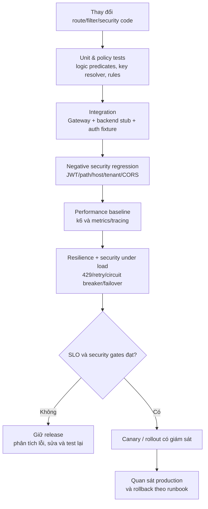
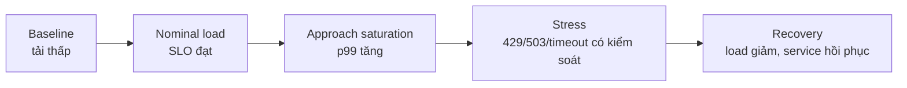
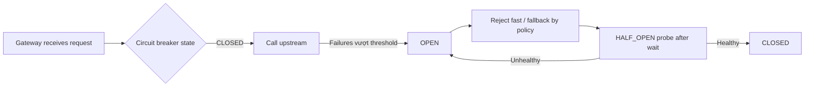
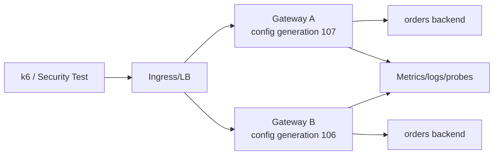
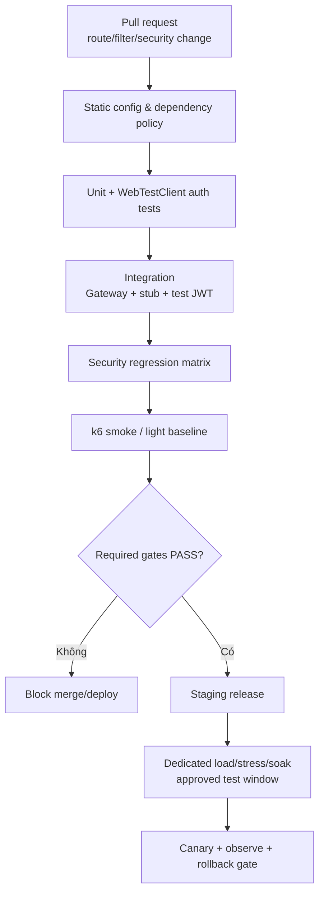

# Kiểm thử tải và hồi quy bảo mật cho gateway

Một API Gateway có thể vượt qua hàng trăm unit test mà vẫn gặp sự cố khi vận hành: 3.000 client đồng thời khiến connection pool đầy; một bộ lọc retry nhân số lần gọi vào backend; một route mới vô tình mở đường đến API quản trị; hoặc cơ chế giới hạn tốc độ chặn người dùng hợp lệ nhưng lại không chặn được một client gửi hàng trăm request. **Kiểm thử tải** và **kiểm thử hồi quy bảo mật** cần được tổ chức chung để phát hiện những lỗi chỉ xuất hiện khi *lưu lượng, định tuyến và chính sách bảo vệ* tương tác với nhau.

Bài học thuộc chương **Kiểm thử** của module **SPRING_CLOUD_GATEWAY**. Ta sẽ kiểm chứng một Gateway sử dụng route predicates, filter chain, biến đổi đường dẫn/header, service discovery và load balancing; sau đó mở rộng sang **JWT authentication/authorization, rate limiting, circuit breaker, retry, TLS và observability**. Mục tiêu không phải chỉ tạo nhiều request, mà là đo **hành vi đúng của Gateway dưới tải** và ngăn cấu hình mới tạo lỗ hổng đã từng được phát hiện.

**Sau bài học, bạn có thể:**

1. Xác định workload và SLO/SLA thử nghiệm cho từng route, phân biệt **closed model** với **open model**.
2. Viết một kịch bản **k6** có rate, latency percentile, error checks, thresholds và dữ liệu test an toàn.
3. Phân biệt lỗi Gateway, lỗi backend, lỗi load generator và các phản hồi **401/403/404/429 dự kiến**.
4. Kiểm tra tác động của retry, rate limiter, circuit breaker, service discovery, body buffering, TLS và connection pools.
5. Xây **ma trận hồi quy bảo mật** kiểm thử token, scope/tenant/object ownership, path/host/method predicates, headers, CORS, CSRF, quản trị Actuator và target URI.
6. Triển khai các cổng kiểm tra trong CI/CD, đọc metrics/traces/logs và quyết định rollout/rollback dựa trên bằng chứng.

> **Phạm vi phiên bản:** Ví dụ cấu hình chính hướng đến **Spring Cloud Gateway Server WebFlux** trên các phiên bản có namespace `spring.cloud.gateway.server.webflux.*`. Các bản Gateway 4.x cũ có namespace khác; **Server Web MVC** sử dụng Servlet/WebMvc.fn, filters và thread model khác. Ví dụ Spring Security dùng reactive `SecurityWebFilterChain`, còn ứng dụng MVC cần `SecurityFilterChain`. Các ngưỡng số và kết quả kiểm thử trong bài **chỉ minh họa**, phải được hiệu chỉnh từ tải thực tế và SLO của hệ thống.

## 1. Vì sao phải kiểm thử tải *cùng* hồi quy bảo mật?

Hai hoạt động giải quyết những câu hỏi khác nhau:

| Nhóm | Câu hỏi chính | Ví dụ rủi ro |
| --- | --- | --- |
| **Kiểm thử tải (load/performance)** | Gateway chịu được bao nhiêu request/s mà vẫn đáp ứng latency/error budget? | P99 tăng, pool cạn, hàng đợi đầy, GC tăng. |
| **Hồi quy bảo mật** | Các quyền và chính sách đã kiểm thử trước đây còn đúng sau thay đổi không? | Route mới bypass auth, tenant A xem dữ liệu tenant B. |
| **Kiểm thử bảo mật dưới tải** | Chính sách bảo vệ có còn hoạt động đúng khi bị cạnh tranh tài nguyên? | Rate limit sai key, Redis chậm, unauthorized requests ăn hết pool. |
| **Kiểm thử resilience** | Lỗi backend/tải cao có bị khuếch đại hay cách ly đúng không? | Retry storm, fallback công khai dữ liệu nhạy cảm. |
| **Quan sát vận hành** | Có bằng chứng đáng tin để giải thích kết quả không? | K6 báo 5xx nhưng không biết route, node và dependency lỗi. |

Một Gateway nhanh nhưng cho phép request không có quyền đi tới backend **không đạt**. Một Gateway từ chối mọi request với `403` có thể rất nhanh, nhưng **cũng không đạt** nếu đó là API hợp lệ. Vì vậy mỗi test phải có **oracle chức năng** (*expected behavior*): request nào phải thành công, request nào phải bị từ chối, và backend nào được phép nhận nó.

### 1.1. Mô hình kiểm thử từ sớm đến gần production



**Không chạy stress test phá tải trên production mặc định**. Mô hình tốt là chạy smoke/security regression trong CI ở môi trường cô lập, kiểm thử tải trên staging đủ đại diện với giới hạn an toàn, rồi canary/monitor trên production khi được phê duyệt.

## 2. Xác định phạm vi: kiểm thử Gateway ở những tầng nào?

Một request thường đi qua:

```text
Client / load generator
  -> DNS / TLS / WAF / Ingress
  -> Spring Security / WebFilter
  -> Spring Cloud Gateway RoutePredicateHandlerMapping
  -> Gateway filter chain
       - headers/path rewrite
       - RequestRateLimiter / Retry / CircuitBreaker
       - Service discovery + LoadBalancer
  -> outbound HTTP client / connection pool
  -> backend service
  -> database/cache/dependency khác
  <- response qua Gateway
```

Chỉ đo thời gian ở URL Gateway sẽ cho **latency đầu cuối**, không tự chỉ ra Gateway tiêu tốn bao nhiêu thời gian. Phải có baseline của **backend trực tiếp** trong một môi trường tương đương và metrics ở từng hop để nhận diện bottleneck.

| Tầng | Nên đo/kiểm tra | Điều thường bị hiểu sai |
| --- | --- | --- |
| Client/load generator | Scheduled RPS, achieved RPS, latency, failed requests, dropped iterations | Load generator chậm bị quy thành lỗi Gateway. |
| Ingress/TLS | TLS handshake, conn reuse, timeout, proxy limits | Chỉ nhìn JVM metrics rồi bỏ qua ingress throttling. |
| Gateway route/security | Route ID, HTTP status, deny reasons, route order, authz rules | 401/403 dự kiến bị tính thành chức năng hỏng. |
| Gateway HTTP client | Pending connections, connect/read timeout, active pools | Tăng CPU pod không giải quyết pool cạn. |
| Rate limiter/Redis | 429, allowed/denied, key distribution, Redis latency | Một quota per-IP có thể gộp nhiều user sau NAT. |
| Backend | RPS thực nhận, p95/p99, 5xx, concurrency | Tưởng Gateway sinh 5xx nhưng backend đã trả lỗi. |
| Security control plane | Actuator exposure, TLS/mTLS, config drift, forwarded-header trust | Test app security bỏ sót management port. |

### 2.1. Cấu hình test phải tương đương trong những thứ quan trọng

Để kết quả có ý nghĩa:

- Chạy **đúng major/minor version** Boot/Cloud/Gateway, cùng filter order và cấu hình route.
- Số pod/replica, CPU/memory requests/limits, Netty/Servlet threads, HTTP client pools cần được ghi rõ.
- Có cùng kiểu TLS termination, ingress, DNS/service discovery và network topology trong phạm vi mục tiêu.
- Test backend stub khi muốn cô lập Gateway overhead; test backend thật trong staging khi muốn đánh giá end-to-end.
- Sử dụng Redis/registry test tương đương khi rate limiting/load balancing phụ thuộc chúng.
- Dữ liệu test không chứa tài khoản và thông tin thanh toán thật; quyền/tenant test được cấu hình riêng.
- Tắt cache warming/giữ cache một cách có chủ đích, không trộn số liệu cold start và steady state.

**Không kết luận “Gateway chịu 10.000 RPS” nếu thực tế test trỏ tới response cached ở ingress** hoặc backend trả stub quá nhỏ trong khi production gửi body lớn qua JWT, rewrite và TLS.

## 3. Lập workload trước khi chọn công cụ

Một load test hợp lệ bắt đầu bằng **mô hình request mix**, không bắt đầu bằng `vus: 1000`.

### 3.1. Phân loại API theo chi phí và rủi ro

| Nhóm API | Tải dự kiến (minh họa) | Điều cần kiểm chứng |
| --- | --- | --- |
| GET catalog | 60% RPS | Cache, route match, p95, headers, TLS và upstream pool. |
| GET orders/{id} | 25% RPS | JWT/tenant scope, route priority, ownership, không tiết lộ object. |
| POST orders | 10% RPS | Body size, idempotency, quota, không retry ghi trùng. |
| POST payments | 3% RPS | Strict authz, no unintended retries, TLS/mTLS. |
| OPTIONS preflight/health | 2% RPS | CORS/security ordering, protection của management endpoints. |

Đây là **ví dụ giả định**. Hãy lấy request distribution thật từ Gateway access metrics/logs đã loại dữ liệu nhạy cảm. Tối thiểu phải phân nhóm theo method, route, status/response size, auth mode, cache behavior và traffic peak.

**Đừng trộn tất cả routes thành một số p95 tổng**: 90% GET nhanh có thể che 10% POST chậm nghiêm trọng. SLO nên có kiểm tra riêng cho critical routes.

### 3.2. Open model và closed model

**Closed model**: Một tập người dùng ảo (VUs) lặp lại hành động; lần kế tiếp thường bắt đầu sau khi lần trước hoàn tất. Khi backend chậm, tốc độ request **tự giảm**, có thể che hiện tượng hệ thống sắp quá tải.

**Open model**: Test cố khởi tạo một **tốc độ arrival** mới không phụ thuộc thời gian response của request trước. Đây là mô hình phù hợp nếu mục tiêu là “Gateway có nhận nổi 500 request/s không?”.

| Mô hình | k6 executor mẫu | Khi dùng | Bẫy đo đạc |
| --- | --- | --- | --- |
| Closed | `constant-vus`, `ramping-vus` | User journeys có think time, concurrency-driven scenarios | *Coordinated omission* nếu chỉ đo requests đã gửi khi SUT chậm. |
| Open | `constant-arrival-rate` | RPS mục tiêu cố định, capacity/SLO | Thiếu VUs khiến `dropped_iterations`, actual RPS thấp. |
| Open ramp | `ramping-arrival-rate` | Tìm ngưỡng, gradual stress | Phải biết khi nào workload vượt capacity. |
| Burst/spike | Tăng arrival rate đột ngột theo giai đoạn | Autoscaling, burstCapacity, queue saturation | Dễ tạo load ngoài dự kiến; cần giới hạn và sandbox. |

### 3.3. Không nhầm throughput với concurrency

- **RPS**: Số requests HTTP hoàn tất hoặc bắt đầu trên một giây (phải nói rõ).
- **Concurrent in-flight requests**: Bao nhiêu requests đang xử lý cùng lúc.
- **VUs**: Số virtual users/actors của load generator, không bằng số requests đang chạy trong mọi cấu hình.
- **Latency**: Thời gian end-to-end đo từ phía client hoặc theo route/operation.

Một công thức trực giác từ **Little's Law** ở trạng thái ổn định:

\[
L \approx \lambda W
\]

Trong đó `L` là số request trung bình đang ở hệ thống, `λ` là tốc độ arrivals/hoàn tất trung bình, `W` là thời gian xử lý trung bình tính bằng giây. Ví dụ 500 request/s với trung bình 200 ms thường tương ứng khoảng 100 requests in-flight ở trạng thái ổn định.

**Chỉ dùng để ước lượng**, không lấy trung bình thay cho p99 hoặc giả định hệ thống luôn ổn định trong overload/spike. Queueing, retries và client timeouts có thể làm quan hệ thực tế phức tạp hơn.

## 4. Chọn profile kiểm thử: đừng dùng một bài cho tất cả

| Loại test | Mục tiêu | Thời lượng/nhịp minh họa | Tiêu chí kết luận |
| --- | --- | --- | --- |
| **Smoke** | Gateway route, TLS, auth hoạt động | Vài requests mỗi route | Correct status/body/headers/backend hit. |
| **Baseline** | Đo độ trễ khi tải thấp | 2–5 phút, RPS thấp | Có p50/p95/p99, error rate, CPU/memory. |
| **Load** | Đo ở mức lưu lượng vận hành | Ramp/warm-up + steady state | Đáp ứng SLO tại RPS mục tiêu. |
| **Stress** | Tìm ngưỡng bão hòa và cách suy giảm | Tăng RPS có kiểm soát | Biết điểm gãy; thất bại an toàn, recover được. |
| **Spike** | Đánh giá tăng tải bất ngờ | Burst ngắn trong staging | Không bypass auth/quota; tránh collapse kéo dài. |
| **Soak/endurance** | Phát hiện memory/connection leak | Hàng giờ, tải ổn định | Không tăng memory/pending requests không kiểm soát. |
| **Resilience under load** | Lỗi backend/Redis/TLS, timeouts | Fault injection trên staging | Retry budget/circuit breaker/429 đúng. |
| **Security regression** | Không tái xuất hiện lỗ hổng | Mỗi PR/config change | Positive/negative assertions đều PASS. |

Khi test ở mức tải cao, phải có **cơ chế dừng khẩn cấp** và người chịu trách nhiệm. Chạy bài stress có thể ảnh hưởng tới hạ tầng dùng chung (IdP, Redis, service discovery, DNS, mạng) ngay cả khi Gateway nằm trong staging.

### 4.1. Viết mục tiêu SLO thực nghiệm

Một hợp đồng minh họa cho **GET /api/catalog/** ở staging:

- Kỳ vọng **150 HTTP requests/s** ổn định ở cấu hình 2 Gateway replicas, mỗi replica 1 vCPU/512 MiB (chỉ là con số ví dụ).
- `p95 < 300 ms`, `p99 < 800 ms` ở phía client.
- Tỉ lệ request lỗi **ngoài ý định** dưới 1%.
- Không có `dropped_iterations` trong pha steady state.
- Không có phản hồi sai policy (401/403/429/200 ngoài dự kiến).
- Backend thực nhận request đúng URI/path; không lộ admin endpoints.

**Không dùng một ngưỡng chung cho mọi môi trường**. Một proxy tới backend cần 2 giây mỗi request không thể đạt p95 300 ms bằng cách chỉ sửa Gateway. SLO được đặt theo nhu cầu sản phẩm và baseline đã đo.

## 5. Chuẩn bị một Gateway test an toàn

Ví dụ route trên **Server WebFlux**:

```yaml
spring:
  application:
    name: test-edge-gateway
  cloud:
    gateway:
      server:
        webflux:
          routes:
            - id: catalog-read
              uri: http://127.0.0.1:9090
              predicates:
                - Path=/api/catalog/**
                - Method=GET
              filters:
                - StripPrefix=1

            - id: orders-read
              uri: http://127.0.0.1:9091
              predicates:
                - Path=/api/orders/**
                - Method=GET
              filters:
                - StripPrefix=1

server:
  port: 8080

management:
  endpoints:
    web:
      exposure:
        include: health,info,metrics
```

Giả định:

- `GET /api/catalog/items/42` sẽ được rewrite thành `GET /catalog/items/42` ở stub 9090.
- `GET /api/orders/42` sẽ được rewrite thành `GET /orders/42` ở stub 9091.
- Một route `Method=GET` **không** tự cho phép POST: backend không nên nhận POST qua route này.
- Spring Security config, nếu được thêm, sẽ quyết định status 401/403 **trước khi forward**.

**Đây là môi trường cô lập cho bài lab**, không dùng nó làm cấu hình production: thiếu TLS/public authz, quota, retry/timeouts, discovery và egress security. Với App Boot/Gateway phiên bản khác, property namespace cần điều chỉnh theo tài liệu chính thức.

### 5.1. Bổ sung observability tối thiểu

Spring Cloud Gateway Server WebFlux có thể cung cấp metric timer **`spring.cloud.gateway.requests`** khi sử dụng Actuator/Micrometer và bật Gateway metrics filter phù hợp. Tài liệu mô tả tags như route ID, route URI, status, outcome và method; tên property bật metrics phụ thuộc phiên bản. **Đừng mặc định mọi metrics đã tự xuất hiện** chỉ vì application.yml có `management.endpoints.web.exposure.include=metrics`.

Có thể thêm:

```xml
<dependency>
    <groupId>org.springframework.boot</groupId>
    <artifactId>spring-boot-starter-actuator</artifactId>
</dependency>
<dependency>
    <groupId>io.micrometer</groupId>
    <artifactId>micrometer-registry-prometheus</artifactId>
</dependency>
```

và nếu dùng Prometheus:

```yaml
management:
  endpoints:
    web:
      exposure:
        include: health,info,metrics,prometheus

spring:
  cloud:
    gateway:
      server:
        webflux:
          metrics:
            path-tags:
              enabled: false
```

**Chỉ truy cập Actuator qua management network có bảo vệ.** Không công khai route diagnostics, environment, metrics có URI nhạy cảm hoặc endpoint ghi route chỉ để test. Với Gateway 5.x, hãy đối chiếu property `spring.cloud.gateway.server.webflux.metrics.enabled`/namespace tương ứng; một số tài liệu cũ còn dùng `spring.cloud.gateway.metrics.enabled`.

### 5.2. Đo được nguyên nhân, không chỉ kết quả

Tối thiểu thu:

- Gateway server request rate/status, latency histogram p95/p99.
- Gateway route ID và outbound client connect/read timeout, active/pending connections.
- JVM heap/off-heap, GC, CPU throttling, container RSS.
- Netty event-loop lag hoặc proxy concurrency tương ứng, scheduler blocking.
- Backend RPS, latency, failed requests; Redis/IdP latency khi có dependency.
- Correlation ID/traces giúp nối một request qua Gateway → backend.

**Không gắn raw URL chứa ID hoặc token vào metric labels**; tránh cardinality cao. Route ID và status thường phù hợp hơn. Nếu cần path tag, chuẩn hóa theo route template và kiểm tra policy/chi phí.

## 6. Kịch bản k6: tải cố định theo arrival rate

**k6** là công cụ phổ biến để tạo tải HTTP và quy định **thresholds** trong script. Ví dụ này đo một workload thử nghiệm nhẹ ở môi trường local/staging đã được phép; các giá trị RPS, thời gian và ngưỡng **chỉ phục vụ bài học**.

### 6.1. Mã k6 đầy đủ

Tạo tệp thực hành giả định `load-gateway.js` trong **dự án lab riêng** của người học:

```javascript
import http from 'k6/http';
import { check } from 'k6';
import { Rate } from 'k6/metrics';

const BASE_URL = __ENV.BASE_URL || 'http://127.0.0.1:8080';
const ORDERS_READ_TEST_TOKEN = __ENV.ORDERS_READ_TEST_TOKEN;
const contractFailures = new Rate('gateway_contract_failures');

export const options = {
  scenarios: {
    catalog_read: {
      executor: 'constant-arrival-rate',
      exec: 'catalogRead',
      rate: 30,
      timeUnit: '1s',
      duration: '2m',
      preAllocatedVUs: 30,
      tags: { route_group: 'catalog' },
    },
    orders_read: {
      executor: 'constant-arrival-rate',
      exec: 'ordersRead',
      rate: 10,
      timeUnit: '1s',
      duration: '2m',
      preAllocatedVUs: 20,
      tags: { route_group: 'orders' },
    },
  },
  thresholds: {
    'http_req_duration{scenario:catalog_read}': [
      'p(95)<300',
      'p(99)<800',
    ],
    'http_req_duration{scenario:orders_read}': [
      'p(95)<500',
      'p(99)<1000',
    ],
    'http_req_failed': ['rate<0.01'],
    'gateway_contract_failures': ['rate<0.01'],
    'dropped_iterations': ['count<1'],
  },
};

export function catalogRead() {
  const response = http.get(
    BASE_URL + '/api/catalog/items/42',
    { tags: { operation: 'catalog-read' } },
  );

  const passed = check(response, {
    'catalog status is 200': (res) => res.status === 200,
    'catalog body contains item id': (res) =>
      res.body !== null && res.body.includes('"id":"42"'),
  });
  contractFailures.add(!passed, { route_group: 'catalog' });
}

export function ordersRead() {
  if (!ORDERS_READ_TEST_TOKEN) {
    throw new Error('Missing ORDERS_READ_TEST_TOKEN from test environment');
  }
  const response = http.get(
    BASE_URL + '/api/orders/42',
    {
      headers: {
        Authorization: 'Bearer ' + ORDERS_READ_TEST_TOKEN,
      },
      tags: { operation: 'orders-read' },
    },
  );

  const passed = check(response, {
    'orders status is 200': (res) => res.status === 200,
    'orders content type is JSON': (res) =>
      (res.headers['Content-Type'] || '').includes('application/json'),
  });
  contractFailures.add(!passed, { route_group: 'orders' });
}
```

**Điều kiện để chạy đúng:** Catalog GET được công khai theo policy của lab; orders GET yêu cầu token thử nghiệm hợp lệ có `SCOPE_orders.read` và quyền với order 42. Script lấy token từ `__ENV.ORDERS_READ_TEST_TOKEN`, không hardcode. Nếu không có token, bài test phải thất bại do thiếu fixture, không được tắt xác thực để thresholds xanh. Chỉ inject token qua secret store/test runner được ủy quyền; không ghi token vào console, Git hay report.

Trong thực tế, kiểm tra body bằng chuỗi `'"id":"42"'` dễ lệ thuộc thứ tự/spacing JSON; hãy thay bằng `response.json('id') == '42'` khi API bảo đảm JSON và xác định được kiểu ID. Với payload lớn, cân nhắc kiểm tra một field ổn định và giới hạn chi phí parse.

### 6.2. Chạy bài test

```bash
# Trong môi trường đã được phép thử tải:
# Giả định ORDERS_READ_TEST_TOKEN đã được inject bằng biến môi trường
# từ test runner/secret store, không đưa token trực tiếp vào dòng lệnh.
k6 run --env BASE_URL=http://127.0.0.1:8080 load-gateway.js
```

Tổng arrival rate thiết kế: **30 + 10 = 40 iterations/s**; vì mỗi iteration của script gửi **một HTTP request**, mục tiêu gần 40 requests/s nếu không có HTTP redirect/retry ở client và đủ virtual users. Nếu mỗi iteration gọi nhiều endpoints hoặc client tự follow redirect, **requests/s không còn bằng iterations/s**.

**Không có `sleep()`** ở cuối các hàm `catalogRead`/`ordersRead` vì executor `constant-arrival-rate` đã điều tiết tốc độ arrivals. Nếu thêm sleep hoặc logic kéo dài, phải cấp đủ VUs; khi không đủ, k6 có thể báo `dropped_iterations`.

### 6.3. Thresholds mới quyết định CI fail

Trong k6:

- **`check(...)`** ghi kết quả assertions và thống kê check rate, nhưng **một mình check fail không mặc định khiến cả k6 process exit non-zero**.
- **`thresholds`** là các tiêu chí pass/fail; khi vượt ngưỡng, k6 đánh dấu failure và có exit code khác 0.
- **`http_req_failed`** được tính theo chính sách expected response của k6. Với cấu hình mặc định, nhiều phản hồi 4xx/5xx được coi là lỗi HTTP; test negative auth nên được thiết kế riêng để không nhầm status 401 dự kiến với lỗi tải.
- **`http_req_duration`** là thời gian gửi request + đợi response + nhận response; **không bao gồm** thời gian DNS/TCP/TLS handshake ban đầu như những metric riêng `http_req_blocked`, `http_req_connecting`, `http_req_tls_handshaking`.
- **`dropped_iterations`** nghĩa là k6 **không thể khởi tạo đủ iterations đã lên lịch**, có thể do thiếu VUs hoặc tài nguyên load generator/cách hệ thống phản hồi. Không dùng actual achieved rate thấp hơn target rồi tuyên bố SLO đạt.

Ví dụ hợp lệ:

```text
Thiết kế: 40 iterations/s trong 120 giây
Số iterations mục tiêu: khoảng 4.800
Actual HTTP requests: [chỉ điền sau khi chạy]
p95 catalog: [chỉ điền sau khi chạy]
p99 orders: [chỉ điền sau khi chạy]
http_req_failed rate: [chỉ điền sau khi chạy]
dropped_iterations: [chỉ điền sau khi chạy]
Gateway/backend CPU & memory: [chỉ điền sau khi đo]
```

Những dòng trên là **mẫu báo cáo**, không phải kết quả thực đo.

### 6.4. Vì sao cần kiểm tra achieved load?

Giả sử test đặt 500 iterations/s nhưng generator chỉ khởi tạo 150/s vì thiếu VUs, còn Gateway phục vụ ổn định 150/s. Kết luận chính xác là **test chưa chứng minh năng lực 500/s**, không phải “Gateway pass 500 RPS”.

Ngoài `dropped_iterations` cần kiểm tra:

1. `http_reqs` / duration thực đạt.
2. CPU/memory của máy tạo tải; giới hạn file descriptors/network.
3. DNS/TLS/connection reuse và các network bottlenecks phía generator.
4. VU allocation; tăng `preAllocatedVUs` một cách có kiểm soát khi cần.
5. Không cấu hình test client khiến nó vô tình chỉ gọi một route cached.

### 6.5. Tải xác thực không nên dùng một token duy nhất cho mọi use case

Nếu hệ thống có rate limit **theo principal**, 200 VUs dùng chung một JWT sẽ trông giống **một người dùng**, không phản ánh 200 tài khoản thật. Ngược lại, nếu cố tạo một token ngẫu nhiên chưa ký cho mỗi request, gateway trả 401 và bài test chỉ đo chi phí từ chối token.

Hãy chuẩn bị **một tập test identities có token hợp lệ** và policy rõ ràng: test một user (quota per-key), nhiều users độc lập, tenants khác nhau và anonymous requests. Không tự ghi JWT vào output k6, access logs hoặc artifact CI. Token phải được phát qua một test IdP hoặc fixture được phép; không dùng secrets production.

## 7. Baseline, saturation point và p95/p99

### 7.1. Lập đường cơ sở có thể lặp lại

Trước thay đổi:

1. Chụp trạng thái Git commit, Docker image digest, config hash, Gateway route definition và policy version.
2. Xác định cùng số replicas, node sizes, ingress, backend stub hoặc backend staging, TLS và cache policy.
3. Warm-up để tránh so JIT/cold connection với steady state.
4. Đo các cửa sổ đủ dài ở RPS kiểm soát.
5. Chụp latency histogram p50/p95/p99, RPS, errors, CPU, memory và pending connections.
6. Lặp lại nhiều lần để nhận biết phương sai tự nhiên của hạ tầng.

Sau thay đổi, chạy cùng workload. Nếu khác biệt p99 tăng, kiểm tra cả cache, proxy route match, TLS sessions, backend latency và queueing. **Không kết luận regression từ một percentile của vài request.**

### 7.2. Phân biệt trung bình và tail latency

Ví dụ giả định:

| Bản build | RPS thực | p50 | p95 | p99 | 5xx |
| --- | ---: | ---: | ---: | ---: | ---: |
| A — baseline | 300 | 58 ms | 160 ms | 410 ms | 0,1% |
| B — thêm custom filter | 300 | 60 ms | 170 ms | 920 ms | 0,4% |

Trung vị gần như không đổi, nhưng **p99 tăng hơn gấp đôi**. Có thể custom filter thực hiện blocking operation ở một số request, backend pool đụng giới hạn hoặc GC pauses. Cần trace/log và event-loop metrics, không chỉ nhìn trung bình.

**Đừng so hai percentile từ workload không cùng phân phối**: nếu build B có nhiều POST lớn hơn A, p99 thay đổi chưa chắc do filter mới.

### 7.3. Khi tăng tải dần

Một bức tranh mong muốn:



Khi hệ thống quá tải, dấu hiệu nguy hiểm là **latency kéo dài vô hạn, retry storm, connection leak, event-loop bị block** hoặc liveness collapse. Một Gateway có circuit breaker/rate limiter đúng có thể trả **429/503 có chủ đích** để bảo vệ backend; bài stress phải đánh giá **degradation policy**, không áp mục tiêu 0% 429 trong mọi mức quá tải.

### 7.4. Phân loại kết quả trước khi gộp metric

| Status / kết quả | Khi nào được chấp nhận? | Không được suy diễn |
| --- | --- | --- |
| **200/201/204** | Request hợp lệ, hợp đồng trả thành công | 200 chưa chứng minh backend đã thực hiện đúng side effect. |
| **401** | Không có token/invalid token theo policy | 401 trên request hợp lệ là regression. |
| **403** | Token hợp lệ nhưng thiếu quyền hoặc ownership | Không nên thay thành 404/200 tùy tiện nếu contract không nêu. |
| **404** | Không có route hoặc tài nguyên không tồn tại/ẩn | Phải phân biệt 404 Gateway với 404 backend. |
| **405** | Method không được phép tại route/backend | Cần kiểm tra method predicate. |
| **429** | Vượt rate limit được xác định | Không phải kết quả chấp nhận trong benchmark under-limit. |
| **502/503/504** | Backend không sẵn, network/timeout, policy fallback… | Cần xác định tầng sinh lỗi; không tự coi là lỗi Gateway code. |
| **Không có HTTP response** | Socket timeout/TLS/DNS/connect error | Không thể gán mã 503 nếu server chưa phát response. |

Đối với **security negative tests**, nên định nghĩa **custom pass/fail checks** trên status/headers/backend hit count, rồi đặt thresholds tương ứng; không dựa vào `http_req_failed` mặc định để đánh giá một loạt 401/403 dự kiến.

## 8. Tìm bottleneck của Gateway thay vì chỉ tăng tài nguyên

Một bài test tải tốt phải có **hypothesis** và số liệu kiểm chứng:

| Quan sát | Khả năng | Cần kiểm tra |
| --- | --- | --- |
| p99 tăng, CPU Gateway thấp | Outbound pool, Redis/IdP/backend hoặc pending connections | HTTP client pool, Redis latency, backend spans. |
| CPU Gateway 100%, backend nhàn | JWT signature verification, JSON/body rewrite, blocking custom filter | CPU profile, event loop, request mix. |
| Memory tăng theo POST body | Body caching/retry hoặc custom decorator giữ bytes | Heap/off-heap usage, DataBuffer release, max in-memory size. |
| 429 tăng sau thêm route | KeyResolver/quota scope/Redis config | Key distribution, burst, replenish, request rate by principal. |
| Retry làm backend nhận gấp 3 | Retry filter hoặc client-side retries chồng nhau | Backend request counter theo attempt và correlation ID. |
| 503 khi scale pods | Discovery/instance readiness/load-balancer stale data | Registry snapshots, readiness, connection draining. |
| 401 tăng sau đổi route | Security matcher, JWT validation, clock skew, issuer/audience | Auth decision log (không raw token), route/path map. |
| Test client có dropped iterations | VU thiếu hoặc generator quá tải | k6 metrics/machine CPU/network. |

### 8.1. Event loop và custom filters

Trên Gateway Server WebFlux, những thao tác như `Thread.sleep(...)`, database JDBC trực tiếp, blocking network call hoặc file I/O nặng trên Netty event-loop có thể làm **tắc nghẽn nhiều requests**.

Ví dụ anti-pattern:

```java
// Anti-pattern trong GatewayFilter/WebFlux reactive chain:
Thread.sleep(100);     // block event-loop nếu chạy trên Netty thread
return chain.filter(exchange);
```

Một custom filter dùng external policy service nên chọn HTTP client non-blocking/caching phù hợp, kiểm soát timeout và hiệu ứng khi dependency không sẵn sàng. Nếu phải thực hiện blocking work, cần kiến trúc scheduler/worker pool phù hợp cùng capacity limit; **không chỉ bọc mọi code trong subscribeOn rồi bỏ qua resource budgeting**.

### 8.2. So sánh Servlet Gateway MVC

Server Web MVC dựa trên Servlet/Tomcat/Jetty, có mô hình thread/HTTP client khác WebFlux. Khi test MVC phải đo:

- Servlet worker thread pool, active/request queues.
- HTTP outbound connections, timeouts và backend latency.
- Spring Security Servlet FilterChain, CSRF/session behavior.
- JVM/GC, virtual threads nếu đã bật và được hỗ trợ.

**Không dùng Reactor Netty event-loop metrics để kết luận Tomcat đã bão hòa**. Hai Gateway variants cần quan sát runtime khác nhau, dù cùng một test client k6 có thể gửi HTTP.

## 9. Hồi quy bảo mật: kiểm tra chính sách thay vì chỉ status code

Một **security regression test** là một bài kiểm tra có thể chạy lặp lại sau mỗi lần đổi route, filter, security policy, dependency hoặc TLS configuration, nhằm bảo đảm **những quy tắc bảo vệ trước đây vẫn đúng**.

Ví dụ với `GET /api/orders/{id}`:

- User A có token hợp lệ và scope `orders.read` xem được đơn hàng của chính họ.
- User B có cùng scope **không** xem được đơn của A.
- Token hết hạn hoặc sai chữ ký bị từ chối.
- Anonymous caller không được truy cập protected orders API.
- Header `X-User-Role: ADMIN` do client tự gửi không cấp quyền admin.
- Khi đổi `StripPrefix/RewritePath`, backend vẫn kiểm tra object ownership.

Chỉ assert 401/403 ở mọi tình huống là chưa đủ. Phải có **positive tests**, **negative tests** và kiểm chứng **backend calls/side effects**. Một Gateway từ chối mọi request có thể qua negative tests nhưng vẫn sai chức năng nghiêm trọng.

### 9.1. Liên hệ OWASP API Security Top 10

| Chủ đề OWASP API Security 2023 | Rủi ro của Gateway | Kiểm thử hồi quy |
| --- | --- | --- |
| **API1 Broken Object Level Authorization** | Token có scope đúng nhưng object ID không thuộc user | Thử ownership khác user/tenant tại backend. |
| **API2 Broken Authentication** | Token sai chữ ký, issuer, audience hoặc hết hạn vẫn được nhận | JWT validation thực với test JWKS. |
| **API3 Broken Object Property Level Authorization** | Response JSON lộ field nội bộ sau body rewrite | Assert response không có thuộc tính nhạy cảm. |
| **API4 Unrestricted Resource Consumption** | Thiếu quota/body limit, retry storm | 429, max payload, concurrent requests, recovery. |
| **API5 Broken Function Level Authorization** | Route mới vô tình mở admin/delete function | Path + method + role tests. |
| **API6 Sensitive Business Flows** | Bot lặp thanh toán/đăng ký | Quota, idempotency và business-level protections. |
| **API7 SSRF** | URI động điều hướng tới nội bộ trái phép | URI allowlist và network egress tests. |
| **API8 Security Misconfiguration** | Actuator public, CORS quá rộng, unsafe TLS | Management access, CORS/CSRF/TLS tests. |
| **API9 Improper Inventory Management** | Legacy routes hoặc staging API được public | So route inventory với approved manifest. |
| **API10 Unsafe Consumption of APIs** | Tin redirect, headers, body của upstream không đáng tin | Response schema/size/redirect safety. |

**Gateway không thay thế business authorization của backend**: scope `orders.read` không chứng minh `orderId=42` thuộc principal hiện tại.

### 9.2. Policy là dữ liệu đầu vào của test

| API | Caller | Token | Expected | Backend nhận? |
| --- | --- | --- | --- | --- |
| `GET /api/catalog/items/42` | Anonymous | Không có | 200 nếu public | Có |
| `GET /api/orders/42` | User A sở hữu order 42 | Valid + orders.read | 200 | Có |
| `GET /api/orders/42` | Anonymous | Không có | 401 | **Không** |
| `GET /api/orders/42` | User A thiếu scope | Valid | 403 | **Không** |
| `GET /api/orders/42` | User B không sở hữu 42 | Valid + scope | 403/404 theo hợp đồng | Backend có thể nhận để xác định ownership |
| `POST /api/admin/routes` | User thường | Valid | 403/404 | Không tới admin backend |
| `DELETE /api/orders/42` | User A chỉ có scope read | Valid | 403/405 theo policy | Không tới backend thực hiện xóa |
| `OPTIONS /api/orders/42` | Browser preflight được phép | Có thể không có JWT | Response CORS đúng | Không chạy business handler |

Một request sai ownership có thể **phải tới backend để backend trả 403**. Nhưng một request không có token/scope mà Gateway đã cam kết chặn thì backend **không nên bị gọi**. Test phải thể hiện sự phân chia trách nhiệm này.

### 9.3. Mỗi diff route phải dẫn đến security tests

Các thay đổi nhạy cảm:

- `Path=/api/orders/**` mở rộng thành `Path=/api/**`.
- `order=-10` đổi thành `order=-1000`, che tuyến chuyên biệt.
- Bỏ `Method` predicate hoặc đổi `Host`.
- `StripPrefix=1` thành `StripPrefix=2`, chuyển request tới endpoint khác.
- `RemoveRequestHeader=Authorization` hoặc `AddRequestHeader=X-Role,ADMIN`.
- Bỏ `RequestRateLimiter`, thay `KeyResolver` bằng header do client tự gửi.
- Thay `lb://orders` bằng URI nội bộ tùy ý.
- Tin `Forwarded`/`X-Forwarded-*` từ nguồn không được xác thực.
- Bật endpoint Actuator ghi trên cổng public.

Do đó, hồi quy bảo mật phải test **tập route đầy đủ và filter order**, không chỉ test một lớp Security config cô lập.

## 10. Spring Security WebFlux: policy làm nền cho kiểm thử

Ví dụ cấu hình Gateway **JWT Resource Server** trên WebFlux, chỉ minh họa chính sách API Bearer-only:

```java
package com.example.gateway.security;

import org.springframework.context.annotation.Bean;
import org.springframework.context.annotation.Configuration;
import org.springframework.http.HttpMethod;
import org.springframework.security.config.Customizer;
import org.springframework.security.config.annotation.web.reactive.EnableWebFluxSecurity;
import org.springframework.security.config.web.server.ServerHttpSecurity;
import org.springframework.security.web.server.SecurityWebFilterChain;

@Configuration
@EnableWebFluxSecurity
public class GatewaySecurityPolicy {

    @Bean
    SecurityWebFilterChain security(ServerHttpSecurity http) {
        return http
            // Chỉ dành cho stateless Bearer API, không dùng cookie session.
            .csrf(ServerHttpSecurity.CsrfSpec::disable)
            .authorizeExchange(exchanges -> exchanges
                .pathMatchers(HttpMethod.GET, "/api/catalog/**")
                    .permitAll()
                .pathMatchers(HttpMethod.GET, "/api/orders/**")
                    .hasAuthority("SCOPE_orders.read")
                .pathMatchers(HttpMethod.POST, "/api/orders/**")
                    .hasAuthority("SCOPE_orders.write")
                .anyExchange().denyAll())
            .oauth2ResourceServer(oauth2 ->
                oauth2.jwt(Customizer.withDefaults()))
            .build();
    }
}
```

Để chạy đúng phải có JWT decoder/issuer:

```yaml
spring:
  security:
    oauth2:
      resourceserver:
        jwt:
          issuer-uri: https://idp.test.example/issuer
```

**Điểm cần kiểm tra:**

1. `issuer-uri` là placeholder, không phải IdP tồn tại trong bài lab; cần JWKS/test IdP.
2. JWT phải được validate signature, `exp`, `nbf` và issuer. Nếu API có audience riêng, cần **audience validator** và test token có `aud` sai; không giả định audience tự được validate như yêu cầu nghiệp vụ.
3. Scope JWT thường được map sang authorities có prefix `SCOPE_`, nhưng claim/converter tùy cấu hình.
4. Security chỉ kiểm tra route-level permission; backend vẫn chịu trách nhiệm object ownership.
5. `csrf().disable()` **không phù hợp với cookie-based browser session**; với mô hình đó phải test CSRF tokens, SameSite cookies và CORS.
6. Đây là **SecurityWebFilterChain cho WebFlux**. Gateway Server Web MVC dùng `SecurityFilterChain`/`HttpSecurity` và Servlet filters.

### 10.1. Security matcher khác Gateway route predicate

Security cho phép `POST /api/orders/**` không tự tạo một Gateway route POST. Nếu Gateway chỉ khai báo `Method=GET`, request POST vẫn có thể trả 404/405 vì không có route, dù security decision đã cho phép. Ngược lại, việc thêm một route GET/POST mới không tự mở một security matcher tương ứng. **Test cả sự chọn route và authorization**.

### 10.2. Phân biệt các phản hồi

- **401**: caller chưa xác thực hoặc credential không hợp lệ.
- **403**: principal đã xác thực nhưng thiếu quyền, hoặc request vi phạm một bảo vệ như CSRF.
- **404**: route/object không tồn tại; có hệ thống cố ý dùng 404 khi không được phép xem một object.
- **405**: method không được handler/route đích hỗ trợ.

Không dùng một kỳ vọng status cứng cho tất cả nghiệp vụ khi chưa có API/security contract. Việc trả 403 hay 404 khi sai object ownership là một lựa chọn cần được định nghĩa và test nhất quán.

## 11. WebTestClient và mockJwt: kiểm thử quyền theo scope

Spring Security Reactive Test có helper **`mockJwt()`** để gắn một JWT authentication vào test context mà không phải ký một JWT mới cho mỗi assertion. Nó thích hợp cho **test authorization và route behavior**, nhưng **không kiểm tra chữ ký/JWK/issuer thực**.

### 11.1. Chuẩn bị một WebTestClient có Spring Security

Trong một Spring Boot test context reactive có route Gateway và backend stub test riêng, có thể bind client vào ApplicationContext:

```java
import org.springframework.context.ApplicationContext;
import org.springframework.test.web.reactive.server.WebTestClient;
import static org.springframework.security.test.web.reactive.server
    .SecurityMockServerConfigurers.springSecurity;

WebTestClient client = WebTestClient
    .bindToApplicationContext(applicationContext)
    .apply(springSecurity())
    .configureClient()
    .build();
```

Đây là **đoạn setup**, không phải một file Java hoàn chỉnh: cần Spring test context, WebFlux/Spring Security test dependencies, route config và server stub. Import static được tách dòng theo syntax Java (xuống dòng trước dấu chấm vẫn hợp lệ); trong IDE có thể gom lại thành một dòng. Với Boot versions khác nhau, auto-configuration test và package của test annotations có thể đổi; xem tài liệu Spring Security Reactive Test của đúng phiên bản.

### 11.2. Assert anonymous và wrong scope

```java
import org.springframework.security.core.authority.SimpleGrantedAuthority;
import static org.springframework.security.test.web.reactive.server
    .SecurityMockServerConfigurers.mockJwt;

// Request không có token tới protected orders API.
client.get().uri("/api/orders/42")
    .exchange()
    .expectStatus().isUnauthorized();

// Đã authenticated, nhưng không có scope orders.read.
client.mutateWith(mockJwt().authorities(
        new SimpleGrantedAuthority("SCOPE_catalog.read")))
    .get().uri("/api/orders/42")
    .exchange()
    .expectStatus().isForbidden();

// Có scope orders.read: Gateway cho phép tới backend test.
client.mutateWith(mockJwt().authorities(
        new SimpleGrantedAuthority("SCOPE_orders.read")))
    .get().uri("/api/orders/42")
    .exchange()
    .expectStatus().isOk();
```

Để positive case cuối trả 200, backend stub phải có handler `GET /orders/42` trả thành công. Một mock JWT đúng scope **không tự tạo downstream stub**; nếu backend không tồn tại, test sẽ nhận lỗi network/5xx và cần sửa fixture trước khi đánh giá security.

### 11.3. Test backend không bị gọi khi Gateway chặn

Test chỉ assert 401/403 có thể bỏ sót lỗi một filter gửi request upstream **trước khi SecurityWebFilterChain từ chối**. Với mock backend WireMock, MockWebServer hoặc HTTP stub:

1. Reset request hit count của stub.
2. Gửi anonymous GET tới orders.
3. Assert 401.
4. Assert **số call tại orders backend là 0**.
5. Gửi token hợp lệ nhưng thiếu scope.
6. Assert 403 và backend vẫn không nhận call.
7. Gửi token đủ scope và assert backend nhận đúng một call với path/header dự kiến.

**Giới hạn:** Object ownership do backend xác minh có thể yêu cầu request được forward tới backend để trả 403. Không đặt assertion “0 backend calls” cho những trường hợp nằm ngoài phạm vi chặn ở Gateway.

### 11.4. mockJwt() không phải test xác thực thực

`mockJwt()` bỏ qua một số bước decode/verify JWT và đưa vào authentication context đã mock. Vì vậy thêm **end-to-end tests qua cổng HTTP thật** với test IdP/JWKS:

- Chữ ký hợp lệ và không hợp lệ.
- Issuer đúng và sai.
- Audience đúng và sai, kể cả audience thiếu.
- Token hết hạn, `nbf` ở tương lai, sai time skew.
- Scope/role sai hoặc authority converter sai.
- Token không phải JWT, header Authorization bị hỏng.
- Đổi `kid` khi test JWK rotation.
- Token valid nhưng principal thuộc tenant khác.

Dùng **khóa test và tài khoản test**; không hardcode private keys/token thật vào Git, log hoặc CI artifacts. Nếu dùng local mock JWKS, tách hoàn toàn khỏi IdP production.

### 11.5. Negative tests phải có positive control

Giả sử yêu cầu token không hợp lệ trả 401. Nếu Gateway trả 401 cho **mọi request**, negative tests đều xanh nhưng ứng dụng vô dụng. Sau mỗi nhóm negative tests, chạy ít nhất một positive control có token/role hợp lệ và backend nhận request đúng. Đây là cách phát hiện cấu hình “deny all” hoặc thiếu backend masquerade thành security PASS.

## 12. k6 kiểm thử security semantics mà không nhầm 401/403 là lỗi tải

Các phản hồi 401/403 có thể là **hành vi đúng** của security regression. Vì thế dùng **custom Rate metric** cho violation thay vì kết luận từ `http_req_failed` khi bài cố tình tạo negative requests.

### 12.1. Một kịch bản nhỏ cho môi trường test

```javascript
import http from 'k6/http';
import { check } from 'k6';
import { Rate } from 'k6/metrics';

const BASE = __ENV.BASE_URL || 'http://127.0.0.1:8080';
const NO_SCOPE_TOKEN = __ENV.NO_SCOPE_TEST_TOKEN;
const VALID_TOKEN = __ENV.ORDERS_READ_TEST_TOKEN;
const violations = new Rate('gateway_security_violations');

export const options = {
  vus: 1,
  iterations: 1,
  thresholds: {
    gateway_security_violations: ['rate<0.001'],
    checks: ['rate==1'],
  },
};

export default function () {
  if (!NO_SCOPE_TOKEN || !VALID_TOKEN) {
    throw new Error('Missing test JWT fixtures in environment');
  }

  const anonymous = http.get(BASE + '/api/orders/42');
  const noScope = http.get(BASE + '/api/orders/42', {
    headers: { Authorization: 'Bearer ' + NO_SCOPE_TOKEN },
  });
  const authorized = http.get(BASE + '/api/orders/42', {
    headers: { Authorization: 'Bearer ' + VALID_TOKEN },
  });

  const passed = check(null, {
    'anonymous denied': () => anonymous.status === 401,
    'no-scope user denied': () => noScope.status === 403,
    'authorized test user allowed': () => authorized.status === 200,
    'no backend error leaked': () =>
      !String(anonymous.body || '').includes('java.lang.')
      && !String(noScope.body || '').includes('java.lang.'),
  });
  violations.add(!passed);
}
```

**Script là ví dụ cần token hợp lệ do IdP test cung cấp**; không tạo token giả rồi kỳ vọng positive case 200. Khi body của HTTP response là null, đoạn kiểm tra dùng `String(body || '')` để không lỗi runtime. Bài production-grade nên còn xác minh content type/error schema, dùng secret store thay vì in JWT trong logs, và kiểm tra backend hit counts bằng suite integration riêng.

Ở đây **không đặt threshold `http_req_failed: rate<0.01`** bởi 401/403 là status cố ý trong test security. `gateway_security_violations` phản ánh đúng hợp đồng status. Nếu muốn vừa load-test vừa security-test trong cùng run, có thể sử dụng **k6 scenarios/tags riêng** với thresholds phân nhóm và cấu hình expected response rõ; nhưng giữ hai suite riêng dễ truy trách nhiệm thất bại hơn.

### 12.2. K6 error rate không thay thế backend evidence

Ngay cả khi k6 thấy một 403 đúng, nó không xác minh backend có bị gọi/sửa dữ liệu trước khi trả status hay không. Để chống bypass, cần test integration với backend stub/recorded invocations và kiểm tra dữ liệu nghiệp vụ sau requests. Có thể dùng k6 kiểm tra phổ biến ở HTTP boundary, sau đó Spring integration/WireMock để xác minh non-forwarding.

### 12.3. Không đo hiệu năng bằng request bị từ chối

Một bài tạo 100% token invalid thường chỉ đo đường từ chối tại Spring Security và có thể làm quá tải JWK lookups tùy cache/decoder. Nó **không đại diện** cho traffic thực qua route/Gateway filters/backend. Hãy có hai workload:

- **Authorized performance workload:** Token hợp lệ, scopes đúng, backend trả thành công.
- **Unauthorized abuse regression workload:** Token không hợp lệ/quota vượt, assert policy từ chối nhanh và không gây tiêu thụ tài nguyên quá mức.

Nếu không chia, một “Gateway 20.000 RPS với p95 3 ms” có thể chỉ là 20.000 responses `401` chưa hề route đến microservice nào.

## 13. Rate limiting dưới tải: đúng key, đúng 429, đúng phạm vi

RequestRateLimiter trong Gateway Server WebFlux có thể sử dụng **RedisRateLimiter** với token bucket. Một request vượt quota thường nhận **HTTP 429 Too Many Requests**, nhưng phải kiểm tra policy version và error handling thực tế.

### 13.1. Cấu hình token bucket minh họa

```yaml
spring:
  cloud:
    gateway:
      server:
        webflux:
          routes:
            - id: catalog-protected
              uri: lb://catalog-service
              predicates:
                - Path=/api/catalog/private/**
              filters:
                - name: RequestRateLimiter
                  args:
                    redis-rate-limiter.replenishRate: 10
                    redis-rate-limiter.burstCapacity: 20
                    redis-rate-limiter.requestedTokens: 1
```

Đây là mẫu cấu hình filter; để có quota **per user**, còn cần `KeyResolver` đáng tin cậy và Redis reactive support được cấu hình đúng. **Không lấy user ID từ query `?user=alice` làm quota key ở production**, bởi client có thể đổi nó để né hạn mức.

### 13.2. Những kịch bản bắt buộc

| Test | Cách tạo dữ liệu | Kỳ vọng |
| --- | --- | --- |
| Dưới quota | Một user gửi đều dưới replenishRate | Không có 429 ngoài ý định. |
| Burst nhỏ | Burst thấp hơn burstCapacity sau khi bucket đầy | Cho phép trong giới hạn quy tắc. |
| Burst vượt | Một user vượt burstCapacity | Một phần request nhận 429. |
| Nhiều user khác nhau | Hai test principals được tin cậy | Quota độc lập nếu policy per-principal. |
| Cùng user qua hai Gateway replicas | Chia traffic qua A/B | Redis limiter chia quota theo key, không nhân đôi quota per pod. |
| Anonymous | Không có principal | Fallback key/deny policy rõ, không gộp một key không kiểm soát. |
| Redis unavailable | Mô phỏng network error trong staging | Chính sách fail-open/fail-closed được xác minh và có alert. |
| Header IP giả mạo | Client tự gửi X-Forwarded-For | Không tạo quota key tùy ý từ header không tin. |

**Không kỳ vọng “cứ request thứ 21 trả 429” trong mọi test**: token bucket có replenishment theo thời gian, Redis scheduling, key distribution và concurrency. Test nên xác minh tính chất của quota theo cửa sổ đủ lớn, không hardcode thứ tự tuyệt đối trong burst bất đồng bộ.

### 13.3. Kiểm thử fail-open/fail-closed

Khi Redis không đáp ứng, một hệ thống có thể:

- **Fail-closed:** từ chối requests để bảo vệ backend; ảnh hưởng availability.
- **Fail-open:** cho requests đi qua; ảnh hưởng abuse protection.
- **Degrade quota:** áp một giới hạn cục bộ/tạm thời nếu thiết kế cho phép.

Đây là **quyết định bảo mật/vận hành**, không phải tính năng tự động phải có. Test phải ghi đúng behavior được phê duyệt, quan sát alerts và thời gian phục hồi sau khi Redis khỏe.

### 13.4. Không cho 429 che lỗi 401

Nếu quota đặt trước auth, anonymous flood có thể tiêu tốn Redis/bucket và khiến users hợp lệ bị hạn chế; nếu quota đặt sau auth, invalid tokens có thể tiêu tốn CPU JWT verification. Cần test thứ tự filters/WebFilters và policy nhiều lớp (ingress coarse protection + principal quotas). **Không suy luận một RequestRateLimiter filter đủ chống mọi hình thức DoS**.

## 14. Retry, circuit breaker và lỗi backend dưới tải

Một Gateway thiếu thử nghiệm resilience có thể tạo **feedback loop**: backend chậm → request timeout → Gateway retry → backend chịu nhiều tải hơn → timeout tăng. Vì vậy phải đo **client RPS**, **Gateway outbound attempts** và **backend RPS** riêng.

### 14.1. Retry amplification

Ví dụ client phát 100 request/s, mỗi request có tối đa 2 lần retry sau attempt đầu:

```text
Client -> Gateway:             100 requests/s
Gateway -> Backend attempt 1:  100 attempts/s
Gateway -> Backend attempt 2:  tối đa 100 attempts/s
Gateway -> Backend attempt 3:  tối đa 100 attempts/s

Backend: tối đa xấp xỉ 300 attempts/s nếu tất cả thất bại
```

Đây là **upper bound đơn giản** trước khi xét backoff, circuit breaker, timeout, cancellation và rate limiter. Không nhất thiết mọi request sẽ được retry. Nhưng nó minh họa vì sao nhìn **client request rate** không đủ để phát hiện retry storm.

### 14.2. Retry chỉ cho operation an toàn

Với GET không gây tác dụng phụ, có thể cho phép retry giới hạn trên lỗi network/status đã xác định. Với **POST thanh toán/tạo đơn**, retry có thể tạo **hai side effects** nếu attempt đầu đã thành công ở backend nhưng response bị mất.

Test cần:

1. Cấu hình stub: attempt đầu trả 503/timeout, attempt sau trả 200.
2. Kiểm tra backend nhận **số attempts tối đa đúng** theo cấu hình.
3. Kiểm tra backoff/deadline không khiến request chờ vô hạn.
4. Kiểm tra correlationId/trace liên kết các attempts.
5. Test POST có idempotency key hoặc xác nhận policy **không retry**.
6. Test 400/401/403 và các status ngoài retry list không bị retry.

**Đừng mặc định retry HTTP 500/503 luôn an toàn.** Phải hiểu method, body replayability, idempotency và trạng thái side effects.

### 14.3. Body caching làm thay đổi memory profile

Một số cách retry request có body cần cache dữ liệu để phát lại. WebFlux/Servlet có implementation và lifecycle khác nhau, nhưng rủi ro chung là **giữ nhiều request bodies lớn trong bộ nhớ**.

Nếu 500 requests đồng thời có body 1 MiB được cache toàn phần, chỉ riêng body có thể chiếm khoảng 500 MiB, **chưa kể** buffers, copies, JVM heap/off-heap và codecs. Test với các nhóm:

- 1 KiB, 64 KiB, 1 MiB và ngưỡng tối đa cấu hình.
- JSON hợp lệ/sai schema hoặc sai Content-Type.
- Multipart/upload nếu thật sự hỗ trợ.
- Client cancel giữa lúc gửi body.
- Retry/fallback khi backend lỗi sau khi đã nhận body.

Quan sát memory/GC, `DataBuffer` lifecycle trên WebFlux, giới hạn in-memory/body size và response commit. **Không dùng một bài GET nhỏ để kết luận POST upload an toàn**.

### 14.4. Circuit breaker mở và hồi phục



Kiểm thử:

- Lỗi nào được tính vào metrics của breaker.
- Có đủ sample/minimum calls trước khi xét threshold không.
- Khi OPEN, **backend call count giảm**, không tiếp tục bị flood.
- Fallback trả contract đúng và **không bỏ qua authorization**.
- HALF_OPEN probes được giới hạn, không tạo spike.
- Khi backend hồi phục, breaker đóng theo policy và latency bình thường.

Với Gateway Server WebFlux, CircuitBreaker filter tích hợp Spring Cloud CircuitBreaker/Resilience4J qua starter phù hợp; fallback URI `forward:` có lifecycle riêng. Test phải dùng **đúng Gateway flavor** thay vì copy filter MVC vào WebFlux.

### 14.5. Fault injection có ranh giới

Chỉ dùng stub/proxy kiểm soát lỗi **trong staging**, không gây network disruption trên hạ tầng chung. Kịch bản:

| Trường hợp | Cách mô phỏng an toàn | Tiêu chí |
| --- | --- | --- |
| HTTP 503 | Stub trả 503 theo tỉ lệ đã định | Retry/breaker/fallback đúng. |
| Latency cao | Stub delay có giới hạn | Timeout budget đúng, không pool leak. |
| Connection refused | Stub tạm ngừng listener sandbox | Gateway không treo/leak khi hồi phục. |
| Registry không có instance | Service name test không có trong registry riêng | Fail rõ ràng; không route nhầm. |
| Một instance backend lỗi | Nhiều stub instances với health khác nhau | Load balancing/readiness xử lý đúng. |
| Redis rate limiter lỗi | Redis test tạm không truy cập được | Fail-open/closed đúng policy, alert. |
| IdP/JWKS unavailable | IdP test tạm ngưng | Không bất ngờ chấp nhận token sai. |
| TLS cert sai hostname/hết hạn | Test server có cert cố ý không hợp lệ | Gateway từ chối an toàn. |

**Không thực hiện phá tải hoặc quét hạ tầng thật** khi chưa có quyền/biện pháp an toàn. Đây là fault injection phòng thủ với dữ liệu giả.

## 15. CORS, CSRF và trust boundaries

### 15.1. CORS preflight khác yêu cầu API thật

Một browser có thể gửi:

```http
OPTIONS /api/orders/42 HTTP/1.1
Origin: https://frontend.example.test
Access-Control-Request-Method: GET
Access-Control-Request-Headers: authorization
```

Với origin/method/header được phép, Gateway cần phản hồi CORS đúng. Preflight thường **không mang cookies/Bearer token** như business request, nên Spring Security khuyến nghị CORS được xử lý **trước authentication decision**.

| Test | Mục tiêu |
| --- | --- |
| Origin trong allowlist | `Access-Control-Allow-Origin` đúng, không mở rộng. |
| Origin ngoài allowlist | Không trả quyền truy cập cross-origin trái phép. |
| Method/header ngoài allowlist | Không công bố quyền rộng hơn cấu hình. |
| Preflight không có bearer | Không bị chặn sai nếu CORS policy cho phép. |
| Credentialed CORS | Không dùng wildcard origin cùng Allow-Credentials. |
| GET thật sau preflight | Vẫn kiểm tra JWT/authorization đúng. |

**CORS là cơ chế của browser, không phải authentication**; một HTTP client không phải browser có thể gọi URL trực tiếp nên cần security server-side độc lập.

### 15.2. CSRF phụ thuộc loại auth

API **Bearer-only stateless** và ứng dụng **browser cookie session/OIDC login** có rủi ro CSRF khác nhau. Nếu dùng cookie session, test:

- State-changing request không có CSRF token bị từ chối.
- Request có session/CSRF token hợp lệ thành công theo quyền.
- Cookie flags Secure/HttpOnly/SameSite phù hợp.
- Origin/CSRF/CORS được xử lý đúng với frontend.

**Không sao chép `csrf.disable()` từ cấu hình Bearer-only vào ứng dụng có browser session**.

### 15.3. Forwarded headers chỉ tin nguồn được ủy quyền

Trong topology:

```text
Internet -> Trusted Ingress -> Gateway -> Backend
```

Client có thể tự gửi `X-Forwarded-For`, `X-Forwarded-Proto`, `X-Forwarded-Host`. Test ingress loại/ghi đè giá trị untrusted, Gateway chỉ chấp nhận dữ liệu từ proxies được cấp quyền và backend không dùng header tùy ý để cấp quyền.

Những lỗi cần phát hiện:

- Rate limiter per-IP bị bypass vì tin X-Forwarded-For của caller.
- Redirect trả hostname do client tự đặt.
- Backend tin X-Forwarded-Proto để bỏ TLS-required policy.
- Security logs dựa vào IP spoofed thay vì peer/trusted proxy.

Thử qua **staging fixtures**, assert key/redirect/security decision; không xem header chứa IP nào đó là bằng chứng nguồn kết nối thật.

### 15.4. Header và rewrite regression

Các tests:

- Header không hợp lệ bị reject/normalize.
- `Authorization` không rò sang backend không tin cậy.
- `RemoveRequestHeader`/`SetRequestHeader` không tạo header principal/role giả.
- Response `Location` không tiết lộ backend hostname.
- `Set-Cookie` domain/path/SameSite đúng sau rewrite.
- `Content-Length`/body framing đúng khi body thay đổi.
- `Connection` và hop-by-hop headers tuân thủ HTTP intermediary rules.

**Mọi thay đổi thứ tự Gateway filters đều đáng chạy lại security regression**, vì thứ tự xử lý header/URI và response commit có thể thay đổi ranh giới bảo vệ.

## 16. TLS, mTLS, Actuator và SSRF trong kiểm thử hồi quy

### 16.1. TLS phải được kiểm tra ở cả hai phía

| Hop | Điều cần xác nhận |
| --- | --- |
| Client → Ingress/Gateway | Certificate chain, hostname, TLS version/cipher theo policy. |
| Ingress → Gateway | Hop nội bộ được bảo vệ như thiết kế; trusted proxies được khai báo. |
| Gateway → Backend | HTTP client xác thực certificate/hostname/SNI của upstream. |
| mTLS backend | Client cert và service identity đúng policy; cert thiếu/sai bị từ chối. |
| Certificate rotation | Gia hạn cert không tạo outage kéo dài, truststore được reload/cập nhật phù hợp. |
| Invalid test cert | Expired/self-signed/untrusted/mismatched hostname bị từ chối an toàn. |

**Không dùng `curl -k`, `--insecure` hoặc trust-all manager để làm TLS test pass**. Spring Cloud Gateway có các thuộc tính SSL/trust manager tùy phiên bản; kiểu `use-insecure-trust-manager=true` nguy hiểm ở production và cần bị chặn bằng static policy tests.

Nếu TLS terminate tại ingress, chỉ gọi HTTP vào `localhost:8080` **không kiểm tra được external TLS posture**. Phải có integration test qua endpoint HTTPS thực tế của môi trường thử.

### 16.2. Quét cấu hình trước deploy

Ví dụ **anti-pattern** cần bị từ chối:

```yaml
# KHÔNG dùng trên production.
spring:
  cloud:
    gateway:
      server:
        webflux:
          httpclient:
            ssl:
              use-insecure-trust-manager: true
```

Một policy-as-code job có thể kiểm tra YAML/Helm rendered config, container image và runtime properties để phát hiện cấu hình mất an toàn. Nhưng **static scan không thay thế runtime TLS handshake test**, bởi truststore vẫn có thể sai file hoặc chứa CA ngoài dự kiến.

### 16.3. Actuator cần một test matrix riêng

Management endpoints có blast radius lớn:

- `/actuator/health` có thể public ở mức hạn chế theo policy.
- `/actuator/gateway/routes` có thể lộ route IDs/URIs.
- Endpoint tạo, xóa, refresh routes khi có quyền ghi có thể chuyển traffic.
- `env`, `configprops`, `heapdump`, `loggers`, thread dumps và diagnostics có thể lộ dữ liệu/tài nguyên.

| Từ đâu | Ai gọi | Test | Expected |
| --- | --- | --- | --- |
| Public network | Anonymous | GET management routes | Không được lộ dữ liệu. |
| Public network | Anonymous | POST/DELETE route | Không được ghi thay đổi. |
| Internal management network | Viewer | Read-only diagnostics | Chỉ read theo scope. |
| Internal management network | Viewer | Route write/refresh | Bị từ chối. |
| Internal management network | Approved publisher | Thay route được phép | Có audit và xác minh đúng revision. |
| Public network | Anonymous | Heap/env/secrets endpoints | Không được truy cập. |

**Không mở Actuator ghi trên public port chỉ để bài test có thể gọi**. Thay vào đó dùng management listener/mạng test riêng và tài khoản test có quyền rõ ràng.

### 16.4. Dynamic routes và SSRF

Một API quản trị nhận `uri` tùy ý có thể biến Gateway thành proxy truy cập internal resources. Test an toàn:

1. URI test hợp lệ thuộc allowlist được publish.
2. URI ngoài allowlist hoặc scheme trái policy bị chặn **trước khi route active**.
3. Network egress policy chặn destination ngoài danh sách dù validation layer có lỗi.
4. Redirect từ host được phép không tự đi tới host bị cấm.
5. Audit ghi actor, route ID, before/after diff và quyết định policy.

Chỉ dùng **hostname/HTTP stub giả trong mạng cô lập** để kiểm tra SSRF policy; không quét nội bộ thật hoặc gọi metadata endpoints thực.

## 17. Kiểm tra hồi quy với nhiều Gateway replicas và rollout động

Gateway thường chạy nhiều replicas phía sau ingress/load balancer. Một thay đổi được áp dụng lên một node chưa bảo đảm toàn cụm có cùng hành vi.



Kịch bản:

1. Route `orders-read` revision 42 có auth matcher phù hợp.
2. Control plane publish revision 43, nới route predicate và thêm header filter.
3. Gateway A đã refresh; Gateway B còn cache cũ.
4. K6 gửi cùng workload qua LB, một phần request bị 401/403/404 khác với mong đợi.

Không thể kết luận chỉ từ số lỗi tổng rằng **bản 43 sai** hay **Gateway B chưa hội tụ**. Cần tag từng Gateway instance và, khi có cơ chế observability, **observed route-set revision/hash**. Các trạng thái cần phân biệt:

| Trạng thái | Ý nghĩa |
| --- | --- |
| Desired 43, A/B observed 43 | Có khả năng đã hội tụ; vẫn cần probe behavior. |
| Desired 43, A observed 43, B observed 42 | Mixed config; không đánh dấu VERIFIED toàn cụm. |
| Published store=43, A/B observed 42 | Lỗi refresh/distribution hoặc cache stale. |
| A/B metadata=43 nhưng route hash khác | Metadata không đủ, cần so effective definitions. |

### 17.1. Test nhất quán và chống bypass trong canary

- Chạy **cùng bộ security negative tests** trực tiếp tới mỗi Gateway replica trong mạng test nếu topology cho phép, hoặc qua ingress với instance routing có chứng cứ.
- So public route inventory và security rules giữa nodes.
- Khi canary, bảo đảm nodes cũ **không** là đường đi bypass một fix bảo mật mới.
- Nếu fix nghiêm trọng yêu cầu tất cả nodes được cập nhật, cân nhắc drain những nodes chưa hội tụ trước khi tiếp nhận traffic.
- Test refresh/rollback theo snapshot known-good và xác nhận các HTTP probes sau khi rollback.

Đừng dùng một status HTTP 200 của endpoint refresh để tuyên bố đã an toàn: cần kiểm tra routes thực tế và hành vi qua từng node.

### 17.2. Service discovery/load balancing dưới tải

Khi route dùng `lb://service-id`:

1. Start một backend instance healthy, một instance không healthy trong **registry test**.
2. Quan sát lựa chọn instances, readiness/health policies và backend calls.
3. Scale instances trong lúc k6 đang chạy; theo dõi RPS/p99/5xx.
4. Thử network partition/stale registration trong staging.
5. Kiểm tra sticky/session hoặc cookie behavior nếu API có state.
6. Kiểm tra không route tới host ngoài policy khi metadata/registry thay đổi.

**Không giả định Spring Cloud LoadBalancer tự có cùng thuật toán/health-check/tính đồng bộ ở mọi version**. Test theo implementation và cấu hình thực tế.

### 17.3. Rollback là một hành vi phải được kiểm thử

Nếu cấu hình 43 gây rate limit/key resolver sai:

- Dừng rollout 43.
- Publish revision mới 44 chứa known-good content của 42 (giữ lịch sử audit).
- Refresh/reconcile required nodes.
- Test lại negative/positive security cases và baseline HTTP performance.
- Ghi RTO thực tế, observed revisions và metrics sau rollback.

**Rollback không tự xóa side effects đã xảy ra**, không sửa được dữ liệu backend đã bị ghi trùng và không tự phục hồi cert/service đã bị dỡ bỏ.

## 18. Chạy kiểm thử trong CI/CD: tốc độ và độ tin cậy

Một pipeline hiệu quả chia suites theo chi phí:



### 18.1. Ví dụ các job (pseudo YAML)

```yaml
# PSEUDO-CI: không phải cú pháp chạy ngay của một CI vendor cụ thể.
pipeline:
  - name: static-security
    checks:
      - gateway-dependency-compatibility
      - allowed-route-uri-and-filters
      - tls-trust-policy
      - actuator-exposure-policy
  - name: reactive-security-tests
    checks:
      - authenticated-and-anonymous-cases
      - jwt-issuer-audience-expiry
      - route-overlap-and-methods
      - cors-and-csrf-as-applicable
  - name: integration
    checks:
      - backend-call-count
      - retry-and-circuit-breaker
      - rate-limiter-and-redis
  - name: k6-smoke-load
    env: isolated-test-cluster
    checks:
      - target-rps-achieved
      - p95-and-p99-thresholds
      - expected-http-status
      - zero-security-critical-violations
  - name: staging-performance
    trigger: approved-schedule-or-release-candidate
    checks:
      - nominal-load
      - spike-and-stress-with-safety-limit
      - resource-recovery
```

**Không chạy full soak/stress trên mỗi commit** nếu nó mất thời gian lớn, gây chia sẻ hạ tầng hoặc làm test thiếu ổn định. PR nên có unit + integration + light load gates; bài stress/soak chạy trên test environment chuyên dụng theo release hoặc lịch.

### 18.2. Các ngưỡng phải có nguồn gốc rõ

| Gate | Ví dụ | Mục đích |
| --- | --- | --- |
| Unit/security | 100% critical authz assertions pass | Không tái xuất hiện bypass đã biết. |
| Integration | 0 unexpected backend calls cho request bị chặn | Chứng minh pre-route protection. |
| Load latency | p95/p99 dưới SLO mỗi route | Kiểm tra trải nghiệm users. |
| Error rate | Dưới error budget ở nominal load | Không hy sinh availability vì performance. |
| Achieved load | Đạt arrival rate và ít/không dropped iterations | Test đo đúng mức tải mục tiêu. |
| Resource saturation | CPU, memory, pending queue dưới mức cho phép | Tránh pass ở mép sập. |
| Canary security | Không còn node dùng policy yếu trước thay đổi | Fix bảo mật áp dụng toàn traffic cần thiết. |

Các ngưỡng cụ thể như `p95<300ms` và `error<1%` là **ví dụ**, không phải tiêu chuẩn cho mọi Gateway. Chúng phải được phê duyệt theo SLO hệ thống.

### 18.3. Bằng chứng tối thiểu phải lưu cho mỗi run

- Code commit/release image digest, Spring Boot/Cloud/Gateway versions.
- Route snapshot/hash, security policy version, test data/tenant fixtures.
- k6 script revision/options, target và achieved RPS, thresholds, exit code.
- Ingress/TLS config, Gateway replica count/CPU/memory, backend topology.
- Timings, p50/p95/p99, errors, dropped iterations.
- Correlation IDs mẫu cho errors, traces, metrics dashboards.
- Backend hit counts cho các negative security cases.
- Observed config revisions từng node nếu dùng routes động.
- Kết luận PASS/FAIL/INCONCLUSIVE và lý do, không chỉ một screenshot màu xanh.

**Không lưu raw JWT, private keys, cookie values hoặc dữ liệu khách hàng thật trong test artifacts**.

### 18.4. Phân loại FAIL và INCONCLUSIVE

Nếu k6 script không đủ VUs để đạt RPS mục tiêu hoặc backend stub chết ngoài ý định, run có thể là **INCONCLUSIVE** cho mục tiêu performance. Nhưng nếu một request sai tenant trả dữ liệu trái phép, đó vẫn là **SECURITY FAIL** dù load generator đang bị lỗi. Đừng dùng lỗi hạ tầng để bỏ qua bằng chứng security violation.

Khi test fail, ghi ai là owner: test setup, policy/authz, route config, Gateway resources, backend, registry, Redis hay CI runner. Tránh sửa SLO thresholds cho đến khi test “xanh” mà không có review.

## 19. Ma trận kiểm thử tải và hồi quy bảo mật tổng hợp

Ma trận dưới đây là **bộ khung để chuyển thành test cases cụ thể**; mỗi case cần fixture, request, expected response, backend evidence và phạm vi môi trường. Không cần chạy mọi case ở mọi PR, nhưng những case liên quan đến thay đổi phải được chọn và các security-critical regressions đã biết luôn phải chạy.

### 19.1. Hiệu năng và khả năng chịu tải

| ID | Kịch bản | Cần xác minh |
| --- | --- | --- |
| L01 | GET catalog với backend stub ổn định | Gateway overhead có baseline đo được. |
| L02 | GET orders có JWT hợp lệ | p95/p99, authz, backend hits. |
| L03 | POST body 1 KiB và 1 MiB | Memory/latency theo kích thước; không rò buffer. |
| L04 | 30–50 RPS ổn định | Achieved RPS đúng, không dropped iterations. |
| L05 | Tăng dần đến nominal RPS | SLO đạt ở mức mục tiêu. |
| L06 | Vượt nominal có kiểm soát | Backpressure/429/503 theo policy, recover. |
| L07 | Spike ngắn | Không queue bão hòa kéo dài, không bypass security. |
| L08 | Soak thời gian dài | Heap/direct memory, threads, connections không tăng vô hạn. |
| L09 | TLS với handshake reuse | Tách handshake/dns/connect latency khỏi request duration. |
| L10 | Tắt connection reuse trong bài test phụ | Hiểu chi phí TCP/TLS setup, không so nhầm. |
| L11 | Request mix theo production distribution | SLO từng route, không bị aggregate che. |
| L12 | Load generator CPU cao | Phát hiện generator là bottleneck, đánh dấu inconclusive. |
| L13 | Cấu hình VUs không đủ | k6 dropped_iterations cảnh báo. |
| L14 | 2 Gateway replicas qua LB | RPS/latency phân bổ, node nào chậm được phát hiện. |
| L15 | Autoscaling/rolling restart | Request draining, latency/error trong thời gian chuyển. |
| L16 | Log/tracing enabled vs disabled trên staging | Định lượng overhead của observability. |

### 19.2. Authentication/authorization/route security

| ID | Kịch bản | Cần xác minh |
| --- | --- | --- |
| S01 | No token vào protected API | 401; không tới backend nếu chặn ở Gateway. |
| S02 | JWT giả chữ ký/sai signature | Bị từ chối; không route đến backend. |
| S03 | JWT `exp` đã qua | Bị từ chối đúng. |
| S04 | JWT `nbf` trong tương lai | Bị từ chối đúng. |
| S05 | JWT issuer không hợp lệ | Bị từ chối đúng. |
| S06 | JWT audience không thuộc API | Bị từ chối nếu audience policy yêu cầu. |
| S07 | JWT đủ read scope | GET thành công qua route đúng. |
| S08 | JWT thiếu read scope | 403; không chạm protected backend. |
| S09 | Token read thử POST write | 403/route behavior như policy. |
| S10 | User A xem object của User B | Không lộ data; backend ownership check. |
| S11 | Tenant A gọi object Tenant B | Không lộ data/side effect. |
| S12 | Client gửi header giả mạo role/principal | Không nâng quyền. |
| S13 | Route `/api/**` catch-all với order cao | Không che route admin/security. |
| S14 | Path có trailing slash, encoded segments | Normalize/route/security/backend thống nhất. |
| S15 | Host khác domain đã cho phép | Không route sang virtual host khác. |
| S16 | Method OPTIONS/POST/DELETE | Không bỏ qua method/policy. |
| S17 | StripPrefix/RewritePath thay đổi | Public path không map sai internal privileged endpoint. |
| S18 | Token Relay tới backend khác trust zone | Không tiết lộ client token/cookie. |
| S19 | Unknown route và lỗi 404 | Không lộ route inventory/stacktrace. |
| S20 | Response JSON chứa field nhạy cảm | Filter/backend không lộ field theo role. |
| S21 | Thay route ID/predicate qua config động | Approved revision và effective policy khớp. |
| S22 | Gateway A/B khác policy trong canary | Phát hiện drift, không báo rollout an toàn sớm. |

### 19.3. Rate limit, resilience, transport và vận hành

| ID | Kịch bản | Cần xác minh |
| --- | --- | --- |
| R01 | Một principal dưới quota | Được phép, không 429 bất thường. |
| R02 | Một principal vượt burst/quota | 429 theo token bucket, backend không nhận toàn bộ attempts. |
| R03 | Hai principals khác nhau | Không dùng chung bucket nếu policy per-principal. |
| R04 | Cùng principal qua 2 pods | Quota không nhân lên theo pod nếu Redis shared. |
| R05 | Client spoof X-Forwarded-For | Không né quota/key policy. |
| R06 | Redis limiter unavailable | Fail-open/closed được ghi rõ và alert. |
| R07 | Backend trả 503 | Retry bounded, observed outbound attempts đúng. |
| R08 | POST thanh toán timeout | Không ghi trùng side effect ngoài idempotency contract. |
| R09 | Circuit breaker OPEN | Backend load giảm, fallback không mở quyền. |
| R10 | HALF_OPEN/Recovery | Không spike, breaker đóng khi đủ signal. |
| R11 | Body buffering lớn + retries | Memory/GC có giới hạn, không leak. |
| R12 | Upstream TLS cert sai | Kết nối bị từ chối an toàn. |
| R13 | mTLS thiếu/sai client cert | Không kết nối ngoài policy. |
| R14 | Public truy cập Actuator route write | Bị chặn, không có thay đổi. |
| R15 | Dynamic route URI ngoài allowlist | Bị reject; không có SSRF. |
| R16 | Redirect từ backend sang host lạ | Không tự follow/tiết lộ dữ liệu trái policy. |
| R17 | CORS origin lạ | Không cấp wildcard/credentials trái phép. |
| R18 | Cookie session POST thiếu CSRF | Bị từ chối đúng. |
| R19 | Browser preflight hợp lệ | Được xử lý đúng trước auth theo policy. |
| R20 | Log theo correlation ID qua retries | Một request có ID ổn định, attempts phân biệt. |
| R21 | Log chứa Authorization/Cookie | Test phát hiện và chặn raw secrets. |
| R22 | Test k6 401/403 chủ động | Custom security oracle pass, không nhầm http_req_failed. |
| R23 | Config rollback | Security và performance trở về known-good trong RTO. |
| R24 | Redis/registry/network partition trong test cluster | Degradation an toàn, không false success. |

### 19.4. Thêm metadata để chọn test theo thay đổi

Ví dụ:

```yaml
# Test case metadata DO ĐỘI NGŨ TỰ ĐỊNH NGHĨA, không phải schema k6/Spring.
testId: S17
name: Path rewrite must not bypass backend authorization
scope:
  routes:
    - orders-read
  changes:
    - RewritePath
    - StripPrefix
severity: critical
automation: integration
expected:
  status: forbidden-or-hidden-by-contract
  backendSideEffects: 0
dataFixture: cross-tenant-orders
```

Khi PR thay `StripPrefix`, bộ chọn test nên chạy S13/S14/S17, các JWT/ownership cases liên quan và một load baseline trên route đó. Nhưng các tests global như actuator exposure và SSL trust vẫn nên chạy định kỳ/ở release gate, vì đổi thư viện có thể ảnh hưởng toàn app.

## 20. Đọc kết quả và xử lý lỗi thường gặp

### 20.1. “K6 báo p95 tốt nhưng production chậm”

Khả năng:

- Test backend stub trả response quá nhỏ/nhanh.
- Test bỏ TLS, JWT, Redis rate limit hoặc ingress.
- RPS thực chỉ đạt 10% mục tiêu vì thiếu VUs.
- Chỉ đo steady state, chưa kiểm tra spike/soak.
- Request mix khác production hoặc không có request bodies lớn.
- Dashboard chỉ hiển thị p95 aggregate, che p99 route quan trọng.

Giải pháp: **tăng tính đại diện của test**, đối chiếu baseline theo route, xác minh achieved load và các dependency. Không tự nâng RPS bằng cách giả định một VU luôn sinh một số requests/s cố định.

### 20.2. “Test negative security pass nhưng API có người dùng thật bị 403”

Khả năng:

- Chỉ có tests cho missing/invalid token, thiếu positive cases.
- Scope/authority converter không khớp claim từ IdP.
- Route được rewrite sang path khác nhưng Security matcher chưa cập nhật.
- `POST`/`GET` có method rules mới.
- Tenant/role fixture không còn phù hợp.

Giải pháp: thêm **positive control** theo user/role/tenant thật trong test IdP, kiểm tra cả security decision và backend call.

### 20.3. “Test load báo 429 nhiều hơn dự kiến”

Không vội kết luận Gateway chậm. Kiểm tra:

- Script có đang gửi tất cả requests bằng **một principal/token**?
- Token bucket replenish/burstCapacity có đúng kỳ vọng không?
- Có requests khác cùng key đang dùng chung Redis staging không?
- Có hidden retries/redirects làm tăng attempts không?
- Redis latency/time skew hoặc KeyResolver lấy sai key?
- Test đang dùng rate vượt quota như mục tiêu stress hay đang dưới quota?

Ghi rõ **429 dự kiến** và **429 ngoài ý định** theo từng workload; đừng gộp chúng với network errors.

### 20.4. “Backend báo 300 RPS, k6 chỉ gửi 100 RPS”

Có thể Gateway Retry filter hoặc HTTP client backend đang retry. Cần:

1. Kiểm tra correlation IDs, attempt IDs và số outbound calls.
2. Kiểm tra retry config ở Gateway **và** backend clients.
3. Kiểm tra backend đang nhận request từ nguồn nào khác.
4. So client RPS, Gateway request count và backend access count trong cùng cửa sổ.

**Không tăng rate limiter một cách mù quáng**: retry amplification có thể là nguyên nhân gốc.

### 20.5. “HTTP 200 nhưng không có request vào backend mong đợi”

Khả năng:

- Một route khác được match vì `order`/predicates overlap.
- Response đến từ cache hoặc fallback.
- Gateway proxy tới backend khác.
- Mock tests chỉ trả mock response local.

Giải pháp: assert route ID, downstream URI/path, backend hit count và response marker từ stub. Nếu kiểm thử BOLA, assert dữ liệu/side effects, không chỉ HTTP status.

### 20.6. “TLS test pass vì client đã dùng --insecure”

Kết quả không chứng minh certificate validation đúng. Bỏ `--insecure`, dùng truststore test phù hợp và thử negative certificate cases. Kiểm tra cả ingress→Gateway và Gateway→backend nếu chính sách yêu cầu TLS/mTLS nội bộ.

### 20.7. “Gateway replica A pass, replica B fail”

Kiểm tra observed route revision, security policy, environment config, Redis/registry, time skew, cache refresh và image digest. Canary hoặc rolling rollout có thể tạo mixed config. **Không đánh dấu VERIFIED toàn cụm chỉ vì một node được test qua ingress**.

### 20.8. “Test p99 không ổn định giữa hai lần chạy”

Cần xem:

- Số samples có đủ không, đặc biệt khi test quá ngắn.
- JVM JIT/cold start, connection warm-up, caches.
- Hạ tầng chung có competing workloads không.
- GC và CPU throttling, noisy neighbors.
- Biến động backend/IdP/Redis/network.

Nên lặp run, giữ môi trường cố định và báo cả phương sai/confidence; **không dùng duy nhất một run để khẳng định regression có ý nghĩa thống kê** nếu chênh lệch rất nhỏ.

### 20.9. “Spring test mockJwt pass, token thật lại bị 401”

`mockJwt()` không xác minh chữ ký/issuer/audience thật. Chạy end-to-end với JWKS test, decoded claims, authority conversion, clock skew và security filters thật. Không sửa bằng cách tắt `JwtDecoder` verification ở production.

### 20.10. “Security test fail chỉ khi bật retry”

Kiểm tra filter order và request replay:

- Một filter auth/header có bị execute lại ở retry attempts không?
- Body có bị cache/release đúng không?
- Backend có nhận request/side effect trước khi retry không?
- Fallback có bypass một lớp authorization không?
- Có shared mutable state trong custom filter hay RequestDecorator không?

Một security regression có thể chỉ xuất hiện ở **fault path** chứ không ở happy path; do đó test failure injection là bắt buộc với những API nhạy cảm.

## 21. Bài thực hành tích hợp: tải hợp lệ và chống bypass

### 21.1. Mục tiêu của lab

Dựng **một môi trường thử nghiệm cô lập** với:

- Gateway Server WebFlux trên `localhost:8080`.
- Catalog stub trên `localhost:9090`, public GET.
- Orders stub trên `localhost:9091`, protected GET/POST.
- IdP test hoặc JWKS test và users/tenants giả lập.
- Redis test cho RequestRateLimiter nếu bài đã bật bộ lọc đó.
- k6 chạy ở máy có đủ capacity; Spring WebTestClient/security tests chạy trong build test suite.
- Log JSON/route metrics/correlation ID để điều tra các tình huống lỗi.

Các bài kiểm tra phải sử dụng **dữ liệu giả**, không gửi request ngoài môi trường đã được phép. Không trỏ bài stress test vào endpoint production hay một IdP/Redis dùng chung.

### 21.2. Đặt kỳ vọng trước khi chạy

Chọn hai routes:

```text
catalog-read
  GET /api/catalog/items/{id}
  public
  Path=/api/catalog/**
  StripPrefix=1
  backend: catalog-stub

orders-read
  GET /api/orders/{id}
  requires: SCOPE_orders.read
  Path=/api/orders/**
  StripPrefix=1
  backend: orders-stub
  object ownership checked in backend
```

Đặt SLO minh họa:

- Catalog test: `p95 < 300ms`, `p99 < 800ms` tại 30 request/s.
- Orders test: `p95 < 500ms`, `p99 < 1000ms` tại 10 request/s.
- Không có unexpected HTTP errors ở load nominal theo threshold.
- Không có request thiếu token/scope tới orders backend.
- User A không xem được order của User B, dù scope giống nhau.
- Khi lỗi backend 503, số outbound attempts không vượt retry budget đã quy định.
- Không có secrets trong logs và không có Actuator route-write endpoint public.

### 21.3. Các bước thực hiện

1. **Kiểm tra versions và config:** Ghi lại Boot/Cloud/Gateway, route definitions, policy và test images.
2. **Dựng backend stub:** Trả JSON có marker phục vụ xác định backend nào nhận request; ghi method/path và call counts.
3. **Dựng test IdP/JWT fixtures:** Có user A, user B, token đúng scope, token thiếu scope và token hết hạn.
4. **Smoke test:** Gửi GET catalog/orders với token hợp lệ; xác nhận status/body/path.
5. **Security tests:** Gửi anonymous, wrong scope, cross-tenant requests; assert status, body và backend evidence.
6. **Warm-up:** Chạy tải nhẹ trong thời gian có kiểm soát, không tính vào steady-state baseline.
7. **k6 nominal load:** Chạy script ở mục 6 với token hợp lệ cho protected endpoints; ghi achieved load và thresholds.
8. **Collect metrics:** Gateway/Redis/backend CPU, memory, p95/p99, HTTP client pool, retry/fallback counters và logs.
9. **Fault injection:** Cho backend stub trả 503/timeout, kiểm tra retry/circuit breaker rồi phục hồi stub.
10. **Abuse regression:** Thử quota với nhiều principals và một principal; xác minh 429 theo policy.
11. **TLS/management:** Chạy negative TLS và Actuator access tests trong network riêng.
12. **Rollback thử:** Phát hành bản route/policy khác trong test control plane, gây regression có kiểm soát, rồi khôi phục snapshot known-good và chạy lại security gates.
13. **Report:** Ghi PASS/FAIL/INCONCLUSIVE và bằng chứng, không chỉ ghi “test xong”.

### 21.4. Mẫu báo cáo kết quả

```yaml
# Mẫu do đội ngũ tự định nghĩa, KHÔNG phải kết quả thật.
runId: gateway-test-2026-11-24-001
environment: isolated-staging
gateway:
  version: "<record actual Gateway version>"
  imageDigest: "<record actual immutable image digest>"
  routeConfigHash: "<record approved route snapshot hash>"
  replicas: 2
workload:
  tool: k6
  scriptRevision: "<git commit>"
  targetRate: 40
  rateUnit: "requests/s"
  achievedRate: "<measured>"
  droppedIterations: "<measured>"
results:
  catalogP95Ms: "<measured>"
  catalogP99Ms: "<measured>"
  ordersP95Ms: "<measured>"
  ordersP99Ms: "<measured>"
  unexpectedErrorRate: "<measured>"
  criticalSecurityViolations: "<measured>"
  backendCallsForDeniedRequests: "<measured>"
  retryAmplification: "<measured>"
  observedConfigRevisions: "<A, B from diagnostics>"
decision: "PASS | FAIL | INCONCLUSIVE"
notes: "Replace placeholders with real evidence after test"
```

**Không chèn raw JWT, password, client certificate/private key hay dữ liệu người dùng thật vào test report.** Các đường dẫn dashboard/tracing nội bộ phải được phân quyền và có retention policy.

## 22. Câu hỏi tình huống có đáp án

### Tình huống A — P95 rất thấp, nhưng 80% requests là 401

Team báo Gateway cực nhanh vì k6 p95 chỉ 5ms.

**Đáp án:** Kết quả chủ yếu đo đường reject của Spring Security, không đo proxying qua backend. Phải tạo workload với **token hợp lệ** và đối chiếu backend hit counts. Negative auth tests được đánh giá bằng **security oracle**, không dùng để tuyên bố capacity business traffic.

### Tình huống B — Test đặt 500 RPS, actual chỉ 110 RPS

K6 có `dropped_iterations` lớn; p99 requests thực hiện vẫn đẹp.

**Đáp án:** Test chưa chứng minh Gateway chịu 500 RPS. Kiểm tra VU allocation, CPU/load generator, network và iteration duration. Trạng thái có thể là **INCONCLUSIVE**, không phải PASS.

### Tình huống C — Một người dùng bị 429, người khác không

Hai clients gửi cùng tốc độ, mỗi client dùng JWT khác nhau.

**Đáp án:** Điều này có thể đúng nếu quota theo principal/burst state khác nhau. Cần xác minh KeyResolver thật, bucket/timestamps/Redis state và policy, không kỳ vọng mọi user có 429 ở cùng thời điểm.

### Tình huống D — User B xem đơn của User A

Gateway kiểm tra cả hai có `orders.read` nên chuyển request.

**Đáp án:** Đây là BOLA. Gateway scope không thay backend object-level authorization. Cần test tenant/ownership ở backend, sửa policy và hồi quy các ID/roles liên quan.

### Tình huống E — Test với mockJwt xanh, token production-like bị 401

Token có scope đúng nhưng issuer/audience sai.

**Đáp án:** `mockJwt()` không chứng minh signature/issuer/audience validation thật. Bổ sung HTTP integration test với JWT được ký bởi test IdP/JWKS, kiểm tra validators và claims.

### Tình huống F — Một GET vào backend ba lần

Client gọi một GET, nhưng backend logs cho thấy ba calls cùng correlation ID.

**Đáp án:** Có thể do Retry filter/HTTP client retry. Đo attempts, đối chiếu retry budget và circuit breaker. Không coi ba backend calls là ba client requests.

### Tình huống G — Thay RewritePath rồi tất cả requests vào admin backend

Response vẫn 404, nên test status-only báo PASS.

**Đáp án:** Test sai oracle. Phải assert **đúng backend target/path**, call count và không có side effects. Route rewrite có thể làm thay đổi security boundary ngay cả khi response status trông hợp lệ.

### Tình huống H — Test fail khi Redis mất kết nối

Rate limiter trả 5xx hoặc cho tất cả requests đi qua.

**Đáp án:** So với fail-open/fail-closed policy đã duyệt. Không có một status mặc định phù hợp cho mọi hệ thống. Cần alert, recovery test và kiểm tra quota không bị lạm dụng.

### Tình huống I — Preflight OPTIONS nhận 401

Browser yêu cầu GET với Authorization, nhưng preflight không có token.

**Đáp án:** Kiểm tra CORS ordering và allowlist; Spring Security khuyến nghị CORS được xử lý trước auth. Vẫn phải yêu cầu JWT ở request GET thật.

### Tình huống J — Một node Gateway vẫn dùng route cũ sau deploy

K6 qua LB thấy lúc 200, lúc 403.

**Đáp án:** Có thể là config drift/rolling rollout; kiểm tra per-node observed route revisions, Security matcher, registry và cache refresh. Không gộp mọi node rồi ghi “đã hoàn tất” khi chưa hội tụ.

### Tình huống K — JWT invalid làm CPU Gateway 100%

Một lượng lớn requests có token sai đang gây tải CPU.

**Đáp án:** Kiểm tra chi phí JWT verification, parser limits, coarse ingress throttling, cache/JWKS, rate limiter order và security logs. Không giải quyết bằng cách tắt JWT validation hoặc chỉ tăng pool mù quáng.

### Tình huống L — Backend đã ghi dữ liệu dù Gateway trả 503

Client retry POST và backend nhận hai requests.

**Đáp án:** Timeout/503 không chứng minh attempt đầu chưa có side effect. Thiết kế idempotency key hoặc không retry operation không an toàn, kiểm tra uniqueness transaction phía backend và bổ sung hồi quy.

### Tình huống M — Test tải có p99 tăng sau bật JSON logs

Không đổi route/backend, chỉ đổi logging.

**Đáp án:** Kiểm tra appender blocking, disk/collector, event-loop lag, log volume và GC. Dùng structured logging fields được chọn, async appender có capacity policy và không log body/headers nhạy cảm dưới tải.

### Tình huống N — Certificate test pass khi bật trust-all

Team cho rằng outbound TLS hợp lệ.

**Đáp án:** Sai. Trust-all đã bỏ certificate validation. Test lại với truststore đúng, certificate chain/hostname test, chặn cấu hình trust-all khỏi production.

### Tình huống O — Security scan qua một Gateway replica pass

Nhưng replica còn lại chưa nạp security fix, vẫn phục vụ API lỗi.

**Đáp án:** Phải xác minh từng node đang nhận traffic hoặc drain node chưa hội tụ; test canary security, config revision và behavior end-to-end trên toàn cụm trước khi đánh dấu fix hoàn thành.

## 23. Checklist trước khi phát hành Gateway

1. **Định nghĩa workload:** request mix theo route, method, auth mode, body size, traffic peaks.
2. **Ghi SLO rõ ràng:** RPS mục tiêu, p95/p99, error budget và hành vi khi overload.
3. **Môi trường test có kiểm soát:** dữ liệu giả, không dùng production secrets/IdP/Redis chung, có quyền thực hiện stress test.
4. **Một route/source of truth:** biết route ID, predicates, order, URI, filters và phiên bản cấu hình.
5. **Đo cả client và backend:** achieved RPS, http_req_failed, dropped_iterations, backend hit counts, connection pools.
6. **Tách positive/negative security tests:** cho đúng người vào, chặn sai quyền, kiểm chứng non-forwarding/side effects.
7. **JWT thật và mockJwt đều được kiểm tra đúng mục đích:** authz nhanh, crypto/issuer/audience end-to-end.
8. **BOLA được test ở backend:** scope ở Gateway không thay ownership authorization.
9. **Rate limiter theo key đáng tin:** thử under-quota, burst, multi-user, multi-pod và Redis failure.
10. **Retry có giới hạn và an toàn:** đo amplification; POST side effects có idempotency hoặc không retry.
11. **Circuit breaker/fallback test fault path:** OPEN/HALF_OPEN/recovery và không bypass auth.
12. **Payload/buffering có giới hạn:** memory, DataBuffer/body size, upload/cancel tests.
13. **CORS/CSRF/forwarded headers đúng trust boundary:** preflight, cookie session, spoofed headers.
14. **TLS/mTLS xác minh thật:** không trust-all, test cert rotation và hostname mismatch.
15. **Actuator ghi không public:** kiểm tra network access và least privilege.
16. **Dynamic route không tạo SSRF:** allowlist, egress network policy, version/audit.
17. **Hệ nhiều replicas hội tụ:** observed route revision/hash và security policy ở từng node.
18. **Metrics/logs/traces đủ điều tra:** routeId, status, p99, correlationId; không log secrets/PII.
19. **CI gates có thresholds thực:** fail build với security-critical violations và load regressions có bằng chứng.
20. **Phân biệt FAIL và INCONCLUSIVE:** generator/stub lỗi không bị nhầm thành capacity pass, security violation không bị bỏ qua.
21. **Có rollback runbook đã thử:** snapshot known-good, kiểm tra backend compatibility và time-to-recovery.
22. **Lưu report tái lập được:** versions/config hash, workload, thresholds, actual metrics, kết luận và owner.

## 24. Ghi nhớ

1. **Load testing** trả lời Gateway xử lý bao nhiêu traffic với latency/error budget nào; **security regression** trả lời chính sách authn/authz/routing còn đúng không.
2. **Positive và negative cases đều bắt buộc.** Một Gateway trả 403 cho mọi request không phải một hệ thống an toàn và hoạt động đúng.
3. **RPS mục tiêu khác RPS thực đạt.** Với k6 arrival-rate, kiểm tra `dropped_iterations` và tài nguyên load generator.
4. **Checks không tự làm CI fail** nếu thiếu thresholds; đồng thời không dùng `http_req_failed` mặc định để chấm bài chủ động nhận 401/403.
5. **JWT mock chỉ test authorization context**, không thay end-to-end JWT signature/issuer/audience/expiry validation.
6. **Gateway scope không thay BOLA check ở backend**; cần test ownership theo user/tenant.
7. **Rate limit, Retry và CircuitBreaker phải được test cả khi lỗi**: quota, amplification, idempotency, breaker OPEN/recovery và fallback policy.
8. **TLS, CORS/CSRF, forwarded headers, Actuator và route URI** là các bề mặt hồi quy bảo mật, không chỉ vấn đề vận hành phụ.
9. **Một status code đúng không chứng minh route đúng**: kiểm tra downstream path, backend hit count và side effects.
10. **Thử tải và security phải có evidence tái lập được** để quyết định canary, rollout hoặc rollback.

**Kết luận thực hành:** Để vận hành **SPRING_CLOUD_GATEWAY** an toàn, hãy biến kiểm thử thành một quy trình liên tục: *định nghĩa workload và policy → unit/integration/security regression → đo tải có threshold → fault injection → quan sát từng hop → canary và rollback có kiểm chứng*. Một Gateway không chỉ cần nhanh, mà còn phải **chọn đúng route, từ chối đúng đối tượng, không khuếch đại lỗi backend và không rò rỉ dữ liệu** khi lưu lượng tăng hoặc hạ tầng suy giảm. Những phép đo đáng tin và các assertions bảo mật được lặp lại trong CI là nền tảng để thay đổi Gateway mà vẫn giữ mức độ tin cậy cần thiết.

### Tài liệu tham khảo chính thức

- [Spring Cloud Gateway Server WebFlux — Global Filters và Gateway Metrics](https://docs.spring.io/spring-cloud-gateway/reference/spring-cloud-gateway-server-webflux/global-filters.html): `spring.cloud.gateway.requests`, route/status tags, Gateway filter order.
- [Spring Cloud Gateway Server WebFlux — RequestRateLimiter](https://docs.spring.io/spring-cloud-gateway/reference/spring-cloud-gateway-server-webflux/gatewayfilter-factories/requestratelimiter-factory.html): Redis token bucket, `replenishRate`, `burstCapacity`, 429 và KeyResolver.
- [Spring Cloud Gateway Server WebFlux — CircuitBreaker](https://docs.spring.io/spring-cloud-gateway/reference/spring-cloud-gateway-server-webflux/gatewayfilter-factories/circuitbreaker-filter-factory.html): Spring Cloud CircuitBreaker/Resilience4J và fallback.
- [Spring Cloud Gateway — Configuration Properties](https://docs.spring.io/spring-cloud-gateway/reference/configprops.html): xác nhận tên thuộc tính Gateway HTTP client, SSL, metrics theo phiên bản.
- [Spring Cloud Gateway — Retry Filter for Server WebFlux](https://docs.spring.io/spring-cloud-gateway/reference/spring-cloud-gateway-server-webflux/gatewayfilter-factories/retry-factory.html): retry conditions, backoff và body caching.
- [Grafana k6 — Constant Arrival Rate](https://grafana.com/docs/k6/latest/using-k6/scenarios/executors/constant-arrival-rate/): open model và `preAllocatedVUs`.
- [Grafana k6 — Thresholds](https://grafana.com/docs/k6/latest/using-k6/thresholds/): syntax, pass/fail exit codes, kết hợp `check` và `thresholds`.
- [Grafana k6 — Built-in Metrics](https://grafana.com/docs/k6/latest/using-k6/metrics/reference/): `http_req_duration`, `http_req_failed`, connect/TLS metrics.
- [Spring Security — Reactive Testing OAuth2/JWT](https://docs.spring.io/spring-security/reference/reactive/test/web/oauth2.html): `mockJwt()` và test authorization context.
- [Spring Security — Reactive OAuth2 Resource Server JWT](https://docs.spring.io/spring-security/reference/reactive/oauth2/resource-server/jwt.html): issuer, JWT validation và scopes.
- [Spring Security — Reactive CORS](https://docs.spring.io/spring-security/reference/reactive/integrations/cors.html): xử lý preflight trước SecurityWebFilterChain.
- [Spring Security — Reactive CSRF](https://docs.spring.io/spring-security/reference/reactive/exploits/csrf.html): bảo vệ CSRF theo cơ chế đăng nhập/session.
- [OWASP — API Security Top 10 (2023)](https://owasp.org/API-Security/editions/2023/en/0x11-t10/): BOLA, broken authentication, resource consumption, SSRF, misconfiguration.
- [OWASP — Web Security Testing Guide](https://owasp.org/www-project-web-security-testing-guide/): lập test cases cho authentication, authorization, configuration và API security.
