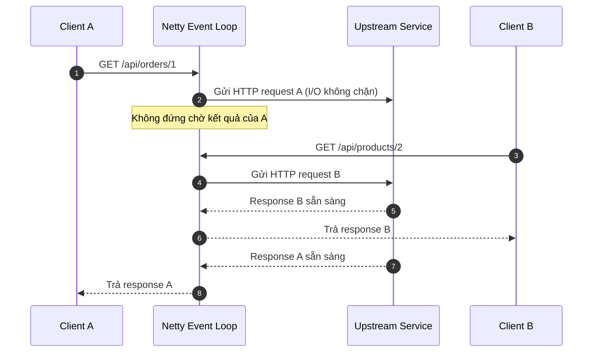
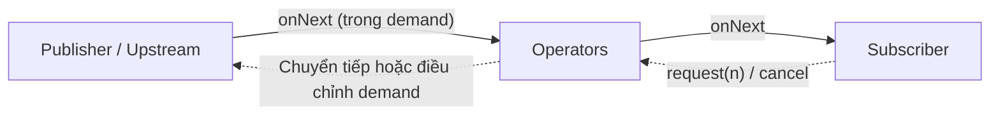
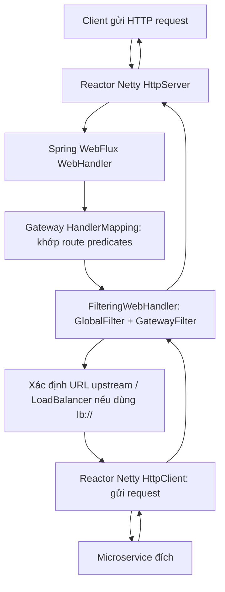

# Mô hình xử lý không chặn của Spring WebFlux và Reactor Netty

## 1. Bối cảnh: Vì sao API Gateway cần xử lý không chặn?

Trong hệ thống microservices, **Spring Cloud Gateway** nhận nhiều HTTP request từ client, xác định route, chạy các filter rồi chuyển tiếp đến service đích. Một request thường dành phần lớn thời gian để **chờ I/O**: chờ kết nối, chờ upstream xử lý, chờ nhận dữ liệu hoặc chờ gửi response qua mạng.

Nếu mỗi request giữ riêng một thread trong suốt thời gian chờ, số thread và chi phí chuyển ngữ cảnh có thể tăng mạnh khi nhiều request cùng tồn tại. **Spring WebFlux** cung cấp mô hình xử lý phản ứng (reactive), còn **Reactor Netty** cung cấp HTTP server/client và cơ chế I/O không chặn dựa trên event loop. Kết hợp này cho phép một số lượng thread hữu hạn phục vụ nhiều kết nối đang chờ I/O.

Mục tiêu của bài:

- Phân biệt **bất đồng bộ (asynchronous)** và **không chặn (non-blocking)**.
- Hiểu **event loop**, **Reactor Netty**, `Mono`, `Flux` và **Reactive Streams**.
- Theo dõi hành trình request qua Spring WebFlux và Spring Cloud Gateway.
- Nhận diện thao tác chặn event loop và cách xử lý khi buộc phải gọi thư viện đồng bộ.
- Hiểu các giới hạn về backpressure, timeout, bộ nhớ và observability trong vận hành gateway.

> **Phạm vi:** bài tập trung vào nền tảng WebFlux dùng cho biến thể **Spring Cloud Gateway Server WebFlux**. Spring Cloud Gateway cũng có biến thể Server MVC với mô hình triển khai khác. Các ví dụ cấu hình cần đối chiếu tài liệu tương ứng với phiên bản Spring Cloud/Spring Boot thực tế.

## 2. Blocking, non-blocking và asynchronous: không phải cùng một khái niệm

Một phép gọi **blocking** giữ thread tại điểm gọi cho đến khi thao tác hoàn tất (hoặc hết timeout). Một phép gọi **non-blocking** không giữ thread chỉ để chờ I/O; khi tài nguyên sẵn sàng, hệ thống nhận sự kiện và tiếp tục xử lý.

**Synchronous/asynchronous** nói về cách kết quả được phối hợp: gọi rồi đợi kết quả theo luồng điều khiển hiện tại, hoặc đăng ký việc cần làm và nhận kết quả ở thời điểm khác. Asynchronous không tự động đồng nghĩa non-blocking: có thể chuyển một lời gọi JDBC blocking sang thread khác, nhưng thread mới ấy vẫn bị chặn trong lúc đợi JDBC.

| Mô hình | Điều gì xảy ra khi upstream chưa phản hồi? | Đánh đổi điển hình |
| --- | --- | --- |
| Blocking, mỗi request có thread xử lý | Thread giữ trạng thái chờ kết quả I/O | Dễ viết theo lối tuần tự; nhiều request chờ có thể tiêu thụ nhiều thread |
| Async nhưng chuyển việc blocking sang thread pool | Thread nhận request có thể rảnh; thread trong pool vẫn chờ I/O | Tránh chặn thread tiếp nhận nhưng vẫn cần quản lý kích thước pool |
| Non-blocking I/O với event loop | Thread thực hiện công việc khác, xử lý tiếp khi có sự kiện I/O | Giảm chi phí thread cho tải I/O lớn; yêu cầu toàn bộ chuỗi xử lý tránh blocking |

**Không chặn không có nghĩa là không tốn thời gian.** Một lần gọi upstream mất 700 ms vẫn có độ trễ ít nhất tương ứng với thời gian chờ đó. Lợi ích là thread có thể phục vụ thêm công việc trong khoảng chờ, giúp sử dụng tài nguyên hiệu quả hơn khi tải đồng thời cao và phần lớn thời gian dành cho I/O.

### Minh họa hai request đồng thời



Sơ đồ mô tả **quy tắc hoạt động**, không khẳng định toàn hệ thống chỉ có một event-loop thread. Reactor Netty sử dụng nhiều event loop; các thao tác khác có thể dùng scheduler/thread khác theo cấu hình. Thứ tự response cũng phụ thuộc thời gian upstream hoàn thành.

## 3. Reactor Netty: lớp HTTP và mạng dựa trên event loop

**Netty** là framework xử lý mạng bất đồng bộ dựa trên channel, event loop và chuỗi handler. **Reactor Netty** xây dựng các API HTTP/TCP có thể kết hợp với Project Reactor lên trên Netty. Spring WebFlux có thể dùng Reactor Netty làm HTTP server runtime; WebClient cũng có thể dùng Reactor Netty làm HTTP client connector.

Một số thành phần cần phân biệt:

| Thành phần | Trách nhiệm |
| --- | --- |
| `Channel` | Đại diện cho kết nối hoặc kênh I/O |
| `EventLoop` | Theo dõi sự kiện I/O của các channel và chạy tác vụ gắn với chúng |
| `ChannelPipeline` / handler | Xử lý dữ liệu vào/ra như giải mã HTTP, ghi response |
| Reactor Netty `HttpServer` | Tiếp nhận HTTP request từ client |
| Reactor Netty `HttpClient` | Gửi HTTP request đến upstream mà không chặn thread khi chờ mạng |
| Spring WebFlux | Chuyển request/response thành các abstraction HTTP và phối hợp handler/filter reactive |

Một channel thường được gắn với một event loop để xử lý I/O của nó, nhưng **không có quy tắc một thread cho mỗi request**. Một event-loop thread có thể luân phiên xử lý sự kiện cho nhiều channel. Mô hình này dựa vào điều kiện quan trọng: công việc được chạy trên event loop phải nhanh, đặc biệt không chờ thao tác blocking.

### Vòng đời I/O ở mức khái niệm

1. HTTP server nhận kết nối và dữ liệu mới qua Netty.
2. Netty giải mã các byte thành thông điệp HTTP; WebFlux biểu diễn chúng thành request/response để xử lý ở tầng ứng dụng.
3. Handler/Filter xây dựng chuỗi xử lý reactive và, khi được subscribe, thực hiện các tác vụ cần thiết.
4. Khi cần gọi service khác, HTTP client khởi tạo I/O mà không giữ event-loop thread để chờ kết quả.
5. Lúc có dữ liệu hoặc trạng thái kết nối mới, event loop tiếp tục xử lý tín hiệu; pipeline hoàn thành việc ghi response.

Trong một ứng dụng, HTTP server và HTTP client có thể chia sẻ tài nguyên event-loop của Reactor Netty theo cấu hình mặc định hoặc dùng tài nguyên riêng khi cấu hình khác. Không nên cố định số thread theo số request; cấu hình tài nguyên phải dựa trên tải thực và đặc điểm triển khai.

**Bộ nhớ cũng là tài nguyên phải quản lý.** Netty có thể sử dụng bộ đệm `ByteBuf` được pool; Spring WebFlux cung cấp `DataBuffer` ở tầng ứng dụng. Nếu tự viết filter đọc, cache hoặc chỉnh sửa body, cần chú ý quy tắc tiêu thụ và giải phóng buffer để tránh rò rỉ bộ nhớ. Không tự gom toàn bộ request/response lớn vào RAM nếu có thể streaming.

## 4. Project Reactor: mô tả công việc sẽ xảy ra khi dữ liệu đến

Spring WebFlux dùng **Project Reactor** làm thư viện reactive phổ biến. Hai kiểu trung tâm là:

| Kiểu | Số phần tử tối đa được phát | Trường hợp hay gặp |
| --- | --- | --- |
| `Mono<T>` | 0 hoặc 1 | Một JSON response, kết quả xác thực, hoàn tất thao tác |
| `Flux<T>` | 0 đến nhiều | Dòng sự kiện, dữ liệu trả về theo luồng, nhiều bản ghi |

Cả `Mono` và `Flux` triển khai các hợp đồng publisher của Reactive Streams. Một chuỗi reactive có thể phát ra các tín hiệu:

- **`onSubscribe`**: subscriber nhận subscription.
- **`onNext`**: có phần tử dữ liệu mới (không dùng với giá trị `null`).
- **`onComplete`**: stream hoàn tất bình thường.
- **`onError`**: stream kết thúc do lỗi.
- **`cancel`**: subscriber không còn cần dữ liệu tiếp theo, ví dụ client ngắt kết nối; cách tài nguyên được hủy phụ thuộc từng thành phần trong chuỗi.

`onComplete` và `onError` là tín hiệu kết thúc thay thế nhau. Một `Mono` có thể hoàn tất mà không phát phần tử, như `Mono.empty()`.

### Assembly và subscription

Viết:

```java
Mono<String> message = Mono.just("gateway")
    .map(String::toUpperCase);
```

mới **mô tả** chuỗi biến đổi. Với các publisher kiểu **cold**, công việc phía nguồn thường được bắt đầu khi có subscription. Trong Spring WebFlux, framework subscribe vào `Mono`/`Flux` được trả về từ handler; lập trình viên thường **không gọi `.subscribe()` thủ công** trong controller hoặc filter để điều khiển response.

Sự phân biệt này rất quan trọng khi kết hợp I/O:

```java
Mono<Product> product = webClient.get()
    .uri("/products/{id}", id)
    .retrieve()
    .bodyToMono(Product.class);
```

Đây là mô tả một lời gọi HTTP bất đồng bộ. Gọi `product.block()` lại buộc thread hiện tại chờ kết quả, làm mất lợi ích non-blocking nếu được gọi trên event loop.

Không phải mọi publisher đều cold: Reactor cũng có những nguồn **hot**, có thể phát dữ liệu độc lập với từng subscriber. Cần hiểu nguồn phát và cách chia sẻ subscription khi muốn cache/multicast dữ liệu.

### Các operator thường gặp

| Operator | Cách dùng | Lưu ý |
| --- | --- | --- |
| `map` | Biến đổi dữ liệu đồng bộ, nhanh | Hàm trong `map` vẫn có thể chặn thread nếu bên trong gọi I/O blocking |
| `flatMap` | Ghép một tác vụ trả về `Mono`/`Flux` khác | Phù hợp với lời gọi WebClient hoặc workflow bất đồng bộ |
| `filter` | Chỉ giữ phần tử thỏa điều kiện | Khác với Gateway Filter xử lý HTTP request |
| `timeout` | Phát lỗi nếu publisher không đáp ứng thời hạn | Timeout không tự hoàn tác nghiệp vụ đã thực hiện ở upstream |
| `onErrorResume` | Xử lý lỗi bằng luồng thay thế | Chỉ fallback khi ngữ nghĩa nghiệp vụ cho phép |
| `doOnNext`, `doOnError` | Quan sát tín hiệu, phục vụ logging/metrics | Không nên đặt I/O blocking trong callback |
| `subscribeOn`, `publishOn` | Điều phối vị trí thực thi qua scheduler | Scheduler không tự biến thao tác blocking thành non-blocking |

## 5. Backpressure: điều tiết tốc độ tiêu thụ dữ liệu

**Backpressure** trong Reactive Streams là cơ chế subscriber có thể thông báo mức nhu cầu thông qua `Subscription.request(n)`. Publisher tương thích chỉ phát `onNext` theo lượng demand được cho phép. Nhờ đó, chuỗi dữ liệu có khả năng tránh sản xuất vượt tốc độ xử lý của downstream.



Ví dụ, một subscriber xử lý chậm có thể chỉ yêu cầu thêm dữ liệu sau khi xử lý xong phần trước. Các operator như `buffer`, `flatMap`, `limitRate` có thể thay đổi cách demand đi ngược chuỗi; cấu hình concurrency/buffer phải phù hợp với bộ nhớ và upstream.

Cần tránh suy luận quá mức:

- **Backpressure ở Reactor không đồng nghĩa mọi upstream bên ngoài đều hỗ trợ Reactive Streams.** Một HTTP server, hệ thống message hoặc database có cơ chế điều tiết riêng. Reactor Netty phối hợp đọc/ghi qua tầng mạng, nhưng demand không tự biến thành quota nghiệp vụ cho API phía sau.
- **HTTP không tự bảo đảm hệ thống an toàn trước tải lớn.** Gateway vẫn cần hạn mức số kết nối, giới hạn kích thước body, rate limiting, timeout và quản lý tài nguyên.
- Khi có một `Mono` cho mỗi request, vấn đề thường là **số request đồng thời** hơn là số phần tử trong một `Flux`. Backpressure không thay thế cơ chế kiểm soát concurrency của HTTP client và gateway.

## 6. Request đi qua Spring Cloud Gateway Server WebFlux như thế nào?

Trong luồng WebFlux, Reactor Netty tiếp nhận HTTP I/O; Spring WebFlux cung cấp abstraction request, response và handler; Spring Cloud Gateway chọn route và chạy **Gateway Filter Chain**.



Đối với các route HTTP(S) được chuyển tiếp qua Netty, filter định tuyến của gateway dùng Reactor Netty HTTP client để nói chuyện với upstream; response được đưa về cho client qua lớp HTTP server. Chi tiết filter và thứ tự xử lý phụ thuộc cấu hình và phiên bản Gateway.

Hãy phân biệt ba lớp trách nhiệm:

1. **Route predicate:** quyết định request có khớp route hay không, ví dụ `Path=/api/orders/**`.
2. **Gateway filter:** biến đổi path/header, thực hiện rate limiting hoặc các chính sách khác đã được cấu hình.
3. **HTTP transport:** mở, tái sử dụng và điều phối kết nối mạng; nhận/gửi byte mà không chặn event loop khi chờ I/O.

`WebFilter` của Spring WebFlux và `GatewayFilter`/`GlobalFilter` của Spring Cloud Gateway là **những abstraction khác nhau**. Không nên coi mọi filter đều được thực thi ở cùng một vị trí trong chuỗi request. Một số công việc như xác thực bằng Spring Security có thể được triển khai ở chuỗi WebFlux WebFilter trước khi đến các gateway filter.

### Ví dụ route gateway

Đây là ví dụ **minh họa** theo kiểu cấu hình được nhiều dự án **Spring Cloud Gateway Server WebFlux 4.x** sử dụng. Thuộc tính cấu hình có thể khác ở các phiên bản mới hơn:

```yaml
spring:
  cloud:
    gateway:
      routes:
        - id: product-route
          uri: http://localhost:8081
          predicates:
            - Path=/api/products/**
          filters:
            - StripPrefix=1
```

Khi `GET /api/products/42` đến gateway, predicate khớp đường dẫn; filter bỏ tiền tố `/api`; HTTP client gọi `GET http://localhost:8081/products/42`.

Cấu hình này minh họa **định tuyến không chặn ở tầng I/O**. Nó chưa thêm xác thực, rate limiting, retry, circuit breaker, TLS hay service discovery. Nếu dùng `lb://PRODUCT-SERVICE`, phải có các dependency/cấu hình tương ứng cho khám phá instance và cân bằng tải. WebFlux không tự kích hoạt những tính năng đó.

## 7. Ví dụ WebFlux: gọi upstream qua WebClient mà không chặn event loop

Ví dụ dưới là một **WebFlux controller độc lập để quan sát cơ chế reactive**; trong Spring Cloud Gateway thuần định tuyến, bạn thường dùng Gateway route/filter thay vì viết controller cho từng API. Giả sử ứng dụng có Spring WebFlux, được Spring Boot cung cấp `WebClient.Builder` và có upstream đang chạy ở `http://localhost:8081`.

```java
import java.time.Duration;
import org.springframework.web.bind.annotation.GetMapping;
import org.springframework.web.bind.annotation.PathVariable;
import org.springframework.web.bind.annotation.RequestMapping;
import org.springframework.web.bind.annotation.RestController;
import org.springframework.web.reactive.function.client.WebClient;
import reactor.core.publisher.Mono;

@RestController
@RequestMapping("/demo")
class ProductController {
    private final WebClient webClient;

    ProductController(WebClient.Builder builder) {
        this.webClient = builder
                .baseUrl("http://localhost:8081")
                .build();
    }

    @GetMapping("/products/{id}")
    Mono<ProductView> getProduct(@PathVariable long id) {
        return webClient.get()
                .uri("/products/{id}", id)
                .retrieve()
                .bodyToMono(ProductView.class)
                .timeout(Duration.ofSeconds(2));
    }
}

record ProductView(long id, String name) {}
```

Điều gì diễn ra?

1. `getProduct` trả về `Mono<ProductView>`, không chờ `WebClient` hoàn tất tại phương thức Java.
2. Spring WebFlux subscribe vào publisher để gửi response; Reactor Netty HTTP client thực hiện I/O bất đồng bộ.
3. Khi có response, `bodyToMono` giải mã JSON thành `ProductView` rồi framework ghi HTTP response cho client.
4. `timeout` phát lỗi nếu chuỗi không hoàn tất trong thời hạn; mã HTTP cuối cùng còn phụ thuộc cơ chế ánh xạ lỗi của ứng dụng.

Không gọi `.block()` hoặc tự `.subscribe()` trong handler. `Mono` chỉ giúp mô hình gọi I/O không chặn khi **toàn bộ chuỗi thật sự không thực hiện thao tác blocking**.

Một ví dụ khác minh họa việc chờ bằng timer không giữ thread:

```java
@GetMapping("/ready-later")
Mono<String> readyLater() {
    return Mono.delay(Duration.ofMillis(300))
            .map(tick -> "ready");
}
```

`Mono.delay` không tương đương `Thread.sleep(300)`: nó lập lịch phát tín hiệu sau một khoảng thời gian thay vì bắt thread hiện tại ngủ trong suốt khoảng đó.

## 8. Các lỗi phổ biến làm mất tính non-blocking

### 8.1. Chặn event loop

Các thao tác sau có thể gây nghẽn nếu chạy trực tiếp trên luồng xử lý Netty/WebFlux:

```java
// Ví dụ sai khi chạy trên event loop:
Thread.sleep(500);
String result = webClient.get()
        .uri("/status")
        .retrieve()
        .bodyToMono(String.class)
        .block();
```

Tương tự, gọi trực tiếp JDBC blocking, I/O file đồng bộ, HTTP client đồng bộ hoặc tính toán CPU nặng trong filter sẽ làm chậm những kết nối khác được phục vụ bởi event loop đó. Trong nhiều đường chạy Reactor không hỗ trợ blocking, `.block()` còn có thể ném ngoại lệ để ngăn hành vi này.

**`Mono.just(blockingCall())` không giải quyết vấn đề** vì `blockingCall()` được thực thi ngay khi tính tham số, trước khi `Mono` được tạo.

### 8.2. Cô lập thao tác blocking bắt buộc

Nếu chưa thể thay thư viện cũ bằng API reactive, có thể chuyển phần blocking sang scheduler phù hợp:

```java
import reactor.core.publisher.Mono;
import reactor.core.scheduler.Schedulers;

// legacyClient.loadProduct(id) là lời gọi đồng bộ, blocking.
Mono<ProductView> product = Mono.fromCallable(
        () -> legacyClient.loadProduct(id)
    )
    .subscribeOn(Schedulers.boundedElastic());
```

`fromCallable` trì hoãn lời gọi đến lúc subscribe; `subscribeOn(Schedulers.boundedElastic())` chuyển việc chạy nguồn blocking sang một scheduler được thiết kế cho công việc dạng này. Nó **không biến API cũ thành non-blocking**: các thread của `boundedElastic` vẫn bị chiếm khi thư viện cũ chờ I/O. Hàng đợi, giới hạn thread và số lượng tác vụ đang chờ vẫn cần được đo và kiểm soát.

Trong đường xử lý gateway có lưu lượng cao, ưu tiên API không chặn từ đầu đến cuối: Reactor Netty HTTP client, driver database reactive khi phù hợp và các thao tác transform dữ liệu ngắn. Không lạm dụng `boundedElastic` để che giấu việc chọn sai kiến trúc.

### 8.3. Giả định mọi operator tự có thread riêng

`map` và `flatMap` không mặc nhiên tạo thread mới. Operator thường thực thi trên thread phát tín hiệu tại thời điểm đó, trừ khi có ranh giới scheduler hoặc logic bất đồng bộ chuyển execution context. Hai operator điều phối thường gặp:

- `subscribeOn`: ảnh hưởng đến nơi nguồn được subscribe/thực thi.
- `publishOn`: chuyển nơi thực thi các operator phía sau nó trong chuỗi.

Do đó, một `map` làm việc CPU nặng vẫn có thể chiếm event-loop thread. Với tác vụ CPU lớn, cần cân nhắc đưa sang worker pool thích hợp, giới hạn concurrency và đo chi phí scheduling; không nên mặc định mỗi request tạo một scheduler mới.

### 8.4. Dựa vào ThreadLocal cho dữ liệu request

Vì xử lý có thể đi qua các thread khác nhau, `ThreadLocal` không phải lựa chọn mặc định để truyền context xuyên suốt chuỗi reactive. Reactor có **`Context`** gắn với subscriber để mang metadata phù hợp; Spring Security reactive cũng tổ chức security context theo cơ chế reactive. Khi viết filter, logging hoặc tracing, cần dùng cách lan truyền context phù hợp với thư viện và phiên bản đang dùng.

## 9. Timeout, cancellation và giới hạn của mô hình

### Timeout và retry

Trong gateway, latency đầu cuối gồm nhiều phần: kết nối client, xử lý filter, DNS/discovery, kết nối upstream, thời gian upstream phản hồi và ghi dữ liệu về client. Một `timeout` ở cấp publisher có thể dừng việc chờ và phát lỗi, nhưng không chắc hủy được công việc hoặc thay đổi nghiệp vụ đã xảy ra ở hệ thống bên kia.

Đặc biệt với `POST /payments` hoặc thao tác tạo đơn hàng, **retry có thể tạo tác dụng phụ trùng lặp** nếu upstream đã xử lý thành công nhưng response bị mất. Cần thiết kế idempotency và giới hạn retry; không phải mọi lỗi `5xx` đều an toàn để thử lại.

### Client ngắt kết nối và cancellation

Khi client đóng kết nối hoặc không còn tiêu thụ dữ liệu, một số phần của pipeline có thể nhận cancellation. Cancellation giúp giải phóng tài nguyên liên quan khi các publisher và transport hỗ trợ; nó **không đảm bảo** có thể ngừng ngay công việc đã giao cho upstream độc lập. Không dựa vào cancellation để triển khai nghiệp vụ rollback.

### Streaming và bộ nhớ

Với response lớn hoặc stream kéo dài (chẳng hạn Server-Sent Events), `Flux` cho phép xử lý theo luồng thay vì tự gom mọi phần tử trước khi ghi. Song streaming vẫn đòi hỏi giới hạn buffer, kết nối và kiểm soát tốc độ client tiêu thụ. Một custom filter cache body không đúng cách có thể gây đầy RAM hoặc rò rỉ buffer dù toàn bộ pipeline dùng API reactive.

## 10. Quan sát và chẩn đoán gateway WebFlux

Mô hình event loop cần bộ chỉ báo vận hành khác với ứng dụng chỉ nhìn vào số lượng thread. Những tín hiệu đáng theo dõi gồm:

| Triệu chứng | Giả thuyết cần kiểm tra | Hướng quan sát |
| --- | --- | --- |
| p95/p99 latency tăng mạnh khi nhiều request đồng thời | Event loop bị blocking, upstream chậm hoặc cạn kết nối | Trace phân tán, thread dump, độ trễ per-route, thời gian chờ upstream |
| CPU cao dù mạng không bận | Biến đổi JSON/crypto/tính toán nặng chạy trên event loop | CPU profiling, độ dài tác vụ, operator/filter tiêu tốn CPU |
| Request bị treo hoặc timeout thường xuyên | Upstream quá tải, thiếu timeout, thiếu kết nối khả dụng | Timeout theo chặng, connection pool metrics, trạng thái upstream |
| RAM/direct memory tăng | Buffer body quá mức, cache không giới hạn hoặc rò rỉ `DataBuffer`/`ByteBuf` | Heap/direct-memory metrics, log cảnh báo leak, kích thước payload |
| Nhiều thread `boundedElastic` bận | Gọi blocking trong chuỗi reactive | Thread dump, queue task, điểm gọi thư viện đồng bộ |
| Tỷ lệ `429`/`503` cao | Rate limit hoặc discovery/upstream chưa sẵn sàng | Metrics filter, health instance, dashboard theo route |

Trong phát triển, có thể dùng công cụ phát hiện blocking như **BlockHound** khi tương thích với môi trường dự án; kết quả cần được diễn giải theo thư viện, phiên bản và cấu hình thực tế. Khi vận hành, nên kết hợp **Micrometer metrics**, distributed tracing và log có correlation ID; không ghi token hoặc thông tin nhạy cảm vào log.

Một điểm dễ nhầm: nếu gateway bắt đầu xử lý nhanh nhưng upstream tốn 800 ms, latency client vẫn có thể quanh 800 ms hoặc hơn. Non-blocking giúp gateway không phải giữ thread để chờ, **không làm upstream tính toán nhanh hơn**.

## 11. Checklist áp dụng vào Spring Cloud Gateway

1. Xác định đang dùng đúng **Spring Cloud Gateway Server WebFlux** và runtime tương ứng; không trộn giả định của Spring MVC.
2. Dùng các filter không chặn; rà soát `.block()`, `Thread.sleep`, JDBC/HTTP client đồng bộ và xử lý CPU nặng trong request path.
3. Dùng `Mono`/`Flux` để **trả publisher về framework**; tránh `.subscribe()` thủ công trong controller/filter cho luồng response.
4. Nếu phải dùng thư viện blocking, cô lập bằng scheduler phù hợp và thiết lập giới hạn tải; lên kế hoạch thay bằng API không chặn khi cần.
5. Quản lý connection pool, timeout, request/body size và concurrency; đừng xem backpressure là công cụ thay thế rate limiting.
6. Chỉ cấu hình retry khi hiểu idempotency; phân biệt lỗi transport với lỗi nghiệp vụ.
7. Với filter đọc/cached body, kiểm tra đúng cách tiêu thụ và giải phóng `DataBuffer`; hạn chế buffer vô hạn.
8. Gắn metrics và trace vào route/request để phát hiện upstream chậm, event loop nghẽn, memory leak và các lỗi HTTP.

### Tự kiểm tra sự hiểu biết bằng một tình huống

Gateway nhận 2.000 request cùng lúc; mỗi upstream phản hồi sau khoảng 600 ms. Nếu gateway chỉ dùng Reactor Netty để gửi, nhận và chuyển tiếp HTTP, các event-loop thread có thể xử lý nhiều request trong lúc chờ I/O. Nếu một custom filter lại gọi `Thread.sleep(600)` trên event loop cho **mỗi** request, gateway có thể bị nghẽn dù upstream vẫn khỏe.

Đặt câu hỏi khi debug: **Thread nào đang chờ?** Nếu thread chỉ được thông báo tiếp khi có I/O, thiết kế đang tận dụng non-blocking. Nếu thread bị giữ trong `sleep`, `block` hoặc API đồng bộ, cần loại bỏ/cô lập điểm blocking trước khi cân nhắc tăng số event-loop thread.

## 12. Ghi nhớ

**Spring WebFlux** cung cấp mô hình lập trình HTTP reactive; **Project Reactor** cung cấp `Mono`, `Flux`, tín hiệu và backpressure; **Reactor Netty** cung cấp HTTP transport dựa trên non-blocking I/O và event loop. **Spring Cloud Gateway Server WebFlux** kết hợp các tầng đó với route predicates và filter chain để chuyển tiếp request đến microservices.

Điều quan trọng nhất không nằm ở việc phương thức trả về `Mono` hay `Flux`, mà ở chỗ **toàn bộ đường xử lý request có tránh blocking và kiểm soát tài nguyên hay không**. Khi hiểu rõ điều này, bạn có cơ sở để thiết kế route/filter, xác thực, rate limiting, circuit breaker, retry, TLS và observability cho gateway an toàn và ổn định khi tải tăng.
