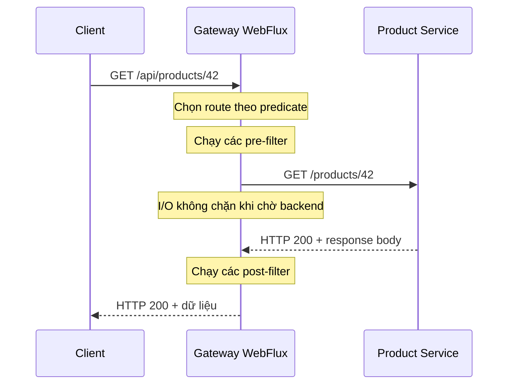
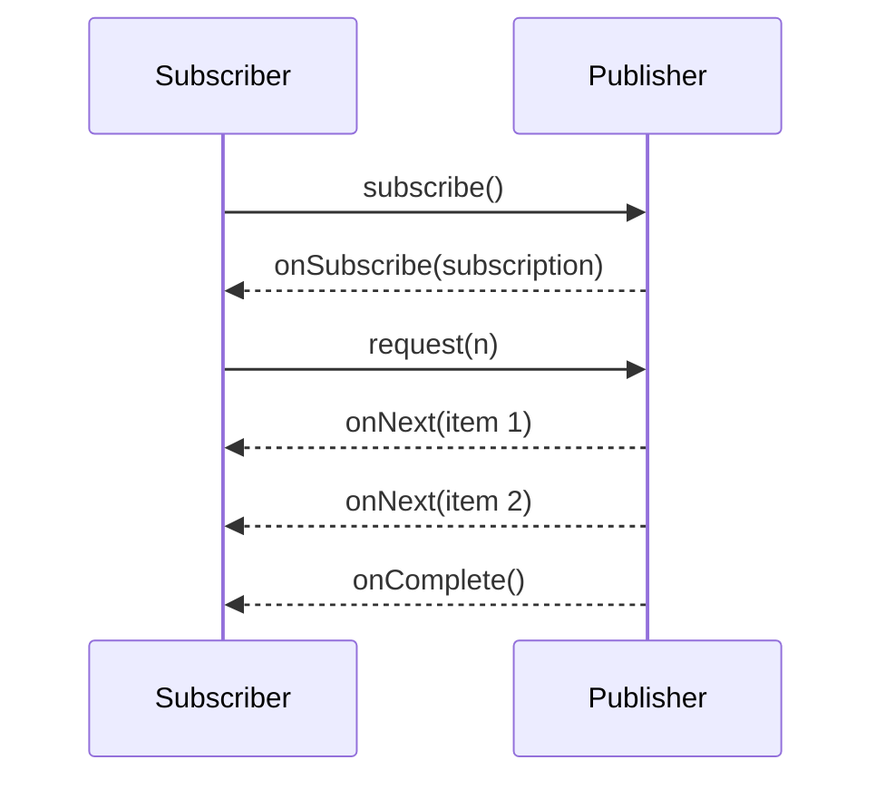
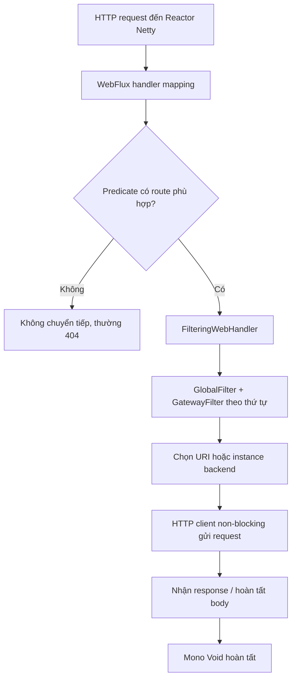

# Mono, Flux và cách biểu diễn yêu cầu HTTP bất đồng bộ trong Spring Cloud Gateway

**Spring Cloud Gateway Server WebFlux** xây dựng luồng tiếp nhận và chuyển tiếp HTTP trên Spring WebFlux, Project Reactor và nền tảng mạng hỗ trợ I/O không chặn như Reactor Netty. Vì vậy, khi đọc hoặc viết filter cho API Gateway, cần hiểu vì sao các hàm thường trả về `Mono` hay `Flux`, khi nào một phép xử lý thực sự diễn ra và vì sao không nên gọi các thao tác chặn luồng.

Trong module `SPRING_CLOUD_GATEWAY`, kiến thức này là nền tảng để kết hợp **route predicate**, **filter chain**, biến đổi path/header và chuyển tiếp tới dịch vụ phía sau, kể cả dịch vụ được khám phá qua `lb://`. Cùng một cách tư duy reactive còn giúp xây dựng xác thực, giới hạn lưu lượng, circuit breaker, retry, TLS và quan sát request mà không làm nghẽn cổng vào microservices.

## 1. Một HTTP request đi qua Gateway như thế nào?

Giả sử client gọi `GET /api/products/42`. Gateway cần chọn route theo predicate, bỏ tiền tố `/api`, rồi chuyển tiếp tới Product Service ở `/products/42`. Trong thời gian chờ kết nối và dữ liệu từ backend, tiến trình không nhất thiết phải giữ riêng một thread chỉ để đứng chờ.



Với mô hình này, một request có thể phải đợi backend hàng chục hoặc hàng trăm mili giây. I/O không chặn giúp tài nguyên thread xử lý các sự kiện của những kết nối khác trong khoảng thời gian đợi ấy. Đây là một lợi thế quan trọng khi Gateway phải xử lý đồng thời nhiều kết nối, nhưng **không có nghĩa mọi đoạn mã chạy trong WebFlux tự động trở nên bất đồng bộ hoặc không chặn**.

Cần phân biệt:

| Khái niệm | Ý nghĩa | Ví dụ |
| --- | --- | --- |
| **Bất đồng bộ (asynchronous)** | Công việc có thể hoàn tất và thông báo kết quả sau, không buộc caller phải nhận kết quả ngay. | Gửi HTTP request tới backend, xử lý response khi có dữ liệu. |
| **Không chặn (non-blocking)** | Thread không phải đứng đợi một thao tác I/O hoàn tất. | Reactor Netty xử lý sự kiện mạng thay vì dùng `Thread.sleep()` để đợi. |
| **Reactive** | Biểu diễn luồng tín hiệu và ghép các phép xử lý qua publisher/operator/subscriber. | `Mono<Void>` mà một `GlobalFilter` trả về. |
| **Song song (parallel)** | Nhiều công việc thực sự chạy đồng thời trên các tài nguyên thực thi khác nhau. | Xử lý CPU trên nhiều worker khi thiết kế rõ scheduler. |

Một pipeline reactive có thể xử lý **tuần tự trên cùng một thread**. Nó không tự tạo thêm thread, cũng không sửa được thư viện gọi I/O kiểu blocking ở bên trong.

## 2. Reactive Streams: tín hiệu thay vì giá trị có sẵn

Project Reactor triển khai mô hình **Reactive Streams**, trong đó:

- **Publisher** là nguồn phát dữ liệu hoặc sự kiện kết thúc; trong Reactor thường gặp `Mono<T>` và `Flux<T>`.
- **Subscriber** nhận dữ liệu và các tín hiệu trạng thái từ publisher.
- **Subscription** liên kết hai phía; subscriber có thể yêu cầu số phần tử muốn nhận (`request(n)`) hoặc hủy (`cancel()`).
- Các tín hiệu chính gồm `onSubscribe`, `onNext`, `onComplete` và `onError`. Sau `onComplete` hoặc `onError`, stream kết thúc.

Về mặt trình tự:



Nếu xảy ra lỗi, `onError` thay cho `onComplete`. Nếu subscriber hủy, publisher có thể dừng công việc đang thực hiện ở mức mà nguồn dữ liệu hỗ trợ; việc hủy không đảm bảo mọi tác dụng phụ tại backend đã được hoàn tác.

**Điểm cốt lõi:** tạo một chuỗi `Mono` hoặc `Flux` chủ yếu là **mô tả công việc**. Phần lớn publisher dùng trong xử lý HTTP chỉ bắt đầu nguồn dữ liệu khi có subscription. Trong Spring WebFlux, framework chịu trách nhiệm subscribe vào publisher do handler hoặc filter trả về. **Không tự gọi `subscribe()` trong gateway filter chỉ để “kích hoạt” lời gọi backend** vì sẽ tạo nhánh xử lý ngoài vòng đời HTTP, khó đồng bộ lỗi, hoàn tất và hủy request.

> `Mono.just(value)` lưu ngay giá trị được cung cấp khi dựng publisher; `Mono.defer(...)` trì hoãn việc gọi factory cho đến lúc có subscription. Phân biệt “khởi tạo publisher” với “thực thi nguồn dữ liệu” khi làm việc với các thao tác có tác dụng phụ.

## 3. Mono và Flux khác nhau ở đâu?

`Mono<T>` biểu diễn một luồng có **tối đa một phần tử**; `Flux<T>` biểu diễn luồng có **từ không đến nhiều phần tử**. Cả hai đều có thể kết thúc thành công, kết thúc do lỗi, hoặc bị hủy.

| Tiêu chí | `Mono<T>` | `Flux<T>` |
| --- | --- | --- |
| Số tín hiệu `onNext` | 0 hoặc 1 | 0, 1 hoặc nhiều |
| Kết thúc thành công | `onComplete`, có thể không có dữ liệu | `onComplete` sau 0 hoặc nhiều phần tử |
| Kết thúc khi lỗi | `onError` | `onError` |
| Tình huống thường gặp | Lấy một sản phẩm, xác thực một token, tín hiệu hoàn tất ghi response | Dòng sự kiện, nhiều bản ghi, các khối dữ liệu request/response |
| Ví dụ kiểu | `Mono<ProductDto>`, `Mono<Void>` | `Flux<ProductDto>`, `Flux<DataBuffer>` |

### 3.1. Mono: không có, một hoặc lỗi

```java
Mono<String> one = Mono.just("product-42");
Mono<String> none = Mono.empty();
Mono<String> failed = Mono.error(new IllegalStateException("Backend unavailable"));
```

- `one` phát một chuỗi rồi hoàn tất.
- `none` hoàn tất **không phát phần tử nào**; đây không tự động là lỗi.
- `failed` phát tín hiệu lỗi; muốn chuyển lỗi thành phản hồi hoặc fallback cần chính sách xử lý phù hợp.

Một kiểu rất quan trọng ở Gateway là **`Mono<Void>`**. Nó không chứa dữ liệu nghiệp vụ để lấy ra bằng `map`; nó biểu diễn **việc xử lý đã hoàn thành hoặc thất bại**. Điều này không có nghĩa HTTP response trống: filter có thể ghi header/body ra `ServerHttpResponse`, rồi publisher hoàn tất khi quá trình xử lý response kết thúc.

### 3.2. Flux: nhiều phần tử theo thời gian

```java
Flux<String> statuses = Flux.just("accepted", "routed", "completed")
    .map(String::toUpperCase);
```

`Flux` có thể phát từng phần tử khi nguồn tạo ra chúng. Ví dụ một backend trả **Server-Sent Events (SSE)**, hoặc request/response body được truyền qua nhiều chunk dữ liệu. Ngược lại, trả về `Flux<ProductDto>` từ một controller **không đồng nghĩa** client sẽ nhận nhiều HTTP response; thông thường vẫn là **một HTTP response**, có thể được serialize thành JSON array hoặc truyền dạng streaming tùy media type và cách ghi body.

Một `Flux` không mặc nhiên phát dữ liệu liên tục; nó có thể kết thúc rất nhanh. Tương tự, `Flux` không mặc nhiên chạy trên thread khác.

### 3.3. Ví dụ HTTP ở một backend WebFlux

Giả sử Product Service có `ProductService.findById(id)` trả về `Mono<ProductDto>`. Handler có thể biểu diễn ba kết quả rõ ràng:

```java
@GetMapping("/products/{id}")
public Mono<ResponseEntity<ProductDto>> findOne(@PathVariable String id) {
    return productService.findById(id)
        .map(product -> ResponseEntity.ok(product))
        .defaultIfEmpty(ResponseEntity.notFound().build());
}
```

Ở đây:

1. Có sản phẩm: phát một `ResponseEntity<ProductDto>` với status 200.
2. Không có sản phẩm: `Mono.empty()` từ service được đổi thành status 404 bằng `defaultIfEmpty`.
3. Có lỗi: publisher phát `onError`; handler xử lý lỗi chung của ứng dụng quyết định HTTP response nếu không bắt lỗi trong chuỗi.

Ví dụ thể hiện kiểu trả về của **backend WebFlux**. Spring Cloud Gateway thông thường định tuyến và chuyển tiếp qua filter tích hợp, không cần tự viết controller gọi từng backend bằng `WebClient` cho mỗi route.

## 4. Ghép thao tác bằng operator

Điểm mạnh của Reactor nằm ở cách mô tả chuỗi công việc mà vẫn giữ nguyên vòng đời subscription, lỗi và hủy. Một số operator thiết yếu:

| Operator | Khi dùng | Lưu ý |
| --- | --- | --- |
| `map` | Biến đổi đồng bộ một phần tử thành giá trị khác. | Hàm bên trong phải nhanh, không chặn. |
| `flatMap` | Phép biến đổi trả về một `Publisher` khác, ví dụ gọi I/O reactive. | Tránh lồng `Mono<Mono<T>>` và tránh gọi `block()` để lấy kết quả. |
| `filter` | Giữ phần tử khi điều kiện đúng. | Với `Mono`, điều kiện sai có thể dẫn tới `Mono.empty()`. |
| `then` | Chờ publisher trước hoàn tất rồi tiếp tục publisher khác; bỏ qua giá trị trước. | Rất thường gặp trong luồng trả về `Mono<Void>`. |
| `defaultIfEmpty` / `switchIfEmpty` | Quy định kết quả nếu publisher hoàn tất mà không có phần tử. | “Không có dữ liệu” khác “lỗi”. |
| `onErrorResume` | Chọn một publisher thay thế khi có lỗi. | Không được che lỗi hệ thống một cách tùy tiện. |
| `doOnNext` / `doOnError` / `doFinally` | Quan sát tín hiệu phục vụ ghi log/metric. | Không nên đặt tác dụng phụ blocking hoặc ghi thông tin nhạy cảm. |
| `timeout` | Phát lỗi timeout nếu nguồn không phát tín hiệu mong đợi đúng hạn. | Cần xét timeout/điều kiện HTTP thực tế và response đã commit hay chưa. |

Ví dụ, một backend WebFlux dùng `WebClient` không chặn để truy vấn dịch vụ khác:

```java
public Mono<ProductDto> findById(String id) {
    return webClient.get()
        .uri("/products/{id}", id)
        .retrieve()
        .bodyToMono(ProductDto.class)
        .timeout(Duration.ofSeconds(2));
}
```

`retrieve()` mặc định biến các HTTP status 4xx/5xx thành lỗi kiểu `WebClientResponseException`, trừ khi cấu hình xử lý riêng. `bodyToMono` chỉ biểu diễn việc đọc và giải mã response; request mạng thực sự được khởi động theo subscription của chuỗi. Khi ghép vào handler, **trả lại** publisher để WebFlux quản lý.

So sánh hai cách viết:

```java
// Đúng hướng reactive: nối các tác vụ vào một chuỗi.
return productService.findById(id)
    .flatMap(product -> inventoryService.check(product));

// Sai trong handler/filter reactive: chặn thread để chờ giá trị.
ProductDto product = productService.findById(id).block();
return inventoryService.check(product);
```

`block()` chờ đồng bộ cho đến khi có kết quả, làm mất lợi thế I/O không chặn; trên các thread được đánh dấu không cho phép blocking của Reactor nó còn có thể gây ngoại lệ.

## 5. Ghép Mono với vòng đời một HTTP request tại Gateway

Một request HTTP thường tương ứng với một đối tượng `ServerWebExchange` chứa ngữ cảnh xử lý:

- `exchange.getRequest()`: `ServerHttpRequest` với method, URI, path, header và body.
- `exchange.getResponse()`: `ServerHttpResponse` với status, header và khả năng ghi body.
- `exchange.getAttributes()`: thuộc tính nội bộ của request, bao gồm thông tin route được chọn khi Gateway đã định tuyến.

Đối với **Spring Cloud Gateway Server WebFlux**, một cách nhìn đơn giản:



Trong code, cả `GlobalFilter` lẫn `GatewayFilter` đều có phương thức:

```java
Mono<Void> filter(ServerWebExchange exchange, GatewayFilterChain chain);
```

Lời gọi `chain.filter(exchange)` trả về publisher biểu diễn **phần còn lại của chuỗi xử lý**. Filter có thể làm việc trước khi gọi `chain.filter`, rồi gắn operator để quan sát tín hiệu hoàn tất/lỗi/hủy của chuỗi.

- **Pre-phase:** điều kiện, xác thực/ngữ cảnh đã được xử lý ở lớp thích hợp, chỉnh request path/header trước khi gửi tới backend.
- **Post-phase:** quan sát thời gian, bổ sung logic response được thiết kế đúng thời điểm trước khi response commit, ghi metric và xử lý lỗi phù hợp.

Từ “pre/post” mô tả vị trí trong chuỗi filter, **không phải hai HTTP request khác nhau**. Bên cạnh gateway filters còn có `WebFilter` của Spring WebFlux/Spring Security, có thể xử lý request ở lớp WebFlux bên ngoài việc chọn route.

### 5.1. Ví dụ GlobalFilter đo độ trễ không chặn

```java
import java.util.concurrent.TimeUnit;
import org.slf4j.Logger;
import org.slf4j.LoggerFactory;
import org.springframework.cloud.gateway.filter.GatewayFilterChain;
import org.springframework.cloud.gateway.filter.GlobalFilter;
import org.springframework.cloud.gateway.route.Route;
import org.springframework.cloud.gateway.support.ServerWebExchangeUtils;
import org.springframework.core.Ordered;
import org.springframework.stereotype.Component;
import org.springframework.web.server.ServerWebExchange;
import reactor.core.publisher.Mono;

@Component
public class GatewayLatencyFilter implements GlobalFilter, Ordered {
    private static final Logger log =
        LoggerFactory.getLogger(GatewayLatencyFilter.class);

    @Override
    public int getOrder() {
        return -10;
    }

    @Override
    public Mono<Void> filter(ServerWebExchange exchange, GatewayFilterChain chain) {
        long startedAt = System.nanoTime();
        Route route = exchange.getAttribute(ServerWebExchangeUtils.GATEWAY_ROUTE_ATTR);
        String routeId = route == null ? "unknown" : route.getId();

        return chain.filter(exchange)
            .doFinally(signal -> {
                long elapsedMs = TimeUnit.NANOSECONDS.toMillis(
                    System.nanoTime() - startedAt
                );
                log.info("route={} elapsedMs={} signal={}",
                    routeId, elapsedMs, signal);
            });
    }
}
```

Giải thích:

1. `routeId` được lấy từ route đã chọn; ghi tên route thường hữu ích hơn ghi URI đầy đủ chứa tham số nhạy cảm.
2. `chain.filter(exchange)` không bị tách khỏi request hiện tại. Gateway/WebFlux quản lý subscription và phản hồi.
3. `doFinally` chạy khi chuỗi kết thúc thành công, lỗi hoặc bị hủy (ví dụ client ngắt kết nối). `signal` giúp phân biệt các trường hợp đó.
4. `getOrder()` là một phần của quy tắc sắp xếp filter; trong chuỗi đã sắp thứ tự, filter có ưu tiên cao chạy sớm ở pre-phase và muộn ở post-phase.

Đây là ví dụ về **đo thời gian vòng đời của chuỗi**, chưa phải hệ đo latency hoàn chỉnh. Trong môi trường production nên ưu tiên Micrometer/Actuator/tracing tích hợp, giới hạn số lượng nhãn metric, dùng logger bất đồng bộ nếu ghi log có thể chặn, và không ghi token hay dữ liệu cá nhân.

### 5.2. Không hiểu nhầm Mono<Void> là mất response

```java
return chain.filter(exchange)
    .doOnError(error -> log.warn("Gateway filter failed", error));
```

Phương thức vẫn trả `Mono<Void>`, nhưng response do các filter tiếp theo và thành phần ghi HTTP đảm trách. `doOnError` chỉ **quan sát** lỗi, không tự chuyển lỗi thành JSON hay status. Nếu muốn xử lý lỗi, phải cân nhắc status, response body và việc response có thể đã được gửi một phần; không nên cố ghi response lần thứ hai khi nó đã commit.

## 6. Flux<DataBuffer>: HTTP body cũng có thể là một luồng

Trong Spring WebFlux, body của request có thể được cung cấp ở dạng:

```java
Flux<DataBuffer> body = exchange.getRequest().getBody();
```

`DataBuffer` biểu diễn một vùng dữ liệu byte; body có thể gồm nhiều buffer đến ở những thời điểm khác nhau. Gateway có thể chuyển tiếp chúng mà không cần luôn tải toàn bộ body vào một chuỗi `String` hoặc một `byte[]` lớn.

Các điểm cần nhớ:

- **Header và body có vòng đời khác nhau.** Header thường được biết trước; body có thể chưa đến đủ khi filter bắt đầu chạy.
- **Body có thể chỉ đọc một lần.** Một filter tự tiêu thụ `getBody()` rồi mới gọi `chain.filter(exchange)` có thể khiến downstream không còn dữ liệu để đọc, trừ khi thực hiện cache/decorate đúng cách.
- **Dữ liệu lớn có chi phí bộ nhớ.** Một filter biến đổi body, giải mã JSON hoặc cache payload có thể cần gom dữ liệu và làm tăng sử dụng RAM. Nên kiểm soát kích thước payload và áp dụng filter tích hợp khi phù hợp.
- **Buffer cần được quản lý đúng vòng đời.** Với pooled buffer, code tùy biến phải tuân thủ cơ chế retain/release khi giữ lại, đọc hoặc tạo lại buffer. Không tự giữ `DataBuffer` qua các bước bất đồng bộ nếu không hiểu hợp đồng sở hữu.
- **Truyền nhiều chunk không tạo nhiều request.** Một HTTP request có thể có body `Flux<DataBuffer>`, trong khi Gateway vẫn tạo một chuỗi xử lý request/response cho exchange đó.

Khi cần viết lại payload, ưu tiên các cơ chế phù hợp của Spring Cloud Gateway như `ModifyRequestBody` hoặc `ModifyResponseBody`, đồng thời hiểu giới hạn codec, kích thước và cách xử lý header như `Content-Length`. Chỉ viết decorator tùy biến khi cần kiểm soát cụ thể việc tiêu thụ và tái phát body.

### 6.1. Backpressure không phải rate limiting

Reactive Streams có khái niệm **backpressure**: subscriber báo nhu cầu tiếp nhận phần tử thông qua `request(n)`, giúp publisher hỗ trợ điều tiết tốc độ phát. Với stream HTTP, cơ chế thực tế còn chịu ảnh hưởng của codec, buffer, các thành phần chuyển tiếp và kiểm soát luồng của giao thức mạng.

| Backpressure | API rate limiting |
| --- | --- |
| Điều tiết **số phần tử của một stream** đang được tiêu thụ. | Giới hạn **số request** hoặc mức sử dụng theo client/key trong một khoảng thời gian. |
| Liên quan tín hiệu subscription/demand và nguồn dữ liệu. | Thường thực hiện bằng filter như `RequestRateLimiter` trước khi gọi backend. |
| Không tự nhận diện người dùng hay kiểm soát quota. | Cần xác định khóa, ngưỡng, chiến lược chia sẻ state và response khi vượt giới hạn. |

Có backpressure không đồng nghĩa request gateway tự được giới hạn theo IP/API key. Ngược lại, bật rate limiting không thay thế việc xử lý luồng body an toàn về bộ nhớ.

## 7. Lỗi, timeout, hủy và retry trong pipeline reactive

Một pipeline Reactor có thể kết thúc bằng `onComplete`, `onError` hoặc bị `cancel`. Tuy nhiên, **HTTP status 4xx/5xx không đồng nghĩa luôn có tín hiệu `onError`** ở mọi tầng: một gateway có thể chuyển tiếp nguyên trạng response 503 từ backend, còn reactive pipeline vẫn hoàn tất bình thường sau khi ghi response. Cần phân biệt status trên dây HTTP với lỗi của publisher.

| Tình huống | Điều có thể quan sát | Hướng xử lý |
| --- | --- | --- |
| Backend trả `503` hợp lệ | Gateway có thể nhận và chuyển tiếp response, pipeline vẫn hoàn tất. | Dùng chính sách status/circuit breaker/retry theo cấu hình Gateway, không mặc định `doOnError` sẽ bắt được. |
| Kết nối backend bị từ chối | Thành phần I/O phát tín hiệu lỗi. | Thiết lập timeout, error handling và circuit breaker phù hợp. |
| Client hủy request giữa chừng | Chuỗi có thể nhận tín hiệu hủy. | Giải phóng tài nguyên, tránh ghi response sau khi client đã rời đi. |
| Backend chậm vượt thời hạn | Có thể phát lỗi timeout từ operator hoặc timeout mạng. | Xác định timeout kết nối/response và mức chịu trễ cho từng route. |

`Retry` có thể khiến publisher **được subscribe lại**. Với một lời gọi HTTP, điều này có thể dẫn đến gửi lại request. Vì thế cần phân biệt:

- **Idempotent:** nhiều lần gọi cùng thao tác có cùng hiệu ứng dự kiến, ví dụ nhiều thao tác đọc `GET`.
- **Có tác dụng phụ:** tạo đơn hàng, trừ tiền hoặc ghi dữ liệu có thể thực hiện nhiều lần nếu retry thiếu thiết kế idempotency.
- **Đã gửi body:** retry các request có body cần xem xét khả năng tái phát body và chi phí cache; body stream không nhất thiết đọc lại được.

Gateway cung cấp các filter và cơ chế tích hợp cho retry/circuit breaker. Không nên đặt một `retry()` tùy tiện quanh `chain.filter(exchange)` rồi giả định mọi trường hợp đều an toàn, đặc biệt khi response đã bắt đầu gửi hoặc backend đã xử lý nghiệp vụ.

Một ví dụ Reactor độc lập giúp thấy khác biệt giữa dữ liệu rỗng và lỗi:

```java
Mono<String> lookup = Mono.<String>error(
        new IllegalStateException("Temporary lookup failure"))
    .onErrorResume(error -> Mono.just("fallback"));

// lookup phát "fallback", rồi onComplete.
```

`onErrorResume` là lựa chọn nghiệp vụ có chủ đích; nếu sử dụng quá rộng ở Gateway, nó có thể che mất lỗi thực, làm khó quan sát và trả phản hồi sai cho client.

## 8. Scheduler, blocking code và ngữ cảnh của request

### 8.1. Đừng chặn event loop

Spring Cloud Gateway Server WebFlux thường vận hành trên các thread xử lý sự kiện mạng. Nếu filter thực hiện những việc sau, nhiều kết nối có thể bị ảnh hưởng:

```java
Thread.sleep(1000);              // Chặn thread hiện tại.
String value = jdbcCall();       // Giả định đây là lời gọi JDBC đồng bộ.
String result = mono.block();    // Chờ đồng bộ một publisher.
```

Ưu tiên client không chặn (`WebClient`, driver reactive phù hợp), API bất đồng bộ và các filter Gateway tích hợp. Việc trả về kiểu `Mono` không làm một lời gọi blocking nằm bên trong tự biến thành non-blocking.

Khi bắt buộc tích hợp thư viện cũ blocking, có thể cách ly **phần gọi blocking** qua scheduler thích hợp:

```java
Mono<LegacyResult> result =
    Mono.fromCallable(() -> legacyClient.fetch())
        .subscribeOn(Schedulers.boundedElastic());
```

Cách này dời công việc sang tài nguyên chuyên dùng, nhưng thư viện vẫn thực hiện blocking và vẫn cần giới hạn concurrency, timeout, giám sát tải. Đây là **giải pháp chuyển tiếp**, không phải lý do để bọc mọi filter bằng `boundedElastic`. Với chi phí CPU lớn, cần thiết kế riêng; `publishOn`/`subscribeOn` không nên thêm tùy tiện.

### 8.2. Dữ liệu theo request và Context

Dòng xử lý reactive có thể chuyển thread. Vì vậy không nên dựa hoàn toàn vào `ThreadLocal` tự tạo để mang user ID, trace ID hay thông tin request qua các operator. Tùy mục tiêu có thể dùng:

- `ServerWebExchange` và thuộc tính exchange cho dữ liệu thuộc request tại Gateway.
- **Reactor Context** để truyền ngữ cảnh đi cùng subscription qua các operator có hỗ trợ.
- Tích hợp **Micrometer Tracing** và cơ chế context propagation tương ứng khi quan sát xuyên dịch vụ.

Bất kể cách nào, correlation ID do client gửi cần được xem xét tính hợp lệ và ranh giới tin cậy. Một header tự khai báo không chứng minh danh tính hay quyền truy cập. Xác thực, phân quyền và bảo vệ token cần được xử lý đúng lớp bảo mật, thường có sự tham gia của Spring Security và các backend.

### 8.3. TLS và I/O reactive

Reactive xử lý cách ứng dụng tiêu thụ sự kiện HTTP; nó **không tự cấu hình TLS**. Khi Gateway nhận HTTPS hoặc kết nối HTTPS tới upstream, vẫn phải chọn chứng chỉ, trust store, chính sách xác minh hostname và mTLS nếu hệ thống yêu cầu. Mã hóa đường truyền và thiết kế pipeline không chặn là hai trách nhiệm bổ sung cho nhau.

## 9. Theo dõi và kiểm thử luồng HTTP

Một lỗi điển hình là gateway trả chậm nhưng log chỉ nói route đã khớp. Để chẩn đoán, nên quan sát đồng thời:

1. **Request vào:** method, route ID, thời điểm đến và correlation/trace ID hợp lệ.
2. **Route/predicate:** route nào khớp, gateway có thực sự chuyển tiếp không.
3. **Filter chain:** filter nào thêm/bớt path hoặc header, có thao tác blocking hoặc cache body quá lớn không.
4. **Upstream:** kết nối có thành công, có instance từ discovery, thời gian chờ backend và timeout là bao nhiêu.
5. **Kết quả:** HTTP status thực tế, tín hiệu Reactor hoàn tất/lỗi/hủy, kích thước response và độ trễ.

**Không ghi body nhạy cảm, access token hay credentials** vào log chỉ để debug. Với tracing/metric, ưu tiên các công cụ được tích hợp và chuẩn hóa thay vì tạo bộ đếm tùy biến có nhãn độ phân giải quá cao (chẳng hạn toàn bộ path có ID).

### 9.1. Kiểm thử operator với StepVerifier

Khi một phép biến đổi Reactor độc lập với HTTP, có thể xác minh chính xác các tín hiệu:

```java
StepVerifier.create(
        Mono.just("gateway").map(String::toUpperCase)
    )
    .expectNext("GATEWAY")
    .verifyComplete();
```

`StepVerifier` thuộc thư viện `reactor-test`; kiểm thử cả giá trị phát ra và cách stream kết thúc. Với route và filter của Gateway, nên kết hợp kiểm thử HTTP bằng `WebTestClient` hoặc bài thử tích hợp có backend giả lập, kiểm tra status, path/header chuyển tiếp, timeout và tình huống client hủy giữa chừng. Đừng chỉ kiểm tra việc tạo được `Mono`.

### 9.2. Các lỗi thường gặp

| Triệu chứng | Nguyên nhân cần kiểm tra |
| --- | --- |
| Response trả ngay trong khi tác vụ nền vẫn chạy | Filter gọi `subscribe()` riêng và trả về `Mono.empty()`, tách tác vụ khỏi vòng đời request. |
| Gateway chậm mạnh khi tăng số kết nối | Có `block()`, JDBC đồng bộ, ngủ thread hoặc logging blocking trên event loop. |
| Backend nhận body rỗng sau một filter | Filter đã tiêu thụ `Flux<DataBuffer>` nhưng không phát lại body đúng cách. |
| Không thấy `doOnError` dù client nhận 5xx | 5xx là HTTP status được chuyển tiếp, pipeline không nhất thiết phát `onError`. |
| Retry tạo nhiều bản ghi | Request có tác dụng phụ được thực hiện lại khi backend đã xử lý lần trước. |
| Thiếu trace/context sau chuyển thread | Dựa vào `ThreadLocal` mà không có cơ chế truyền context tương ứng. |

## 10. Bài tập áp dụng

**Bài 1 — Chọn Mono hay Flux.** Hãy chọn kiểu publisher phù hợp cho từng trường hợp:

- (a) Tìm một sản phẩm theo mã định danh.
- (b) Truyền một chuỗi sự kiện SSE liên tục.
- (c) Trả về tín hiệu khi toàn bộ filter chain kết thúc.
- (d) Đọc các khối byte của request body.

**Gợi ý đáp án:** (a) `Mono<ProductDto>`, (b) `Flux<ServerSentEvent<?>>` hoặc `Flux<EventDto>` tùy API, (c) `Mono<Void>`, (d) `Flux<DataBuffer>`.

**Bài 2 — Điều gì xảy ra khi filter tự subscribe?** Xem đoạn mã:

```java
public Mono<Void> filter(ServerWebExchange exchange, GatewayFilterChain chain) {
    auditService.saveEvent(exchange).subscribe();
    return chain.filter(exchange);
}
```

**Phân tích:** `saveEvent` chạy ở subscription riêng. Lỗi hoặc hủy request không còn điều khiển đầy đủ tác vụ audit; thứ tự hoàn thành cũng không được bảo đảm. Nếu sự kiện audit là một phần bắt buộc của request, hãy **ghép publisher đó vào chuỗi trả về**, chẳng hạn `return auditService.saveEvent(exchange).then(chain.filter(exchange));`, với giả định `saveEvent` trả `Mono<Void>` và việc chạy trước lời gọi backend là yêu cầu đúng. Nếu audit phải chạy độc lập, cần cơ chế hàng đợi và bảo đảm giao nhận riêng thay vì `subscribe()` tùy tiện trong filter.

**Bài 3 — Phân biệt HTTP lỗi và tín hiệu lỗi.** Backend gửi response `503 Service Unavailable` thành công ở mức giao thức. Có nhất thiết `onError` của publisher tại gateway được kích hoạt không?

**Đáp án:** Không. Gateway có thể chuyển tiếp response 503 và chuỗi xử lý hoàn tất bình thường. Cần quan sát HTTP status và policy Gateway, ngoài các tín hiệu reactive.

**Bài 4 — Chọn vị trí xử lý.** Có route `Path=/api/products/**`, filter `StripPrefix=1` và URI `lb://product-service`. Request `GET /api/products/42` được xử lý ra sao?

**Đáp án:** Predicate chọn route, filter biến đường dẫn thành `/products/42`, load balancer lựa chọn instance `product-service` đã đăng ký, rồi Gateway chuyển tiếp qua HTTP client không chặn khi các thành phần hỗ trợ. `Mono<Void>` của filter chain báo khi quá trình xử lý hoàn tất, không phải đối tượng chứa sản phẩm. Xác thực, rate limiting, retry và quan sát có thể tham gia ở những lớp/filter phù hợp nhưng phải được cấu hình riêng.

## 11. Ghi nhớ để xây dựng Gateway an toàn

`Mono` biểu diễn **0–1 phần tử**, `Flux` biểu diễn **0–N phần tử**; cả hai cung cấp các tín hiệu hoàn tất, lỗi và hủy. Trong Spring Cloud Gateway Server WebFlux, HTTP request được quản lý bằng `ServerWebExchange`, còn `GatewayFilterChain.filter(...)` trả về `Mono<Void>` để gắn toàn bộ vòng đời xử lý vào cùng một pipeline.

Muốn khai thác đúng mô hình này, hãy **trả publisher cho framework**, ghép tác vụ bằng operator, tránh blocking trên event loop, xử lý body như một stream có vòng đời và tài nguyên rõ ràng, đồng thời phân biệt HTTP status với lỗi Reactive Streams. Từ nền tảng đó mới có thể cấu hình route, bảo vệ kết nối TLS, áp dụng chính sách xác thực/rate limiting, kết hợp retry/circuit breaker và theo dõi request xuyên microservices một cách có kiểm soát.
