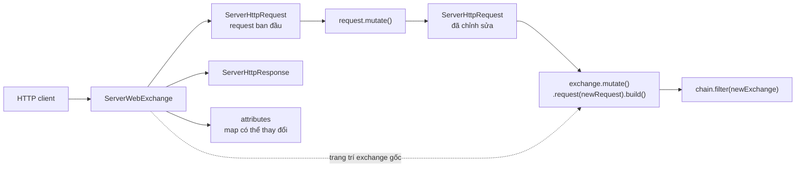
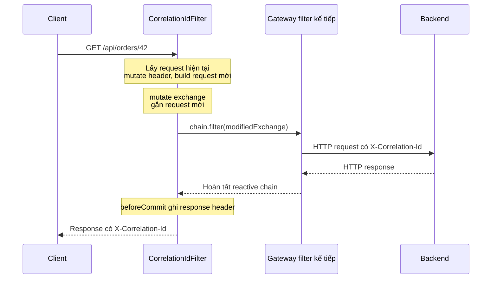

# Tính bất biến và cơ chế mutate request hoặc exchange

Trong Spring WebFlux, request được xử lý bằng một chuỗi thành phần reactive: bộ lọc, handler và các thao tác bất đồng bộ có thể tiếp tục chạy ở những thời điểm khác nhau. Khi dùng **Spring Cloud Gateway** làm điểm vào microservices, ta thường cần thêm header nhận diện, chuẩn hóa đường dẫn, truyền thông tin quan sát hoặc điều chỉnh request trước khi gửi tới backend. Cách làm đúng là **tạo một phiên bản request/exchange đã chỉnh sửa rồi truyền phiên bản đó xuống filter chain**.

Đây là nền tảng của các tác vụ trong **SPRING_CLOUD_GATEWAY**: route predicate quyết định route nào phù hợp, gateway filter chain thực thi chính sách và có thể biến đổi path/header, service discovery kết hợp load balancing chọn backend, còn các thành phần xác thực, rate limiting, circuit breaker, retry, TLS và observability cần thao tác đúng với request/exchange để tránh dữ liệu không nhất quán.

## 1. Tại sao WebFlux ưu tiên cách làm bất biến?

Trong kiểu xử lý servlet truyền thống, lập trình viên thường hình dung một request gắn với một luồng thực thi. WebFlux sử dụng mô hình reactive, non-blocking: một request có thể đi qua nhiều toán tử `Mono`/`Flux`, qua các callback và được tiếp tục xử lý trên các luồng khác nhau tùy scheduler và thao tác bất đồng bộ.

Nếu các bộ lọc tùy ý sửa trực tiếp cùng một đối tượng request theo kiểu chia sẻ trạng thái, việc truy vết ai thay đổi dữ liệu, lúc nào và dữ liệu nào được chuyển xuống downstream sẽ rất khó. Spring WebFlux vì vậy biểu diễn thông tin của **`ServerHttpRequest`** theo hướng **chỉ đọc từ góc nhìn bên sử dụng**, và cung cấp **builder qua `mutate()`** khi cần tạo request có giá trị mới.

Ví dụ: client gửi `GET /api/orders/42`, gateway cần thêm `X-Correlation-Id` trước khi gọi `order-service`. Thay vì sửa request đang có, gateway xây một request mới với header bổ sung, sau đó bọc request đó vào một exchange phù hợp.

**Lưu ý về thuật ngữ:** “Bất biến” ở đây chủ yếu mô tả **request được nhìn thấy qua API xử lý** và cách thay thế request trong luồng. `ServerWebExchange` **không phải một cấu trúc bất biến hoàn toàn**: nó vẫn chứa các vùng trạng thái có thể đổi như `attributes`; response cũng tiến triển trạng thái khi được ghi/commit. `mutate()` tạo đối tượng trang trí (*decorator*) chia sẻ nhiều thành phần gốc, không sao chép sâu toàn bộ request và exchange.

## 2. Phân biệt các đối tượng trước khi mutate

| Đối tượng | Trách nhiệm | Điều gì thường được đọc hoặc thay đổi? |
| --- | --- | --- |
| `ServerHttpRequest` | Đại diện HTTP request đi vào ứng dụng WebFlux. | Method, URI, path, query, headers, cookies, body publisher; dùng `request.mutate()` để tạo request với path/header/URI mới. |
| `ServerHttpResponse` | Đại diện HTTP response sẽ trả về client. | Status, headers, cookies, body; chỉ sửa một số thông tin trước khi response được commit. |
| `ServerWebExchange` | Ngữ cảnh của một lần trao đổi HTTP, nối request, response và thuộc tính xử lý. | `getRequest()`, `getResponse()`, `getAttributes()`; dùng `exchange.mutate()` để thay request/response hoặc trang trí exchange. |
| `GatewayFilterChain` | Chuỗi xử lý tiếp theo trong Spring Cloud Gateway. | Nhận `ServerWebExchange` được truyền tại `chain.filter(exchange)`, trả về `Mono<Void>`. |
| `WebFilterChain` | Chuỗi `WebFilter` trong WebFlux nói chung. | Cũng nhận `ServerWebExchange`, nhưng thuộc tầng lọc WebFlux; khác kiểu filter chuyên biệt của Gateway. |

Sơ đồ quan hệ:



Hai hành động riêng biệt cần nhớ:

1. **`request.mutate()`** tạo một `ServerHttpRequest` mới với những phần cần thay đổi.
2. **`exchange.mutate()`** xây một `ServerWebExchange` dùng request mới; đó là exchange phải truyền cho thành phần downstream.

Chỉ gọi `request.mutate().build()` **chưa** khiến các bộ lọc tiếp theo nhìn thấy request mới.

## 3. Mutate `ServerHttpRequest`: chỉnh header và path

### 3.1. Ví dụ thay đổi HTTP header

Trong một gateway filter, giả sử cần tạo correlation ID để truy vết request qua nhiều dịch vụ:

```java
String correlationId = UUID.randomUUID().toString();

ServerHttpRequest newRequest = exchange.getRequest()
    .mutate()
    .headers(headers -> {
        headers.set("X-Correlation-Id", correlationId);
        headers.remove("X-Internal-Role");
    })
    .build();
```

Giải thích từng bước:

- `exchange.getRequest()` lấy request hiện tại của filter.
- `mutate()` trả về `ServerHttpRequest.Builder`, khởi tạo từ request hiện tại.
- `headers(...)` cung cấp bản headers có thể thay đổi trong quá trình xây dựng. `set` đặt giá trị header, `remove` bỏ một header cụ thể khỏi request mới.
- `build()` tạo request được trang trí với thay đổi đã khai báo.

Trong ví dụ này, header `X-Internal-Role` bị loại khỏi request chuyển tiếp vì nó có thể là thông tin client tự gắn. Việc thêm/bớt header **không thay thế** bước xác thực và phân quyền; chỉ thành phần tin cậy mới được cấp và truyền thông tin danh tính nội bộ.

**Phân biệt `set` và `add`:** `set` thích hợp khi muốn một giá trị duy nhất như correlation ID, còn `add` bổ sung giá trị vào danh sách và có thể tạo nhiều giá trị cùng tên. Cần cân nhắc đặc biệt với các header nhạy cảm như `Authorization`, `Host`, `Forwarded` và `X-Forwarded-*`; không tự ý tin hoặc sao chép các giá trị do client cung cấp.

### 3.2. Ví dụ chỉnh đường dẫn

```java
ServerHttpRequest newRequest = exchange.getRequest()
    .mutate()
    .path("/orders/42")
    .build();
```

Đoạn code minh họa cách builder tạo request mang path khác. Tuy nhiên, **trong Spring Cloud Gateway, việc rewrite đường dẫn phải phù hợp với thứ tự gateway filters và thời điểm URL downstream được xác định**. Nếu URI đích đã được tính từ trước, thay path trên request muộn có thể không làm thay đổi URI thực tế dùng để gọi backend.

Với nhu cầu thông thường, hãy ưu tiên các **gateway filter có sẵn** như `StripPrefix`, `SetPath` hoặc `RewritePath`. Ví dụ một route nhận `/api/orders/42` nhưng muốn backend nhận `/orders/42`:

```yaml
spring:
  cloud:
    gateway:
      routes:
        - id: orders
          uri: lb://order-service
          predicates:
            - Path=/api/orders/**
          filters:
            - StripPrefix=1
```

Đây là ví dụ theo kiểu cấu hình route của **Spring Cloud Gateway Server WebFlux**; tiền tố thuộc tính và starter cần đối chiếu với phiên bản đang dùng. `Path` là **route predicate**, `StripPrefix` là **gateway filter**, còn `lb://order-service` yêu cầu thành phần phân giải instance và load balancer phù hợp. Việc rewrite path không làm route predicate chạy lại.

### 3.3. Sau khi mutate, request cũ có đổi không?

Xét đoạn code:

```java
ServerHttpRequest original = exchange.getRequest();

ServerHttpRequest modified = original.mutate()
    .headers(h -> h.set("X-Correlation-Id", "req-123"))
    .build();

String oldValue = original.getHeaders().getFirst("X-Correlation-Id");
String newValue = modified.getHeaders().getFirst("X-Correlation-Id");
```

Nếu ban đầu chưa có header `X-Correlation-Id`, `oldValue` là `null`, còn `newValue` là `"req-123"`. Request gốc **không được thay thế tự động** chỉ bởi lời gọi `build()`. Cơ chế này giúp giữ rõ phiên bản request nào đang được sử dụng ở mỗi giai đoạn.

## 4. Mutate `ServerWebExchange`: đưa request mới vào luồng

Đây là thao tác thường bị thiếu khi mới viết filter:

```java
ServerHttpRequest modifiedRequest = exchange.getRequest().mutate()
    .headers(h -> h.set("X-Correlation-Id", "req-123"))
    .build();

ServerWebExchange modifiedExchange = exchange.mutate()
    .request(modifiedRequest)
    .build();

return chain.filter(modifiedExchange);
```

Đối tượng `modifiedExchange` là **đầu vào thực tế của bộ lọc kế tiếp**. Nếu viết `return chain.filter(exchange);` thì filter tiếp theo tiếp tục nhận exchange cũ; việc xây `modifiedRequest` trở nên vô ích đối với luồng chuyển tiếp đó.

Trong Spring WebFlux/Gateway thường có hai mẫu tương đương về mục đích:

```java
// Mẫu 1: mutate request riêng, sau đó gắn vào exchange.
ServerHttpRequest request = exchange.getRequest()
    .mutate()
    .headers(h -> h.set("X-Source", "gateway"))
    .build();
return chain.filter(exchange.mutate().request(request).build());
```

```java
// Mẫu 2: dùng overload nhận callback chỉnh builder request
// nếu API của phiên bản Spring WebFlux đang dùng hỗ trợ.
ServerWebExchange updated = exchange.mutate()
    .request(builder -> builder.headers(h -> h.set("X-Source", "gateway")))
    .build();
return chain.filter(updated);
```

Mẫu thứ nhất tách rõ hai bước và dễ đặt breakpoint khi học. Mẫu thứ hai ngắn hơn nhưng phụ thuộc chữ ký `ServerWebExchange.Builder` ở phiên bản framework cụ thể.

### 4.1. Exchange mới có phải bản sao hoàn toàn?

Không. `exchange.mutate().build()` thường trả về một **decorator** ủy quyền tới exchange gốc cho các thành phần không bị thay thế. Ví dụ, cùng một response và các attributes thường vẫn được dùng qua lớp trang trí. Vì vậy:

- **Request** được thay bằng phiên bản mới khi gọi `.request(modifiedRequest)`.
- **Response** thường vẫn là cùng đối tượng response; trạng thái commit không được “reset”.
- **Attributes** của exchange là một map có thể thay đổi và được các thành phần chia sẻ; không nên xem nó là bản sao riêng của mỗi decorator.
- Mutate **không tự tạo một HTTP request ngoài mạng**. Request thực tế chỉ được chuyển tiếp khi chain/handler xử lý và các thành phần routing/network thực thi.

Nắm được phạm vi thay đổi này giúp tránh suy luận sai rằng “đã clone exchange thì mọi trạng thái đều độc lập”.

## 5. Ví dụ hoàn chỉnh trong Spring Cloud Gateway

Ví dụ sau định nghĩa một `GlobalFilter` cho gateway **reactive/WebFlux**. Filter tạo ID mới để tương quan log, loại bỏ header nội bộ do client có thể tự gửi, gắn ID vào request chuyển tiếp và phản hồi ID cho client.

```java
package com.example.gateway.filter;

import java.util.UUID;
import org.springframework.cloud.gateway.filter.GatewayFilterChain;
import org.springframework.cloud.gateway.filter.GlobalFilter;
import org.springframework.core.Ordered;
import org.springframework.http.server.reactive.ServerHttpRequest;
import org.springframework.stereotype.Component;
import org.springframework.web.server.ServerWebExchange;
import reactor.core.publisher.Mono;

@Component
public class CorrelationIdFilter implements GlobalFilter, Ordered {

    @Override
    public Mono<Void> filter(
            ServerWebExchange exchange,
            GatewayFilterChain chain) {

        String correlationId = UUID.randomUUID().toString();

        ServerHttpRequest modifiedRequest = exchange.getRequest()
            .mutate()
            .headers(headers -> {
                headers.set("X-Correlation-Id", correlationId);
                headers.remove("X-Internal-Role");
            })
            .build();

        ServerWebExchange modifiedExchange = exchange.mutate()
            .request(modifiedRequest)
            .build();

        modifiedExchange.getResponse().beforeCommit(() -> {
            modifiedExchange.getResponse().getHeaders()
                .set("X-Correlation-Id", correlationId);
            return Mono.empty();
        });

        return chain.filter(modifiedExchange);
    }

    @Override
    public int getOrder() {
        return -10;
    }
}
```

Các điểm cần hiểu:

1. **`GlobalFilter`** được áp dụng trong gateway filter chain cho các route được xử lý bởi Spring Cloud Gateway; khác với `WebFilter` tổng quát của WebFlux.
2. **`Ordered`** xác định thứ tự tương đối của filter. Giá trị `-10` chỉ minh họa; hãy xác định thứ tự theo các filters khác và nhu cầu của ứng dụng, không giả định thứ tự này phù hợp với mọi dự án.
3. **`ServerHttpRequest.mutate()`** chuẩn bị request đã chỉnh header. Phải gắn request vào exchange rồi gọi `chain.filter(modifiedExchange)`.
4. **`beforeCommit(...)`** đăng ký callback chỉnh response header ngay trước khi response commit. Callback được đăng ký trước khi gọi downstream; không thể sửa headers sau khi response đã commit.
5. **`Mono<Void>`** biểu diễn hoàn tất xử lý bất đồng bộ. Filter trả về publisher từ chain, **không gọi `subscribe()` thủ công** và không chặn luồng bằng `block()`.

Ví dụ tạo ID mới để minh họa việc không tin giá trị client gửi. Trong hệ thống distributed tracing, có thể cần **tiếp tục trace context hợp lệ** từ upstream và dùng chuẩn như W3C Trace Context thay vì tạo dấu vết mới ở mỗi hop. Correlation ID tùy biến nên được tách khỏi khái niệm trace ID chuẩn; tránh làm đứt chuỗi trace hiện có.

### 5.1. Luồng dữ liệu trước và sau filter



Sơ đồ mô tả thứ tự logic, không cam kết mỗi bước chạy trên cùng một thread. Sự kiện commit/ghi response có thể diễn ra như một phần của xử lý downstream; callback `beforeCommit` được thực thi tại thời điểm commit, chứ không đơn thuần “sau khi tất cả dòng Java chạy xong”.

## 6. Khi nào mutate request, khi nào mutate exchange, khi nào dùng attributes?

| Mục tiêu | Cách tiếp cận | Giải thích |
| --- | --- | --- |
| Thêm hoặc xóa header trước backend | `request.mutate().headers(...)` rồi `exchange.mutate().request(...)` | Backend và các filters phía sau nhìn thấy request đã đổi. |
| Chỉnh path, method hoặc URI | `request.mutate()` hoặc gateway filter chuyên dụng | Với Gateway cần xét vị trí trong filter chain và URL routing. |
| Thay request đang được chain nhìn thấy | `exchange.mutate().request(request).build()` | Chỉ tạo request mới thì chưa thay thế đầu vào của downstream. |
| Lưu dữ liệu nội bộ phục vụ các filters cùng request | `exchange.getAttributes().put(key, value)` | Đây là **trạng thái xử lý nội bộ**, không phải HTTP header sẽ tự gửi đi. |
| Thêm response header | `exchange.getResponse().beforeCommit(...)` hoặc chỉnh header trước khi commit | Sửa response, không cần mutate request. |
| Biến đổi response body | Response decorator hoặc filter chuyên dụng như `ModifyResponseBody` | Chỉ mutate request/exchange thông thường không viết lại body. |

Ví dụ lưu thông tin xử lý **chỉ bên trong gateway**:

```java
exchange.getAttributes().put("app.gateway.auditCategory", "orders");
```

Attribute này có thể được những filter phía sau đọc qua `getAttributes()`, nhưng không tự biến thành HTTP header hoặc dữ liệu mà backend nhận. Khác với request bất biến theo cách dùng, map attributes **có thể bị thay đổi**, vì vậy cần đặt tên key rõ ràng, tránh xung đột với các khóa framework sử dụng và kiểm soát ai được ghi/đọc.

## 7. Tính bất biến đi cùng thứ tự filter chain

Trong Spring Cloud Gateway, một route thường được **chọn bằng predicate trước khi chuỗi Gateway filters của route đó chạy**. Các `GlobalFilter` và filters cấu hình trên route được kết hợp, sắp xếp theo thứ tự rồi thực thi quanh request. Với kiểu xử lý pre/post, thứ tự còn quyết định callback xử lý response ở chiều quay về.

Hình dung hai filters:

```text
Request vào
  -> Filter A: mutate request, thêm X-Correlation-Id
      -> Filter B: đọc exchange.getRequest().getHeaders()
          -> Backend
      <- Filter B: xử lý response
  <- Filter A: xử lý response
```

Nếu A gọi `chain.filter(modifiedExchange)`, B đọc được header mới. Nếu A gọi `chain.filter(exchange)`, B nhận request cũ. Đảo thứ tự B trước A thì B đọc headers trước khi A chỉnh, nên B không thể thấy thay đổi đó trong pha xử lý request của chính nó.

Một gateway có thể có filters nội bộ tính toán **URL đích** và lưu trong exchange attributes để những thành phần routing/load balancing sử dụng. Do đó:

- Đổi path bằng request builder **sau khi URL đích đã được tạo** không bảo đảm request thực sự được gửi tới path mới.
- Đổi header ở một filter chạy **sau thành phần proxy đã bắt đầu gửi request** không có tác dụng cho request đã chuyển đi.
- Tính toán route bằng predicate đã diễn ra trước chuỗi Gateway filters; sửa path trong một `GlobalFilter` **không tự chọn lại route**.
- Các filters chuẩn `StripPrefix`, `RewritePath`, `SetPath`, `AddRequestHeader`, `SetRequestHeader` và `RemoveRequestHeader` thường đủ cho các biến đổi thông dụng. Dùng filter tùy biến khi có logic nghiệp vụ hay tích hợp cụ thể cần thiết.

### 7.1. Request được mutate nhiều lần

Mỗi filter có thể nhận exchange do filter trước tạo và tiếp tục mutate request hiện tại:

```java
ServerHttpRequest current = exchange.getRequest();
ServerHttpRequest next = current.mutate()
    .headers(h -> h.set("X-Stage", "validated"))
    .build();

return chain.filter(exchange.mutate().request(next).build());
```

Điểm cốt lõi là **luôn bắt đầu từ `exchange.getRequest()` của exchange mình nhận được**. Đừng lấy lại hoặc truyền một reference request cũ được lưu từ filter khác vì có thể làm mất những thay đổi mới hơn.

### 7.2. Không mutate để bỏ qua chuỗi bảo mật

Tự thêm `X-User-Id` hoặc `X-User-Role` vào request không chứng minh người gọi đã xác thực. Nếu gateway cần chuyển identity đến backend, hãy lấy identity từ **security context đã xác thực**, áp dụng quy tắc tin cậy giữa gateway và backend, loại bỏ các header giả mạo từ client và vẫn thực thi phân quyền ở dịch vụ. Tương tự, thay path không làm chính sách route predicate hoặc bảo mật chạy lại.

## 8. Request body là trường hợp đặc biệt

Path, URI và headers là metadata nên builder có thể thay đổi tương đối trực tiếp. **Body** trong WebFlux lại được thể hiện bằng luồng `Flux<DataBuffer>`: dữ liệu có thể chỉ đến khi có subscriber, được đọc theo từng phần và chịu cơ chế backpressure.

Vì vậy, không thể hiểu `request.mutate().build()` là đã “sao chép body” để đọc lại vô hạn. Một số nguồn body thực tế chỉ có thể được tiêu thụ một lần. Nếu một filter tự subscribe hoặc đọc body rồi không cung cấp lại một publisher hợp lệ, backend có thể nhận body rỗng, bị lỗi hoặc request bị treo.

Muốn sửa JSON body, chẳng hạn chuyển một trường đầu vào sang dạng chuẩn:

1. Xác định nội dung cần decode và kiểu `Content-Type` có thể xử lý.
2. Dùng cơ chế đọc/ghi body có quản lý codec và lifecycle, ưu tiên **`ModifyRequestBody` GatewayFilterFactory** khi phù hợp với loại Spring Cloud Gateway đang dùng.
3. Tạo body đầu ra mới theo reactive contract; xử lý trường hợp body rỗng, dữ liệu sai, giới hạn kích thước và backpressure.
4. Để framework/cơ chế chuyên dụng xử lý lại những headers liên quan như `Content-Length` và `Content-Type`, hoặc cấu hình đúng nếu tự triển khai.

Khi xử lý `DataBuffer` thủ công, cần hiểu reference counting và giải phóng buffer đúng cách để tránh rò rỉ bộ nhớ, đồng thời bảo đảm không đọc body nhiều lần ngoài ý muốn. Việc cache body cũng tiêu thụ bộ nhớ; tránh cache nội dung lớn hoặc nhạy cảm khi không cần.

Tương tự, chỉnh **response body** cần decorator hoặc filter chuyên dụng như `ModifyResponseBody`. Thêm một request header qua `mutate()` không tự thay đổi body response.

## 9. Các lỗi thường gặp và cách khắc phục

### Lỗi 1: Xây request mới nhưng truyền exchange cũ

```java
// Sai: request mới không đi tiếp trong chuỗi.
ServerHttpRequest request = exchange.getRequest().mutate()
    .headers(h -> h.set("X-Test", "yes"))
    .build();
return chain.filter(exchange);
```

```java
// Đúng: gắn request vào exchange rồi chuyển tiếp.
return chain.filter(exchange.mutate().request(request).build());
```

### Lỗi 2: Cố sửa trực tiếp request gốc

```java
// Không coi request.getHeaders() là điểm để sửa trực tiếp.
// Hãy mutate request bằng builder và truyền exchange mới.
ServerHttpRequest changed = exchange.getRequest().mutate()
    .headers(h -> h.set("X-Test", "yes"))
    .build();
```

Việc dựa vào một implementation cho phép đổi headers trực tiếp có thể hoạt động khác nhau giữa những lớp decorator hoặc làm trạng thái thiếu nhất quán. API builder diễn tả chính xác ý định thay thế request.

### Lỗi 3: Nhầm request header với response header

```java
// Header mà backend sẽ nhận nếu request được chuyển tiếp:
ServerHttpRequest req = exchange.getRequest().mutate()
    .headers(h -> h.set("X-From-Gateway", "true"))
    .build();

// Header mà client sẽ nhận (phải đặt trước response commit):
exchange.getResponse().getHeaders().set("X-Gateway", "edge");
```

Hai nhóm headers đi theo **hai chiều khác nhau**. Với response được ghi bất đồng bộ, có thể đăng ký `beforeCommit` để đảm bảo chỉnh đúng thời điểm.

### Lỗi 4: Sửa response sau khi đã commit

Sau khi headers/status đã được gửi, chỉnh `response.getHeaders()` hoặc `setStatusCode(...)` có thể thất bại hoặc không còn hiệu lực. Hãy thực hiện trước khi ghi response, hoặc đăng ký callback `beforeCommit` từ sớm. Không dùng `exchange.mutate()` để “mở lại” response đã commit.

### Lỗi 5: Đọc body nhiều lần hay gọi `block()`

Tự `subscribe()` vào request body rồi gọi `chain.filter(exchange)` có thể làm downstream không đọc được dữ liệu. Gọi `block()` trong WebFlux/Gateway có thể chặn event-loop và gây giảm thông lượng hoặc lỗi ở luồng non-blocking. Hãy ghép các thao tác bất đồng bộ bằng `Mono`/`Flux` và sử dụng filter chuyên dụng khi sửa body.

### Lỗi 6: Nghĩ rằng mutate sẽ đổi route hoặc mọi metadata

Mutate request không tự kích hoạt đánh giá lại predicate, không tự tạo instance discovery, không điều chỉnh các attributes routing đã được tính và không tái áp dụng chính sách auth. Thiết kế filter theo đúng giai đoạn xử lý; dùng loại filter và vị trí phù hợp.

### Lỗi 7: Ghi dữ liệu cá nhân vào log

Correlation ID hỗ trợ quan sát request, nhưng không nên ghi nguyên token `Authorization`, cookie phiên, mật khẩu hay body nhạy cảm vào logs. Khi cần tạo hoặc truyền header truy vết, phải thống nhất chính sách tin cậy nguồn dữ liệu và ẩn thông tin nhạy cảm.

## 10. Kiểm chứng hành vi bằng một số tình huống nhỏ

Giả sử đầu vào là request `GET /api/orders/42` chưa có `X-Correlation-Id`:

| Thao tác | Kết quả mong đợi |
| --- | --- |
| `original.mutate().headers(...).build()` | Request `original` vẫn giữ giá trị ban đầu; request tạo mới có header mong muốn. |
| `chain.filter(exchange)` sau khi build request mới | Bộ lọc sau vẫn nhìn exchange cũ, không tự nhận request vừa build. |
| `chain.filter(exchange.mutate().request(newRequest).build())` | Bộ lọc sau thấy `newRequest` qua `getRequest()`. |
| `exchange.getAttributes().put("key", value)` | Filters cùng ngữ cảnh có thể đọc attribute; backend không tự thấy HTTP header `key`. |
| `beforeCommit(...)` đăng ký trước khi downstream ghi response | Có thể bổ sung response header khi chưa commit. |
| Route `Path=/api/orders/**` và `StripPrefix=1` | Sau khi filter áp dụng, backend nhận path `/orders/42` nếu routing được cấu hình đúng. |

Khi viết test, có thể dựng request/exchange giả bằng **`MockServerHttpRequest`** và **`MockServerWebExchange`** của Spring Test, rồi dùng một filter chain giả để ghi lại `exchange.getRequest()` được truyền xuống. Đối chiếu cả giá trị của **request ban đầu** và **request downstream**, đặc biệt với headers đã được set/xóa và path đã rewrite. Test filter còn nên kiểm tra response headers trước/sau commit và các trường hợp không có body.

### Câu hỏi tự ôn tập

1. Vì sao `ServerHttpRequest.mutate().build()` chưa đủ để filter sau nhận request mới?
2. `ServerWebExchange` có bất biến hoàn toàn không? `attributes` và `response` khác `request` ở điểm nào?
3. Khi nào nên dùng `StripPrefix` hoặc `RewritePath` thay vì tự gọi `request.mutate().path(...)`?
4. Có thể xác thực người dùng chỉ bằng việc thêm `X-User-Id` vào request không? Vì sao?
5. Vì sao sửa body khó hơn sửa header trong reactive pipeline?
6. Tại sao cần cân nhắc thời điểm commit khi chỉnh response header?

**Ghi nhớ:** Với WebFlux, `mutate()` là **cơ chế xây phiên bản request/exchange mới có thay đổi được chỉ định**. Mẫu quan trọng nhất khi viết Spring Cloud Gateway filter là:

```java
ServerHttpRequest request = exchange.getRequest().mutate()
    .headers(h -> h.set("X-Example", "value"))
    .build();

ServerWebExchange updated = exchange.mutate()
    .request(request)
    .build();

return chain.filter(updated);
```

Luôn biết đang thay đổi **request, exchange attributes hay response**, và bảo đảm **đối tượng đúng được truyền xuống filter chain đúng thời điểm**. Đây là tiền đề để triển khai an toàn các filter biến đổi path/header, xác thực, rate limiting, resilience và observability trong Spring Cloud Gateway.
