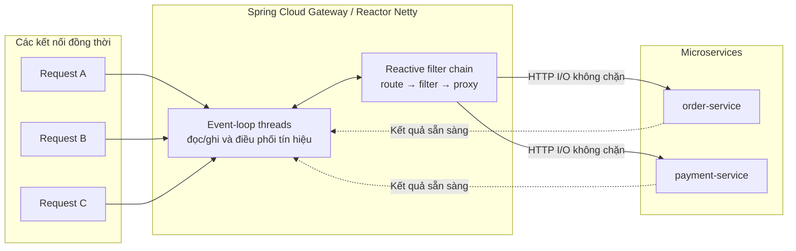
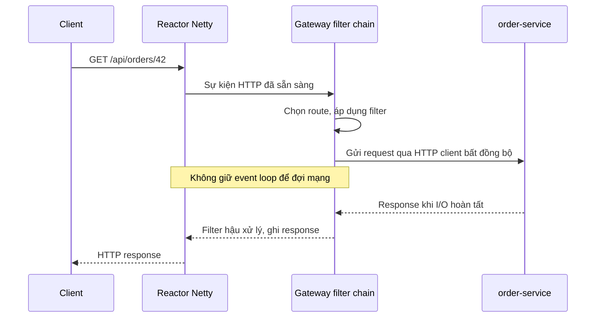

# Event loop và tác động của lời gọi chặn luồng

Trong **Spring Cloud Gateway Server WebFlux**, một yêu cầu HTTP đi qua route predicate, chuỗi filter và kết nối tới microservice phía sau theo mô hình xử lý **reactive, non-blocking I/O**. Nền tảng thường dùng là Spring WebFlux, Project Reactor và Reactor Netty. Vì gateway nằm trước nhiều dịch vụ, một thao tác chặn luồng tưởng như nhỏ trong filter có thể ảnh hưởng đến rất nhiều request không liên quan.

Bài này thuộc chương **Nền tảng WebFlux** của module **SPRING_CLOUD_GATEWAY**. Mục tiêu là hiểu event loop hoạt động thế nào, nhận diện lời gọi blocking, thấy được hậu quả đối với độ trễ và thông lượng của gateway, và biết cách tổ chức xử lý phù hợp khi xây dựng API Gateway với định tuyến, biến đổi header/path, xác thực, rate limiting, circuit breaker, retry, TLS và quan sát request.

Sau bài học, bạn cần trả lời được ba câu hỏi:

1. Tại sao một số ít thread có thể phục vụ nhiều kết nối HTTP khi các thao tác I/O không chặn?
2. Tại sao gọi JDBC, HTTP client đồng bộ, `Thread.sleep()` hoặc `.block()` trong đường xử lý gateway là nguy hiểm?
3. Khi bắt buộc tích hợp một API đồng bộ, cần cô lập nó như thế nào và giám sát giới hạn ra sao?

## 1. Event loop là gì?

**Event loop** là một vòng xử lý sự kiện: thread liên tục nhận biết kết nối nào sẵn sàng đọc/ghi, thực thi ngắn gọn phần việc tương ứng, đăng ký thao tác I/O tiếp theo rồi nhường cơ hội cho các kết nối khác. Trong Reactor Netty, một nhóm nhỏ event-loop thread có thể điều phối nhiều kết nối nhờ I/O bất đồng bộ.

Mô hình này khác với cách hình dung “mỗi request chiếm một thread trong suốt thời gian chờ backend trả lời”:

| Tiêu chí | Thread-per-request truyền thống (mô hình khái quát) | Event loop với non-blocking I/O |
| --- | --- | --- |
| Khi đợi socket/network | Thread có thể bị giữ trong lời gọi blocking | Thread đăng ký công việc I/O và tiếp tục xử lý sự kiện khác |
| Số thread phục vụ kết nối đồng thời | Thường tăng theo quy mô worker pool | Thường có một nhóm event loop nhỏ, không tỉ lệ 1:1 với kết nối |
| Khi một đoạn code đồng bộ chạy lâu | Chiếm một worker trong pool | Chiếm event-loop thread và trì hoãn nhiều kết nối được thread đó phục vụ |
| Điểm cần quản lý | Kích thước worker pool, chi phí context switch, giới hạn kết nối | Không chặn event loop; kiểm soát thời lượng mỗi callback, áp lực CPU và hàng đợi |
| Khả năng mở rộng | Phụ thuộc giới hạn thread, bộ nhớ và thời gian chờ | Hiệu quả nếu phần lớn xử lý là I/O bất đồng bộ và callback ngắn |

Không phải mọi ứng dụng Java “chạy WebFlux” đều chạy mọi dòng mã trên cùng một thread. Reactor có nhiều scheduler; thao tác như `publishOn` hoặc `subscribeOn`, framework tích hợp và thư viện bên ngoài có thể làm execution chuyển thread. Điều cốt lõi là **không giữ event-loop thread để chờ công việc có thể tiếp diễn theo tín hiệu bất đồng bộ**.

### Sơ đồ: nhiều request dùng chung event loop



Khi gateway gửi request tới `order-service`, kết nối mạng cần thời gian chờ. Với I/O không chặn, event loop **không đứng tại lệnh gọi để đợi cho đến khi nhận đủ response**. Thread có thể phục vụ request khác; khi có tín hiệu socket, chuỗi xử lý tiếp tục.

Ngược lại, nếu filter gọi `Thread.sleep(200)`, thread thật sự không thể làm việc khác trong 200 ms. Tác động lan sang mọi request khác cần sự phục vụ của chính event-loop thread đó.

## 2. Request đi qua gateway như thế nào?

Xét request:

```http
GET /api/orders/42 HTTP/1.1
Host: api.example.com
Authorization: Bearer <access-token>
```

Ở Spring Cloud Gateway Server WebFlux, luồng khái niệm như sau:



Các thành phần có vai trò khác nhau:

- **Route predicate** như `Path`, `Method`, `Host` quyết định request có khớp tuyến hay không. Một predicate tùy biến có logic đồng bộ chậm cũng có thể làm nghẽn đường xử lý.
- **`GatewayFilter` và `GlobalFilter`** tham gia chuỗi xử lý request/response. Một filter chỉ sửa metadata sẽ hoàn thành nhanh; filter gọi API đồng bộ hoặc truy vấn database theo kiểu chờ kết quả có thể giữ thread lâu.
- **Spring Security WebFlux** có các `WebFilter` riêng để xác thực/phân quyền ở lớp biên. Dùng cấu hình bảo mật reactive phù hợp; không biến filter xác thực thành nơi gọi một dịch vụ đồng bộ trên mỗi request.
- **Reactive HTTP client / Reactor Netty** thực hiện network I/O bất đồng bộ tới backend. Route `lb://order-service` thường kết hợp discovery và load balancer để tìm instance, nhưng bản thân discovery cũng cần được cấu hình và vận hành đúng.
- **Observability** có thể gắn route ID, trace ID, status và latency để phân tích hành vi. Logging hoặc exporting telemetry bằng lời gọi blocking ngay trong filter vẫn có thể làm hại event loop.

Chi tiết thứ tự filter còn phụ thuộc loại filter và thuộc tính `Ordered`. Quan trọng hơn là nhận diện **đoạn mã nào thực thi trực tiếp trên đường xử lý request và đoạn nào trả về một luồng bất đồng bộ**.

## 3. Reactive publisher không đồng nghĩa mọi thao tác đều non-blocking

Trong Reactor, `Mono<T>` biểu diễn một luồng tối đa một giá trị; `Flux<T>` có thể biểu diễn nhiều giá trị. Publisher thường *lười thực thi* (lazy): nhiều phép toán chỉ được kích hoạt khi có subscriber. Nhưng **bọc một thao tác blocking vào `Mono` không tự biến thao tác đó thành non-blocking**.

Ví dụ non-blocking về mặt thời gian chờ:

```java
Mono<String> delayed =
    Mono.delay(Duration.ofMillis(200))
        .thenReturn("ready");
```

`Mono.delay` lập lịch phát tín hiệu sau một khoảng thời gian; không cần giữ một thread trong `Thread.sleep` suốt 200 ms.

Ví dụ sau vẫn blocking:

```java
Mono<String> misleading =
    Mono.fromCallable(() -> {
        Thread.sleep(200); // Vẫn chặn thread thực thi Callable
        return "ready";
    });
```

`fromCallable` giúp **trì hoãn** lời gọi đến lúc subscribe, nhưng nếu không đổi scheduler thì `Callable` sẽ chạy trên thread thực hiện subscription. Khi subscription bắt đầu trên event loop của gateway, lời gọi trên có thể chặn event loop.

### Những lời gọi cần chú ý

| Đoạn mã / thư viện | Vì sao có nguy cơ chặn? | Hướng xử lý ưu tiên |
| --- | --- | --- |
| `Thread.sleep(...)` | Giữ thread trong suốt thời gian ngủ | Dùng `Mono.delay(...)` khi cần trì hoãn tín hiệu bất đồng bộ |
| `mono.block()`, `flux.blockFirst()` | Chờ kết quả bằng cách khóa thread gọi | Ghép publisher bằng `flatMap`, `then`, `zip` và trả về `Mono`/`Flux` |
| `Future.get()`, `CompletableFuture.join()` | Chờ tác vụ nền kết thúc | Dùng API hoàn tất bất đồng bộ và chuyển sang publisher phù hợp |
| `RestTemplate` hoặc HTTP client blocking | Thread chờ kết nối/response | Ưu tiên `WebClient` với connector non-blocking |
| JDBC/JPA/`JdbcTemplate` | Truy vấn và chờ DB theo mô hình đồng bộ | Ưu tiên R2DBC/reactive driver nếu kiến trúc cho phép; nếu không, cô lập đoạn JDBC |
| File I/O đồng bộ hoặc SDK legacy blocking | Đọc file/nhận dữ liệu trong thread hiện tại | Dùng API bất đồng bộ nếu có; nếu không, dùng scheduler phù hợp và giới hạn tải |
| Mã hóa/giải mã, JSON hoặc xử lý CPU lớn | Không nhất thiết blocking I/O nhưng chiếm CPU lâu | Giảm chi phí, phân luồng tác vụ CPU phù hợp; không lạm dụng `boundedElastic` |

Lưu ý: `Mono.just(legacyClient.load())` còn nguy hiểm hơn trong nhiều tình huống vì `legacyClient.load()` **được gọi ngay khi biểu thức `Mono.just(...)` được đánh giá**, trước cả lúc publisher được subscribe. Thay `just` bằng `fromCallable` là một bước để trì hoãn thực thi, nhưng phải đồng thời xem xét **scheduler nào thực thi**.

## 4. Chặn event loop tạo ra hiệu ứng dây chuyền gì?

Giả sử filter ở gateway gọi một API đồng bộ để hỏi trạng thái route:

```java
@Override
public Mono<Void> filter(ServerWebExchange exchange, GatewayFilterChain chain) {
    boolean enabled = legacyRouteClient.isEnabled("orders"); // Blocking I/O
    if (!enabled) {
        exchange.getResponse().setStatusCode(HttpStatus.SERVICE_UNAVAILABLE);
        return exchange.getResponse().setComplete();
    }
    return chain.filter(exchange);
}
```

Mã ở trên minh họa **cách làm sai trong gateway reactive**: lời gọi `legacyRouteClient.isEnabled(...)` đồng bộ hoàn tất trước khi filter trả `Mono<Void>`. Dù phần còn lại của gateway dùng Reactor, event-loop thread vẫn phải đợi kết quả của client đồng bộ.

### Dòng thời gian minh họa

```mermaid
gantt
    title Một event loop bị giữ bởi lời gọi blocking
    dateFormat X
    axisFormat %L ms
    section Event loop
    Request A - blocking       :a, 0, 200
    Request B - chờ đến lượt   :b, 200, 210
    Request C - chờ đến lượt   :c, 210, 220
```



Đây là sơ đồ đơn giản hóa: trong thực tế, các request có thể được phân phối lên các event-loop thread khác nhau và lịch xử lý thay đổi theo tải. Nhưng nó cho thấy **một request giữ thread lâu sẽ làm tăng thời gian chờ của những request cùng chia sẻ thread**.

Các hệ quả thường gặp:

1. **Tăng độ trễ đuôi** (`p95`, `p99`): một số request chậm vượt mức dù backend của chúng vẫn khỏe.
2. **Giảm thông lượng:** event loop mất thời gian vào công việc chờ, không thể điều phối đủ socket.
3. **Dồn hàng đợi:** kết nối mới, tín hiệu đọc/ghi và callback bị xử lý chậm; ứng dụng phía client có thể phải chờ lâu hoặc timeout.
4. **Hiệu ứng lan truyền:** một tích hợp blocking trong filter chung gây chậm cả route của các service không liên quan.
5. **Cơ chế chịu lỗi hoạt động sai kỳ vọng:** timeout, retry và circuit breaker cho upstream không giải quyết được việc chính event loop đang bị giữ; retry có thể còn nhân tải.
6. **Quan sát bị méo:** trạng thái timeout/503 xuất hiện ở nhiều route trong khi điểm nghẽn thật nằm trong code gateway.

Ví dụ tư duy: nếu chỉ có **4** event-loop thread và mỗi request thực sự chiếm một thread **200 ms** để đợi blocking, giới hạn lý tưởng cho riêng đoạn này xấp xỉ `4 / 0,2 = 20` lượt/giây, trước khi tính mọi chi phí khác. Đây là phép tính minh họa tính chất chiếm thread, **không phải dự báo thông lượng thực tế** của bất kỳ cấu hình Reactor Netty nào.

### Có phải gọi `.block()` luôn treo im lặng?

Không. Reactor có thể phát hiện và từ chối một số lời gọi chờ bằng `block()` trên thread được đánh dấu non-blocking, gây lỗi kiểu:

```text
IllegalStateException: block()/blockFirst()/blockLast()
are blocking, which is not supported in thread reactor-http-nio-...
```

Nhưng **không phải mọi lời gọi blocking đều bị Reactor phát hiện**. `Thread.sleep()`, SDK dùng socket đồng bộ, JDBC, khóa, ghi log đồng bộ hoặc tính toán CPU nặng có thể giữ thread mà không tạo lỗi `.block()` nêu trên. Vì thế, không thấy exception không đồng nghĩa pipeline an toàn.

## 5. Cách đúng ưu tiên: dùng API bất đồng bộ xuyên suốt

Giải pháp tốt nhất khi có thể là **không tạo ra lời gọi blocking**. Ví dụ một policy service trả trạng thái route qua HTTP, gateway có thể gọi bằng `WebClient`:

```java
@Component
public class ReactiveRoutePolicyClient {
    private final WebClient webClient;

    public ReactiveRoutePolicyClient(WebClient.Builder builder) {
        this.webClient = builder
            .baseUrl("http://route-policy-service")
            .build();
    }

    public Mono<Boolean> isEnabled(String routeId) {
        return webClient.get()
            .uri("/routes/{routeId}/enabled", routeId)
            .retrieve()
            .bodyToMono(Boolean.class)
            .timeout(Duration.ofMillis(250));
    }
}
```

Đoạn mã là **mẫu API minh họa**: `/routes/{routeId}/enabled` phải được triển khai ở service thực tế. Kết nối `WebClient` cần cấu hình phù hợp với mô hình DNS, load balancer/discovery, TLS và timeout của hệ thống. `retrieve()` mặc định coi phần lớn HTTP 4xx/5xx là lỗi, nên production cần chính sách xử lý lỗi và hành vi khi policy service không sẵn sàng.

Ưu điểm nằm ở cách sử dụng:

```java
return policyClient.isEnabled(routeId)
    .flatMap(enabled -> {
        if (enabled) {
            return chain.filter(exchange);
        }
        exchange.getResponse().setStatusCode(HttpStatus.SERVICE_UNAVAILABLE);
        return exchange.getResponse().setComplete();
    });
```

`flatMap` **ghép hai bước bất đồng bộ**. Gateway không gọi `.block()` để lấy `enabled`. Khi kết quả đến, chuỗi xử lý tiếp tục qua publisher.

Cần lưu ý: gọi policy service qua mạng **mỗi request** vẫn tăng latency, tạo phụ thuộc mới và làm policy service quá tải. Với dữ liệu có thể cache, hãy cân nhắc cache có TTL, cập nhật theo sự kiện hoặc thiết kế chính sách tại chỗ. Non-blocking I/O giải quyết vấn đề giữ thread, **không loại bỏ chi phí I/O**.

## 6. Khi không thể bỏ thư viện blocking: cô lập với boundedElastic

Có những tích hợp chưa có reactive driver: JDBC legacy, SDK đồng bộ từ bên thứ ba hoặc mã cũ không thể thay thế ngay. Khi đó, Project Reactor cung cấp `Schedulers.boundedElastic()` để **di chuyển phần việc có thể chặn thread sang một nhóm worker riêng có giới hạn**, tránh chặn trực tiếp event loop.

Mẫu cơ bản:

```java
Mono<RouteFlag> routeFlag =
    Mono.fromCallable(() -> legacyRepository.readRouteFlag("orders"))
        .subscribeOn(Schedulers.boundedElastic())
        .timeout(Duration.ofMillis(300));
```

Ba điểm cần hiểu:

- `Mono.fromCallable(...)` trì hoãn việc gọi API đồng bộ đến lúc publisher được subscribe.
- `subscribeOn(Schedulers.boundedElastic())` sắp lịch phần nguồn `Callable` trên scheduler dành cho việc blocking có giới hạn.
- `timeout(...)` giới hạn thời gian mà **subscriber** chờ kết quả; nó **không bảo đảm hủy ngay** thao tác đồng bộ đang chạy bên dưới. Driver hoặc HTTP client đồng bộ vẫn cần timeout riêng và khả năng hủy phù hợp.

### Ví dụ filter hoàn chỉnh với repository đồng bộ

Đây là ví dụ biên dịch được về mặt cấu trúc cho Spring Cloud Gateway Server WebFlux, giả định ứng dụng đã cung cấp bean `LegacyRouteFlagRepository` có phương thức blocking. Mục đích là minh họa cách đặt ranh giới blocking; không khuyến khích kiểm tra trạng thái route qua database trên mọi request trong hệ thống thật.

```java
import java.time.Duration;
import java.util.concurrent.TimeoutException;

import org.springframework.cloud.gateway.filter.GatewayFilterChain;
import org.springframework.cloud.gateway.filter.GlobalFilter;
import org.springframework.cloud.gateway.route.Route;
import org.springframework.cloud.gateway.support.ServerWebExchangeUtils;
import org.springframework.core.Ordered;
import org.springframework.http.HttpStatus;
import org.springframework.stereotype.Component;
import org.springframework.web.server.ServerWebExchange;

import reactor.core.publisher.Mono;
import reactor.core.scheduler.Schedulers;

@Component
public class LegacyRouteFlagFilter implements GlobalFilter, Ordered {

    private final LegacyRouteFlagRepository repository;

    public LegacyRouteFlagFilter(LegacyRouteFlagRepository repository) {
        this.repository = repository;
    }

    @Override
    public Mono<Void> filter(
            ServerWebExchange exchange,
            GatewayFilterChain chain) {

        Route route = exchange.getAttribute(
            ServerWebExchangeUtils.GATEWAY_ROUTE_ATTR);

        if (route == null) {
            return chain.filter(exchange);
        }

        Mono<Boolean> enabled = Mono
            .fromCallable(() -> repository.isEnabled(route.getId()))
            .subscribeOn(Schedulers.boundedElastic())
            .timeout(Duration.ofMillis(300))
            .onErrorResume(TimeoutException.class, ex -> Mono.just(false));

        return enabled.flatMap(isEnabled -> {
            if (isEnabled) {
                return chain.filter(exchange);
            }

            exchange.getResponse()
                .setStatusCode(HttpStatus.SERVICE_UNAVAILABLE);
            return exchange.getResponse().setComplete();
        });
    }

    @Override
    public int getOrder() {
        return 0;
    }
}

interface LegacyRouteFlagRepository {
    // Lời gọi đồng bộ phải có timeout / connection limit ở driver.
    boolean isEnabled(String routeId);
}
```

**Vì sao cách này phù hợp hơn cách blocking trực tiếp?** Một worker của `boundedElastic` thực thi `repository.isEnabled(...)`; event loop có thể quay lại điều phối request khác. Khi kết quả phát ra, `flatMap` quyết định tiếp tục chain hoặc trả `503`.

**Giới hạn của ví dụ:** `onErrorResume(TimeoutException.class, ...)` chọn chính sách *fail closed* cho timeout (đánh giá route không khả dụng). Các lỗi khác của repository vẫn đi vào luồng lỗi, cần được ánh xạ phù hợp với chuẩn response và telemetry của hệ thống; không nên bắt mọi lỗi rồi trả `200`. Trong thực tế, nên tránh gọi repository đồng bộ mỗi request, cache trạng thái, cấu hình giới hạn cạnh tranh và kiểm soát quyền truy cập nguồn chính sách.

### boundedElastic không phải phép màu

- Scheduler có **giới hạn số worker và khả năng xếp hàng**; nếu quá nhiều request cùng chạy blocking lâu, hàng đợi lại tăng và `p99` có thể xấu đi.
- Chuyển sang worker khác **không làm thao tác đồng bộ chạy nhanh hơn**. Mỗi request vẫn phải đợi kết quả hoặc timeout.
- `boundedElastic` không sửa được một kết nối database/HTTP không có timeout hoặc SDK bị treo.
- Đặt `subscribeOn` quanh nguồn blocking cần thiết, không “chuyển cả gateway sang boundedElastic” một cách tùy tiện.
- Nếu công việc **thuần CPU nặng**, cần giảm chi phí, giới hạn song song và cân nhắc scheduler chuyên cho CPU; dùng nhiều blocking worker để che vấn đề CPU có thể làm nghẽn máy.
- Cần xác định policy khi scheduler đầy, timeout hoặc upstream không sẵn sàng. Không dùng retry vô hạn để “đợi cho đến khi thành công”.

## 7. subscribeOn và publishOn khác nhau ra sao?

Cả hai đều có thể tác động đến nơi tín hiệu được xử lý, nhưng chúng không đồng nghĩa:

| Toán tử | Ý nghĩa khái quát | Tình huống điển hình |
| --- | --- | --- |
| `subscribeOn(scheduler)` | Lập lịch giai đoạn subscription và nguồn phát tín hiệu trên scheduler được chọn | Cô lập `Mono.fromCallable` bao quanh lời gọi blocking |
| `publishOn(scheduler)` | Chuyển việc xử lý **các tín hiệu phía sau vị trí toán tử** sang scheduler đã chọn | Đưa một đoạn downstream nặng về nơi xử lý phù hợp |

Ví dụ:

```java
Mono<String> result = Mono.fromCallable(() -> legacyClient.load())
    .subscribeOn(Schedulers.boundedElastic())
    .map(value -> normalize(value));
```

`legacyClient.load()` chạy trên `boundedElastic`. Trong cách ghép này, `normalize` thường tiếp tục xử lý trên thread phát tín hiệu tương ứng, trừ khi có toán tử hoặc thành phần khác đổi scheduler. **Không nên dựa vào tên thread cụ thể như một giao kèo API**; hãy dựa vào ngữ nghĩa và tránh chèn code blocking vào bất cứ đoạn nào có thể được gọi trên event loop.

Còn với `publishOn`:

```java
Mono<String> result = getReactiveValue()
    .publishOn(Schedulers.parallel())
    .map(this::cpuBoundTransform);
```

`publishOn` giúp lập lịch toán tử `map` phía sau trên scheduler dùng cho các tác vụ CPU ngắn, độc lập. Tuy nhiên, `Schedulers.parallel()` có số worker hữu hạn; một công việc CPU khổng lồ cũng có thể làm nghẽn scheduler đó. Không đưa JDBC/HTTP blocking lên `parallel()`.

`subscribeOn` cũng không làm cho `.block()` được phép gọi trong filter: nếu filter tự đợi publisher bằng `.block()`, chính thread gọi `.block()` vẫn bị giữ (và có thể bị Reactor từ chối). Hãy **trả về publisher** để framework subscribe và quản lý vòng đời.

## 8. Backpressure có giải quyết được blocking không?

**Backpressure** là cơ chế điều tiết tốc độ phát dữ liệu theo nhu cầu của downstream trong Reactive Streams. Nó có ích khi một chuỗi xử lý `Flux` có bên phát nhanh hơn bên tiêu thụ và các thành phần tuân thủ tín hiệu yêu cầu dữ liệu.

Tuy nhiên:

- Backpressure **không biến** `Thread.sleep()` hoặc JDBC đồng bộ thành non-blocking.
- Không phải tất cả nguồn dữ liệu, client HTTP hoặc API ngoại vi đều có cùng khả năng điều tiết theo nhu cầu.
- Rate limiting ở gateway kiểm soát lượng request được chấp nhận; backpressure trong pipeline kiểm soát nhu cầu tiêu thụ dữ liệu. **Hai công cụ giải quyết các tầng áp lực khác nhau**.
- Retry khi upstream lỗi có thể tăng số lần gọi, làm đầy connection pool hoặc `boundedElastic`; cần hạn mức retry, timeout và circuit breaker hợp lý.

Trong Spring Cloud Gateway, cấu hình `RequestRateLimiter`, timeout, circuit breaker và retry giúp bảo vệ tài nguyên nhưng **không thay thế kỷ luật non-blocking trong custom filter**. Một route ít request vẫn có thể gây lỗi lớn nếu mỗi callback giữ event loop quá lâu.

## 9. Các điểm dễ đưa blocking vào Gateway mà không nhận ra

### 9.1. Xác thực và phân quyền

- **Nên:** Dùng Spring Security reactive để kiểm tra token và áp dụng rule ở lớp biên; ủy quyền truy cập tài nguyên chi tiết cho service sở hữu dữ liệu.
- **Cần xem xét:** Custom authentication filter gọi JDBC hoặc một user-info API đồng bộ để tra quyền trên mỗi request.
- **Cẩn thận:** Xác thực token không có nghĩa mọi hoạt động đi kèm (tải khóa, gọi endpoint bổ sung, ghi audit) đều bất đồng bộ. Hãy xem thực tế driver và cách tích hợp.

### 9.2. Filter biến đổi request/response

- **Nên:** Dùng filter có sẵn như `StripPrefix`, `RewritePath`, `AddRequestHeader`, `RemoveRequestHeader` cho các phép biến đổi HTTP đơn giản.
- **Cần tránh:** Trong `GlobalFilter` đọc toàn bộ body, chuyển sang `String`, truy vấn database, gọi HTTP đồng bộ rồi mới trả về `Mono<Void>`.
- **Cẩn thận:** Buffer body lớn gây áp lực bộ nhớ ngay cả khi code không blocking; `DataBuffer` cần được xử lý đúng vòng đời và giới hạn kích thước.

### 9.3. Logging và quan sát

- **Nên:** Ghi metrics/traces phi chặn với nhãn route/status phù hợp, dùng logging bất đồng bộ có chính sách khi hàng đợi đầy, tránh ghi dữ liệu nhạy cảm.
- **Cần tránh:** Gọi HTTP exporter đồng bộ, ghi file tốn thời gian hoặc đẩy log qua socket đồng bộ trong mỗi request.
- **Cẩn thận:** “Đo thời gian rồi ghi log” trông ngắn gọn nhưng appender/transport có thể chặn khi disk hoặc collector chậm.

### 9.4. Resilience, TLS và service discovery

- Timeout, circuit breaker và retry ở gateway nên điều khiển **publisher bất đồng bộ** và có giới hạn rõ.
- DNS, TLS handshake, chọn instance và gọi upstream có thể ảnh hưởng latency; phải cấu hình đúng connection pool, discovery, truststore/certificate và timeout.
- Không nên “khắc phục” timeout bằng cách gọi một SDK đồng bộ trên event loop hoặc retry vô hạn. Nếu nguồn discovery, policy hoặc backend đã chậm, retry thường làm tải tăng thêm.

## 10. Nhận diện và chẩn đoán blocking trong vận hành

Vì hiện tượng thường xuất hiện dưới tải, nên kiểm tra cả latency lẫn thread.

### Triệu chứng cần quan sát

| Dấu hiệu | Có thể gợi ý điều gì? | Cần phân biệt với |
| --- | --- | --- |
| `p95/p99` tăng ở nhiều route cùng lúc | Điểm nghẽn tại gateway/event loop hoặc tài nguyên chung | Backend riêng lẻ chậm, mạng, CPU/GC |
| Throughput giảm khi concurrency tăng | Event loop bị giữ, queue, connection pool hoặc scheduler đầy | Rate limit cố ý chặn request |
| Thread dump có `reactor-http-nio-*` trong `Thread.sleep`, JDBC, socket read đồng bộ | Blocking diễn ra ngay trên event loop | Thread name và stack tùy runtime/connector |
| Nhiều task chờ ở `boundedElastic` | Nguồn blocking bị quá tải, không đủ worker/timeout | Executor hoặc queue khác đang nghẽn |
| Timeout/503 lan sang route không liên quan | Phần dùng chung trong filter, CPU hoặc resource pool có sự cố | Backend đồng loạt gặp vấn đề |
| CPU tăng và callback dài nhưng không thấy I/O đồng bộ | Xử lý CPU/serialization quá nặng | GC pause, cấu hình TLS hoặc logging |

### Quy trình điều tra có hệ thống

1. **Xác định phạm vi:** Chậm toàn gateway hay chỉ một route? So sánh route ID, status, request rate, `p50/p95/p99` theo cùng một khoảng thời gian.
2. **Đối chiếu trace:** Xác định thời gian ở lớp gateway và đoạn gọi upstream; kiểm tra span và thời điểm request bắt đầu/hoàn tất.
3. **Xem tình trạng tài nguyên:** CPU, GC, event-loop pending work nếu runtime có cung cấp, thread dump, scheduler queue, connection pool và pending connections.
4. **Đọc code các filter liên quan:** Tìm `.block()`, `Thread.sleep()`, `Future.get()`, `join()`, `RestTemplate`, `JdbcTemplate`, synchronous SDK, logging/metrics exporter.
5. **Khoanh vùng bằng thử nghiệm tải có kiểm soát:** Giữ nguyên tuyến backend nhưng tắt hoặc thay đường gọi blocking bằng bản non-blocking; đo lại `p95/p99` và thông lượng.
6. **Kiểm tra cả giới hạn sau sửa:** Nếu đã offload, quan sát giới hạn `boundedElastic`, timeout nguồn, connection pool và kết quả khi upstream lỗi.

Tên metrics cụ thể thay đổi theo phiên bản Spring Cloud Gateway, Reactor Netty, Micrometer và cấu hình instrumentation. Ví dụ có thể gặp `spring.cloud.gateway.requests` cho traffic theo route hoặc metrics của Reactor Netty về HTTP client, connection pool và event loop nếu được bật. Không nên dựa vào tên metric giả định mà bỏ qua việc kiểm tra endpoint/registry thực tế.

### Công cụ hỗ trợ phát hiện

- **Thread dump / Java Flight Recorder (JFR):** Xem stack và thời gian thread bị giữ, phân biệt CPU-bound với blocking I/O.
- **BlockHound trong môi trường test/phát triển:** Có thể phát hiện một số blocking call chạy trên thread được coi là non-blocking. Tính tương thích và cách gắn agent phụ thuộc phiên bản JVM/Reactor/BlockHound; nên kiểm tra tương thích trước khi bật.
- **Load test có kịch bản:** Gửi request song song trên nhiều route, quan sát tuyến nhanh có bị chậm theo tuyến chậm hay không.
- **Metrics/traces:** Dùng timestamp, route ID, trace ID, thông lượng và latency để xác định nút thắt; tránh log token, raw body, URL chứa dữ liệu nhạy cảm.

## 11. Bài thực hành: một filter chậm ảnh hưởng route khác thế nào?

**Bối cảnh:** Gateway công khai `/api/catalog/**` và `/api/orders/**`. Tuyến catalog phản hồi ổn định, nhưng một custom filter dùng chung gọi SDK đồng bộ trước khi forward mỗi request.

**Yêu cầu thực hành** (thực hiện trên môi trường thử nghiệm):

1. Tạo một custom `GlobalFilter` minh họa có `Thread.sleep(200)` ngay trong `filter(...)`; chạy thử với tải thấp và tải đồng thời, không dùng mã này ở production.
2. Gửi request đồng thời tới **cả hai** route, ghi lại throughput và latency `p50/p95/p99`, đồng thời quan sát thread dump nếu có.
3. Bỏ `Thread.sleep` và dùng `Mono.delay(Duration.ofMillis(200)).then(chain.filter(exchange))` chỉ khi mục đích là **hẹn giờ bất đồng bộ**, không phải thay cho một API I/O đồng bộ.
4. Nếu chậm do SDK đồng bộ thật, thay bằng `Mono.fromCallable(...).subscribeOn(Schedulers.boundedElastic())`, giữ timeout nguồn, giới hạn cạnh tranh và số lần thử lại hợp lý.
5. Đo lại. Kỳ vọng các route khác bớt bị giữ bởi thao tác chặn event loop, nhưng route vẫn đợi SDK sẽ tiếp tục chịu độ trễ của SDK.
6. Thử tình huống SDK chậm kéo dài/không phản hồi: timeout có đủ không? Hàng đợi worker có tăng không? Khi backend khôi phục, service có ổn định không?

Ví dụ thay thế **đúng cho bài toán tạo độ trễ**:

```java
@Override
public Mono<Void> filter(ServerWebExchange exchange, GatewayFilterChain chain) {
    return Mono.delay(Duration.ofMillis(200))
        .then(chain.filter(exchange));
}
```

`Mono.delay` không chiếm một thread trong lúc đợi đồng hồ. Nhưng nếu bài toán thực tế là truy vấn DB hoặc gọi SDK đồng bộ, không thể chỉ thêm `Mono.delay` để “đổi” API đó thành non-blocking.

### Câu hỏi tự kiểm tra

**Câu 1.** Tại sao `Mono.just(restTemplate.getForObject(...))` vẫn blocking?

> Vì `getForObject(...)` phải hoàn tất để tạo đối số cho `Mono.just`; Reactor không có cơ hội thực hiện mạng bất đồng bộ trong phần đó.

**Câu 2.** Có thể dùng `Mono.fromCallable(...)` mà không dùng `subscribeOn` không?

> Có về mặt cú pháp, nhưng `Callable` sẽ chạy trên thread thực thi subscription; nếu là event loop thì vẫn blocking. Với nguồn đồng bộ phải cô lập bằng scheduler phù hợp hoặc thay bằng API non-blocking.

**Câu 3.** Dùng `boundedElastic` rồi có cần timeout JDBC/HTTP không?

> Có. `boundedElastic` giải phóng event loop nhưng mỗi lời gọi vẫn chiếm một worker và tài nguyên bên ngoài. Timeout tại tầng Reactor không đảm bảo dừng ngay thao tác blocking trong driver.

**Câu 4.** Circuit breaker hoặc rate limiter có tự sửa lỗi `Thread.sleep` trong filter không?

> Không. Chúng giải quyết tính chịu lỗi và lưu lượng ở lớp khác. Để tránh giữ event loop, cần loại bỏ blocking khỏi đường xử lý hoặc cô lập đoạn bắt buộc blocking.

**Câu 5.** Tại sao một `GlobalFilter` blocking nguy hiểm hơn một lời gọi chậm ở service cụ thể?

> Vì filter dùng chung có thể được thực thi trên request của nhiều route. Khi event-loop thread bị giữ, các kết nối dùng chung thread đó đều có nguy cơ bị chậm, bất kể backend của chúng có chậm hay không.

## 12. Checklist khi viết filter cho Spring Cloud Gateway WebFlux

- [ ] Trong `filter(...)`, tránh `.block()`, `Thread.sleep()`, `Future.get()`, `join()`, JDBC hoặc HTTP client đồng bộ chạy trực tiếp trên event loop.
- [ ] Ưu tiên `WebClient`, reactive database/Redis driver hoặc publisher bất đồng bộ khi cần I/O.
- [ ] Nếu buộc phải tích hợp SDK đồng bộ, dùng `fromCallable` + `boundedElastic`, giới hạn concurrency và thiết lập timeout của chính SDK/driver.
- [ ] Dùng `flatMap`/`then` để nối publisher và **trả publisher cho framework**; không gọi `subscribe()` tùy tiện trong filter để tạo tác vụ không được quản lý vòng đời.
- [ ] Phân biệt retry/timeout/circuit breaker với việc ngăn blocking; không retry vô hạn các lời gọi gây side effect.
- [ ] Tránh xử lý payload lớn, CPU nặng và ghi log/export telemetry đồng bộ ngay trên event loop.
- [ ] Khi thêm filter toàn cục, đo latency và thông lượng của **nhiều route**, không chỉ một route.
- [ ] Theo dõi hoạt động event loop, connection pool, `boundedElastic` và độ trễ `p95/p99` bằng công cụ phù hợp môi trường.
- [ ] Xác định hành vi khi dependency chậm, timeout hoặc lỗi; không trả kết quả thành công giả cho thao tác quan trọng.

## Kết luận

Điểm mạnh của Spring WebFlux và Reactor Netty là **không chiếm một thread chỉ để đợi I/O**. Một số event-loop thread có thể điều phối nhiều kết nối, giúp Spring Cloud Gateway xử lý lưu lượng cho nhiều microservice hiệu quả khi route, predicate và filter đều tôn trọng mô hình bất đồng bộ.

Một lời gọi blocking trong `GlobalFilter`, `GatewayFilter`, lớp xác thực hoặc logging có thể giữ event loop và kéo theo độ trễ cho những request không liên quan. Ưu tiên **non-blocking API xuyên suốt**; khi chưa thay được thư viện đồng bộ, dùng `Mono.fromCallable(...).subscribeOn(Schedulers.boundedElastic())` như biện pháp cô lập có giới hạn, kết hợp timeout và quan sát tải. Đây là nền tảng cần nắm trước khi triển khai các chức năng cao hơn của Spring Cloud Gateway như rate limiting, retry, circuit breaker, TLS và observability trong môi trường microservices.

