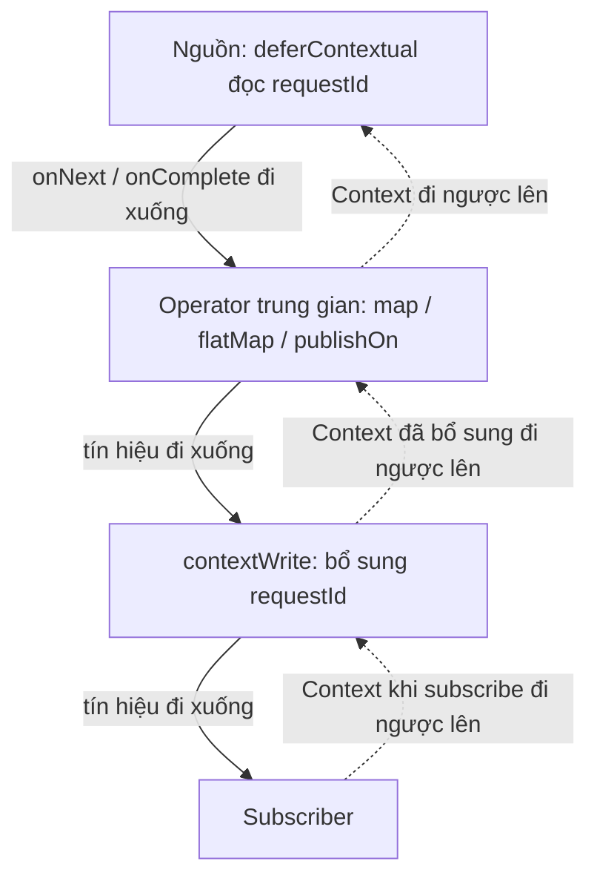
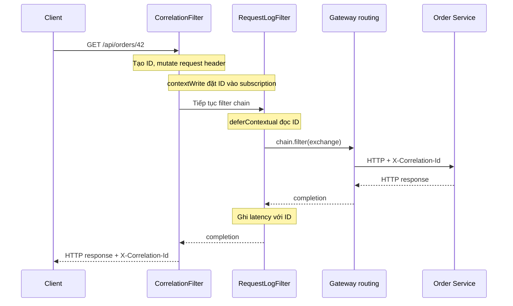

# Reactor Context và truyền dữ liệu xuyên chuỗi xử lý

## Mục tiêu học tập

Trong chương **Nền tảng WebFlux**, bài này giải thích cách mang thông tin gắn với một request qua chuỗi xử lý bất đồng bộ trong **Spring Cloud Gateway** mà không phụ thuộc vào thread đang chạy. Sau bài học, bạn có thể:

- Mô tả vì sao `ThreadLocal` không phù hợp để truyền thông tin xuyên suốt một chuỗi Reactor có thể đổi thread.
- Phân biệt `Context`, `ContextView`, `contextWrite` và `deferContextual`; giải thích chính xác hướng truyền của Reactor Context.
- Áp dụng Reactor Context trong `Mono`/`Flux`, qua các bước `flatMap`, `publishOn` và trong `GlobalFilter` của Spring Cloud Gateway.
- Chọn đúng nơi lưu thông tin: Reactor Context, `ServerWebExchange` attributes hay HTTP headers.
- Hiểu giới hạn của Context đối với `WebClient`, tracing, Spring Security, retry và ranh giới giữa các dịch vụ.
- Kiểm tra và gỡ lỗi tình huống dữ liệu Context bị thiếu hoặc bị ghi đè.

## 1. Bài toán: một request không nhất thiết chạy trên một thread

Hãy hình dung một request đi qua API Gateway:

1. Client gửi `GET /api/orders/42` kèm mã tương quan `X-Correlation-Id`.
2. Gateway áp dụng route predicate để chọn Order Service.
3. Filter xác thực thông tin truy cập, filter khác đo thời gian và ghi log.
4. Chuỗi xử lý bất đồng bộ gọi hệ thống ngoài hoặc chuyển request đến dịch vụ đích.
5. Response trả về client; nhóm vận hành cần liên kết log của các bước với cùng request.

Trong ứng dụng servlet đồng bộ truyền thống, nhiều đoạn mã thường giả định một request gắn với một thread và lưu dữ liệu bằng `ThreadLocal`, chẳng hạn MDC (`Mapped Diagnostic Context`) dùng để gắn `requestId` vào log.

Trong **Spring WebFlux/Reactor**, các operator có thể lập lịch lại công việc hoặc tiếp tục xử lý trên thread khác. Một thread cũng có thể xử lý nhiều request ở những thời điểm khác nhau. Vì vậy, giá trị gắn với thread **không tự động** trở thành giá trị gắn với request:

```text
Request A
  │  event-loop-1: nhận request
  ├─ map(...)
  ├─ publishOn(...) ───────► parallel-2: xử lý tiếp
  └─ gọi upstream ─────────► callback bất đồng bộ

Request B có thể sử dụng event-loop-1 khi Request A đang chờ I/O.
```

Nếu filter gọi `MDC.put("requestId", ...)` rồi giả định mọi operator tiếp theo đều chạy trên thread đó, log có thể thiếu ID, mang ID từ request khác hoặc buộc phải viết logic dọn dẹp phức tạp. `MDC` vẫn có thể dùng khi framework thiết lập cầu nối context propagation thích hợp, nhưng **không nên mặc định ThreadLocal tự lan truyền trong reactive pipeline**.

**Reactor Context** giải quyết nhu cầu mang metadata theo *subscription* (lần đăng ký luồng), độc lập với thread thực thi. Nó thích hợp cho correlation ID, tenant ID đã xác minh, thông tin quan sát hoặc một số dữ liệu kỹ thuật gắn với request.

## 2. Reactor Context là gì?

Trong Project Reactor:

- `Context` là cấu trúc ánh xạ **key → value** bất biến ở mức API: thao tác như `put` tạo ra một Context mới, không sửa tại chỗ Context ban đầu.
- `ContextView` là giao diện **chỉ đọc**, dùng để truy cập dữ liệu đã có trong Context.
- Context được **gắn với Subscriber**, không phải gắn với `Thread` hay là biến toàn cục.
- Mỗi lần subscription có thể mang Context riêng; hai request xử lý đồng thời không mặc nhiên chia sẻ giá trị Context.
- Dữ liệu đi vào Context nhờ `contextWrite(...)` và thường được đọc bằng `Mono.deferContextual(...)`, `Flux.deferContextual(...)` hoặc những API Reactor nhận `ContextView`.

Điểm dễ gây nhầm nhất là **chiều truyền Context ngược chiều tín hiệu dữ liệu thông thường**:



Trong một chuỗi khai báo từ trên xuống dưới, `contextWrite` **tác động tới các operator ở phía nguồn (upstream) của nó**. Điều này khác với suy nghĩ trực giác rằng “ghi context tại một dòng thì các dòng viết bên dưới sẽ đọc được”. Để hiểu đúng cần nhìn vị trí **subscription** và cách lồng các publisher, không chỉ thứ tự dòng code.

### 2.1. Ví dụ nhỏ nhất: ghi rồi đọc

```java
import reactor.core.publisher.Mono;

Mono<String> result =
    Mono.deferContextual(contextView -> {
        String requestId = contextView.get("requestId");
        return Mono.just("Request = " + requestId);
    })
    .contextWrite(context -> context.put("requestId", "req-123"));

// Khi subscribe, result phát ra một giá trị:
// "Request = req-123"
```

Diễn giải:

1. `Mono.deferContextual(...)` chưa đọc dữ liệu lúc **assembly** (khi dựng pipeline); callback chạy khi **subscription** xảy ra.
2. `contextWrite(...)` tạo Context có `requestId`.
3. Khi subscriber đăng ký, Context được truyền về phía nguồn để `deferContextual` nhìn thấy.
4. `ContextView.get("requestId")` trả lại giá trị đã ghi. Nếu key không tồn tại, `get` có thể báo lỗi; dùng `getOrDefault` khi giá trị là tùy chọn.

Trên một luồng request đang hoạt động, Reactor Context giúp nhiều operator xử lý cùng một subscription đọc metadata mà không cần thêm tham số `requestId` vào mọi phương thức.

### 2.2. Thay đổi scheduler không có nghĩa mất Reactor Context

```java
import reactor.core.publisher.Mono;
import reactor.core.scheduler.Schedulers;

Mono<String> pipeline =
    Mono.just("order-42")
        .publishOn(Schedulers.parallel())
        .flatMap(orderId ->
            Mono.deferContextual(view ->
                Mono.just(view.get("requestId") + ":" + orderId)
            )
        )
        .contextWrite(ctx -> ctx.put("requestId", "req-123"));

// Kết quả: "req-123:order-42"
```

`publishOn` chuyển phần xử lý phía sau sang scheduler khác, nhưng các operator Reactor được kết nối trong cùng chuỗi vẫn có cơ chế truyền Context theo subscription. Trái lại, một `ThreadLocal` tự đặt trước `publishOn` không bảo đảm xuất hiện trên thread mới.

**Lưu ý:** quy tắc này áp dụng cho luồng Reactor được nối đúng cách. Code tự tạo thread, một callback bên ngoài không được tích hợp với publisher, hoặc một lần `subscribe()` độc lập có thể tạo ranh giới mới và không nhận Context như mong đợi.

### 2.3. Hai `contextWrite` và quy tắc ghi đè

```java
Mono<String> result =
    Mono.deferContextual(view ->
        Mono.just(view.get("level"))
    )
    .contextWrite(ctx -> ctx.put("level", "Gần nguồn"))
    .contextWrite(ctx -> ctx.put("level", "Gần subscriber"));

// Kết quả khi subscribe: "Gần nguồn"
```

Khi đăng ký, hàm `contextWrite` gần subscriber áp dụng trước, sau đó hàm gần nguồn tiếp tục thay cùng key. Vì vậy, **với cùng key, giá trị được ghi ở `contextWrite` gần nguồn hơn có thể che giá trị từ phía downstream**.

Điều này tạo ra một nguyên tắc thiết kế: tránh để nhiều filter tùy tiện ghi cùng key với ý nghĩa khác nhau. Nên có một chủ sở hữu rõ ràng cho metadata quan trọng; key có thể được gom trong một lớp hằng số dùng chung để giảm lỗi chính tả và xung đột.

### 2.4. ContextView chỉ đọc; Context không phải một bản đồ mutable chia sẻ

```java
Mono<String> source = Mono.deferContextual(view -> {
    String tenantId = view.getOrDefault("tenantId", "public");
    return Mono.just(tenantId);
});

Mono<String> tenantA =
    source.contextWrite(ctx -> ctx.put("tenantId", "tenant-A"));

Mono<String> tenantB =
    source.contextWrite(ctx -> ctx.put("tenantId", "tenant-B"));
```

Hai pipeline có thể dùng chung `source` nhưng mang hai giá trị `tenantId` khác nhau khi được subscribe. Việc tái sử dụng publisher không tự làm hai Context trộn lẫn.

Mặc dù bản thân Context bất biến, **đối tượng được đặt làm value có thể mutable**. Không đặt một `HashMap` dùng chung hoặc đối tượng request có thể sửa trên nhiều subscription nếu không quản lý vòng đời và tính an toàn đồng thời.

## 3. Đọc Context trong các phép biến đổi

### 3.1. `deferContextual`: lựa chọn phổ biến

Khi bước xử lý cần đọc Context để tạo một publisher mới, dùng `deferContextual`:

```java
Mono<String> buildAuditMessage(String operation) {
    return Mono.deferContextual(view -> {
        String requestId = view.getOrDefault("requestId", "unknown");
        return Mono.just("requestId=" + requestId + ", operation=" + operation);
    });
}

Mono<String> audit =
    buildAuditMessage("read-order")
        .contextWrite(ctx -> ctx.put("requestId", "req-abc"));
```

Có thể lồng `deferContextual` trong `flatMap` để lấy Context đúng lúc thực thi:

```java
Mono<String> output =
    lookupOrder("42")
        .flatMap(order ->
            Mono.deferContextual(view ->
                buildResponse(order, view.get("requestId"))
            )
        )
        .contextWrite(ctx -> ctx.put("requestId", "req-abc"));
```

Ở đây `lookupOrder(...)` và `buildResponse(...)` biểu thị các hàm nghiệp vụ đã có, trong đó `buildResponse` trả về `Mono<String>`. Điểm chính là **trả publisher bên trong `flatMap`**, không mở subscription lẻ bằng `subscribe()` để cố đọc Context.

### 3.2. `transformDeferredContextual`: khi muốn dùng Context cho nhiều phần tử

Với `Flux`, thay vì truy vấn Context cho từng phần tử ở nhiều chỗ, có thể dùng `transformDeferredContextual`:

```java
import reactor.core.publisher.Flux;

Flux<String> tagged =
    Flux.just("created", "validated", "routed")
        .transformDeferredContextual((flux, view) -> {
            String requestId = view.getOrDefault("requestId", "unknown");
            return flux.map(event -> requestId + ":" + event);
        })
        .contextWrite(ctx -> ctx.put("requestId", "req-123"));

// tagged phát ra:
// req-123:created
// req-123:validated
// req-123:routed
```

Hàm biến đổi nhận `ContextView` ứng với lần subscribe. Phù hợp khi cùng metadata cần áp vào nhiều phần tử liên tiếp. Đối với một tín hiệu lỗi, `doOnEach` còn cho phép đọc `Signal.getContextView()`; cần xem loại signal vì `Mono<Void>` hoàn thành bình thường **không phát `onNext`**.

### 3.3. Không gọi `block()` hoặc `subscribe()` giữa pipeline của Gateway

Ví dụ **không nên làm** trong một gateway filter:

```java
// Sai mục đích: tách luồng xử lý và làm mất kiểm soát completion/error.
return Mono.deferContextual(view -> {
    auditService.log(view.get("requestId")).subscribe();
    return chain.filter(exchange);
});
```

Lời gọi `subscribe()` tự tạo một subscription khác, quản lý lỗi và vòng đời riêng; nó còn có thể chạy ngoài thời gian sống của HTTP request. Nếu cần thao tác bất đồng bộ trước khi tiếp tục chuỗi xử lý, ghép publisher:

```java
return Mono.deferContextual(view ->
    auditService.log(view.get("requestId")) // Mono<Void>
        .then(chain.filter(exchange))
);
```

Khi đó chuỗi chính quản lý thứ tự, completion, cancellation và lỗi. Trong đường xử lý WebFlux, `block()` còn có thể chặn event-loop và làm giảm khả năng xử lý đồng thời.

## 4. Áp dụng trong Spring Cloud Gateway: truyền correlation ID giữa các GlobalFilter

### 4.1. Luồng minh họa

Giả sử yêu cầu của Gateway như sau:

- Mỗi request có một `correlationId` để liên kết log giữa các filter.
- Một filter tạo ID, đưa vào Reactor Context và thêm HTTP header để backend nhận được.
- Một filter chạy sau đọc Reactor Context để ghi thời gian xử lý.
- Các route như `/api/orders/**` tiếp tục được Spring Cloud Gateway chọn bằng predicate và chuyển đến dịch vụ tương ứng.



**Reactor Context chỉ sống trong pipeline của Gateway**. Nó không tự đi qua HTTP sang Order Service. Chính HTTP header `X-Correlation-Id` trong ví dụ mới là dữ liệu mà service đích nhận được.

### 4.2. Filter tạo correlation ID và ghi Context

Ví dụ dành cho **Spring Cloud Gateway Server WebFlux**:

```java
import java.util.UUID;

import org.springframework.cloud.gateway.filter.GatewayFilterChain;
import org.springframework.cloud.gateway.filter.GlobalFilter;
import org.springframework.core.Ordered;
import org.springframework.http.server.reactive.ServerHttpRequest;
import org.springframework.stereotype.Component;
import org.springframework.web.server.ServerWebExchange;
import reactor.core.publisher.Mono;

@Component
public class CorrelationFilter implements GlobalFilter, Ordered {

    public static final String CONTEXT_KEY = "app.correlationId";
    public static final String HEADER = "X-Correlation-Id";

    @Override
    public Mono<Void> filter(ServerWebExchange exchange,
                             GatewayFilterChain chain) {
        // Tạo ID mới cho ví dụ, tránh tin tưởng trực tiếp header từ client.
        String correlationId = UUID.randomUUID().toString();

        ServerHttpRequest updatedRequest = exchange.getRequest()
            .mutate()
            .headers(headers -> headers.set(HEADER, correlationId))
            .build();

        ServerWebExchange updatedExchange = exchange.mutate()
            .request(updatedRequest)
            .build();

        updatedExchange.getResponse()
            .getHeaders()
            .set(HEADER, correlationId);

        return chain.filter(updatedExchange)
            .contextWrite(context -> context.put(CONTEXT_KEY, correlationId));
    }

    @Override
    public int getOrder() {
        return -100;
    }
}
```

Cần phân biệt ba hành động trong code:

1. `contextWrite(...)` gắn giá trị vào subscriber context của phần `chain.filter(...)`. Nhờ cách lồng publisher của filter chain, các publisher ở phía nguồn của `contextWrite` có thể đọc giá trị khi được subscribe.
2. `updatedRequest` thêm header vào **HTTP request chuyển tiếp**; `contextWrite` một mình không thêm header và không gửi Context qua mạng.
3. `getResponse().getHeaders().set(...)` cho client nhìn thấy ID ở response nếu response chưa commit và không có thành phần khác ghi đè; trong hệ thống thật phải thống nhất chính sách header trên toàn chuỗi.

Trong ví dụ, chúng ta **cấp ID mới** ở rìa gateway. Nếu hệ thống cần bảo toàn ID từ client hoặc một proxy phía trước, hãy kiểm tra nguồn tin cậy, độ dài và tập ký tự hợp lệ trước khi dùng. Dùng `headers.set(...)` để tránh tạo nhiều giá trị header từ dữ liệu cũ không đáng tin.

### 4.3. Filter chạy sau đọc Context

```java
import org.slf4j.Logger;
import org.slf4j.LoggerFactory;
import org.springframework.cloud.gateway.filter.GatewayFilterChain;
import org.springframework.cloud.gateway.filter.GlobalFilter;
import org.springframework.core.Ordered;
import org.springframework.stereotype.Component;
import org.springframework.web.server.ServerWebExchange;
import reactor.core.publisher.Mono;

@Component
public class RequestLogFilter implements GlobalFilter, Ordered {
    private static final Logger log =
        LoggerFactory.getLogger(RequestLogFilter.class);

    @Override
    public Mono<Void> filter(ServerWebExchange exchange,
                             GatewayFilterChain chain) {
        return Mono.deferContextual(view -> {
            String id = view.getOrDefault(
                CorrelationFilter.CONTEXT_KEY, "missing"
            );

            long started = System.nanoTime();

            return chain.filter(exchange)
                .doFinally(signal -> {
                    long tookMs =
                        (System.nanoTime() - started) / 1_000_000;
                    log.info(
                        "correlationId={} path={} outcome={} durationMs={}",
                        id,
                        exchange.getRequest().getPath(),
                        signal,
                        tookMs
                    );
                });
        });
    }

    @Override
    public int getOrder() {
        return -90;
    }
}
```

Với hai custom filter minh họa, `-100` được chạy trước `-90` ở pha *pre* của gateway filter chain. `RequestLogFilter` được dựng trong `chain.filter(...)` của `CorrelationFilter`, nên `deferContextual` có thể thấy Context do filter bên ngoài bổ sung. Giá trị `id` được đọc một lần và được giữ trong biến cục bộ dùng cho `doFinally`, kể cả khi luồng tiếp tục ở thread khác.

`doFinally` chạy cả khi hoàn tất, lỗi hoặc bị hủy. Tham số `signal` là loại tín hiệu kết thúc (`ON_COMPLETE`, `ON_ERROR`, `CANCEL`...), **không phải HTTP status**. Nếu cần phân loại HTTP status, phải đọc status từ response đúng thời điểm và kiểm tra trường hợp response chưa có status hoặc bị commit.

**Chú ý về thứ tự filter:** cách cấu hình `Ordered` quyết định thứ tự giữa các `GlobalFilter`/`GatewayFilter`; filter có thứ tự không như mong đợi có thể đọc trước khi Context được đưa vào pipeline. Đừng khẳng định mọi filter trên toàn gateway đều tự nhìn thấy một key chỉ vì key được ghi ở một filter bất kỳ.

### 4.4. Context không có nghĩa là sửa HTTP request

Sự khác biệt rất quan trọng trong gateway:

| Nơi lưu dữ liệu | Vòng đời và phạm vi | Công dụng | Có tự truyền tới backend qua HTTP? |
| --- | --- | --- | --- |
| **Reactor Context** | Theo subscriber của pipeline Reactor | Truyền metadata tới operator/filter reactive có quyền đọc Context | **Không** |
| **`ServerWebExchange.getAttributes()`** | Map gắn với exchange xử lý server request | Chia sẻ trạng thái kỹ thuật giữa các thành phần có cùng `ServerWebExchange` | **Không** |
| **HTTP request headers** | Dữ liệu thuộc request trên giao thức HTTP | Truyền correlation ID hoặc thông tin giao thức sang downstream | **Có**, nếu proxy/routing giữ header đó |
| **MDC/`ThreadLocal`** | Theo thread nếu không có cơ chế bridge | Gắn metadata vào log hoặc tích hợp thư viện legacy | **Không**, và không tự theo pipeline reactive |

`ServerWebExchange` attributes là một lựa chọn hợp lý nếu nhiều gateway filter cùng có đối tượng `exchange` và cần lưu thông tin cục bộ. Chúng **không cần** phải chuyển mọi giá trị sang Reactor Context. Ngược lại, khi một hàm thư viện chỉ nhận `Mono`/`Flux` mà không nhận `exchange`, Reactor Context cho phép truyền metadata qua subscription mà không phải thêm tham số.

Với thông tin nghiệp vụ như quyền truy cập một đơn hàng, backend vẫn phải kiểm tra quyền; việc một header hoặc một key Context tồn tại **không thay thế xác thực và phân quyền**.

## 5. Truyền Context qua các lớp dịch vụ reactive

Không phải mọi lớp trong ứng dụng đều nhận `ServerWebExchange`. Reactor Context hữu ích khi nhiều component trả về `Mono`/`Flux`:

```java
Mono<Order> loadOrder(String orderId) {
    return Mono.deferContextual(view -> {
        String correlationId =
            view.getOrDefault("app.correlationId", "missing");

        return orderRepository.findById(orderId)
            .doOnNext(order ->
                log.debug("requestId={} loadedOrder={}",
                    correlationId, order.getId())
            );
    });
}
```

Ở đây `orderRepository.findById` biểu thị phương thức repository *reactive* trả về `Mono<Order>`; `log` là logger được khai báo trong lớp. Code dùng `deferContextual` để lấy đúng metadata của subscription đang gọi. Với repository blocking, cần thiết kế tích hợp phù hợp thay vì thực hiện I/O chặn ngay trên event-loop.

Ví dụ nếu một phương thức dịch vụ gọi tiếp phương thức khác:

```java
Mono<OrderDto> getOrder(String id) {
    return loadOrder(id)
        .flatMap(order -> enrichOrder(order))
        .map(this::toDto);
}
```

Khi `getOrder` được gọi trong cùng chuỗi Reactor có Context, các publisher được kết nối đúng cách có thể truy cập thông tin này. **Không cần truyền `correlationId` như tham số giữa mọi lớp**, nhưng với dữ liệu quan trọng quyết định logic nghiệp vụ, tham số tường minh thường làm hợp đồng hàm dễ hiểu và dễ kiểm thử hơn. Context phù hợp nhất cho metadata nằm ngoài nội dung chính của hàm.

### 5.1. Từ Gateway sang một HTTP service khác

Reactor Context không thể tự vượt qua ranh giới tiến trình. Nếu ứng dụng tự gọi downstream bằng `WebClient`, cần chủ động chuyển metadata vào HTTP header:

```java
Mono<String> callRemote(WebClient webClient, String id) {
    return Mono.deferContextual(view -> {
        String correlationId =
            view.getOrDefault("app.correlationId", "");

        return webClient.get()
            .uri("/orders/{id}", id)
            .headers(headers -> {
                if (!correlationId.isBlank()) {
                    headers.set("X-Correlation-Id", correlationId);
                }
            })
            .retrieve()
            .bodyToMono(String.class);
    });
}
```

`WebClient` ở đây là `org.springframework.web.reactive.function.client.WebClient`. Đây là ví dụ cho **một HTTP client do ứng dụng chủ động gọi**, không phải khẳng định Spring Cloud Gateway mặc định định tuyến upstream bằng `WebClient`. Gateway Server WebFlux có filter định tuyến riêng; trong ví dụ ở mục 4, header đã được đưa vào request để cơ chế routing chuyển tiếp.

Khi backend nhận `X-Correlation-Id`, nó có thể đưa giá trị đã được kiểm tra vào Context của **pipeline mới ở backend**. Không có sự chia sẻ trực tiếp cùng một đối tượng Context giữa hai JVM hoặc hai dịch vụ.

### 5.2. Metadata cho tracing

Correlation ID do ứng dụng tự tạo giúp tra cứu log, nhưng tracing phân tán còn có **trace ID, span ID** và các header propagation tiêu chuẩn như `traceparent`. Trong hệ sinh thái Spring, Micrometer Observation/Tracing và công cụ instrumentation có thể quản lý luồng truyền trace context nếu được cấu hình và tích hợp đúng.

Không nên tự ghi đè header tracing tiêu chuẩn chỉ để đồng bộ nó với custom correlation ID. Nếu tổ chức sử dụng cả hai, hãy định nghĩa quan hệ rõ ràng: ví dụ log có `correlationId` cho tra cứu nghiệp vụ đồng thời chứa `traceId` cho việc mở chuỗi span.

## 6. Reactor Context với Spring Security và xác thực

Trong WebFlux, Spring Security có cơ chế lưu thông tin bảo mật theo ngữ cảnh reactive. Code nên dùng API dành riêng cho nó, chẳng hạn `ReactiveSecurityContextHolder`, thay vì tự đoán key nội bộ trong Reactor Context:

```java
import org.springframework.security.core.context.ReactiveSecurityContextHolder;
import reactor.core.publisher.Mono;

Mono<String> currentPrincipalName() {
    return ReactiveSecurityContextHolder.getContext()
        .map(securityContext ->
            securityContext.getAuthentication().getName()
        );
}
```

Đây là ví dụ cách đọc tên principal khi security context đã được thiết lập trong reactive security chain. Khi không có context đã xác thực, publisher có thể không phát giá trị; ứng dụng cần quy định xử lý trường hợp anonymous hoặc unauthorized phù hợp.

Trong Spring Cloud Gateway, có thể dùng thông tin đã xác thực để quyết định chính sách đầu vào. Tuy nhiên:

- **Authentication**: xác minh người gọi là ai, token/credential có hợp lệ không.
- **Authorization tại gateway**: kiểm soát quyền truy cập route hoặc phạm vi API chung.
- **Authorization tại backend**: kiểm tra tài nguyên và quy tắc nghiệp vụ cụ thể, ví dụ người gọi có sở hữu đơn hàng hay không.

Không gửi toàn bộ `Authentication`, token gốc hoặc đối tượng security context qua header cho backend. Nếu cần truyền danh tính, phải thiết kế token/chứng thực và ranh giới tin cậy thích hợp; header do client tự cung cấp không được xem như danh tính đã xác minh.

## 7. Các ranh giới Context thường bị hiểu sai

### 7.1. Assembly và subscription khác nhau

```java
Mono<String> handler = Mono.deferContextual(view ->
    Mono.just(view.getOrDefault("role", "guest"))
);

Mono<String> a = handler.contextWrite(ctx -> ctx.put("role", "reader"));
Mono<String> b = handler.contextWrite(ctx -> ctx.put("role", "admin"));
```

Khi *dựng* hai publisher, chưa có subscription nên chưa có lý do đọc Context. Khi từng publisher được subscribe, `deferContextual` nhận Context của lần đó. Đó là lý do không nên cố “lấy Context hiện hành” ở constructor hoặc ở chỗ cấu hình Bean để dùng cho mọi request.

### 7.2. `contextWrite` không lan theo mọi hướng

```java
Mono<String> result =
    Mono.deferContextual(view ->
        Mono.just("source=" + view.getOrDefault("tag", "none"))
    )
    .contextWrite(ctx -> ctx.put("tag", "local"))
    .flatMap(sourceValue ->
        Mono.deferContextual(view ->
            Mono.just(
                sourceValue + ", after=" +
                view.getOrDefault("tag", "none")
            )
        )
    );

// Kết quả: "source=local, after=none"
```

`contextWrite` ở nhánh phía trước `flatMap` chỉ ảnh hưởng tới source upstream của chính nó. Nó không biến `tag` thành một giá trị toàn cục để operator **phía downstream** sau `contextWrite` mặc nhiên truy cập được.

Khi muốn nhiều đoạn trong cùng request đều nhìn thấy một key, đặt `contextWrite` tại vị trí bao bọc đúng **toàn bộ các publisher cần đọc**, và kiểm tra cách các filter/lớp gọi ghép nối publisher với nhau.

### 7.3. Tạo subscription mới có thể tách khỏi luồng ban đầu

```java
// Không nên:
Mono.deferContextual(view -> {
    sendAuditMessage(view.get("app.correlationId")).subscribe();
    return chain.filter(exchange);
});
```

`subscribe()` nội bộ mở một lần đăng ký riêng. Nó có thể kết thúc ngoài lifecycle của request hoặc không nhận Context như mong muốn. Cách ghép bằng `then`, `flatMap`, `concatMap` hoặc tổ hợp publisher phù hợp cho phép Reactor quản lý dòng xử lý nhất quán.

Đối với công việc thật sự cần chạy nền độc lập với HTTP request, phải thiết kế một hàng đợi/tác vụ nền riêng, truyền metadata tường minh và có cơ chế xử lý lỗi; không dựa vào Context của subscription request đã kết thúc.

### 7.4. Bridge ThreadLocal/MDC là cấu hình bổ sung

Một số bản Reactor/Spring và bộ thư viện Micrometer Context Propagation hỗ trợ cơ chế đồng bộ một số `ThreadLocal` với Reactor Context thông qua accessor và instrumentation. Tính năng này phụ thuộc **phiên bản, dependency và chế độ cấu hình**, không nên coi là mặc định cho mọi project.

Ngay cả khi bật automatic context propagation, cần kiểm tra vòng đời và cleanup của MDC, không đưa token hoặc dữ liệu nhạy cảm vào log, và bảo đảm logging/tracing được instrument theo cách nhất quán. Đối với dữ liệu trong nghiệp vụ reactive, đọc bằng `deferContextual` thường rõ ràng hơn việc truy cập MDC trực tiếp.

### 7.5. Context không phải bộ nhớ cache hoặc kho dữ liệu dài hạn

Reactor Context không có TTL, kho chia sẻ giữa request, hay cơ chế truy vấn phân tán. Nó không thay thế Redis, database, session store hoặc event metadata. Tránh nhét payload lớn, đối tượng mutable hoặc tài nguyên cần đóng vào Context: Context được sao chép theo kiểu bất biến khi thêm/bớt key, còn giá trị có thể giữ tham chiếu tới đối tượng trong suốt subscription.

## 8. Đặt Context đúng chỗ trong filter chain

Một cách nhìn đơn giản cho hai filter:

```text
CorrelationFilter (order -100)
  return chain.filter(exchange)
             .contextWrite(ctx -> ctx.put(KEY, id))
                 │
                 ▼ (subscription vào publisher của chain)
    RequestLogFilter (order -90)
      return Mono.deferContextual(ctx -> ...)
                 │
                 ▼
      Các filter/route tiếp theo
```

`CorrelationFilter` bao bọc publisher được trả về từ `chain.filter`. Khi pipeline được subscribe, `contextWrite` sẽ bổ sung Context cho những publisher phía nguồn nằm trong chuỗi đó. Khi `RequestLogFilter` đọc bằng `deferContextual` ở thời điểm subscription, nó có thể thấy `KEY`.

Nếu đảo thứ tự, hoặc đặt `contextWrite` trong một nhánh publisher mà filter cần đọc không đi qua, kết quả có thể là `missing`. Không thể sửa bằng cách thêm `Thread.sleep(...)` hoặc đoán thứ tự chạy theo thời gian: cần chỉnh **cấu trúc và phạm vi subscription**.

Một số quy tắc thực hành:

1. Gắn metadata một lần ở ranh giới request phù hợp (ví dụ một filter có thứ tự xác định).
2. Ưu tiên `contextWrite(ctx -> ctx.put(KEY, value))` để giữ các key đã có.
3. Đọc bằng `deferContextual` ở vị trí publisher được subscribe, không đọc từ một biến tĩnh.
4. Truyền metadata qua network bằng header/giao thức đáng tin; đừng giả định Context tự đi tới service khác.
5. Duy trì hợp đồng rõ ràng nếu nhiều filter cùng cần ghi một key; tránh ghi đè ngầm.

## 9. Kiểm thử và chẩn đoán lỗi Context

### 9.1. Ví dụ kiểm thử với StepVerifier

Khi dự án có dependency `reactor-test`, có thể kiểm tra nội dung phát ra:

```java
import org.junit.jupiter.api.Test;
import reactor.core.publisher.Mono;
import reactor.test.StepVerifier;

class ReactorContextExampleTest {

    @Test
    void canReadValueFromSubscriberContext() {
        Mono<String> result =
            Mono.deferContextual(view ->
                Mono.just(view.get("requestId") + ":order-42")
            )
            .contextWrite(ctx -> ctx.put("requestId", "req-7"));

        StepVerifier.create(result)
            .expectNext("req-7:order-42")
            .verifyComplete();
    }
}
```

Đây là minh họa kiến thức; trong một ứng dụng thật cần kiểm tra thêm filter chain, response headers và trường hợp Context không có key. Không nên viết test chỉ đếm số lần gọi `contextWrite`; hãy kiểm tra hành vi mà subscriber hoặc HTTP client nhìn thấy.

### 9.2. Câu hỏi khi đọc không ra dữ liệu

| Triệu chứng | Nguyên nhân hay gặp | Hướng xử lý |
| --- | --- | --- |
| `get("requestId")` báo thiếu key | Không có `contextWrite` trên nhánh subscription chứa đoạn đọc | Kiểm tra sơ đồ publisher và dùng `getOrDefault` nếu key tùy chọn |
| Filter B thấy `missing` | Thứ tự filter hoặc phạm vi `contextWrite` không bao phủ publisher B | Kiểm tra `Ordered` và vị trí `.contextWrite(...)` |
| Log sau `publishOn` không còn MDC | MDC/ThreadLocal chưa được bridge | Đọc Reactor Context trực tiếp hoặc cấu hình context propagation theo stack |
| Backend không thấy correlation ID | Chỉ ghi Reactor Context, chưa thêm HTTP header | Mutate request/header chuyển tiếp hoặc cấu hình HTTP client |
| Giá trị bị thay thành ID khác | Nhiều `contextWrite` ghi cùng key hoặc filter tái tạo ID | Xác định nơi tạo ID chuẩn và tránh ghi đè |
| Mất lỗi hoặc log audit chạy ngoài request | Dùng `subscribe()` bên trong operator/filter | Ghép publisher và để chain quản lý terminal signal |
| Context có ở test nhưng thiếu lúc chạy thực tế | Đường chạy thật khác nhánh test, thư viện ngoài tự tạo subscription hoặc callback | Theo trace từng ranh giới reactive, kiểm tra tích hợp thư viện |

### 9.3. Đo lường an toàn

Trong môi trường production, hãy ưu tiên metric/trace theo route, status và latency hơn là ghi toàn bộ Context. Chỉ log các trường đã được phân loại an toàn, có giới hạn độ dài, và nhất quán với chuẩn quan sát của tổ chức.

Khi debug, một `requestId` hợp lệ cùng `traceId` có thể giúp xác định request đã đi qua predicate nào, filter nào báo lỗi và request có đến backend hay không. Reactor Context hỗ trợ gắn metadata vào chuỗi xử lý; tracing end-to-end vẫn cần instrumentation và propagator xuyên mạng.

## 10. Bài thực hành gợi ý

Bạn có thể luyện tập trên một ứng dụng Spring Cloud Gateway Server WebFlux tối giản:

1. Tạo hai route định tuyến đến hai backend HTTP giả lập; đặt một `GlobalFilter` sinh correlation ID như ở mục 4.2.
2. Thêm `RequestLogFilter` như mục 4.3 và xác minh log có cùng ID với header trả về client.
3. Trong một dịch vụ reactive tự viết, thử thêm `publishOn` hoặc `flatMap` rồi đọc ID bằng `deferContextual`. Quan sát việc Reactor Context còn giá trị khi đổi scheduler.
4. Thử bỏ `.contextWrite(...)`: `getOrDefault` trong filter đọc trả `missing`. Khôi phục và xác minh kết quả.
5. Đảo thứ tự hai filter hoặc gắn Context vào một nhánh không bao phủ filter đọc; quan sát ảnh hưởng đến phạm vi Context.
6. Gửi request tới backend và xác minh backend nhận header `X-Correlation-Id`; so sánh với trường hợp chỉ ghi Reactor Context mà không mutate request.
7. Gây lỗi backend và hủy request để quan sát `doFinally`; phân biệt terminal signal với HTTP status.

**Tiêu chí hoàn thành:** bạn giải thích được key được ghi ở đâu, ai subscribe publisher, filter nào đọc được Context, khi nào cần HTTP header, và cách tránh mất context khi thay đổi chuỗi xử lý.

## Tổng kết

Reactor Context là công cụ mang **metadata theo subscription** qua các operator trong chuỗi Spring WebFlux. Nó giúp request của Spring Cloud Gateway giữ correlation ID, thông tin quan sát và một số dữ liệu kỹ thuật trong môi trường bất đồng bộ mà không phụ thuộc một thread cố định. Bộ đôi thường dùng là **`contextWrite` để bổ sung** và **`deferContextual` để đọc tại subscription**.

Ba ranh giới cần nhớ là: Context đi **ngược từ subscriber về source**; Context không tự chảy qua **HTTP/network** sang microservice; và Context không đồng nghĩa với **ThreadLocal/MDC**. Hiểu ba điểm này giúp viết gateway filter an toàn, dễ kiểm thử và dễ truy vết khi vận hành microservices.
