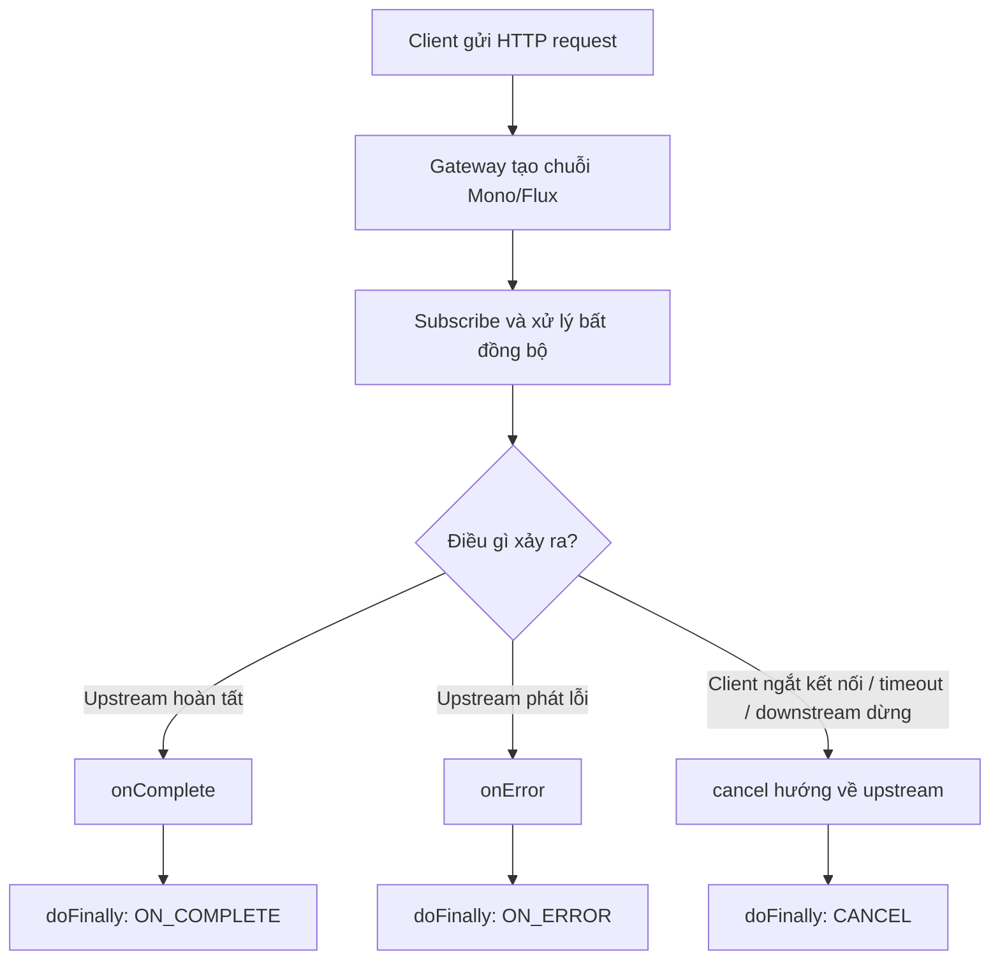
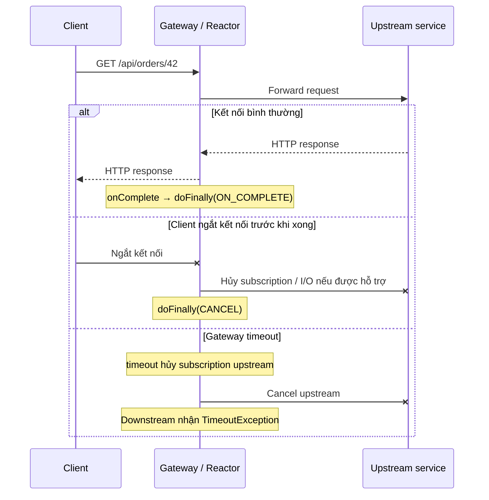

# Truyền lỗi, hủy xử lý và quản lý vòng đời tài nguyên

Trong Spring WebFlux, một request được xử lý như một luồng tín hiệu bất đồng bộ. Spring Cloud Gateway xây dựng trên nền tảng này: Gateway nhận request, chạy chuỗi predicate/filter, gọi dịch vụ phía sau và truyền response về client. Vì vậy, **lỗi**, **hủy xử lý** và **giải phóng tài nguyên** phải được thiết kế theo vòng đời của `Mono`/`Flux`, thay vì giả định mỗi request luôn chạy liên tục trên một thread và kết thúc bằng `return` hoặc `throw`.

Bài này tập trung vào cách Reactor truyền tín hiệu, cách các toán tử xử lý lỗi/cancellation hoạt động, cách bảo vệ tài nguyên (đặc biệt là `DataBuffer`) và cách áp dụng những nguyên tắc đó vào filter chain của Spring Cloud Gateway. Đây cũng là nền tảng để cấu hình timeout, retry, circuit breaker và giám sát request ở các phần vận hành Gateway.

## 1. Mô hình tín hiệu: hoàn tất, lỗi và hủy

Một `Publisher` tuân thủ Reactive Streams có thể phát dữ liệu qua `onNext`, sau đó kết thúc bằng **một trong hai tín hiệu terminal**: `onComplete` hoặc `onError`. Một `Subscriber` cũng có quyền gửi `cancel()` ngược về `Subscription` để cho biết nó không còn cần dữ liệu. Cancellation **không phải** tín hiệu `onError` hay `onComplete` gửi đến subscriber.

| Khái niệm | Ai khởi phát? | Ý nghĩa và hệ quả |
| --- | --- | --- |
| `onNext(value)` | Publisher → Subscriber | Phát giá trị khi còn nhu cầu (`request(n)`); một `Mono` có tối đa một giá trị. |
| `onComplete()` | Publisher → Subscriber | Kết thúc thành công, có thể không phát giá trị nào. |
| `onError(error)` | Publisher → Subscriber | Kết thúc thất bại; sau đó không còn `onNext`/`onComplete` từ subscription đó. |
| `cancel()` | Subscriber → Subscription | Yêu cầu upstream dừng cung cấp dữ liệu và dọn dẹp khi có thể; không bảo đảm thao tác bên ngoài đã được hoàn tác. |



**Một phân biệt rất quan trọng ở API Gateway:** HTTP `404`, `429` hoặc `503` là **mã trạng thái trong response**, không mặc nhiên là `onError` của Reactor. Ví dụ, Gateway có thể chuyển tiếp nguyên vẹn response `503` từ dịch vụ đích và luồng ghi response vẫn `onComplete` bình thường. Ngược lại, lỗi kết nối, exception trong filter hoặc timeout có thể phát `onError`. Khi dùng `WebClient.retrieve()`, các trạng thái HTTP lỗi thường được chuyển thành exception theo quy tắc của `WebClient`; đây là hành vi của API gọi HTTP đó, không phải quy tắc cho mọi luồng Gateway.

Một số hệ quả thực tế:

- `Mono`/`Flux` thường **lazy**: tạo pipeline không có nghĩa là đã gọi mạng hoặc cấp phát tài nguyên; hoạt động bắt đầu khi có subscription.
- `throw` bên trong callback hoặc lỗi từ một publisher sẽ được Reactor chuyển thành tín hiệu `onError` theo ngữ cảnh toán tử. `try/catch` bao quanh *thao tác khai báo* pipeline không bắt được lỗi bất đồng bộ xảy ra sau khi subscribe.
- Khi một nguồn đã `onError`, nó đã chấm dứt. `onErrorResume` tạo luồng thay thế; `retry` tạo lần subscribe mới. Chúng không làm nguồn cũ tiếp tục phát dữ liệu.
- Cancellation thường lan từ downstream về upstream, nhưng việc dừng một HTTP call, tác vụ I/O hay side effect đã bắt đầu còn phụ thuộc thư viện và thời điểm hủy.

## 2. Lỗi truyền qua pipeline như thế nào?

Xét một pipeline truy vấn dịch vụ sản phẩm trong một thành phần WebFlux:

```java
Mono<Product> product = webClient.get()
    .uri("/products/{id}", productId)
    .retrieve()
    .bodyToMono(Product.class)
    .map(this::normalizeProduct)
    .doOnError(error -> log.warn("product lookup failed", error));
```

Nếu kết nối lỗi, upstream phản hồi lỗi được `retrieve()` diễn giải thành exception, hoặc `normalizeProduct` ném exception, các toán tử phía sau nhận một `onError`. `doOnError` chỉ **quan sát**, không chữa lỗi; subscriber ở cuối vẫn nhận `onError` trừ khi pipeline có toán tử phục hồi.

### Các toán tử cần phân biệt

| Toán tử | Công dụng | Điều cần nhớ |
| --- | --- | --- |
| `doOnError(...)` | Ghi log, đo metric, thêm quan sát | Không nuốt lỗi, không tự thay đổi HTTP status. |
| `onErrorMap(...)` | Chuyển exception sang loại mang ý nghĩa nghiệp vụ/hạ tầng | Giữ `cause` để còn chẩn đoán. |
| `onErrorResume(...)` | Chuyển sang `Publisher` dự phòng | Chỉ dùng khi có fallback đúng về mặt ngữ nghĩa. |
| `onErrorReturn(...)` | Trả một giá trị mặc định cố định | Dễ che mất sự cố nếu dùng đại trà. |
| `onErrorComplete(...)` | Biến lỗi thành hoàn tất rỗng | Có thể làm mất tín hiệu thất bại; chỉ dùng khi cố ý bỏ qua lỗi. |
| `retryWhen(...)` | Đăng ký lại nguồn sau lỗi theo chính sách | Có thể gọi lại upstream và lặp side effect; không phù hợp mặc định cho mọi request. |
| `doFinally(...)` | Chạy tác vụ quan sát/dọn dẹp khi complete, error hoặc cancel | Nhận `SignalType`; không phù hợp để phát sinh HTTP response mới. |

Ví dụ có phân loại timeout và chỉ phục hồi cho lỗi được phép:

```java
Mono<Product> fetchProduct(String productId) {
    return webClient.get()
        .uri("/products/{id}", productId)
        .retrieve()
        .bodyToMono(Product.class)
        .timeout(Duration.ofSeconds(2))
        .onErrorMap(
            TimeoutException.class,
            ex -> new ProductServiceTimeoutException("Product service timed out", ex)
        )
        .onErrorResume(
            ProductNotFoundException.class,
            ex -> Mono.empty()
        );
}
```

Đoạn mã minh họa cơ chế xử lý trên **một client WebFlux**: `ProductServiceTimeoutException` và `ProductNotFoundException` là các kiểu exception do ứng dụng tự định nghĩa. Nhánh `onErrorResume` chỉ chạy khi pipeline thực sự phát `ProductNotFoundException`; HTTP `404` từ `retrieve()` cần được ánh xạ sang kiểu này trước nếu muốn sử dụng nhánh đó. Việc biến `Mono.empty()` thành HTTP `404` hay giá trị khác là trách nhiệm của tầng gọi bên ngoài.

Trong Gateway, nên phân chia trách nhiệm: timeout/circuit breaker xử lý sự cố hạ tầng; bộ xử lý lỗi tập trung quyết định response an toàn; filter giám sát ghi tín hiệu mà không tự che mọi exception. Tránh sử dụng `onErrorContinue` cho toàn bộ request: toán tử này có ngữ nghĩa phụ thuộc vào operator hỗ trợ, dễ bỏ qua dữ liệu lỗi một cách khó kiểm soát.

### Khi nào lỗi được chuyển thành HTTP response?

Một lỗi ở tầng reactive cần được xử lý trước lúc response được commit. Tùy cách xây dựng ứng dụng, `WebExceptionHandler`, `ErrorWebExceptionHandler` hoặc một Gateway filter có thể xử lý exception và đặt HTTP status/body. Nếu header hay body đã gửi ra mạng, không thể thay đổi status thành `500`/`504` một cách đáng tin cậy. Hệ quả thường là response bị ngắt giữa chừng, client gặp lỗi đọc hoặc kết nối đóng.

Do đó, khi muốn sinh response lỗi trong filter, luôn kiểm tra `exchange.getResponse().isCommitted()` và chỉ viết response nếu chưa commit; nếu đã commit, chuyển tiếp lỗi để cơ chế xử lý/ghi log phù hợp giải quyết. Không gọi `setComplete()` để che mọi exception một cách vô điều kiện.

## 3. Cancellation: ai hủy, hủy đến đâu?

Các tình huống thường gặp ở Spring Cloud Gateway:

1. Client đóng tab, hủy HTTP request hoặc ngắt kết nối trước khi Gateway trả response.
2. Một toán tử `timeout` hết thời gian, hủy subscription upstream rồi phát `TimeoutException` xuống downstream.
3. `take`, `next`, `switchMap` hoặc một toán tử điều phối khác không còn cần nguồn đang chạy.
4. Một nhánh lỗi trong chuỗi có nhiều publisher khiến các nhánh còn lại bị hủy theo ngữ nghĩa của toán tử, ví dụ `flatMap` khi không dùng chế độ trì hoãn lỗi.



Điểm dễ nhầm: khi `timeout` xảy ra, **phía upstream nhìn thấy cancellation**, còn **phía downstream nhìn thấy lỗi timeout** (trừ khi có fallback). Do đó metric đếm `CANCEL` ở một operator và `ON_ERROR` ở operator khác cho cùng một request không nhất thiết mâu thuẫn.

Cancellation là yêu cầu dừng tiếp tục làm việc, **không phải transaction rollback**. Một dịch vụ đích có thể đã ghi dữ liệu trước khi Gateway/client ngắt kết nối. Không được dựa vào cancellation để đảm bảo thao tác `POST /payments` chưa thực hiện; việc chống xử lý trùng cần idempotency key và cơ chế nghiệp vụ thích hợp.

### Theo dõi kết thúc bằng `doFinally`

```java
@Component
public final class ExchangeLifecycleFilter implements GlobalFilter, Ordered {
    private static final Logger log =
        LoggerFactory.getLogger(ExchangeLifecycleFilter.class);

    @Override
    public Mono<Void> filter(ServerWebExchange exchange, GatewayFilterChain chain) {
        String requestId = exchange.getRequest().getId();
        long start = System.nanoTime();

        return chain.filter(exchange)
            .doOnError(error ->
                log.warn("gateway request failed: requestId={}", requestId, error))
            .doFinally(signal -> {
                long elapsedMs = TimeUnit.NANOSECONDS.toMillis(
                    System.nanoTime() - start);
                log.info("gateway requestId={} signal={} status={} elapsedMs={}",
                    requestId,
                    signal,
                    exchange.getResponse().getStatusCode(),
                    elapsedMs);
            });
    }

    @Override
    public int getOrder() {
        return -1;
    }
}
```

Các kiểu dùng trong ví dụ: `GlobalFilter`, `GatewayFilterChain`, `Ordered`, `ServerWebExchange`, `Mono`, SLF4J `Logger`/`LoggerFactory` và `TimeUnit`. Đây là filter quan sát, không sửa response. `doFinally` được thực thi khi subscription mà filter này quan sát kết thúc; vị trí đặt toán tử quyết định nó thấy `CANCEL`, `ON_ERROR` hay `ON_COMPLETE`. Khi phản hồi HTTP `503` được proxy thành công, tín hiệu có thể vẫn là `ON_COMPLETE`, nên metric cần ghi **cả signal lẫn HTTP status**.

`doOnCancel` chỉ kích hoạt cho cancellation; `doOnError` chỉ kích hoạt cho lỗi. `doFinally` bao phủ cả ba kiểu kết thúc và phù hợp để tính thời gian, giảm đếm số request đang xử lý, hoặc chạy cleanup đồng bộ nhanh. Không thực hiện blocking I/O trong callback đó; nếu cleanup bất đồng bộ có ý nghĩa bắt buộc, dùng `usingWhen` hoặc cơ chế quản lý vòng đời chuyên dụng.

## 4. Quản lý tài nguyên theo subscription

Trong ứng dụng đồng bộ, tài nguyên thường nằm trong `try/finally` hoặc `try-with-resources`. Với Reactor, đoạn mã sau có lỗi vòng đời:

```java
// SAI: đóng connection ngay khi dựng Mono, trước lúc subscribe.
Connection connection = openConnection();
try {
    return asyncRead(connection); // Chỉ tạo publisher, chưa chạy I/O.
} finally {
    connection.close();
}
```

Tài nguyên nên được cấp phát trong subscription và được đóng ở mọi lối kết thúc. Reactor cung cấp hai nhóm công cụ:

- `using(...)`: quản lý tài nguyên có cleanup đồng bộ (ví dụ `AutoCloseable`).
- `usingWhen(...)`: quản lý tài nguyên có cleanup trả về `Publisher`, phù hợp đóng connection/transaction bất đồng bộ theo ba nhánh **complete**, **error** và **cancel**.

Ví dụ minh họa một tài nguyên bất đồng bộ do ứng dụng định nghĩa:

```java
interface AsyncLease {
    Mono<byte[]> read();
    Mono<Void> close();
}

Mono<byte[]> readSafely(Mono<AsyncLease> acquireLease) {
    return Mono.usingWhen(
        acquireLease,
        AsyncLease::read,                   // Dùng resource.
        AsyncLease::close,                  // Cleanup khi complete.
        (lease, error) -> lease.close(),    // Cleanup khi error.
        AsyncLease::close                   // Cleanup khi cancel.
    );
}
```

`usingWhen` đưa quá trình cleanup vào lifecycle reactive: nó subscribe vào publisher dọn dẹp thay vì chỉ gọi một hàm rồi bỏ mặc. Nếu cleanup bất đồng bộ thất bại, lỗi cleanup có thể ảnh hưởng đến lỗi/kết quả quan sát được; cần ghi log, thiết kế timeout cleanup và quy định mức ưu tiên lỗi theo yêu cầu nghiệp vụ. Không có cơ chế reactive nào bảo đảm cleanup nếu tiến trình bị kill đột ngột hoặc máy chủ mất điện.

Ngoài tài nguyên cấp phát thủ công, Gateway còn quản lý connection, socket, HTTP body và buffer thông qua Spring WebFlux/Reactor Netty. Tránh gọi `subscribe()` trong Gateway filter chỉ để chạy công việc phụ: cách đó tạo subscription độc lập, tách khỏi cancellation/error của request và dễ làm rò rỉ tài nguyên. Thay vào đó, trả về một `Mono` được nối vào `chain.filter(exchange)` bằng toán tử thích hợp.

## 5. `DataBuffer`: tình huống dễ rò rỉ bộ nhớ nhất

`DataBuffer` đại diện cho phần dữ liệu request/response body. Khi chạy trên Reactor Netty, nó có thể sử dụng bộ nhớ off-heap và cơ chế reference counting. Với buffer pooled, việc giữ hoặc bỏ một buffer mà không cân bằng `retain`/`release` có thể gây rò rỉ bộ nhớ; release quá sớm khiến downstream đọc dữ liệu đã không còn hợp lệ.

Một số quy tắc thực hành:

1. **Không đọc body chỉ để log rồi quên chuyển tiếp.** Request body thường chỉ có thể tiêu thụ một lần; filter muốn thay đổi body phải tạo request decorator/publisher body phù hợp. Ưu tiên các Gateway filter tích hợp như `ModifyRequestBody`, `ModifyResponseBody` và `CacheRequestBody` khi chúng đáp ứng được yêu cầu.
2. **Nếu tự tiêu thụ buffer và không chuyển nó đi, phải giải phóng khi xử lý xong.** Không release buffer mà downstream vẫn đang sở hữu và sẽ sử dụng.
3. **Với operator loại bỏ phần tử**, dùng `doOnDiscard(DataBuffer.class, DataBufferUtils::release)` tại vị trí được operator hỗ trợ. Không mặc định mọi operator đều gọi discard hook trong mọi trường hợp.
4. **Giới hạn kích thước body đọc vào RAM.** Việc gom toàn bộ body có thể tăng áp lực bộ nhớ và tạo điểm nghẽn khi nhiều request đồng thời.

Ví dụ chỉ dành cho trường hợp **thực sự cần đọc hết body và sở hữu dữ liệu sau khi đọc**:

```java
Mono<byte[]> readBody(Flux<DataBuffer> body) {
    int maxBytes = 1024 * 1024;

    return DataBufferUtils.join(body, maxBytes)
        .map(buffer -> {
            try {
                byte[] copy = new byte[buffer.readableByteCount()];
                buffer.read(copy);
                return copy;
            } finally {
                DataBufferUtils.release(buffer);
            }
        });
}
```

`DataBufferUtils.join(..., maxBytes)` hỗ trợ ngưỡng dung lượng; vượt ngưỡng có thể phát `DataBufferLimitException`. Nó xử lý giải phóng các buffer đã tích lũy khi gặp lỗi/hủy trong quá trình `join`; đoạn `finally` đảm bảo buffer gộp được release sau khi ứng dụng trích xuất dữ liệu. Ví dụ trả về bản sao `byte[]`, vì vậy không cần giữ `DataBuffer` sau `map`.

Lưu ý: nếu dùng hàm trên trực tiếp trong filter Gateway, body đã bị tiêu thụ và **không còn tự động được chuyển tiếp**. Muốn backend vẫn nhận body, cần gắn nội dung đã chuẩn bị lại vào request được decorate một cách chính xác và xử lý ownership của buffer mới; không thể chỉ gọi `readBody()` trước `chain.filter(exchange)` rồi mong request gốc vẫn còn nguyên.

## 6. Timeout, retry, circuit breaker và vòng đời request

Các cơ chế bảo vệ Gateway có liên hệ trực tiếp với error/cancellation:

| Cơ chế | Tín hiệu Reactor thường gặp | Nguy cơ cần kiểm soát |
| --- | --- | --- |
| Connection/response timeout | Lỗi kết nối hoặc timeout; upstream có thể bị cancel | Phải có giới hạn thời gian hợp lý cả ở tầng HTTP client và toàn request. |
| `timeout(Duration)` | Hủy upstream, phát `TimeoutException` downstream | Đặt toán tử trước/sau fallback sẽ thay đổi signal quan sát được. |
| `Retry` / `retryWhen` | Subscribe lại sau lỗi được chọn | Có thể lặp `POST` và tác dụng phụ; body request phải có khả năng phát lại hợp lệ. |
| `CircuitBreaker` | Từ chối hoặc chuyển sang fallback theo trạng thái mạch | Fallback phải phân biệt lỗi thật, có metric và không biến sự cố thành thành công giả. |
| `RequestRateLimiter` | Từ chối request vượt hạn mức, thường bằng HTTP `429` | HTTP `429` trả hợp lệ không nhất thiết phát `onError`. |

Ví dụ timeout ngay trên filter chain để thấy cơ chế lan tín hiệu (chỉ dùng như bài học; khi triển khai thực tế cần phối hợp với timeout HTTP client và chính sách lỗi chung):

```java
return chain.filter(exchange)
    .timeout(Duration.ofSeconds(3))
    .onErrorResume(TimeoutException.class, error -> {
        ServerHttpResponse response = exchange.getResponse();
        if (response.isCommitted()) {
            return Mono.error(error);
        }
        response.setStatusCode(HttpStatus.GATEWAY_TIMEOUT);
        return response.setComplete();
    });
```

Ở đây, `timeout` cancel upstream và tạo lỗi; `onErrorResume` có thể trả `504 Gateway Timeout` khi response **chưa commit**. Đoạn mã không thay thế được chính sách timeout kết nối/đọc response của Reactor Netty và không tự bảo đảm rằng hệ thống đích đã dừng xử lý. Nếu một request đã ghi được phần response body, Gateway không thể quay ngược để gửi một response `504` khác.

Với retry, chỉ nên thử lại các lỗi tạm thời có căn cứ và các thao tác an toàn hoặc có cơ chế idempotency. Cần xác định tổng ngân sách thời gian: nhiều retry + backoff có thể vượt deadline client, dẫn tới kết quả upstream vẫn chạy dù client đã hủy. Không retry hàng loạt cho HTTP `400`, lỗi xác thực `401`/`403`, hoặc lỗi dữ liệu cố định. Khi retry request có body, phải kiểm tra cách Gateway cache/phát lại body và giới hạn bộ nhớ.

## 7. Quan sát lỗi và cleanup trong môi trường thật

Để vận hành Gateway an toàn, nên ghi nhận độc lập ba nhóm dữ liệu:

| Nhóm | Dữ liệu hữu ích | Vì sao cần? |
| --- | --- | --- |
| HTTP | Route ID, method, mã status, thời gian phản hồi | Biết tỷ lệ lỗi thật từ góc nhìn client, kể cả response lỗi được proxy thành công. |
| Reactive | `ON_COMPLETE`, `ON_ERROR`, `CANCEL`; loại exception; timeout/retry | Phân biệt lỗi pipeline với ngắt kết nối hoặc timeout chủ động. |
| Tài nguyên | Số request đang chạy, pool connection, memory/buffer, timeout cleanup | Phát hiện connection/buffer leak và request treo. |

Một `requestId`/trace ID xuyên suốt client → Gateway → upstream giúp ghép các sự kiện. Reactor có thể chuyển execution giữa nhiều thread, vì vậy không nên mặc định dữ liệu trong `ThreadLocal` hoặc MDC sẽ được mang theo; hãy dùng Reactor `Context` và cơ chế context propagation/tracing đã cấu hình. `doOnError` có thể ghi log ở nhiều tầng cho cùng một exception; nên thống nhất tầng chịu trách nhiệm log chính để tránh đếm đôi hoặc tạo log storm.

Không ghi trực tiếp `Authorization`, cookie, token, PII hoặc toàn bộ body vào log. Với request đang bị hủy, cần xem xét cả metric `CANCEL` và thông tin mất kết nối ở network layer; không phải mọi lỗi socket đều tương ứng chính xác với một tín hiệu Reactor duy nhất.

### Kiểm thử cancellation và timeout

`reactor-test` cung cấp `StepVerifier` để kiểm tra signal mà không cần dựng cả Gateway. Ví dụ xác nhận timeout hủy upstream:

```java
@Test
void timeoutCancelsUpstream() {
    AtomicReference<SignalType> upstreamSignal = new AtomicReference<>();

    Mono<String> upstream = Mono.<String>never()
        .doFinally(upstreamSignal::set);

    StepVerifier.create(upstream.timeout(Duration.ofMillis(50)))
        .expectError(TimeoutException.class)
        .verify();

    assertEquals(SignalType.CANCEL, upstreamSignal.get());
}
```

Trong bài test này, `Mono.never()` không phát dữ liệu, `timeout` hủy subscription upstream rồi phát lỗi downstream. Với các bài test Gateway end-to-end, dùng `WebTestClient` kết hợp upstream giả lập để kiểm tra: response trước và sau khi commit; client cancel; timeout; retry có/không có body; lỗi từ service đích; buffer leak hoặc kết nối không đóng. Khi cần kiểm tra timing chính xác, cân nhắc `StepVerifier.withVirtualTime` cho các pipeline tương thích với virtual scheduler.

## 8. Các tình huống cần quyết định rõ

**Tình huống A — Upstream trả `503` hợp lệ.** Gateway có thể hoàn tất chuyển tiếp response, nên `doFinally(ON_COMPLETE)` vẫn đúng. Metric HTTP status báo `503`; đừng dựa riêng vào `doOnError` để đo lỗi dịch vụ.

**Tình huống B — Client hủy trong khi upstream đang xử lý `POST`.** Gateway có thể cancel I/O, nhưng backend vẫn có thể đã ghi dữ liệu. Dùng idempotency key và theo dõi trạng thái nghiệp vụ thay vì suy luận rollback từ cancellation.

**Tình huống C — Filter đọc body để kiểm tra chữ ký.** Nếu tiêu thụ `DataBuffer` mà không phục hồi body cho chain, backend sẽ nhận body rỗng; nếu giữ pooled buffer sai cách, Gateway có thể rò bộ nhớ. Ưu tiên cơ chế body rewrite/cache có sẵn hoặc quản lý ownership có chủ đích.

**Tình huống D — Backend timeout sau khi response đã bắt đầu streaming.** Không còn cơ hội đổi HTTP status; ghi metric/log, giải phóng tài nguyên và để kết nối kết thúc theo cơ chế mạng. Điều này đặc biệt quan trọng với SSE, streaming download hoặc response lớn.

**Tình huống E — Một fallback nuốt toàn bộ lỗi.** Client có thể thấy `200` trong khi backend chết, làm sai dashboard, phá hợp đồng API và gây khó điều tra. Chỉ fallback khi có dữ liệu thay thế chấp nhận được; gắn metric cho fallback và giữ khả năng truy dấu nguyên nhân.

## 9. Checklist khi thiết kế một Gateway filter

Trước khi đưa một filter vào vận hành, cần trả lời được:

1. Filter trả về `Mono<Void>` liên kết với `chain.filter(exchange)` hay đã tạo subscription ngoài luồng?
2. Lỗi nào nên truyền tiếp, lỗi nào cần ánh xạ và lỗi nào có fallback hợp lệ?
3. Response có thể đã commit trước khi xử lý lỗi không?
4. Khi client cancel/timeout, tác vụ nào được dừng và tài nguyên nào được dọn dẹp?
5. Nếu filter đọc/sửa body, ai sở hữu và giải phóng từng `DataBuffer`? Body có được phát lại đúng một lần cho downstream không?
6. Retry có an toàn với HTTP method, side effect, request body và tổng deadline không?
7. Metric có phân biệt HTTP status, reactive terminal signal, cancellation và fallback không?

**Ghi nhớ:** `onError` biểu diễn thất bại của luồng, `cancel` biểu diễn downstream không còn nhu cầu, còn HTTP status biểu diễn kết quả giao tiếp ở tầng HTTP. Hiểu đúng ba lớp này giúp Spring Cloud Gateway trả lỗi nhất quán, tránh retry sai, hạn chế rò rỉ `DataBuffer`/connection và quan sát được request trong các trường hợp client ngắt kết nối hoặc upstream không ổn định.
