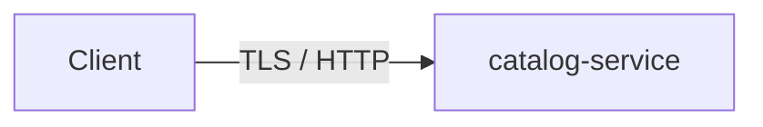
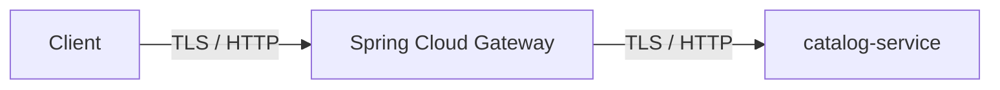
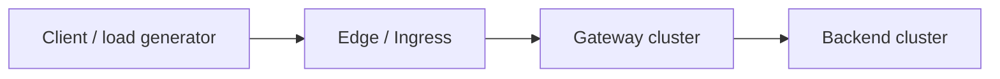
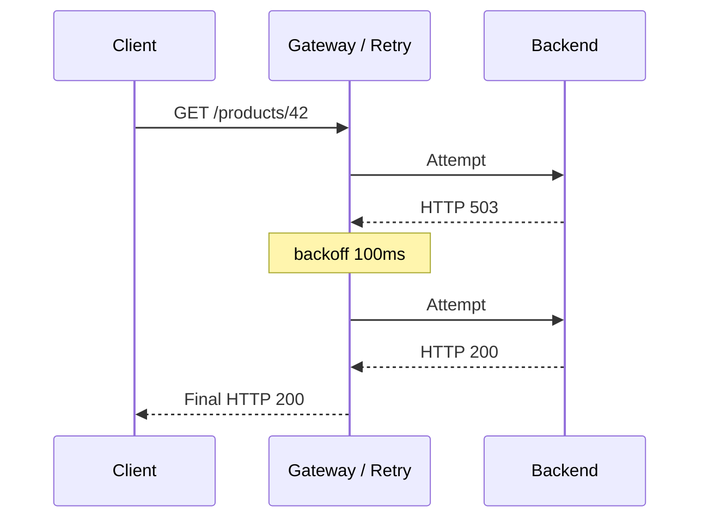
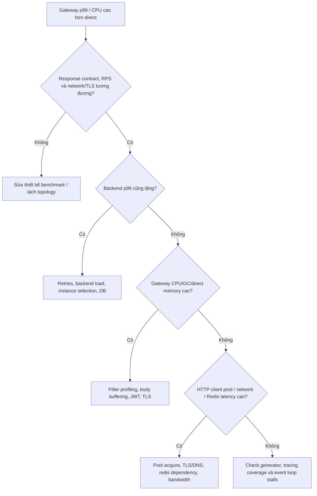

# Đánh giá chi phí gateway so với gọi trực tiếp dịch vụ

Khi triển khai **Spring Cloud Gateway** làm cổng vào microservices, đội phát triển thường đặt câu hỏi: *“Đi qua gateway có chậm hơn gọi thẳng backend bao nhiêu? Gateway tốn thêm CPU, bộ nhớ, kết nối, băng thông và tiền vận hành đến mức nào? Nếu có thêm rate limiting, retry, cache, circuit breaker, TLS và token validation thì lợi ích có xứng với chi phí không?”* Những câu hỏi này chỉ có thể được trả lời đáng tin bằng **mô hình chi phí rõ ràng và phép đo có đối chứng**. Một lần chạy `curl` hay một biểu đồ HTTP latency không đủ để kết luận.

Bài thuộc chương **Hiệu năng** trong module **SPRING_CLOUD_GATEWAY**. Bối cảnh là xây dựng API Gateway bằng route predicates, filter chain, sửa path/header, service discovery/LoadBalancer, authentication, giới hạn lưu lượng, circuit breaker, retry, TLS và quan sát request. Mục tiêu không phải chứng minh gateway luôn nhanh hoặc luôn chậm, mà là giúp bạn đo **chi phí bổ sung có thể quy trách nhiệm** và **giá trị vận hành/nghiệp vụ** của gateway so với mô hình client gọi trực tiếp dịch vụ.

> **Phạm vi kỹ thuật:** Ví dụ tập trung vào **Spring Cloud Gateway Server WebFlux (Reactor Netty)**. Gateway Server Web MVC và Proxy Exchange có runtime, filter chain, HTTP client và những giới hạn khác. Namespace cấu hình có thể là `spring.cloud.gateway.server.webflux.*` ở các dòng mới hoặc `spring.cloud.gateway.*` ở dòng cũ; cần đối chiếu Spring Boot/Spring Cloud release train đang chạy. Những số liệu trong bảng minh họa là **giả lập có chủ đích**, không phải kết quả benchmark được Spring hay đội học phần công bố.

## 1. Tại sao gateway tạo chi phí nhưng vẫn có thể đáng dùng?

### Gọi trực tiếp backend



Client tìm được địa chỉ dịch vụ và gọi thẳng. Mô hình này có thể giảm số hop proxy ở lớp ứng dụng nhưng đặt ra nhiều vấn đề:

- Client phải biết endpoint và cơ chế tìm dịch vụ.
- Mỗi backend phải có chính sách xác thực, TLS, CORS, rate limit, logging/metrics phù hợp.
- Backend public exposure có thể tăng số bề mặt tấn công.
- Thay backend host, API versions hoặc chuyển vùng có thể ảnh hưởng client.
- Những trách nhiệm chung có thể bị lặp lại giữa nhiều dịch vụ.

### Đi qua gateway



Gateway thêm một bước nhận request, chọn route, xử lý filter và gửi request outbound. Nhờ đó, ta có thể:

- Dùng một public entry point và quản lý route version.
- Tập trung phần policy được thiết kế chung như CORS, rate limiting, TLS termination, access logging, request tracing.
- Hỗ trợ route `lb://` qua service discovery và Spring Cloud LoadBalancer.
- Chặn traffic không hợp lệ trước backend.
- Áp retry/circuit breaker và response cache có chính sách.
- Giảm phức tạp public routing ở client và nhiều backend.

**Đánh giá đúng cần tính cả hai phía:** gateway tạo thêm chi phí trên *một request đi qua*, nhưng có thể giúp giảm backend work, giảm chi phí lặp lại, giảm sự cố và đơn giản hóa vận hành. Không nên so chỉ **p50 của đường đi trực tiếp** với **p50 của đường đi gateway** rồi quyết định toàn bộ kiến trúc.

## 2. Phân loại chi phí trước khi đo

| Nhóm | Thành phần chi phí | Đơn vị phù hợp |
| --- | --- | --- |
| **Latency** | Thời gian thêm ở Gateway, mạng và backend. | ms/request, p50/p95/p99. |
| **Throughput** | Số request/giây bền vững trước khi vượt SLO. | RPS tại concurrency và error budget cố định. |
| **Compute** | CPU do route matching, filters, TLS, serialization, metrics. | CPU core-seconds/triệu requests; CPU utilization ở RPS cố định. |
| **Memory** | Heap, direct memory, request buffering, cache, connection pools. | MiB/pod, MiB/1.000 concurrent requests. |
| **Network** | Hai chặng HTTP/TLS, headers, retries, ingress/egress. | Bytes/request, GB/triệu requests. |
| **Connections** | Sockets, TLS handshakes, HTTP/2 streams, keep-alive. | Active connections, pending pool acquires. |
| **Resilience cost** | Retry thêm upstream attempts, circuit breaker/fallback. | Attempts/inbound request, failure recovery. |
| **Policy cost** | Redis limiter, JWT signature validation, custom filters. | Additional ms, CPU, dependency RPS. |
| **Caching benefit/cost** | Cache hits giảm backend calls nhưng dùng RAM và có stale risk. | Hit ratio, saved calls, MiB/TTL, freshness. |
| **Infrastructure** | Gateway pods, ingress, LB, observability, Redis, data transfer. | Giá/giờ, giá/triệu requests, ngân sách vận hành. |
| **Engineering/operations** | Cấu hình, bảo mật, monitoring, incident response, rollout. | Giờ công/chu kỳ, MTTR, số policy điểm cần bảo trì. |

**Không gọi tất cả khoản trên là “gateway latency overhead”.** Một backend nhanh hơn do cache là tác động end-to-end của hệ thống, không chứng minh gateway filter có chi phí CPU bằng số âm.

## 3. Định nghĩa công bằng hai đường đo

### Đường A — direct

```text
Load generator
   -> HTTPS/TLS to catalog-service
   -> backend handler
   -> response
```

### Đường B — through Gateway

```text
Load generator
   -> HTTPS/TLS to Spring Cloud Gateway
   -> route match + filters
   -> HTTPS/TLS / HTTP connection to catalog-service
   -> same backend handler
   -> response through Gateway
```

**Điểm mấu chốt:** cả hai đường phải gọi **cùng contract backend**. Nếu route trực tiếp gọi `GET /products/42` nhưng gateway gọi một endpoint khác qua `RewritePath`, benchmark đang so hai workload khác nhau.

### Bốn kiểu so sánh cần tách

| Mã | Mục đích | Những thứ cần giữ giống nhau |
| --- | --- | --- |
| **A: Direct baseline** | Giá của đường đi không có Gateway. | Cùng client, backend, request/response, network zone, TLS policy tương đương. |
| **B: Minimal Gateway** | Chi phí thêm chủ yếu từ proxy/routing. | Chỉ `Path`/`Method` và route cơ bản, không cache/retry/custom logic. |
| **C: Policy Gateway** | Chi phí từng filter/policy. | Chỉ thêm **một thay đổi** so với B mỗi lượt thử. |
| **D: Optimized/realistic Gateway** | Tác động thực tế ở production-like workload. | Policy đầy đủ, traffic mix thật, nhiều replicas, SLO và resource budgets. |

Nên thử B sau A rồi lần lượt thêm JWT validation, rate limiter, path rewrite, retry, cache và tracing. Nếu bật mọi thứ cùng lúc, khó tìm cơ chế gây thay đổi p99 hoặc backend RPS.

## 4. Phân rã latency theo các chặng

Mô hình đơn giản hóa:

\[
T_{\text{direct}}
= T_{\text{client}\to\text{backend}}
+ T_{\text{backend}}
+ T_{\text{backend}\to\text{client}}
\]

\[
T_{\text{gateway}}
= T_{\text{client}\to\text{gateway}}
+ T_{\text{gateway-process}}
+ T_{\text{gateway}\to\text{backend}}
+ T_{\text{backend}}
+ T_{\text{backend}\to\text{gateway}}
+ T_{\text{gateway}\to\text{client}}
\]

Đây là cách **phân rã khái niệm**, không phải tổng độc lập hoàn hảo của các bước trong một hệ thống streaming/pipelined: CPU, I/O và response transfer có thể chồng lấn; request có thể chờ thread, event loop, connection pool hoặc backend.

### Những khoản thường xuất hiện thêm

- **TCP/TLS**: Gateway có server connection inbound và HTTP client connection outbound. Khi keep-alive/pooling hoạt động, nhiều request có thể **tái sử dụng kết nối**; không tính full TCP/TLS handshake vào từng request một cách máy móc.
- **Route matching**: xét predicates, chọn `Route`, tra route cache và metadata.
- **Filter chain**: `GlobalFilter`/`GatewayFilter`, Netty routing, header transformations, body filters.
- **Context propagation**: trace/span, MDC/observation, metrics, security principal.
- **Outbound scheduling**: Reactor Netty connection pool, acquire queue, event-loop scheduling, TLS and network send.
- **Buffer/copy**: request/response body buffering khi có filters, compression/decompression hoặc aggregation.
- **Mạng bổ sung**: request phải đi qua Gateway rồi đến backend thay vì đường direct tương ứng.

### Không lấy hiệu hai p99 làm “p99 overhead per request”

Đặt:

\[
\Delta_{p95} = p95(T_{\text{gateway}}) - p95(T_{\text{direct}})
\]

Giá trị này là **chênh lệch phân vị của hai phân phối** trong điều kiện thử tương đương. Nó **không phải** phân vị p95 của các độ trễ chênh lệch tính theo từng request, và không chứng minh request nào cũng chậm đúng bằng `\Delta_{p95}`.

Nếu muốn nghiên cứu **overhead theo từng request**, cần thiết kế đo ghép cặp (paired requests), chuẩn hóa backend workload, đồng hồ/timestamp phù hợp; ngay cả khi cùng URL, backend/cache/network noise có thể làm kết quả dao động.

## 5. Trễ mạng, TLS và vị trí triển khai có thể lớn hơn filter CPU

Trong topology thực tế:



Mạng giữa các thành phần có thể nằm trong cùng host, cùng Kubernetes node, khác node, khác zone hoặc khác region. **Chi phí hop không phải một hằng số**.

| Topology | Rủi ro sai lệch trong benchmark |
| --- | --- |
| Gateway và backend cùng host | Loopback latency cực thấp, không đại diện network production. |
| Gateway và backend cùng node K8s | Ít cross-node traffic; kết quả có thể đẹp hơn khi scale trải các node. |
| Gateway và backend khác zone | RTT và egress fees khác, p99 nhạy với network. |
| Direct qua một public load balancer, Gateway qua private service | Đường đo không tương đương nếu có hop/TLS policy khác. |
| Direct gọi bằng HTTP, Gateway dùng HTTPS hai chặng | Chênh lệch bao gồm TLS/security, không chỉ Gateway overhead. |
| Client gần Gateway nhưng xa backend direct | Gateway có thể “nhanh hơn” vì topology, không chứng minh proxy có chi phí xử lý âm. |

### TLS: warm connections và cold handshakes

Nên báo cáo ít nhất hai chế độ:

1. **Warm steady-state**: kết nối keep-alive/pool tái sử dụng; phù hợp nhiều HTTP requests dài hạn.
2. **Cold connections**: nhiều TCP/TLS handshakes, ví dụ clients mở kết nối ngắn; chi phí CPU/latency cao hơn.

Với HTTP/2, nhiều logical streams dùng chung kết nối; với HTTP/1.1, concurrency phụ thuộc số connections và pool. **Không so H2 direct với H1 gateway rồi quy mọi chênh lệch cho Gateway**.

### Cân bằng điều kiện an ninh

Nếu production yêu cầu JWT signature validation, TLS/mTLS và rate limiting, direct baseline **không có** những kiểm soát đó chỉ phản ánh *một đường đi ít chức năng hơn*. Để hiểu chi phí kiến trúc:

- **Microbenchmark proxy**: tắt policy ở cả hai đường để đo overhead thuần.
- **Functionally equivalent benchmark**: direct backend tự thực hiện auth/quota tương đương, còn gateway đảm nhận chúng trên đường proxy.
- **Production benefit benchmark**: cho phép cache/limiter/retry/fallback hoạt động và đo cả backend load, availability, SLO.

Không dùng kết quả microbenchmark “gateway chậm hơn X ms” để đánh giá toàn bộ hiệu quả vận hành nếu direct baseline bỏ qua những chức năng bắt buộc.

## 6. Throughput, queueing và tail latency

**Throughput** là số requests hoàn tất mỗi giây trong một điều kiện tải; **latency** là thời gian mỗi request. Chúng liên quan nhưng **không hoán đổi**.

### Little's Law

Ở trạng thái ổn định, với cùng ranh giới hệ thống và số lượng request đang xử lý:

\[
L = \lambda W
\]

Trong đó:

- `L`: số request đang ở trong hệ thống trung bình.
- `\lambda`: throughput hoàn tất trung bình (requests/s).
- `W`: thời gian lưu trú trung bình (seconds/request).

Ví dụ giả định nếu throughput `2.000 RPS` và latency trung bình `0,050 s`, số request đang tồn tại đồng thời khoảng `100` trong ranh giới đo. Điều này **không** có nghĩa Gateway xử lý tối đa 100 concurrent requests; chỉ là quan hệ trung bình dưới giả thiết ổn định và đo đúng đối tượng.

### Vì sao p99 có thể tăng mạnh trước khi throughput ngừng tăng?

- Event loop hoặc CPU gần bão hòa.
- Reactor Netty HTTP client pool pending acquire tăng.
- Backend thread/DB pool/connection queue đầy.
- RedisRateLimiter hoặc tracing exporter chậm.
- JVM GC/direct memory pressure.
- Retry tạo extra attempts khi backend đã quá tải.
- Một nhóm requests có body lớn chiếm memory/network.

**Mức tăng p50 nhỏ không bảo đảm p99 nhỏ.** Với API latency-sensitive, cần đo p95/p99 hoặc error-budget latency distribution theo mức tải.

### Open-loop và closed-loop test

| Cách sinh tải | Đặc điểm | Hạn chế |
| --- | --- | --- |
| **Closed-loop** (ví dụ N virtual users gọi rồi chờ) | Mô phỏng hành vi users có think time, dễ thiết lập. | Khi server chậm, tốc độ tạo request giảm; có thể che overload. |
| **Open-loop** (đặt arrival rate/RPS) | Phát request theo tốc độ định trước, tốt để tìm khả năng đáp ứng khi traffic không tự giảm. | Phải sizing load generator, quan sát dropped iterations và saturation. |

Muốn xác định throughput bền vững trước SLO, dùng open-loop hoặc công cụ hỗ trợ *constant-arrival-rate*, rồi tăng từng mức tải; **đừng chỉ chạy 100 VUs và gọi số requests thực nhận là công suất tối đa**.

## 7. Chọn SLO trước khi so benchmark

Một báo cáo phải nêu **điều kiện thành công** trước khi đo:

| Chỉ số | Ví dụ mục tiêu của POC, không phải chuẩn chung |
| --- | --- |
| Client-facing HTTP error rate | Dưới 0,5% cho requests hợp lệ, ở lưu lượng mục tiêu. |
| End-to-end latency p95 | Dưới 120 ms cho GET mock workload. |
| End-to-end latency p99 | Dưới 250 ms tại một RPS đã xác định. |
| CPU Gateway | Dưới ngân sách CPU đã cấp, không throttling kéo dài. |
| Memory Gateway | Không tăng không giới hạn, không OOM/GC storm. |
| Backend RPS | Không bị khuếch đại ngoài retry budget. |
| Security/correctness | Không rò token/PII, không cache nhầm tenant, auth đúng. |

Đây là **chỉ tiêu được đề xuất để minh họa quy trình**, không phải benchmark numbers của Spring Cloud Gateway và không phù hợp mọi hệ thống. Khi quyết định architecture, dùng SLO từ sản phẩm và thực tế lưu lượng.

### So sánh tại cùng RPS hay cùng CPU?

Hai góc nhìn khác nhau:

1. **Cùng offered load/RPS**: so client latency, errors, CPU/memory và backend cost ở cùng lượng yêu cầu.
2. **Cùng resource budget**: so throughput lớn nhất mà mỗi topology đáp ứng được trước khi vi phạm SLO.

Không dùng “Gateway đạt 20.000 RPS” nếu một đường đo có nhiều CPU hơn nhiều lần hoặc backend đã bypass; cần báo cấu hình tài nguyên và actual completed RPS.

## 8. Chuẩn bị POC có thể lặp lại

Ta dùng một backend Spring Boot nhỏ trả JSON cố định, một Gateway Server WebFlux và một load generator bên ngoài hai ứng dụng.

| Thành phần | Lab address | Vai trò |
| --- | --- | --- |
| **Load generator** | Máy test hoặc container độc lập | Sinh tải và đo latency người gọi quan sát. |
| **catalog-service** | `localhost:8081` | Cùng endpoint được gọi ở cả hai đường. |
| **Spring Cloud Gateway** | `localhost:8080` | Chọn route và proxy đến catalog-service. |
| **Prometheus/Actuator** | Endpoint quản trị riêng theo cấu hình | Theo dõi Gateway, backend và JVM. |
| **Redis** (giai đoạn sau) | Redis test instance | Đo `RequestRateLimiter` nếu muốn thêm quota. |

### Hai URL tương đương

```text
Direct:
  http://localhost:8081/products/42

Via Gateway:
  http://localhost:8080/api/catalog/products/42
    -- StripPrefix=2 -->
  http://localhost:8081/products/42
```

**Chỉ dùng HTTP cleartext trong POC đo proxy overhead tối thiểu trên loopback cô lập.** Ở production-like test, **phải đo thêm** hai đường với TLS/hostname/CA/trust-store và topology ngang nhau, không suy kết luận an ninh từ POC HTTP.

### Giữ request và response đúng như nhau

- Method: GET.
- Backend handler: cùng `/products/42`.
- Response body: cùng byte sequence.
- Content-Type và các headers quan trọng: cùng contract.
- Không cache tại browser, CDN, Gateway hoặc mock backend trong giai đoạn đo overhead thuần.
- Không bật Retry, CircuitBreaker, rate limiter, token validation hoặc body rewriting khi đo B minimal.
- Không dùng development hot reload, debugger hoặc wiretap payload logging trên một đường mà đường khác không có.

Nếu Gateway route có `StripPrefix=2` để khớp backend URL, đó là một phần nhỏ của chi phí cơ bản. Có thể so thêm một route không strip path bằng cách tạo backend endpoint tương ứng, nhưng không đổi cách xử lý nghiệp vụ giữa các đường.

## 9. Backend mock cố định: không để database che chi phí Gateway

Ví dụ backend Spring Boot MVC:

```java
package com.example.catalog;

import org.springframework.http.CacheControl;
import org.springframework.http.MediaType;
import org.springframework.http.ResponseEntity;
import org.springframework.web.bind.annotation.GetMapping;
import org.springframework.web.bind.annotation.RestController;

@RestController
public class CatalogBenchmarkController {

    private static final String PAYLOAD =
        "{\"id\":42,\"name\":\"Keyboard\",\"inStock\":true}";

    @GetMapping(value = "/products/42",
        produces = MediaType.APPLICATION_JSON_VALUE)
    public ResponseEntity<String> getProduct() {
        return ResponseEntity.ok()
            .cacheControl(CacheControl.noStore())
            .contentType(MediaType.APPLICATION_JSON)
            .body(PAYLOAD);
    }
}
```

Backend có `server.port=8081`. Response không dùng database, file I/O, remote RPC hay random sleeps; có thể kiểm tra body bằng hash hoặc so exact string. Đo `CPU`/`memory` backend riêng. Không dùng endpoint Actuator `/health` làm workload vì có thể có health contributors khác nhau giữa deployments và không đại diện application contract.

### Kiểm tra response trước khi tạo tải

```bash
curl -i "http://localhost:8081/products/42"
```

Kỳ vọng:

```json
{"id":42,"name":"Keyboard","inStock":true}
```

Đây là response do controller trong lab tạo, **không phải output mặc định của Gateway**. Nếu một đường trả HTML exception page hoặc JSON khác, không bắt đầu so latency.

### Backend no-op không đại diện API thật

Backend không thực hiện DB work giúp **phóng đại tỷ trọng gateway overhead** trong tổng latency, hữu ích để tìm upper-bound relative overhead của proxy cơ bản. Nhưng để quyết định production, cần chạy thêm một workload backend có DB/RPC, payload sizes và response distributions gần thực tế. Một delay 100 ms ở backend làm tỷ lệ Gateway overhead tính theo phần trăm giảm, **không có nghĩa chi phí tuyệt đối của Gateway tự biến mất**.

## 10. Gateway WebFlux minimal route

Trong Gateway lab chạy cổng `8080`:

```yaml
server:
  port: 8080

spring:
  cloud:
    gateway:
      server:
        webflux:
          routes:
            - id: catalog-minimal
              uri: http://localhost:8081
              predicates:
                - Path=/api/catalog/**
                - Method=GET
              filters:
                - StripPrefix=2
```

Đây là cú pháp **Gateway Server WebFlux ở các dòng mới**. Dòng cũ thường dùng:

```yaml
spring:
  cloud:
    gateway:
      routes:
        - id: catalog-minimal
          uri: http://localhost:8081
          predicates:
            - Path=/api/catalog/**
            - Method=GET
          filters:
            - StripPrefix=2
```

**Chỉ dùng một namespace khớp phiên bản thực tế**, không khai báo cả hai cùng lúc. Starter WebFlux/Boot/Cloud BOM phải tương thích. Không thể thay mã mẫu bằng Gateway Server MVC rồi kỳ vọng cùng property/API.

### Xác nhận đường đi

```bash
curl -i "http://localhost:8080/api/catalog/products/42"
```

Hai đường phải trả cùng nội dung JSON. Nếu Gateway trả HTTP 404 trước backend, kiểm tra route match/namespace/filter/path; nếu backend nhận `/api/catalog/products/42` thay vì `/products/42`, `StripPrefix` chưa hoạt động theo hợp đồng.

### Đo đúng route

Để so overhead **minimal Gateway**, đừng vô tình bật các GlobalFilters tùy chỉnh khác trong ứng dụng. Những global filters có thể được đăng ký từ starter/auto-configuration hoặc code công ty. Kiểm tra runtime filter chain và Actuator routes ở môi trường lab được bảo vệ; không coi YAML route ngắn là chứng cứ filter chain thực sự trống.

## 11. Kịch bản k6: cùng tần suất yêu cầu cho hai URL

`k6` là một lựa chọn phổ biến để tạo tải HTTP. Ví dụ này sử dụng **constant-arrival-rate** để kiểm tra latency/error dưới offered load gần như cố định, thay vì chỉ dùng một số virtual users đóng vòng.

### File `compare-gateway.js` (minh họa)

```javascript
import http from 'k6/http';
import { check } from 'k6';

const target = __ENV.TARGET_URL ||
  'http://localhost:8081/products/42';

export const options = {
  discardResponseBodies: false,
  scenarios: {
    fixed_arrivals: {
      executor: 'constant-arrival-rate',
      rate: 200,
      timeUnit: '1s',
      duration: '2m',
      preAllocatedVUs: 120,
      maxVUs: 240,
    },
  },
  thresholds: {
    http_req_failed: ['rate<0.005'],
    http_req_duration: ['p(95)<120', 'p(99)<250'],
    dropped_iterations: ['count==0'],
  },
};

export default function () {
  const res = http.get(target, {
    headers: { Accept: 'application/json' },
    tags: { scenario_kind: 'catalog_minimal' },
  });

  check(res, {
    'HTTP 200': r => r.status === 200,
    'expected product': r => r.body.includes('"id":42'),
  });
}
```

**Lưu ý:** Code này là script để người học lưu và chạy trong môi trường được phép. Đối với benchmark tối đa throughput, kiểm tra body từng request và `discardResponseBodies=false` tạo chi phí client; có thể giữ cùng mức kiểm tra ở cả hai đường, hoặc dùng validate sampled responses và `discardResponseBodies=true` cho bài capacity riêng. Không thay đổi một đường mà không thay đường kia.

`http_req_duration` của k6 chủ yếu gồm gửi request, chờ response và nhận response; **không bao gồm toàn bộ thời gian chờ kết nối/TLS handshake** như một end-to-end UX metric tổng quát. Muốn đánh giá cold connects, cần xem thêm `http_req_blocked`, `http_req_connecting`, `http_req_tls_handshaking` và lifecycle của VUs/connection reuse. Một `iteration_duration` cũng có thể bao gồm logic script ngoài HTTP request. Báo rõ metric nào được dùng.

### Chạy hai nhóm theo cùng thời lượng

Trong một shell có k6:

```bash
k6 run \
  -e TARGET_URL=http://localhost:8081/products/42 \
  compare-gateway.js

k6 run \
  -e TARGET_URL=http://localhost:8080/api/catalog/products/42 \
  compare-gateway.js
```

**Không chạy cả hai lệnh song song trong một host nhỏ** nếu CPU/mạng/load generator dùng chung sẽ làm nhiễu kết quả, trừ khi bạn đang thực hiện phép thử canary đồng thời có thiết kế tách tài nguyên. Để giảm thiên lệch do thứ tự, có thể chạy chuỗi **A → B → B → A** với reset trạng thái và warm-up tương đương rồi phân tích nhiều lần lặp.

### Đừng chỉ nhìn số requests đã gửi

k6 có thể báo **`dropped_iterations`** khi thiếu VUs/resources để đạt arrival rate. Khi đó:

- Offered load thực tế không còn đúng mục tiêu.
- Load generator có thể là bottleneck, không phải Gateway.
- Chỉ số latency trên subset requests đã gửi có thể quá lạc quan.

**Không tuyên bố Gateway đáp ứng 5.000 RPS** nếu k6 chỉ phát thành công 2.000 RPS do generator bão hòa.

### Nhiều mức tải

Chạy các mức `100, 200, 500, 1.000, 2.000 RPS` **chỉ khi môi trường test được cấp phép và đủ tài nguyên**, dừng tăng nếu error/latency/resource budget bị vượt. Các mức là ví dụ, không phải mặc định cho mọi laptop. Ghi cho từng mức:

- Arrivals target và completed RPS.
- p50/p95/p99, maximum và confidence/variability qua các lượt.
- HTTP status/errors/timeouts; dropped iterations.
- Gateway/backend CPU/memory/network.
- Active connections, pending pool acquires.
- Load-generator CPU/memory/network.

## 12. Thực nghiệm nhiều payload sizes

Một API Gateway có thể thêm **rất ít CPU** khi chỉ chuyển headers cho response nhỏ, nhưng body filters, decompression hoặc payload lớn có thể thay đổi hoàn toàn cost profile.

| Payload | Ví dụ | Nút thắt cần quan sát |
| --- | --- | --- |
| **0–1 KiB** | Endpoint status/metadata. | Route match, headers, TLS, per-request overhead. |
| **10–50 KiB** | Catalog/product JSON. | HTTP client pool, network, content encoding. |
| **100 KiB–1 MiB** | Search results lớn. | Serialization, direct memory, buffering, GC. |
| **5–20 MiB** | Export/report/download. | Bandwidth, backpressure, response buffering, connection lifetime. |
| **Streaming** | SSE, WebSocket/gRPC workload riêng. | Long-lived connections, idle timeout, flow control. |

**Không tùy tiện benchmark một file 20 MiB ở 2.000 RPS trên môi trường chia sẻ**; traffic đó rất lớn và có thể gây hại các hệ thống cùng mạng. Quyết định mức tải theo capacity và sandbox.

### Body filters thay đổi bài toán

Các filter như `ModifyRequestBody`, `ModifyResponseBody`, `CacheRequestBody`, body-based validation, compression/decompression có thể:

- Đọc/giải mã payload.
- Cấp phát/giữ `DataBuffer` hoặc object trong heap/direct memory.
- Chờ toàn bộ body rồi mới gửi tiếp (mất streaming behavior ở những use cases).
- Chuyển đổi JSON và gây CPU/GC.

Tách **minimal proxy** và **body-transform proxy** thành hai thí nghiệm; không kết luận chi phí của `RewritePath` bằng chi phí của `ModifyResponseBody`.

## 13. So sánh ở nhiều độ trễ backend

Để xác định gateway overhead có ý nghĩa thế nào khi backend thực hiện nghiệp vụ nặng hơn, có thể tạo mock có **delay được định nghĩa trong test server**:

| Backend latency profile | Tác dụng |
| --- | --- |
| ~0–2 ms | Làm nổi bật proxy/filter/network overhead. |
| ~20 ms | Gần với một service đọc dữ liệu nhanh. |
| ~100 ms | Mô phỏng service gọi DB/RPC chậm hơn. |
| Tail có 1% request chậm 500 ms | Kiểm tra p99, timeouts, pooling và queuing. |

**Các giá trị trên chỉ là kịch bản giả lập**. Trong Spring WebFlux backend test, không dùng `Thread.sleep()` trên event loop để mô phỏng latency vì đó là **blocking** và có thể làm thay đổi kết quả theo cách không đại diện backend I/O. Nếu mock delay bằng blocking thread ở Spring MVC, ghi rõ đó là mô hình phụ, không dùng để kết luận non-blocking throughput.

### Đánh giá phần trăm overhead

Nếu trong kịch bản không lỗi (giả định):

```text
Direct p50  = 20 ms
Gateway p50 = 23 ms
Δp50        =  3 ms
relative Δ  = 15%
```

Cùng `3 ms` absolute cost nhưng backend chỉ mất `2 ms` thì relative ratio sẽ rất lớn; backend mất `200 ms` thì ratio nhỏ. Với SLO latency tuyệt đối, **3 ms vẫn là 3 ms**, đừng chỉ nhìn tỷ lệ phần trăm.

**Không dùng phần trăm overhead khi direct baseline gần zero** như bằng chứng Gateway “chậm gấp nhiều lần” mà bỏ qua mức tăng tuyệt đối, độ phân giải đo và network topology.

## 14. Micrometer và Actuator: đo tại Gateway và backend

Với Spring Boot, thêm dependencies ở ứng dụng phù hợp:

```xml
<dependency>
    <groupId>org.springframework.boot</groupId>
    <artifactId>spring-boot-starter-actuator</artifactId>
</dependency>
<dependency>
    <groupId>io.micrometer</groupId>
    <artifactId>micrometer-registry-prometheus</artifactId>
</dependency>
```

### Gateway metrics theo route

Spring Cloud Gateway WebFlux có **Gateway Metrics Filter**, ghi timer `spring.cloud.gateway.requests` với tags thường gồm `routeId`, `routeUri`, `outcome`, `status`/`httpStatusCode` và `httpMethod`; raw `path` có thể được bật tùy config nhưng không nên bật trên API có IDs/PII.

Với một số dòng mới, ví dụ cấu hình:

```yaml
spring:
  cloud:
    gateway:
      server:
        webflux:
          metrics:
            enabled: true
            path-tags:
              enabled: false
          httpclient:
            pool:
              metrics: true

management:
  endpoints:
    web:
      exposure:
        include: health,info,metrics,prometheus
  metrics:
    distribution:
      percentiles-histogram:
        spring.cloud.gateway.requests: true
```

**Kiểm tra bản đang dùng**: dòng cũ thường có `spring.cloud.gateway.metrics.enabled`, `spring.cloud.gateway.metrics.tags.path.enabled` và namespace HTTP client khác. Cấu hình `httpclient.pool.metrics` bật **pool metrics** nếu được runtime hỗ trợ, không tự tạo metric **mỗi retry attempt**. Đừng thêm cả prefix mới/cũ rồi giả định hệ thống sẽ bỏ qua giá trị sai.

### Hai endpoint cần kiểm tra

```http
GET /actuator/metrics/spring.cloud.gateway.requests
GET /actuator/prometheus
```

Trên Prometheus, timer này thường được export thành các series như:

```text
spring_cloud_gateway_requests_seconds_count
spring_cloud_gateway_requests_seconds_sum
spring_cloud_gateway_requests_seconds_bucket
```

Series `_bucket` chỉ có nếu histogram thích hợp đã bật; metric names/labels có thể khác giữa exporters/releases. **Không đoán:** kiểm tra actual scrape body. Trong production, đặt Actuator/Prometheus ở management network, có authentication/authorization và chỉ cho scraper tin cậy truy cập; không expose writable Gateway management endpoints ra Internet.

### Backend metrics và HTTP server requests

Backend cũng cần đo `http.server.requests`, connection pool, CPU, memory, DB calls nếu có. So:

- Client `k6.http_req_duration`: caller nhìn thấy.
- Gateway `spring.cloud.gateway.requests`: thời gian route request theo metric filter và context của Gateway.
- Backend `http.server.requests`: thời gian backend xử lý request theo server observation.

**Đừng lấy một trong ba làm thay thế hoàn hảo cho hai cái còn lại.** Ranh giới timing, sampling, connection setup, buffering và clock khác nhau.

### Có thêm bảo mật và policy?

HTTP requests bị Spring Security chặn **trước Gateway route matching** có thể xuất hiện ở server metrics nhưng không có `routeId` trong Gateway timer. Nếu tính Gateway success RPS hoặc ratio từ timer route, nêu rõ mẫu số **route-matched requests**, không phải mọi inbound traffic.

## 15. PromQL: client/route latency, error và capacity

PromQL dưới đây là **mẫu tham khảo** dựa trên tên Prometheus exporter phổ biến và route label `routeId`. Xác minh dữ liệu trước khi vẽ:

### Gateway RPS

```promql
sum by (routeId) (
  rate(spring_cloud_gateway_requests_seconds_count[5m])
)
```

### Gateway p95 theo route

```promql
histogram_quantile(
  0.95,
  sum by (le, routeId) (
    rate(spring_cloud_gateway_requests_seconds_bucket[5m])
  )
)
```

Không lấy trung bình các p95 theo pod để được p95 cluster. **Gộp histogram buckets (`sum by (le, routeId)`) trước khi tính phân vị**. Nếu không có histogram buckets, phải dùng cách thống kê khác; `_sum/_count` chỉ cho trung bình, không cho p95.

### Gateway final 5xx ratio

```promql
sum by (routeId) (
  rate(spring_cloud_gateway_requests_seconds_count{
    status=~"5.."
  }[5m])
)
/
clamp_min(
  sum by (routeId) (
    rate(spring_cloud_gateway_requests_seconds_count[5m])
  ),
  0.000001
)
```

Nếu version dùng tag `httpStatusCode` thay cho `status` ở dạng mong đợi, sửa selector. Response HTTP 200 có thể được retry, cache hoặc fallback thành công; ratio 5xx không đủ chứng minh backend khỏe.

### Backend request rate

Với meter backend `http_server_requests_seconds_count` có nhãn `uri`/`method`/`status` tùy app:

```promql
sum (
  rate(http_server_requests_seconds_count{
    uri="/products/42",
    method="GET"
  }[5m])
)
```

**Điểm quan trọng:** trong môi trường Prometheus có cả Gateway/backend, query phải lọc **job/instance/namespace/service** tương ứng. Nếu không lọc, có thể đếm nhầm HTTP server requests của Gateway hoặc service khác. Trong bài lab, ví dụ:

```promql
sum (
  rate(http_server_requests_seconds_count{
    job="catalog-backend",
    uri="/products/42",
    method="GET"
  }[5m])
)
```

Chỉ dùng `job="catalog-backend"` nếu scraper thực sự đặt label đó; nó không xuất hiện từ Spring Boot mặc định.

### Gateway JVM CPU utilization

Micrometer thường cung cấp `process_cpu_usage` hoặc `system_cpu_usage` như **gauge**. Đây là tỷ lệ theo semantics process/system đã được runtime đo; **không tự bằng số CPU cores đã tiêu thụ**. Với nhiều replicas, cần kết hợp CPU requests/limits, actual usage từ cAdvisor/Kubernetes hoặc process CPU time cho core-seconds.

### Gateway vs direct trên dashboard

Để tránh trộn metrics, đặt một label phân biệt `path_kind=direct/gateway` cho **load generator/test result** hoặc hai k6 output groups. Đừng tùy tiện gắn label đó vào metrics backend nếu backend không biết đường đi; dùng trace/correlation hoặc test deployment/job context.

## 16. CPU cost: đo core-seconds thay vì chỉ nhìn % CPU

Tại cùng offered/completed RPS, CPU utilization là một tín hiệu, nhưng không đo đầy đủ **chi phí trên mỗi request** nếu số cores/instance thay đổi. Cách tiếp cận:

\[
\text{coreSecondsPerRequest}
= \frac{\text{CPU core-seconds thực dùng trong khoảng đo}}
{\text{số request hoàn tất hợp lệ}}
\]

\[
\text{coreSecondsPerMillion}
= \text{coreSecondsPerRequest} \times 10^6
\]

### Ví dụ giả định

Gateway tiêu thụ trung bình **1,2 CPU cores** trong **600 giây** khi proxy thành công **600.000 requests**:

\[
\text{gatewayCoreSeconds}
= 1{,}2 \times 600
= 720
\]

\[
\text{gatewayCoreSecondsPerMillion}
= \frac{720}{600000} \times 1000000
= 1.200
\]

Tức khoảng **1.200 core-seconds/triệu requests**, hay **0,333 core-hours/triệu requests** (giả định tốc độ sử dụng CPU ổn định).

**Đây không phải phí CPU của một Gateway thật.** Để tách workload khỏi idle overhead, có thể đo CPU nền trước test:

\[
\text{incrementalCoreSeconds}
= \text{totalCoreSecondsDuringRun}
- \text{idleCoreSecondsExpectedForSameWindow}
\]

Tuy nhiên, **CPU idle subtraction** không luôn chính xác vì JVM GC/JIT/network/background jobs không tuyến tính. Nên báo cả **total resource used** và **incremental estimate**, làm nhiều lượt thí nghiệm.

### So sánh total compute cost thay vì chỉ Gateway CPU

Direct topology:

\[
C_{\text{compute,direct}}
= C_{\text{backend,direct}}
+ C_{\text{edge,direct}}
\]

Gateway topology:

\[
C_{\text{compute,gateway}}
= C_{\text{gateway}}
+ C_{\text{backend,viaGateway}}
+ C_{\text{edge,viaGateway}}
\]

Gateway có thể làm backend CPU giảm nhờ cache/limiter hoặc tăng nhờ retry. Nếu benchmark chỉ tính `C_gateway` mà bỏ backend delta và edge, bạn chưa tính **tổng chi phí kiến trúc**.

### CPU throttling và limits

Kubernetes CPU limit có thể làm Gateway bị throttle khi bùng tải; p99 tăng dù process CPU usage không đạt 100% *máy chủ*. So:

- CPU requests/limits trên từng pod.
- Actual used cores và throttled time/periods.
- Event loop thread saturation và GC.
- Completed throughput và latency histogram theo offered load.

**Đừng “tối ưu” bằng cách tăng số replicas mà không tính chi phí bổ sung**; đó là một cách mua capacity, không chứng minh filter CPU đã giảm.

## 17. Memory cost: heap, direct memory, cache và in-flight requests

Spring Cloud Gateway WebFlux chạy trên Reactor Netty, thường dùng cả:

- **Java heap**: objects, route definitions, security context, JSON conversion, caches tùy implementation.
- **Direct/off-heap buffers**: Netty `ByteBuf`/`DataBuffer`, network I/O.
- **Thread stacks và native memory**: event loops, connection/native resources.
- **Connection pools**: sockets/TLS state và pending acquire queues.
- **Response cache**: ví dụ Caffeine `LocalResponseCache` local cho từng Gateway instance.

### Không dùng mỗi `jvm_memory_used_bytes`

`jvm_memory_used_bytes` thường đo heap/non-heap qua JVM memory pools, nhưng **không nhất thiết bao phủ toàn bộ Netty direct memory hoặc container RSS**. Cần đối chiếu JVM direct buffer pools, container memory working set/RSS, OOMKill, GC pause và allocator metrics (nếu có).

### In-flight requests và memory

Ở mức tải lớn, số requests in-flight tăng theo latency (Little's Law). Nếu filter **buffer request body 1 MiB** cho 500 concurrent requests, chỉ riêng dữ liệu body có thể cần khoảng **500 MiB** trước overhead/replication; thực tế tùy code, codec, memory pool và buffering. Đây là **một ước lượng worst-case đơn giản**, không phải công thức chính xác mọi DataBuffer.

### Đo bộ nhớ theo kịch bản

| Kịch bản | Cần quan sát |
| --- | --- |
| Route chỉ rewrite path | Baseline heap/direct memory, GC và connection pool. |
| Request body transformation | Allocations/request, body size cap, max in-flight buffers. |
| Retry với POST | Body replay buffers có được giải phóng, peak heap/direct. |
| LocalResponseCache | Cache maxSize, eviction, hit/miss, memory per pod và stale response. |
| Long-lived streaming | Active buffers, flow control, idle timeout, cancellation. |
| TLS/connections tăng | Socket count, native/TLS memory, open file descriptors. |

Đừng dùng `-Xmx` quá cao hoặc tắt memory limits chỉ để benchmark không OOM. Một cấu hình mà chỉ có thể chạy khi tăng memory lên mức không chấp nhận được phải được tính vào capacity/cost.

## 18. Network cost và đường truyền hai chặng

Gateway topology có hai chặng:

```text
client <--> gateway <--> backend
```

Một response payload kích thước `S` thường được truyền **từ backend tới Gateway rồi từ Gateway tới client**. So với direct client→backend, có thể tạo thêm traffic trong nội bộ mạng. Tuy nhiên, **chi phí cloud không nhất thiết gấp đôi**:

- Traffic nội bộ cùng zone/vpc có thể có biểu giá khác internet egress.
- Mạng backend direct cũng có thể qua một public load balancer.
- TLS termination, headers compression, HTTP/2, gzip và connection reuse thay đổi số bytes thực.
- Cache hit có thể loại bỏ chặng Gateway→backend cho request đó.
- Retry làm upstream bytes/requests tăng.
- Một gateway đặt gần client có thể thay đổi đường đi internet so với direct.

### Công thức khái niệm

\[
B_{\text{direct}} = B_{\text{client}\leftrightarrow\text{backend}}
\]

\[
B_{\text{gateway}} =
B_{\text{client}\leftrightarrow\text{gateway}}
+ B_{\text{gateway}\leftrightarrow\text{backend}}
\]

Đo bytes ở **network layer có đơn vị và phạm vi rõ** (TCP/IP, HTTP payload, pod egress, cross-zone transfer). Không cộng cùng một byte hai lần khi lấy cả interface traffic và cloud billed transfer.

### Lưu ý về egress fees

Cloud/provider có biểu giá biến động theo vùng, inter-zone, inter-region, internet, ingress/LB và loại traffic. **Không đặt một giá USD/GB “chuẩn”** trong bài nếu chưa kiểm tra biểu giá thật. Dùng lượng bytes đo được nhân với **giá thực tế của topology/ngày triển khai**.

## 19. Chi phí tiền và công vận hành cho mỗi triệu request

Mô hình tổng quát trong cùng một kỳ:

\[
\text{costPerMillion}
= \frac{
C_{\text{compute}} +
C_{\text{network}} +
C_{\text{load-balancer}} +
C_{\text{observability}} +
C_{\text{managed-dependencies}}
}{
N_{\text{completed requests}}
} \times 10^6
\]

Cần nêu rõ `C_observability` bao gồm metrics retention, trace sampling, log volume; `C_managed_dependencies` có thể gồm Redis/rate limiting và secret/certificate operations nếu thực sự phát sinh.

### Phân biệt provisioned và utilized cost

Giả sử gateway cluster luôn giữ **3 pods** để high availability dù đêm chỉ có 10 RPS. **Giá provisioned/triệu requests** lúc traffic thấp sẽ cao vì tài nguyên nhàn rỗi; khi traffic tăng và hạ tầng vẫn đủ capacity, giá này có thể giảm do phân bổ fixed cost cho nhiều requests.

Vì vậy, báo cả:

- **Marginal cost** của thêm một triệu requests khi còn capacity.
- **Amortized cost** khi tính toàn bộ pods/Redis/monitoring trong tháng.
- **Peak capacity cost** để phục vụ p99 ở giờ cao điểm.
- **Reliability headroom** để sống sót khi một pod/zone mất, không chỉ đạt 100% CPU ở điều kiện khỏe.

### Không tính cost chỉ theo 2xx

Nếu một triệu incoming requests có 100.000 bị rate limit, Gateway vẫn nhận, parse và trả responses cho chúng. Với cost accounting, ghi rõ denominator là:

- **Incoming requests**, bao gồm 4xx/429/5xx.
- **Successful requests** theo SLO sản phẩm.
- **Business operations** đã hoàn tất.

Ba số này khác nhau. “Cost per successful business operation” có thể tăng dù “cost per incoming request” giảm, nếu limiter hoặc fallback gây suy giảm.

### Chi phí tổ chức

Direct topology đòi mỗi backend tự sở hữu một phần cấu hình CORS, OAuth2/JWT, access policy, TLS, routing/versioning và observability. Gateway giúp gom những trách nhiệm **có thể gom** nhưng thêm hệ thống phải deploy, monitor, scale và incident response.

Không thể quy đổi chính xác công sức đó chỉ từ `RPS`. Khi đánh giá kiến trúc, ghi nhận **số policy bản sao**, audit burden, onboarding time, số loại incidents và khả năng thay đổi backend mà không cập nhật clients.

## 20. Tách chi phí từng GatewayFilter bằng experiment ladder

Không nên bật tất cả filters rồi đo một lần. Một chiến lược tốt là **thêm dần từng tính năng** trong điều kiện kiểm thử được kiểm soát.

| Mức | Thành phần bật thêm | Tác động phải đo |
| --- | --- | --- |
| `P0` | Direct backend. | Baseline HTTP/CPU/network. |
| `P1` | Gateway minimal: `Path`, `Method`, `StripPrefix`. | Proxy/routing overhead. |
| `P2` | Add/Remove/SetRequestHeader đơn giản. | Header mutation CPU/allocation, không được thay backend contract. |
| `P3` | Spring Security JWT validation. | Signature verification, JWKS/cache behavior, auth rejection. |
| `P4` | `RequestRateLimiter` với RedisRateLimiter. | Redis latency/RPS, 429, backend calls tránh được. |
| `P5` | `Retry` với backend failure injection. | Extra attempts, backoff, memory, p99 và recovery rate. |
| `P6` | `CircuitBreaker`/fallback. | Breaker overhead, prevented attempts, degraded success. |
| `P7` | `LocalResponseCache` trên GET công khai đủ điều kiện. | Hit/miss, memory, backend RPS và freshness. |
| `P8` | Request/response body transform. | Buffering, allocation, codecs, size-dependent cost. |
| `P9` | Full observability/tracing sampling. | Metric/trace/log overhead và khả năng chẩn đoán. |

**Lưu ý:** Ladder này là phương pháp nghiên cứu. Trong production, **không tắt authentication hoặc rate limit trên API có dữ liệu thật** để tạo baseline; dùng lab cô lập hoặc backend nội bộ đã được bảo vệ. Các giai đoạn có thể không cộng tuyến tính: cache short-circuit làm các filter sau nó không chạy; retry khiến filter downstream bị gọi nhiều lần; HTTP client pool warming làm chi phí thay đổi theo thứ tự chạy.

### Không lấy hiệu số hai runs làm thời gian CPU chính xác của một filter

Giả sử:

```text
P1 gateway p95 = 22 ms
P2 gateway p95 = 23 ms
```

Không nên khẳng định “AddRequestHeader tốn chính xác 1 ms CPU”. Chênh lệch p95 có thể do network noise, GC, nhiệt/CPU frequency, cold connections hoặc biến động backend. Muốn kết luận về filter:

- Lặp nhiều runs với thứ tự xen kẽ.
- Kiểm soát RPS, payload, runtime/environment.
- Sử dụng CPU profiling/allocations để truy nguồn.
- So confidence intervals và distribution, không chỉ một quantile.
- Có test đúng chức năng, vì filter không chạy cũng có thể làm benchmark “nhanh hơn”.

## 21. Chính sách rate limiting: chi phí Redis so với backend tránh được

`RequestRateLimiter` thường dựa `KeyResolver` và một `RateLimiter`. RedisRateLimiter sử dụng Redis token bucket, nên có thể tạo **network round-trip/dependency latency** trước khi request đi backend. Nhưng khi giới hạn traffic hợp lệ theo policy, backend có thể được giảm tải.

### Mô hình quyết định đơn giản

Trong một khoảng thử:

```text
N = 10.000 incoming requests
A =  9.000 được limiter cho phép
D =  1.000 bị limiter từ chối
```

Nếu không có cache/retry/other short-circuit và mỗi request được cho qua tạo một backend call, backend nhận khoảng 9.000 calls thay vì 10.000. Gateway/Redis vẫn xử lý **10.000 policy decisions**; 1.000 responses 429 vẫn có CPU/network cost.

### Những biến cần đo

| Chỉ số | Tác động |
| --- | --- |
| Redis decision p50/p95/p99 | Chi phí thêm lên mỗi accepted request; có thể trở thành tail bottleneck. |
| Redis connection pool/timeout | Mức nghẽn trong Gateway/Redis stack. |
| Allowed/denied decisions | Mức chặn theo policy, không đồng nhất với HTTP 429 từ backend. |
| Backend RPS/CPU | Chi phí thực được tiết kiệm nếu requests bị chặn đúng. |
| 429 ở khách hàng hợp lệ | Chi phí trải nghiệm/doanh thu không thể bỏ qua. |
| Fail-open/fail-closed behavior | Giá của Redis outage đối với availability và backend safety. |

### Lưu ý `KeyResolver`

Nếu `KeyResolver` chạm DB/service ngoài hoặc làm blocking I/O trong Reactor event loop, phần chi phí này có thể lớn hơn RedisRateLimiter. Nên dùng principal đã xác thực hoặc dữ liệu local khả dụng, non-blocking; tránh key dạng user ID làm **metric label cardinality cao**.

Với Redis outage, **không mặc định** Gateway sẽ luôn cho qua hoặc từ chối requests: behavior tùy implementation, config và exception handling. Test fail-open/fail-closed theo policy trên đúng version.

### Khi nào rate limiter “có lợi về cost”?

Nó có thể giảm backend compute/database cost, giảm overload và hạn chế abuso. Nhưng việc lợi hay không phụ thuộc:

- Denied requests có phải là traffic vượt quota/không hợp lệ?
- Redis + Gateway overhead bao nhiêu?
- Có chặn nhầm traffic hợp lệ không?
- Backend có thật sự quá tải nếu không chặn?
- Có thể xử lý quota ở edge hoặc upstream có sẵn mà rẻ hơn không?

**Tối ưu CPU nhưng vi phạm hợp đồng khách hàng không được coi là thành công.**

## 22. Retry: availability được cải thiện bằng chi phí traffic và latency

`Retry` có thể chuyển một request client thành nhiều attempts outbound. Nếu `retries: 2` và lỗi đủ điều kiện, một request có thể có **một attempt ban đầu + tối đa hai retries**, tùy timeout/cancellation và đường đi filter.

### Các chỉ số cần ghi

\[
\text{attemptAmplification}
= \frac{\text{upstream total attempts}}
{\text{upstream initial attempts}}
\]

Ví dụ minh họa:

```text
1.000 initial attempts
  150 extra retries
1.150 total attempts
amplification = 1,15
```

Backend nhận **15% nhiều attempts hơn** so với một lần thử duy nhất cho cùng tập calls ban đầu, chưa tính các retries không tới backend do connect errors.

### Retry cải thiện final success nhưng tăng tail latency



Nếu backend đang gặp overload, retry có thể làm hàng đợi lớn hơn và tạo **retry storm**. Khi so direct với gateway:

- Direct không retry: có thể có nhiều final 503 nhưng ít backend calls.
- Gateway Retry: ít final 503 hơn nhưng p99/CPU/network lớn hơn.
- Direct client cũng có thể có SDK retry: nếu không tắt hoặc ghi nhận, **hai lớp retry có thể nhân nhau**.

**Công bằng:** so cả *điều kiện không retry* để đo proxy overhead và *chính sách retry tương đương* để đánh giá chức năng. Một hệ thống Gateway có retry không thể so chỉ với direct client không retry rồi quy mọi chênh lệch cho Gateway.

### POST và request body

Retry write operations thiếu idempotency có thể nhân side effects nghiệp vụ. Một request body lớn phải được giữ để replay theo implementation, tăng heap/direct memory. Để đo cost, ngoài HTTP status cần đo **số đơn hàng/sự kiện thực tạo** và body memory, không chỉ completion latency.

## 23. CircuitBreaker và fallback: giảm tải nhưng phải tính degraded quality

Circuit breaker có thể chặn một backend đang lỗi và chuyển vào fallback. Khi breaker `OPEN`:

- Backend có thể nhận **ít attempts hơn**.
- Gateway vẫn có chi phí xử lý request + fallback.
- Final status có thể là HTTP 503 hoặc HTTP 200 degraded.
- Người dùng có thể nhận dữ liệu không đủ hoặc không mới.

### Ba chỉ số không thể trộn

| Chỉ số | Ý nghĩa |
| --- | --- |
| `circuit.not_permitted_calls` (tên tùy Resilience4j instrumentation) | Calls bị chặn vì breaker không cho gọi. |
| `fallback_invocations` | Lần handler fallback thực sự xử lý. |
| `full_service_success` | Response đạt **business contract** đầy đủ. |

Nếu fallback trả HTTP 200, tỷ lệ HTTP 2xx có thể đẹp lên trong khi `full_service_success` giảm. Một báo cáo hiệu năng công bằng cần thể hiện **degraded response rate/freshness** và nguồn gốc backend/fallback.

### Khi nào fallback có lợi?

Ví dụ danh mục sản phẩm public cho phép dùng snapshot cũ đến 30 giây trong sự cố backend. Fallback có thể giảm lỗi người dùng, giảm tải backend và duy trì UX. Nhưng với số dư tài khoản, thanh toán hoặc phân quyền, một snapshot cũ có thể nguy hiểm; fallback trả 200 không nên được ưu tiên chỉ vì dashboard đẹp.

### Đo đúng thứ tự

Nếu kết hợp Retry + CircuitBreaker, **thứ tự filter quyết định** breaker nhìn thấy một chuỗi Retry hay từng attempt. Không suy luận từ thứ tự dòng YAML; dùng runtime filter order và integration test trên đúng release train. Đếm Gateway incoming, upstream attempts, breaker failures, fallback invocations, client outcome riêng.

## 24. Cache: một gateway có thể giảm **end-to-end cost** dù thêm proxy hop

`LocalResponseCache` của Gateway WebFlux dùng cache local (Caffeine) cho responses đủ điều kiện, thường là GET không body và response status/cache-control cho phép theo version. Khi cache hit, backend không cần làm lại công việc.

### Mô hình đơn giản

Giả sử:

- `N`: số incoming requests GET cache-eligible.
- `h`: cache hit ratio, từ 0 đến 1.
- `C_b`: chi phí backend xử lý một request miss.
- `C_g`: chi phí Gateway xử lý một request (tách hit/miss nếu cần).

Trong một mô hình đơn giản hóa không retry/other filtering:

\[
N_{\text{backend,viaCache}} = N (1 - h)
\]

\[
C_{\text{total,withCache}}
\approx N C_g + N(1-h)C_b + C_{\text{cache-memory}}
\]

Nếu không cache và client gọi backend trực tiếp:

\[
C_{\text{direct}} \approx N C_b
\]

Với những giả thiết đơn giản đó, cache có thể có **lợi ích compute** nếu chi phí backend được tiết kiệm lớn hơn chi phí Gateway + cache. Nhưng production còn network/LB/TLS/Redis/replicas, và cache correctness là điều kiện bắt buộc.

### Ví dụ minh họa

```text
N = 100.000 GET requests
h = 70% cache hit

Direct backend calls     = 100.000
Gateway cache miss calls =  30.000
Potential saved calls    =  70.000
```

Đây là **số backend calls tránh được trong mô hình không retry và traffic tương đương**, không phải giảm 70% toàn bộ CPU/cost của hệ thống; Gateway và cache vẫn dùng tài nguyên, còn backend có thể có việc background.

### Khi nào cache làm benchmark sai?

Nếu bài đo B Minimal Gateway vô tình bật cache, Gateway có thể trả response nhanh hơn direct; người đọc sẽ tưởng gateway processing tự nhanh hơn backend. Ngược lại, khi đánh giá lợi ích production, **không được tắt cache** nếu nó là phần quan trọng của kiến trúc mà chưa báo cáo hai kịch bản.

### Điều kiện nghiệp vụ trước hiệu năng

- Không cache dữ liệu user/tenant private chỉ để đạt hit ratio cao.
- Tôn trọng `Cache-Control: private/no-store` và `Vary` theo khả năng/policy thực tế.
- Kiểm tra stale TTL, invalidation, query/language/origin variants.
- Caffeine cache **per Gateway replica**, không tự chia sẻ qua RedisRateLimiter.
- Khi rolling deployment, cold cache trên từng pod làm backend RPS tăng tạm.

**Một lần cross-tenant cache leak là sự cố an ninh, không phải trade-off chấp nhận được để giảm p99.**

## 25. Service discovery và LoadBalancer: đo đúng chi phí `lb://`

Khi Gateway định tuyến đến `lb://catalog-service`, Spring Cloud LoadBalancer và `DiscoveryClient`/`ReactiveDiscoveryClient` cung cấp danh sách `ServiceInstance` để chọn backend.

### Không mặc định mỗi request gọi registry

Một cách hiểu sai là “mỗi request qua Gateway phải gọi Eureka/Consul, vì thế latency luôn cộng thêm một HTTP request đến registry”. **Không đúng trong mọi triển khai**: discovery client, cache instance list, refresh/TTL và load balancer có thể giữ thông tin local. Chi phí thực có thể là lựa chọn instance từ cache, đồng bộ registry định kỳ hoặc call khi cache miss, tùy phiên bản/config.

### Những biến phải đo

| Tình huống | Metric và dấu hiệu |
| --- | --- |
| Danh sách instance đã cache | Route latency, CPU selection, heap/allocations. |
| Cache miss/refresh | Discovery latency, extra registry traffic, p99 spike. |
| Instance unhealthy hoặc removed | 503, re-selection, connection/TLS errors. |
| Nhiều instances | Backend distribution, per-pod RPS/latency. |
| Zone affinity | Cross-zone network latency/cost, failover behavior. |
| Registry outage | Có dùng stale instance cache không, failure/timeout semantics. |

### Tách load balancing khỏi Gateway proxy overhead

Trước tiên benchmark URI tĩnh `http://backend:port` để biết overhead proxy tối thiểu. Sau đó **chỉ đổi** sang `lb://catalog-service` với cùng backend instance/response, rồi đo chênh lệch. Không thay số backend replicas và autoscaling cùng lúc.

Với gRPC hoặc streaming HTTP/2, một kết nối có thể chứa nhiều streams; không dùng số HTTP requests đơn giản để kết luận active streams/connection distribution. Cần workload riêng cho streaming nếu Gateway sẽ phục vụ nó.

## 26. Security: so chức năng tương đương, không tắt bảo vệ để “thắng benchmark”

### JWT verification

Spring Security Resource Server có thể xác minh JWT signature và claims trên Gateway. Chi phí thường gồm:

- Parsing token, kiểm tra ký số/issuer/audience/expiry/scope.
- Security context và authorization decisions.
- Có thể refresh JWKS/public keys theo cache/TTL, **không phải chắc chắn gọi identity provider mỗi request**.
- Tracing/security logs và exception handling cho invalid tokens.

Một direct backend có cùng yêu cầu bảo mật phải thực hiện các kiểm tra tương đương hoặc sử dụng cơ chế delegated trust được thiết kế rõ. Nếu Gateway kiểm tra JWT nhưng backend direct không làm gì, **sự khác nhau là feature cost**, không chỉ proxy cost.

### Route đích và SSRF

Nếu hệ thống dùng dynamic routes hoặc tự dựng target URI từ request headers, query hay path, việc cho client quyết định upstream host/scheme có thể tạo **SSRF** và rò thông tin/credential. Benchmark một route `https://trusted-service` so với một cơ chế proxy URI tùy ý không chỉ khác về chi phí: **mô hình an ninh không tương đương**. Dùng allowlist service IDs/hosts, egress network policy, DNS trust và TLS verification; không mở route đến metadata/internal admin endpoints để tăng tỷ lệ request thành công.

### TokenRelay và downstream trust

`TokenRelay` có thể chuyển access token đến backend nếu có authorized client. Một token được relay phải phù hợp audience/scopes và backend trust boundary. **Không loại TokenRelay, TLS verification hoặc authorization để đạt chỉ số đẹp rồi áp kết luận cho production.**

### CORS và preflight

Browser có thể gửi OPTIONS preflight trước GET/POST nếu sử dụng cross-origin request. Nếu direct backend có CORS policy khác Gateway, tổng số HTTP requests khác nhau và kết quả RPS/latency bị méo.

Trong thử nghiệm:

1. Đo *actual API request* tách khỏi preflight.
2. Đo browser end-to-end flow (có CORS/preflight) khi đó là UX thật.
3. Bảo đảm cả hai topology có CORS policy tương đương và không dùng wildcard credentials.

### Rate limiting và WAF ở edge

Nếu direct topology vẫn có CDN/WAF/ingress rate limiting còn Gateway topology dùng RedisRateLimiter, hai hệ thống có thể được bảo vệ ở **các tầng khác nhau**. Báo rõ policy nào được bật trên từng đường. Không quy chi phí WAF vốn đã có cho riêng Spring Cloud Gateway.

### TLS/mTLS

Nếu Gateway terminate TLS phía client rồi **re-encrypt** TLS tới backend, có thể có thêm TLS handshake/crypto trên chặng nội bộ; trong direct topology, backend chỉ terminate một kết nối. Nhưng vì keep-alive, connection pooling và HTTP/2 multiplexing, không tính mỗi request như hai full TLS handshakes nếu thực tế reuse.

**Một hệ thống nhanh hơn vì tắt certificate verification hoặc dùng plaintext trên mạng không tin cậy không phải phương án tối ưu hợp lệ.**

## 27. Điều tra khi gateway chậm hơn nhiều so với direct

| Quan sát | Giả thuyết | Kiểm tra để phân biệt |
| --- | --- | --- |
| Gateway p50 tăng đều vài ms | Proxy hop/TLS/filter overhead. | Minimal Gateway, same-node topology, connection reuse và CPU profiling. |
| Gateway p99 cao, p50 bình thường | Event loop stalls, GC, pool contention, Redis/metrics exporter chậm. | JFR/thread dumps, Netty pending acquire, GC pauses, downstream spans. |
| Gateway CPU cao khi RPS thấp | Blocking/custom filter loop, regex/serialization, logging, crypto. | CPU profiler, filter-level timing, event loop utilization. |
| Gateway heap/direct memory tăng liên tục | Body caching/Retry, Caffeine TTL/size, leaked buffers, long-lived requests. | Heap/direct allocator metrics, DataBuffer lifecycle, cache size và leaks. |
| Backend CPU tăng khi qua Gateway | Retry amplification, request duplication, cache misses hoặc route đến instance khác. | Count outbound attempts và backend accesses, check filter order. |
| Backend RPS thấp nhưng final 2xx cao | Cache hits hoặc fallback 200; có thể hợp lệ hoặc che lỗi. | Cache hit/miss, fallback events, business correctness. |
| Final 429 tăng | Limiter policy/KeyResolver lỗi hoặc quota được áp đúng. | Redis decision metrics, customer tier, backend 429, SLO. |
| Gateway 503 nhưng direct OK | `lb://` không tìm được instance, TLS/DNS/timeout, circuit open. | Discovery cache, backend instance health, TLS trust và CB state. |
| Throughput plateau dù CPU không cao | Connection pool max, pending acquire, slow backend/Redis, load generator bottleneck. | Pool metrics, queue wait, generator dropped iterations, backend saturation. |
| Chỉ chậm sau deploy | Cold JVM/JIT/connection pool/cache, route refresh config drift. | Warm-up curves, replica revision, cold cache metrics. |
| Chỉ chậm khi request body lớn | Body transformation/buffering, network bandwidth, GC/direct memory. | Payload sweep, Netty buffers, heap/direct memory, per-filter profiling. |
| Chỉ chậm khi TLS bật | TLS handshake không reuse, CA/hostname issues, CPU crypto. | Compare cold/warm connects, ALPN, TLS reuse và CPU. |
| k6 báo lỗi hoặc dropped iterations | Generator không đủ VUs/CPU/ports hoặc network. | Load-generator metrics, compare another generator, lower target rate. |
| Một pod Gateway chậm hơn các pod khác | CPU throttling, noisy neighbor, route config drift, JIT warmup. | Per-pod p95/p99, CPU limits/throttle, cluster placement. |
| HTTP status giống nhau nhưng body khác | Path rewrite/headers/token/cache/cors policy khác. | Byte-level contract checks, backend access logs, traces. |

### Cây điều tra nhanh



### Không sửa lỗi bằng cách tắt guardrails

Các hành động **không nên** làm để “cải thiện benchmark”:

- Tắt TLS certificate validation.
- Tắt JWT/authorization cho route production.
- Xóa rate limiting để tránh Redis latency nhưng không có bảo vệ backend khác.
- Bật retry không giới hạn để ép 2xx cao hơn.
- Cache private/customer-specific responses thành shared cache.
- Tắt metrics/traces/logs hoàn toàn trong production mà không có phương án observability tối thiểu.

Mục tiêu là giảm overhead *trong ngân sách chính sách bắt buộc*, không phải loại bỏ tính đúng và an toàn.

## 28. Bản mẫu báo cáo benchmark

Một benchmark nên kèm một **bảng điều kiện chạy** và một **bảng kết quả**. Nếu thiếu điều kiện, người khác không thể tái lập hoặc đánh giá ý nghĩa số liệu.

### Điều kiện chạy cần ghi

| Trường | Ghi gì |
| --- | --- |
| Gateway version/variant | Spring Cloud Gateway Server WebFlux, Spring Boot/Cloud BOM, Reactor Netty. |
| Backend version | Spring Boot/runtime, handler, DB/RPC/payload profile. |
| Infrastructure | CPU/memory limits, pod count, nodes/zones, container vs bare metal. |
| Network | Direct/Gateway paths, ingress/LB, H1/H2, TLS/mTLS, DNS. |
| Gateway configuration | Route predicates, filter IDs/order, `lb://` hay fixed URI, HTTP client pool. |
| Security equivalence | Auth/CORS/WAF/quota/token validation trên cả hai đường. |
| Test traffic | URL/path, methods, payload bytes, request mix, arrival rate, concurrency. |
| Test duration | Warm-up, steady-state window, repeated runs và CI/variance. |
| Generator | Tool/version, VUs/workers, CPU/network, dropped iterations. |
| Metrics | Prometheus scrape interval, histogram buckets, error semantics, clock. |
| Failure profile | Backend 503/timeout injection, cache cold/warm, Redis state. |
| Change ID/revision | Commit/config revision cho A, B, C, D nếu có. |

### Bảng kết quả **giả định**, không phải benchmark thực

| Chỉ số | Direct A | Minimal Gateway B | Gateway + policy C |
| --- | ---: | ---: | ---: |
| Target arrival rate | 1.000 RPS | 1.000 RPS | 1.000 RPS |
| Completed RPS | 999 | 997 | 995 |
| HTTP p50 | 20 ms | 23 ms | 25 ms |
| HTTP p95 | 45 ms | 53 ms | 57 ms |
| HTTP p99 | 80 ms | 96 ms | 110 ms |
| Error rate | 0,1% | 0,2% | 0,3% |
| Gateway CPU cores used | N/A | 0,8 | 1,2 |
| Backend CPU cores used | 2,0 | 2,0 | 1,8 |
| Gateway memory RSS | N/A | 400 MiB | 600 MiB |
| Backend RPS | 999 | 997 | ~930 |
| Retry amplification | 1,00 | 1,00 | 1,10 |
| Local cache hit ratio | N/A | N/A | 15% |

**Bảng chỉ minh họa cách trình bày**: các con số chưa được đo, được làm tròn và không được trích như kết quả thử thực tế. Chẳng hạn ở cột C, nếu khoảng 995 requests hoàn tất đều đến nhánh cache, 15% hits dẫn đến xấp xỉ 846 initial backend calls; với retry amplification 1,10, tổng backend attempts khoảng 930. Nếu có thêm limiter denials/fallback short-circuit, công thức phải điều chỉnh theo số decisions/hits thực; hãy lấy số từ backend counter và instrumentation thay vì áp giả thiết một cách máy móc.

### Kết luận mẫu đúng cách

Một kết luận có thể viết:

> Ở lab HTTP no-op endpoint, trong 5 lượt thử steady-state 1.000 RPS trên cùng host với giữ kết nối, Minimal Gateway làm p95 tăng từ X lên Y ms và dùng thêm Z core-seconds/triệu requests. Khi bật JWT/limiter/cache/retry theo policy đã mô tả, p95 và backend RPS thay đổi lần lượt…, nhưng traffic bị chặn/cache hit/fallback đã được phân loại. Kết luận áp dụng cho topology và release train đã thử; chưa suy ra cloud multi-zone và streaming workloads.

Không kết luận:

> Spring Cloud Gateway luôn thêm chính xác 3 ms, tiêu thụ 1 CPU cho mọi 1.000 RPS hoặc cache luôn giảm chi phí 70%.

Đó là những khẳng định không thể suy ra ngoài môi trường, workload và cấu hình đã đo.

## 29. Instrument thời gian filter chain để hỗ trợ phân tích

Micrometer Gateway timer sẵn có thường đủ cho request latency theo route. Khi cần thí nghiệm riêng, có thể thêm **một GlobalFilter chỉ trong lab** để ghi thời gian downstream chain cho route xác định.

```java
package com.example.gateway.performance;

import io.micrometer.core.instrument.MeterRegistry;
import io.micrometer.core.instrument.Timer;
import org.springframework.cloud.gateway.filter.GatewayFilterChain;
import org.springframework.cloud.gateway.filter.GlobalFilter;
import org.springframework.cloud.gateway.route.Route;
import org.springframework.cloud.gateway.support.ServerWebExchangeUtils;
import org.springframework.core.Ordered;
import org.springframework.stereotype.Component;
import org.springframework.web.server.ServerWebExchange;
import reactor.core.publisher.Mono;

@Component
public class LabChainTimerFilter implements GlobalFilter, Ordered {

    private final MeterRegistry registry;
    private final Timer chainTimer;

    public LabChainTimerFilter(MeterRegistry registry) {
        this.registry = registry;
        this.chainTimer = Timer.builder("lab.gateway.chain.duration")
            .description("Time observed by benchmark GlobalFilter")
            .tag("route", "catalog-minimal")
            .register(registry);
    }

    @Override
    public int getOrder() {
        return -100;
    }

    @Override
    public Mono<Void> filter(
            ServerWebExchange exchange,
            GatewayFilterChain chain) {

        Route route = exchange.getAttribute(
            ServerWebExchangeUtils.GATEWAY_ROUTE_ATTR);

        if (route == null ||
                !"catalog-minimal".equals(route.getId())) {
            return chain.filter(exchange);
        }

        Timer.Sample sample = Timer.start(registry);
        return chain.filter(exchange)
            .doFinally(signalType -> sample.stop(chainTimer));
    }
}
```

### Phải hiểu meter này đo gì

- Timer bắt đầu **sau khi route đã được chọn** và filter được gọi; không đo toàn bộ inbound HTTP stack.
- Nó bao gồm phần downstream `chain.filter(exchange)` của vị trí `getOrder()=-100`, có thể gồm network/backend wait và post-filters; **không phải CPU time riêng của Gateway**.
- `doFinally` ghi cả complete/error/cancel; nếu muốn phân biệt, cần metrics tags/counters hữu hạn cho `SignalType` sau khi kiểm tra thiết kế.
- Timer của riêng filter có thể chồng lấn Gateway Metrics Filter timer; **không cộng hai timers lại**.
- Không tạo timer mới theo raw URL, customer ID hoặc request ID.
- Bản code đo này cũng tạo một ít overhead; bật/tắt nó như một biến độc lập trong experiment nếu cần đo microseconds.

Nếu muốn đo một filter cụ thể (ví dụ custom JWT mapper) tốn **CPU bao nhiêu**, cần profiler/JFR/allocations và timing **ngay trong logic cần đo**, không dùng timer bao toàn chuỗi request rồi suy phần còn lại.

### Ví dụ chẩn đoán bằng phân rã thời gian

```text
Client k6 http_req_duration p95          = 50 ms
Gateway route timer p95                  = 47 ms
Backend http.server.requests p95         = 39 ms
Custom GlobalFilter chain timer p95      = 46 ms
```

Không lấy `50 - 39 = 11 ms` rồi gọi đó là “Gateway processing CPU p95”. Các phân vị thuộc những phân phối và boundaries khác nhau; network, queues, connection waits và concurrency còn xen giữa. Dữ liệu này giúp **khoanh vùng**; muốn xác định nguyên nhân, xem per-attempt traces, network metrics, event-loop/pool wait và profiling.

## 30. Ma trận nghiệm thu benchmark direct vs Gateway

Các test dưới đây định nghĩa **bằng chứng mong muốn**. Chúng không phải kết quả đã chạy; toàn bộ phải được thực hiện trong lab/production-like environment phù hợp và không xâm phạm production.

| ID | Kịch bản | Kết quả cần kiểm chứng |
| --- | --- | --- |
| B01 | Direct GET payload JSON nhỏ | Backend đúng contract, ghi p50/p95/p99/CPU/RPS. |
| B02 | Minimal Gateway GET tương đương | Body/status/header tương đương direct, backend nhận cùng path. |
| B03 | Gateway route không khớp | Không tính 404 unmatched như backend workload; phân biệt server vs route timers. |
| B04 | TLS direct và TLS qua Gateway | So same security policy, cold/warm connection behavior. |
| B05 | HTTP/1.1 và HTTP/2 (nếu hỗ trợ) | Ghi protocol và reuse; không trộn kết quả. |
| B06 | Gateway/backend khác K8s nodes | Ghi topology; không suy từ localhost baseline. |
| B07 | Payload 1 KiB so 100 KiB/1 MiB | Đo bandwidth, direct memory, p99, CPU per byte. |
| B08 | Compression bật/tắt có chủ đích | So payload bytes và CPU, không tắt trên một đường vô tình. |
| B09 | `StripPrefix`/`RewritePath` | Đúng backend path; chênh CPU nếu muốn phân tích. |
| B10 | Custom filter có regex | Không blocking/regex DoS; throughput/allocations ổn định. |
| B11 | JWT valid/invalid | Security policy tương đương, tách auth denial và compute cost. |
| B12 | JWKS warm/cold cache | Không mặc định IdP network call mỗi request; xem refresh behavior. |
| B13 | `lb://` vs static URI | So instance selection/cache/TLS, không đổi backend topology. |
| B14 | Gateway HTTP client pool bị giới hạn | Quan sát pending acquire, latency tail và throughput plateau. |
| B15 | Open-loop offered RPS vượt capacity | Đo dropped iterations/errors và p99 trước khi sụp throughput. |
| B16 | Rate limiter trên cùng request mix | Đo Redis latency, decisions 429, backend RPS và customer impact. |
| B17 | Redis unavailable/slow | Có failure policy rõ, không làm outage không báo cáo. |
| B18 | Retry với 503→200 | Đếm initial/extra attempts, backoff latency, recovered outcomes. |
| B19 | Retry với backend always 503 | Không tạo retry storm, obey budget, đo backend overload. |
| B20 | Retry với POST/body lớn trong lab | Thử idempotency/memory, không nhân side effects production. |
| B21 | CircuitBreaker OPEN | Đếm not-permitted/fallback, backend spared calls, degraded responses. |
| B22 | Fallback trả HTTP 200 | Có metric degraded, không che outage khi đánh giá SLO. |
| B23 | Cache cold/warm | Tách MISS/HIT, backend call reduction và memory per pod. |
| B24 | Cache `private/no-store` | Không cache dữ liệu riêng/cấm cache, không rò giữa users. |
| B25 | Cache với `Vary`/language/query | Đúng variants, không báo hit ratio giả do sai cache key. |
| B26 | Multi-replica cache | Cold cache riêng từng pod, cluster hit ratio tính có trọng số. |
| B27 | Gateway pod restart/rolling deploy | Đo warm-up, cache invalidation, route revisions. |
| B28 | Load generator CPU/ports bão hòa | Phân biệt generator bottleneck với Gateway limit. |
| B29 | Metrics histogram và scrape | Không mất pods, p95/p99 global được aggregate đúng. |
| B30 | Traffic security/CORS preflight | Phân biệt server inbound và route-matched counts. |
| B31 | Canary vs stable release | Cùng request mix/budgets, có rollback threshold. |
| B32 | Zone/region failover | Kiểm tra network RTT/egress cost và tail latency. |
| B33 | Thử direct backend có cùng auth policies | So functionally equivalent, không so secure-vs-insecure. |
| B34 | Retention của tracing/logs | Tính chi phí observability và không rò token/PII. |

### Một test cần nhiều dạng bằng chứng

Ví dụ `B18 — Retry 503→200`:

```text
client incoming count:              1
client final HTTP status:           200
Gateway route timer count:         1
backend request received count:    2
retry extra attempts:              1
response body:                     valid JSON
backend side effects:              none (GET)
```

Nếu chỉ có final HTTP 200, bạn không thể đánh giá **chi phí retry**. Nếu chỉ có backend count=2, bạn còn cần xác minh **hai calls thực sự do một inbound request** chứ không phải do một client khác hoặc test concurrency.

## 31. Checklist trước khi quyết định kiến trúc

### A. Tính công bằng của đường đo

- [ ] Đã xác định hai URL dẫn tới **cùng backend handler và cùng response contract**.
- [ ] Có direct baseline **và** minimal Gateway baseline; không so direct plaintext với Gateway TLS rồi gọi là proxy cost.
- [ ] CPU, memory, replica count, nodes/zones, ingress/LB, protocol, TLS/mTLS và client location được ghi lại.
- [ ] Có warm-up, nhiều lần chạy và thiết kế đảo thứ tự A/B để giảm time drift.
- [ ] Dùng offered load/arrival rate có kiểm soát, theo dõi completed RPS, errors và dropped iterations.
- [ ] Load generator không trở thành bottleneck; có tài nguyên độc lập hoặc được đo.
- [ ] Đã test nhiều request sizes, backend latencies, concurrency levels và keep-alive/TLS modes.
- [ ] Chỉ đổi **một biến mỗi bước** khi đo cost của từng policy/filter.
- [ ] Không kết luận p99 overhead per-request chỉ bằng hiệu hai p99 của hai chạy độc lập.

### B. Đo đúng các lớp chi phí

- [ ] Có client-facing p50/p95/p99/error và HTTP/TLS timing.
- [ ] Có Gateway route-matched timer và backend request timer, biết ranh giới mỗi metric.
- [ ] Prometheus có histogram buckets phù hợp; không trung bình p95 của các pods.
- [ ] Ghi total/incremental CPU core-seconds, CPU throttling và throughput per core.
- [ ] Ghi heap, direct/native memory, GC, connection pools và body/cache memory.
- [ ] Ghi traffic network theo chặng và đơn giá egress thực của topology.
- [ ] Có costPerMillion theo cả incoming/successful requests khi phù hợp, không bỏ 429/5xx khỏi cost accounting.
- [ ] Đã tính gateway pods, LB, Redis, tracing/logging/monitoring, storage và operations.

### C. Đo đúng chức năng Gateway

- [ ] Route predicate, StripPrefix/RewritePath và header mutations tạo đúng backend request.
- [ ] Security/authorization/CORS/TokenRelay tương đương hoặc được tách thành feature cost riêng.
- [ ] RateLimiter allow/deny/Redis errors và customer impact được đo, không chỉ HTTP 429.
- [ ] Retry extra attempts, backoff, time budget và side effects được đo.
- [ ] CircuitBreaker state/fallback invocations và degraded 200 được theo dõi.
- [ ] Cache HIT/MISS/TTL/memory/freshness được đo, response private không bị lưu.
- [ ] `lb://`/DiscoveryClient/LoadBalancer không bị nhầm với mỗi request gọi registry.
- [ ] TLS outbound đúng trust/hostname/SNI, không tắt verification để tăng tốc.
- [ ] Không đưa blocking I/O vào Reactor Netty event loop để kiểm tra route/custom filter.

### D. Đưa kết quả vào quyết định

- [ ] Có SLO/p99 và error-budget rõ ràng cho API classes, không chỉ throughput tối đa.
- [ ] Đã tính value của gateway đối với giảm backend exposure, policy consistency và vận hành.
- [ ] Biết khi nào Gateway cần autoscale và cần headroom cho lỗi một pod/zone.
- [ ] Có canary, dashboard theo revision, rollback/scale thresholds và load-shedding plan.
- [ ] Có security/correctness gate: không đánh đổi rò token/tenant data lấy latency.
- [ ] Báo cáo kết quả **theo release train và topology**; không tổng quát hóa benchmark localhost cho mọi môi trường.

## 32. Câu hỏi tự kiểm tra

1. Vì sao Gateway có thể tăng latency nhưng giảm tổng backend compute cost?
2. Gọi trực tiếp dịch vụ có thực sự không cần TLS, auth, CORS hay rate limiting không?
3. Phân biệt **minimal proxy benchmark** và **functionally equivalent benchmark**.
4. Một HTTP 200 qua Gateway có thể bao gồm những cơ chế nào không gọi backend hoặc gọi backend nhiều lần?
5. Vì sao phải giữ cùng backend path, body và response contract giữa A Direct và B Gateway?
6. Khi so HTTP direct với HTTPS Gateway, những khoản chi phí nào bị trộn lẫn?
7. TCP/TLS handshake có phải lặp lại ở mọi request khi connection pooling hoạt động không?
8. HTTP/2 multiplexing ảnh hưởng kết nối và throughput như thế nào?
9. Giải thích `Little's Law: L = λW` và tại sao nó không tự cho biết throughput cực đại.
10. Tại sao p99 latency có thể tăng trước khi CPU đạt 100%?
11. Open-loop arrival rate khác closed-loop virtual users ở điểm nào?
12. Tại sao `dropped_iterations` trong k6 khiến kết luận về capacity không đáng tin?
13. `http_req_duration` có bao gồm toàn bộ thời gian TLS handshake của mọi request không?
14. Vì sao phải xem cả client timer, Gateway timer và backend server timer?
15. Một chênh lệch `p95(gateway) - p95(direct)` có bằng p95 của từng request overhead không?
16. Tính core-seconds/triệu requests từ CPU 1,2 cores trong 600 giây phục vụ 600.000 requests.
17. Tại sao container RSS và Netty direct memory cần đo bổ sung JVM heap?
18. Với 500 concurrent requests buffer 1 MiB mỗi request, chỉ tính dữ liệu payload là bao nhiêu?
19. Vì sao giá cloud network egress không đơn giản bằng hai lần tổng bytes?
20. Phân biệt marginal cost và amortized cost cho Gateway HA cluster.
21. Dùng những metrics nào để phát hiện `RedisRateLimiter` đang gây p99 spike?
22. Nếu Retry cứu một request 503→200 nhưng tạo thêm hai attempts, phải báo cáo những trade-offs nào?
23. `CircuitBreaker` fallback trả 200 có nên luôn được tính full service success không?
24. Cache hit ratio cao có chứng minh dữ liệu trả đúng tenant và còn mới không?
25. Vì sao `LocalResponseCache` trên ba Gateway pods không tự là một shared cache?
26. Khi dùng `lb://catalog-service`, mọi request có bắt buộc gọi registry qua mạng không?
27. Những sự khác nhau giữa K8s same-node, cross-node, cross-zone có thể ảnh hưởng benchmark thế nào?
28. Làm thế nào chứng minh một custom filter có blocking operation thay vì đoán từ p95?
29. Những loại Prometheus metrics nào có thể tổng hợp từ pods, loại nào không được trung bình trực tiếp?
30. Nếu Gateway có CPU cao nhưng backend CPU giảm mạnh sau bật cache, nên tính tổng cost ra sao?
31. Vì sao bật TLS verification, JWT hoặc CORS trên một đường mà tắt trên đường kia là so sánh không công bằng?
32. Một báo cáo benchmark đáng tin phải chứa tối thiểu những thông tin về workload, phiên bản, topology và thống kê nào?

## 33. Tài liệu tham khảo theo phiên bản

Các nguồn chính thức sau giúp đối chiếu API/config và phương pháp đo. Với phiên bản cụ thể, **kiểm tra release train, configprops và runtime meters** thay vì tin rằng mọi bản Spring Cloud Gateway giống nhau:

- [Spring Cloud Gateway Server WebFlux — How It Works](https://docs.spring.io/spring-cloud-gateway/reference/spring-cloud-gateway-server-webflux/how-it-works.html) — route matching, FilteringWebHandler và chuỗi filters.
- [Spring Cloud Gateway Server WebFlux — Global Filters](https://docs.spring.io/spring-cloud-gateway/reference/spring-cloud-gateway-server-webflux/global-filters.html) — `NettyRoutingFilter`, `NettyWriteResponseFilter`, Gateway Metrics Filter và filter ordering.
- [Spring Cloud Gateway Server WebFlux — GatewayFilter Factories](https://docs.spring.io/spring-cloud-gateway/reference/spring-cloud-gateway-server-webflux/gatewayfilter-factories.html) — `StripPrefix`, `RewritePath` và filters.
- [Spring Cloud Gateway — Configuration Properties](https://docs.spring.io/spring-cloud-gateway/reference/configprops.html) — metrics, HTTP client/pool, timeout, load balancing và cache.
- [Spring Cloud Gateway Server WebFlux — RequestRateLimiter](https://docs.spring.io/spring-cloud-gateway/reference/spring-cloud-gateway-server-webflux/gatewayfilter-factories/requestratelimiter-factory.html) — Redis token bucket, KeyResolver và quotas.
- [Spring Cloud Gateway Server WebFlux — Retry GatewayFilter](https://docs.spring.io/spring-cloud-gateway/reference/spring-cloud-gateway-server-webflux/gatewayfilter-factories/retry-factory.html) — retries, status, backoff, body memory.
- [Spring Cloud Gateway Server WebFlux — CircuitBreaker GatewayFilter](https://docs.spring.io/spring-cloud-gateway/reference/spring-cloud-gateway-server-webflux/gatewayfilter-factories/circuitbreaker-filter-factory.html) — Resilience4j, fallback URI và error handling.
- [Spring Cloud Gateway Server WebFlux — LocalResponseCache](https://docs.spring.io/spring-cloud-gateway/reference/spring-cloud-gateway-server-webflux/gatewayfilter-factories/local-cache-response-filter.html) — Caffeine, eligible responses, TTL và size.
- [Spring Boot — Metrics](https://docs.spring.io/spring-boot/reference/actuator/metrics.html) — Micrometer timers, Prometheus và distribution histograms.
- [Spring Boot — Observability](https://docs.spring.io/spring-boot/reference/actuator/observability.html) — Observation/tracing cho HTTP client/server.
- [Reactor Netty — Reference Guide](https://projectreactor.io/docs/netty/release/reference/index.html) — connection pool, metrics, HTTP/2 và resource management.
- [Micrometer — Timers and Distribution Summaries](https://docs.micrometer.io/micrometer/reference/concepts/timers.html) — timing, percentiles/histograms và tags.
- [Prometheus — Query Functions](https://prometheus.io/docs/prometheus/latest/querying/functions/) — `rate`, `increase`, `histogram_quantile`.
- [Grafana k6 — Constant Arrival Rate](https://grafana.com/docs/k6/latest/using-k6/scenarios/executors/constant-arrival-rate/) — open-loop load test.
- [Grafana k6 — Built-in Metrics](https://grafana.com/docs/k6/latest/using-k6/metrics/reference/) — `http_req_duration`, connection/TLS timings và dropped iterations.
- [OpenTelemetry — Semantic Conventions](https://opentelemetry.io/docs/specs/semconv/) — request/client spans và các ranh giới observability.

**Ghi nhớ:** “Gateway tốn bao nhiêu so với gọi trực tiếp dịch vụ?” không có một con số millisecond/RPS áp dụng cho mọi hệ thống. Cần đo **đúng hai đường với cùng backend contract và cùng điều kiện**, tách **proxy hop thuần** khỏi **TLS, authentication, rate limit, retry, fallback, cache và tracing**, rồi so ở **cùng offered load, resource budgets và SLO**. Đừng kết luận chỉ từ HTTP 200 hay p50: hãy đo **p95/p99, backend attempts, CPU core-seconds, heap/direct memory, network/egress cost, policy decisions, cache hit/miss, degraded responses và correctness/security**. Một Spring Cloud Gateway có thể thêm latency cho từng request nhưng vẫn đáng giá nhờ kiểm soát microservices thống nhất, giảm tải backend và vận hành an toàn—hoặc có thể trở thành nút thắt nếu cấu hình/filter/network không phù hợp. **Phép đo có đối chứng và khả năng tái lập mới quyết định**, không phải một benchmark đẹp không rõ điều kiện.


